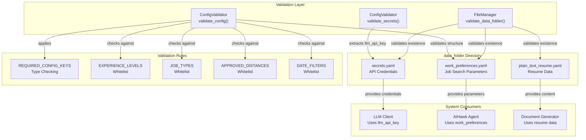
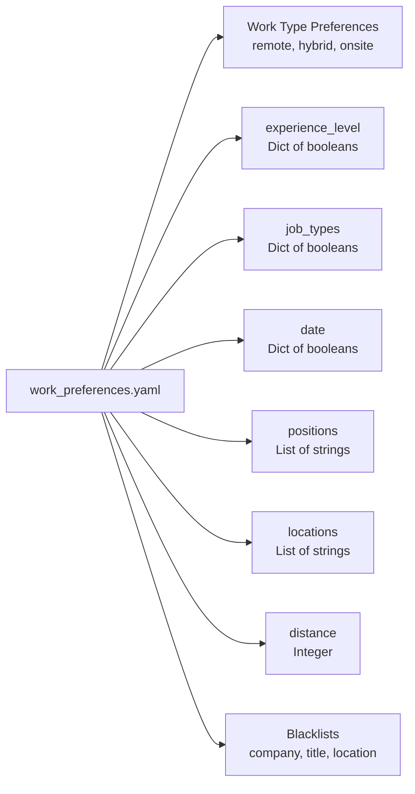
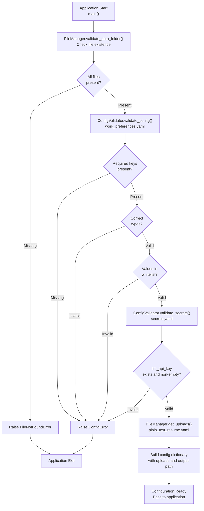

<!-- source: DeepWiki mcp.deepwiki.com · repo feder-cr/Jobs_Applier_AI_Agent_AIHawk · page 3.2 Configuration Files · fetched 2026-10-29 -->

# Configuration Files

<details>
<summary>Relevant source files</summary>

The following files were used as context for generating this wiki page:

- [data_folder/plain_text_resume.yaml](data_folder/plain_text_resume.yaml)
- [data_folder/secrets.yaml](data_folder/secrets.yaml)
- [data_folder/work_preferences.yaml](data_folder/work_preferences.yaml)
- [main.py](main.py)

</details>


This page provides a comprehensive guide to all configuration files required by the AIHawk system. These files control job search parameters, API authentication, and personal resume data. For information about programmatic validation of these files, see [Configuration and Validation](#4.6). For setup instructions, see [Setup and Installation](#3.1).

## Overview

The AIHawk system requires three YAML configuration files located in the `data_folder` directory. These files are validated at startup to ensure correct format and values.

| File | Purpose | Validated By |
|------|---------|--------------|
| `secrets.yaml` | API keys and credentials | `ConfigValidator.validate_secrets()` |
| `work_preferences.yaml` | Job search criteria and preferences | `ConfigValidator.validate_config()` |
| `plain_text_resume.yaml` | User's resume data | `FileManager` and schema classes |

The system validates all required files exist using `FileManager.validate_data_folder()` [main.py:190-207]() and enforces strict validation rules to prevent runtime errors.

**Sources:** [main.py:20-24](), [main.py:187](), [main.py:190-207]()

## Configuration Files Architecture



**Sources:** [main.py:35-181](), [main.py:184-217](), [main.py:527-562]()

## secrets.yaml

The `secrets.yaml` file stores sensitive authentication credentials required for LLM API access. This file should never be committed to version control.

### Structure

```yaml
llm_api_key: 'your-api-key-here'
```

### Required Fields

| Field | Type | Description | Validation |
|-------|------|-------------|------------|
| `llm_api_key` | string | API key for LLM service (OpenAI or OLLAMA) | Must be non-empty |

### Validation Rules

The `ConfigValidator.validate_secrets()` method [main.py:169-181]() enforces:

1. **Existence Check**: The `llm_api_key` field must exist [main.py:175-176]()
2. **Non-Empty Check**: The value cannot be empty or null [main.py:178-179]()
3. **File Existence**: The file itself must exist in the data folder [main.py:84-85]()

### Example

```yaml
llm_api_key: 'sk-proj-abc123xyz789...'
```

**Important:** Keep this file secure and never share it publicly. The API key provides access to paid LLM services.

**Sources:** [data_folder/secrets.yaml:1-2](), [main.py:169-181](), [main.py:536]()

## work_preferences.yaml

The `work_preferences.yaml` file defines job search criteria, filters, and application behavior. This is the most complex configuration file with extensive validation rules.

### Structure Overview

The file is organized into several sections:



**Sources:** [data_folder/work_preferences.yaml:1-47]()

### Required Configuration Keys

The `REQUIRED_CONFIG_KEYS` constant [main.py:39-50]() defines all mandatory fields:

| Key | Type | Description |
|-----|------|-------------|
| `remote` | bool | Whether to include remote jobs |
| `experience_level` | dict | Map of experience levels to boolean flags |
| `job_types` | dict | Map of job types to boolean flags |
| `date` | dict | Map of date filters to boolean flags |
| `positions` | list | List of job titles to search for |
| `locations` | list | List of locations to search in |
| `location_blacklist` | list | Locations to exclude from search |
| `distance` | int | Search radius in miles/kilometers |
| `company_blacklist` | list | Companies to exclude |
| `title_blacklist` | list | Keywords to exclude from job titles |

**Sources:** [main.py:39-50]()

### Experience Level Configuration

The `experience_level` dictionary controls which seniority levels to target.

**Allowed Values** (defined in `EXPERIENCE_LEVELS` [main.py:51-58]()):

| Experience Level | Description |
|------------------|-------------|
| `internship` | Internship positions |
| `entry` | Entry-level positions |
| `associate` | Associate-level positions |
| `mid_senior_level` | Mid to senior-level positions |
| `director` | Director-level positions |
| `executive` | Executive-level positions |

**Example:**
```yaml
experience_level:
  internship: false
  entry: true
  associate: true
  mid_senior_level: true
  director: false
  executive: false
```

**Validation:** Each experience level must be a boolean value [main.py:114-120]().

**Sources:** [main.py:51-58](), [main.py:114-120](), [data_folder/work_preferences.yaml:5-11]()

### Job Types Configuration

The `job_types` dictionary specifies employment types to consider.

**Allowed Values** (defined in `JOB_TYPES` [main.py:59-67]()):

| Job Type | Description |
|----------|-------------|
| `full_time` | Full-time employment |
| `contract` | Contract positions |
| `part_time` | Part-time employment |
| `temporary` | Temporary positions |
| `internship` | Internship positions |
| `other` | Other employment types |
| `volunteer` | Volunteer positions |

**Example:**
```yaml
job_types:
  full_time: true
  contract: false
  part_time: false
  temporary: true
  internship: false
  other: false
  volunteer: true
```

**Validation:** Each job type must be a boolean value [main.py:123-129]().

**Sources:** [main.py:59-67](), [main.py:123-129](), [data_folder/work_preferences.yaml:13-20]()

### Date Filters Configuration

The `date` dictionary controls how recent job postings should be.

**Allowed Values** (defined in `DATE_FILTERS` [main.py:68]()):

| Date Filter | Description |
|-------------|-------------|
| `all_time` | All job postings regardless of age |
| `month` | Jobs posted within the last month |
| `week` | Jobs posted within the last week |
| `24_hours` | Jobs posted within the last 24 hours |

**Example:**
```yaml
date:
  all_time: false
  month: false
  week: false
  24_hours: true
```

**Validation:** Each date filter must be a boolean value [main.py:132-138]().

**Sources:** [main.py:68](), [main.py:132-138](), [data_folder/work_preferences.yaml:22-26]()

### Positions and Locations

**Positions List:**
```yaml
positions:
  - Software engineer
  - Data Scientist
  - Product Manager
```

**Locations List:**
```yaml
locations:
  - Germany
  - United States
  - Remote
```

**Validation:** Both `positions` and `locations` must be lists of strings [main.py:141-147]().

**Sources:** [main.py:141-147](), [data_folder/work_preferences.yaml:28-32]()

### Distance Configuration

The `distance` field specifies the search radius from specified locations.

**Allowed Values** (defined in `APPROVED_DISTANCES` [main.py:69]()):

```
0, 5, 10, 25, 50, 100
```

**Example:**
```yaml
distance: 100
```

**Validation:** Must be one of the approved distance values [main.py:150-155]().

**Sources:** [main.py:69](), [main.py:150-155](), [data_folder/work_preferences.yaml:36]()

### Blacklist Configuration

Three blacklist types allow filtering out unwanted opportunities:

```yaml
company_blacklist:
  - wayfair
  - Crossover

title_blacklist:
  - word1
  - word2

location_blacklist:
  - Brazil
```

**Validation:** 
- All blacklists must be lists [main.py:158-166]()
- If null or missing, automatically initialized to empty list [main.py:94-100]()

**Sources:** [main.py:158-166](), [data_folder/work_preferences.yaml:38-47]()

## plain_text_resume.yaml

The `plain_text_resume.yaml` file contains structured resume data used for generating tailored resumes and cover letters.

### File Structure

```mermaid
graph TB
    RESUME["plain_text_resume.yaml"]
    
    RESUME --> PERSONAL["personal_information<br/>Name, contact, links"]
    RESUME --> EDUCATION["education_details<br/>List of education entries"]
    RESUME --> EXPERIENCE["experience_details<br/>List of work experience"]
    RESUME --> PROJECTS["projects<br/>List of projects"]
    RESUME --> ACHIEVEMENTS["achievements<br/>List of achievements"]
    RESUME --> CERTIFICATIONS["certifications<br/>List of certifications"]
    RESUME --> LANGUAGES["languages<br/>List of languages"]
    RESUME --> INTERESTS["interests<br/>List of interests"]
    RESUME --> AVAILABILITY["availability<br/>Notice period"]
    RESUME --> SALARY["salary_expectations<br/>Salary range"]
    RESUME --> SELF_ID["self_identification<br/>Demographics"]
    RESUME --> LEGAL["legal_authorization<br/>Work authorization"]
    RESUME --> WORK_PREFS["work_preferences<br/>Work style preferences"]
```



**Sources:** [data_folder/plain_text_resume.yaml:1-131]()

### Personal Information Section

Contains basic contact and profile information.

```yaml
personal_information:
  name: "[Your Name]"
  surname: "[Your Surname]"
  date_of_birth: "[Your Date of Birth]"
  country: "[Your Country]"
  city: "[Your City]"
  address: "[Your Address]"
  zip_code: "[Your zip code]"
  phone_prefix: "[Your Phone Prefix]"
  phone: "[Your Phone Number]"
  email: "[Your Email Address]"
  github: "[Your GitHub Profile URL]"
  linkedin: "[Your LinkedIn Profile URL]"
```

**Fields:**

| Field | Description |
|-------|-------------|
| `name` | First name |
| `surname` | Last name |
| `date_of_birth` | Date of birth |
| `country` | Country of residence |
| `city` | City of residence |
| `address` | Street address |
| `zip_code` | Postal code |
| `phone_prefix` | International phone prefix (e.g., "+1") |
| `phone` | Phone number |
| `email` | Email address |
| `github` | GitHub profile URL (optional) |
| `linkedin` | LinkedIn profile URL (optional) |

**Sources:** [data_folder/plain_text_resume.yaml:1-13]()

### Education Details Section

List of educational qualifications with detailed exam grades.

```yaml
education_details:
  - education_level: "[Your Education Level]"
    institution: "[Your Institution]"
    field_of_study: "[Your Field of Study]"
    final_evaluation_grade: "[Your Final Evaluation Grade]"
    start_date: "[Start Date]"
    year_of_completion: "[Year of Completion]"
    exam:
      exam_name_1: "[Grade]"
      exam_name_2: "[Grade]"
      # ... additional exams
```

**Structure:**
- **List Entry**: Each education entry is a list item
- **Exams**: Nested dictionary of exam names to grades

**Sources:** [data_folder/plain_text_resume.yaml:15-28]()

### Experience Details Section

List of work experience entries with responsibilities and skills.

```yaml
experience_details:
  - position: "[Your Position]"
    company: "[Company Name]"
    employment_period: "[Employment Period]"
    location: "[Location]"
    industry: "[Industry]"
    key_responsibilities:
      - responsibility_1: "[Responsibility Description]"
      - responsibility_2: "[Responsibility Description]"
      - responsibility_3: "[Responsibility Description]"
    skills_acquired:
      - "[Skill]"
      - "[Skill]"
      - "[Skill]"
```

**Structure:**
- **List Entry**: Each job is a list item
- **Key Responsibilities**: List of dictionary items describing responsibilities
- **Skills Acquired**: Simple list of skills gained

**Sources:** [data_folder/plain_text_resume.yaml:30-57]()

### Projects Section

List of personal or professional projects.

```yaml
projects:
  - name: "[Project Name]"
    description: "[Project Description]"
    link: "[Project Link]"
```

**Sources:** [data_folder/plain_text_resume.yaml:59-66]()

### Achievements Section

List of notable accomplishments.

```yaml
achievements:
  - name: "[Achievement Name]"
    description: "[Achievement Description]"
```

**Sources:** [data_folder/plain_text_resume.yaml:68-72]()

### Certifications Section

List of professional certifications.

```yaml
certifications:
  - name: "[Certification Name]"
    description: "[Certification Description]"
```

**Sources:** [data_folder/plain_text_resume.yaml:74-78]()

### Languages Section

List of languages with proficiency levels.

```yaml
languages:
  - language: "[Language]"
    proficiency: "[Proficiency Level]"
```

**Common Proficiency Levels:**
- Native
- Fluent
- Advanced
- Intermediate
- Basic

**Sources:** [data_folder/plain_text_resume.yaml:80-84]()

### Additional Sections

**Interests:**
```yaml
interests:
  - "[Interest]"
  - "[Interest]"
```

**Availability:**
```yaml
availability:
  notice_period: "[Notice Period]"
```

**Salary Expectations:**
```yaml
salary_expectations:
  salary_range_usd: "[Salary Range]"
```

**Sources:** [data_folder/plain_text_resume.yaml:86-95]()

### Self Identification Section

Demographic information for applications requiring EEO data.

```yaml
self_identification:
  gender: "[Gender]"
  pronouns: "[Pronouns]"
  veteran: "[Yes/No]"
  disability: "[Yes/No]"
  ethnicity: "[Ethnicity]"
```

**Sources:** [data_folder/plain_text_resume.yaml:97-102]()

### Legal Authorization Section

Work authorization status for various countries.

```yaml
legal_authorization:
  eu_work_authorization: "[Yes/No]"
  us_work_authorization: "[Yes/No]"
  requires_us_visa: "[Yes/No]"
  requires_us_sponsorship: "[Yes/No]"
  requires_eu_visa: "[Yes/No]"
  legally_allowed_to_work_in_eu: "[Yes/No]"
  legally_allowed_to_work_in_us: "[Yes/No]"
  requires_eu_sponsorship: "[Yes/No]"
  canada_work_authorization: "[Yes/No]"
  requires_canada_visa: "[Yes/No]"
  legally_allowed_to_work_in_canada: "[Yes/No]"
  requires_canada_sponsorship: "[Yes/No]"
  uk_work_authorization: "[Yes/No]"
  requires_uk_visa: "[Yes/No]"
  legally_allowed_to_work_in_uk: "[Yes/No]"
  requires_uk_sponsorship: "[Yes/No]"
```

**Supported Regions:**
- European Union (EU)
- United States (US)
- Canada
- United Kingdom (UK)

**Sources:** [data_folder/plain_text_resume.yaml:105-121]()

### Work Preferences Section

Personal work style preferences.

```yaml
work_preferences:
  remote_work: "[Yes/No]"
  in_person_work: "[Yes/No]"
  open_to_relocation: "[Yes/No]"
  willing_to_complete_assessments: "[Yes/No]"
  willing_to_undergo_drug_tests: "[Yes/No]"
  willing_to_undergo_background_checks: "[Yes/No]"
```

**Note:** This section is distinct from the top-level `work_preferences.yaml` file. This section describes personal preferences while `work_preferences.yaml` defines job search parameters.

**Sources:** [data_folder/plain_text_resume.yaml:124-131]()

## Validation Flow

The following diagram shows how configuration files flow through the validation system:



**Sources:** [main.py:527-562]()

## Configuration Loading Process

The `main()` function [main.py:527-562]() orchestrates the configuration loading:

1. **Define Data Folder**: Set the data folder path [main.py:531]()
2. **Validate Folder Structure**: Call `FileManager.validate_data_folder()` [main.py:532]()
3. **Validate Work Preferences**: Call `ConfigValidator.validate_config()` [main.py:535]()
4. **Validate Secrets**: Call `ConfigValidator.validate_secrets()` [main.py:536]()
5. **Get Resume Uploads**: Call `FileManager.get_uploads()` [main.py:539]()
6. **Build Configuration Object**: Merge all validated data [main.py:539-540]()

### Configuration Object Structure

After validation, the configuration object contains:

```python
{
    # From work_preferences.yaml
    "remote": bool,
    "experience_level": dict,
    "job_types": dict,
    "date": dict,
    "positions": list,
    "locations": list,
    "distance": int,
    "company_blacklist": list,
    "title_blacklist": list,
    "location_blacklist": list,
    
    # Added by FileManager
    "uploads": {
        "plainTextResume": Path
    },
    "outputFileDirectory": Path
}
```

The `llm_api_key` is extracted separately and passed to components that need it [main.py:536]().

**Sources:** [main.py:527-546]()

## Error Handling

The system provides detailed error messages for configuration issues:

### ConfigError

Raised when configuration files have validation errors [main.py:30-32]().

**Common Causes:**
- Missing required keys [main.py:97]()
- Invalid data types [main.py:102-104]()
- Invalid experience levels [main.py:118-120]()
- Invalid job types [main.py:126-128]()
- Invalid date filters [main.py:135-137]()
- Invalid distance value [main.py:153-155]()
- Empty API key [main.py:178-179]()

### FileNotFoundError

Raised when required files are missing [main.py:554-556]().

**Common Causes:**
- `data_folder` directory doesn't exist [main.py:192-193]()
- Configuration files missing from `data_folder` [main.py:195-197]()
- `plain_text_resume.yaml` not found [main.py:212-213]()

### Error Messages

All errors include references to the configuration guide [main.py:551-553]():

```python
logger.error(
    "Refer to the configuration guide for troubleshooting: "
    "https://github.com/feder-cr/Auto_Jobs_Applier_AIHawk?tab=readme-ov-file#configuration"
)
```

**Sources:** [main.py:30-32](), [main.py:548-561]()

## File Location Requirements

All configuration files must be located in the `data_folder` directory at the project root:

```
project_root/
├── data_folder/
│   ├── secrets.yaml           # Required
│   ├── work_preferences.yaml  # Required
│   ├── plain_text_resume.yaml # Required
│   └── output/                # Created automatically
└── main.py
```

The `output` folder is created automatically if it doesn't exist [main.py:199-200]().

**Sources:** [main.py:20-24](), [main.py:199-200](), [main.py:531-532]()

## Best Practices

### Security

1. **Never commit** `secrets.yaml` to version control
2. Add `data_folder/secrets.yaml` to `.gitignore`
3. Use environment-specific API keys for different deployments

### Configuration Management

1. **Validate before running**: The system validates automatically, but check configurations manually first
2. **Start conservatively**: Begin with narrow search criteria (specific positions/locations) before expanding
3. **Use blacklists effectively**: Add companies or keywords that consistently produce poor matches
4. **Review distance settings**: Larger distances increase results but may reduce relevance

### Resume Data

1. **Be specific**: Include detailed descriptions for better LLM tailoring
2. **Keep updated**: Regularly update experience and skills
3. **Use consistent formatting**: Follow the provided structure exactly
4. **Include all sections**: Even if minimal, populate all sections for complete documents

**Sources:** [main.py:527-562](), [data_folder/plain_text_resume.yaml:1-131](), [data_folder/work_preferences.yaml:1-47]()

---

