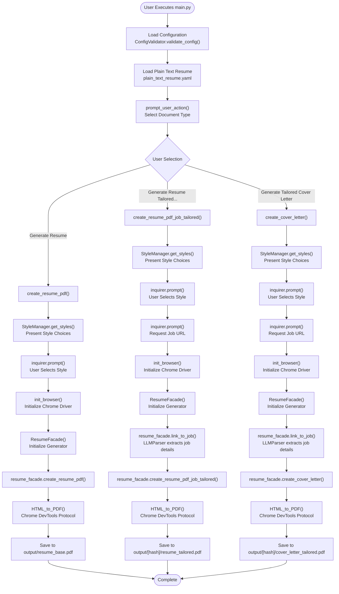
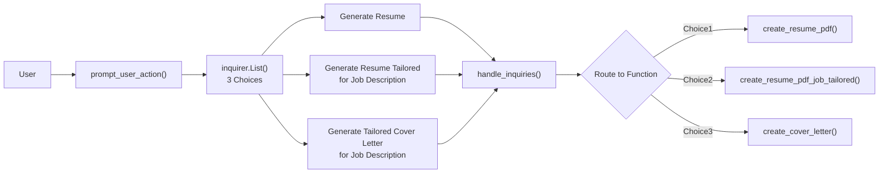
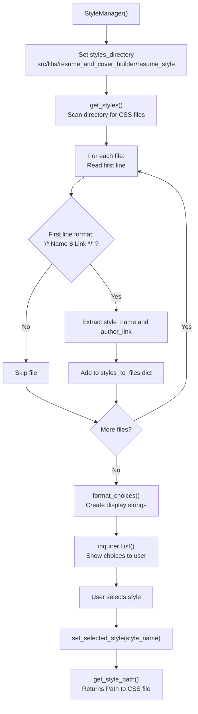
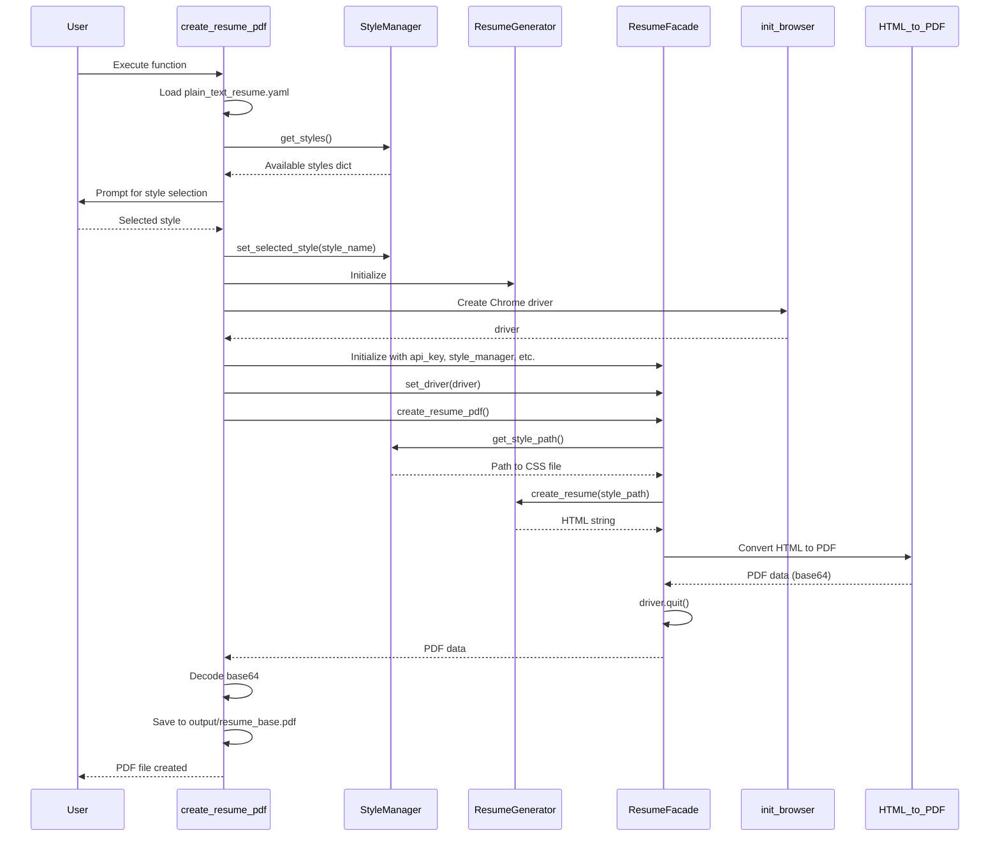
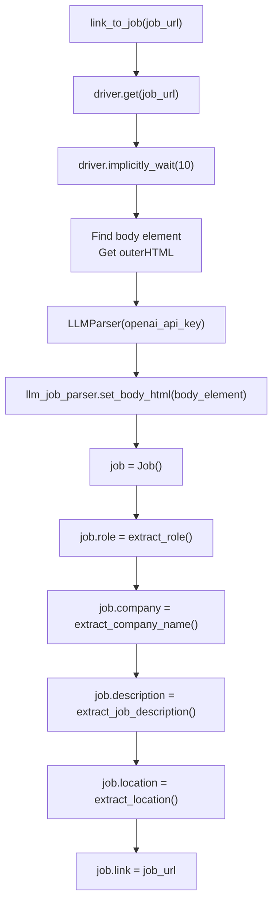
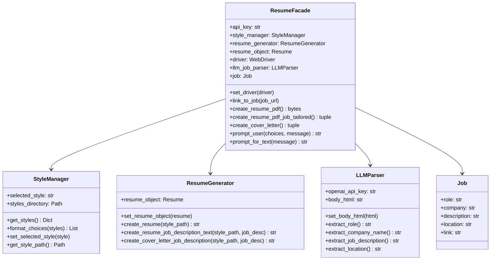

<!-- source: DeepWiki mcp.deepwiki.com · repo feder-cr/Jobs_Applier_AI_Agent_AIHawk · page 3.3 Generating Documents · fetched 2026-10-29 -->

# Generating Documents

<details>
<summary>Relevant source files</summary>

The following files were used as context for generating this wiki page:

- [main.py](main.py)
- [src/libs/resume_and_cover_builder/resume_facade.py](src/libs/resume_and_cover_builder/resume_facade.py)
- [src/libs/resume_and_cover_builder/style_manager.py](src/libs/resume_and_cover_builder/style_manager.py)

</details>


## Purpose and Scope

This page provides a comprehensive guide for generating professional resumes and cover letters using the AIHawk document generation system. It covers the three document types available (general resume, job-tailored resume, and cover letter), the style selection process, and step-by-step instructions for creating each document type.

For information about the underlying architecture and technical implementation details, see [Document Generation Architecture](#4.1). For details on configuring the system before generating documents, see [Configuration Files](#3.2).

Sources: [main.py:220-468](), [src/libs/resume_and_cover_builder/resume_facade.py:1-153]()

---

## Document Types

The system supports three distinct document types, each serving a different purpose in the job application process:

| Document Type | Function Name | Description | Requires Job URL |
|--------------|---------------|-------------|------------------|
| **General Resume** | `create_resume_pdf` | Generates a professionally formatted resume from your plain text resume data without job-specific tailoring | No |
| **Job-Tailored Resume** | `create_resume_pdf_job_tailored` | Creates a resume customized to match a specific job posting, emphasizing relevant experience and skills | Yes |
| **Cover Letter** | `create_cover_letter` | Generates a personalized cover letter addressing the specific job and company | Yes |

All three document types use your `plain_text_resume.yaml` as the source data and apply LLM-powered content generation to produce professional PDF outputs.

Sources: [main.py:392-468](), [main.py:307-389](), [main.py:220-304]()

---

## Generation Workflow Overview



**Figure 1: Document Generation Workflow**

This diagram illustrates the complete user journey from starting the application to receiving a generated PDF document. The workflow branches based on the document type selected and includes interactive prompts for style selection and job URL input where required.

Sources: [main.py:527-562](), [main.py:471-497](), [main.py:499-524]()

---

## Interactive Selection Process

When you run the main application, you are presented with an interactive menu powered by the `inquirer` library. This menu allows you to select which document type to generate.



**Figure 2: User Action Selection Flow**

Sources: [main.py:499-524](), [main.py:471-497]()

---

## Style Selection

All document types require you to select a visual style before generation. The `StyleManager` class scans the `resume_style` directory for available CSS templates.

### How Style Selection Works



**Figure 3: Style Selection Process**

### Style File Format

Each style CSS file must begin with a special comment on the first line that defines the style name and author:

```
/* Style Name $ Author Link */
```

For example:
```
/* Professional Modern $ https://github.com/username */
```

The `StyleManager` parses this metadata to present formatted choices to the user in the format: `"Style Name (style author -> Author Link)"`.

Sources: [src/libs/resume_and_cover_builder/style_manager.py:10-89](), [main.py:231-255]()

---

## Generating a General Resume

A general resume is created without reference to any specific job posting. It provides a clean, professional presentation of your complete resume data.

### Step-by-Step Process

1. **Configuration Loading**: The system reads `plain_text_resume.yaml` containing your resume data
2. **Style Selection**: You are prompted to select a visual style from available templates
3. **Browser Initialization**: Chrome WebDriver is initialized via `init_browser()`
4. **Resume Generation**: The `ResumeGenerator` class processes your resume data using LLM
5. **PDF Conversion**: The generated HTML is converted to PDF using Chrome DevTools Protocol
6. **File Saving**: The PDF is saved as `resume_base.pdf` in the output directory

### Code Flow



**Figure 4: General Resume Generation Sequence**

### Output Location

The generated PDF is saved at:
```
data_folder/output/resume_base.pdf
```

Sources: [main.py:392-468](), [src/libs/resume_and_cover_builder/resume_facade.py:113-129]()

---

## Generating a Job-Tailored Resume

A job-tailored resume analyzes a specific job posting and customizes your resume to emphasize the most relevant skills, experiences, and qualifications for that position.

### Step-by-Step Process

1. **Style Selection**: You select a visual style (same as general resume)
2. **Job URL Input**: You provide the URL of the job posting
3. **Job Parsing**: The system uses `LLMParser` to extract key information from the job page:
   - Job role/title
   - Company name
   - Job description
   - Location
4. **Content Tailoring**: The LLM analyzes your resume data against the job requirements
5. **Resume Generation**: A customized resume HTML is generated emphasizing relevant experience
6. **PDF Conversion**: The HTML is converted to PDF
7. **File Saving**: The PDF is saved in a unique directory based on the job URL hash

### Code Flow



```mermaid
flowchart TD
    Start["create_resume_pdf_job_tailored()"] --> LoadResume["Load plain_text_resume.yaml"]
    LoadResume --> SelectStyle["StyleManager: Select style"]
    SelectStyle --> PromptURL["inquirer.Text()<br/>Prompt for job URL"]
    
    PromptURL --> InitComponents["Initialize:<br/>- ResumeGenerator<br/>- Resume object<br/>- Chrome driver"]
    
    InitComponents --> CreateFacade["Create ResumeFacade with:<br/>- api_key<br/>- style_manager<br/>- resume_generator<br/>- resume_object"]
    
    CreateFacade --> SetDriver["resume_facade.set_driver(driver)"]
    SetDriver --> LinkJob["resume_facade.link_to_job(job_url)"]
    
    LinkJob --> FetchPage["driver.get(job_url)<br/>Retrieve job page HTML"]
    FetchPage --> ExtractHTML["Get body.outerHTML"]
    ExtractHTML --> InitParser["LLMParser(openai_api_key)"]
    
    InitParser --> ParseJob["LLMParser extracts:<br/>- role<br/>- company<br/>- description<br/>- location"]
    
    ParseJob --> StoreJob["Store in Job object"]
    StoreJob --> Generate["resume_facade.create_resume_pdf_job_tailored()"]
    
    Generate --> GetStylePath["style_manager.get_style_path()"]
    GetStylePath --> CreateHTML["resume_generator.create_resume_job_description_text()"]
    
    CreateHTML --> GenHash["Generate MD5 hash of job URL<br/>First 10 chars as suggested_name"]
    GenHash --> ConvertPDF["HTML_to_PDF(html_resume, driver)"]
    ConvertPDF --> QuitDriver["driver.quit()"]
    
    QuitDriver --> ReturnData["Return (base64_pdf, suggested_name)"]
    ReturnData --> DecodeB64["Decode base64 to binary"]
    DecodeB64 --> CreateDir["Create output_dir/<br/>suggested_name/"]
    CreateDir --> SaveFile["Save to<br/>resume_tailored.pdf"]
```

**Figure 5: Job-Tailored Resume Generation Flow**

### Job Information Extraction

The `link_to_job()` method in `ResumeFacade` performs the job parsing:



**Figure 6: Job Information Extraction Process**

### Output Location

The generated PDF is saved at:
```
data_folder/output/[10-char-hash]/resume_tailored.pdf
```

Where `[10-char-hash]` is the first 10 characters of the MD5 hash of the job URL, ensuring unique directories for each job application.

Sources: [main.py:307-389](), [src/libs/resume_and_cover_builder/resume_facade.py:71-109]()

---

## Generating a Cover Letter

A cover letter is a personalized document that addresses the specific company and role, highlighting why you are an excellent candidate for the position.

### Step-by-Step Process

The cover letter generation process is nearly identical to the job-tailored resume, with the key difference being the final generation method called:

1. **Style Selection**: Select visual style
2. **Job URL Input**: Provide job posting URL
3. **Job Parsing**: Extract job details using `LLMParser`
4. **Cover Letter Generation**: Generate personalized cover letter text
5. **PDF Conversion**: Convert to PDF
6. **File Saving**: Save to unique directory

### Code Flow

The flow is similar to the job-tailored resume but calls different generation methods:

- Instead of `resume_facade.create_resume_pdf_job_tailored()`, it calls `resume_facade.create_cover_letter()`
- Instead of `resume_generator.create_resume_job_description_text()`, it uses `resume_generator.create_cover_letter_job_description()`

```mermaid
graph LR
    CreateCoverLetter["create_cover_letter()"] --> LinkJob["link_to_job(job_url)"]
    LinkJob --> ParseJob["LLMParser extracts job details"]
    ParseJob --> GenerateCL["resume_facade.create_cover_letter()"]
    
    GenerateCL --> GetStyle["style_manager.get_style_path()"]
    GetStyle --> GenHTML["resume_generator.create_cover_letter_job_description()"]
    GenHTML --> Hash["Generate MD5 hash"]
    Hash --> Convert["HTML_to_PDF()"]
    Convert --> Save["Save to output/[hash]/cover_letter_tailored.pdf"]
```



**Figure 7: Cover Letter Generation Flow**

### Output Location

The generated PDF is saved at:
```
data_folder/output/[10-char-hash]/cover_letter_tailored.pdf
```

Sources: [main.py:220-304](), [src/libs/resume_and_cover_builder/resume_facade.py:131-153]()

---

## Component Interactions

This diagram shows how the key components interact during document generation, bridging the user-facing process to the underlying code classes:

```mermaid
graph TB
    subgraph "main.py Entry Points"
        CreateResume["create_resume_pdf()"]
        CreateTailored["create_resume_pdf_job_tailored()"]
        CreateCover["create_cover_letter()"]
    end
    
    subgraph "User Input via inquirer"
        StylePrompt["inquirer.List<br/>Style Selection"]
        URLPrompt["inquirer.Text<br/>Job URL Input"]
    end
    
    subgraph "Style Management"
        SM["StyleManager"]
        GetStyles["get_styles()"]
        SetStyle["set_selected_style()"]
        GetPath["get_style_path()"]
    end
    
    subgraph "Resume Processing"
        RG["ResumeGenerator"]
        RO["Resume(plain_text_resume)"]
        CreateR["create_resume()"]
        CreateRJ["create_resume_job_description_text()"]
        CreateCL["create_cover_letter_job_description()"]
    end
    
    subgraph "Facade Layer"
        RF["ResumeFacade"]
        LinkJob["link_to_job()"]
        CreateResPDF["create_resume_pdf()"]
        CreateResTailored["create_resume_pdf_job_tailored()"]
        CreateCoverPDF["create_cover_letter()"]
    end
    
    subgraph "Job Parsing"
        Parser["LLMParser"]
        ExtractRole["extract_role()"]
        ExtractCompany["extract_company_name()"]
        ExtractDesc["extract_job_description()"]
        JobObj["Job object"]
    end
    
    subgraph "Browser & PDF"
        InitBrowser["init_browser()"]
        Driver["Chrome WebDriver"]
        H2P["HTML_to_PDF()"]
    end
    
    subgraph "Output"
        FileSystem["File System<br/>data_folder/output/"]
    end
    
    CreateResume --> StylePrompt
    CreateTailored --> StylePrompt
    CreateTailored --> URLPrompt
    CreateCover --> StylePrompt
    CreateCover --> URLPrompt
    
    StylePrompt --> SM
    SM --> GetStyles
    SM --> SetStyle
    SM --> GetPath
    
    CreateResume --> InitBrowser
    CreateTailored --> InitBrowser
    CreateCover --> InitBrowser
    InitBrowser --> Driver
    
    CreateResume --> RF
    CreateTailored --> RF
    CreateCover --> RF
    
    RF --> RG
    RG --> CreateR
    RG --> CreateRJ
    RG --> CreateCL
    
    CreateTailored --> LinkJob
    CreateCover --> LinkJob
    LinkJob --> Driver
    LinkJob --> Parser
    Parser --> ExtractRole
    Parser --> ExtractCompany
    Parser --> ExtractDesc
    Parser --> JobObj
    
    RF --> CreateResPDF
    RF --> CreateResTailored
    RF --> CreateCoverPDF
    
    CreateResPDF --> H2P
    CreateResTailored --> H2P
    CreateCoverPDF --> H2P
    
    H2P --> Driver
    H2P --> FileSystem
```



**Figure 8: Component Interaction Map**

This diagram maps the high-level user-facing functions to the specific classes and methods they utilize, making it easier to locate relevant code when troubleshooting or extending functionality.

Sources: [main.py:220-468](), [src/libs/resume_and_cover_builder/resume_facade.py:16-153](), [src/libs/resume_and_cover_builder/style_manager.py:10-89]()

---

## File Output Structure

The system organizes generated documents in a structured directory hierarchy:

```
data_folder/
└── output/
    ├── resume_base.pdf                    # General resume
    ├── [job-hash-1]/                      # Unique per job URL
    │   ├── resume_tailored.pdf            # Job-tailored resume
    │   └── cover_letter_tailored.pdf      # Cover letter
    └── [job-hash-2]/                      # Another job application
        ├── resume_tailored.pdf
        └── cover_letter_tailored.pdf
```

### Hash Generation

For job-specific documents, the system creates a unique directory name using MD5 hashing:

1. The job URL is encoded to bytes
2. An MD5 hash is computed
3. The first 10 characters of the hex digest are used as the directory name

This ensures that documents for the same job are grouped together while maintaining unique directories for different job postings.

Sources: [main.py:284-301](), [main.py:369-386](), [src/libs/resume_and_cover_builder/resume_facade.py:105](), [src/libs/resume_and_cover_builder/resume_facade.py:148]()

---

## Common Workflows

### Workflow 1: Creating Your Base Resume

```
1. Run: python main.py
2. Select: "Generate Resume"
3. Choose a style from the presented list
4. Wait for generation to complete
5. Find output at: data_folder/output/resume_base.pdf
```

### Workflow 2: Applying to a Specific Job

```
1. Run: python main.py
2. Select: "Generate Resume Tailored for Job Description"
3. Choose a style
4. Enter the job posting URL when prompted
5. Wait for job parsing and generation
6. Find output at: data_folder/output/[hash]/resume_tailored.pdf

7. Run: python main.py again (or continue if in a loop)
8. Select: "Generate Tailored Cover Letter for Job Description"
9. Choose a style
10. Enter the same job posting URL
11. Find output at: data_folder/output/[hash]/cover_letter_tailored.pdf
```

### Workflow 3: Testing Different Styles

```
1. Run: python main.py
2. Select: "Generate Resume"
3. Choose style A
4. Review the generated PDF
5. Run again and choose style B
6. Compare the results
```

Sources: [main.py:527-562](), [main.py:471-497]()

---

## Error Handling

The document generation functions include comprehensive error handling:

| Error Type | Handling Approach | Example |
|------------|------------------|---------|
| **Missing Files** | Caught by `FileManager.validate_data_folder()` before generation starts | Plain text resume file not found |
| **Invalid Configuration** | Caught by `ConfigValidator` during initialization | Invalid API key in secrets.yaml |
| **Base64 Decode Errors** | Caught and logged during PDF data processing | Corrupted PDF data from HTML_to_PDF |
| **File Write Errors** | Caught with IOError handling when saving PDFs | Permission denied on output directory |
| **Browser Errors** | Driver initialization failures logged | Chrome driver not found |
| **LLM Errors** | API errors during content generation | Invalid API key or rate limit exceeded |

All exceptions are logged with detailed error messages and stack traces to aid in troubleshooting.

Sources: [main.py:277-304](), [main.py:362-389](), [main.py:448-468]()

---

## Prerequisites

Before generating documents, ensure:

1. **Configuration Files** exist and are valid (see [Configuration Files](#3.2)):
   - `data_folder/secrets.yaml` with valid `llm_api_key`
   - `data_folder/plain_text_resume.yaml` with your resume data
   - `data_folder/work_preferences.yaml` (required by validation)

2. **Chrome WebDriver** is accessible:
   - The system uses `webdriver_manager` to automatically download the driver
   - Ensure Chrome browser is installed on your system

3. **Network Access**:
   - Internet connection for LLM API calls
   - Access to job posting URLs (for tailored documents)

4. **Output Directory**:
   - Write permissions on `data_folder/output/`
   - Sufficient disk space for generated PDFs

Sources: [main.py:527-562](), [main.py:184-217]()

---

## Advanced: Resume Facade Architecture

The `ResumeFacade` class serves as the primary interface for document generation, encapsulating the complexity of the generation pipeline:



**Figure 9: ResumeFacade Class Relationships**

The facade pattern simplifies the client code in `main.py` by providing a unified interface for all document generation operations while managing the complexity of coordinating multiple subsystems.

Sources: [src/libs/resume_and_cover_builder/resume_facade.py:16-153]()

---

