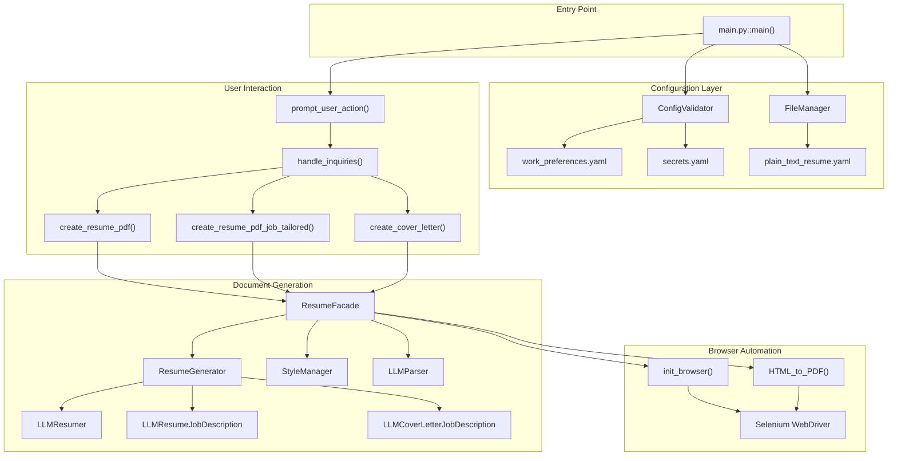
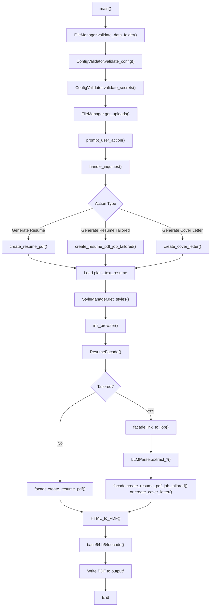
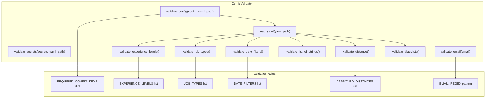
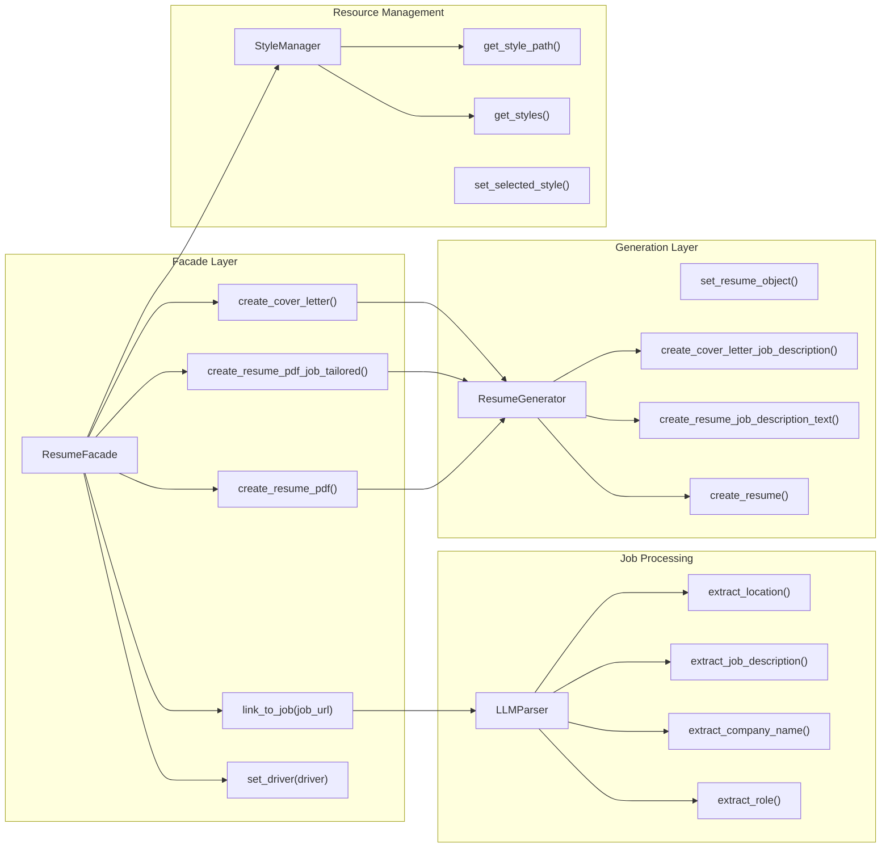
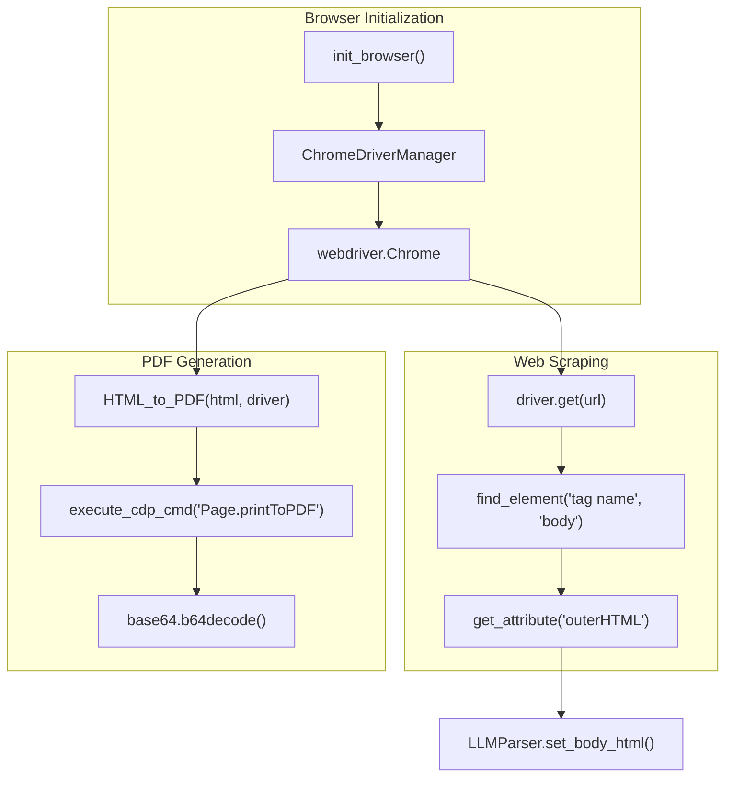
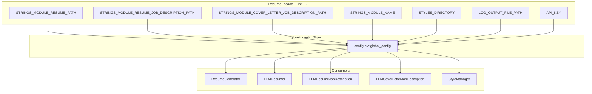
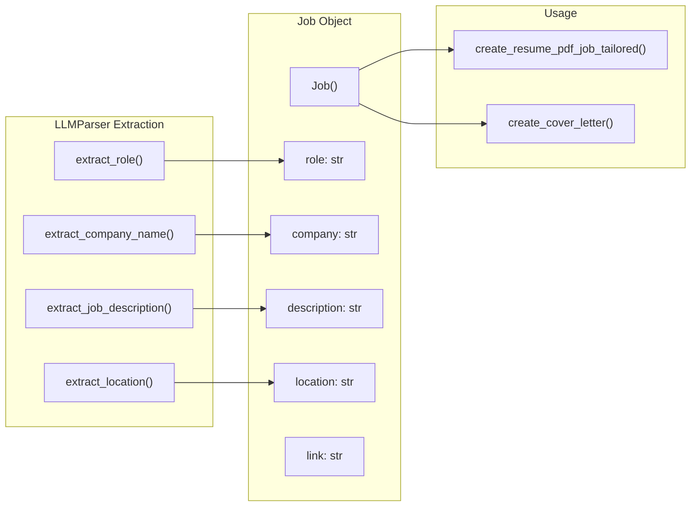
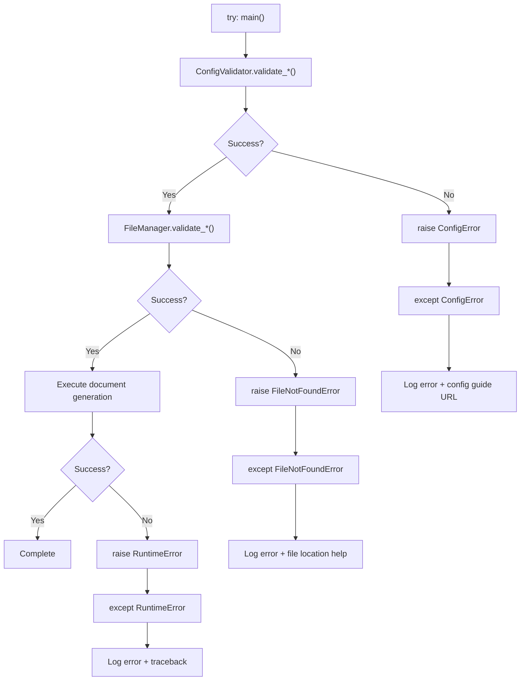

<!-- source: DeepWiki mcp.deepwiki.com · repo feder-cr/Jobs_Applier_AI_Agent_AIHawk · page 4 Development Guide · fetched 2026-10-29 -->

# Development Guide

<details>
<summary>Relevant source files</summary>

The following files were used as context for generating this wiki page:

- [main.py](main.py)
- [src/libs/resume_and_cover_builder/resume_facade.py](src/libs/resume_and_cover_builder/resume_facade.py)

</details>


This guide provides technical documentation for developers who want to understand, modify, or extend the AIHawk system. It covers the core architecture, key design patterns, component interactions, and extension points.

For end-user instructions on installing and configuring the system, see [User Guide](#3). For comprehensive architectural documentation, see [System Architecture](#2).

## Purpose and Scope

This document serves as the primary technical reference for developers working with the AIHawk codebase. It explains:

- Core architectural patterns and design decisions
- How components are wired together and communicate
- Entry points for common development tasks
- Code organization and key classes
- Extension mechanisms for adding new functionality

Detailed documentation on specific subsystems is available in the following child pages:
- [Document Generation Architecture](#4.1) - Deep dive into `ResumeFacade`, `ResumeGenerator`, and the generation pipeline
- [Prompt Engineering](#4.2) - LLM prompt template system and customization
- [Job Description Processing](#4.3) - How job descriptions are parsed and processed
- [Style Management System](#4.4) - Style discovery, selection, and CSS integration
- [LLM Components](#4.5) - Technical details on LLM integration classes
- [Configuration and Validation](#4.6) - Configuration flow and validation rules
- [Extending the System](#4.7) - Guide for adding new features

---

## System Architecture Overview

The AIHawk system is structured around three primary subsystems that collaborate through well-defined interfaces:



**Sources:** [main.py:1-566](), [src/libs/resume_and_cover_builder/resume_facade.py:1-153]()

---

## Main Execution Flow

The `main.py` file serves as the application's entry point and orchestrates the entire execution flow:



**Sources:** [main.py:527-566](), [main.py:471-497](), [main.py:392-468]()

### Key Entry Points

| Function | Line Range | Purpose |
|----------|-----------|---------|
| `main()` | [main.py:527-566]() | Application entry point, coordinates validation and user interaction |
| `prompt_user_action()` | [main.py:499-524]() | Interactive prompt for user action selection |
| `handle_inquiries()` | [main.py:471-497]() | Routes user actions to appropriate document generation functions |
| `create_resume_pdf()` | [main.py:392-468]() | Generates basic resume PDF |
| `create_resume_pdf_job_tailored()` | [main.py:307-389]() | Generates job-tailored resume PDF |
| `create_cover_letter()` | [main.py:220-304]() | Generates job-tailored cover letter PDF |

**Sources:** [main.py:1-566]()

---

## Configuration and Validation System

The configuration system uses two specialized classes to ensure data integrity before any processing begins:

### ConfigValidator Class

The `ConfigValidator` class provides static validation methods for all configuration files:



| Class Attribute | Type | Purpose |
|----------------|------|---------|
| `EMAIL_REGEX` | `re.Pattern` | Email address validation pattern |
| `REQUIRED_CONFIG_KEYS` | `dict[str, type]` | Maps config keys to expected types |
| `EXPERIENCE_LEVELS` | `list[str]` | Valid experience level values |
| `JOB_TYPES` | `list[str]` | Valid job type values |
| `DATE_FILTERS` | `list[str]` | Valid date filter values |
| `APPROVED_DISTANCES` | `set[int]` | Valid distance values in miles |

**Sources:** [main.py:35-182]()

### FileManager Class

The `FileManager` class handles file system operations and path validation:

| Method | Parameters | Returns | Purpose |
|--------|-----------|---------|---------|
| `validate_data_folder()` | `app_data_folder: Path` | `Tuple[Path, Path, Path, Path]` | Validates data folder structure and returns paths to config files |
| `get_uploads()` | `plain_text_resume_file: Path` | `Dict[str, Path]` | Creates file path mappings for upload operations |

**Sources:** [main.py:184-217]()

---

## Document Generation Pipeline

The document generation system is built around three core classes that work together to produce customized PDFs:



### ResumeFacade

The `ResumeFacade` class coordinates all document generation operations. It initializes global configuration, manages the browser driver, and provides high-level methods for creating documents.

**Key Responsibilities:**
- Initialize global configuration paths ([resume_facade.py:27-34]())
- Manage browser driver lifecycle ([resume_facade.py:40-41]())
- Parse job postings via `LLMParser` ([resume_facade.py:71-85]())
- Coordinate document generation and PDF conversion ([resume_facade.py:88-153]())

**Constructor Parameters:**
- `api_key: str` - OpenAI API key for LLM operations
- `style_manager: StyleManager` - Manages CSS styles
- `resume_generator: ResumeGenerator` - Generates HTML content
- `resume_object: Resume` - User's resume data
- `output_path: Path` - Directory for output files

**Sources:** [src/libs/resume_and_cover_builder/resume_facade.py:16-153]()

### Document Generation Methods

| Method | Returns | Purpose |
|--------|---------|---------|
| `link_to_job(job_url)` | `None` | Scrapes and parses job posting into `Job` object |
| `create_resume_pdf()` | `bytes` | Generates basic resume PDF |
| `create_resume_pdf_job_tailored()` | `tuple[bytes, str]` | Generates job-tailored resume with unique filename |
| `create_cover_letter()` | `tuple[bytes, str]` | Generates job-tailored cover letter with unique filename |

**Sources:** [src/libs/resume_and_cover_builder/resume_facade.py:71-153]()

---

## Browser Automation System

The system uses Selenium WebDriver for two critical functions: web scraping and PDF generation.



### Key Functions

**`init_browser()`**
- Initializes Chrome WebDriver with headless configuration
- Sets up Chrome options for PDF generation
- Returns configured `webdriver.Chrome` instance
- Located in `src/utils/chrome_utils.py`

**`HTML_to_PDF(html_content, driver)`**
- Converts HTML string to PDF using Chrome DevTools Protocol
- Uses `Page.printToPDF` CDP command
- Returns base64-encoded PDF data
- Configured for A4 page size with proper margins
- Located in `src/utils/chrome_utils.py`

**Sources:** [src/libs/resume_and_cover_builder/resume_facade.py:40-41](), [src/libs/resume_and_cover_builder/resume_facade.py:71-77](), [src/libs/resume_and_cover_builder/resume_facade.py:107-108]()

---

## Global Configuration Pattern

The system uses a singleton configuration object (`global_config`) to share settings across modules:



### Configuration Attributes

| Attribute | Type | Set By | Used By |
|-----------|------|--------|---------|
| `STRINGS_MODULE_RESUME_PATH` | `Path` | `ResumeFacade.__init__()` | `LLMResumer` |
| `STRINGS_MODULE_RESUME_JOB_DESCRIPTION_PATH` | `Path` | `ResumeFacade.__init__()` | `LLMResumeJobDescription` |
| `STRINGS_MODULE_COVER_LETTER_JOB_DESCRIPTION_PATH` | `Path` | `ResumeFacade.__init__()` | `LLMCoverLetterJobDescription` |
| `STRINGS_MODULE_NAME` | `str` | `ResumeFacade.__init__()` | All LLM components |
| `STYLES_DIRECTORY` | `Path` | `ResumeFacade.__init__()` | `StyleManager` |
| `LOG_OUTPUT_FILE_PATH` | `Path` | `ResumeFacade.__init__()` | Logging system |
| `API_KEY` | `str` | `ResumeFacade.__init__()` | All LLM components |

**Sources:** [src/libs/resume_and_cover_builder/resume_facade.py:27-34]()

---

## Job Object Structure

When processing job-tailored documents, the system populates a `Job` object with extracted information:



**Sources:** [src/libs/resume_and_cover_builder/resume_facade.py:79-84]()

---

## Error Handling Patterns

The system uses custom exceptions and comprehensive error handling:

### ConfigError Exception

Custom exception class for configuration-related errors:

```python
class ConfigError(Exception):
    """Custom exception for configuration-related errors."""
    pass
```

**Raised By:**
- `ConfigValidator.load_yaml()` - YAML parsing errors
- `ConfigValidator.validate_config()` - Invalid configuration values
- `ConfigValidator.validate_secrets()` - Missing or invalid secrets

**Caught In:**
- `main()` - Logged with configuration guide reference

**Sources:** [main.py:30-32](), [main.py:548-553]()

### Exception Handling Flow



**Sources:** [main.py:548-562]()

---

## Development Workflow

### Adding New Document Types

To add a new document type (e.g., portfolio page):

1. **Create generation method in `ResumeGenerator`**
   - Add method similar to `create_resume()` or `create_cover_letter_job_description()`
   - Use appropriate LLM component for content generation

2. **Create LLM component class**
   - Inherit from appropriate base class
   - Define prompt template in new `strings_*.py` file
   - Implement content generation logic

3. **Add facade method in `ResumeFacade`**
   - Create public method like `create_portfolio_page()`
   - Handle job parsing if document is job-tailored
   - Call `HTML_to_PDF()` for PDF conversion

4. **Update `main.py` orchestration**
   - Add new choice in `prompt_user_action()`
   - Create handler function like `create_portfolio_page()`
   - Add routing logic in `handle_inquiries()`

**Sources:** [main.py:499-524](), [main.py:471-497]()

### Modifying Validation Rules

To add new configuration validation:

1. **Update `ConfigValidator` class attributes:**
   - Add new validation constants (e.g., `APPROVED_VALUES`)
   - Define expected types in `REQUIRED_CONFIG_KEYS`

2. **Create validation method:**
   - Follow pattern `_validate_<field_name>()`
   - Raise `ConfigError` with descriptive message on failure

3. **Call validator in `validate_config()`:**
   - Add call to new validation method
   - Ensure proper error propagation

**Sources:** [main.py:35-182]()

### Extending Browser Capabilities

To add new browser automation features:

1. **Modify browser initialization:**
   - Update `init_browser()` in `chrome_utils.py`
   - Add Chrome options as needed

2. **Create utility functions:**
   - Add functions similar to `HTML_to_PDF()`
   - Use Chrome DevTools Protocol for advanced features

3. **Update `ResumeFacade` driver usage:**
   - Add methods that use new browser capabilities
   - Ensure proper driver lifecycle management

**Sources:** [src/libs/resume_and_cover_builder/resume_facade.py:40-41]()

---

## Testing Considerations

### Key Testing Points

| Component | Testing Focus | Critical Paths |
|-----------|--------------|----------------|
| `ConfigValidator` | YAML parsing, type validation, whitelist checks | [main.py:88-166]() |
| `FileManager` | File existence, path resolution | [main.py:190-217]() |
| `ResumeFacade` | Job parsing, document generation coordination | [resume_facade.py:71-153]() |
| `HTML_to_PDF` | PDF generation, base64 encoding | Referenced in facade |
| LLM Components | API interaction, prompt formatting | See [LLM Components](#4.5) |

### Test Data Requirements

- Valid and invalid YAML configuration files
- Sample resume data in correct format
- Mock job posting HTML
- Mock LLM API responses
- Various style CSS files

**Sources:** [main.py:35-217]()

---

## Common Development Tasks

### Debugging Document Generation

1. **Enable detailed logging:**
   - The system uses `loguru` logger throughout
   - Logs provide detailed information about each step

2. **Inspect intermediate HTML:**
   - Add breakpoint before `HTML_to_PDF()` call
   - Examine `html_resume` or `cover_letter_html` variables
   - Validate HTML structure before PDF conversion

3. **Verify LLM responses:**
   - Check global_config.API_KEY is set
   - Verify prompt templates are loading correctly
   - Inspect LLM component outputs

**Sources:** [main.py:220-468](), [src/libs/resume_and_cover_builder/resume_facade.py:88-153]()

### Adding Custom Styles

1. **Create CSS file in styles directory:**
   - Place in directory defined by `global_config.STYLES_DIRECTORY`
   - Follow existing style file structure

2. **StyleManager will auto-discover:**
   - No code changes needed
   - Style will appear in `get_styles()` output

3. **Test with document generation:**
   - Select new style in interactive prompt
   - Verify PDF rendering

See [Style Management System](#4.4) for detailed information.

**Sources:** [src/libs/resume_and_cover_builder/resume_facade.py:27-34]()

---

## Next Steps

For detailed information on specific subsystems, see:

- **[Document Generation Architecture](#4.1)** - Deep dive into generation pipeline classes
- **[Prompt Engineering](#4.2)** - LLM prompt templates and customization
- **[Job Description Processing](#4.3)** - Detailed job parsing logic
- **[Style Management System](#4.4)** - Style discovery and application
- **[LLM Components](#4.5)** - Individual LLM component details
- **[Configuration and Validation](#4.6)** - Comprehensive validation documentation
- **[Extending the System](#4.7)** - Step-by-step extension guides

---

