<!-- source: DeepWiki mcp.deepwiki.com · repo feder-cr/Jobs_Applier_AI_Agent_AIHawk · page 4.1 Document Generation Architecture · fetched 2026-10-29 -->

# Document Generation Architecture

<details>
<summary>Relevant source files</summary>

The following files were used as context for generating this wiki page:

- [main.py](main.py)
- [src/libs/resume_and_cover_builder/resume_facade.py](src/libs/resume_and_cover_builder/resume_facade.py)
- [src/libs/resume_and_cover_builder/resume_generator.py](src/libs/resume_and_cover_builder/resume_generator.py)

</details>


## Purpose and Scope

This document provides a detailed technical overview of the document generation system within AIHawk. The system is responsible for creating three types of documents: general resumes, job-tailored resumes, and cover letters. Each document type is generated using LLM-powered content creation, style templates, and browser-based PDF rendering.

For information about LLM integration details, see [LLM Components](#4.5). For style management specifics, see [Style Management System](#4.4). For prompt engineering details, see [Prompt Engineering](#4.2).

**Sources:** [main.py:1-566](), [src/libs/resume_and_cover_builder/resume_facade.py:1-153](), [src/libs/resume_and_cover_builder/resume_generator.py:1-65]()

---

## System Overview

The document generation architecture follows a facade pattern with three primary layers:

1. **Orchestration Layer** - Entry point that handles user interaction and routes requests
2. **Generation Layer** - Core facade and generator components that coordinate document creation
3. **Execution Layer** - LLM components and browser automation that produce final output

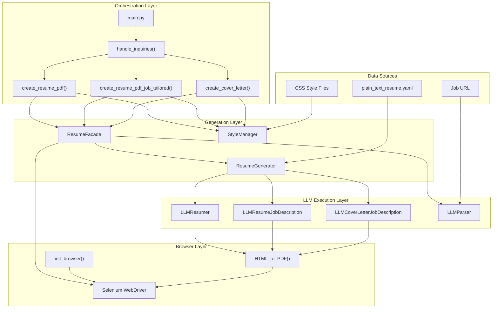

**Sources:** [main.py:220-497](), [src/libs/resume_and_cover_builder/resume_facade.py:16-153](), [src/libs/resume_and_cover_builder/resume_generator.py:13-65]()

---

## Orchestration Layer

The orchestration layer is implemented in `main.py` and provides the entry point for all document generation operations.

### Entry Point Flow

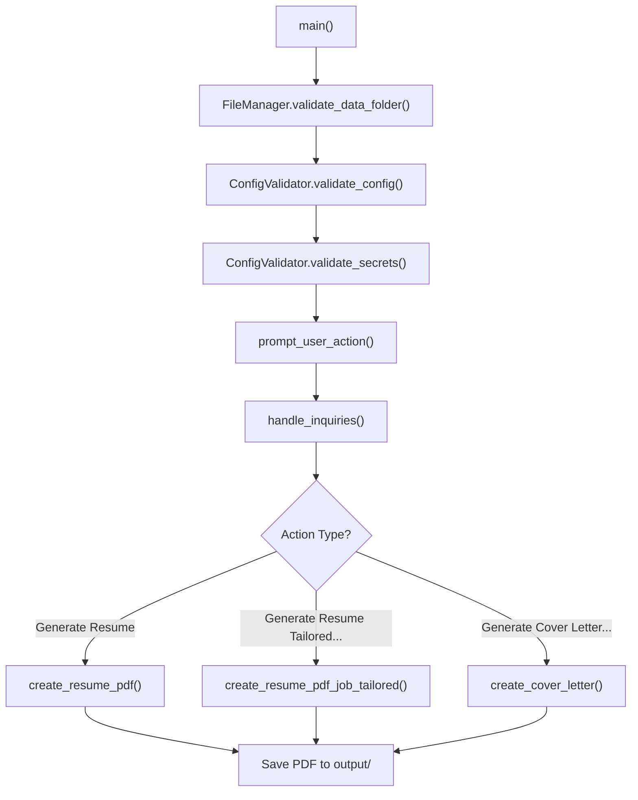

**Sources:** [main.py:527-565](), [main.py:471-497](), [main.py:499-524]()

### Handler Functions

The three document type handlers follow a similar pattern but invoke different generation methods:

| Function | Purpose | Output File | Job Context Required |
|----------|---------|-------------|---------------------|
| `create_resume_pdf()` | Generate general resume | `resume_base.pdf` | No |
| `create_resume_pdf_job_tailored()` | Generate job-tailored resume | `resume_tailored.pdf` | Yes |
| `create_cover_letter()` | Generate cover letter | `cover_letter_tailored.pdf` | Yes |

Each handler follows this sequence:
1. Load plain text resume from YAML [main.py:228-229](), [main.py:315-316](), [main.py:400-401]()
2. Initialize `StyleManager` and prompt user for style selection [main.py:231-255](), [main.py:318-342](), [main.py:403-428]()
3. For job-tailored documents, prompt for job URL [main.py:256-260](), [main.py:343-345]()
4. Initialize `ResumeGenerator` and `Resume` object [main.py:261-264](), [main.py:346-349](), [main.py:430-434]()
5. Initialize browser via `init_browser()` [main.py:263](), [main.py:348](), [main.py:433]()
6. Create and configure `ResumeFacade` [main.py:265-271](), [main.py:350-356](), [main.py:437-443]()
7. For job-tailored documents, link to job via `link_to_job()` [main.py:273](), [main.py:358]()
8. Generate PDF via appropriate facade method [main.py:274](), [main.py:359](), [main.py:445]()
9. Decode Base64 result and write to file [main.py:277-301](), [main.py:362-386](), [main.py:448-465]()

**Sources:** [main.py:220-468]()

---

## Generation Layer

### ResumeFacade

`ResumeFacade` is the primary interface for document generation. It coordinates between job parsing, resume generation, style management, and PDF rendering.

#### Initialization and Configuration

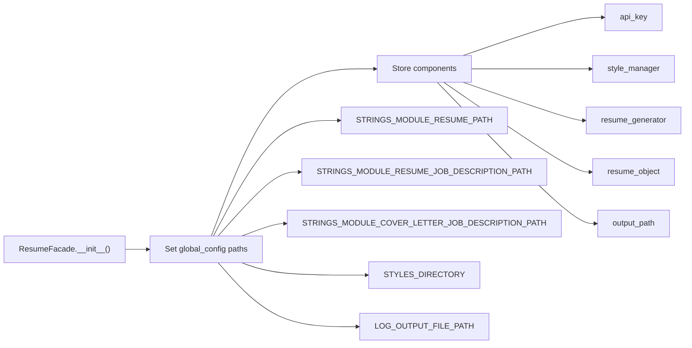

The constructor configures global paths for prompt modules and styles [src/libs/resume_and_cover_builder/resume_facade.py:27-34]():

- `STRINGS_MODULE_RESUME_PATH` - Prompts for general resume generation
- `STRINGS_MODULE_RESUME_JOB_DESCRIPTION_PATH` - Prompts for job-tailored resume
- `STRINGS_MODULE_COVER_LETTER_JOB_DESCRIPTION_PATH` - Prompts for cover letter
- `STYLES_DIRECTORY` - CSS style files location
- `LOG_OUTPUT_FILE_PATH` - Output directory for generated documents

**Sources:** [src/libs/resume_and_cover_builder/resume_facade.py:17-38]()

#### Job Context Extraction

For job-tailored documents, `link_to_job()` extracts job details from a URL:

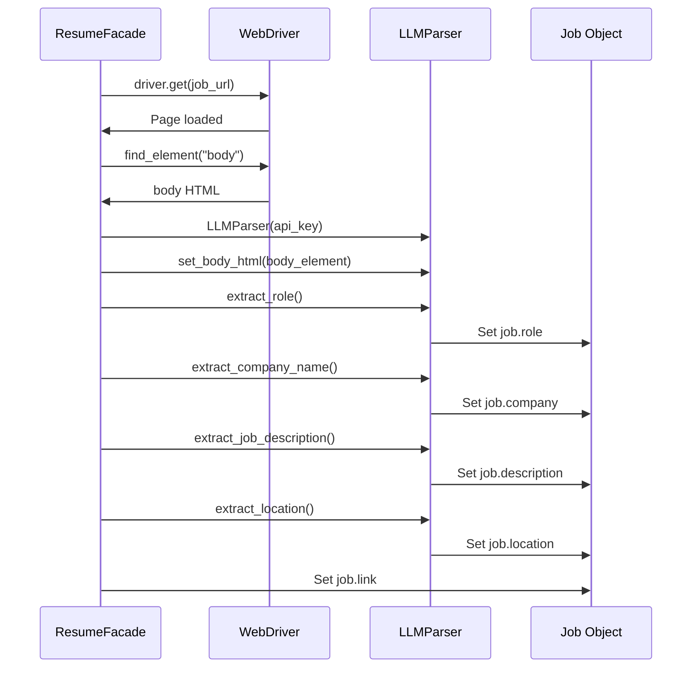

The method performs the following operations [src/libs/resume_and_cover_builder/resume_facade.py:71-86]():

1. Navigate to job URL using Selenium WebDriver
2. Extract page body HTML
3. Initialize `LLMParser` with API key
4. Extract job details using LLM:
   - Role via `extract_role()`
   - Company name via `extract_company_name()`
   - Job description via `extract_job_description()`
   - Location via `extract_location()`
5. Store job link

**Sources:** [src/libs/resume_and_cover_builder/resume_facade.py:71-86]()

#### PDF Generation Methods

`ResumeFacade` exposes three document generation methods:

| Method | LLM Component | Returns | Hash Generated |
|--------|--------------|---------|----------------|
| `create_resume_pdf()` | `LLMResumer` | Base64 PDF | No |
| `create_resume_pdf_job_tailored()` | `LLMResumeJobDescription` | (Base64 PDF, hash) | Yes |
| `create_cover_letter()` | `LLMCoverLetterJobDescription` | (Base64 PDF, hash) | Yes |

Each method follows this pattern:
1. Validate style selection [src/libs/resume_and_cover_builder/resume_facade.py:97-99]()
2. Generate HTML via `ResumeGenerator` with appropriate method
3. For job-tailored documents, generate MD5 hash of job URL [src/libs/resume_and_cover_builder/resume_facade.py:105]()
4. Convert HTML to PDF via `HTML_to_PDF()` [src/libs/resume_and_cover_builder/resume_facade.py:107]()
5. Quit browser [src/libs/resume_and_cover_builder/resume_facade.py:108]()
6. Return PDF and optional filename

**Sources:** [src/libs/resume_and_cover_builder/resume_facade.py:88-153]()

### ResumeGenerator

`ResumeGenerator` is responsible for coordinating LLM-based content generation and HTML template composition.

#### Architecture

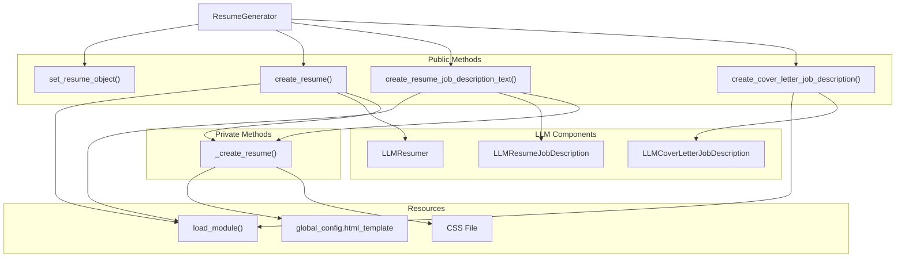

**Sources:** [src/libs/resume_and_cover_builder/resume_generator.py:13-65]()

#### Generation Methods

##### General Resume Generation

`create_resume()` generates a resume without job context [src/libs/resume_and_cover_builder/resume_generator.py:42-45]():

1. Load prompt strings from `STRINGS_MODULE_RESUME_PATH`
2. Initialize `LLMResumer` with API key and strings
3. Delegate to `_create_resume()` with style path

##### Job-Tailored Resume Generation

`create_resume_job_description_text()` generates a resume tailored to a specific job [src/libs/resume_and_cover_builder/resume_generator.py:47-51]():

1. Load prompt strings from `STRINGS_MODULE_RESUME_JOB_DESCRIPTION_PATH`
2. Initialize `LLMResumeJobDescription` with API key and strings
3. Set job description via `set_job_description_from_text()`
4. Delegate to `_create_resume()` with style path

##### Cover Letter Generation

`create_cover_letter_job_description()` generates a cover letter [src/libs/resume_and_cover_builder/resume_generator.py:53-62]():

1. Load prompt strings from `STRINGS_MODULE_COVER_LETTER_JOB_DESCRIPTION_PATH`
2. Initialize `LLMCoverLetterJobDescription` with API key and strings
3. Set resume object and job description
4. Generate cover letter HTML via `generate_cover_letter()`
5. Apply HTML template with style CSS
6. Return complete HTML document

**Sources:** [src/libs/resume_and_cover_builder/resume_generator.py:42-63]()

#### Core Generation Logic

The `_create_resume()` method implements the shared resume generation logic [src/libs/resume_and_cover_builder/resume_generator.py:21-40]():

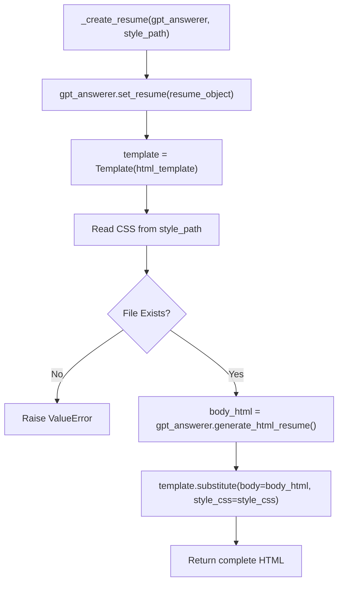

Steps:
1. Set resume object on LLM component [src/libs/resume_and_cover_builder/resume_generator.py:23]()
2. Load HTML template from `global_config.html_template` [src/libs/resume_and_cover_builder/resume_generator.py:26]()
3. Read CSS from provided style path [src/libs/resume_and_cover_builder/resume_generator.py:29-30]()
4. Generate HTML body via `generate_html_resume()` [src/libs/resume_and_cover_builder/resume_generator.py:37]()
5. Substitute body and CSS into template [src/libs/resume_and_cover_builder/resume_generator.py:40]()
6. Return complete HTML document

**Sources:** [src/libs/resume_and_cover_builder/resume_generator.py:21-40]()

---

## Document Generation Flows

### General Resume Flow

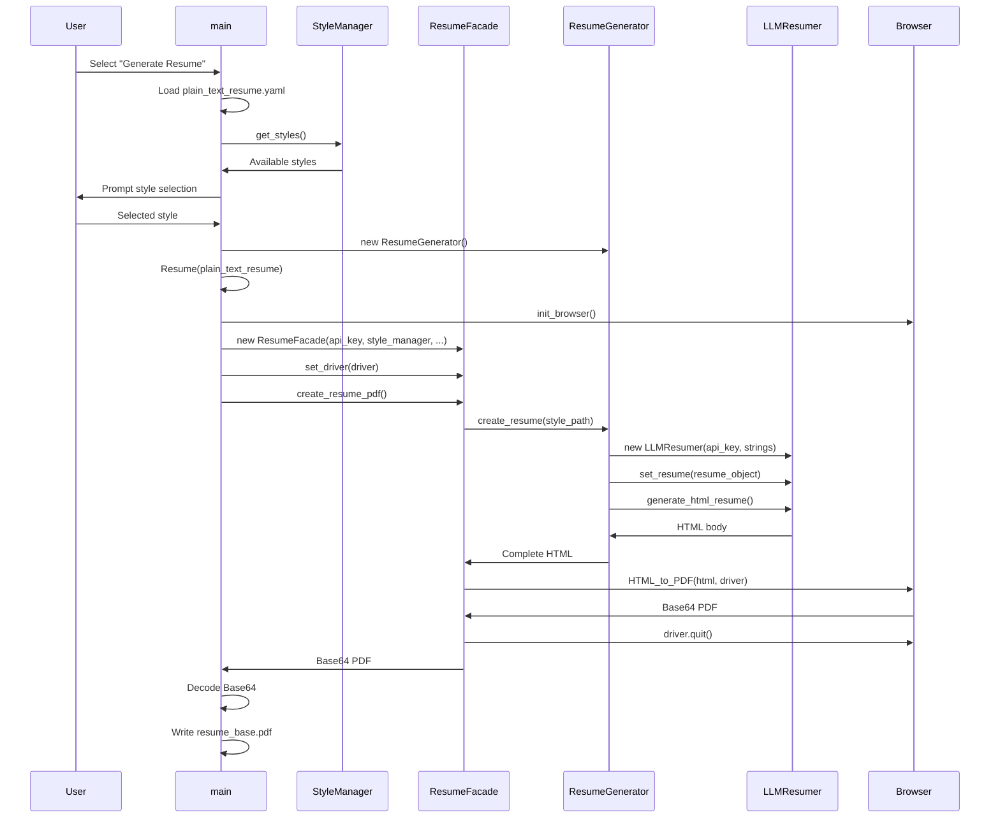

**Sources:** [main.py:392-468](), [src/libs/resume_and_cover_builder/resume_facade.py:113-129](), [src/libs/resume_and_cover_builder/resume_generator.py:42-45]()

### Job-Tailored Resume Flow

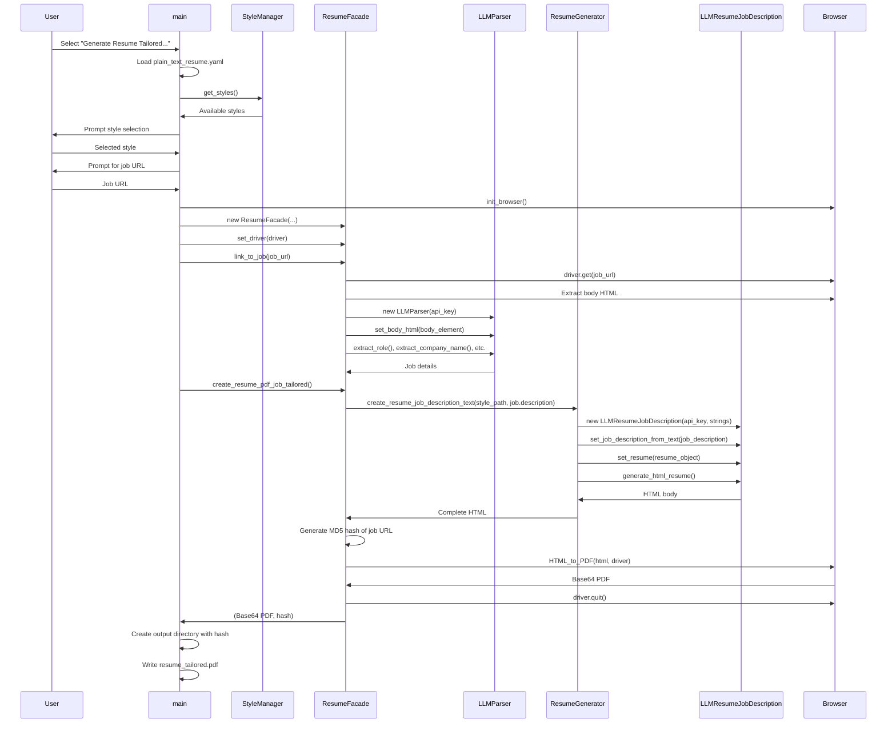

**Sources:** [main.py:307-389](), [src/libs/resume_and_cover_builder/resume_facade.py:71-109](), [src/libs/resume_and_cover_builder/resume_generator.py:47-51]()

### Cover Letter Flow

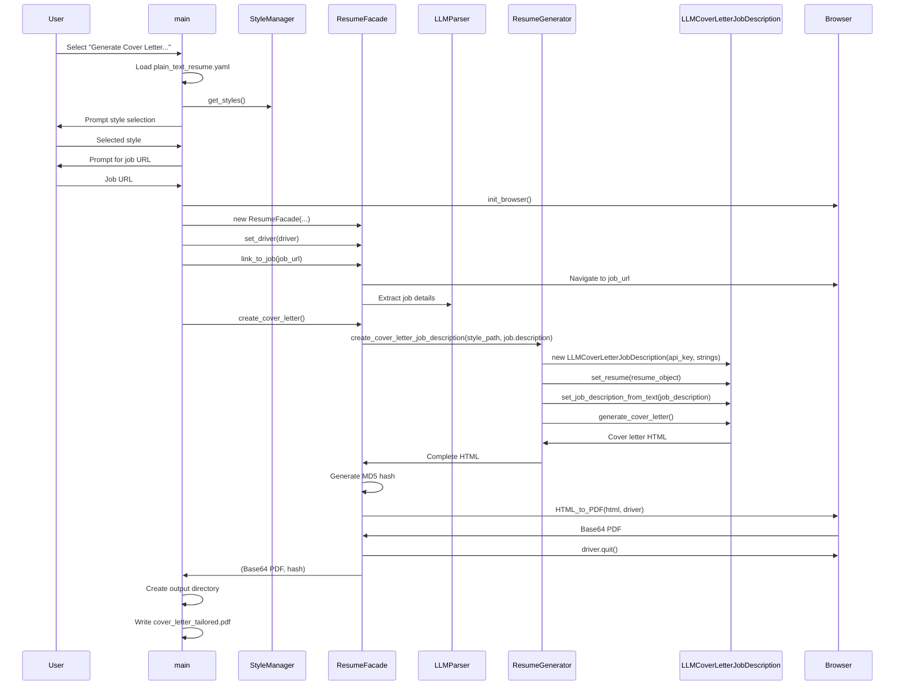

**Sources:** [main.py:220-304](), [src/libs/resume_and_cover_builder/resume_facade.py:131-153](), [src/libs/resume_and_cover_builder/resume_generator.py:53-62]()

---

## Component Interactions

### Data Flow Architecture

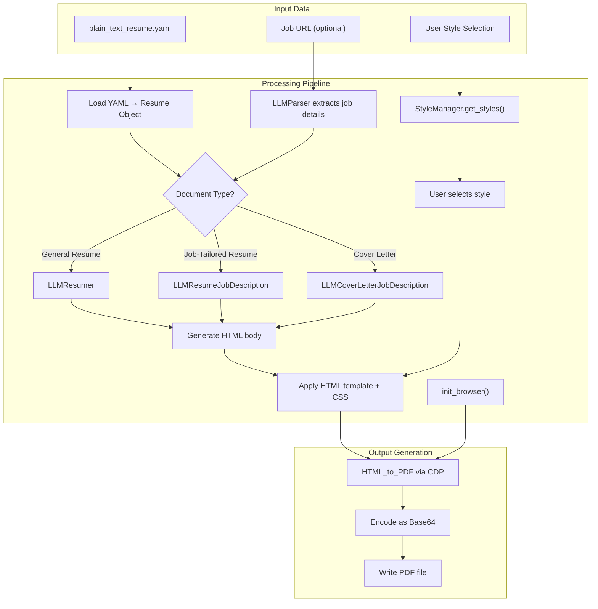

**Sources:** [main.py:220-468](), [src/libs/resume_and_cover_builder/resume_facade.py:16-153](), [src/libs/resume_and_cover_builder/resume_generator.py:13-65]()

### Configuration Flow

Global configuration is set during `ResumeFacade` initialization:

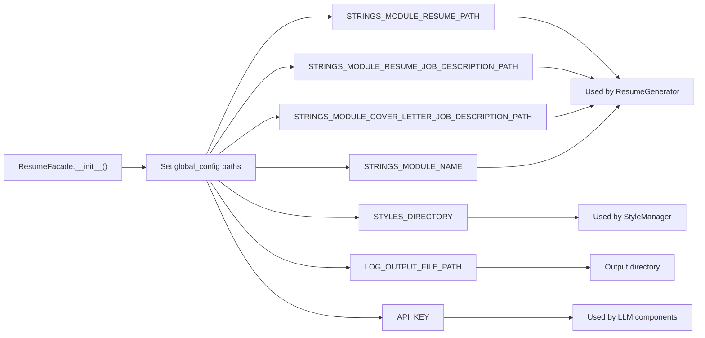

The configuration is stored in `global_config` and accessed by:
- `ResumeGenerator` when loading prompt modules via `load_module()` [src/libs/resume_and_cover_builder/resume_generator.py:43-44]()
- `LLMResumer`, `LLMResumeJobDescription`, and `LLMCoverLetterJobDescription` for API authentication
- `StyleManager` for locating CSS files

**Sources:** [src/libs/resume_and_cover_builder/resume_facade.py:27-34]()

---

## HTML Template System

### Template Structure

The system uses Python's `string.Template` for HTML composition [src/libs/resume_and_cover_builder/resume_generator.py:26]():

```python
template = Template(global_config.html_template)
```

The template contains two placeholders:
- `$body` - The generated HTML content (resume or cover letter)
- `$style_css` - The CSS stylesheet content

### Substitution Process

1. Read CSS file content from selected style path [src/libs/resume_and_cover_builder/resume_generator.py:29-30]()
2. Generate HTML body via LLM component [src/libs/resume_and_cover_builder/resume_generator.py:37]()
3. Substitute both into template [src/libs/resume_and_cover_builder/resume_generator.py:40]():

```python
return template.substitute(body=body_html, style_css=style_css)
```

For cover letters, the same pattern is used [src/libs/resume_and_cover_builder/resume_generator.py:59-62]():

```python
template = Template(global_config.html_template)
with open(style_path, "r") as f:
    style_css = f.read()
return template.substitute(body=cover_letter_html, style_css=style_css)
```

**Sources:** [src/libs/resume_and_cover_builder/resume_generator.py:21-62]()

---

## PDF Generation

### Browser Initialization

PDF generation requires a Selenium WebDriver instance initialized via `init_browser()` [main.py:263](), [main.py:348](), [main.py:433]().

The driver is set on `ResumeFacade` via `set_driver()` [main.py:272](), [main.py:357](), [main.py:444]():

```python
driver = init_browser()
resume_facade.set_driver(driver)
```

**Sources:** [main.py:263-272](), [src/libs/resume_and_cover_builder/resume_facade.py:40-41]()

### HTML to PDF Conversion

The `HTML_to_PDF()` function is called with the generated HTML and WebDriver [src/libs/resume_and_cover_builder/resume_facade.py:107](), [src/libs/resume_and_cover_builder/resume_facade.py:127](), [src/libs/resume_and_cover_builder/resume_facade.py:151]():

```python
result = HTML_to_PDF(html_resume, self.driver)
```

This function:
1. Uses Chrome DevTools Protocol (CDP) to render HTML
2. Generates PDF via browser's native rendering engine
3. Returns Base64-encoded PDF content

After conversion, the WebDriver is terminated [src/libs/resume_and_cover_builder/resume_facade.py:108](), [src/libs/resume_and_cover_builder/resume_facade.py:128](), [src/libs/resume_and_cover_builder/resume_facade.py:152]():

```python
self.driver.quit()
```

**Sources:** [src/libs/resume_and_cover_builder/resume_facade.py:107-108]()

### Output File Management

For general resumes, the output file is written directly [main.py:458-462]():

```python
output_path = output_dir / "resume_base.pdf"
with open(output_path, "wb") as file:
    file.write(pdf_data)
```

For job-tailored documents, a unique directory is created using the MD5 hash [main.py:284-293](), [main.py:369-377]():

```python
suggested_name = hashlib.md5(self.job.link.encode()).hexdigest()[:10]
output_dir = Path(parameters["outputFileDirectory"]) / suggested_name
output_dir.mkdir(parents=True, exist_ok=True)
```

This ensures that documents for different jobs are organized in separate directories.

**Sources:** [main.py:277-301](), [main.py:362-386](), [main.py:448-465](), [src/libs/resume_and_cover_builder/resume_facade.py:105](), [src/libs/resume_and_cover_builder/resume_facade.py:148]()

---

## Error Handling

### Configuration Errors

The orchestration layer catches and logs configuration errors [main.py:548-553]():

```python
except ConfigError as ce:
    logger.error(f"Configuration error: {ce}")
    logger.error("Refer to the configuration guide...")
```

### File Not Found Errors

Missing files are handled with specific error messages [main.py:554-556]():

```python
except FileNotFoundError as fnf:
    logger.error(f"File not found: {fnf}")
    logger.error("Ensure all required files are present...")
```

### Generation Errors

Document generation errors are caught and logged [main.py:302-304](), [main.py:387-389](), [main.py:466-468]():

```python
except Exception as e:
    logger.exception(f"An error occurred while creating the CV: {e}")
    raise
```

### Style Validation

`ResumeFacade` validates that a style has been selected before generation [src/libs/resume_and_cover_builder/resume_facade.py:97-99]():

```python
style_path = self.style_manager.get_style_path()
if style_path is None:
    raise ValueError("You must choose a style before generating the PDF.")
```

### CSS File Errors

`ResumeGenerator` handles CSS file reading errors [src/libs/resume_and_cover_builder/resume_generator.py:31-34]():

```python
except FileNotFoundError:
    raise ValueError(f"Il file di stile non è stato trovato nel percorso: {style_path}")
except Exception as e:
    raise RuntimeError(f"Errore durante la lettura del file CSS: {e}")
```

**Sources:** [main.py:302-304](), [main.py:548-561](), [src/libs/resume_and_cover_builder/resume_facade.py:97-99](), [src/libs/resume_and_cover_builder/resume_generator.py:28-34]()

---

## Summary

The document generation architecture implements a layered design with clear separation of concerns:

1. **Orchestration** - `main.py` handles user interaction and routing
2. **Coordination** - `ResumeFacade` orchestrates the generation pipeline
3. **Generation** - `ResumeGenerator` coordinates LLM components and template composition
4. **Execution** - LLM components generate content, browser renders PDF

Key design patterns:
- **Facade Pattern** - `ResumeFacade` provides a simplified interface to complex subsystems
- **Strategy Pattern** - Different LLM components handle different document types
- **Template Method** - `_create_resume()` implements shared generation logic
- **Builder Pattern** - Progressive construction of documents through multiple stages

The architecture enables flexible document generation with support for multiple document types, customizable styles, and job-specific tailoring.

---

