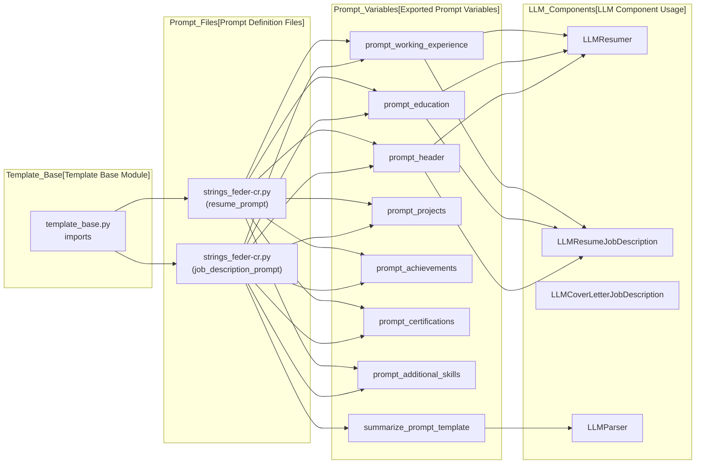
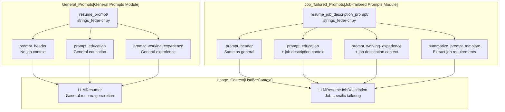
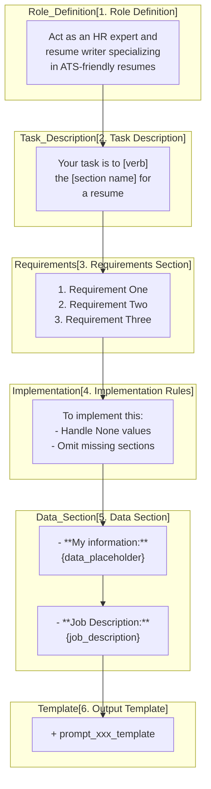
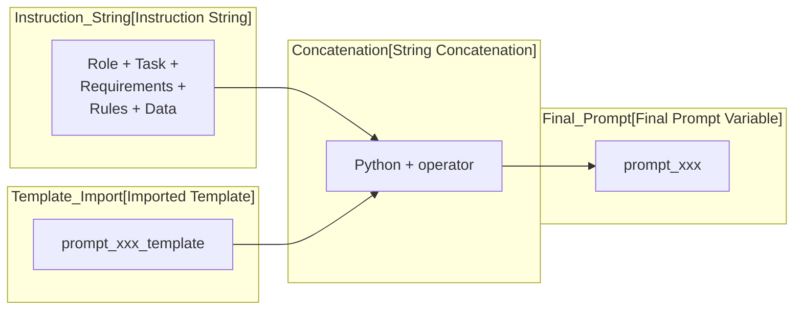
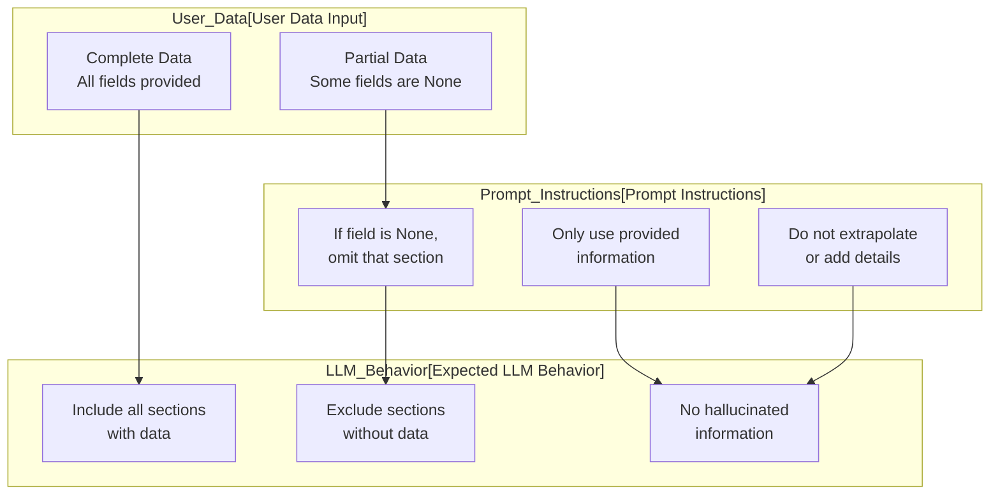
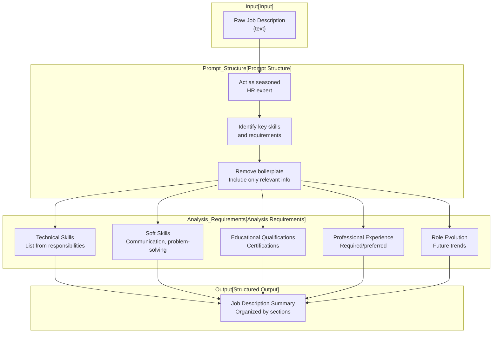
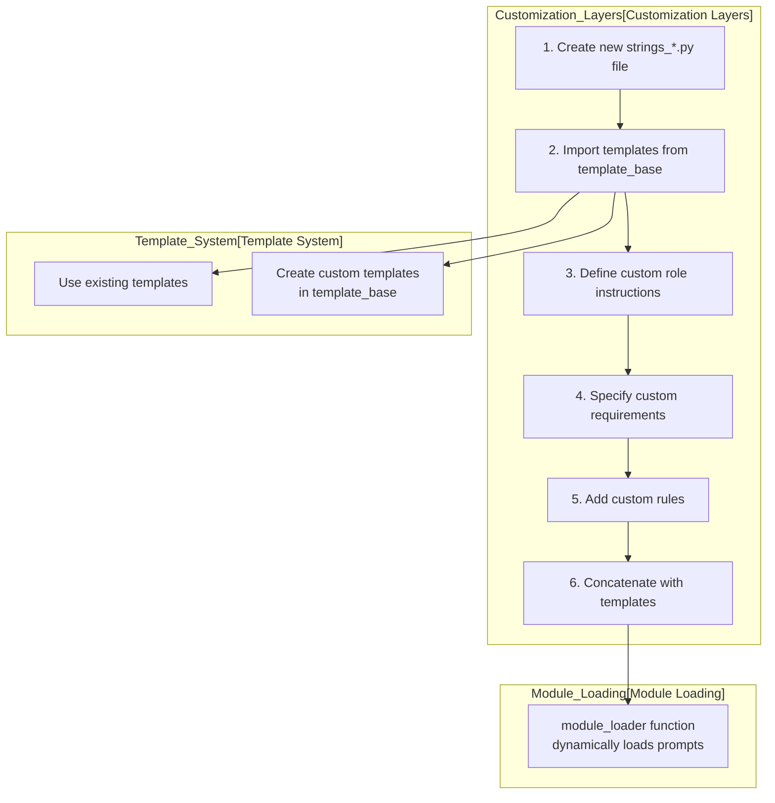

<!-- source: DeepWiki mcp.deepwiki.com · repo feder-cr/Jobs_Applier_AI_Agent_AIHawk · page 4.2 Prompt Engineering · fetched 2026-10-29 -->

# Prompt Engineering

<details>
<summary>Relevant source files</summary>

The following files were used as context for generating this wiki page:

- [src/libs/resume_and_cover_builder/resume_job_description_prompt/strings_feder-cr.py](src/libs/resume_and_cover_builder/resume_job_description_prompt/strings_feder-cr.py)
- [src/libs/resume_and_cover_builder/resume_prompt/strings_feder-cr.py](src/libs/resume_and_cover_builder/resume_prompt/strings_feder-cr.py)

</details>


## Purpose and Scope

This document explains the prompt engineering system used in AIHawk to generate tailored resumes and cover letters. It covers the structure, composition patterns, and customization of prompts used for LLM-based document generation. For details on how these prompts are used by LLM components, see [LLM Components](#4.5). For information on how job descriptions are processed before being used in prompts, see [Job Description Processing](#4.3).

The prompt system is modular, template-based, and designed to produce ATS-friendly (Applicant Tracking System) content by instructing LLMs to act as HR experts and resume writers.

## Prompt Architecture Overview

The prompt engineering system consists of three layers that compose together to create complete prompts sent to LLMs.

### Three-Layer Prompt Composition

```mermaid
graph TB
    subgraph "Layer_1[Layer 1: Role Instructions]"
        role["Role Definition<br/>Act as HR expert..."]
        requirements["Formatting Requirements<br/>ATS-friendly guidelines"]
        rules["Processing Rules<br/>Handle None values"]
    end
    
    subgraph "Layer_2[Layer 2: User Data]"
        personal["Personal Information<br/>{personal_information}"]
        experience["Experience Details<br/>{experience_details}"]
        education["Education Details<br/>{education_details}"]
        job_desc["Job Description<br/>{job_description}"]
    end
    
    subgraph "Layer_3[Layer 3: Output Templates]"
        header_tmpl["prompt_header_template"]
        edu_tmpl["prompt_education_template"]
        exp_tmpl["prompt_working_experience_template"]
        proj_tmpl["prompt_projects_template"]
        skills_tmpl["prompt_additional_skills_template"]
        cert_tmpl["prompt_certifications_template"]
        achv_tmpl["prompt_achievements_template"]
    end
    
    subgraph "Composition_Process[Composition Process]"
        combine["String Concatenation<br/>prompt + data + template"]
    end
    
    subgraph "Final_Output[Final Prompt]"
        final["Complete LLM Prompt"]
    end
    
    role --> combine
    requirements --> combine
    rules --> combine
    personal --> combine
    experience --> combine
    education --> combine
    job_desc --> combine
    header_tmpl --> combine
    edu_tmpl --> combine
    exp_tmpl --> combine
    proj_tmpl --> combine
    skills_tmpl --> combine
    cert_tmpl --> combine
    achv_tmpl --> combine
    
    combine --> final
```



**Diagram: Prompt Composition Architecture**

The system uses string concatenation to combine role instructions, user data placeholders, and output templates into complete prompts. Templates are imported from `template_base` and appended using the `+` operator.

Sources: [src/libs/resume_and_cover_builder/resume_job_description_prompt/strings_feder-cr.py:1-169](), [src/libs/resume_and_cover_builder/resume_prompt/strings_feder-cr.py:1-93]()

## Prompt Types and Code Mappings

The system defines seven distinct prompt types, each responsible for generating a specific section of a resume or cover letter.

### Prompt Type Registry

| Prompt Variable | Purpose | Template Import | User Data Fields |
|----------------|---------|-----------------|------------------|
| `prompt_header` | Contact information section | `prompt_header_template` | `{personal_information}` |
| `prompt_education` | Education background | `prompt_education_template` | `{education_details}`, `{job_description}` |
| `prompt_working_experience` | Work experience entries | `prompt_working_experience_template` | `{experience_details}`, `{job_description}` |
| `prompt_projects` | Side projects and contributions | `prompt_projects_template` | `{projects}`, `{job_description}` |
| `prompt_achievements` | Awards and recognitions | `prompt_achievements_template` | `{achievements}`, `{job_description}` |
| `prompt_certifications` | Professional certifications | `prompt_certifications_template` | `{certifications}`, `{job_description}` |
| `prompt_additional_skills` | Languages, interests, skills | `prompt_additional_skills_template` | `{languages}`, `{interests}`, `{skills}`, `{job_description}` |

### Prompt Type Relationships



**Diagram: Prompt Type Code Relationships**

Sources: [src/libs/resume_and_cover_builder/resume_job_description_prompt/strings_feder-cr.py:1-169](), [src/libs/resume_and_cover_builder/resume_prompt/strings_feder-cr.py:1-93]()

## Job-Tailored vs General Prompts

The system maintains two separate sets of prompts to support different use cases: general resume generation and job-specific resume tailoring.

### Key Differences



**Diagram: General vs Job-Tailored Prompt Usage**

### Structural Differences

**General Prompts** [src/libs/resume_and_cover_builder/resume_prompt/strings_feder-cr.py:1-93]():
- Do not include `{job_description}` placeholder
- Focus on presenting user data clearly
- Shorter instructions (no job alignment requirements)
- Used for standalone resume generation

**Job-Tailored Prompts** [src/libs/resume_and_cover_builder/resume_job_description_prompt/strings_feder-cr.py:1-169]():
- Include `{job_description}` placeholder in most prompts
- Instruct LLM to align content with job requirements
- Additional instruction: "ensuring it aligns with the provided job description"
- Include `summarize_prompt_template` for job description processing
- Used when generating documents for specific job applications

Sources: [src/libs/resume_and_cover_builder/resume_job_description_prompt/strings_feder-cr.py:16-56](), [src/libs/resume_and_cover_builder/resume_prompt/strings_feder-cr.py:14-37]()

## Prompt Structure Breakdown

Each prompt follows a consistent structure with specific sections that guide the LLM's behavior.

### Standard Prompt Components



**Diagram: Standard Prompt Structure Flow**

### Example: Education Prompt Structure

The education prompt demonstrates all standard components:

**Role Definition** [src/libs/resume_and_cover_builder/resume_job_description_prompt/strings_feder-cr.py:16-17]():
```
Act as an HR expert and resume writer with a specialization in creating 
ATS-friendly resumes.
```

**Task Description** [src/libs/resume_and_cover_builder/resume_job_description_prompt/strings_feder-cr.py:17-18]():
```
Your task is to articulate the educational background for a resume, 
ensuring it aligns with the provided job description.
```

**Requirements** [src/libs/resume_and_cover_builder/resume_job_description_prompt/strings_feder-cr.py:18-23]():
```
1. **Institution Name and Location**: Specify the university...
2. **Degree and Field of Study**: Clearly indicate...
3. **Grade**: Include your Grade if it is strong...
4. **Relevant Coursework**: List key courses...
```

**Implementation Rules** [src/libs/resume_and_cover_builder/resume_job_description_prompt/strings_feder-cr.py:24-26]():
```
To implement this, follow these steps:
- If the exam details are not provided (i.e., `None`), skip the coursework section...
- If the exam details are available, fill out the coursework section accordingly.
```

**Data Section** [src/libs/resume_and_cover_builder/resume_job_description_prompt/strings_feder-cr.py:29-33]():
```
- **My information:**  
  {education_details}

- **Job Description:**  
  {job_description}
```

**Template Appending** [src/libs/resume_and_cover_builder/resume_job_description_prompt/strings_feder-cr.py:34]():
```python
"""+ prompt_education_template
```

Sources: [src/libs/resume_and_cover_builder/resume_job_description_prompt/strings_feder-cr.py:16-34]()

## Template Base System

Templates are imported from `template_base` module and define the expected output format structure. They are appended to prompts using string concatenation.

### Template Import Pattern

All prompt files begin with the same import statement:

```python
from src.libs.resume_and_cover_builder.template_base import (
    prompt_header_template,
    prompt_education_template,
    prompt_working_experience_template,
    prompt_projects_template,
    prompt_additional_skills_template,
    prompt_certifications_template,
    prompt_achievements_template
)
```

Sources: [src/libs/resume_and_cover_builder/resume_job_description_prompt/strings_feder-cr.py:1](), [src/libs/resume_and_cover_builder/resume_prompt/strings_feder-cr.py:1]()

### Template Usage Pattern



**Diagram: Template Concatenation Pattern**

Example concatenation pattern seen throughout the codebase:

```python
prompt_education = """
[instruction text with placeholders]
"""+ prompt_education_template
```

The template provides the output format specification, while the instruction text provides the context and rules.

Sources: [src/libs/resume_and_cover_builder/resume_job_description_prompt/strings_feder-cr.py:34](), [src/libs/resume_and_cover_builder/resume_job_description_prompt/strings_feder-cr.py:56](), [src/libs/resume_and_cover_builder/resume_job_description_prompt/strings_feder-cr.py:77]()

## Handling Missing Data

The prompt system includes explicit instructions for handling missing or `None` values in user data to prevent LLMs from hallucinating information.

### None-Handling Strategy



**Diagram: None-Value Handling Flow**

### Implementation Examples

**Header Prompt** [src/libs/resume_and_cover_builder/resume_job_description_prompt/strings_feder-cr.py:9-10]():
```
To implement this:
- If any of the contact information fields (e.g., LinkedIn profile, GitHub profile) 
  are not provided (i.e., `None`), omit them from the header.
```

**Working Experience Prompt** [src/libs/resume_and_cover_builder/resume_job_description_prompt/strings_feder-cr.py:47-48]():
```
To implement this:
- If any of the work experience details (e.g., responsibilities, achievements) 
  are not provided (i.e., `None`), omit those sections when filling out the template.
```

**Additional Skills Prompt** [src/libs/resume_and_cover_builder/resume_job_description_prompt/strings_feder-cr.py:122]():
```
Do not add any information beyond what is listed in the provided data fields. 
Only use the information provided in the 'languages', 'interests', and 'skills' 
fields to formulate your responses. Avoid extrapolating or incorporating details 
from the job description or other external sources.
```

This explicit instruction prevents the LLM from inventing skills or qualifications not present in the user's actual resume data.

Sources: [src/libs/resume_and_cover_builder/resume_job_description_prompt/strings_feder-cr.py:9-10](), [src/libs/resume_and_cover_builder/resume_job_description_prompt/strings_feder-cr.py:47-48](), [src/libs/resume_and_cover_builder/resume_job_description_prompt/strings_feder-cr.py:122]()

## Job Description Summarization Prompt

The job-tailored prompt module includes a special `summarize_prompt_template` used to extract and analyze key information from job descriptions before using them in document generation.

### Summarization Architecture



**Diagram: Job Description Summarization Flow**

### Summarization Prompt Structure

The `summarize_prompt_template` [src/libs/resume_and_cover_builder/resume_job_description_prompt/strings_feder-cr.py:143-169]() follows a different structure than resume section prompts:

**Purpose Statement**:
```
As a seasoned HR expert, your task is to identify and outline the key skills 
and requirements necessary for the position of this job.
```

**Processing Rules** [src/libs/resume_and_cover_builder/resume_job_description_prompt/strings_feder-cr.py:146-148]():
```
Rules:
Remove boilerplate text
Include only relevant information to match the job description against the resume
```

**Analysis Requirements Section** [src/libs/resume_and_cover_builder/resume_job_description_prompt/strings_feder-cr.py:150-156]():
1. Technical Skills
2. Soft Skills
3. Educational Qualifications and Certifications
4. Professional Experience
5. Role Evolution

**Output Format** [src/libs/resume_and_cover_builder/resume_job_description_prompt/strings_feder-cr.py:158-160]():
```
Your analysis should be structured in a clear and organized document with 
distinct sections for each of the points listed above.
```

This structured summarization enables the system to extract relevant job requirements and match them against the user's resume data when generating tailored documents.

Sources: [src/libs/resume_and_cover_builder/resume_job_description_prompt/strings_feder-cr.py:143-169]()

## ATS-Friendly Focus

All prompts explicitly instruct the LLM to create "ATS-friendly" content. This is a critical requirement that appears in every role definition.

### ATS-Friendly Requirements

The phrase "specializing in ATS-friendly resumes" or "with a specialization in creating ATS-friendly resumes" appears in:

- `prompt_header` [src/libs/resume_and_cover_builder/resume_job_description_prompt/strings_feder-cr.py:4]()
- `prompt_education` [src/libs/resume_and_cover_builder/resume_job_description_prompt/strings_feder-cr.py:17]()
- `prompt_working_experience` [src/libs/resume_and_cover_builder/resume_job_description_prompt/strings_feder-cr.py:38]()
- `prompt_projects` [src/libs/resume_and_cover_builder/resume_job_description_prompt/strings_feder-cr.py:60]()
- `prompt_achievements` [src/libs/resume_and_cover_builder/resume_job_description_prompt/strings_feder-cr.py:81]()
- `prompt_certifications` [src/libs/resume_and_cover_builder/resume_job_description_prompt/strings_feder-cr.py:101]()
- `prompt_additional_skills` [src/libs/resume_and_cover_builder/resume_job_description_prompt/strings_feder-cr.py:121]()

This consistent framing ensures that LLM-generated content is optimized for Applicant Tracking Systems, which parse resumes for keywords and structured information.

Sources: [src/libs/resume_and_cover_builder/resume_job_description_prompt/strings_feder-cr.py:4](), [src/libs/resume_and_cover_builder/resume_job_description_prompt/strings_feder-cr.py:17](), [src/libs/resume_and_cover_builder/resume_job_description_prompt/strings_feder-cr.py:38]()

## Placeholder Variables Reference

Each prompt type uses specific placeholder variables that are filled with user data at runtime.

### Placeholder Mapping Table

| Prompt Type | Placeholder Variables | Data Source |
|------------|----------------------|-------------|
| `prompt_header` | `{personal_information}` | `plain_text_resume.yaml` personal_information section |
| `prompt_education` | `{education_details}`, `{job_description}` | `plain_text_resume.yaml` education section, job posting |
| `prompt_working_experience` | `{experience_details}`, `{job_description}` | `plain_text_resume.yaml` experience section, job posting |
| `prompt_projects` | `{projects}`, `{job_description}` | `plain_text_resume.yaml` projects section, job posting |
| `prompt_achievements` | `{achievements}`, `{job_description}` | `plain_text_resume.yaml` achievements section, job posting |
| `prompt_certifications` | `{certifications}`, `{job_description}` | `plain_text_resume.yaml` certifications section, job posting |
| `prompt_additional_skills` | `{languages}`, `{interests}`, `{skills}`, `{job_description}` | `plain_text_resume.yaml` multiple sections, job posting |
| `summarize_prompt_template` | `{text}` | Raw job description text |

### Multi-Placeholder Prompt Example

The `prompt_additional_skills` uses three separate data placeholders [src/libs/resume_and_cover_builder/resume_job_description_prompt/strings_feder-cr.py:134-140]():

```
- **My information:**  
  {languages}
  {interests}
  {skills}

- **Job Description:**  
  {job_description}
```

This allows the prompt to combine multiple aspects of the user's profile into a cohesive skills section.

Sources: [src/libs/resume_and_cover_builder/resume_job_description_prompt/strings_feder-cr.py:12-13](), [src/libs/resume_and_cover_builder/resume_job_description_prompt/strings_feder-cr.py:29-33](), [src/libs/resume_and_cover_builder/resume_job_description_prompt/strings_feder-cr.py:134-140]()

## Customizing Prompts

To customize prompts for different writing styles, industries, or requirements, developers should understand the modular structure.

### Customization Points



**Diagram: Prompt Customization Architecture**

### Steps to Create Custom Prompts

1. **Create a new prompt module**: Create a new file following the naming pattern `strings_[identifier].py` in either the `resume_prompt/` or `resume_job_description_prompt/` directory.

2. **Import necessary templates**: Import the templates you need from `template_base`:
   ```python
   from src.libs.resume_and_cover_builder.template_base import (
       prompt_header_template,
       prompt_education_template,
       # ... other templates
   )
   ```

3. **Define custom instructions**: Create prompt variables with custom role definitions, requirements, and rules specific to your use case.

4. **Maintain placeholder consistency**: Use the same placeholder variable names (`{personal_information}`, `{education_details}`, etc.) to ensure compatibility with the data loading system.

5. **Append templates**: Use the `+` operator to concatenate your instructions with the imported templates.

6. **Configure module loading**: The system uses a module loader to dynamically load prompts based on configuration. Update the loading logic to reference your custom prompt module.

### Example: Industry-Specific Customization

To create technology-focused prompts, modify the role definition:

**Original** [src/libs/resume_and_cover_builder/resume_job_description_prompt/strings_feder-cr.py:4]():
```
Act as an HR expert and resume writer specializing in ATS-friendly resumes.
```

**Technology-Focused**:
```
Act as a technical recruiter and resume writer specializing in software 
engineering resumes and ATS-friendly formats.
```

Then adjust requirements to emphasize technical skills, metrics, and technologies used.

Sources: [src/libs/resume_and_cover_builder/resume_job_description_prompt/strings_feder-cr.py:1-169](), [src/libs/resume_and_cover_builder/resume_prompt/strings_feder-cr.py:1-93]()

## Prompt Engineering Best Practices

Based on the existing prompt structure, the following patterns are established:

### Design Patterns

1. **Explicit Role Assignment**: Always begin with "Act as [role]" to establish the LLM's perspective
2. **Task Clarity**: State "Your task is to [verb] [object]" explicitly
3. **Numbered Requirements**: Use numbered lists (1., 2., 3.) for clear requirement specification
4. **None-Value Handling**: Always include explicit instructions for handling missing data
5. **Template Separation**: Keep output format (template) separate from instruction logic
6. **ATS Focus**: Include "ATS-friendly" in role definitions for resume content
7. **Data Section Clarity**: Use bold markdown headers (`**My information:**`) to delineate data sections
8. **Job Context**: Include `{job_description}` placeholder when content should be tailored

### Anti-Patterns to Avoid

1. **Vague Instructions**: Avoid general statements like "make it good" or "be professional"
2. **Mixed Responsibilities**: Don't combine multiple section types in one prompt
3. **Hardcoded Data**: Never hardcode example values; always use placeholders
4. **Missing Omission Rules**: Always specify what to do when data is `None`
5. **Template Inline**: Don't include output format specification in the instruction text

Sources: [src/libs/resume_and_cover_builder/resume_job_description_prompt/strings_feder-cr.py:1-169]()

---

