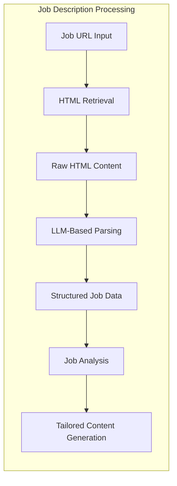
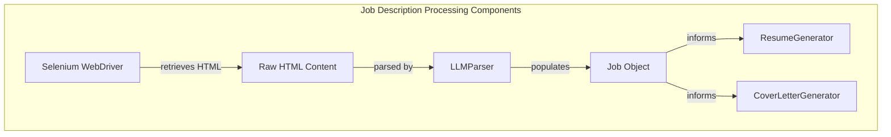
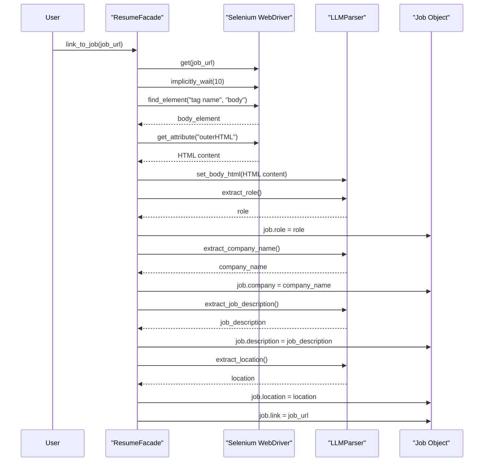
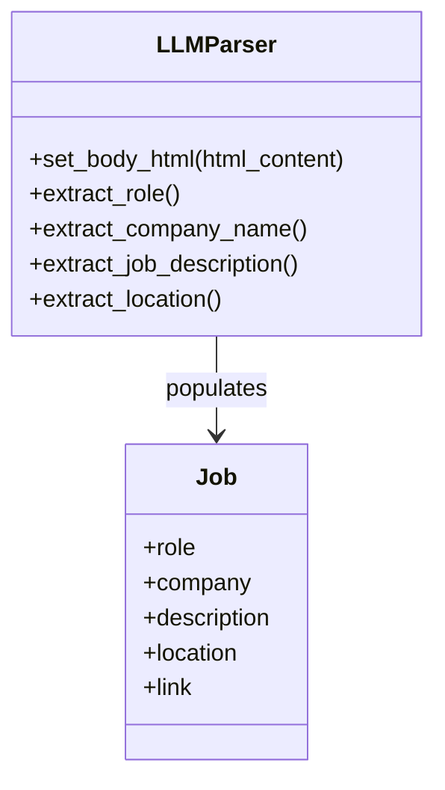
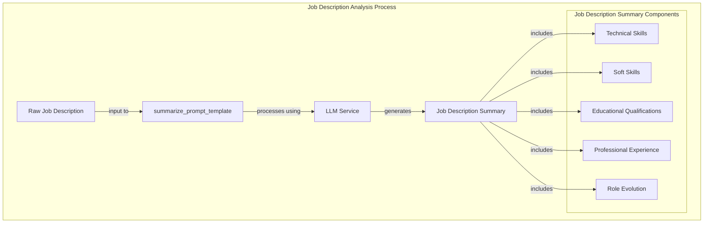
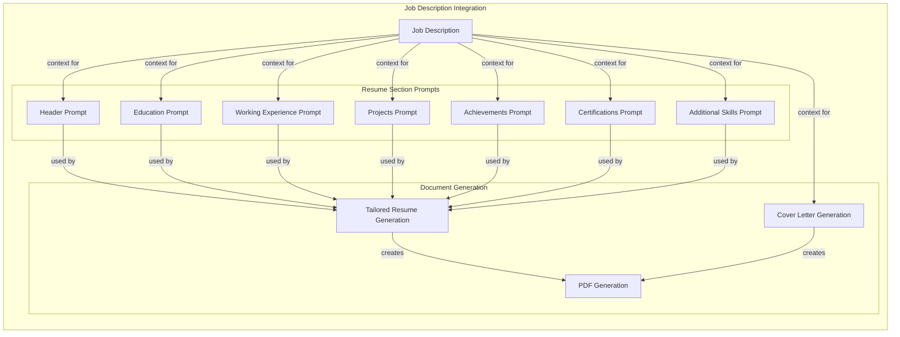
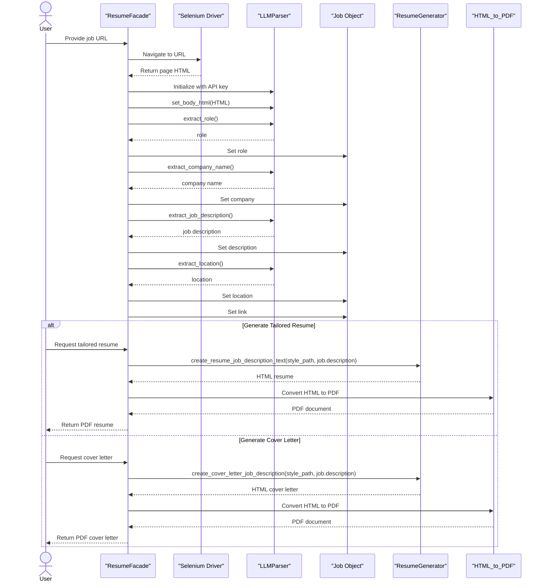

<!-- source: DeepWiki mcp.deepwiki.com · repo feder-cr/Jobs_Applier_AI_Agent_AIHawk · page 4.3 Job Description Processing · fetched 2026-10-29 -->

# Job Description Processing

Relevant source files

The following files were used as context for generating this wiki page:

- [src/libs/resume_and_cover_builder/resume_facade.py](src/libs/resume_and_cover_builder/resume_facade.py)
- [src/libs/resume_and_cover_builder/resume_job_description_prompt/strings_feder-cr.py](src/libs/resume_and_cover_builder/resume_job_description_prompt/strings_feder-cr.py)

## Purpose and Scope

This document explains how the AIHawk system scrapes, extracts, and processes job descriptions from online job postings. This processing serves as the foundation for creating tailored resumes and cover letters that align with specific job requirements. This page focuses specifically on the technical implementation of job data extraction and processing, not the actual resume or cover letter generation (see [Resume Generation System](#4.1) and [Cover Letter Generation](#4.2) for those details).

## Overview

The Job Description Processing system is responsible for:

1. Retrieving HTML content from job posting URLs
2. Extracting structured job data (role, company, description, location)
3. Analyzing job descriptions to identify key requirements
4. Providing parsed job data to the resume and cover letter generators

Sources: [src/libs/resume_and_cover_builder/resume_facade.py:71-84]()

## System Architecture

The job description processing functionality is implemented through a combination of web scraping and LLM-based text extraction. The system integrates with Selenium for retrieving HTML content and uses a specialized LLM parser to extract structured information.

Sources: [src/libs/resume_and_cover_builder/resume_facade.py:71-84](), [src/libs/resume_and_cover_builder/resume_facade.py:88-109](), [src/libs/resume_and_cover_builder/resume_facade.py:131-153]()

## HTML Retrieval Process

The first step in job description processing is retrieving the HTML content from the job posting URL. This is handled by the `link_to_job` method in the `ResumeFacade` class.

Sources: [src/libs/resume_and_cover_builder/resume_facade.py:71-84]()

### Key Components:

1. **Selenium WebDriver**: Used to load the job URL and extract HTML content
2. **HTML Extraction**: The system extracts the complete HTML content of the page body
3. **Wait Time**: The system implements a 10-second implicit wait to ensure the page loads completely

## LLM-Based Job Data Parsing

After retrieving the HTML content, the system uses the `LLMParser` to extract structured job information. The parser is initialized with an API key for the chosen LLM service and processes the HTML to extract specific job details.

Sources: [src/libs/resume_and_cover_builder/resume_facade.py:71-84]()

### Extracted Job Data:

The LLM parser extracts the following structured information from the job posting:

| Field | Description | Method |
|-------|-------------|--------|
| Role | Job title/position | `extract_role()` |
| Company | Employer name | `extract_company_name()` |
| Description | Full job description text | `extract_job_description()` |
| Location | Job location | `extract_location()` |
| Link | Original job posting URL | Directly stored |

## Job Description Analysis

Once the job description is extracted, it can be analyzed to identify key requirements and skills. The system uses an LLM prompt template called `summarize_prompt_template` to perform this analysis.

Sources: [src/libs/resume_and_cover_builder/resume_job_description_prompt/strings_feder-cr.py:143-169]()

### Analysis Prompt Structure:

The summarize prompt instructs the LLM to analyze the job description and extract the following information:

1. **Technical Skills**: Required technical competencies for the role
2. **Soft Skills**: Interpersonal and non-technical skills needed
3. **Educational Qualifications and Certifications**: Required education and credentials
4. **Professional Experience**: Required work experience
5. **Role Evolution**: How the role might change over time

The prompt also specifically instructs the LLM to:
- Remove boilerplate text
- Include only information relevant for matching against a resume

## Integration with Resume and Cover Letter Generation

The extracted and analyzed job description is used to tailor both resumes and cover letters to specific job requirements. This integration happens through specialized prompt templates that include the job description as context.

Sources: [src/libs/resume_and_cover_builder/resume_job_description_prompt/strings_feder-cr.py:1-142](), [src/libs/resume_and_cover_builder/resume_facade.py:88-109](), [src/libs/resume_and_cover_builder/resume_facade.py:131-153]()

### Integration Process:

1. Each resume section prompt includes the job description as context
2. The prompts instruct the LLM to tailor content to emphasize skills and experiences relevant to the job
3. The generated content is used to create a customized resume or cover letter
4. The final document is converted to PDF and provided to the user

## Complete Job Description Processing Flow

The following diagram illustrates the complete process from job URL input to tailored document generation:

Sources: [src/libs/resume_and_cover_builder/resume_facade.py:71-153]()

## Key Classes and Their Roles

The job description processing system revolves around several key classes:

| Class | Role |
|-------|------|
| `ResumeFacade` | Coordinates the job processing workflow and connects components |
| `LLMParser` | Extracts structured information from raw HTML |
| `Job` | Data structure that holds extracted job information |
| `ResumeGenerator` | Uses job data to generate tailored documents |

## Conclusion

The Job Description Processing system provides the foundation for AIHawk's ability to generate tailored application materials. By extracting and analyzing job descriptions, the system enables the creation of resumes and cover letters that highlight the most relevant skills and experiences for specific positions. This increases the chances of passing automated applicant tracking systems (ATS) and impressing human recruiters.

---

