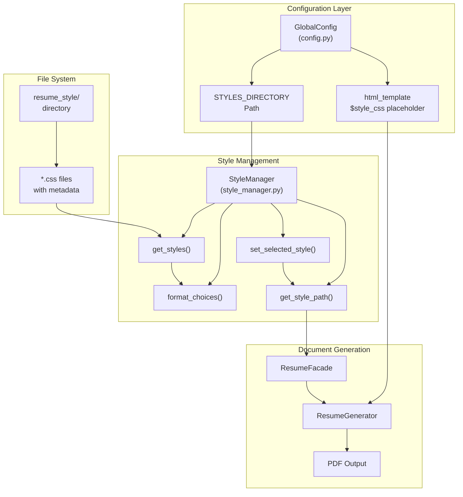
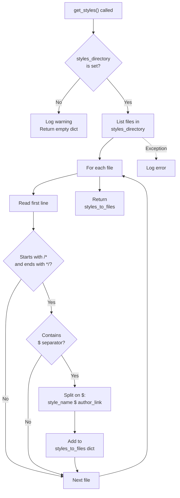
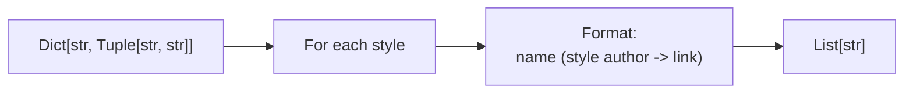
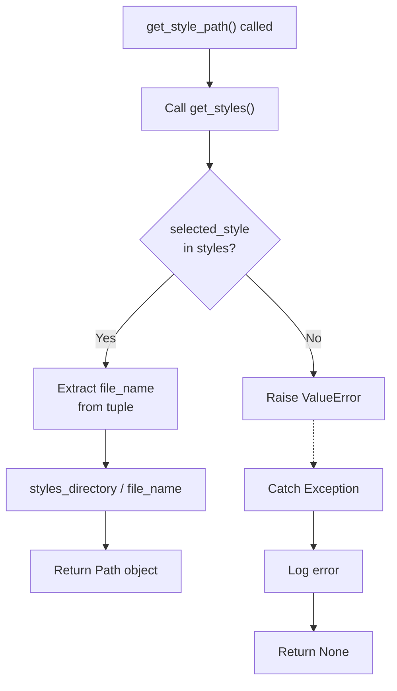
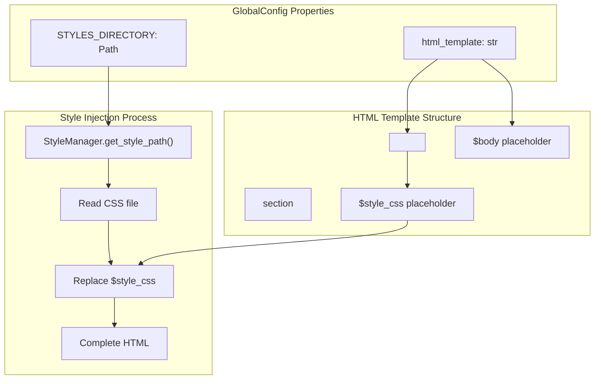
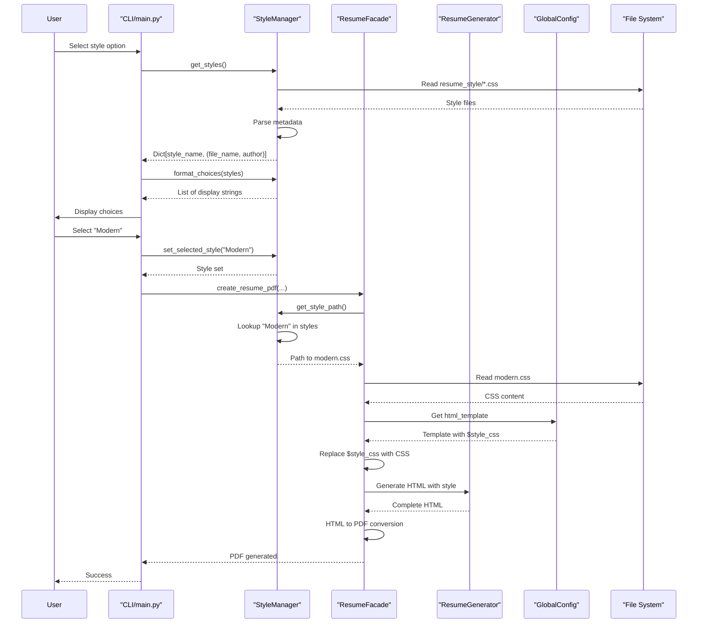
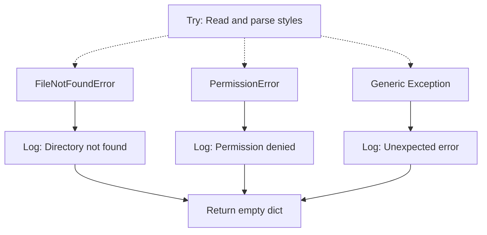

<!-- source: DeepWiki mcp.deepwiki.com · repo feder-cr/Jobs_Applier_AI_Agent_AIHawk · page 4.4 Style Management System · fetched 2026-10-29 -->

# Style Management System

<details>
<summary>Relevant source files</summary>

The following files were used as context for generating this wiki page:

- [src/libs/resume_and_cover_builder/config.py](src/libs/resume_and_cover_builder/config.py)
- [src/libs/resume_and_cover_builder/style_manager.py](src/libs/resume_and_cover_builder/style_manager.py)

</details>


The Style Management System is responsible for discovering, loading, and managing CSS styles for resume and cover letter generation. It provides a centralized mechanism for style discovery, selection, and integration into the HTML template rendering pipeline.

This document covers the architecture and implementation of style management. For information about how styles are integrated into the document generation process, see [Document Generation Architecture](#4.1). For details on the HTML template system, see [Prompt Engineering](#4.2).

## Purpose and Scope

The Style Management System enables:
- **Dynamic style discovery** from a designated styles directory
- **Metadata parsing** to extract style names and author attribution
- **Style selection** for document generation
- **Path resolution** to locate style files for CSS injection

The system abstracts style management from the core document generation logic, allowing new styles to be added without code changes.

## Architecture Overview

The following diagram shows how the Style Management System fits into the document generation pipeline:



**Sources:** [src/libs/resume_and_cover_builder/config.py](), [src/libs/resume_and_cover_builder/style_manager.py]()

## Core Components

### StyleManager Class

The `StyleManager` class [src/libs/resume_and_cover_builder/style_manager.py:10-89]() is the primary interface for style management operations. It encapsulates all logic for style discovery, selection, and path resolution.

#### Initialization


The constructor [src/libs/resume_and_cover_builder/style_manager.py:11-18]() performs the following operations:

| Operation | Implementation | Purpose |
|-----------|----------------|---------|
| Initialize selected_style | `self.selected_style: Optional[str] = None` | Track currently selected style |
| Resolve current file | `Path(__file__).resolve()` | Get absolute path of style_manager.py |
| Calculate project root | `current_file.parent.parent.parent.parent` | Navigate up directory tree |
| Set styles directory | `project_root / "src" / "libs" / ... / "resume_style"` | Locate styles directory |
| Log configuration | `logging.debug(...)` | Debug information for troubleshooting |

The path calculation logic navigates from:
```
style_manager.py (current file)
  → resume_and_cover_builder/ (parent)
    → libs/ (parent.parent)
      → src/ (parent.parent.parent)
        → project_root/ (parent.parent.parent.parent)
```

**Sources:** [src/libs/resume_and_cover_builder/style_manager.py:11-18]()

### Style Discovery

The `get_styles()` method [src/libs/resume_and_cover_builder/style_manager.py:20-53]() implements the style discovery mechanism:



**Sources:** [src/libs/resume_and_cover_builder/style_manager.py:20-53]()

#### Style Metadata Format

Each CSS style file must follow this metadata convention in the first line:

```css
/* Style Name $ Author Link */
```

The parser [src/libs/resume_and_cover_builder/style_manager.py:39-46]() extracts:

| Component | Extraction Method | Example |
|-----------|------------------|---------|
| Full comment | `first_line[2:-2].strip()` | Removes `/*` and `*/` |
| Style name | `content.split("$", 1)[0].strip()` | Text before `$` |
| Author link | `content.split("$", 1)[1].strip()` | Text after `$` |

**Return Value:** `Dict[str, Tuple[str, str]]` mapping `style_name` → `(file_name, author_link)`

**Sources:** [src/libs/resume_and_cover_builder/style_manager.py:36-46]()

### Style Selection

#### format_choices Method

The `format_choices()` method [src/libs/resume_and_cover_builder/style_manager.py:55-63]() transforms the styles dictionary into user-friendly display strings:



**Example Transformation:**

| Input Dictionary | Output List |
|------------------|-------------|
| `{"Modern": ("modern.css", "https://...")}` | `["Modern (style author -> https://...)"]` |
| `{"Classic": ("classic.css", "github.com/...")}` | `["Classic (style author -> github.com/...)"]` |

**Sources:** [src/libs/resume_and_cover_builder/style_manager.py:55-63]()

#### set_selected_style Method

The `set_selected_style()` method [src/libs/resume_and_cover_builder/style_manager.py:65-72]() provides a simple setter for the selected style:

```python
def set_selected_style(self, selected_style: str):
    self.selected_style = selected_style
    logging.info(f"Selected style set to: {self.selected_style}")
```

This method:
- Updates the `self.selected_style` instance variable
- Logs the selection for debugging
- Does not validate the style name (validation occurs in `get_style_path`)

**Sources:** [src/libs/resume_and_cover_builder/style_manager.py:65-72]()

### Style Path Resolution

The `get_style_path()` method [src/libs/resume_and_cover_builder/style_manager.py:74-88]() resolves the selected style name to an absolute file path:



**Error Handling:**

| Error Condition | Exception Type | Result |
|-----------------|----------------|--------|
| Style not found | `ValueError` | Logs error, returns `None` |
| File system error | Generic `Exception` | Logs error, returns `None` |
| Unset selected_style | Implicit KeyError | Caught by generic exception handler |

**Sources:** [src/libs/resume_and_cover_builder/style_manager.py:74-88]()

## Configuration Integration

### GlobalConfig Class

The `GlobalConfig` class [src/libs/resume_and_cover_builder/config.py:7-36]() provides configuration parameters for the style system:



**Sources:** [src/libs/resume_and_cover_builder/config.py:7-36]()

### HTML Template Structure

The template [src/libs/resume_and_cover_builder/config.py:16-34]() includes:

| Component | Purpose | Line Reference |
|-----------|---------|----------------|
| DOCTYPE declaration | HTML5 document type | Line 17 |
| Meta charset | UTF-8 encoding | Line 20 |
| External fonts | Google Fonts (Barlow) | Lines 23-24 |
| Font Awesome | Icon library | Line 25 |
| Style block | `$style_css` placeholder | Lines 26-28 |
| Body section | `$body` placeholder | Line 31 |

The `$style_css` placeholder [src/libs/resume_and_cover_builder/config.py:27]() is where the selected style's CSS content is injected during document generation.

**Sources:** [src/libs/resume_and_cover_builder/config.py:16-34]()

## Style File Organization

### Directory Structure

```
src/
└── libs/
    └── resume_and_cover_builder/
        └── resume_style/
            ├── style1.css
            ├── style2.css
            └── style3.css
```

The styles directory location is computed in `StyleManager.__init__` [src/libs/resume_and_cover_builder/style_manager.py:15]().

### Style File Format

Each style file must follow this structure:

```css
/* Style Name $ https://author-link.com */

/* CSS rules follow */
body {
    font-family: Arial, sans-serif;
    /* ... */
}

.header {
    /* ... */
}
```

**Requirements:**
- First line must be a comment: `/* ... */`
- Must contain separator: `$`
- Style name comes before `$`
- Author link comes after `$`
- CSS rules start from line 2 onwards

**Sources:** [src/libs/resume_and_cover_builder/style_manager.py:36-46]()

## Integration with Document Generation

The following diagram shows the complete flow from style selection to PDF generation:



**Sources:** [src/libs/resume_and_cover_builder/style_manager.py](), [src/libs/resume_and_cover_builder/config.py]()

## Error Handling and Logging

### Logging Configuration

The module uses Python's logging framework [src/libs/resume_and_cover_builder/style_manager.py:6-7]():

```python
logging.basicConfig(level=logging.DEBUG, 
                   format="%(asctime)s - %(levelname)s - %(message)s")
```

### Logged Events

| Event | Log Level | Location |
|-------|-----------|----------|
| Project root determined | DEBUG | Line 17 |
| Styles directory set | DEBUG | Line 18 |
| Reading styles directory | DEBUG | Line 30 |
| Files found | DEBUG | Line 33 |
| Processing file | DEBUG | Line 35 |
| First line content | DEBUG | Line 38 |
| Style added successfully | INFO | Line 46 |
| Directory not found | ERROR | Line 48 |
| Permission denied | ERROR | Line 50 |
| Unexpected error | ERROR | Line 52 |
| Selected style set | INFO | Line 72 |
| Style retrieval error | ERROR | Line 87 |

### Exception Handling

The `get_styles()` method [src/libs/resume_and_cover_builder/style_manager.py:47-52]() handles multiple exception types:



The `get_style_path()` method [src/libs/resume_and_cover_builder/style_manager.py:80-88]() uses a generic exception handler to catch all errors during path resolution, ensuring the method returns `None` rather than crashing.

**Sources:** [src/libs/resume_and_cover_builder/style_manager.py:47-52](), [src/libs/resume_and_cover_builder/style_manager.py:80-88]()

## Type Annotations

The `StyleManager` class uses type hints for clarity:

| Method | Return Type | Parameters |
|--------|-------------|------------|
| `get_styles()` | `Dict[str, Tuple[str, str]]` | None |
| `format_choices()` | `List[str]` | `styles_to_files: Dict[str, Tuple[str, str]]` |
| `set_selected_style()` | None | `selected_style: str` |
| `get_style_path()` | `Optional[Path]` | None |

Instance variable `selected_style` is typed as `Optional[str]` [src/libs/resume_and_cover_builder/style_manager.py:12]().

**Sources:** [src/libs/resume_and_cover_builder/style_manager.py:10-89]()

## Creating Custom Styles

To add a new style to the system:

1. **Create CSS file** in `src/libs/resume_and_cover_builder/resume_style/`
2. **Add metadata comment** as the first line:
   ```css
   /* My Custom Style $ https://github.com/myusername */
   ```
3. **Write CSS rules** targeting resume HTML structure
4. **Test discovery** by running style selection - the new style should appear automatically

No code changes are required. The `StyleManager` will discover the new style on the next run.

**Sources:** [src/libs/resume_and_cover_builder/style_manager.py:20-53]()

## Dependencies

The Style Management System depends on:

| Dependency | Purpose | Import Statement |
|------------|---------|------------------|
| `pathlib.Path` | File system path manipulation | `from pathlib import Path` |
| `typing` | Type annotations | `from typing import Dict, List, Tuple, Optional` |
| `logging` | Debug and error logging | `import logging` |
| `os` | Operating system interface (imported but unused) | `import os` |

**Sources:** [src/libs/resume_and_cover_builder/style_manager.py:1-4]()

## Design Patterns

### Directory-Based Discovery

The style system uses a **directory-based discovery pattern** where:
- Styles are stored as files in a known directory
- Metadata is embedded in the files themselves
- The system scans the directory at runtime
- No central registry or configuration is needed

### Convention Over Configuration

The style metadata format (`/* Name $ Link */`) is a **convention over configuration** approach:
- No separate manifest file required
- Self-documenting (metadata in the file itself)
- Simple to add new styles
- Minimal configuration overhead

### Path Object Pattern

The system uses `pathlib.Path` objects throughout for:
- Type safety (`Path` vs. `str`)
- Cross-platform compatibility
- Readable path manipulation (`.parent`, `/` operator)
- Explicit file system operations

**Sources:** [src/libs/resume_and_cover_builder/style_manager.py]()

---

