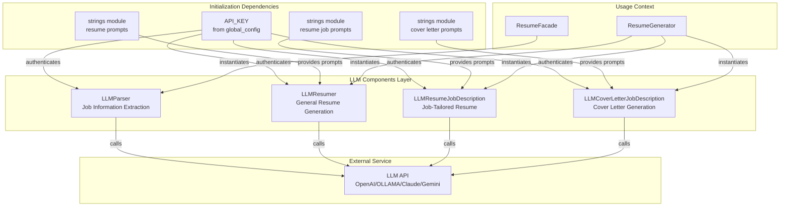
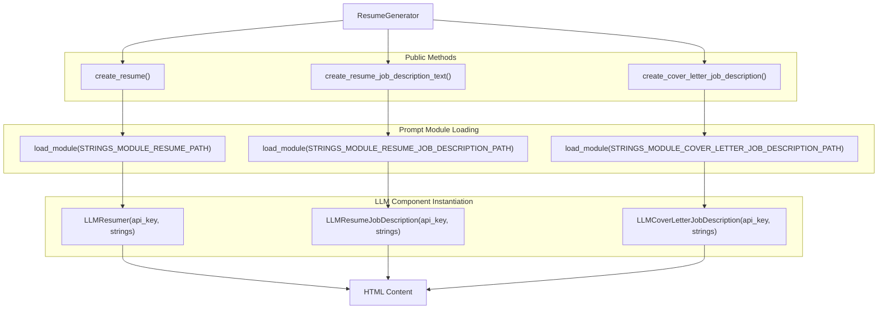
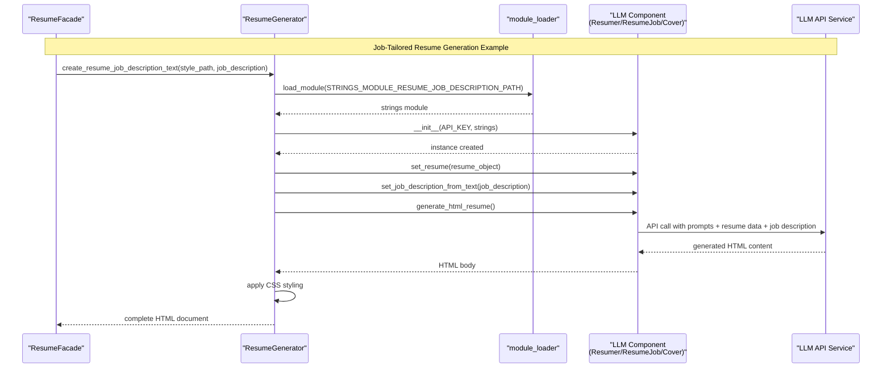

<!-- source: DeepWiki mcp.deepwiki.com · repo feder-cr/Jobs_Applier_AI_Agent_AIHawk · page 4.5 LLM Components · fetched 2026-10-29 -->

# LLM Components

<details>
<summary>Relevant source files</summary>

The following files were used as context for generating this wiki page:

- [src/libs/resume_and_cover_builder/resume_facade.py](src/libs/resume_and_cover_builder/resume_facade.py)
- [src/libs/resume_and_cover_builder/resume_generator.py](src/libs/resume_and_cover_builder/resume_generator.py)

</details>


The LLM Components subsystem provides specialized classes for interacting with Large Language Models (OpenAI, OLLAMA, Claude, Gemini) to perform specific document generation and parsing tasks. This module includes four primary components: `LLMParser` for extracting structured job information, `LLMResumer` for generating general resumes, `LLMResumeJobDescription` for creating job-tailored resumes, and `LLMCoverLetterJobDescription` for generating cover letters.

Sources: [src/libs/resume_and_cover_builder/resume_facade.py:11](), [src/libs/resume_and_cover_builder/resume_generator.py:7-9]()
</thinking>

## LLM Component Architecture

The four LLM components serve distinct purposes within the document generation pipeline. Each component encapsulates specific prompts, processing logic, and LLM interaction patterns.

**LLM Component Structure**


Sources: [src/libs/resume_and_cover_builder/resume_facade.py:76](), [src/libs/resume_and_cover_builder/resume_generator.py:44](), [src/libs/resume_and_cover_builder/resume_generator.py:49](), [src/libs/resume_and_cover_builder/resume_generator.py:55]()

## Component Comparison

Each LLM component has a specific role, initialization pattern, and set of methods. The following table outlines their characteristics:

| Component | Purpose | Initialization Parameters | Primary Methods | Input Data | Output Format |
|-----------|---------|---------------------------|-----------------|------------|---------------|
| `LLMParser` | Extract structured job information from HTML | `openai_api_key` | `set_body_html()`, `extract_role()`, `extract_company_name()`, `extract_job_description()`, `extract_location()` | Raw HTML content | Structured strings |
| `LLMResumer` | Generate general resume HTML | `api_key`, `strings` module | `set_resume()`, `generate_html_resume()` | Resume object | HTML content |
| `LLMResumeJobDescription` | Generate job-tailored resume HTML | `api_key`, `strings` module | `set_resume()`, `set_job_description_from_text()`, `generate_html_resume()` | Resume object + job description | HTML content |
| `LLMCoverLetterJobDescription` | Generate cover letter HTML | `api_key`, `strings` module | `set_resume()`, `set_job_description_from_text()`, `generate_cover_letter()` | Resume object + job description | HTML content |

Sources: [src/libs/resume_and_cover_builder/resume_facade.py:76-84](), [src/libs/resume_and_cover_builder/resume_generator.py:44-58]()

## LLMParser

The `LLMParser` class is responsible for extracting structured information from raw HTML job postings. It is instantiated in the `link_to_job()` method of `ResumeFacade`.

### Initialization and Usage

```python
# Instantiation pattern from resume_facade.py
self.llm_job_parser = LLMParser(openai_api_key=global_config.API_KEY)
self.llm_job_parser.set_body_html(body_element)
```

### Extraction Methods

The `LLMParser` provides specialized extraction methods, each querying the LLM to parse specific information:

- `extract_role()`: Returns the job title/role as a string
- `extract_company_name()`: Returns the company name as a string
- `extract_job_description()`: Returns the full job description text
- `extract_location()`: Returns the job location as a string

### Integration Pattern

`LLMParser` is used within `ResumeFacade.link_to_job()` to populate a `Job` object:

```python
# Usage pattern from resume_facade.py:79-84
self.job = Job()
self.job.role = self.llm_job_parser.extract_role()
self.job.company = self.llm_job_parser.extract_company_name()
self.job.description = self.llm_job_parser.extract_job_description()
self.job.location = self.llm_job_parser.extract_location()
self.job.link = job_url
```

Sources: [src/libs/resume_and_cover_builder/resume_facade.py:76-84]()

## LLMResumer

The `LLMResumer` class generates general-purpose resume HTML without tailoring to a specific job description. It is instantiated by the `ResumeGenerator` class.

### Initialization Pattern

```python
# From resume_generator.py:42-45
strings = load_module(global_config.STRINGS_MODULE_RESUME_PATH, global_config.STRINGS_MODULE_NAME)
gpt_answerer = LLMResumer(global_config.API_KEY, strings)
```

The `strings` parameter provides prompt templates loaded from `strings_feder-cr.py` files.

### Content Generation Workflow

The `LLMResumer` follows a standard workflow:

1. `set_resume(resume_object)`: Loads the user's resume data
2. `generate_html_resume()`: Calls the LLM to generate HTML-formatted resume content

### Integration Context

`LLMResumer` is used by `ResumeGenerator.create_resume()` for general resume generation:

```python
# From resume_generator.py:21-40
gpt_answerer.set_resume(self.resume_object)
body_html = gpt_answerer.generate_html_resume()
# HTML is then combined with CSS styling
```

Sources: [src/libs/resume_and_cover_builder/resume_generator.py:42-45](), [src/libs/resume_and_cover_builder/resume_generator.py:21-40]()

## LLMResumeJobDescription

The `LLMResumeJobDescription` class generates job-tailored resume HTML by incorporating a specific job description into the generation process.

### Initialization Pattern

```python
# From resume_generator.py:47-51
strings = load_module(global_config.STRINGS_MODULE_RESUME_JOB_DESCRIPTION_PATH, global_config.STRINGS_MODULE_NAME)
gpt_answerer = LLMResumeJobDescription(global_config.API_KEY, strings)
gpt_answerer.set_job_description_from_text(job_description_text)
```

### Key Difference from LLMResumer

While `LLMResumer` generates general resumes, `LLMResumeJobDescription` accepts job description text via `set_job_description_from_text()`. The LLM uses this context to emphasize relevant skills and experiences.

### Integration Context

`LLMResumeJobDescription` is used by `ResumeGenerator.create_resume_job_description_text()`:

```python
# From resume_generator.py:47-51
gpt_answerer = LLMResumeJobDescription(global_config.API_KEY, strings)
gpt_answerer.set_job_description_from_text(job_description_text)
return self._create_resume(gpt_answerer, style_path)
```

The `_create_resume()` helper method handles the common HTML generation and styling logic for both `LLMResumer` and `LLMResumeJobDescription`.

Sources: [src/libs/resume_and_cover_builder/resume_generator.py:47-51](), [src/libs/resume_and_cover_builder/resume_generator.py:21-40]()

## LLMCoverLetterJobDescription

The `LLMCoverLetterJobDescription` class generates personalized cover letters that connect a candidate's experience to a specific job opportunity.

### Initialization Pattern

```python
# From resume_generator.py:53-58
strings = load_module(global_config.STRINGS_MODULE_COVER_LETTER_JOB_DESCRIPTION_PATH, global_config.STRINGS_MODULE_NAME)
gpt_answerer = LLMCoverLetterJobDescription(global_config.API_KEY, strings)
gpt_answerer.set_resume(self.resume_object)
gpt_answerer.set_job_description_from_text(job_description_text)
cover_letter_html = gpt_answerer.generate_cover_letter()
```

### Generation Method

Unlike the resume generators that use `generate_html_resume()`, this component uses `generate_cover_letter()`, which produces cover letter-specific HTML formatted as a letter with appropriate salutation and structure.

### Integration Context

`LLMCoverLetterJobDescription` is used by `ResumeGenerator.create_cover_letter_job_description()`:

```python
# From resume_generator.py:53-62
gpt_answerer = LLMCoverLetterJobDescription(global_config.API_KEY, strings)
gpt_answerer.set_resume(self.resume_object)
gpt_answerer.set_job_description_from_text(job_description_text)
cover_letter_html = gpt_answerer.generate_cover_letter()
# HTML is then combined with CSS styling
```

Sources: [src/libs/resume_and_cover_builder/resume_generator.py:53-62]()

## Common Initialization Patterns

All LLM components share common initialization and configuration patterns that ensure consistent authentication and prompt management.

### API Key Configuration

All components require an API key sourced from `global_config.API_KEY`, which is set in `ResumeFacade.__init__()`:

```python
# From resume_facade.py:34
global_config.API_KEY = api_key
```

This key authenticates requests to the configured LLM provider (OpenAI, OLLAMA, Claude, or Gemini).

### Prompt Module Loading

Resume and cover letter generators load prompt templates from dedicated module paths:

| Component | Prompt Module Path Configuration |
|-----------|----------------------------------|
| `LLMResumer` | `global_config.STRINGS_MODULE_RESUME_PATH` |
| `LLMResumeJobDescription` | `global_config.STRINGS_MODULE_RESUME_JOB_DESCRIPTION_PATH` |
| `LLMCoverLetterJobDescription` | `global_config.STRINGS_MODULE_COVER_LETTER_JOB_DESCRIPTION_PATH` |

These paths point to `strings_feder-cr.py` files containing prompt templates for headers, education, experience, projects, and skills sections.

Sources: [src/libs/resume_and_cover_builder/resume_facade.py:28-34](), [src/libs/resume_and_cover_builder/resume_generator.py:43-55]()

## Integration with ResumeGenerator

The `ResumeGenerator` class serves as the factory and orchestrator for all LLM components involved in content generation. It provides three public methods, each using a different LLM component:

**ResumeGenerator Component Selection**


Sources: [src/libs/resume_and_cover_builder/resume_generator.py:42-62]()

### Content Generation Workflow

The `ResumeGenerator` follows a consistent workflow for all document types:

1. **Load Prompts**: Use `load_module()` to load the appropriate prompt strings
2. **Instantiate Component**: Create the LLM component with API key and prompts
3. **Set Context**: Call `set_resume()` and optionally `set_job_description_from_text()`
4. **Generate Content**: Call the generation method (`generate_html_resume()` or `generate_cover_letter()`)
5. **Apply Styling**: Combine generated HTML with CSS from style file
6. **Return Result**: Return complete HTML document

This pattern is implemented in the `_create_resume()` helper method for resume generation and inline for cover letter generation.

Sources: [src/libs/resume_and_cover_builder/resume_generator.py:21-40](), [src/libs/resume_and_cover_builder/resume_generator.py:53-62]()

## Component Interaction Flow

The following diagram illustrates how LLM components interact with the broader document generation system:

**LLM Component Usage in Document Generation**


Sources: [src/libs/resume_and_cover_builder/resume_generator.py:47-51](), [src/libs/resume_and_cover_builder/resume_generator.py:21-40]()

## Design Patterns and Best Practices

The LLM components follow several design patterns that promote maintainability and extensibility:

### Factory Pattern

`ResumeGenerator` acts as a factory, instantiating the appropriate LLM component based on the requested document type. Each method in `ResumeGenerator` encapsulates the creation logic for its specific component.

### Dependency Injection

All LLM components receive their dependencies (API key, prompt strings) through constructor parameters, allowing for flexible configuration and testing.

### Template Method Pattern

The `_create_resume()` helper method in `ResumeGenerator` defines the skeleton of the resume generation algorithm, while allowing subclass-specific behavior through the polymorphic `generate_html_resume()` method.

### Separation of Concerns

- **Prompt Engineering**: Separated into module files loaded by `module_loader`
- **LLM Interaction**: Encapsulated within component classes
- **Styling**: Handled by `StyleManager` and CSS files
- **Output Conversion**: Delegated to `HTML_to_PDF` utility

Sources: [src/libs/resume_and_cover_builder/resume_generator.py:21-51]()

## Customization Capabilities

The cover letter generation system offers several levels of customization:

1. **Style Customization**: Users can select from various styles for their cover letter through the style manager.
2. **Content Customization**: The system generates cover letter content tailored to both the user's resume data and the specific job description.
3. **LLM Provider Selection**: The system can work with different LLM providers (OpenAI, Ollama, Claude, Gemini) based on configuration settings.

Sources: [src/libs/resume_and_cover_builder/resume_facade.py:140-142](), [src/libs/resume_and_cover_builder/resume_generator.py:54-58]()

## Summary

The Cover Letter Generation system in AIHawk provides a powerful tool for creating personalized, job-tailored cover letters. By leveraging LLM technology, it can analyze job descriptions and generate cover letter content that highlights the most relevant aspects of a candidate's experience for a specific role. The system's modular architecture allows for customization of both the content and style of the generated cover letters.

---

