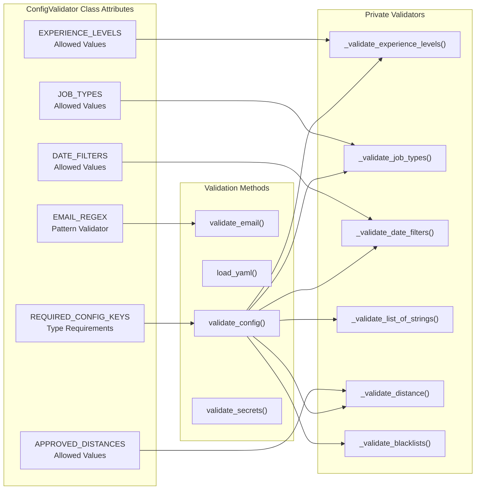
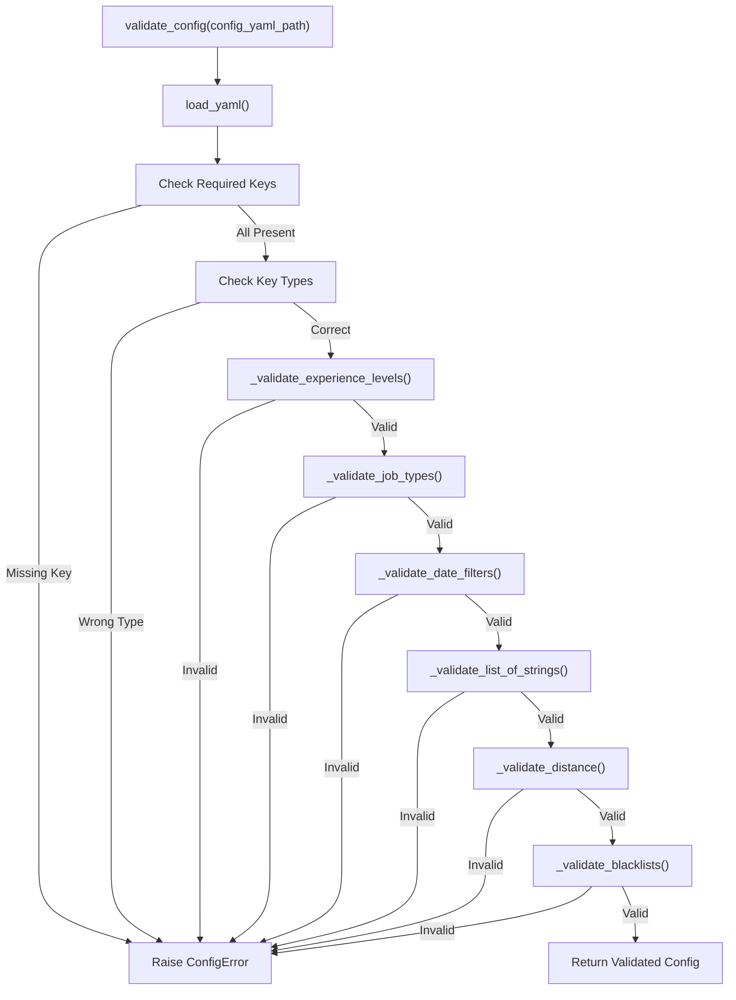
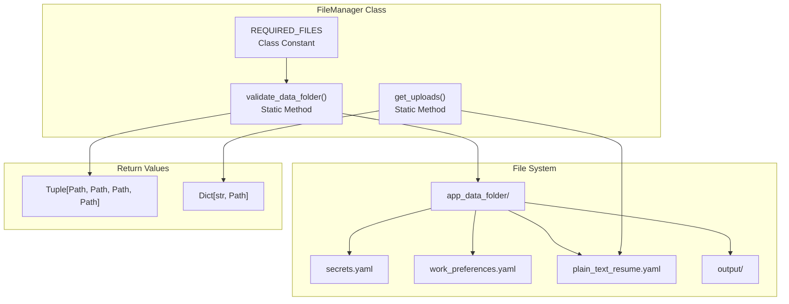
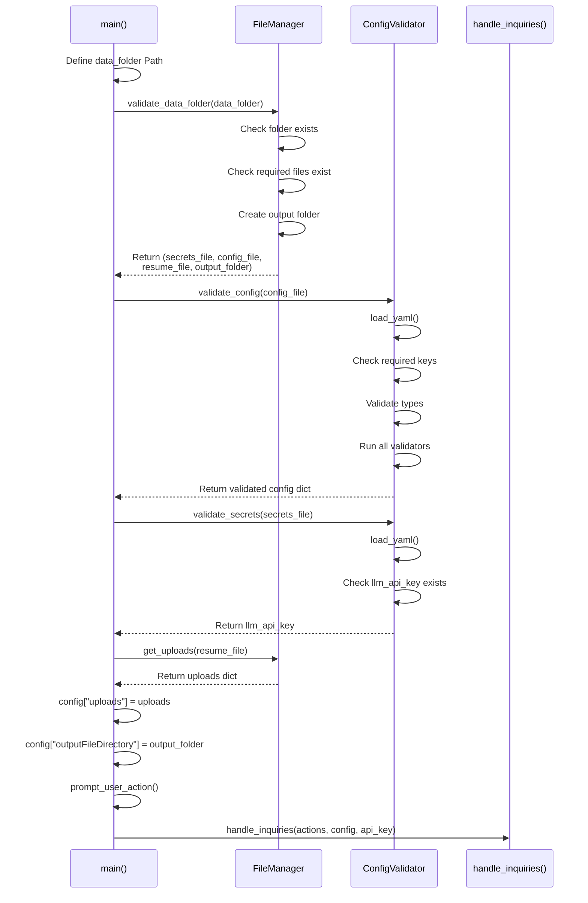
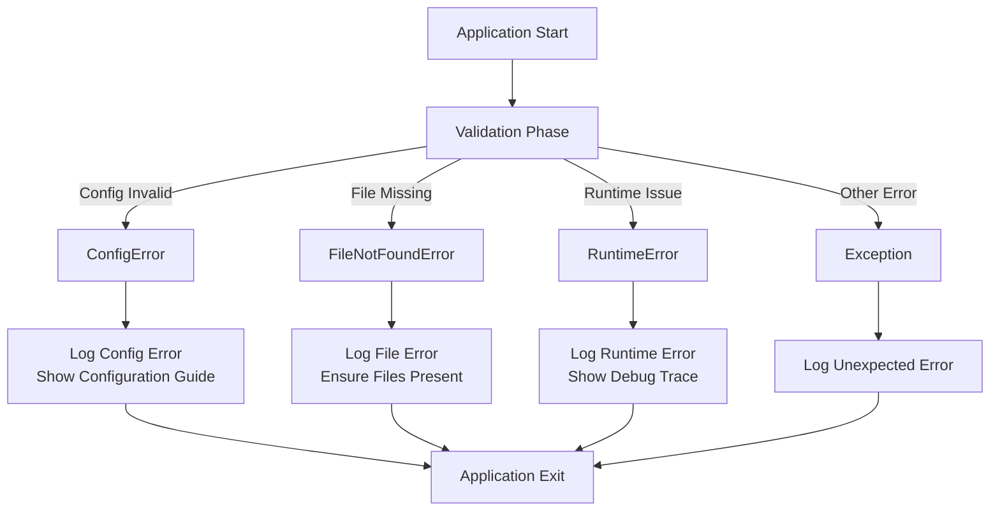

<!-- source: DeepWiki mcp.deepwiki.com · repo feder-cr/Jobs_Applier_AI_Agent_AIHawk · page 4.6 Configuration and Validation · fetched 2026-10-29 -->

# Configuration and Validation

<details>
<summary>Relevant source files</summary>

The following files were used as context for generating this wiki page:

- [main.py](main.py)
- [src/libs/resume_and_cover_builder/config.py](src/libs/resume_and_cover_builder/config.py)

</details>


## Purpose and Scope

This page provides technical documentation on the configuration and validation system in AIHawk. The system ensures that all configuration files conform to expected formats and values before the application starts. This includes validation of YAML configuration files, API keys, file paths, and user preferences.

This page covers the `ConfigValidator` and `FileManager` classes, validation rules, and the configuration flow. For information about how configuration is used by specific subsystems, see:
- LLM configuration and API integration: [LLM Integration](#2.3)
- Configuration file structure and user options: [Configuration Files](#3.2)
- Global configuration for document generation: [Document Generation Architecture](#4.1)

**Sources:** [main.py:1-566](), [src/libs/resume_and_cover_builder/config.py:1-37]()

---

## System Overview

The configuration and validation system consists of two primary classes and a custom exception type:

| Component | Purpose | Location |
|-----------|---------|----------|
| `ConfigValidator` | Validates YAML configuration files against predefined rules | [main.py:35-182]() |
| `FileManager` | Manages file system operations and path validation | [main.py:184-218]() |
| `ConfigError` | Custom exception for configuration-related errors | [main.py:30-32]() |

The validation process occurs during application startup, before any job application or document generation logic executes. This fail-fast approach prevents runtime errors due to invalid configuration.

**Sources:** [main.py:30-218]()

---

## Configuration Validation Architecture

```mermaid
graph TB
    subgraph "Entry Point"
        MAIN["main()"]
    end
    
    subgraph "File System Layer"
        DATA_FOLDER["data_folder/"]
        SECRETS["secrets.yaml"]
        CONFIG["work_preferences.yaml"]
        RESUME["plain_text_resume.yaml"]
        OUTPUT["output/"]
    end
    
    subgraph "Validation Layer"
        FILE_MGR["FileManager"]
        CONFIG_VAL["ConfigValidator"]
        
        VALIDATE_FOLDER["validate_data_folder()"]
        VALIDATE_CONFIG["validate_config()"]
        VALIDATE_SECRETS["validate_secrets()"]
        GET_UPLOADS["get_uploads()"]
    end
    
    subgraph "Validation Rules"
        REQUIRED_KEYS["REQUIRED_CONFIG_KEYS"]
        EXPERIENCE["EXPERIENCE_LEVELS"]
        JOB_TYPES["JOB_TYPES"]
        DISTANCES["APPROVED_DISTANCES"]
        EMAIL_REGEX["EMAIL_REGEX"]
    end
    
    subgraph "Validated Output"
        VALID_CONFIG["Validated Config Dict"]
        API_KEY["llm_api_key"]
        UPLOADS["uploads Dict"]
        OUTPUT_DIR["outputFileDirectory"]
    end
    
    subgraph "Error Handling"
        CONFIG_ERROR["ConfigError"]
        FILE_NOT_FOUND["FileNotFoundError"]
    end
    
    MAIN --> FILE_MGR
    MAIN --> CONFIG_VAL
    
    FILE_MGR --> VALIDATE_FOLDER
    VALIDATE_FOLDER --> DATA_FOLDER
    DATA_FOLDER --> SECRETS
    DATA_FOLDER --> CONFIG
    DATA_FOLDER --> RESUME
    DATA_FOLDER --> OUTPUT
    
    VALIDATE_FOLDER --> GET_UPLOADS
    GET_UPLOADS --> RESUME
    
    CONFIG_VAL --> VALIDATE_CONFIG
    CONFIG_VAL --> VALIDATE_SECRETS
    
    VALIDATE_CONFIG --> CONFIG
    VALIDATE_SECRETS --> SECRETS
    
    VALIDATE_CONFIG --> REQUIRED_KEYS
    VALIDATE_CONFIG --> EXPERIENCE
    VALIDATE_CONFIG --> JOB_TYPES
    VALIDATE_CONFIG --> DISTANCES
    VALIDATE_SECRETS --> EMAIL_REGEX
    
    VALIDATE_CONFIG --> VALID_CONFIG
    VALIDATE_SECRETS --> API_KEY
    GET_UPLOADS --> UPLOADS
    VALIDATE_FOLDER --> OUTPUT_DIR
    
    VALIDATE_CONFIG -.->|on error| CONFIG_ERROR
    VALIDATE_SECRETS -.->|on error| CONFIG_ERROR
    VALIDATE_FOLDER -.->|on error| FILE_NOT_FOUND
```



**Diagram: Configuration validation flow showing the relationship between file system operations, validation logic, and error handling**

**Sources:** [main.py:35-218](), [main.py:527-562]()

---

## ConfigValidator Class

The `ConfigValidator` class provides static methods for validating configuration YAML files. It enforces strict type checking and value constraints to ensure configuration correctness.

### Class Attributes



**Diagram: ConfigValidator class structure showing attributes and validation methods**

**Sources:** [main.py:35-182]()

### Required Configuration Keys

The `REQUIRED_CONFIG_KEYS` dictionary defines the expected structure of `work_preferences.yaml`:

| Key | Expected Type | Description |
|-----|---------------|-------------|
| `remote` | `bool` | Whether to include remote jobs |
| `experience_level` | `dict` | Experience level preferences (dict of booleans) |
| `job_types` | `dict` | Job type preferences (dict of booleans) |
| `date` | `dict` | Date filter preferences (dict of booleans) |
| `positions` | `list` | List of position titles to search |
| `locations` | `list` | List of locations to search |
| `location_blacklist` | `list` | List of locations to exclude |
| `distance` | `int` | Search radius in miles |
| `company_blacklist` | `list` | List of companies to exclude |
| `title_blacklist` | `list` | List of job titles to exclude |

**Sources:** [main.py:39-50]()

### Allowed Values

The class defines strict whitelists for enumerated configuration values:

**Experience Levels:**
```
internship, entry, associate, mid_senior_level, director, executive
```

**Job Types:**
```
full_time, contract, part_time, temporary, internship, other, volunteer
```

**Date Filters:**
```
all_time, month, week, 24_hours
```

**Approved Distances:**
```
0, 5, 10, 25, 50, 100 (miles)
```

**Sources:** [main.py:51-69]()

### Validation Methods

#### validate_config()

The primary configuration validation method enforces all validation rules:



**Diagram: Configuration validation flow in validate_config()**

**Sources:** [main.py:88-111]()

#### validate_secrets()

This method validates `secrets.yaml` and extracts the LLM API key:

1. Loads the YAML file using `load_yaml()`
2. Checks for the mandatory `llm_api_key` field
3. Ensures the key is non-empty
4. Returns the API key string

**Sources:** [main.py:169-181]()

### Private Validation Methods

These methods enforce specific validation rules:

| Method | Purpose | Validation Logic |
|--------|---------|------------------|
| `_validate_experience_levels()` | Validates experience level booleans | Each level must be a boolean value |
| `_validate_job_types()` | Validates job type booleans | Each type must be a boolean value |
| `_validate_date_filters()` | Validates date filter booleans | Each filter must be a boolean value |
| `_validate_list_of_strings()` | Validates string lists | All items must be strings |
| `_validate_distance()` | Validates distance value | Must be in `APPROVED_DISTANCES` set |
| `_validate_blacklists()` | Validates blacklist fields | Must be lists (empty lists allowed) |

**Sources:** [main.py:113-167]()

---

## FileManager Class

The `FileManager` class handles file system operations and path validation.

### Class Structure



**Diagram: FileManager class structure and file system interaction**

**Sources:** [main.py:184-218]()

### Required Files

The `REQUIRED_FILES` constant defines files that must exist in the data folder:

```python
REQUIRED_FILES = [SECRETS_YAML, WORK_PREFERENCES_YAML, PLAIN_TEXT_RESUME_YAML]
```

These constants are imported from `src/utils/constants.py`.

**Sources:** [main.py:187](), [main.py:20-24]()

### validate_data_folder()

This method performs comprehensive file system validation:

1. **Folder Existence:** Verifies that `app_data_folder` exists and is a directory
2. **Required Files:** Checks that all files in `REQUIRED_FILES` exist
3. **Output Folder:** Creates the output folder if it doesn't exist (`mkdir(exist_ok=True)`)
4. **Return Value:** Returns a tuple of four `Path` objects:
   - Path to `secrets.yaml`
   - Path to `work_preferences.yaml`
   - Path to `plain_text_resume.yaml`
   - Path to output folder

**Error Handling:**
- Raises `FileNotFoundError` if the data folder doesn't exist
- Raises `FileNotFoundError` if any required files are missing

**Sources:** [main.py:190-207]()

### get_uploads()

This method creates a dictionary mapping upload identifiers to file paths:

```python
def get_uploads(plain_text_resume_file: Path) -> Dict[str, Path]:
    uploads = {"plainTextResume": plain_text_resume_file}
    return uploads
```

The method:
1. Validates that the resume file exists
2. Creates a dictionary with the key `"plainTextResume"` mapping to the file path
3. Returns the dictionary for use by document generation components

**Sources:** [main.py:210-217]()

---

## GlobalConfig Class

The `GlobalConfig` class in `src/libs/resume_and_cover_builder/config.py` stores global configuration for the document generation system:

| Attribute | Type | Purpose |
|-----------|------|---------|
| `STRINGS_MODULE_RESUME_PATH` | `Path` | Path to resume prompt strings module |
| `STRINGS_MODULE_RESUME_JOB_DESCRIPTION_PATH` | `Path` | Path to job-tailored resume prompts |
| `STRINGS_MODULE_COVER_LETTER_JOB_DESCRIPTION_PATH` | `Path` | Path to cover letter prompts |
| `STRINGS_MODULE_NAME` | `str` | Name of the prompt strings module |
| `STYLES_DIRECTORY` | `Path` | Directory containing CSS style files |
| `LOG_OUTPUT_FILE_PATH` | `Path` | Path to log file |
| `API_KEY` | `str` | LLM API key |
| `html_template` | `str` | HTML template for document generation |

A global instance `global_config` is created and used throughout the document generation system.

**Sources:** [src/libs/resume_and_cover_builder/config.py:7-36]()

---

## Configuration Flow in main()



**Diagram: Sequence diagram showing configuration validation flow in main()**

The complete flow:

1. **File System Validation:** `FileManager.validate_data_folder()` verifies folder structure
2. **Configuration Validation:** `ConfigValidator.validate_config()` validates work preferences
3. **Secrets Validation:** `ConfigValidator.validate_secrets()` extracts API key
4. **Path Preparation:** `FileManager.get_uploads()` creates upload mapping
5. **Config Assembly:** Adds `uploads` and `outputFileDirectory` to config dict
6. **Execution:** Passes validated config to document generation functions

**Sources:** [main.py:527-546]()

---

## Validation Rules Details

### Experience Level Validation

The `_validate_experience_levels()` method ensures each experience level is a boolean:

```python
for level in cls.EXPERIENCE_LEVELS:
    if not isinstance(experience_levels.get(level), bool):
        raise ConfigError(f"Experience level '{level}' must be a boolean")
```

**Valid Configuration:**
```yaml
experience_level:
  internship: true
  entry: true
  associate: false
  mid_senior_level: true
  director: false
  executive: false
```

**Sources:** [main.py:114-120]()

### Job Type Validation

Similar to experience levels, each job type must be a boolean:

```yaml
job_types:
  full_time: true
  contract: false
  part_time: false
  temporary: false
  internship: true
  other: false
  volunteer: false
```

**Sources:** [main.py:122-129]()

### Distance Validation

The distance value must be exactly one of the approved values:

| Valid Distances (miles) |
|-------------------------|
| 0 (on-site only) |
| 5 |
| 10 |
| 25 |
| 50 |
| 100 |

Any other value raises a `ConfigError`.

**Sources:** [main.py:150-155]()

### Blacklist Validation

Blacklist fields have special handling:

1. If missing, they are initialized as empty lists
2. If `None`, they are converted to empty lists
3. Must be lists (not strings or other types)

This allows users to omit blacklist fields if they don't need filtering.

**Sources:** [main.py:94-100](), [main.py:158-166]()

---

## Error Handling

### ConfigError Exception

The custom `ConfigError` exception provides clear error messages for configuration issues:

```python
class ConfigError(Exception):
    """Custom exception for configuration-related errors."""
    pass
```

**Usage in main():**
```python
except ConfigError as ce:
    logger.error(f"Configuration error: {ce}")
    logger.error("Refer to the configuration guide...")
```

**Sources:** [main.py:30-32](), [main.py:548-553]()

### Error Flow



**Diagram: Error handling flow showing exception types and logging behavior**

**Sources:** [main.py:548-561]()

---

## Integration with Other Systems

### Document Generation

After validation, the config dictionary is passed to document generation functions:

- `create_resume_pdf(parameters, llm_api_key)` - Uses `parameters["uploads"]["plainTextResume"]`
- `create_resume_pdf_job_tailored(parameters, llm_api_key)` - Same
- `create_cover_letter(parameters, llm_api_key)` - Same

All functions expect `parameters["outputFileDirectory"]` for saving generated PDFs.

**Sources:** [main.py:220-468]()

### LLM Integration

The validated `llm_api_key` from `secrets.yaml` is passed to:
- `ResumeFacade` constructor as `api_key` parameter
- LLM client components for API authentication

See [LLM Components](#4.5) for details on how the API key is used.

**Sources:** [main.py:536](), [main.py:266](), [main.py:351](), [main.py:438]()

---

## Validation Rule Summary

| Validation Category | Rules | Enforcement Method |
|---------------------|-------|-------------------|
| **Required Keys** | 10 mandatory keys must be present | `validate_config()` checks dict keys |
| **Type Checking** | Each key must match expected type | `isinstance()` checks |
| **Experience Levels** | 6 levels, all boolean | `_validate_experience_levels()` |
| **Job Types** | 7 types, all boolean | `_validate_job_types()` |
| **Date Filters** | 4 filters, all boolean | `_validate_date_filters()` |
| **Distance** | Must be in {0, 5, 10, 25, 50, 100} | `_validate_distance()` |
| **String Lists** | positions, locations must be string lists | `_validate_list_of_strings()` |
| **Blacklists** | Must be lists (can be empty) | `_validate_blacklists()` |
| **API Key** | Must exist and be non-empty | `validate_secrets()` |
| **Email** | Must match regex pattern | `validate_email()` (currently unused) |

**Sources:** [main.py:35-182]()

---

