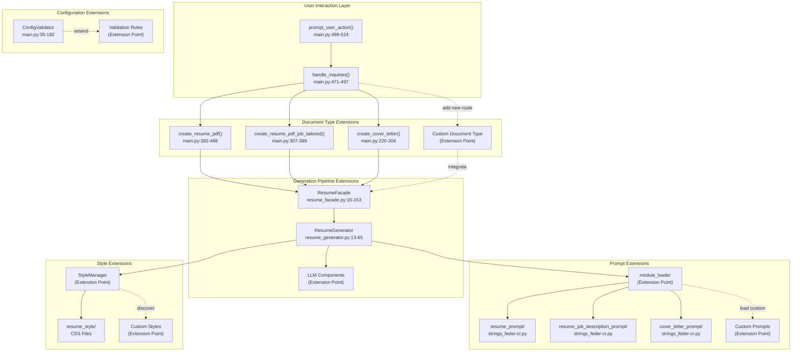
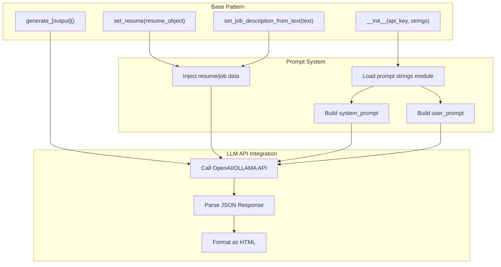
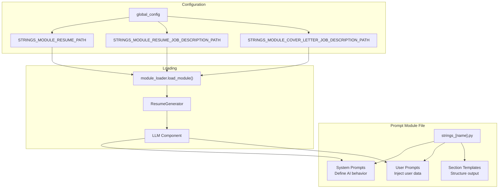
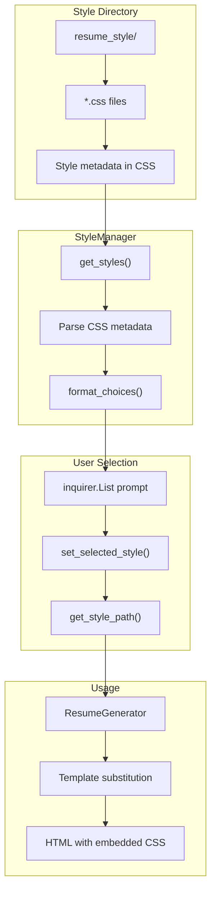
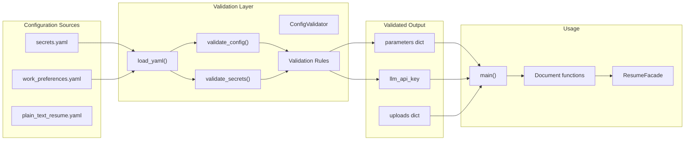
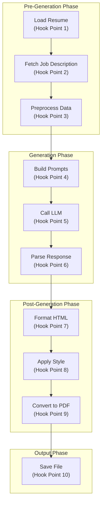

<!-- source: DeepWiki mcp.deepwiki.com · repo feder-cr/Jobs_Applier_AI_Agent_AIHawk · page 4.7 Extending the System · fetched 2026-10-29 -->

# Extending the System

<details>
<summary>Relevant source files</summary>

The following files were used as context for generating this wiki page:

- [main.py](main.py)
- [src/libs/resume_and_cover_builder/resume_facade.py](src/libs/resume_and_cover_builder/resume_facade.py)
- [src/libs/resume_and_cover_builder/resume_generator.py](src/libs/resume_and_cover_builder/resume_generator.py)

</details>


This guide provides technical documentation for developers who want to extend the AIHawk system with new features, document types, LLM providers, or custom processing logic. It covers the key extension points in the architecture and provides step-by-step guidance for common customization scenarios.

For information about the existing architecture and components, see [Document Generation Architecture](#4.1), [LLM Components](#4.5), and [Style Management System](#4.4). For understanding the prompt system, see [Prompt Engineering](#4.2).

---

## Extension Points Overview

The AIHawk system is designed with several well-defined extension points that allow developers to customize behavior without modifying core logic.



**Sources:** [main.py:1-566](), [src/libs/resume_and_cover_builder/resume_facade.py:1-153](), [src/libs/resume_and_cover_builder/resume_generator.py:1-65]()

---

## Adding New Document Types

The system supports adding new document types by following the established pattern of resume and cover letter generation. Each document type requires integration at multiple layers.

### Document Type Architecture

```mermaid
graph LR
    subgraph "Layer 1: User Interface"
        USER_CHOICE["prompt_user_action()"]
        ROUTE_HANDLER["handle_inquiries()"]
    end
    
    subgraph "Layer 2: Document Function"
        DOC_FUNCTION["create_[document_type]()"]
    end
    
    subgraph "Layer 3: Facade"
        FACADE_METHOD["ResumeFacade.[method]()"]
    end
    
    subgraph "Layer 4: Generator"
        GEN_METHOD["ResumeGenerator.[method]()"]
    end
    
    subgraph "Layer 5: LLM Component"
        LLM_CLASS["LLM[DocumentType] class"]
        PROMPT_MODULE["Prompt Module"]
    end
    
    USER_CHOICE -->|"add choice"| ROUTE_HANDLER
    ROUTE_HANDLER -->|"add case"| DOC_FUNCTION
    DOC_FUNCTION -->|"call"| FACADE_METHOD
    FACADE_METHOD -->|"call"| GEN_METHOD
    GEN_METHOD -->|"use"| LLM_CLASS
    LLM_CLASS -->|"load"| PROMPT_MODULE
```



**Sources:** [main.py:220-497]()

### Step-by-Step Implementation

**Step 1: Add User Choice**

Extend the choices list in `prompt_user_action()`:

```python
# main.py, modify the choices list
choices=[
    "Generate Resume",
    "Generate Resume Tailored for Job Description",
    "Generate Tailored Cover Letter for Job Description",
    "Generate Custom Document",  # Add new choice
]
```

**Step 2: Create Document Function**

Add a new function following the pattern of existing document creators:

| Component | Purpose | Location | Example |
|-----------|---------|----------|---------|
| Function Definition | Entry point for document type | [main.py:392-468]() | `create_resume_pdf()` |
| Style Selection | User picks visual style | [main.py:403-428]() | `StyleManager.get_styles()` |
| Resume Loading | Load user's resume data | [main.py:400-401]() | Load from YAML |
| Facade Initialization | Set up generation pipeline | [main.py:437-444]() | `ResumeFacade(...)` |
| Generation Call | Trigger document creation | [main.py:445]() | `create_resume_pdf()` |
| Output Handling | Save PDF to disk | [main.py:448-465]() | Base64 decode and write |

**Step 3: Add Route in Handler**

Extend `handle_inquiries()` to route to your new function:

```python
# main.py:471-497, add new case
if "Generate Custom Document" == selected_actions:
    logger.info("Creating custom document...")
    create_custom_document(parameters, llm_api_key)
```

**Step 4: Add Facade Method**

Add a method in `ResumeFacade` for your document type:

```python
# src/libs/resume_and_cover_builder/resume_facade.py
def create_custom_document(self) -> tuple[bytes, str]:
    style_path = self.style_manager.get_style_path()
    if style_path is None:
        raise ValueError("You must choose a style before generating the PDF.")
    
    html_content = self.resume_generator.create_custom_document(
        style_path, 
        self.job.description
    )
    
    suggested_name = hashlib.md5(self.job.link.encode()).hexdigest()[:10]
    result = HTML_to_PDF(html_content, self.driver)
    self.driver.quit()
    return result, suggested_name
```

**Step 5: Add Generator Method**

Add a method in `ResumeGenerator`:

```python
# src/libs/resume_and_cover_builder/resume_generator.py
def create_custom_document(self, style_path: str, job_description_text: str):
    strings = load_module(
        global_config.STRINGS_MODULE_CUSTOM_PATH, 
        global_config.STRINGS_MODULE_NAME
    )
    gpt_answerer = LLMCustomDocument(global_config.API_KEY, strings)
    gpt_answerer.set_resume(self.resume_object)
    gpt_answerer.set_job_description_from_text(job_description_text)
    return self._create_resume(gpt_answerer, style_path)
```

**Step 6: Create LLM Component**

Create a new LLM class for your document type (see [Creating Custom LLM Components](#creating-custom-llm-components) below).

**Sources:** [main.py:220-497](), [src/libs/resume_and_cover_builder/resume_facade.py:88-153](), [src/libs/resume_and_cover_builder/resume_generator.py:42-62]()

---

## Creating Custom LLM Components

Custom LLM components handle the AI-powered generation of specific document types. They follow a consistent pattern used by existing components like `LLMResumer`, `LLMResumeJobDescription`, and `LLMCoverLetterJobDescription`.

### LLM Component Structure



**Sources:** Files referenced in LLM components directory structure

### Implementation Template

Create a new file `src/libs/resume_and_cover_builder/llm/llm_generate_[your_type].py`:

```python
from typing import Dict
from .llm_generate_resume import LLMResumer  # Extend base functionality

class LLMCustomDocument(LLMResumer):
    def __init__(self, openai_api_key: str, strings):
        super().__init__(openai_api_key, strings)
        self.job_description = None
    
    def set_job_description_from_text(self, job_description_text: str):
        """Set job description from text."""
        self.job_description = job_description_text
    
    def generate_custom_document(self) -> str:
        """Generate custom document HTML."""
        # Build prompts using strings module
        system_prompt = self.strings.custom_document_system_prompt
        user_prompt = self.strings.custom_document_user_prompt.format(
            resume_data=self.resume.get_resume_yaml(),
            job_description=self.job_description
        )
        
        # Call LLM API
        response = self._call_llm_api(system_prompt, user_prompt)
        
        # Parse and format response
        document_data = self._parse_json_response(response)
        return self._format_as_html(document_data)
    
    def _call_llm_api(self, system_prompt: str, user_prompt: str) -> str:
        """Make API call to LLM provider."""
        # Implementation depends on LLM provider
        # Use existing patterns from LLMResumer
        pass
    
    def _parse_json_response(self, response: str) -> Dict:
        """Parse LLM JSON response."""
        import json
        return json.loads(response)
    
    def _format_as_html(self, data: Dict) -> str:
        """Convert parsed data to HTML."""
        # Build HTML sections based on data structure
        html_sections = []
        for section in data.get('sections', []):
            html_sections.append(f"<section>{section['content']}</section>")
        return '\n'.join(html_sections)
```

### Key Methods to Implement

| Method | Purpose | Input | Output |
|--------|---------|-------|--------|
| `__init__` | Initialize with API key and prompts | `api_key`, `strings` | None |
| `set_resume` | Store resume data | `resume_object` | None |
| `set_job_description_from_text` | Store job context | `job_description_text` | None |
| `generate_[output]` | Main generation method | None | HTML string |
| `_call_llm_api` | Execute LLM API call | `system_prompt`, `user_prompt` | Raw response |
| `_parse_json_response` | Parse LLM output | `response` | Dictionary |
| `_format_as_html` | Convert to HTML | `data` | HTML string |

**Sources:** Pattern derived from existing LLM components referenced in [src/libs/resume_and_cover_builder/resume_generator.py:7-9]()

---

## Customizing Prompts

The prompt system uses modular Python files that define prompt templates as string constants. This allows easy customization without modifying core logic.

### Prompt Module Structure



**Sources:** [src/libs/resume_and_cover_builder/resume_facade.py:27-31](), [src/libs/resume_and_cover_builder/resume_generator.py:43-49]()

### Creating Custom Prompt Sets

**Step 1: Create Prompt Module File**

Create a new file in the appropriate directory (e.g., `src/libs/resume_and_cover_builder/custom_document_prompt/strings_custom.py`):

```python
# System prompt - defines AI behavior and output format
custom_document_system_prompt = """
You are an expert document creator. Your task is to generate a 
professional custom document based on the user's resume and job description.

Output the document as structured JSON with the following format:
{
    "sections": [
        {
            "title": "Section Title",
            "content": "HTML content for section"
        }
    ]
}
"""

# User prompt - template with placeholders for user data
custom_document_user_prompt = """
Generate a custom document based on:

Resume:
{resume_data}

Job Description:
{job_description}

Additional Instructions:
{additional_instructions}
"""

# Section templates - for structured output
header_template = """
<header>
    <h1>{name}</h1>
    <div class="contact">{contact_info}</div>
</header>
"""

content_section_template = """
<section class="content">
    <h2>{title}</h2>
    <div>{content}</div>
</section>
"""
```

**Step 2: Register in Configuration**

Add the path to `global_config` in `ResumeFacade.__init__`:

```python
# src/libs/resume_and_cover_builder/resume_facade.py
global_config.STRINGS_MODULE_CUSTOM_PATH = (
    lib_directory / "custom_document_prompt/strings_custom.py"
)
```

**Step 3: Load in Generator**

Use `module_loader` to load the custom prompts:

```python
# src/libs/resume_and_cover_builder/resume_generator.py
def create_custom_document(self, style_path: str, job_description_text: str):
    strings = load_module(
        global_config.STRINGS_MODULE_CUSTOM_PATH,
        "strings_custom"
    )
    gpt_answerer = LLMCustomDocument(global_config.API_KEY, strings)
    # ... rest of implementation
```

### Prompt Design Guidelines

| Element | Best Practice | Example |
|---------|--------------|---------|
| System Prompt | Define role, output format, constraints | "You are an expert resume writer..." |
| User Prompt | Include placeholders for dynamic data | `{resume_data}`, `{job_description}` |
| Templates | Use HTML structure for consistent formatting | `<section class="skills">...</section>` |
| Formatting | Request JSON for structured output | `{"sections": [...]}` |
| Length | Keep prompts focused and concise | Avoid overly verbose instructions |

**Sources:** [src/libs/resume_and_cover_builder/resume_generator.py:42-62]()

---

## Adding Custom Styles

The `StyleManager` automatically discovers CSS files from the styles directory, making it easy to add new visual themes without code changes.

### Style Discovery System



**Sources:** [main.py:231-255](), [main.py:318-342](), [main.py:403-428]()

### Creating a New Style

**Step 1: Create CSS File**

Create a new file in `src/libs/resume_and_cover_builder/resume_style/`:

```css
/* 
 * Style Name: Modern Professional
 * Author: Your Name
 * Author Link: https://github.com/yourname
 */

/* Reset and base styles */
* {
    margin: 0;
    padding: 0;
    box-sizing: border-box;
}

body {
    font-family: 'Arial', sans-serif;
    font-size: 11pt;
    line-height: 1.4;
    color: #333;
    max-width: 800px;
    margin: 0 auto;
    padding: 20px;
}

/* Header styling */
header {
    text-align: center;
    border-bottom: 2px solid #2c3e50;
    padding-bottom: 15px;
    margin-bottom: 20px;
}

header h1 {
    font-size: 24pt;
    font-weight: bold;
    color: #2c3e50;
}

/* Section styling */
section {
    margin-bottom: 20px;
}

section h2 {
    font-size: 14pt;
    font-weight: bold;
    color: #2c3e50;
    border-bottom: 1px solid #bdc3c7;
    padding-bottom: 5px;
    margin-bottom: 10px;
}

/* Contact information */
.contact {
    font-size: 10pt;
    color: #7f8c8d;
    margin-top: 5px;
}

/* Skills and lists */
ul {
    list-style-type: disc;
    margin-left: 20px;
}

/* Experience entries */
.experience-entry {
    margin-bottom: 15px;
}

.experience-entry h3 {
    font-size: 12pt;
    font-weight: bold;
}

.experience-entry .company {
    font-style: italic;
    color: #7f8c8d;
}
```

**Step 2: Add Metadata Comments**

The first comment block in the CSS file defines metadata:

```css
/* 
 * Style Name: [Display name shown to users]
 * Author: [Your name or organization]
 * Author Link: [URL for attribution]
 */
```

**Step 3: Test the Style**

The style will automatically appear in the selection prompt when running any document generation function. The `StyleManager` discovers it by scanning the `resume_style/` directory.

### Style Guidelines

| Aspect | Recommendation | Rationale |
|--------|---------------|-----------|
| Units | Use `pt` for font sizes | Consistent PDF rendering |
| Colors | Use hex values | Better compatibility |
| Layout | Keep width under 800px | Standard page width |
| Fonts | Stick to web-safe fonts | Avoid missing font issues |
| Sections | Use consistent class names | Matches HTML generation |
| Spacing | Use margins, not absolute positioning | Flexible content length |

**Sources:** Pattern observed in [main.py:231-255]() for style selection flow

---

## Extending Configuration and Validation

The `ConfigValidator` provides centralized validation for all configuration options. Extending it allows you to add new settings with type checking and validation rules.

### Configuration Flow



**Sources:** [main.py:35-182](), [main.py:527-546]()

### Adding New Configuration Options

**Step 1: Add to REQUIRED_CONFIG_KEYS**

Define the key and expected type in `ConfigValidator`:

```python
# main.py:39-50
REQUIRED_CONFIG_KEYS = {
    "remote": bool,
    "experience_level": dict,
    "job_types": dict,
    "date": dict,
    "positions": list,
    "locations": list,
    "location_blacklist": list,
    "distance": int,
    "company_blacklist": list,
    "title_blacklist": list,
    "custom_filter": dict,  # Add new option
}
```

**Step 2: Add Validation Method**

Create a validation method for complex types:

```python
# main.py, add after _validate_blacklists
@classmethod
def _validate_custom_filter(cls, custom_filter: dict, config_path: Path):
    """Validate custom filter configuration."""
    required_keys = ["enabled", "criteria", "threshold"]
    for key in required_keys:
        if key not in custom_filter:
            raise ConfigError(
                f"Custom filter missing required key '{key}' in {config_path}"
            )
    
    if not isinstance(custom_filter["enabled"], bool):
        raise ConfigError(
            f"Custom filter 'enabled' must be boolean in {config_path}"
        )
    
    if not isinstance(custom_filter["threshold"], (int, float)):
        raise ConfigError(
            f"Custom filter 'threshold' must be numeric in {config_path}"
        )
```

**Step 3: Call Validation in validate_config**

Add the validation call to the main validation method:

```python
# main.py:88-111, add to validate_config method
cls._validate_custom_filter(parameters["custom_filter"], config_yaml_path)
```

**Step 4: Update YAML Schema**

Document the new option in `work_preferences.yaml`:

```yaml
# Custom filtering configuration
custom_filter:
  enabled: true
  criteria: "keyword_match"
  threshold: 0.75
```

**Step 5: Use Configuration**

Access the validated configuration in your code:

```python
# In document generation or processing functions
if parameters.get("custom_filter", {}).get("enabled"):
    criteria = parameters["custom_filter"]["criteria"]
    threshold = parameters["custom_filter"]["threshold"]
    # Apply custom filtering logic
```

### Validation Rule Patterns

| Pattern | Use Case | Example |
|---------|----------|---------|
| Type Check | Ensure correct data type | `isinstance(value, bool)` |
| Whitelist | Restrict to known values | `value in APPROVED_VALUES` |
| Range Check | Validate numeric ranges | `0 <= value <= 100` |
| Regex Match | Validate string format | `EMAIL_REGEX.match(email)` |
| Required Keys | Ensure dict completeness | `key in dictionary` |
| Nested Validation | Validate complex structures | Call sub-validators |

**Sources:** [main.py:35-182]()

---

## Custom Processing Pipelines

The generation pipeline can be extended at multiple points to add custom processing logic, such as content filtering, augmentation, or transformation.

### Pipeline Extension Points



**Sources:** Flow derived from [main.py:220-468](), [src/libs/resume_and_cover_builder/resume_facade.py:71-153](), [src/libs/resume_and_cover_builder/resume_generator.py:21-62]()

### Implementing Custom Processing

**Hook Point 1: Resume Loading Enhancement**

Extend resume loading to add derived fields or transformations:

```python
# In main.py, modify the resume loading section
with open(parameters["uploads"]["plainTextResume"], "r", encoding="utf-8") as file:
    plain_text_resume = file.read()

# Add custom processing
plain_text_resume = enhance_resume_data(plain_text_resume)

def enhance_resume_data(resume_text: str) -> str:
    """Add derived fields or enrich resume data."""
    # Parse YAML
    import yaml
    resume_data = yaml.safe_load(resume_text)
    
    # Add computed fields
    resume_data['years_of_experience'] = calculate_experience(
        resume_data.get('work_history', [])
    )
    resume_data['skill_categories'] = categorize_skills(
        resume_data.get('skills', [])
    )
    
    # Return enhanced YAML
    return yaml.dump(resume_data)
```

**Hook Point 2: Job Description Processing**

Extend job fetching to extract additional metadata:

```python
# In resume_facade.py, extend link_to_job method
def link_to_job(self, job_url):
    self.driver.get(job_url)
    self.driver.implicitly_wait(10)
    body_element = self.driver.find_element("tag name", "body")
    body_html = body_element.get_attribute("outerHTML")
    
    self.llm_job_parser = LLMParser(openai_api_key=global_config.API_KEY)
    self.llm_job_parser.set_body_html(body_html)
    
    # Standard extraction
    self.job = Job()
    self.job.role = self.llm_job_parser.extract_role()
    self.job.company = self.llm_job_parser.extract_company_name()
    self.job.description = self.llm_job_parser.extract_job_description()
    
    # Custom extraction
    self.job.required_skills = self.extract_required_skills(body_html)
    self.job.salary_range = self.extract_salary_info(body_html)
    self.job.tech_stack = self.extract_tech_stack(body_html)
```

**Hook Point 3: Prompt Augmentation**

Modify prompts before sending to LLM:

```python
# In LLM component, override prompt building
class LLMResumeEnhanced(LLMResumeJobDescription):
    def generate_html_resume(self) -> str:
        # Build base prompts
        system_prompt = self.strings.resume_system_prompt
        user_prompt = self.strings.resume_user_prompt.format(
            resume_data=self.resume.get_resume_yaml(),
            job_description=self.job_description
        )
        
        # Augment with custom instructions
        augmented_prompt = self.augment_user_prompt(
            user_prompt,
            custom_instructions=self.custom_instructions
        )
        
        # Continue with LLM call
        response = self._call_llm_api(system_prompt, augmented_prompt)
        return self._parse_and_format(response)
    
    def augment_user_prompt(self, base_prompt: str, custom_instructions: str) -> str:
        return f"{base_prompt}\n\nAdditional Instructions:\n{custom_instructions}"
```

**Hook Point 4: Response Post-Processing**

Transform LLM output before HTML formatting:

```python
# In LLM component
def _parse_and_format(self, response: str) -> str:
    # Parse JSON response
    data = json.loads(response)
    
    # Apply custom transformations
    data = self.filter_irrelevant_content(data)
    data = self.enhance_keywords(data)
    data = self.reorder_sections(data)
    
    # Format to HTML
    return self._format_as_html(data)

def filter_irrelevant_content(self, data: dict) -> dict:
    """Remove sections that don't match job requirements."""
    relevant_sections = []
    for section in data.get('sections', []):
        if self.is_relevant_to_job(section):
            relevant_sections.append(section)
    data['sections'] = relevant_sections
    return data
```

**Hook Point 5: Style Customization**

Modify CSS before applying to HTML:

```python
# In resume_generator.py, modify _create_resume
def _create_resume(self, gpt_answerer: Any, style_path):
    gpt_answerer.set_resume(self.resume_object)
    template = Template(global_config.html_template)
    
    with open(style_path, "r") as f:
        style_css = f.read()
    
    # Apply custom style modifications
    style_css = self.customize_style(style_css)
    
    body_html = gpt_answerer.generate_html_resume()
    return template.substitute(body=body_html, style_css=style_css)

def customize_style(self, css: str) -> str:
    """Inject custom CSS rules."""
    custom_rules = """
    .keyword-match {
        color: #2c3e50;
        font-weight: bold;
    }
    """
    return css + "\n" + custom_rules
```

**Hook Point 6: Output Transformation**

Process the final PDF before saving:

```python
# In main.py, after PDF generation
result_base64, suggested_name = resume_facade.create_resume_pdf_job_tailored()

# Decode
pdf_data = base64.b64decode(result_base64)

# Apply transformations
pdf_data = add_watermark(pdf_data)
pdf_data = optimize_pdf_size(pdf_data)
pdf_data = add_metadata(pdf_data, job_info)

# Save
output_path = output_dir / "resume_tailored.pdf"
with open(output_path, "wb") as file:
    file.write(pdf_data)
```

### Pipeline Patterns

| Pattern | Description | Use Case |
|---------|-------------|----------|
| Data Enhancement | Add derived fields to input data | Calculate experience years |
| Content Filtering | Remove irrelevant information | Match to job requirements |
| Prompt Injection | Add context to LLM prompts | Include company research |
| Response Transformation | Modify LLM output structure | Reorder sections by relevance |
| Style Augmentation | Dynamically modify CSS | Highlight matching keywords |
| Post-Processing | Transform final output | Add watermarks, metadata |

**Sources:** [main.py:220-468](), [src/libs/resume_and_cover_builder/resume_facade.py:1-153](), [src/libs/resume_and_cover_builder/resume_generator.py:1-65]()

---

## Best Practices for Extensions

### Code Organization

| Principle | Implementation | Example |
|-----------|---------------|---------|
| Separation of Concerns | Keep extensions in separate modules | `extensions/custom_processor.py` |
| Dependency Injection | Pass dependencies through constructors | `LLMComponent(api_key, strings, custom_parser)` |
| Configuration-Driven | Use config files over hardcoded values | Add options to `work_preferences.yaml` |
| Backward Compatibility | Provide defaults for new options | Check if key exists before using |
| Error Handling | Wrap extensions in try-except blocks | Log errors, continue with defaults |

### Testing Extensions

```python
# Create test file: tests/test_custom_extension.py
import pytest
from src.libs.resume_and_cover_builder import ResumeGenerator
from extensions.custom_processor import CustomProcessor

def test_custom_processor():
    """Test custom processing logic."""
    processor = CustomProcessor()
    input_data = {"name": "John Doe", "skills": ["Python", "JavaScript"]}
    
    result = processor.process(input_data)
    
    assert "skill_categories" in result
    assert len(result["skill_categories"]) > 0

def test_custom_llm_component():
    """Test custom LLM component generation."""
    from extensions.llm_custom import LLMCustomDocument
    
    component = LLMCustomDocument(api_key="test-key", strings=mock_strings)
    component.set_resume(mock_resume)
    component.set_job_description_from_text("Test job description")
    
    html_output = component.generate_custom_document()
    
    assert "<section>" in html_output
    assert "test job description" in html_output.lower()
```

### Documentation

```python
# Document your extensions with clear docstrings
class CustomProcessor:
    """
    Custom processor for enhancing resume data with derived fields.
    
    This processor adds computed fields such as total years of experience,
    skill categorizations, and education level summaries.
    
    Usage:
        processor = CustomProcessor()
        enhanced_data = processor.process(resume_data)
    
    Configuration:
        Add the following to work_preferences.yaml:
        
        custom_processing:
          enabled: true
          derive_experience: true
          categorize_skills: true
    
    Attributes:
        config (dict): Configuration options from YAML
        skill_taxonomy (dict): Mapping of skills to categories
    
    Methods:
        process: Main processing method
        calculate_experience: Compute total years from work history
        categorize_skills: Group skills into categories
    """
```

### Version Control

Keep extensions versioned separately:

```
project_root/
├── src/                          # Core system (stable)
├── extensions/                   # Your extensions
│   ├── __init__.py
│   ├── custom_processor.py      # v1.0.0
│   ├── llm_custom.py            # v1.0.0
│   └── README.md                # Extension documentation
├── tests/
│   └── test_extensions/
│       ├── test_custom_processor.py
│       └── test_llm_custom.py
└── requirements-extensions.txt  # Additional dependencies
```

**Sources:** General software engineering best practices applied to the codebase structure observed in [main.py:1-566]()

---

## Summary

The AIHawk system provides multiple extension points for customization:

1. **Document Types**: Add new document types by implementing the full stack from UI choice through LLM component
2. **LLM Components**: Create custom generation logic by extending base classes and implementing prompt integration
3. **Prompts**: Customize AI behavior through modular prompt files without touching core code
4. **Styles**: Add visual themes by dropping CSS files into the styles directory
5. **Configuration**: Extend validation and settings through the ConfigValidator pattern
6. **Processing Pipelines**: Hook into multiple stages of the generation flow for custom transformations

Each extension point follows established patterns in the codebase, making it straightforward to add new functionality while maintaining system stability and maintainability.

**Sources:** [main.py:1-566](), [src/libs/resume_and_cover_builder/resume_facade.py:1-153](), [src/libs/resume_and_cover_builder/resume_generator.py:1-65]()

---

