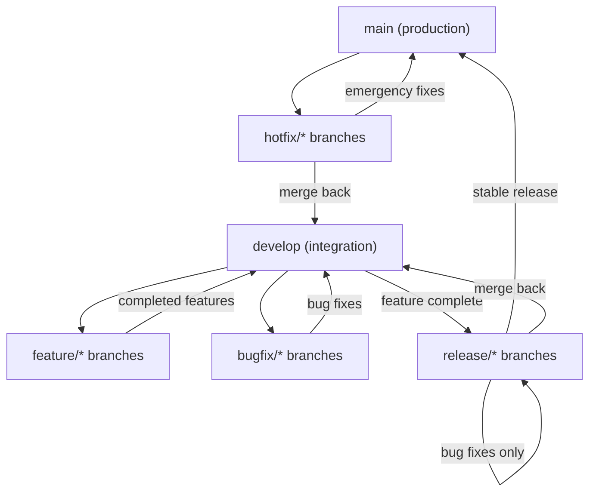
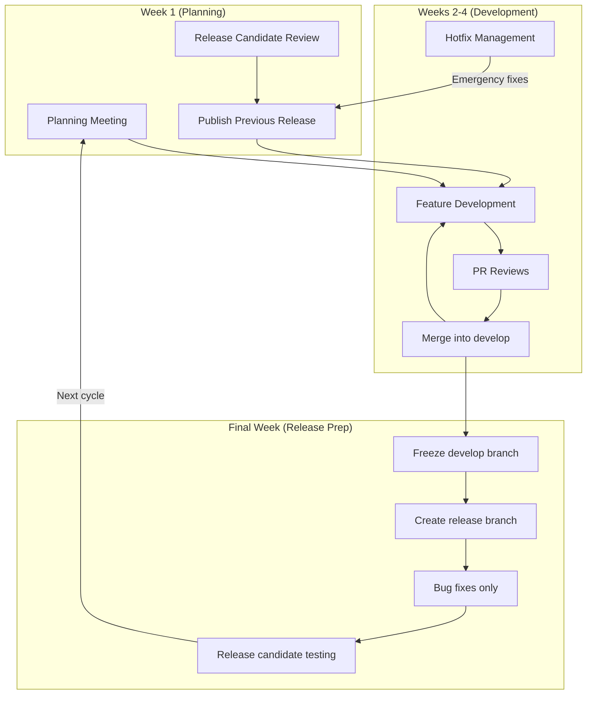
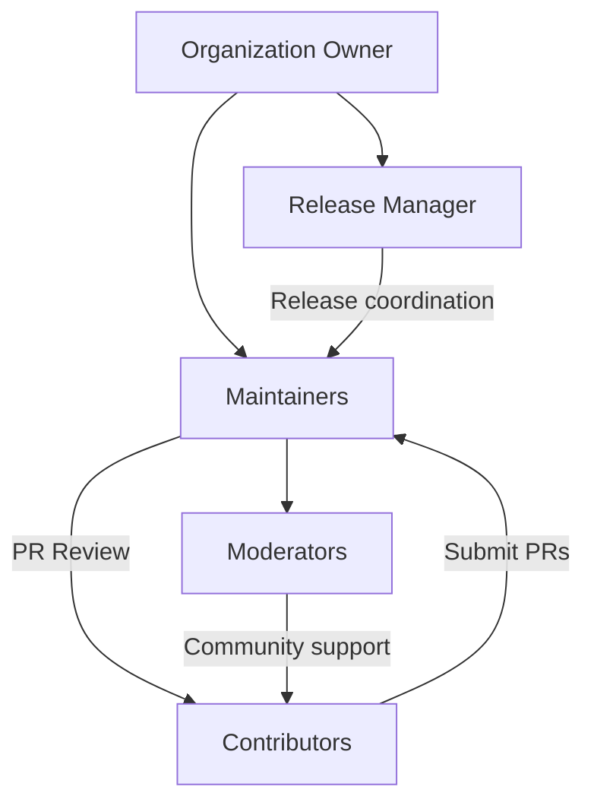
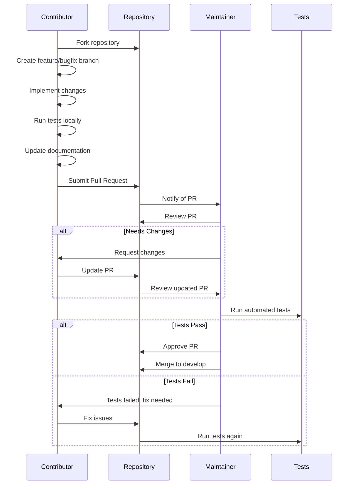

<!-- source: DeepWiki mcp.deepwiki.com · repo feder-cr/Jobs_Applier_AI_Agent_AIHawk · page 5 Contributing · fetched 2026-10-29 -->

# Contributing

<details>
<summary>Relevant source files</summary>

The following files were used as context for generating this wiki page:

- [.github/CODE_OF_CONDUCT.md](.github/CODE_OF_CONDUCT.md)
- [.github/CONTRIBUTING.md](.github/CONTRIBUTING.md)
- [CONTRIBUTING.md](CONTRIBUTING.md)

</details>


This guide provides comprehensive instructions for contributing to the AIHawk job application automation system. It details how to report issues, submit pull requests, follow coding standards, and understand the project's branching strategy and release process. For information about the system architecture and components, see [System Architecture](#2).

Sources: [CONTRIBUTING.md:1-19]()

## Code of Conduct

AIHawk follows the Contributor Covenant Code of Conduct to ensure a welcoming and inclusive environment for all contributors. Key principles include:

- Using welcoming and inclusive language
- Respecting differing viewpoints and experiences
- Accepting constructive criticism gracefully
- Focusing on community benefit
- Showing empathy toward other community members

The full Code of Conduct details unacceptable behaviors, enforcement procedures, and reporting mechanisms.

Sources: [.github/CODE_OF_CONDUCT.md:1-74]()

## Issue Management

### Issue Labels

AIHawk uses a standardized set of labels to organize issues:

| Label | Purpose |
|-------|---------|
| bug | Indicates something isn't working correctly |
| enhancement | New feature requests |
| good first issue | Issues suitable for newcomers |
| help wanted | Issues needing extra attention |
| documentation | Documentation improvements |
| duplicate | Issue already exists elsewhere |
| invalid | Issue that is not valid |
| question | Issues needing clarification |
| wontfix | Issues that won't be addressed |

Sources: [CONTRIBUTING.md:21-30](), [.github/CONTRIBUTING.md:60-71]()

### Bug Reports

When submitting a bug report, include:

1. A clear, descriptive title prefixed with `[BUG]`
2. Steps to reproduce the issue
3. Expected behavior
4. Actual behavior
5. Error messages or screenshots
6. Environment details (OS, Python version, LLM being used)

Sources: [CONTRIBUTING.md:31-41](), [.github/CONTRIBUTING.md:35-45]()

### Feature Requests

For feature requests, include:

1. A title prefixed with `[FEATURE]`
2. Feature summary
3. Detailed feature description
4. Motivation for the feature
5. Alternatives considered

Sources: [CONTRIBUTING.md:42-51](), [.github/CONTRIBUTING.md:46-57]()

## Branching Strategy

AIHawk follows a structured branching strategy to maintain code quality and facilitate collaboration.



**Branch Naming and Purpose:**

| Branch | Purpose | Protection |
|--------|---------|------------|
| `main` | Production-ready code | Protected branch |
| `develop` | Integration branch for features | - |
| `feature/*` | New features | - |
| `release/*` | Release preparation | - |
| `bugfix/*` | Bug fixes for development | - |
| `hotfix/*` | Emergency production fixes | - |

Sources: [CONTRIBUTING.md:52-60]()

## Version Control

AIHawk follows semantic versioning:

- Format: `vMAJOR.MINOR.PATCH`
  - MAJOR: Incompatible API changes
  - MINOR: Backward-compatible functionality additions
  - PATCH: Backward-compatible bug fixes
- Release tags exist only on the `main` branch
- Package versions match git tags

Sources: [CONTRIBUTING.md:61-66]()

## Release Process

AIHawk follows a structured release cycle to ensure code quality and feature delivery.



**Release Timeline Details:**

1. **Week 1**:
   - Planning meeting for next release (scope, milestones)
   - Previous release candidate finalized
   - Previous release merged to `main` and tagged
   - Release published to AIHawk/releases and PyPI

2. **Development Weeks**:
   - Contributors work on features and bugs for next milestone
   - Maintainers review PRs from feature/bugfix branches
   - Hotfixes merged to `main` and `develop` as needed

3. **Final Week**:
   - Freeze `develop` branch (only bug fixes allowed)
   - Create release branch `release/vX.Y.Z` from `develop`
   - Bug fixes merged into release branch
   - Testing and release candidate review

Sources: [CONTRIBUTING.md:67-115]()

## Team Structure and Roles

AIHawk has a defined team structure with specific responsibilities.



| Role | Key Responsibilities |
|------|----------------------|
| **Organization Owner** | Full repository access, controls organization settings |
| **Release Manager** | Creates/manages release branches, coordinates versioning |
| **Maintainer** | Reviews PRs, triages issues, leads feature development |
| **Moderator** | Moderates community channels, manages wiki, contributes to docs |
| **Contributor** | Implements features, fixes bugs, submits PRs |

Sources: [CONTRIBUTING.md:117-152]()

## Pull Request Process



**Steps to contribute:**

1. Fork the repository
2. Create a new branch for your feature or bug fix (from `develop`)
3. Write clear commit messages
4. Update documentation as needed
5. Add tests for new functionality
6. Ensure tests pass
7. Submit a pull request with a clear description

**PR Merging Requirements:**

- All PRs must be reviewed by maintainers
- At least 2 maintainers must approve PRs before merging
- PRs are merged into `develop` (unless it's a hotfix)
- All changes must be tested and verified to work

Sources: [CONTRIBUTING.md:153-169]()

## Code Style Guidelines

AIHawk follows these coding standards:

- **Python Code**: Follows PEP 8 standards
- **Documentation**: All functions and classes must have docstrings
- **Comments**: Complex logic requires explanatory comments
- **Naming**: Consistent naming conventions throughout
- **Security**: Follow security best practices
- **Performance**: Consider performance impacts of changes

Sources: [CONTRIBUTING.md:170-178]()

## Development Setup

To set up the development environment:

1. Clone the repository
   ```bash
   git clone https://github.com/feder-cr/Jobs_Applier_AI_Agent_AIHawk.git
   cd Jobs_Applier_AI_Agent_AIHawk
   ```

2. Install dependencies
   ```bash
   pip install -r requirements.txt
   ```

3. Set up necessary API keys and configurations
   - Create a `secrets.yaml` file with your LLM API keys
   - Configure your resume in `plain_text_resume.yaml`

Sources: [CONTRIBUTING.md:179-184]()

## Testing

Before submitting a PR, ensure:

- Your changes have been thoroughly tested
- Existing tests pass
- New tests are added for new functionality
- Functionality has been verified with different configurations

Sources: [CONTRIBUTING.md:185-193]()

## Communication

Effective communication is essential for successful contributions:

- Be respectful and constructive in discussions
- Use clear and concise language
- Reference relevant issues in commits and PRs
- Ask for help when needed

The project has communication channels on Telegram and Discord, where contributors can interact with maintainers and other community members.

Sources: [CONTRIBUTING.md:194-200](), [.github/CONTRIBUTING.md:26-27](), [.github/CONTRIBUTING.md:56]()

## Additional Resources

- [System Architecture](#2) - Understand the high-level design of AIHawk
- [LLM Integration](#2.3) - Learn how AIHawk integrates with various LLMs
- [Setup and Installation](#3.1) - Detailed setup instructions for users
- [Development Diagrams](./docs/development_diagrams.md) - Visual guides for developers

Note: The project maintainers reserve the right to reject any contribution that doesn't meet these guidelines or align with the project's goals.

Sources: [CONTRIBUTING.md:201-202](), [CONTRIBUTING.md:17]()