# Page: Overview

# Overview

<details>
<summary>Relevant source files</summary>

The following files were used as context for generating this wiki page:

- [README.md](README.md)
- [config.py](config.py)

</details>


This document introduces **AIHawk**, an open-source automated job application AI agent. It explains the system’s purpose, high-level capabilities, and the distinction between the open-source core and the commercial offering. This overview is intended for technical users seeking to understand what AIHawk is, what it does, and how its main systems are organized. For a detailed breakdown of the system’s architecture, see [System Architecture](#2). For user setup and usage, see [User Guide](#3).

---

## Purpose and Scope

AIHawk is designed to automate the process of searching for jobs, generating tailored application documents (resumes and cover letters), and submitting applications on behalf of users. The system leverages browser automation, configuration-driven workflows, and integration with Large Language Models (LLMs) such as OpenAI and OLLAMA.

This page covers:

- The overall goals and capabilities of AIHawk
- The distinction between the open-source and commercial versions
- A high-level summary of the system’s architecture and main components
- How the system bridges user intent (natural language) to code-level automation

For in-depth technical details on individual subsystems, refer to the following pages:
- [System Architecture](#2)
- [Component Overview](#2.1)
- [Configuration System](#2.2)
- [LLM Integration](#2.3)
- [Job Application Agent](#2.4)
- [Browser Automation](#2.5)

**Sources:**  
[README.md:5-27]()

---

## What is AIHawk?

AIHawk is an open-source project that automates the end-to-end job application process. Its core features include:

- Automated job search and scraping from job boards
- Suitability scoring of job postings using LLMs
- Generation of tailored resumes and cover letters using LLMs and style templates
- Automated application submission via browser automation
- Configuration-driven operation for flexibility and extensibility

The open-source version provides the core automation and document generation logic. Third-party provider plugins are excluded due to copyright. For a fully managed, integrated experience (including proprietary provider connections), a commercial version is available via laboro.co.

**Sources:**  
[README.md:5-27]()

---

## Open Source vs. Commercial Offering

AIHawk is available in two forms:

| Version         | Description                                                                 | Codebase Location         | Extensibility | Provider Integrations |
|-----------------|-----------------------------------------------------------------------------|--------------------------|---------------|----------------------|
| Open Source     | Core automation, document generation, browser integration. No proprietary plugins. | GitHub (this repo)       | High          | User-configured only |
| Commercial      | Fully managed, integrated with third-party providers, AI-driven job board.         | laboro.co (external)     | Limited       | Managed by platform  |

- The open-source core is extensible and can be self-hosted or modified.
- The commercial platform (laboro.co) builds on the open-source core, adding managed provider connections and additional features.

**Sources:**  
[README.md:8-10]()

---

## High-Level System Architecture

The AIHawk system is organized into several major subsystems:

- **Configuration System**: Centralizes all settings, credentials, and user preferences.
- **Job Application Agent**: Automates job search, scraping, suitability scoring, and application submission.
- **Document Generation System**: Produces tailored resumes and cover letters using LLMs and style templates.
- **LLM Integration Layer**: Abstracts access to LLM providers (OpenAI, OLLAMA) for content generation and parsing.
- **Browser Automation**: Uses Selenium WebDriver to interact with job sites and render documents as PDFs.

### Diagram: "Overall System Architecture"

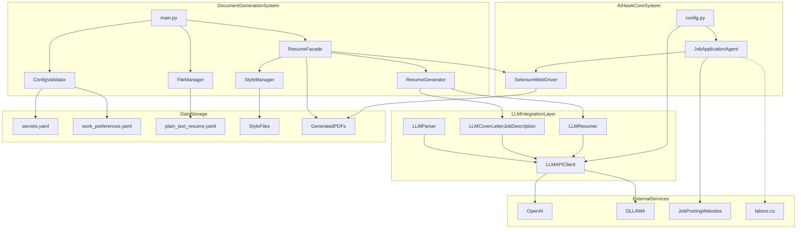

**Sources:**  
[README.md:5-27]()  
[config.py:1-23]()

---

## Bridging Natural Language to Code Entities

AIHawk translates user intent (e.g., "apply to jobs matching my preferences") into automated actions through a series of code entities and configuration files. The following diagram shows how user-facing concepts map to code-level constructs.

### Diagram: "User Intent to Code Entity Mapping"

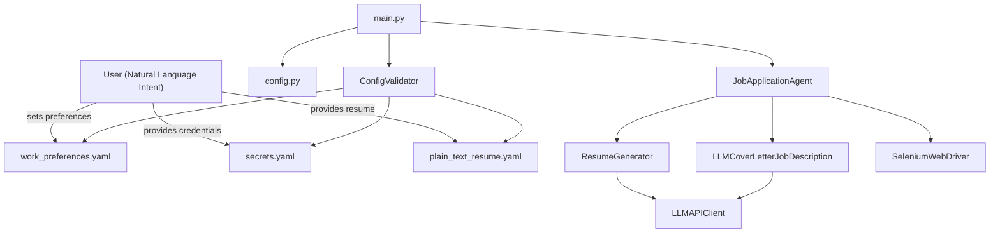

**Sources:**  
[README.md:5-27]()  
[config.py:1-23]()

---

## Key Code Entities and Their Roles

| Code Entity/Class                  | File/Location         | Role                                                                 |
|------------------------------------|----------------------|----------------------------------------------------------------------|
| `main.py`                         | main.py              | Orchestrates the overall workflow                                    |
| `config.py`                       | config.py            | Central configuration, including LLM and job search settings         |
| `ConfigValidator`                 | (see architecture)   | Validates configuration and user input files                         |
| `JobApplicationAgent`             | (see architecture)   | Automates job search, scraping, scoring, and application submission  |
| `ResumeGenerator`                 | (see architecture)   | Generates resumes using LLMs and templates                           |
| `LLMCoverLetterJobDescription`    | (see architecture)   | Generates cover letters tailored to job descriptions                 |
| `LLMAPIClient`                    | (see architecture)   | Abstracts LLM provider access (OpenAI, OLLAMA)                       |
| `SeleniumWebDriver`               | (see architecture)   | Automates browser actions for scraping and PDF generation            |

**Sources:**  
[README.md:5-27]()  
[config.py:1-23]()

---

## Summary

AIHawk is an open-source, configuration-driven system for automating job applications. It combines browser automation, LLM-powered document generation, and a modular architecture to enable extensibility and integration with both open and commercial platforms. The system is designed for technical users who want to automate or extend the job application process.

For further details on the system’s architecture and subsystems, see [System Architecture](#2).

**Sources:**  
[README.md:5-27]()  
[config.py:1-23]()

---

# Page: System Architecture

# System Architecture

<details>
<summary>Relevant source files</summary>

The following files were used as context for generating this wiki page:

- [README.md](README.md)
- [config.py](config.py)
- [main.py](main.py)

</details>


## Purpose and Scope

This document provides a comprehensive overview of the AIHawk system's architecture, detailing how major components interact and the overall design philosophy. It covers the structural organization of the codebase, component responsibilities, data flow patterns, and integration points.

For specific implementation details of individual subsystems, see:
- Configuration validation and file management: [Configuration System](#2.2)
- LLM provider integration: [LLM Integration](#2.3)
- Job automation logic: [Job Application Agent](#2.4)
- Selenium and PDF generation: [Browser Automation](#2.5)

## Core Architectural Principles

The AIHawk system follows a **layered architecture** with clear separation of concerns:

| Layer | Responsibility | Key Components |
|-------|---------------|----------------|
| **Orchestration** | User interaction, workflow coordination | `main.py::main()`, `handle_inquiries()` |
| **Configuration** | Validation, file management, settings | `ConfigValidator`, `FileManager` |
| **Document Generation** | Resume/cover letter creation | `ResumeFacade`, `ResumeGenerator`, `StyleManager` |
| **LLM Integration** | AI-powered content generation | `LLMResumer`, `LLMResumeJobDescription`, `LLMCoverLetterJobDescription` |
| **Browser Automation** | Web scraping, PDF rendering | Selenium WebDriver, Chrome DevTools Protocol |
| **Data** | Configuration files, resume data | YAML files (`secrets.yaml`, `work_preferences.yaml`, `plain_text_resume.yaml`) |

The system employs a **facade pattern** for document generation, abstracting complexity behind `ResumeFacade`, and uses **dependency injection** throughout to maintain loose coupling between components.

**Sources:** [main.py:1-566](), [config.py:1-23]()

## System Component Architecture

The following diagram maps the system's natural language components to their concrete code implementations:

```mermaid
graph TB
    subgraph "Orchestration Layer"
        Main["main.py::main()"]
        HandleInq["main.py::handle_inquiries()"]
        PromptUser["main.py::prompt_user_action()"]
    end
    
    subgraph "Validation Layer"
        ConfigValidator["ConfigValidator<br/>[main.py:35-182]"]
        FileManager["FileManager<br/>[main.py:184-217]"]
    end
    
    subgraph "Document Generation Core"
        ResumeFacade["ResumeFacade<br/>src/libs/resume_and_cover_builder"]
        ResumeGenerator["ResumeGenerator<br/>src/libs/resume_and_cover_builder"]
        StyleManager["StyleManager<br/>src/libs/resume_and_cover_builder"]
    end
    
    subgraph "Document Type Handlers"
        CreateResume["create_resume_pdf()<br/>[main.py:392-468]"]
        CreateResumeJob["create_resume_pdf_job_tailored()<br/>[main.py:307-389]"]
        CreateCover["create_cover_letter()<br/>[main.py:220-304]"]
    end
    
    subgraph "LLM Components"
        LLMResumer["LLMResumer"]
        LLMResumeJob["LLMResumeJobDescription"]
        LLMCover["LLMCoverLetterJobDescription"]
    end
    
    subgraph "Browser Infrastructure"
        InitBrowser["init_browser()<br/>src/utils/chrome_utils"]
        WebDriver["Selenium WebDriver"]
    end
    
    subgraph "Configuration Files"
        SecretsYAML["secrets.yaml<br/>SECRETS_YAML"]
        WorkPrefYAML["work_preferences.yaml<br/>WORK_PREFERENCES_YAML"]
        ResumeYAML["plain_text_resume.yaml<br/>PLAIN_TEXT_RESUME_YAML"]
        ConfigPY["config.py"]
    end
    
    subgraph "Data Models"
        Resume["Resume<br/>src/resume_schemas/resume"]
        JobProfile["JobApplicationProfile<br/>src/resume_schemas/job_application_profile"]
    end
    
    Main --> PromptUser
    Main --> FileManager
    Main --> ConfigValidator
    Main --> HandleInq
    
    FileManager --> SecretsYAML
    FileManager --> WorkPrefYAML
    FileManager --> ResumeYAML
    
    ConfigValidator --> SecretsYAML
    ConfigValidator --> WorkPrefYAML
    
    HandleInq --> CreateResume
    HandleInq --> CreateResumeJob
    HandleInq --> CreateCover
    
    CreateResume --> StyleManager
    CreateResume --> ResumeGenerator
    CreateResume --> ResumeFacade
    CreateResume --> Resume
    CreateResume --> InitBrowser
    
    CreateResumeJob --> StyleManager
    CreateResumeJob --> ResumeGenerator
    CreateResumeJob --> ResumeFacade
    CreateResumeJob --> Resume
    CreateResumeJob --> InitBrowser
    
    CreateCover --> StyleManager
    CreateCover --> ResumeGenerator
    CreateCover --> ResumeFacade
    CreateCover --> Resume
    CreateCover --> InitBrowser
    
    ResumeFacade --> ResumeGenerator
    ResumeFacade --> StyleManager
    ResumeFacade --> WebDriver
    
    ResumeGenerator --> LLMResumer
    ResumeGenerator --> LLMResumeJob
    ResumeGenerator --> LLMCover
    
    InitBrowser --> WebDriver
    
    ConfigPY -.-> ResumeFacade
    ConfigPY -.-> LLMResumer
```

**Sources:** [main.py:1-566](), [config.py:1-23]()

## Configuration and Validation Architecture

The system implements a robust configuration validation pipeline before any operations execute:

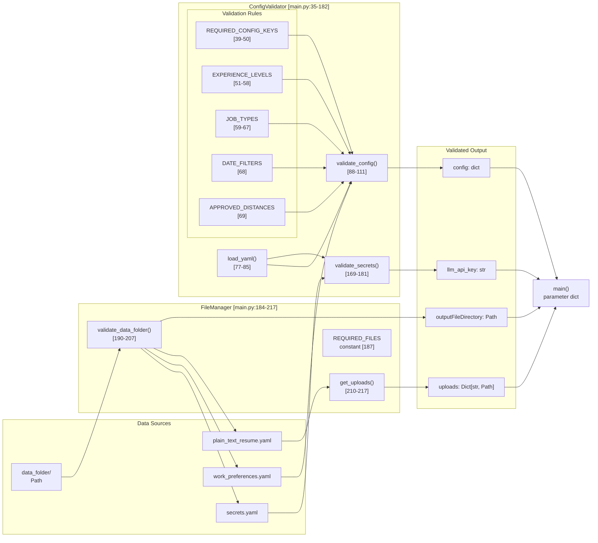

### Configuration Validation Rules

The `ConfigValidator` class enforces strict validation rules defined as class-level constants:

| Validation Rule | Type | Purpose |
|----------------|------|---------|
| `REQUIRED_CONFIG_KEYS` | `dict` | Defines mandatory keys and their expected types |
| `EXPERIENCE_LEVELS` | `list[str]` | Whitelisted experience levels (internship, entry, associate, mid_senior_level, director, executive) |
| `JOB_TYPES` | `list[str]` | Whitelisted job types (full_time, contract, part_time, temporary, internship, other, volunteer) |
| `DATE_FILTERS` | `list[str]` | Whitelisted date filters (all_time, month, week, 24_hours) |
| `APPROVED_DISTANCES` | `set[int]` | Whitelisted distance values (0, 5, 10, 25, 50, 100) |
| `EMAIL_REGEX` | `re.Pattern` | Email validation pattern |

The validator applies these rules through dedicated validation methods:
- `_validate_experience_levels()` [main.py:114-120]()
- `_validate_job_types()` [main.py:123-129]()
- `_validate_date_filters()` [main.py:132-138]()
- `_validate_list_of_strings()` [main.py:141-147]()
- `_validate_distance()` [main.py:150-155]()
- `_validate_blacklists()` [main.py:158-166]()

**Sources:** [main.py:35-217]()

## Document Generation Data Flow

The document generation pipeline follows a consistent pattern across all document types:

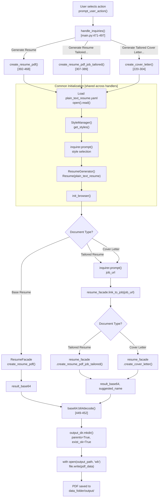

### Document Handler Parameters

Each document generation handler follows this initialization pattern:

```python
# Common pattern across all handlers
with open(parameters["uploads"]["plainTextResume"], "r", encoding="utf-8") as file:
    plain_text_resume = file.read()

style_manager = StyleManager()
resume_generator = ResumeGenerator()
resume_object = Resume(plain_text_resume)
driver = init_browser()
resume_generator.set_resume_object(resume_object)

resume_facade = ResumeFacade(
    api_key=llm_api_key,
    style_manager=style_manager,
    resume_generator=resume_generator,
    resume_object=resume_object,
    output_path=Path("data_folder/output"),
)
resume_facade.set_driver(driver)
```

**Sources:** [main.py:220-468]()

## LLM Configuration and Integration

The system uses a configuration-driven approach to LLM integration:

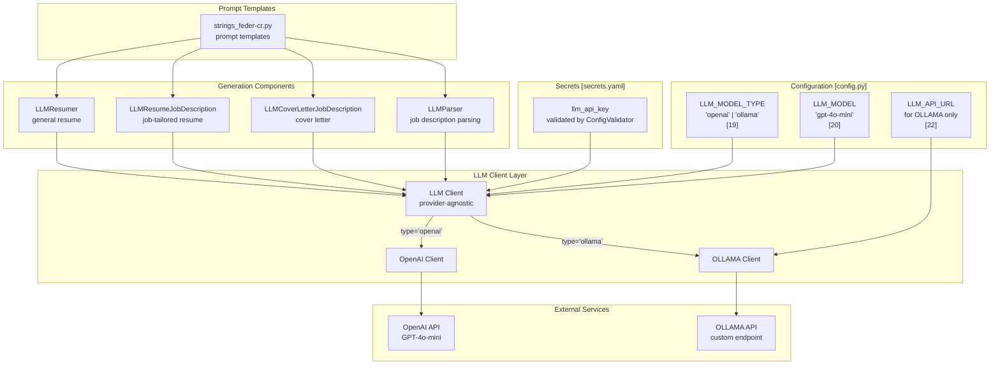

### LLM Configuration Constants

The system defines LLM configuration in `config.py`:

| Constant | Default Value | Purpose |
|----------|--------------|---------|
| `LLM_MODEL_TYPE` | `'openai'` | Selects provider implementation (openai/ollama) |
| `LLM_MODEL` | `'gpt-4o-mini'` | Specifies model identifier |
| `LLM_API_URL` | `''` | Required only for OLLAMA, custom endpoint URL |

The API key is stored separately in `secrets.yaml` and validated by `ConfigValidator.validate_secrets()` [main.py:169-181]().

**Sources:** [config.py:1-23](), [main.py:169-181]()

## Job Application Configuration

The system includes configuration constants for job application behavior:

| Constant | Default | Purpose | Reference |
|----------|---------|---------|-----------|
| `JOB_APPLICATIONS_DIR` | `"job_applications"` | Output directory for applications | [config.py:13]() |
| `JOB_SUITABILITY_SCORE` | `7` | Minimum score threshold for application | [config.py:14]() |
| `JOB_MAX_APPLICATIONS` | `5` | Maximum applications per session | [config.py:16]() |
| `JOB_MIN_APPLICATIONS` | `1` | Minimum applications target | [config.py:17]() |
| `MINIMUM_WAIT_TIME_IN_SECONDS` | `60` | Rate limiting delay | [config.py:11]() |

**Note:** The core AIHawk job application agent logic is referenced but commented out in the current main.py implementation:
- `AIHawkBotFacade` [main.py:25]()
- `AIHawkJobManager` [main.py:26]()
- `GPTAnswerer` [main.py:27]()

**Sources:** [config.py:11-22](), [main.py:25-27]()

## Logging Configuration

The system implements configurable logging with file and console output options:

| Configuration | Type | Purpose | Reference |
|--------------|------|---------|-----------|
| `LOG_LEVEL` | `str` | Global log level ('ERROR', 'DEBUG', etc.) | [config.py:6]() |
| `LOG_SELENIUM_LEVEL` | constant | Selenium-specific logging level | [config.py:7]() |
| `LOG_TO_FILE` | `bool` | Enable file logging | [config.py:8]() |
| `LOG_TO_CONSOLE` | `bool` | Enable console logging | [config.py:9]() |

The logger is imported from `src.logging` [main.py:18]() and used throughout for structured logging.

**Sources:** [config.py:5-9](), [main.py:18]()

## Main Execution Flow

The entry point coordinates the entire system:

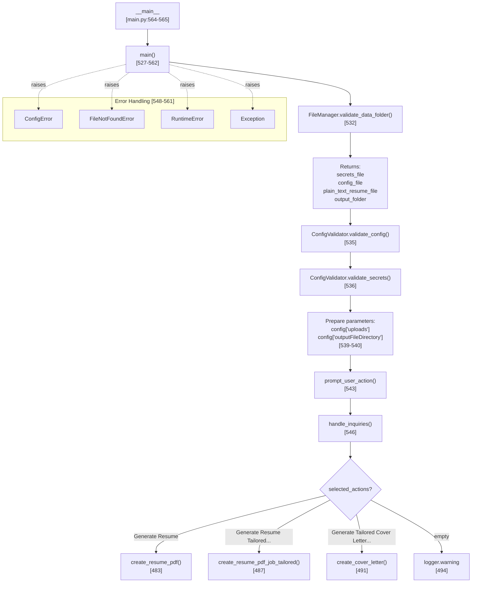

### Error Handling Strategy

The main function implements comprehensive exception handling [main.py:548-561]():

1. **ConfigError**: Configuration validation failures, logged with link to documentation
2. **FileNotFoundError**: Missing required files, logged with guidance
3. **RuntimeError**: Runtime execution errors, logged with traceback
4. **Exception**: Catch-all for unexpected errors, logged with full exception details

**Sources:** [main.py:527-566]()

## Component Dependencies

The system's import structure reveals key dependencies:

```python
# Core libraries [main.py:1-27]
from pathlib import Path              # File system operations
import yaml                           # Configuration parsing
import inquirer                       # User interaction
from selenium import webdriver        # Browser automation
import base64                         # PDF encoding

# Internal modules
from src.libs.resume_and_cover_builder import (
    ResumeFacade,                     # Document generation orchestrator
    ResumeGenerator,                  # Core generation logic
    StyleManager                      # CSS/styling management
)
from src.resume_schemas.job_application_profile import JobApplicationProfile
from src.resume_schemas.resume import Resume
from src.logging import logger
from src.utils.chrome_utils import init_browser
from src.utils.constants import (
    PLAIN_TEXT_RESUME_YAML,
    SECRETS_YAML,
    WORK_PREFERENCES_YAML,
)
```

### External Dependencies

| Package | Purpose | Usage |
|---------|---------|-------|
| `selenium` | Browser automation | Web scraping, PDF rendering via CDP |
| `webdriver_manager` | ChromeDriver management | Automatic driver installation |
| `inquirer` | Interactive CLI prompts | User action selection, style selection |
| `yaml` | Configuration parsing | Loading `.yaml` files |
| `click` | CLI framework | (imported but not actively used) |

**Sources:** [main.py:1-27]()

## Data Model Architecture

The system uses structured data models for resume information:

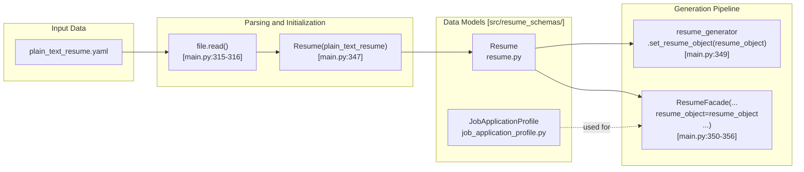

The `Resume` class parses the YAML content and provides structured access to resume data. The `JobApplicationProfile` provides additional context for job-specific tailoring.

**Sources:** [main.py:17-18](), [main.py:262-269](), [main.py:346-356]()

## Style Management System

The `StyleManager` provides CSS style selection and management:

```python
style_manager = StyleManager()
available_styles = style_manager.get_styles()

# Present choices to user
choices = style_manager.format_choices(available_styles)
# ... inquirer.prompt() ...

# Set selected style
style_manager.set_selected_style(style_name)
```

The `StyleManager`:
- Discovers available CSS styles from the styles directory
- Formats choices for user presentation with author attribution
- Maintains the selected style for document generation
- Provides style information to `ResumeFacade` and `ResumeGenerator`

**Sources:** [main.py:15](), [main.py:231-255](), [main.py:318-342](), [main.py:404-428]()

## Open Source vs Commercial Architecture

The codebase architecture supports both open-source and commercial deployments:

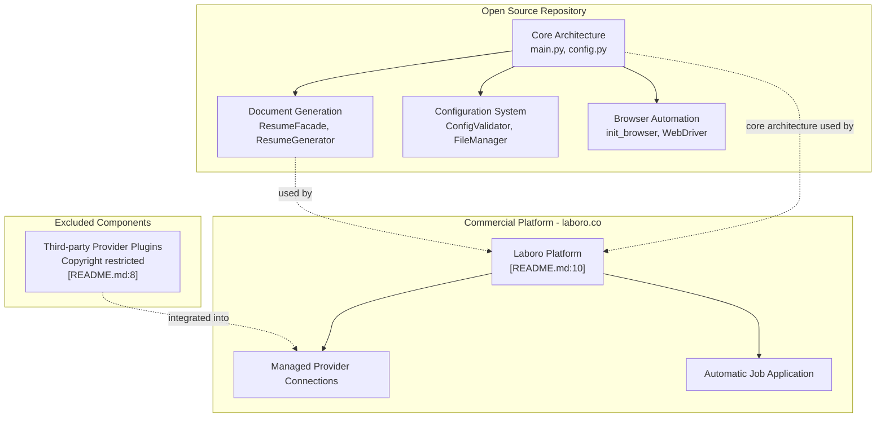

**Key Points:**
- Core automation logic remains open source [README.md:8]()
- Third-party provider plugins removed due to copyright [README.md:8]()
- Commercial platform at [laboro.co](https://laboro.co/) provides managed experience [README.md:10]()
- Commercial version includes automatic job application functionality [README.md:10]()

**Sources:** [README.md:1-27]()

---

# Page: Component Overview

# Component Overview

<details>
<summary>Relevant source files</summary>

The following files were used as context for generating this wiki page:

- [README.md](README.md)
- [config.py](config.py)
- [main.py](main.py)
- [src/libs/resume_and_cover_builder/resume_facade.py](src/libs/resume_and_cover_builder/resume_facade.py)

</details>


This document provides a detailed overview of the major components in the AIHawk system. The system is organized into four primary subsystems: the **Job Application Agent** (core automation logic), the **Document Generation Pipeline** (resume and cover letter creation), the **Configuration System** (validation and settings management), and the **LLM Integration Layer** (AI-powered content generation).

For detailed information about specific subsystems, see:
- Configuration System: [2.2](#2.2)
- LLM Integration: [2.3](#2.3)
- Job Application Agent: [2.4](#2.4)
- Browser Automation: [2.5](#2.5)

## System Component Map

The AIHawk system consists of the following major components organized by subsystem:

| Subsystem | Key Components | Primary Files |
|-----------|---------------|---------------|
| **Document Generation** | `ResumeFacade`, `ResumeGenerator`, `StyleManager` | [src/libs/resume_and_cover_builder/resume_facade.py](), [main.py]() |
| **Configuration & Validation** | `ConfigValidator`, `FileManager` | [main.py:35-217]() |
| **LLM Integration** | `LLMParser`, `LLMResumer`, `LLMResumeJobDescription`, `LLMCoverLetterJobDescription` | [src/libs/resume_and_cover_builder/llm/]() |
| **Browser Automation** | `init_browser()`, `HTML_to_PDF()` | [src/utils/chrome_utils.py]() |
| **Job Application Agent** | `AIHawkBotFacade`, `AIHawkJobManager`, `GPTAnswerer` (commented out) | [main.py:25-27]() |
| **Orchestration** | `main()`, `handle_inquiries()`, `prompt_user_action()` | [main.py:499-565]() |

**Note**: The core job application agent components (`AIHawkBotFacade`, `AIHawkJobManager`, `GPTAnswerer`) are present in the architecture but currently commented out in the main entry point. The active implementation focuses on document generation capabilities.

Sources: [main.py:1-565](), [src/libs/resume_and_cover_builder/resume_facade.py:1-153]()

## Component Architecture Diagram

This diagram shows the active components in the current implementation, mapping natural language concepts to actual code entities:

```mermaid
graph TB
    subgraph "Entry Point & Orchestration"
        main_func["main()<br/>[main.py:527]"]
        handle_inquiries["handle_inquiries()<br/>[main.py:471]"]
        prompt_user["prompt_user_action()<br/>[main.py:499]"]
    end

    subgraph "Configuration Subsystem"
        ConfigValidator["ConfigValidator<br/>[main.py:35]"]
        FileManager["FileManager<br/>[main.py:184]"]
        validate_config["validate_config()<br/>[main.py:88]"]
        validate_secrets["validate_secrets()<br/>[main.py:169]"]
        
        ConfigValidator --> validate_config
        ConfigValidator --> validate_secrets
    end

    subgraph "Document Generation Subsystem"
        create_resume_pdf["create_resume_pdf()<br/>[main.py:392]"]
        create_resume_job["create_resume_pdf_job_tailored()<br/>[main.py:307]"]
        create_cover["create_cover_letter()<br/>[main.py:220]"]
        
        ResumeFacade["ResumeFacade<br/>[resume_facade.py:16]"]
        ResumeGenerator["ResumeGenerator<br/>[resume_and_cover_builder]"]
        StyleManager["StyleManager<br/>[resume_and_cover_builder]"]
    end

    subgraph "LLM Integration Subsystem"
        LLMParser["LLMParser<br/>[llm/llm_job_parser.py]"]
        extract_role["extract_role()"]
        extract_company["extract_company_name()"]
        extract_description["extract_job_description()"]
        
        LLMParser --> extract_role
        LLMParser --> extract_company
        LLMParser --> extract_description
    end

    subgraph "Browser Automation Subsystem"
        init_browser["init_browser()<br/>[chrome_utils.py:19]"]
        HTML_to_PDF["HTML_to_PDF()<br/>[chrome_utils.py]"]
        WebDriver["Selenium WebDriver"]
        
        init_browser --> WebDriver
        HTML_to_PDF --> WebDriver
    end

    subgraph "Data Models"
        Resume["Resume<br/>[resume_schemas/resume.py]"]
        Job["Job<br/>[src/job.py]"]
        config_dict["config: dict"]
        llm_api_key["llm_api_key: str"]
    end

    subgraph "Configuration Files"
        secrets_yaml["secrets.yaml"]
        work_pref_yaml["work_preferences.yaml"]
        resume_yaml["plain_text_resume.yaml"]
    end

    main_func --> prompt_user
    prompt_user --> handle_inquiries
    
    main_func --> ConfigValidator
    main_func --> FileManager
    
    ConfigValidator --> secrets_yaml
    ConfigValidator --> work_pref_yaml
    FileManager --> resume_yaml
    
    ConfigValidator --> llm_api_key
    ConfigValidator --> config_dict
    
    handle_inquiries --> create_resume_pdf
    handle_inquiries --> create_resume_job
    handle_inquiries --> create_cover
    
    create_resume_pdf --> StyleManager
    create_resume_pdf --> ResumeGenerator
    create_resume_pdf --> ResumeFacade
    
    create_resume_job --> ResumeFacade
    create_cover --> ResumeFacade
    
    ResumeFacade --> StyleManager
    ResumeFacade --> ResumeGenerator
    ResumeFacade --> LLMParser
    
    ResumeFacade --> init_browser
    ResumeFacade --> HTML_to_PDF
    
    ResumeGenerator --> Resume
    LLMParser --> Job
```

Sources: [main.py:1-565](), [src/libs/resume_and_cover_builder/resume_facade.py:16-153]()

## Code Entity to Function Mapping

This diagram bridges natural language descriptions to specific code functions and classes:

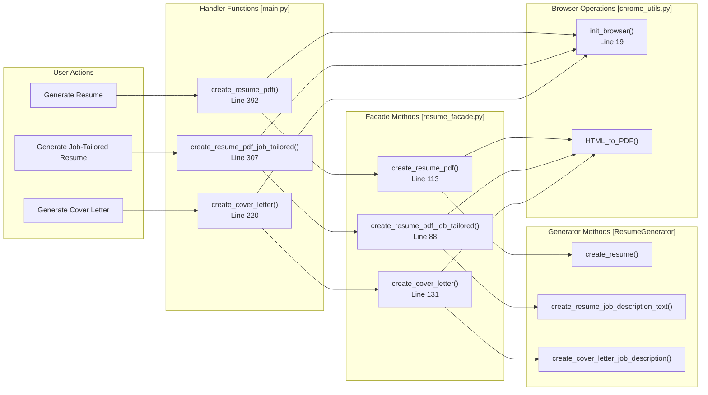

Sources: [main.py:220-468](), [src/libs/resume_and_cover_builder/resume_facade.py:88-153]()

## Component Interactions

The following sequence diagram illustrates how the components interact during a typical resume or cover letter generation process:

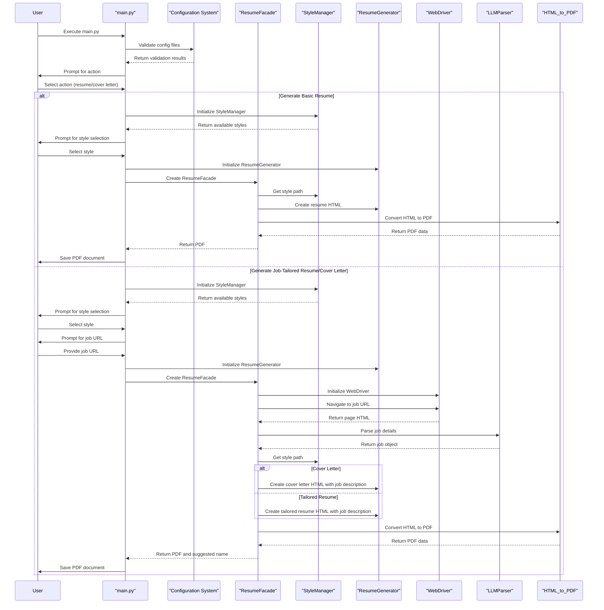

Sources: [main.py:220-468](), [src/libs/resume_and_cover_builder/resume_facade.py:88-153]()

## Subsystem Details

### 1. Configuration System

The configuration system validates and manages application settings through two primary classes:

#### ConfigValidator Class

Located at [main.py:35-181](), `ConfigValidator` performs validation of configuration files with the following key methods:

| Method | Purpose | Key Validations |
|--------|---------|-----------------|
| `validate_config()` | Validates `work_preferences.yaml` | Checks experience levels, job types, distance values against whitelists |
| `validate_secrets()` | Validates `secrets.yaml` | Ensures `llm_api_key` is present and non-empty |
| `validate_email()` | Email format validation | Uses regex pattern: `^[a-zA-Z0-9._%+-]+@[a-zA-Z0-9.-]+\.[a-zA-Z]{2,}$` |
| `_validate_experience_levels()` | Experience level validation | Checks against: `["internship", "entry", "associate", "mid_senior_level", "director", "executive"]` |
| `_validate_job_types()` | Job type validation | Checks against: `["full_time", "contract", "part_time", "temporary", "internship", "other", "volunteer"]` |
| `_validate_distance()` | Distance validation | Must be in: `{0, 5, 10, 25, 50, 100}` |

#### FileManager Class

Located at [main.py:184-217](), `FileManager` handles file system operations:

- `validate_data_folder()`: Ensures required files exist (`secrets.yaml`, `work_preferences.yaml`, `plain_text_resume.yaml`)
- `get_uploads()`: Creates path mappings for resume files

Sources: [main.py:35-217]()

### 2. Document Generation Pipeline

The document generation pipeline is the core active component, orchestrated through three handler functions:

#### Handler Functions

Three main handler functions coordinate document generation:

1. **`create_resume_pdf()`** [main.py:392-468]() - Generates a general resume
2. **`create_resume_pdf_job_tailored()`** [main.py:307-389]() - Generates job-specific resume
3. **`create_cover_letter()`** [main.py:220-304]() - Generates job-specific cover letter

#### ResumeFacade Class

The `ResumeFacade` class [src/libs/resume_and_cover_builder/resume_facade.py:16-153]() provides a unified interface to document generation:

| Method | Returns | Purpose |
|--------|---------|---------|
| `__init__()` | None | Initializes with `api_key`, `style_manager`, `resume_generator`, `resume_object`, `output_path` |
| `set_driver()` | None | Sets the Selenium WebDriver instance |
| `link_to_job()` | None | Scrapes job page and extracts details using `LLMParser` |
| `create_resume_pdf()` | `bytes` | Generates general resume PDF (Base64 encoded) |
| `create_resume_pdf_job_tailored()` | `tuple[bytes, str]` | Generates tailored resume PDF with suggested filename |
| `create_cover_letter()` | `tuple[bytes, str]` | Generates cover letter PDF with suggested filename |

#### Key Dependencies

- **StyleManager**: Manages resume visual styles and templates
- **ResumeGenerator**: Generates HTML content from resume data
- **LLMParser**: Parses job descriptions from web pages

Sources: [main.py:220-468](), [src/libs/resume_and_cover_builder/resume_facade.py:16-153]()

### 3. LLM Integration Layer

The LLM integration layer uses the `LLMParser` class to extract job information:

#### LLMParser Operations

Located at [src/libs/resume_and_cover_builder/resume_facade.py:71-87](), the `LLMParser` performs:

```python
# Job information extraction flow
llm_job_parser = LLMParser(openai_api_key=global_config.API_KEY)
llm_job_parser.set_body_html(body_element)

job = Job()
job.role = llm_job_parser.extract_role()
job.company = llm_job_parser.extract_company_name()
job.description = llm_job_parser.extract_job_description()
job.location = llm_job_parser.extract_location()
```

The extracted `Job` object is used to tailor resume and cover letter content.

Sources: [src/libs/resume_and_cover_builder/resume_facade.py:71-87]()

### 4. Job Application Agent (Inactive)

The job application agent components are present in the architecture but currently commented out:

```python
# from ai_hawk.bot_facade import AIHawkBotFacade
# from ai_hawk.job_manager import AIHawkJobManager
# from ai_hawk.llm.llm_manager import GPTAnswerer
```

These components would provide:
- **AIHawkBotFacade**: Main interface for automated job applications
- **AIHawkJobManager**: Job search and application management
- **GPTAnswerer**: AI-powered form filling and question answering

The architecture supports these components, but they are not active in the current main entry point.

Sources: [main.py:25-27]()

## Data Flow Through Components

This diagram shows the flow of data through the system with specific file and function references:

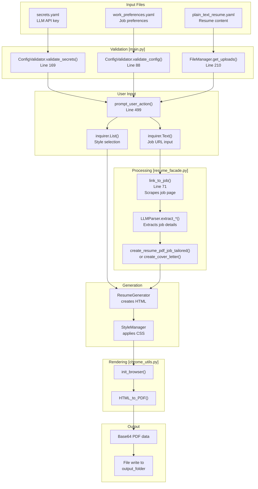

Sources: [main.py:220-468](), [main.py:527-565](), [src/libs/resume_and_cover_builder/resume_facade.py:16-153]()

## Component Initialization and Configuration

### Global Configuration Setup

The `ResumeFacade.__init__()` method [src/libs/resume_and_cover_builder/resume_facade.py:17-38]() sets up global configuration:

```python
# Configuration paths set during initialization
global_config.STRINGS_MODULE_RESUME_PATH = lib_directory / "resume_prompt/strings_feder-cr.py"
global_config.STRINGS_MODULE_RESUME_JOB_DESCRIPTION_PATH = lib_directory / "resume_job_description_prompt/strings_feder-cr.py"
global_config.STRINGS_MODULE_COVER_LETTER_JOB_DESCRIPTION_PATH = lib_directory / "cover_letter_prompt/strings_feder-cr.py"
global_config.STYLES_DIRECTORY = lib_directory / "resume_style"
global_config.LOG_OUTPUT_FILE_PATH = output_path
global_config.API_KEY = api_key
```

### Style Management

The `StyleManager` class provides style-related functionality:

- `get_styles()`: Returns available styles from the styles directory
- `format_choices()`: Formats styles for user selection
- `set_selected_style()`: Sets the active style
- `get_style_path()`: Returns path to the selected style file

User interaction flow for style selection [main.py:232-256]():

```python
style_manager = StyleManager()
available_styles = style_manager.get_styles()
choices = style_manager.format_choices(available_styles)
questions = [inquirer.List("style", message="Select a style for the resume:", choices=choices)]
style_answer = inquirer.prompt(questions)
style_manager.set_selected_style(style_name)
```

Sources: [main.py:231-256](), [main.py:318-342](), [main.py:404-428](), [src/libs/resume_and_cover_builder/resume_facade.py:17-38]()

### Resume Generation Flow

The `ResumeGenerator` class handles content generation with different methods for different document types:

| Method | Input | Output | Usage |
|--------|-------|--------|-------|
| `create_resume()` | `style_path` | HTML string | General resume without job targeting |
| `create_resume_job_description_text()` | `style_path`, `job_description` | HTML string | Job-tailored resume |
| `create_cover_letter_job_description()` | `style_path`, `job_description` | HTML string | Job-tailored cover letter |
| `set_resume_object()` | `Resume` object | None | Sets the resume data to use |

Sources: [main.py:261-274](), [main.py:346-359](), [main.py:431-445](), [src/libs/resume_and_cover_builder/resume_facade.py:88-153]()

## Browser Automation and PDF Generation

### Browser Initialization

The `init_browser()` function [src/utils/chrome_utils.py:19]() initializes a Selenium Chrome WebDriver with specific options for PDF generation:

- Headless mode for background operation
- Disabled GPU for stability
- No sandbox mode
- Configured for PDF rendering

Usage pattern in main.py:
```python
driver = init_browser()  # Line 263, 348, 433
resume_facade.set_driver(driver)  # Set driver on facade
```

### HTML to PDF Conversion

The `HTML_to_PDF()` function converts HTML content to PDF using Chrome DevTools Protocol (CDP):

**Process Flow:**
1. HTML content is loaded into the WebDriver
2. Chrome's native PDF generation via CDP
3. Returns Base64-encoded PDF data

**Invocation Points:**
- [src/libs/resume_and_cover_builder/resume_facade.py:107]() - For job-tailored resumes
- [src/libs/resume_and_cover_builder/resume_facade.py:127]() - For general resumes
- [src/libs/resume_and_cover_builder/resume_facade.py:151]() - For cover letters

**Output Handling** [main.py:277-301](), [main.py:361-386](), [main.py:447-465]():
```python
result_base64, suggested_name = resume_facade.create_resume_pdf_job_tailored()
pdf_data = base64.b64decode(result_base64)
output_path = output_dir / "resume_tailored.pdf"
with open(output_path, "wb") as file:
    file.write(pdf_data)
```

Sources: [main.py:263-301](), [main.py:348-386](), [main.py:433-465](), [src/libs/resume_and_cover_builder/resume_facade.py:88-153]()

## Error Handling and Orchestration

### Main Entry Point

The `main()` function [main.py:527-565]() serves as the application entry point with comprehensive error handling:

```python
def main():
    try:
        # Validation phase
        data_folder = Path("data_folder")
        secrets_file, config_file, plain_text_resume_file, output_folder = 
            FileManager.validate_data_folder(data_folder)
        config = ConfigValidator.validate_config(config_file)
        llm_api_key = ConfigValidator.validate_secrets(secrets_file)
        
        # Preparation phase
        config["uploads"] = FileManager.get_uploads(plain_text_resume_file)
        config["outputFileDirectory"] = output_folder
        
        # Execution phase
        selected_actions = prompt_user_action()
        handle_inquiries(selected_actions, config, llm_api_key)
        
    except ConfigError as ce:
        # Configuration validation errors
    except FileNotFoundError as fnf:
        # Missing file errors
    except RuntimeError as re:
        # Runtime execution errors
    except Exception as e:
        # Unexpected errors
```

### Request Routing

The `handle_inquiries()` function [main.py:471-497]() routes user selections to appropriate handlers:

| User Selection | Handler Function | Line Number |
|----------------|------------------|-------------|
| "Generate Resume" | `create_resume_pdf()` | 483 |
| "Generate Resume Tailored for Job Description" | `create_resume_pdf_job_tailored()` | 487 |
| "Generate Tailored Cover Letter for Job Description" | `create_cover_letter()` | 491 |

Sources: [main.py:471-565]()

## Key Data Models

### Configuration Dictionary Structure

After validation, the configuration dictionary contains:

```python
config = {
    "remote": bool,                    # Remote work preference
    "experience_level": dict,          # Experience level filters
    "job_types": dict,                 # Job type filters
    "date": dict,                      # Date filters
    "positions": list,                 # Target positions
    "locations": list,                 # Target locations
    "location_blacklist": list,        # Excluded locations
    "distance": int,                   # Search radius
    "company_blacklist": list,         # Excluded companies
    "title_blacklist": list,           # Excluded job titles
    "uploads": dict,                   # File path mappings
    "outputFileDirectory": Path        # Output directory
}
```

### Job Object Structure

The `Job` object [src/libs/resume_and_cover_builder/resume_facade.py:79-85]() stores extracted job information:

```python
job = Job()
job.role = llm_job_parser.extract_role()           # Job title
job.company = llm_job_parser.extract_company_name() # Company name
job.description = llm_job_parser.extract_job_description() # Full description
job.location = llm_job_parser.extract_location()    # Job location
job.link = job_url                                  # Original URL
```

### Resume Object

The `Resume` object [main.py:262-263](), [main.py:347-348](), [main.py:432-433]() is created from the YAML resume file:

```python
with open(parameters["uploads"]["plainTextResume"], "r", encoding="utf-8") as file:
    plain_text_resume = file.read()
resume_object = Resume(plain_text_resume)
```

Sources: [main.py:35-110](), [main.py:262-274](), [main.py:347-359](), [main.py:432-445](), [src/libs/resume_and_cover_builder/resume_facade.py:79-87]()

## Summary

The AIHawk system employs a modular architecture with clear separation of concerns between components. The main application controller coordinates the workflow, while specialized components handle specific tasks such as configuration validation, resume generation, and PDF conversion. This design allows for flexibility and extensibility, enabling the system to support different resume styles, LLM integrations, and output formats.

The system follows a facade pattern through the `ResumeFacade` class, which simplifies the interaction between the main application and the various subsystems. This pattern enhances maintainability and provides a clean interface for future enhancements.

---

# Page: Configuration System

# Configuration System

<details>
<summary>Relevant source files</summary>

The following files were used as context for generating this wiki page:

- [README.md](README.md)
- [config.py](config.py)
- [main.py](main.py)
- [src/libs/resume_and_cover_builder/config.py](src/libs/resume_and_cover_builder/config.py)

</details>


## Purpose and Scope

The Configuration System manages all application settings, validates user-provided configuration files, and ensures that the AIHawk system operates with valid parameters. This system acts as a central hub that provides validated configuration to all other subsystems including the job application agent, document generation pipeline, and LLM integration layer.

This page covers the configuration validation architecture, file management, and validation rules. For information about how to configure the system as an end user, see [Configuration Files](#3.2). For LLM-specific configuration details, see [LLM Integration](#2.3).

**Sources:** [README.md:1-27](), [main.py:30-217](), [config.py:1-23]()

---

## Configuration Architecture

The configuration system is built around two primary classes: `ConfigValidator` and `FileManager`. These classes work together to load, validate, and prepare configuration data from multiple YAML files and the global `config.py` module.

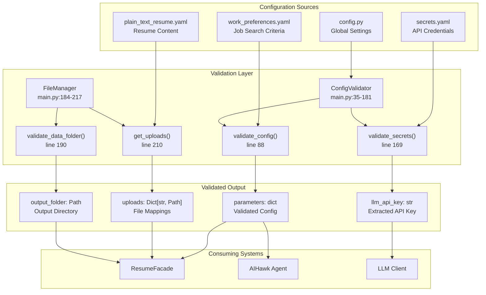

**Configuration Flow from Files to System Consumers**

The `main()` function in [main.py:527-562]() orchestrates the configuration loading process, calling validation methods in sequence and assembling a complete configuration dictionary that is passed to consuming systems.

**Sources:** [main.py:30-217](), [main.py:527-562](), [config.py:1-23]()

---

## Configuration Files

The system requires four configuration sources to operate:

| File | Location | Purpose | Validation Class |
|------|----------|---------|------------------|
| `config.py` | Project root | Global application settings (logging, LLM model, job limits) | Module import |
| `secrets.yaml` | `data_folder/` | Sensitive credentials (API keys) | `ConfigValidator.validate_secrets()` |
| `work_preferences.yaml` | `data_folder/` | Job search preferences (locations, experience levels, job types) | `ConfigValidator.validate_config()` |
| `plain_text_resume.yaml` | `data_folder/` | User resume content in YAML format | `FileManager.get_uploads()` |

### config.py - Global Settings

The `config.py` module [config.py:1-23]() defines application-wide constants:

| Setting | Type | Purpose | Default Value |
|---------|------|---------|---------------|
| `LOG_LEVEL` | str | Logging verbosity | `'ERROR'` |
| `LOG_SELENIUM_LEVEL` | int | Selenium driver log level | `ERROR` constant |
| `LOG_TO_FILE` | bool | Enable file logging | `False` |
| `LOG_TO_CONSOLE` | bool | Enable console logging | `False` |
| `MINIMUM_WAIT_TIME_IN_SECONDS` | int | Rate limiting between applications | `60` |
| `JOB_APPLICATIONS_DIR` | str | Directory for storing applications | `"job_applications"` |
| `JOB_SUITABILITY_SCORE` | int | Minimum score to apply (1-10) | `7` |
| `JOB_MAX_APPLICATIONS` | int | Maximum applications per session | `5` |
| `JOB_MIN_APPLICATIONS` | int | Minimum applications before stopping | `1` |
| `LLM_MODEL_TYPE` | str | LLM provider (`'openai'` or `'ollama'`) | `'openai'` |
| `LLM_MODEL` | str | Specific model name | `'gpt-4o-mini'` |
| `LLM_API_URL` | str | OLLAMA endpoint URL (if applicable) | `''` |

These settings are imported directly by other modules and do not undergo validation.

**Sources:** [config.py:1-23]()

### secrets.yaml - API Credentials

Contains sensitive authentication credentials. The `validate_secrets()` method [main.py:169-181]() ensures the `llm_api_key` field is present and non-empty.

**Required fields:**
- `llm_api_key`: API key for OpenAI or OLLAMA service

**Sources:** [main.py:169-181]()

### work_preferences.yaml - Job Search Configuration

Contains all job search criteria and preferences. This file undergoes extensive validation through `validate_config()` [main.py:88-111]().

**Sources:** [main.py:88-111]()

### plain_text_resume.yaml - Resume Content

Contains the user's resume data in structured YAML format. The `FileManager.get_uploads()` method [main.py:210-217]() validates file existence and creates a file path mapping.

**Sources:** [main.py:210-217]()

---

## ConfigValidator Class

The `ConfigValidator` class [main.py:35-181]() implements comprehensive validation logic for configuration files. It is implemented as a class with static methods and class methods, serving as a stateless validator.

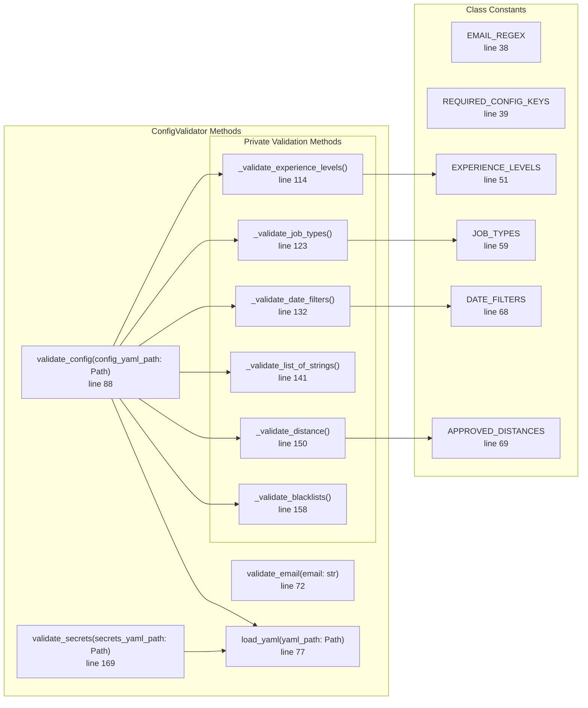

**ConfigValidator Class Structure and Methods**

### Validation Constants

The class defines several constants that serve as whitelists and validation schemas [main.py:38-69]():

| Constant | Purpose | Values |
|----------|---------|--------|
| `EMAIL_REGEX` | Email format validation | Regex pattern: `^[a-zA-Z0-9._%+-]+@[a-zA-Z0-9.-]+\.[a-zA-Z]{2,}$` |
| `REQUIRED_CONFIG_KEYS` | Required fields in work_preferences.yaml | See table below |
| `EXPERIENCE_LEVELS` | Valid experience level values | `["internship", "entry", "associate", "mid_senior_level", "director", "executive"]` |
| `JOB_TYPES` | Valid job type values | `["full_time", "contract", "part_time", "temporary", "internship", "other", "volunteer"]` |
| `DATE_FILTERS` | Valid date filter values | `["all_time", "month", "week", "24_hours"]` |
| `APPROVED_DISTANCES` | Valid distance values in miles | `{0, 5, 10, 25, 50, 100}` |

### Required Configuration Keys

The `REQUIRED_CONFIG_KEYS` dictionary [main.py:39-50]() defines the schema for `work_preferences.yaml`:

| Key | Expected Type | Description |
|-----|---------------|-------------|
| `remote` | `bool` | Enable remote job search |
| `experience_level` | `dict` | Dictionary of experience levels with boolean values |
| `job_types` | `dict` | Dictionary of job types with boolean values |
| `date` | `dict` | Dictionary of date filters with boolean values |
| `positions` | `list` | List of job titles/positions to search for |
| `locations` | `list` | List of geographic locations to search in |
| `location_blacklist` | `list` | List of locations to exclude |
| `distance` | `int` | Maximum distance from location (in miles) |
| `company_blacklist` | `list` | List of companies to exclude |
| `title_blacklist` | `list` | List of job title keywords to exclude |

### Core Validation Methods

**validate_email(email: str) → bool** [main.py:72-74]()

Validates email format using the `EMAIL_REGEX` pattern. Returns `True` if valid, `False` otherwise.

**load_yaml(yaml_path: Path) → dict** [main.py:77-85]()

Loads a YAML file and returns its contents as a dictionary. Raises `ConfigError` if the file is not found or contains invalid YAML syntax.

**validate_config(config_yaml_path: Path) → dict** [main.py:88-111]()

Main validation method for `work_preferences.yaml`. Performs the following checks:
1. Loads the YAML file
2. Verifies all required keys are present
3. Validates data types for each key
4. Calls specialized validation methods for each configuration category
5. Initializes optional blacklist fields to empty lists if missing

Returns the validated configuration dictionary.

**validate_secrets(secrets_yaml_path: Path) → str** [main.py:169-181]()

Validates `secrets.yaml` and extracts the LLM API key. Checks that:
- The `llm_api_key` field exists
- The `llm_api_key` value is non-empty

Returns the API key as a string.

### Specialized Validation Methods

These private methods enforce specific validation rules for different configuration categories:

**_validate_experience_levels(experience_levels: dict, config_path: Path)** [main.py:114-120]()

Ensures each experience level in `EXPERIENCE_LEVELS` is present in the configuration with a boolean value.

**_validate_job_types(job_types: dict, config_path: Path)** [main.py:123-129]()

Ensures each job type in `JOB_TYPES` is present with a boolean value.

**_validate_date_filters(date_filters: dict, config_path: Path)** [main.py:132-138]()

Ensures each date filter in `DATE_FILTERS` is present with a boolean value.

**_validate_list_of_strings(parameters: dict, keys: list, config_path: Path)** [main.py:141-147]()

Validates that specified keys contain lists of strings (used for `positions`, `locations`, blacklists).

**_validate_distance(distance: int, config_path: Path)** [main.py:150-155]()

Validates that the distance value is one of the approved values in `APPROVED_DISTANCES`.

**_validate_blacklists(parameters: dict, config_path: Path)** [main.py:158-166]()

Ensures blacklist fields (`company_blacklist`, `title_blacklist`, `location_blacklist`) are lists, initializing them to empty lists if `None`.

**Sources:** [main.py:35-181]()

---

## FileManager Class

The `FileManager` class [main.py:184-217]() handles file system operations and validations for the configuration system.

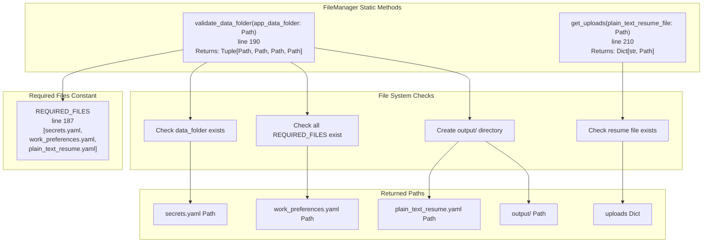

**FileManager Methods and File Path Management**

### Class Constants

**REQUIRED_FILES** [main.py:187]()

A list of required YAML files that must be present in the `data_folder`:
- `SECRETS_YAML` (`"secrets.yaml"`)
- `WORK_PREFERENCES_YAML` (`"work_preferences.yaml"`)
- `PLAIN_TEXT_RESUME_YAML` (`"plain_text_resume.yaml"`)

These constants are imported from [src/utils/constants.py:20-24]().

### Methods

**validate_data_folder(app_data_folder: Path) → Tuple[Path, Path, Path, Path]** [main.py:190-207]()

Validates the existence of the data folder and all required files. Returns a tuple of paths:
1. `secrets.yaml` full path
2. `work_preferences.yaml` full path
3. `plain_text_resume.yaml` full path
4. `output/` directory path (created if it doesn't exist)

Raises `FileNotFoundError` if:
- The `data_folder` directory does not exist
- Any of the required files are missing

**get_uploads(plain_text_resume_file: Path) → Dict[str, Path]** [main.py:210-217]()

Converts the resume file path into a dictionary mapping used by the document generation system. Returns:
```python
{
    "plainTextResume": <Path to plain_text_resume.yaml>
}
```

Raises `FileNotFoundError` if the resume file does not exist.

**Sources:** [main.py:184-217](), [src/utils/constants.py:20-24]()

---

## Configuration Validation Rules

The configuration system enforces strict validation rules to ensure system reliability. This section details each validation rule category.

### Experience Level Validation

Experience levels are validated through `_validate_experience_levels()` [main.py:114-120](). Each level must be a boolean indicating whether to search for jobs at that level.

**Valid Experience Levels:**

| Level | Description |
|-------|-------------|
| `internship` | Internship positions |
| `entry` | Entry-level positions |
| `associate` | Associate-level positions |
| `mid_senior_level` | Mid to senior-level positions |
| `director` | Director-level positions |
| `executive` | Executive-level positions |

**Example Configuration:**
```yaml
experience_level:
  internship: false
  entry: true
  associate: true
  mid_senior_level: true
  director: false
  executive: false
```

### Job Type Validation

Job types are validated through `_validate_job_types()` [main.py:123-129](). Each type must be a boolean indicating whether to search for that job type.

**Valid Job Types:**

| Type | Description |
|------|-------------|
| `full_time` | Full-time employment |
| `contract` | Contract/consulting positions |
| `part_time` | Part-time employment |
| `temporary` | Temporary positions |
| `internship` | Internship programs |
| `other` | Other employment types |
| `volunteer` | Volunteer positions |

### Date Filter Validation

Date filters control how recent job postings should be. Validated through `_validate_date_filters()` [main.py:132-138]().

**Valid Date Filters:**

| Filter | Description |
|--------|-------------|
| `all_time` | All job postings |
| `month` | Posted within the last month |
| `week` | Posted within the last week |
| `24_hours` | Posted within the last 24 hours |

### Distance Validation

Distance values must be one of the approved values in miles, validated through `_validate_distance()` [main.py:150-155]().

**Approved Distance Values:** `0, 5, 10, 25, 50, 100` miles

### List Validations

Several fields must be lists of strings, validated through `_validate_list_of_strings()` [main.py:141-147]():

| Field | Description | Can be Empty |
|-------|-------------|--------------|
| `positions` | Job titles to search for | No (must have at least one) |
| `locations` | Geographic locations to search | No (must have at least one) |
| `location_blacklist` | Locations to exclude | Yes |
| `company_blacklist` | Companies to exclude | Yes |
| `title_blacklist` | Job title keywords to exclude | Yes |

### Blacklist Validation

Blacklists are validated through `_validate_blacklists()` [main.py:158-166]() and automatically initialized to empty lists if not provided or set to `None`.

**Sources:** [main.py:114-166]()

---

## Configuration Flow Through the System

The following diagram illustrates how configuration data flows from initial loading through validation and into consuming systems.

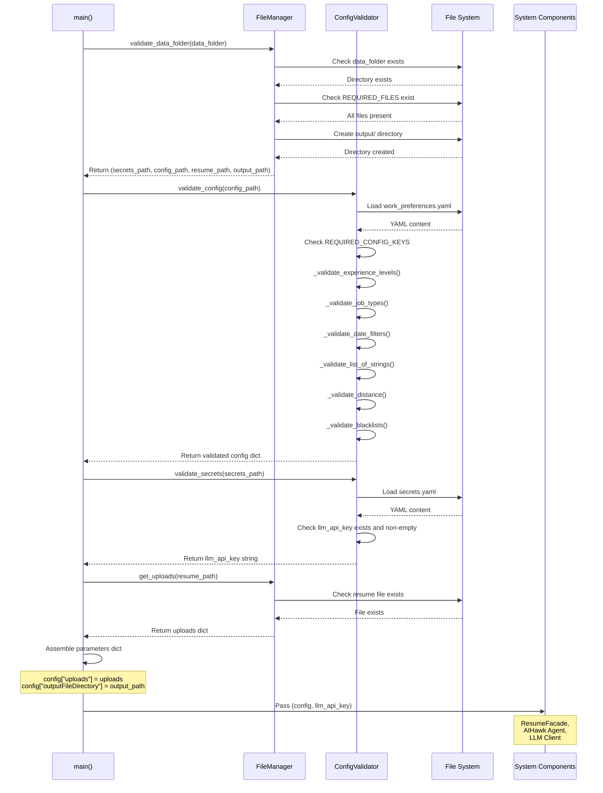

**Configuration Loading and Validation Sequence**

### Main Execution Flow

The `main()` function [main.py:527-562]() orchestrates the configuration loading:

1. **Define data folder** [main.py:531]()
   ```python
   data_folder = Path("data_folder")
   ```

2. **Validate data folder and get paths** [main.py:532]()
   ```python
   secrets_file, config_file, plain_text_resume_file, output_folder = FileManager.validate_data_folder(data_folder)
   ```

3. **Validate configuration** [main.py:535]()
   ```python
   config = ConfigValidator.validate_config(config_file)
   ```

4. **Validate secrets and extract API key** [main.py:536]()
   ```python
   llm_api_key = ConfigValidator.validate_secrets(secrets_file)
   ```

5. **Get file uploads mapping** [main.py:539]()
   ```python
   config["uploads"] = FileManager.get_uploads(plain_text_resume_file)
   ```

6. **Add output directory to config** [main.py:540]()
   ```python
   config["outputFileDirectory"] = output_folder
   ```

7. **Pass validated config to consuming functions** [main.py:546]()
   ```python
   handle_inquiries(selected_actions, config, llm_api_key)
   ```

### Error Handling

The configuration system implements comprehensive error handling [main.py:548-561]():

| Exception Type | Cause | User Guidance |
|----------------|-------|---------------|
| `ConfigError` | Validation failures in YAML files | Link to configuration guide |
| `FileNotFoundError` | Missing required files | Instruction to ensure files exist in data folder |
| `RuntimeError` | Runtime errors during validation | Stack trace logged |
| `Exception` | Unexpected errors | Full exception logged |

**Sources:** [main.py:527-562]()

---

## GlobalConfig Object

The document generation system uses an additional configuration object defined in [src/libs/resume_and_cover_builder/config.py:7-36]().

```mermaid
graph TB
    subgraph "GlobalConfig Class"
        GlobalConfig["GlobalConfig<br/>src/libs/resume_and_cover_builder/config.py:7"]
        
        subgraph "Prompt Module Paths"
            STRINGS_MODULE_RESUME_PATH["STRINGS_MODULE_RESUME_PATH: Path"]
            STRINGS_MODULE_RESUME_JOB_DESCRIPTION_PATH["STRINGS_MODULE_RESUME_JOB_DESCRIPTION_PATH: Path"]
            STRINGS_MODULE_COVER_LETTER_JOB_DESCRIPTION_PATH["STRINGS_MODULE_COVER_LETTER_JOB_DESCRIPTION_PATH: Path"]
            STRINGS_MODULE_NAME["STRINGS_MODULE_NAME: str"]
        end
        
        subgraph "Resource Directories"
            STYLES_DIRECTORY["STYLES_DIRECTORY: Path"]
            LOG_OUTPUT_FILE_PATH["LOG_OUTPUT_FILE_PATH: Path"]
        end
        
        subgraph "API Configuration"
            API_KEY["API_KEY: str"]
        end
        
        subgraph "Templates"
            html_template["html_template: str<br/>HTML Document Template"]
        end
    end
    
    subgraph "Singleton Instance"
        global_config["global_config<br/>Module-level instance"]
    end
    
    GlobalConfig --> STRINGS_MODULE_RESUME_PATH
    GlobalConfig --> STRINGS_MODULE_RESUME_JOB_DESCRIPTION_PATH
    GlobalConfig --> STRINGS_MODULE_COVER_LETTER_JOB_DESCRIPTION_PATH
    GlobalConfig --> STRINGS_MODULE_NAME
    GlobalConfig --> STYLES_DIRECTORY
    GlobalConfig --> LOG_OUTPUT_FILE_PATH
    GlobalConfig --> API_KEY
    GlobalConfig --> html_template
    
    GlobalConfig --> global_config
```

**GlobalConfig Architecture for Document Generation**

### GlobalConfig Fields

The `GlobalConfig` class [src/libs/resume_and_cover_builder/config.py:7-36]() stores paths and settings used throughout the document generation pipeline:

| Field | Type | Purpose |
|-------|------|---------|
| `STRINGS_MODULE_RESUME_PATH` | `Path` | Path to prompt strings for general resume generation |
| `STRINGS_MODULE_RESUME_JOB_DESCRIPTION_PATH` | `Path` | Path to prompt strings for job-tailored resume generation |
| `STRINGS_MODULE_COVER_LETTER_JOB_DESCRIPTION_PATH` | `Path` | Path to prompt strings for cover letter generation |
| `STRINGS_MODULE_NAME` | `str` | Name of the active prompt module |
| `STYLES_DIRECTORY` | `Path` | Directory containing CSS style files |
| `LOG_OUTPUT_FILE_PATH` | `Path` | Path for logging output |
| `API_KEY` | `str` | LLM API key (copied from validated secrets) |
| `html_template` | `str` | HTML template with placeholders for CSS and body content |

### HTML Template Structure

The `html_template` field [src/libs/resume_and_cover_builder/config.py:16-34]() defines the document structure:

```html
<!DOCTYPE html>
<html lang="en">
<head>
    <meta charset="UTF-8">
    <meta name="viewport" content="width=device-width, initial-scale=1.0">
    <title>Resume</title>
    <link href="https://fonts.googleapis.com/css2?family=Barlow:wght@400;600&display=swap" rel="stylesheet" />
    <link rel="stylesheet" href="https://cdnjs.cloudflare.com/ajax/libs/font-awesome/5.15.3/css/all.min.css" /> 
    <style>
        $style_css
    </style>
</head>
<body>
$body
</body>
</html>
```

The template uses placeholder variables:
- `$style_css`: Replaced with selected CSS style content
- `$body`: Replaced with generated resume/cover letter HTML

### Singleton Pattern

The module creates a single instance `global_config` [src/libs/resume_and_cover_builder/config.py:36]() that is imported and used throughout the document generation system. This ensures configuration consistency across all components.

**Sources:** [src/libs/resume_and_cover_builder/config.py:1-37]()

---

## Configuration Usage Examples

### Example 1: Creating Documents with Configuration

From [main.py:392-468](), the `create_resume_pdf()` function demonstrates configuration usage:

```python
# Load plain text resume using validated path
with open(parameters["uploads"]["plainTextResume"], "r", encoding="utf-8") as file:
    plain_text_resume = file.read()

# Use output directory from validated configuration
output_dir = Path(parameters["outputFileDirectory"])
output_path = output_dir / "resume_base.pdf"
```

The `parameters` dictionary contains:
- `parameters["uploads"]["plainTextResume"]`: Path from `FileManager.get_uploads()`
- `parameters["outputFileDirectory"]`: Path from `FileManager.validate_data_folder()`

**Sources:** [main.py:392-468]()

### Example 2: Job-Tailored Documents

From [main.py:307-389](), job-tailored document generation uses additional configuration:

```python
# Create subfolder using suggested job name
output_dir = Path(parameters["outputFileDirectory"]) / suggested_name
output_dir.mkdir(parents=True, exist_ok=True)

output_path = output_dir / "resume_tailored.pdf"
```

This creates a hierarchical structure:
```
data_folder/
└── output/
    └── <suggested_job_name>/
        └── resume_tailored.pdf
```

**Sources:** [main.py:307-389]()

### Example 3: Configuration Error Handling

From [main.py:548-561](), the main function demonstrates proper error handling:

```python
except ConfigError as ce:
    logger.error(f"Configuration error: {ce}")
    logger.error(
        "Refer to the configuration guide for troubleshooting: "
        "https://github.com/feder-cr/Auto_Jobs_Applier_AIHawk?tab=readme-ov-file#configuration"
    )
except FileNotFoundError as fnf:
    logger.error(f"File not found: {fnf}")
    logger.error("Ensure all required files are present in the data folder.")
```

This provides actionable error messages to users when configuration fails.

**Sources:** [main.py:548-561]()

---

## Summary

The Configuration System is a robust validation and file management layer that ensures AIHawk operates with valid settings. Key components include:

- **ConfigValidator**: Validates YAML files against strict schemas with whitelisted values
- **FileManager**: Manages file system operations and path mappings
- **GlobalConfig**: Provides document generation-specific configuration
- **Multi-source configuration**: Separates concerns across `config.py`, `secrets.yaml`, `work_preferences.yaml`, and `plain_text_resume.yaml`

The system enforces type checking, whitelist validation, and required field verification to prevent runtime errors. All configuration data flows through validation before reaching consuming systems, ensuring reliability and predictable behavior.

For information on how to configure these files as an end user, see [Configuration Files](#3.2). For details on extending the configuration system, see [Configuration and Validation](#4.6).

**Sources:** [main.py:30-562](), [config.py:1-23](), [src/libs/resume_and_cover_builder/config.py:1-37]()

---

# Page: LLM Integration

# LLM Integration

<details>
<summary>Relevant source files</summary>

The following files were used as context for generating this wiki page:

- [README.md](README.md)
- [config.py](config.py)
- [src/libs/resume_and_cover_builder/resume_facade.py](src/libs/resume_and_cover_builder/resume_facade.py)
- [src/libs/resume_and_cover_builder/resume_generator.py](src/libs/resume_and_cover_builder/resume_generator.py)

</details>


This document details how the AIHawk job application system integrates with various Large Language Models (LLMs) to power its core document generation capabilities. The LLM integration component serves as the intelligence layer that transforms user resume data and job descriptions into professionally formatted resumes and cover letters.

## Purpose and Scope

The LLM integration in AIHawk serves three main purposes:
1. Generate standard resumes from user profile data
2. Create job-tailored resumes that highlight relevant skills based on job descriptions
3. Craft personalized cover letters for specific job opportunities

This document focuses specifically on the technical implementation of how different LLM providers are integrated and utilized within the system. For information about the actual document generation process, see [Resume Generation System](#4.1) and [Cover Letter Generation](#4.2).

## Supported LLM Providers

AIHawk uses a provider-agnostic architecture that currently supports two LLM providers: OpenAI and Ollama. This design allows the system to route requests to different backends based on configuration without changing the application logic.

| Provider | Default Model | Configuration Required | Use Case |
|----------|---------------|----------------------|----------|
| OpenAI | `gpt-4o-mini` | API key via `secrets.yaml` | Cloud-based LLM with consistent availability |
| Ollama | User-specified | API key + `LLM_API_URL` endpoint | Local/self-hosted LLM for privacy and cost control |

The provider selection is determined by the `LLM_MODEL_TYPE` configuration parameter in [config.py:19]().

Sources: [config.py:19-22](), [README.md:1-27]()

## Configuration System

### LLM Configuration Parameters

The LLM integration is configured through two main files that control provider selection, model specification, and authentication:

**1. config.py** - Defines operational parameters:
- `LLM_MODEL_TYPE`: Selects the LLM provider (`'openai'` or `'ollama'`)
- `LLM_MODEL`: Specifies the model name (e.g., `'gpt-4o-mini'`)
- `LLM_API_URL`: Required for Ollama to specify the local endpoint URL (e.g., `'http://127.0.0.1:11434/'`)

**2. secrets.yaml** - Contains authentication credentials:
- `llm_api_key`: The API key for authenticating with the LLM provider

The API key is extracted and validated by the configuration system before being passed to LLM components. The `global_config.API_KEY` is set during initialization in [src/libs/resume_and_cover_builder/resume_facade.py:34]().

Sources: [config.py:19-22](), [src/libs/resume_and_cover_builder/resume_facade.py:27-34]()

### Configuration Flow Diagram

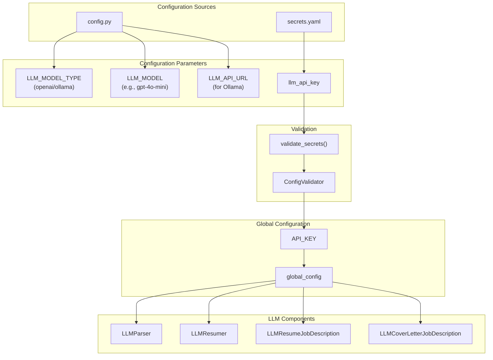

This diagram shows how configuration parameters flow from source files through validation into the global configuration object, which is then consumed by all LLM components.

Sources: [config.py:19-22](), [src/libs/resume_and_cover_builder/resume_facade.py:27-34]()

## LLM Integration Architecture

The LLM integration uses a layered architecture with clear separation between document generation logic, LLM components, and provider-specific clients.

### Component Layer Architecture

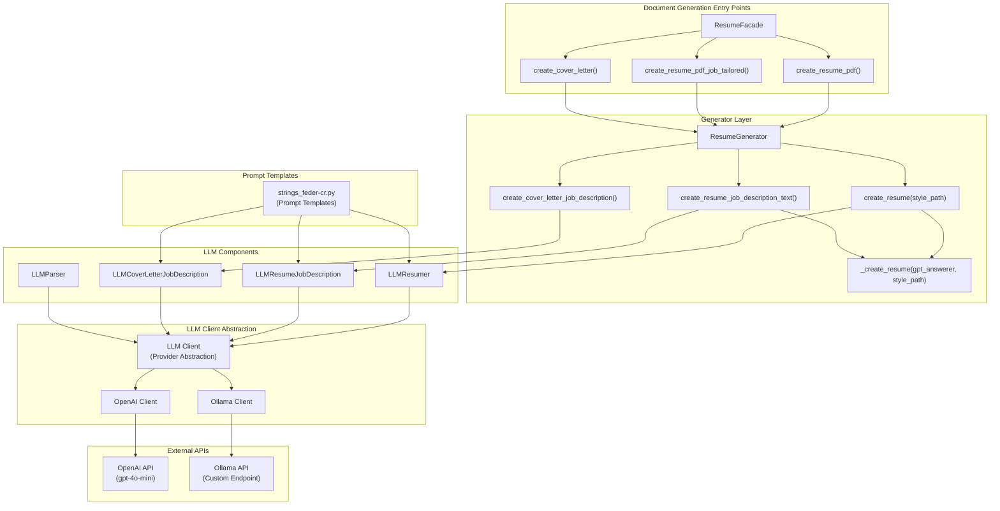

This architecture ensures that document generation logic is decoupled from the specific LLM provider implementation. The `ResumeGenerator` class [src/libs/resume_and_cover_builder/resume_generator.py:13-65]() orchestrates LLM component instantiation, while the LLM client layer handles provider-specific API communication.

Sources: [src/libs/resume_and_cover_builder/resume_facade.py:16-153](), [src/libs/resume_and_cover_builder/resume_generator.py:13-65]()

## LLM Component Classes

The system uses specialized LLM component classes that handle different document generation tasks. Each component follows the same pattern: accepting an API key and prompt strings during initialization, then generating specific document types.

### LLM Component Overview

| Component Class | Purpose | Key Methods | Input Data |
|----------------|---------|-------------|------------|
| `LLMParser` | Extract structured job data from HTML | `extract_role()`, `extract_company_name()`, `extract_job_description()` | Job page HTML |
| `LLMResumer` | Generate general resume | `generate_html_resume()`, `set_resume()` | User resume data |
| `LLMResumeJobDescription` | Generate job-tailored resume | `generate_html_resume()`, `set_job_description_from_text()` | Resume data + job description |
| `LLMCoverLetterJobDescription` | Generate cover letter | `generate_cover_letter()`, `set_job_description_from_text()` | Resume data + job description |

### Component Instantiation Pattern

All LLM components follow a consistent instantiation pattern in the `ResumeGenerator` class:

1. **Load prompt templates** using `load_module()` from the appropriate strings file
2. **Instantiate the LLM component** with the API key and loaded strings
3. **Set context data** (resume, job description) using component-specific methods
4. **Generate output** by calling the component's generation method

Example from [src/libs/resume_and_cover_builder/resume_generator.py:42-45]():
```python
def create_resume(self, style_path):
    strings = load_module(global_config.STRINGS_MODULE_RESUME_PATH, 
                         global_config.STRINGS_MODULE_NAME)
    gpt_answerer = LLMResumer(global_config.API_KEY, strings)
    return self._create_resume(gpt_answerer, style_path)
```

### Job Description Parser Flow

The `LLMParser` component is used specifically for extracting structured information from job postings. The flow is:

```mermaid
graph LR
    job_url["Job URL"] --> driver["Selenium WebDriver"]
    driver --> html["HTML Content<br/>(body element)"]
    html --> LLMParser["LLMParser<br/>(instantiated)"]
    LLMParser --> set_body_html["set_body_html(html)"]
    set_body_html --> extract_role["extract_role()"]
    set_body_html --> extract_company_name["extract_company_name()"]
    set_body_html --> extract_job_description["extract_job_description()"]
    set_body_html --> extract_location["extract_location()"]
    extract_role --> Job["Job Object"]
    extract_company_name --> Job
    extract_job_description --> Job
    extract_location --> Job
```

Implementation in [src/libs/resume_and_cover_builder/resume_facade.py:71-85]():
```python
def link_to_job(self, job_url):
    self.driver.get(job_url)
    self.driver.implicitly_wait(10)
    body_element = self.driver.find_element("tag name", "body")
    body_element = body_element.get_attribute("outerHTML")
    self.llm_job_parser = LLMParser(openai_api_key=global_config.API_KEY)
    self.llm_job_parser.set_body_html(body_element)
    
    self.job = Job()
    self.job.role = self.llm_job_parser.extract_role()
    self.job.company = self.llm_job_parser.extract_company_name()
    self.job.description = self.llm_job_parser.extract_job_description()
    self.job.location = self.llm_job_parser.extract_location()
    self.job.link = job_url
```

Sources: [src/libs/resume_and_cover_builder/resume_facade.py:71-85](), [src/libs/resume_and_cover_builder/resume_generator.py:42-62]()

## Document Generation with LLM Components

### Generation Flow

The `ResumeGenerator` uses different LLM components depending on the document type being generated. All generation flows converge on the `_create_resume()` method [src/libs/resume_and_cover_builder/resume_generator.py:21-40](), which handles common tasks:

1. Set resume data on the LLM component using `set_resume()`
2. Load CSS style from the specified `style_path`
3. Generate HTML content by calling the component's generation method
4. Combine HTML body with CSS using the HTML template
5. Return complete HTML document

```mermaid
graph TB
    subgraph "Entry Points"
        create_resume["create_resume()"]
        create_resume_job_description_text["create_resume_job_description_text()"]
        create_cover_letter_job_description["create_cover_letter_job_description()"]
    end
    
    subgraph "LLM Component Selection"
        LLMResumer_inst["LLMResumer<br/>(general resume)"]
        LLMResumeJobDescription_inst["LLMResumeJobDescription<br/>(job-tailored)"]
        LLMCoverLetterJobDescription_inst["LLMCoverLetterJobDescription<br/>(cover letter)"]
    end
    
    subgraph "Prompt Loading"
        STRINGS_MODULE_RESUME_PATH["STRINGS_MODULE_RESUME_PATH"]
        STRINGS_MODULE_RESUME_JOB_DESCRIPTION_PATH["STRINGS_MODULE_RESUME_JOB_DESCRIPTION_PATH"]
        STRINGS_MODULE_COVER_LETTER_JOB_DESCRIPTION_PATH["STRINGS_MODULE_COVER_LETTER_JOB_DESCRIPTION_PATH"]
        load_module["load_module()"]
    end
    
    subgraph "Common Processing"
        _create_resume["_create_resume()<br/>(common logic)"]
        set_resume["set_resume(resume_object)"]
        generate_html["generate_html_resume() or<br/>generate_cover_letter()"]
        template_substitute["Template.substitute()<br/>(body + CSS)"]
    end
    
    create_resume --> STRINGS_MODULE_RESUME_PATH
    create_resume_job_description_text --> STRINGS_MODULE_RESUME_JOB_DESCRIPTION_PATH
    create_cover_letter_job_description --> STRINGS_MODULE_COVER_LETTER_JOB_DESCRIPTION_PATH
    
    STRINGS_MODULE_RESUME_PATH --> load_module
    STRINGS_MODULE_RESUME_JOB_DESCRIPTION_PATH --> load_module
    STRINGS_MODULE_COVER_LETTER_JOB_DESCRIPTION_PATH --> load_module
    
    load_module --> LLMResumer_inst
    load_module --> LLMResumeJobDescription_inst
    load_module --> LLMCoverLetterJobDescription_inst
    
    LLMResumer_inst --> _create_resume
    LLMResumeJobDescription_inst --> _create_resume
    
    _create_resume --> set_resume
    set_resume --> generate_html
    generate_html --> template_substitute
    
    LLMCoverLetterJobDescription_inst --> set_resume
    LLMCoverLetterJobDescription_inst --> generate_html
```

### Basic Resume Generation

The `create_resume()` method [src/libs/resume_and_cover_builder/resume_generator.py:42-45]() generates a standard resume:

```python
def create_resume(self, style_path):
    strings = load_module(global_config.STRINGS_MODULE_RESUME_PATH, 
                         global_config.STRINGS_MODULE_NAME)
    gpt_answerer = LLMResumer(global_config.API_KEY, strings)
    return self._create_resume(gpt_answerer, style_path)
```

This instantiates `LLMResumer` with prompt templates from `STRINGS_MODULE_RESUME_PATH` and delegates to `_create_resume()`.

### Job-Tailored Resume Generation

The `create_resume_job_description_text()` method [src/libs/resume_and_cover_builder/resume_generator.py:47-51]() generates a resume tailored to a specific job:

```python
def create_resume_job_description_text(self, style_path: str, job_description_text: str):
    strings = load_module(global_config.STRINGS_MODULE_RESUME_JOB_DESCRIPTION_PATH, 
                         global_config.STRINGS_MODULE_NAME)
    gpt_answerer = LLMResumeJobDescription(global_config.API_KEY, strings)
    gpt_answerer.set_job_description_from_text(job_description_text)
    return self._create_resume(gpt_answerer, style_path)
```

This uses `LLMResumeJobDescription` and provides the job description via `set_job_description_from_text()` before generation.

### Cover Letter Generation

The `create_cover_letter_job_description()` method [src/libs/resume_and_cover_builder/resume_generator.py:53-62]() generates a personalized cover letter:

```python
def create_cover_letter_job_description(self, style_path: str, job_description_text: str):
    strings = load_module(global_config.STRINGS_MODULE_COVER_LETTER_JOB_DESCRIPTION_PATH, 
                         global_config.STRINGS_MODULE_NAME)
    gpt_answerer = LLMCoverLetterJobDescription(global_config.API_KEY, strings)
    gpt_answerer.set_resume(self.resume_object)
    gpt_answerer.set_job_description_from_text(job_description_text)
    cover_letter_html = gpt_answerer.generate_cover_letter()
    template = Template(global_config.html_template)
    with open(style_path, "r") as f:
        style_css = f.read()
    return template.substitute(body=cover_letter_html, style_css=style_css)
```

Unlike resume generation, cover letters use `generate_cover_letter()` and handle HTML template substitution directly rather than delegating to `_create_resume()`.

Sources: [src/libs/resume_and_cover_builder/resume_generator.py:21-62]()

## Prompt Engineering Integration

The LLM integration relies heavily on prompt templates stored in the `strings_feder-cr.py` files. These templates are loaded dynamically based on the document type being generated.

### Prompt Module Paths

The `ResumeFacade` initialization [src/libs/resume_and_cover_builder/resume_facade.py:27-32]() configures prompt module paths:

```python
global_config.STRINGS_MODULE_RESUME_PATH = lib_directory / "resume_prompt/strings_feder-cr.py"
global_config.STRINGS_MODULE_RESUME_JOB_DESCRIPTION_PATH = lib_directory / "resume_job_description_prompt/strings_feder-cr.py"
global_config.STRINGS_MODULE_COVER_LETTER_JOB_DESCRIPTION_PATH = lib_directory / "cover_letter_prompt/strings_feder-cr.py"
global_config.STRINGS_MODULE_NAME = "strings_feder_cr"
```

### Prompt Loading Mechanism

The `module_loader.load_module()` function dynamically imports prompt templates:

1. Receives path to prompt module and module name
2. Dynamically imports the module
3. Returns the module object containing prompt strings
4. Prompt strings are passed to LLM component constructors

This design allows prompt templates to be modified without changing code, enabling easier prompt engineering iteration.

Sources: [src/libs/resume_and_cover_builder/resume_facade.py:27-32](), [src/libs/resume_and_cover_builder/resume_generator.py:10-11]()

## Configuration Best Practices

### OpenAI Configuration
- **Model Selection**: Use `gpt-4o-mini` (default) for cost-effective processing with good quality
- **API Key**: Store in `secrets.yaml` with sufficient quota
- **Rate Limits**: The system respects rate limits through the API client

### Ollama Configuration
- **Local Setup**: Ensure Ollama is running before starting the application
- **Endpoint**: Set `LLM_API_URL = 'http://127.0.0.1:11434/'` in [config.py:22]()
- **Model Selection**: Specify model name in `LLM_MODEL` (e.g., `'llama2'`, `'mistral'`)
- **Performance**: Local models provide privacy but require adequate hardware resources

### Configuration Validation
The system validates LLM configuration during startup to catch errors early:
- API key presence and format
- Provider compatibility with model selection
- Endpoint reachability for Ollama configurations

Sources: [config.py:19-22](), [README.md:1-27]()

## Conclusion

The LLM integration component is a critical part of the AIHawk system, providing the intelligence needed to transform user data into professional documents. The modular design allows for flexible configuration with different LLM providers while maintaining a consistent API for the rest of the system.

By supporting multiple LLM providers, the system gives users options based on their specific needs, whether they prioritize performance, cost, or privacy.

---

# Page: Job Application Agent

# Job Application Agent

<details>
<summary>Relevant source files</summary>

The following files were used as context for generating this wiki page:

- [README.md](README.md)
- [config.py](config.py)
- [src/utils/chrome_utils.py](src/utils/chrome_utils.py)

</details>


## Purpose and Scope

This document describes the core automated job application agent, which is the primary automation component of the AIHawk system. The agent orchestrates the end-to-end process of searching for jobs, evaluating their suitability, generating customized application materials, and submitting applications.

This page covers:
- Agent architecture and operational flow
- Job search and scraping mechanisms
- Suitability scoring and filtering logic
- Application submission and rate limiting
- State management and logging

For information about browser automation details, see [Browser Automation](#2.5). For configuration of the agent, see [Configuration System](#2.2). For document generation logic, see [Document Generation Architecture](#4.1).

**Note**: Due to copyright considerations, third-party provider plugins have been removed from the open-source repository. The core architecture is documented here, with the understanding that full provider integrations are available in the commercial [laboro.co](https://laboro.co/) platform.

---

## Agent Architecture

The job application agent operates as a continuous automation loop that searches for job postings, evaluates their suitability against user preferences, generates tailored application materials, and submits applications while respecting rate limits and application quotas.

### Core Agent Flow

```mermaid
graph TB
    START["Agent Initialization"]
    LOAD_CONFIG["Load Configuration<br/>(secrets.yaml, work_preferences.yaml)"]
    VALIDATE["ConfigValidator.validate()"]
    INIT_BROWSER["init_browser()<br/>from chrome_utils"]
    
    SEARCH_LOOP["Job Search Loop"]
    SEARCH["Search Job Postings<br/>(Based on work_preferences)"]
    SCRAPE["Scrape Job Details<br/>(Company, Role, Description)"]
    
    PARSE_JOB["Parse Job Description<br/>LLMParser"]
    SCORE_CHECK{"Job Suitability Score<br/>>= JOB_SUITABILITY_SCORE<br/>(config.py)"}
    
    APP_COUNT_CHECK{"Applications Submitted<br/>< JOB_MAX_APPLICATIONS<br/>(config.py)"}
    
    GENERATE_DOCS["Generate Application Materials<br/>(Resume + Cover Letter)"]
    SAVE_DOCS["Save to JOB_APPLICATIONS_DIR<br/>(config.py)"]
    
    RATE_LIMIT["Wait MINIMUM_WAIT_TIME_IN_SECONDS<br/>(config.py)"]
    SUBMIT["Submit Application<br/>(Form Filling)"]
    LOG_APP["Log Application"]
    
    END["End Session"]
    
    START --> LOAD_CONFIG
    LOAD_CONFIG --> VALIDATE
    VALIDATE --> INIT_BROWSER
    INIT_BROWSER --> SEARCH_LOOP
    
    SEARCH_LOOP --> SEARCH
    SEARCH --> SCRAPE
    SCRAPE --> PARSE_JOB
    
    PARSE_JOB --> SCORE_CHECK
    SCORE_CHECK -->|"Score < Threshold"| SEARCH_LOOP
    SCORE_CHECK -->|"Score >= Threshold"| APP_COUNT_CHECK
    
    APP_COUNT_CHECK -->|"Quota Reached"| END
    APP_COUNT_CHECK -->|"Continue"| GENERATE_DOCS
    
    GENERATE_DOCS --> SAVE_DOCS
    SAVE_DOCS --> RATE_LIMIT
    RATE_LIMIT --> SUBMIT
    SUBMIT --> LOG_APP
    LOG_APP --> SEARCH_LOOP
```

**Sources:** [config.py:1-23](), Diagram 2 from high-level architecture

### Configuration-Driven Behavior

The agent's behavior is controlled by several configuration parameters:

| Configuration Parameter | Location | Default Value | Description |
|------------------------|----------|---------------|-------------|
| `MINIMUM_WAIT_TIME_IN_SECONDS` | [config.py:11]() | 60 | Minimum time between application submissions |
| `JOB_APPLICATIONS_DIR` | [config.py:13]() | "job_applications" | Directory for storing generated documents |
| `JOB_SUITABILITY_SCORE` | [config.py:14]() | 7 | Minimum score (0-10) for job to be considered |
| `JOB_MAX_APPLICATIONS` | [config.py:16]() | 5 | Maximum number of applications per session |
| `JOB_MIN_APPLICATIONS` | [config.py:17]() | 1 | Minimum application target |

**Sources:** [config.py:11-17]()

---

## Agent Initialization

### Browser Initialization

The agent initializes a Chrome browser instance using Selenium WebDriver with specific options optimized for automation:

```mermaid
graph LR
    INIT_CALL["Agent Initialization"]
    CHROME_OPTIONS["chrome_browser_options()"]
    WEBDRIVER_MGR["ChromeDriverManager.install()"]
    CHROME_DRIVER["webdriver.Chrome()"]
    CONFIGURED_BROWSER["Configured Browser Instance"]
    
    INIT_CALL --> CHROME_OPTIONS
    CHROME_OPTIONS --> WEBDRIVER_MGR
    WEBDRIVER_MGR --> CHROME_DRIVER
    CHROME_DRIVER --> CONFIGURED_BROWSER
    
    CHROME_OPTIONS -.-> OPT1["--incognito"]
    CHROME_OPTIONS -.-> OPT2["--no-sandbox"]
    CHROME_OPTIONS -.-> OPT3["--disable-dev-shm-usage"]
    CHROME_OPTIONS -.-> OPT4["--start-maximized"]
    CHROME_OPTIONS -.-> OPT5["--disable-web-security"]
```

The `chrome_browser_options()` function in [src/utils/chrome_utils.py:10-36]() configures Chrome with:

- **Incognito mode** ([src/utils/chrome_utils.py:31]()): Prevents cookie/cache interference
- **Security flags** ([src/utils/chrome_utils.py:14-16]()): `--no-sandbox`, `--ignore-certificate-errors`
- **Performance optimizations** ([src/utils/chrome_utils.py:20-30]()): Disables background throttling, animations, cache
- **File access** ([src/utils/chrome_utils.py:32-33]()): Enables local file access for HTML-to-PDF conversion

The browser instance is created via `init_browser()` ([src/utils/chrome_utils.py:38-47]()), which uses `webdriver_manager` to automatically download and manage the ChromeDriver binary.

**Sources:** [src/utils/chrome_utils.py:10-47]()

### Configuration Validation

Before the agent begins operation, all configuration files are validated by the `ConfigValidator` component (see [Configuration System](#2.2)). This ensures:

- Required API keys are present
- Work preferences conform to allowed values
- File paths exist and are accessible
- LLM configuration is properly specified

**Sources:** Diagram 4 from high-level architecture, [config.py:1-23]()

---

## Job Search and Scraping

### Search Process

The agent searches for job postings based on criteria specified in `work_preferences.yaml`:

```mermaid
graph TB
    WORK_PREFS["work_preferences.yaml"]
    SEARCH_CRITERIA["Search Criteria Extraction"]
    
    TITLES["Job Titles"]
    LOCATIONS["Locations"]
    DISTANCE["Distance"]
    EXP_LEVEL["Experience Levels"]
    JOB_TYPES["Job Types"]
    DATE_POSTED["Date Posted"]
    
    WORK_PREFS --> SEARCH_CRITERIA
    
    SEARCH_CRITERIA --> TITLES
    SEARCH_CRITERIA --> LOCATIONS
    SEARCH_CRITERIA --> DISTANCE
    SEARCH_CRITERIA --> EXP_LEVEL
    SEARCH_CRITERIA --> JOB_TYPES
    SEARCH_CRITERIA --> DATE_POSTED
    
    QUERY["Search Query Construction"]
    TITLES --> QUERY
    LOCATIONS --> QUERY
    DISTANCE --> QUERY
    EXP_LEVEL --> QUERY
    JOB_TYPES --> QUERY
    DATE_POSTED --> QUERY
    
    BROWSER["Browser Navigation"]
    QUERY --> BROWSER
    
    RESULTS["Job Posting Results"]
    BROWSER --> RESULTS
```

The agent constructs search queries by combining user preferences and navigates to job sites using the browser automation layer.

**Sources:** Diagram 2 from high-level architecture, [README.md:8-10]()

### Scraping Job Details

For each job posting discovered in search results, the agent scrapes:

| Data Field | Purpose |
|-----------|---------|
| Company Name | Identification and targeting |
| Job Title | Role matching |
| Job Description | Content for LLM parsing and tailoring |
| Application URL | Navigation for submission |
| Required Qualifications | Suitability assessment |
| Salary Information | Filtering (if specified) |
| Location Details | Verification against preferences |

The scraped data is passed to the LLM integration layer for processing (see [LLM Integration](#2.3)).

**Sources:** Diagram 2 from high-level architecture

---

## Suitability Scoring and Filtering

### Job Description Parsing

The agent uses the `LLMParser` component to extract structured information from job descriptions:

```mermaid
graph LR
    RAW_JOB["Raw Job Description<br/>(HTML/Text)"]
    LLMPARSER["LLMParser"]
    LLM_CLIENT["LLM Client<br/>(OpenAI/OLLAMA)"]
    
    STRUCTURED["Structured Job Data"]
    
    REQUIREMENTS["Requirements"]
    RESPONSIBILITIES["Responsibilities"]
    SKILLS["Required Skills"]
    COMPANY_INFO["Company Information"]
    
    RAW_JOB --> LLMPARSER
    LLMPARSER --> LLM_CLIENT
    LLM_CLIENT --> STRUCTURED
    
    STRUCTURED --> REQUIREMENTS
    STRUCTURED --> RESPONSIBILITIES
    STRUCTURED --> SKILLS
    STRUCTURED --> COMPANY_INFO
```

**Sources:** Diagram 2 and Diagram 6 from high-level architecture

### Suitability Scoring Algorithm

After parsing, the agent calculates a suitability score (0-10 scale) by comparing:

1. **Resume Skills** vs. **Required Skills** - Weighted matching
2. **Experience Level** - Years of experience vs. job requirements
3. **Location Preferences** - Distance and remote work options
4. **Job Type Preferences** - Full-time, part-time, contract alignment
5. **Salary Expectations** - If specified in preferences

The score calculation logic compares the parsed job data against the user's `plain_text_resume.yaml` and `work_preferences.yaml`.

### Filtering Decision

```mermaid
graph TB
    SCORE["Calculate Suitability Score<br/>(0-10 scale)"]
    THRESHOLD["Compare to JOB_SUITABILITY_SCORE<br/>(config.py)"]
    
    ACCEPT["Accept Job"]
    REJECT["Reject Job"]
    
    SCORE --> THRESHOLD
    THRESHOLD -->|"Score >= Threshold"| ACCEPT
    THRESHOLD -->|"Score < Threshold"| REJECT
    
    REJECT --> NEXT_SEARCH["Continue to Next Job"]
    ACCEPT --> CHECK_QUOTA["Check Application Quota"]
    
    CHECK_QUOTA --> COUNT{"Applications < JOB_MAX_APPLICATIONS"}
    COUNT -->|"Yes"| PROCEED["Proceed to Application"]
    COUNT -->|"No"| END_SESSION["End Session"]
```

The `JOB_SUITABILITY_SCORE` threshold ([config.py:14]()) allows users to control how selective the agent should be. A higher threshold (e.g., 8-9) results in fewer but more targeted applications, while a lower threshold (e.g., 5-6) casts a wider net.

**Sources:** [config.py:14-17](), Diagram 2 from high-level architecture

---

## Application Submission

### Document Generation Integration

Once a job passes the suitability filter, the agent generates customized application materials:

```mermaid
graph LR
    APPROVED_JOB["Approved Job"]
    
    RESUME_GEN["LLMResumeJobDescription"]
    COVER_GEN["LLMCoverLetterJobDescription"]
    
    HTML_RESUME["HTML Resume"]
    HTML_COVER["HTML Cover Letter"]
    
    PDF_CONVERT["HTML_to_PDF()<br/>(chrome_utils)"]
    
    PDF_RESUME["Resume PDF"]
    PDF_COVER["Cover Letter PDF"]
    
    SAVE["Save to JOB_APPLICATIONS_DIR"]
    
    APPROVED_JOB --> RESUME_GEN
    APPROVED_JOB --> COVER_GEN
    
    RESUME_GEN --> HTML_RESUME
    COVER_GEN --> HTML_COVER
    
    HTML_RESUME --> PDF_CONVERT
    HTML_COVER --> PDF_CONVERT
    
    PDF_CONVERT --> PDF_RESUME
    PDF_CONVERT --> PDF_COVER
    
    PDF_RESUME --> SAVE
    PDF_COVER --> SAVE
```

The `HTML_to_PDF()` function ([src/utils/chrome_utils.py:51-93]()) uses Chrome DevTools Protocol to convert HTML to PDF with specific formatting:

- Paper size: A4 (8.27" × 11.69")
- Margins: Top/Bottom 0.8", Left/Right 0.5"
- Background printing enabled
- Portrait orientation
- Returns base64-encoded PDF

**Sources:** [src/utils/chrome_utils.py:51-93](), Diagram 3 from high-level architecture

### Rate Limiting

Before submitting each application, the agent enforces a mandatory wait period:

```mermaid
graph TB
    DOCS_READY["Documents Generated"]
    WAIT_START["Start Wait Timer"]
    
    WAIT_DURATION["Wait for<br/>MINIMUM_WAIT_TIME_IN_SECONDS<br/>(default: 60 seconds)"]
    
    WAIT_COMPLETE["Wait Complete"]
    SUBMIT["Submit Application"]
    
    DOCS_READY --> WAIT_START
    WAIT_START --> WAIT_DURATION
    WAIT_DURATION --> WAIT_COMPLETE
    WAIT_COMPLETE --> SUBMIT
```

The `MINIMUM_WAIT_TIME_IN_SECONDS` configuration ([config.py:11]()) serves multiple purposes:

1. **Rate limiting**: Prevents overwhelming job sites with requests
2. **Detection avoidance**: Mimics human behavior patterns
3. **System stability**: Allows LLM and browser operations to complete
4. **Ethical compliance**: Respects job site terms of service

**Sources:** [config.py:11]()

### Form Filling and Submission

The agent uses browser automation to:

1. Navigate to the application URL
2. Fill form fields based on scraped requirements
3. Upload generated resume and cover letter PDFs
4. Complete any additional required fields
5. Submit the application

This logic is part of the excluded third-party provider plugins, as different job sites have different form structures and submission flows.

**Sources:** [README.md:8-10](), Diagram 2 from high-level architecture

---

## State Management and Logging

### Application Tracking

The agent maintains state to track:

| State Component | Purpose |
|----------------|---------|
| Application Counter | Enforces `JOB_MAX_APPLICATIONS` quota |
| Submitted Job IDs | Prevents duplicate applications |
| Session Statistics | Success/failure rates, timing metrics |
| Error Log | Tracks failures for debugging |

### File Organization

Application materials are saved in the `JOB_APPLICATIONS_DIR` ([config.py:13]()) with a structured naming convention:

```
job_applications/
├── [company_name]_[job_title]_[date]/
│   ├── resume.pdf
│   ├── cover_letter.pdf
│   ├── job_description.txt
│   └── application_metadata.json
```

This organization allows users to review generated materials and track application history.

**Sources:** [config.py:13]()

### Logging Configuration

The agent's logging behavior is controlled by configuration flags:

| Configuration | Location | Default | Purpose |
|--------------|----------|---------|---------|
| `LOG_LEVEL` | [config.py:6]() | 'ERROR' | Controls verbosity |
| `LOG_TO_FILE` | [config.py:8]() | False | Enables file logging |
| `LOG_TO_CONSOLE` | [config.py:9]() | False | Enables console output |
| `LOG_SELENIUM_LEVEL` | [config.py:7]() | ERROR | Selenium-specific logging |

Setting `LOG_LEVEL` to 'DEBUG' provides detailed execution traces, while 'ERROR' only logs failures.

**Sources:** [config.py:6-9]()

---

## Session Management

### Application Quota Control

The agent enforces both minimum and maximum application targets:

```mermaid
graph TB
    SESSION_START["Session Start"]
    APP_COUNTER["Applications Counter = 0"]
    
    APPLY_LOOP["Application Loop"]
    INCREMENT["Applications Counter++"]
    
    CHECK_MIN{"Counter >= JOB_MIN_APPLICATIONS"}
    CHECK_MAX{"Counter >= JOB_MAX_APPLICATIONS"}
    
    SESSION_START --> APP_COUNTER
    APP_COUNTER --> APPLY_LOOP
    
    APPLY_LOOP --> INCREMENT
    INCREMENT --> CHECK_MAX
    
    CHECK_MAX -->|"No"| APPLY_LOOP
    CHECK_MAX -->|"Yes"| CHECK_MIN
    
    CHECK_MIN -->|"Yes"| SESSION_END["Session End: Success"]
    CHECK_MIN -->|"No"| SESSION_END_PARTIAL["Session End: Partial Success"]
```

- `JOB_MIN_APPLICATIONS` ([config.py:17]()): Target minimum for a successful session
- `JOB_MAX_APPLICATIONS` ([config.py:16]()): Hard limit to prevent excessive applications

This quota system ensures the agent operates within reasonable bounds while allowing users to control automation intensity.

**Sources:** [config.py:16-17]()

### Error Handling

The agent implements error recovery strategies:

1. **Browser crashes**: Reinitialize browser via `init_browser()` ([src/utils/chrome_utils.py:38-47]())
2. **Network failures**: Retry with exponential backoff
3. **LLM errors**: Skip job and continue (see [LLM Integration](#2.3))
4. **Form filling failures**: Log and move to next application

Critical errors that cannot be recovered from cause the session to terminate gracefully, ensuring any completed applications are properly logged.

**Sources:** [src/utils/chrome_utils.py:38-47]()

---

## Integration with Other Components

### Component Dependencies

```mermaid
graph TB
    AGENT["Job Application Agent"]
    
    CONFIG_SYS["Configuration System<br/>(#2.2)"]
    LLM_LAYER["LLM Integration<br/>(#2.3)"]
    BROWSER_AUTO["Browser Automation<br/>(#2.5)"]
    DOC_GEN["Document Generation<br/>(#4.1)"]
    
    CONFIG_VALS["ConfigValidator"]
    FILE_MGR["FileManager"]
    
    LLM_PARSER["LLMParser"]
    LLM_SCORE["Suitability Scorer"]
    
    CHROME_UTILS["chrome_utils.py"]
    SELENIUM["Selenium WebDriver"]
    
    RESUME_FACADE["ResumeFacade"]
    RESUME_GEN["ResumeGenerator"]
    
    AGENT --> CONFIG_SYS
    AGENT --> LLM_LAYER
    AGENT --> BROWSER_AUTO
    AGENT --> DOC_GEN
    
    CONFIG_SYS --> CONFIG_VALS
    CONFIG_SYS --> FILE_MGR
    
    LLM_LAYER --> LLM_PARSER
    LLM_LAYER --> LLM_SCORE
    
    BROWSER_AUTO --> CHROME_UTILS
    BROWSER_AUTO --> SELENIUM
    
    DOC_GEN --> RESUME_FACADE
    DOC_GEN --> RESUME_GEN
```

The agent orchestrates these components to execute the complete application workflow. Each component is documented in its respective wiki page.

**Sources:** Diagrams 1-6 from high-level architecture

---

## Commercial Platform Integration

As noted in [README.md:8-10](), the open-source repository contains the core agent architecture but excludes third-party provider plugins. The commercial **[laboro.co](https://laboro.co/)** platform provides:

- **Managed Provider Connections**: Pre-configured integrations with major job sites
- **AI-Driven Job Board**: Curated job matching using enhanced algorithms
- **Automatic Application System**: Seamless form filling across multiple providers
- **Enhanced Monitoring**: Real-time application tracking and analytics

Users requiring full provider integrations should evaluate the commercial offering.

**Sources:** [README.md:1-27](), Diagram 5 from high-level architecture

---

# Page: Browser Automation

# Browser Automation

<details>
<summary>Relevant source files</summary>

The following files were used as context for generating this wiki page:

- [main.py](main.py)
- [src/utils/chrome_utils.py](src/utils/chrome_utils.py)

</details>


## Purpose and Scope

This page documents the browser automation system used by AIHawk for HTML rendering and PDF generation. The system leverages Selenium WebDriver with Google Chrome and Chrome DevTools Protocol (CDP) to convert HTML documents into PDF format. This capability is essential for generating professional resumes and cover letters from HTML templates.

For information about how these generated PDFs fit into the broader document generation workflow, see [Document Generation Architecture](#4.1). For configuration of the overall system, see [Configuration System](#2.2).

---

## Overview

The browser automation system consists of two primary components:

1. **Chrome WebDriver Initialization**: Configures and launches a headless Chrome browser instance with specific options optimized for PDF generation
2. **HTML to PDF Conversion**: Uses Chrome DevTools Protocol to render HTML content and export it as a PDF document

The implementation is centralized in `src/utils/chrome_utils.py` and integrated throughout the document generation pipeline.

```mermaid
graph TB
    subgraph "Browser Automation System"
        INIT["init_browser()"]
        OPTIONS["chrome_browser_options()"]
        CONVERT["HTML_to_PDF()"]
    end
    
    subgraph "Configuration"
        CHROME_FLAGS["Chrome Options Flags"]
        CDP_PARAMS["CDP Print Parameters"]
    end
    
    subgraph "External Dependencies"
        WEBDRIVER_MGR["ChromeDriverManager"]
        SELENIUM["Selenium WebDriver"]
        CHROME["Chrome Browser"]
    end
    
    subgraph "Consumers"
        MAIN["main.py"]
        FACADE["ResumeFacade"]
        GENERATOR["ResumeGenerator"]
    end
    
    INIT --> OPTIONS
    OPTIONS --> CHROME_FLAGS
    INIT --> WEBDRIVER_MGR
    WEBDRIVER_MGR --> SELENIUM
    SELENIUM --> CHROME
    
    CONVERT --> CDP_PARAMS
    CONVERT --> CHROME
    
    MAIN --> INIT
    FACADE --> CONVERT
    GENERATOR --> CONVERT
    
    style INIT fill:#e8e8e8
    style CONVERT fill:#e8e8e8
```

**Sources:** [src/utils/chrome_utils.py:1-94](), [main.py:10-13](), [main.py:263-272]()

---

## Chrome WebDriver Initialization

### Browser Setup Process

The `init_browser()` function initializes a Chrome WebDriver instance with a comprehensive set of options designed for automated document rendering. The function uses `webdriver_manager` to automatically handle ChromeDriver installation and version management.

```mermaid
flowchart TD
    START["init_browser() called"]
    GET_OPTIONS["Call chrome_browser_options()"]
    BUILD_OPTIONS["Build Options object with flags"]
    INSTALL_DRIVER["ChromeDriverManager().install()"]
    CREATE_SERVICE["Create ChromeService"]
    INIT_DRIVER["Initialize webdriver.Chrome"]
    RETURN["Return driver instance"]
    ERROR["Log error and raise RuntimeError"]
    
    START --> GET_OPTIONS
    GET_OPTIONS --> BUILD_OPTIONS
    BUILD_OPTIONS --> INSTALL_DRIVER
    INSTALL_DRIVER --> CREATE_SERVICE
    CREATE_SERVICE --> INIT_DRIVER
    INIT_DRIVER --> RETURN
    INIT_DRIVER -.->|Exception| ERROR
    
    style INIT_DRIVER fill:#e8e8e8
```

**Sources:** [src/utils/chrome_utils.py:38-47]()

### Chrome Browser Options

The `chrome_browser_options()` function configures Chrome with 20+ command-line arguments to optimize the browser for automated PDF generation. These options disable unnecessary features, improve performance, and ensure consistent rendering behavior.

| Category | Option | Purpose |
|----------|--------|---------|
| **Window Management** | `--start-maximized` | Maximize browser window on start |
| | `window-size=1200x800` | Set default window dimensions |
| **Security** | `--no-sandbox` | Disable Chrome sandbox (required in containerized environments) |
| | `--disable-web-security` | Disable web security for local file access |
| | `--allow-file-access-from-files` | Enable local file access |
| **Performance** | `--disable-dev-shm-usage` | Overcome limited resource issues |
| | `--disable-gpu` | Disable GPU hardware acceleration |
| | `--disable-background-timer-throttling` | Prevent background tab throttling |
| | `--disable-backgrounding-occluded-windows` | Maintain full rendering for occluded windows |
| | `--disable-cache` | Disable browser cache |
| **Features** | `--disable-extensions` | Disable browser extensions |
| | `--disable-translate` | Disable translation prompts |
| | `--disable-popup-blocking` | Allow popups |
| | `--disable-autofill` | Disable form autofill |
| | `--disable-plugins` | Disable plugins |
| | `--disable-animations` | Disable animations for faster rendering |
| **Privacy** | `--incognito` | Launch in incognito mode |
| **Initialization** | `--no-first-run` | Skip first-run experience |
| | `--no-default-browser-check` | Skip default browser check |
| | `--disable-logging` | Disable logging |
| **Misc** | `--ignore-certificate-errors` | Ignore SSL certificate errors |

**Sources:** [src/utils/chrome_utils.py:10-36]()

### Implementation Details

```python
# Browser initialization in main.py
driver = init_browser()  # Lines 263, 348, 433
resume_facade.set_driver(driver)  # Lines 272, 357, 444
```

The driver instance is created once per document generation workflow and passed to the `ResumeFacade`, which manages its lifecycle and uses it for PDF conversion operations.

**Sources:** [main.py:263](), [main.py:348](), [main.py:433]()

---

## HTML to PDF Conversion

### Chrome DevTools Protocol Integration

The `HTML_to_PDF()` function converts HTML content to PDF format using Chrome DevTools Protocol's `Page.printToPDF` command. This method leverages Chrome's native PDF rendering engine, ensuring high-fidelity output with proper CSS support.

```mermaid
flowchart TD
    START["HTML_to_PDF(html_content, driver)"]
    VALIDATE["Validate html_content is non-empty string"]
    ENCODE["URL-encode HTML: urllib.parse.quote()"]
    DATA_URL["Create data URL: data:text/html;charset=utf-8"]
    NAVIGATE["driver.get(data_url)"]
    WAIT["time.sleep(2) - Wait for page load"]
    CDP["driver.execute_cdp_cmd('Page.printToPDF', params)"]
    EXTRACT["Extract pdf_base64['data']"]
    RETURN["Return base64 PDF string"]
    ERROR_VALIDATE["raise ValueError"]
    ERROR_RUNTIME["raise RuntimeError"]
    
    START --> VALIDATE
    VALIDATE -->|Valid| ENCODE
    VALIDATE -->|Invalid| ERROR_VALIDATE
    ENCODE --> DATA_URL
    DATA_URL --> NAVIGATE
    NAVIGATE --> WAIT
    WAIT --> CDP
    CDP --> EXTRACT
    EXTRACT --> RETURN
    CDP -.->|Exception| ERROR_RUNTIME
    
    style CDP fill:#e8e8e8
```

**Sources:** [src/utils/chrome_utils.py:51-93]()

### PDF Generation Parameters

The `Page.printToPDF` command is invoked with the following parameters to ensure consistent, professional-quality output:

| Parameter | Value | Description |
|-----------|-------|-------------|
| `printBackground` | `True` | Include background colors and images in the PDF |
| `landscape` | `False` | Portrait orientation |
| `paperWidth` | `8.27` inches | A4 paper width |
| `paperHeight` | `11.69` inches | A4 paper height |
| `marginTop` | `0.8` inches | ~2 cm top margin |
| `marginBottom` | `0.8` inches | ~2 cm bottom margin |
| `marginLeft` | `0.5` inches | ~1.27 cm left margin |
| `marginRight` | `0.5` inches | ~1.27 cm right margin |
| `displayHeaderFooter` | `False` | Disable headers and footers |
| `preferCSSPageSize` | `True` | Respect CSS page size definitions |
| `generateDocumentOutline` | `False` | Do not generate document outline |
| `generateTaggedPDF` | `False` | Do not generate tagged PDF |
| `transferMode` | `"ReturnAsBase64"` | Return PDF as base64-encoded string |

These parameters are configured for A4 paper size with standard margins, matching typical resume and cover letter formatting requirements.

**Sources:** [src/utils/chrome_utils.py:75-89]()

### Data URL Rendering

The function converts HTML content into a data URL for rendering:

1. **URL Encoding**: The HTML string is URL-encoded using `urllib.parse.quote()` to ensure special characters are properly escaped
2. **Data URL Construction**: Creates a data URL with the format `data:text/html;charset=utf-8,{encoded_html}`
3. **Navigation**: Uses `driver.get(data_url)` to load the HTML content in the browser
4. **Wait Period**: Implements a 2-second sleep to allow complex HTML/CSS to fully render before PDF generation

**Sources:** [src/utils/chrome_utils.py:66-72]()

### Error Handling

The function implements two levels of error handling:

- **Input Validation**: Raises `ValueError` if the HTML content is not a valid non-empty string
- **Runtime Errors**: Catches WebDriver exceptions and raises `RuntimeError` with descriptive error messages

**Sources:** [src/utils/chrome_utils.py:62-63](), [src/utils/chrome_utils.py:91-93]()

---

## Integration with Document Generation Pipeline

### Workflow Integration

The browser automation system is integrated into the document generation workflow at three key points:

```mermaid
graph LR
    subgraph "Document Generation Functions"
        CREATE_RESUME["create_resume_pdf()"]
        CREATE_TAILORED["create_resume_pdf_job_tailored()"]
        CREATE_COVER["create_cover_letter()"]
    end
    
    subgraph "Browser Lifecycle"
        INIT["driver = init_browser()"]
        SET_DRIVER["resume_facade.set_driver(driver)"]
        CONVERT["HTML_to_PDF() via facade"]
    end
    
    subgraph "Output Processing"
        DECODE["base64.b64decode(result_base64)"]
        WRITE["Write PDF to file"]
    end
    
    CREATE_RESUME --> INIT
    CREATE_TAILORED --> INIT
    CREATE_COVER --> INIT
    
    INIT --> SET_DRIVER
    SET_DRIVER --> CONVERT
    CONVERT --> DECODE
    DECODE --> WRITE
    
    style INIT fill:#e8e8e8
    style CONVERT fill:#e8e8e8
```

**Sources:** [main.py:263-272](), [main.py:348-357](), [main.py:433-444]()

### Driver Lifecycle Management

Each document generation operation follows this lifecycle:

1. **Initialization**: Call `init_browser()` to create a new WebDriver instance
2. **Configuration**: Pass the driver to `ResumeFacade` via `set_driver()`
3. **Usage**: The facade uses the driver internally to convert generated HTML to PDF
4. **Output**: The PDF is returned as a base64-encoded string
5. **Cleanup**: The driver instance is implicitly cleaned up when the function completes

**Sources:** [main.py:263](), [main.py:272](), [main.py:274](), [main.py:363]()

### Base64 PDF Handling

The PDF conversion returns data as a base64-encoded string, which is then:

1. Decoded using `base64.b64decode(result_base64)` to convert to binary data
2. Written to a file in the output directory with appropriate naming

```python
# Example from main.py:277-281
pdf_data = base64.b64decode(result_base64)
output_path = output_dir / "cover_letter_tailored.pdf"
with open(output_path, "wb") as file:
    file.write(pdf_data)
```

**Sources:** [main.py:277-301](), [main.py:361-386](), [main.py:447-465]()

---

## Technical Considerations

### Dependency Management

The system uses `webdriver_manager` to automatically handle ChromeDriver installation and version compatibility:

- **Auto-installation**: ChromeDriver is downloaded and cached automatically on first run
- **Version Matching**: The manager ensures ChromeDriver version matches the installed Chrome browser version
- **Cross-platform**: Works on Windows, macOS, and Linux without manual configuration

**Sources:** [src/utils/chrome_utils.py:6](), [src/utils/chrome_utils.py:42]()

### Performance Optimization

Several Chrome options are specifically configured for optimal performance in automated environments:

- **Resource Management**: `--disable-dev-shm-usage` prevents issues in low-memory environments
- **Rendering Optimization**: `--disable-gpu`, `--disable-animations`, and `--disable-cache` reduce rendering overhead
- **Background Process Control**: `--disable-background-timer-throttling` ensures consistent rendering timing

**Sources:** [src/utils/chrome_utils.py:14-30]()

### Security Considerations

The browser is configured with relaxed security settings to enable local file access and HTML rendering:

- `--disable-web-security`: Required for rendering local HTML content
- `--allow-file-access-from-files`: Enables access to local file resources
- `--no-sandbox`: Necessary in containerized environments (Docker, CI/CD)

These settings are appropriate for the automated document generation use case but should not be used for general web browsing.

**Sources:** [src/utils/chrome_utils.py:32-33](), [src/utils/chrome_utils.py:14]()

### Error Recovery

The initialization function includes error handling to provide clear diagnostics when browser setup fails:

```python
except Exception as e:
    logger.error(f"Failed to initialize browser: {str(e)}")
    raise RuntimeError(f"Failed to initialize browser: {str(e)}")
```

Common failure scenarios include:
- Chrome browser not installed
- ChromeDriver version mismatch
- Insufficient system resources
- Permission issues in containerized environments

**Sources:** [src/utils/chrome_utils.py:45-47]()

---

## File Structure

| File | Purpose |
|------|---------|
| `src/utils/chrome_utils.py` | Core browser automation utilities |
| `main.py` | Integration point for document generation workflows |

**Sources:** [src/utils/chrome_utils.py:1-94](), [main.py:1-566]()

---

# Page: User Guide

# User Guide

<details>
<summary>Relevant source files</summary>

The following files were used as context for generating this wiki page:

- [README.md](README.md)
- [config.py](config.py)
- [main.py](main.py)

</details>


This guide provides practical instructions for end users who want to install, configure, and use the AIHawk system to automate job applications and generate tailored professional documents. It covers setup, configuration, document generation, and running the automated job application agent.

For technical details on system architecture and components, see [System Architecture](#2). For information on extending or modifying the system, see [Development Guide](#4). For contribution guidelines, see [Contributing](#5).

## What is AIHawk?

AIHawk is an automated job application system that combines browser automation with Large Language Model (LLM) integration to:

1. **Generate professional resumes** using AI-powered content optimization
2. **Create job-tailored resumes** customized to specific job descriptions
3. **Generate cover letters** tailored to job postings
4. **Automate job applications** by searching, evaluating, and submitting applications

The system consists of two main operational modes:

| Mode | Description | Entry Point |
|------|-------------|-------------|
| **Document Generation** | Interactive document creation for resumes and cover letters | `main.py` with user prompts |
| **Automated Agent** | Continuous job search and application submission | `AIHawkBotFacade` (not included in open source) |

**Note:** The core architecture is open source, but automated job application features require the commercial platform at [laboro.co](https://laboro.co/).

Sources: [README.md:1-27](), [main.py:527-566]()

---

## System Requirements

### Software Prerequisites

- **Python**: Version 3.10 or higher
- **Google Chrome**: Latest version (required for browser automation)
- **ChromeDriver**: Automatically managed by `webdriver-manager`

### API Access

The system requires access to a Large Language Model API:

| Provider | Model | Configuration |
|----------|-------|---------------|
| **OpenAI** | `gpt-4o-mini` (default) | Requires API key in `secrets.yaml` |
| **OLLAMA** | Custom models | Requires local OLLAMA server and API URL |

Sources: [config.py:1-23](), [main.py:10-13]()

---

## User Interaction Flow

The following diagram shows how users interact with the system and which code components handle each action:

```mermaid
flowchart TD
    USER[("User")]
    
    subgraph "Entry Point"
        MAIN["main()"]
        PROMPT["prompt_user_action()"]
    end
    
    subgraph "Configuration Layer"
        VALIDATE_FOLDER["FileManager.validate_data_folder()"]
        VALIDATE_CONFIG["ConfigValidator.validate_config()"]
        VALIDATE_SECRETS["ConfigValidator.validate_secrets()"]
    end
    
    subgraph "Action Handlers"
        HANDLER["handle_inquiries()"]
        CREATE_RESUME["create_resume_pdf()"]
        CREATE_TAILORED["create_resume_pdf_job_tailored()"]
        CREATE_COVER["create_cover_letter()"]
    end
    
    subgraph "User Prompts"
        STYLE_PROMPT["inquirer.List: Select Style"]
        JOB_URL_PROMPT["inquirer.Text: Enter Job URL"]
    end
    
    subgraph "Core Generation"
        FACADE["ResumeFacade"]
        GENERATOR["ResumeGenerator"]
        BROWSER["init_browser()"]
    end
    
    subgraph "Output"
        PDF["PDF Files in output folder"]
    end
    
    USER -->|"runs python main.py"| MAIN
    MAIN --> VALIDATE_FOLDER
    VALIDATE_FOLDER --> VALIDATE_CONFIG
    VALIDATE_CONFIG --> VALIDATE_SECRETS
    VALIDATE_SECRETS --> PROMPT
    
    PROMPT -->|"displays menu"| USER
    USER -->|"selects action"| HANDLER
    
    HANDLER -->|"Generate Resume"| CREATE_RESUME
    HANDLER -->|"Generate Resume Tailored"| CREATE_TAILORED
    HANDLER -->|"Generate Cover Letter"| CREATE_COVER
    
    CREATE_RESUME --> STYLE_PROMPT
    CREATE_TAILORED --> STYLE_PROMPT
    CREATE_COVER --> STYLE_PROMPT
    
    STYLE_PROMPT --> USER
    USER -->|"selects style"| CREATE_TAILORED
    
    CREATE_TAILORED --> JOB_URL_PROMPT
    CREATE_COVER --> JOB_URL_PROMPT
    
    JOB_URL_PROMPT --> USER
    USER -->|"enters URL"| FACADE
    
    CREATE_RESUME --> BROWSER
    BROWSER --> GENERATOR
    GENERATOR --> FACADE
    FACADE --> PDF
    PDF --> USER
```

**Key Functions:**
- `main()` [main.py:527-562](): Entry point that orchestrates configuration and action handling
- `prompt_user_action()` [main.py:499-524](): Interactive menu using `inquirer` library
- `handle_inquiries()` [main.py:471-497](): Routes user selection to appropriate generation function
- `create_resume_pdf()` [main.py:392-468](): Generates base resume
- `create_resume_pdf_job_tailored()` [main.py:307-389](): Generates job-tailored resume
- `create_cover_letter()` [main.py:220-304](): Generates cover letter

Sources: [main.py:220-566]()

---

## Configuration Architecture

Understanding the configuration system is essential for using AIHawk. The following diagram maps configuration files to their validation components:

```mermaid
graph TB
    subgraph "User Configuration Files"
        SECRETS["secrets.yaml<br/>API Keys"]
        WORK_PREF["work_preferences.yaml<br/>Job Search Criteria"]
        RESUME_FILE["plain_text_resume.yaml<br/>Resume Content"]
    end
    
    subgraph "Python Configuration"
        CONFIG_PY["config.py<br/>Global Settings"]
    end
    
    subgraph "Validation Classes"
        CONFIG_VALIDATOR["ConfigValidator"]
        FILE_MANAGER["FileManager"]
        
        VALIDATE_CONFIG["validate_config()"]
        VALIDATE_SECRETS["validate_secrets()"]
        VALIDATE_FOLDER["validate_data_folder()"]
        GET_UPLOADS["get_uploads()"]
    end
    
    subgraph "Validation Rules"
        REQUIRED_KEYS["REQUIRED_CONFIG_KEYS<br/>remote, experience_level, job_types, etc."]
        EXPERIENCE["EXPERIENCE_LEVELS<br/>internship, entry, associate, etc."]
        JOB_TYPES_LIST["JOB_TYPES<br/>full_time, contract, etc."]
        DISTANCES["APPROVED_DISTANCES<br/>0, 5, 10, 25, 50, 100"]
    end
    
    subgraph "Validated Output"
        VALID_CONFIG["Validated config dict"]
        API_KEY["llm_api_key string"]
        UPLOADS["uploads dict"]
    end
    
    WORK_PREF --> CONFIG_VALIDATOR
    SECRETS --> CONFIG_VALIDATOR
    RESUME_FILE --> FILE_MANAGER
    CONFIG_PY -.->|"defines constants"| CONFIG_VALIDATOR
    
    CONFIG_VALIDATOR --> VALIDATE_CONFIG
    CONFIG_VALIDATOR --> VALIDATE_SECRETS
    FILE_MANAGER --> VALIDATE_FOLDER
    FILE_MANAGER --> GET_UPLOADS
    
    VALIDATE_CONFIG --> REQUIRED_KEYS
    VALIDATE_CONFIG --> EXPERIENCE
    VALIDATE_CONFIG --> JOB_TYPES_LIST
    VALIDATE_CONFIG --> DISTANCES
    
    VALIDATE_CONFIG --> VALID_CONFIG
    VALIDATE_SECRETS --> API_KEY
    GET_UPLOADS --> UPLOADS
    
    VALID_CONFIG -.->|"used by"| MAIN_FUNC["main() function"]
    API_KEY -.->|"used by"| MAIN_FUNC
    UPLOADS -.->|"used by"| MAIN_FUNC
```

**Key Classes:**
- `ConfigValidator` [main.py:35-181](): Validates `work_preferences.yaml` and `secrets.yaml` against defined rules
- `FileManager` [main.py:184-217](): Validates file existence and prepares file paths
- `REQUIRED_CONFIG_KEYS` [main.py:39-50](): Dictionary defining required configuration keys and their types
- `EXPERIENCE_LEVELS` [main.py:51-58](): Whitelist of valid experience level values
- `JOB_TYPES` [main.py:59-67](): Whitelist of valid job type values
- `APPROVED_DISTANCES` [main.py:69](): Set of valid distance values in miles

Sources: [main.py:35-217](), [config.py:1-23]()

---

## Getting Started

To use AIHawk, follow these steps in order:

### Step 1: Setup and Installation
Install Python dependencies, set up Chrome, and prepare the directory structure. See [Setup and Installation](#3.1) for detailed instructions.

### Step 2: Configure the System
Create and populate three required YAML files in the `data_folder` directory:

| File | Purpose | Details |
|------|---------|---------|
| `secrets.yaml` | API credentials | Contains LLM API key |
| `work_preferences.yaml` | Job search preferences | Defines experience levels, job types, locations, etc. |
| `plain_text_resume.yaml` | Your resume data | Structured resume content for document generation |

See [Configuration Files](#3.2) for complete configuration reference.

### Step 3: Generate Documents
Run the interactive document generator to create resumes and cover letters:

```bash
python main.py
```

The system will prompt you to:
1. Select an action (Generate Resume, Generate Resume Tailored, or Generate Cover Letter)
2. Choose a style from available templates
3. (For tailored documents) Enter the job posting URL

See [Generating Documents](#3.3) for usage details and examples.

### Step 4: Run the Job Application Agent
Configure and launch the automated job application agent. This requires additional setup beyond the core open-source system. See [Running the Job Application Agent](#3.4) for instructions.

Sources: [main.py:527-566]()

---

## Main Workflows

### Workflow 1: Generate Base Resume

```mermaid
sequenceDiagram
    actor User
    participant Main as main.py
    participant Prompt as prompt_user_action()
    participant Handler as handle_inquiries()
    participant Create as create_resume_pdf()
    participant Style as StyleManager
    participant Facade as ResumeFacade
    participant Output as output folder
    
    User->>Main: python main.py
    Main->>Main: Validate configuration
    Main->>Prompt: Display action menu
    Prompt-->>User: Show choices
    User->>Prompt: Select "Generate Resume"
    Prompt-->>Handler: Return action
    Handler->>Create: Call function
    Create->>Style: Get available styles
    Style-->>Create: Return style list
    Create->>User: Prompt style selection
    User->>Create: Select style
    Create->>Facade: create_resume_pdf()
    Facade-->>Create: Return base64 PDF
    Create->>Output: Save resume_base.pdf
    Output-->>User: File saved
```

**Process:**
1. User runs `python main.py`
2. System validates configuration files [main.py:530-536]()
3. Interactive menu displays three options [main.py:506-516]()
4. User selects "Generate Resume"
5. System prompts for style selection [main.py:410-428]()
6. `ResumeFacade` generates PDF using LLM and selected style
7. PDF saved to `data_folder/output/resume_base.pdf` [main.py:458-462]()

Sources: [main.py:392-468](), [main.py:471-497]()

### Workflow 2: Generate Job-Tailored Resume

```mermaid
sequenceDiagram
    actor User
    participant Main as main.py
    participant Create as create_resume_pdf_job_tailored()
    participant Inquirer as inquirer prompts
    participant Facade as ResumeFacade
    participant Browser as Browser
    participant Output as output folder
    
    User->>Main: Select "Generate Resume Tailored"
    Main->>Create: Call function
    Create->>Inquirer: Prompt style selection
    Inquirer-->>User: Display styles
    User->>Inquirer: Select style
    Create->>Inquirer: Prompt job URL
    Inquirer-->>User: Request URL
    User->>Inquirer: Enter job URL
    Create->>Browser: init_browser()
    Browser-->>Create: WebDriver instance
    Create->>Facade: Set driver and job URL
    Facade->>Facade: link_to_job(job_url)
    Facade->>Facade: create_resume_pdf_job_tailored()
    Facade-->>Create: Return base64 PDF + suggested_name
    Create->>Output: Save to suggested_name folder
    Output->>Output: Create resume_tailored.pdf
    Output-->>User: File saved
```

**Process:**
1. User selects "Generate Resume Tailored for Job Description"
2. System prompts for style [main.py:325-342]()
3. System prompts for job URL [main.py:343-345]()
4. Browser instance created [main.py:348]()
5. `ResumeFacade` fetches job description from URL
6. LLM tailors resume to job requirements
7. PDF saved to `data_folder/output/{suggested_name}/resume_tailored.pdf` [main.py:369-379]()

Sources: [main.py:307-389]()

### Workflow 3: Generate Cover Letter

The cover letter workflow is identical to the job-tailored resume workflow, except:
- Final output is `cover_letter_tailored.pdf` instead of `resume_tailored.pdf` [main.py:294]()
- Uses `ResumeFacade.create_cover_letter()` instead of `create_resume_pdf_job_tailored()` [main.py:274]()

Sources: [main.py:220-304]()

---

## Directory Structure

After setup, your AIHawk installation should have this structure:

```
AIHawk/
├── data_folder/
│   ├── secrets.yaml              # API keys (required)
│   ├── work_preferences.yaml     # Job search settings (required)
│   ├── plain_text_resume.yaml    # Your resume content (required)
│   └── output/                   # Generated documents
│       ├── resume_base.pdf
│       └── {job_name}/
│           ├── resume_tailored.pdf
│           └── cover_letter_tailored.pdf
├── main.py                       # Entry point
├── config.py                     # Global configuration
└── src/
    ├── libs/
    │   └── resume_and_cover_builder/  # Document generation
    ├── resume_schemas/           # Data models
    └── utils/                    # Helper functions
```

The `data_folder` directory must be present in the root of the project with all three YAML files before running the system [main.py:531]().

Sources: [main.py:187-207](), [main.py:531]()

---

## Error Handling

The system provides detailed error messages for common configuration issues:

| Error Type | Trigger | Resolution |
|------------|---------|------------|
| `ConfigError` | Invalid or missing configuration | Check `work_preferences.yaml` format and required keys [main.py:548-553]() |
| `FileNotFoundError` | Missing YAML files | Ensure all three YAML files exist in `data_folder` [main.py:554-556]() |
| `RuntimeError` | Browser or LLM failures | Check Chrome installation and API key validity [main.py:557-559]() |

All errors are logged with detailed stack traces when `LOG_TO_FILE = True` in `config.py` [config.py:8]().

**Common Validation Errors:**

```mermaid
flowchart TD
    START[("System Start")]
    
    CHECK_FOLDER{{"data_folder exists?"}}
    CHECK_FILES{{"All YAML files present?"}}
    CHECK_CONFIG{{"config valid?"}}
    CHECK_API{{"API key valid?"}}
    
    ERROR_FOLDER["FileNotFoundError:<br/>data_folder not found"]
    ERROR_FILES["FileNotFoundError:<br/>Missing YAML files"]
    ERROR_CONFIG["ConfigError:<br/>Invalid configuration"]
    ERROR_API["ConfigError:<br/>Missing/empty API key"]
    
    SUCCESS[("System Ready")]
    
    START --> CHECK_FOLDER
    CHECK_FOLDER -->|No| ERROR_FOLDER
    CHECK_FOLDER -->|Yes| CHECK_FILES
    CHECK_FILES -->|No| ERROR_FILES
    CHECK_FILES -->|Yes| CHECK_CONFIG
    CHECK_CONFIG -->|No| ERROR_CONFIG
    CHECK_CONFIG -->|Yes| CHECK_API
    CHECK_API -->|No| ERROR_API
    CHECK_API -->|Yes| SUCCESS
```

Sources: [main.py:548-562](), [main.py:35-181]()

---

## Configuration Constants

Key configuration constants from `config.py`:

| Constant | Default Value | Purpose |
|----------|---------------|---------|
| `LOG_LEVEL` | `'ERROR'` | Logging verbosity |
| `LOG_TO_FILE` | `False` | Enable file logging |
| `LOG_TO_CONSOLE` | `False` | Enable console logging |
| `MINIMUM_WAIT_TIME_IN_SECONDS` | `60` | Rate limiting between applications |
| `JOB_APPLICATIONS_DIR` | `"job_applications"` | Directory for application logs |
| `JOB_SUITABILITY_SCORE` | `7` | Minimum score threshold (0-10) |
| `JOB_MAX_APPLICATIONS` | `5` | Maximum applications per session |
| `JOB_MIN_APPLICATIONS` | `1` | Minimum applications before stopping |
| `LLM_MODEL_TYPE` | `'openai'` | LLM provider (`'openai'` or `'ollama'`) |
| `LLM_MODEL` | `'gpt-4o-mini'` | Specific model to use |
| `LLM_API_URL` | `''` | OLLAMA server URL (if applicable) |

These can be modified in `config.py` to customize system behavior. Changes require restarting the application.

Sources: [config.py:1-23]()

---

## Next Steps

For detailed information on each aspect of using AIHawk:

- **[Setup and Installation](#3.1)**: Detailed installation instructions, dependency setup, and troubleshooting
- **[Configuration Files](#3.2)**: Complete reference for all configuration options and validation rules
- **[Generating Documents](#3.3)**: Detailed guide to document generation, style customization, and best practices
- **[Running the Job Application Agent](#3.4)**: Instructions for automated job application workflow and monitoring

For technical details on how the system works internally, see [System Architecture](#2) and [Development Guide](#4).

Sources: [main.py:1-566](), [config.py:1-23]()

---

# Page: Setup and Installation

# Setup and Installation

<details>
<summary>Relevant source files</summary>

The following files were used as context for generating this wiki page:

- [README.md](README.md)
- [config.py](config.py)
- [main.py](main.py)

</details>


This document provides a comprehensive guide for installing and configuring the Jobs_Applier_AI_Agent_AIHawk system on your local machine. It covers all necessary prerequisites, installation steps, and initial configuration to get the system up and running.

For information about creating your resume profile after installation, see [Creating Your Resume Profile](#3.2). For using the application to generate resumes and cover letters, see [Using the Application](#3.3).

## 1. System Requirements

Before beginning the installation process, ensure your system meets the following requirements:

### Compatible Operating Systems
- Windows 10
- Ubuntu 22
- macOS (with limitations)

### Supported Python Versions
- Python 3.10
- Python 3.11.9 (64-bit)
- Python 3.12.5 (64-bit)

### Hardware Requirements
- Minimum 4GB RAM
- At least 1GB of free disk space
- Internet connection

Sources: [README.md:50-58]()

## 2. Installation Process

The installation process consists of several steps, including setting up Python, installing Chrome, and configuring the virtual environment.

```mermaid
flowchart TD
    Start["Start Installation"] --> Python["Install Python"]
    Python --> Chrome["Install Google Chrome"]
    Chrome --> Clone["Clone Repository"]
    Clone --> VEnv["Create Virtual Environment"]
    VEnv --> Activate["Activate Virtual Environment"]
    Activate --> Dependencies["Install Dependencies"]
    Dependencies --> End["Installation Complete"]
```

### 2.1 Installing Python

1. Download and install Python from the [official Python website](https://www.python.org/downloads/)
2. Ensure you select the option to add Python to your PATH during installation
3. Verify the installation by opening a terminal/command prompt and running:
   ```
   python --version
   ```

Sources: [README.md:62-68]()

### 2.2 Installing Google Chrome

Download and install the latest version of Google Chrome from its [official website](https://www.google.com/chrome). This browser is required as the system uses Chrome's WebDriver for job page scraping.

Sources: [README.md:70-71]()

### 2.3 Cloning the Repository

Clone the repository using Git:

```bash
git clone https://github.com/feder-cr/Jobs_Applier_AI_Agent_AIHawk.git
cd Jobs_Applier_AI_Agent_AIHawk
```

Sources: [README.md:75-78]()

### 2.4 Setting up the Virtual Environment

Create and activate a Python virtual environment to isolate the project dependencies:

#### For Unix-based systems (Linux/macOS):
```bash
python3 -m venv virtual
source virtual/bin/activate
```

#### For Windows:
```bash
python3 -m venv virtual
.\virtual\Scripts\activate
```

Sources: [README.md:81-99]()

### 2.5 Installing Dependencies

Before installing the required Python packages:

1. **Windows users**: Install Visual C++ Build Tools
   - Download from [Visual Studio](https://visualstudio.microsoft.com/visual-cpp-build-tools/)
   - During installation, select "Desktop development with C++"

2. Install Python dependencies:
   ```bash
   pip install -r requirements.txt
   ```

Sources: [README.md:101-107]()

## 3. Configuration

After installation, you need to configure the system with your personal information and API keys.

```mermaid
graph TD
    subgraph "Configuration Files"
        SecretsYAML["secrets.yaml"]
        ResumeProfYAML["plain_text_resume.yaml"]
        ConfigPY["config.py"]
    end
    
    SecretsYAML -->|"Contains"| APIKEY["LLM API Key"]
    
    ConfigPY -->|"Defines"| LLMTYPE["LLM_MODEL_TYPE"]
    ConfigPY -->|"Defines"| LLMMODEL["LLM_MODEL"]
    ConfigPY -->|"Defines"| LLMAPIURL["LLM_API_URL (for Ollama)"]
    
    ResumeProfYAML -->|"Contains"| PERINFO["Personal Information"]
    ResumeProfYAML -->|"Contains"| EDUCINFO["Education Details"]
    ResumeProfYAML -->|"Contains"| EXPINFO["Experience Details"]
    ResumeProfYAML -->|"Contains"| PROJINFO["Projects"]
    ResumeProfYAML -->|"Contains"| OTHERINFO["Other Information"]
    
    AIHawkSystem["AIHawk System"] -->|"Reads"| SecretsYAML
    AIHawkSystem -->|"Reads"| ResumeProfYAML
    AIHawkSystem -->|"Reads"| ConfigPY
```

### 3.1 Creating the Data Folder

Create a `data_folder` directory in the root of the project. This is where all your configuration files will be stored:

```
Jobs_Applier_AI_Agent_AIHawk/
│
├── data_folder/
│   ├── secrets.yaml
│   └── plain_text_resume.yaml
```

You can use the examples in the `data_folder_example` as templates.

Sources: [README.md:421-441]()

### 3.2 Configuring API Keys (secrets.yaml)

Create a `secrets.yaml` file in your data folder with the following structure:

```yaml
llm_api_key: "YOUR_API_KEY_HERE"
```

Replace `YOUR_API_KEY_HERE` with your chosen LLM provider's API key:
- For OpenAI (GPT models), get a key from the [OpenAI platform](https://platform.openai.com/account/api-keys)
- For Gemini, get a key from [Google AI Studio](https://ai.google.dev/)
- For Claude, get a key from Anthropic
- For Ollama (local models), no API key is required

**Note on OpenAI limits**: New OpenAI accounts may be limited to 200 requests per day with the Free tier. If you encounter rate limit errors, you may need to wait for your account to be upgraded after adding credit.

Sources: [README.md:111-124](), [config.py:19-22]()

### 3.3 Configuring LLM Settings (config.py)

Edit the `config.py` file to set your preferred LLM model:

```python
LLM_MODEL_TYPE = 'openai'  # Options: 'openai', 'ollama', 'claude', 'gemini'
LLM_MODEL = 'gpt-4o-mini'  # Model name depends on LLM_MODEL_TYPE
LLM_API_URL = ''  # Only required for Ollama (typically 'http://127.0.0.1:11434/')
```

Supported configurations include:
- OpenAI: 'gpt-4o', 'gpt-4o-mini', etc.
- Ollama: 'llama2', 'mistral:v0.3', 'llama3.2:1b', etc.
- Claude: Any Claude model
- Gemini: Any Gemini model

Sources: [README.md:127-144](), [config.py:19-22]()

#### Ollama Setup

If using Ollama (local LLM):

1. Install Ollama from [ollama.com/download](https://ollama.com/download)
2. Verify it's running by navigating to `localhost:11434` in your browser
3. Configure `config.py` with:
   ```python
   LLM_MODEL_TYPE = 'ollama'
   LLM_MODEL = 'llama3.2:1b'  # Or another model you've pulled
   LLM_API_URL = 'http://127.0.0.1:11434/'
   ```

Sources: [README.md:515-527]()

### 3.4 Creating Your Resume Profile (plain_text_resume.yaml)

Create a `plain_text_resume.yaml` file in your data folder with your personal and professional information. This file should include:

- Personal information (name, contact details)
- Education history
- Work experience
- Skills and certifications
- Projects
- Additional sections (languages, preferences, etc.)

A template with detailed explanations of each section is available in the README or the provided example folder.

Sources: [README.md:146-419]()

## 4. LLM Integration Architecture

The AIHawk system is designed to work with multiple LLM providers. Here's how the different components connect:

```mermaid
flowchart LR
    subgraph "User Configuration"
        CONFIG["config.py"]
        SECRETS["secrets.yaml"]
    end
    
    subgraph "AIHawk LLM Integration"
        RESUMEGEN["ResumeGenerator"]
        LLMINT["LLM Integration"]
    end
    
    subgraph "LLM Providers"
        OPENAI["OpenAI API"]
        OLLAMA["Ollama API"]
        CLAUDE["Claude API"]
        GEMINI["Gemini API"]
    end
    
    CONFIG -->|"LLM_MODEL_TYPE\nLLM_MODEL"| LLMINT
    SECRETS -->|"llm_api_key"| LLMINT
    
    RESUMEGEN -->|"Uses"| LLMINT
    
    LLMINT -->|"If type='openai'"| OPENAI
    LLMINT -->|"If type='ollama'"| OLLAMA
    LLMINT -->|"If type='claude'"| CLAUDE
    LLMINT -->|"If type='gemini'"| GEMINI
    
    LLMINT -->|"Provides\ngenerated content"| RESUMEGEN
```

Sources: [README.md:111-144](), [config.py:19-22]()

## 5. Verification and Troubleshooting

After completing the installation and configuration steps, you can verify that everything is working correctly.

### 5.1 Verifying Installation

Run the main script to verify the installation:

```bash
python main.py
```

If everything is configured correctly, you should see the application menu.

Sources: [README.md:451-458]()

### 5.2 Common Issues and Solutions

#### OpenAI API Rate Limit Errors

If you encounter errors like:
```
openai.RateLimitError: Error code: 429 - {'error': {'message': 'You exceeded your current quota...'}}
```

Solutions:
- Check your OpenAI API billing at platform.openai.com/account/billing
- Ensure you've added a valid payment method to your OpenAI account
- Wait 12-24 hours after adding funds for changes to take effect
- Consider switching to Ollama for local LLM processing

#### YAML Configuration Errors

For YAML parsing errors:

- Copy the example files and modify them gradually
- Ensure proper indentation and spacing
- Use a YAML validator tool
- Avoid unnecessary special characters

#### General Troubleshooting

- Ensure all dependencies are installed and updated
- Check your internet connection
- Verify Chrome is installed in the default location
- Clear browser cache and cookies if issues persist

For further assistance, create an issue on the [GitHub repository](https://github.com/feder-cr/Jobs_Applier_AI_Agent_AIHawk/issues).

Sources: [README.md:462-509]()

## 6. Next Steps

After completing the setup and installation process, you're ready to:

1. Customize your resume profile in detail ([Creating Your Resume Profile](#3.2))
2. Generate your first resume or cover letter ([Using the Application](#3.3))

The AIHawk system is now ready to help you create personalized, AI-generated resumes and cover letters tailored to specific job descriptions.

Sources: [README.md:444-461]()

---

# Page: Configuration Files

# Configuration Files

<details>
<summary>Relevant source files</summary>

The following files were used as context for generating this wiki page:

- [data_folder/plain_text_resume.yaml](data_folder/plain_text_resume.yaml)
- [data_folder/secrets.yaml](data_folder/secrets.yaml)
- [data_folder/work_preferences.yaml](data_folder/work_preferences.yaml)
- [main.py](main.py)

</details>


This page provides a comprehensive guide to all configuration files required by the AIHawk system. These files control job search parameters, API authentication, and personal resume data. For information about programmatic validation of these files, see [Configuration and Validation](#4.6). For setup instructions, see [Setup and Installation](#3.1).

## Overview

The AIHawk system requires three YAML configuration files located in the `data_folder` directory. These files are validated at startup to ensure correct format and values.

| File | Purpose | Validated By |
|------|---------|--------------|
| `secrets.yaml` | API keys and credentials | `ConfigValidator.validate_secrets()` |
| `work_preferences.yaml` | Job search criteria and preferences | `ConfigValidator.validate_config()` |
| `plain_text_resume.yaml` | User's resume data | `FileManager` and schema classes |

The system validates all required files exist using `FileManager.validate_data_folder()` [main.py:190-207]() and enforces strict validation rules to prevent runtime errors.

**Sources:** [main.py:20-24](), [main.py:187](), [main.py:190-207]()

## Configuration Files Architecture

```mermaid
graph TB
    subgraph "data_folder Directory"
        SECRETS["secrets.yaml<br/>API Credentials"]
        WORK_PREFS["work_preferences.yaml<br/>Job Search Parameters"]
        RESUME["plain_text_resume.yaml<br/>Resume Data"]
    end
    
    subgraph "Validation Layer"
        FILE_MGR["FileManager<br/>validate_data_folder()"]
        CONFIG_VAL["ConfigValidator<br/>validate_config()"]
        SECRET_VAL["ConfigValidator<br/>validate_secrets()"]
    end
    
    subgraph "Validation Rules"
        REQUIRED_KEYS["REQUIRED_CONFIG_KEYS<br/>Type Checking"]
        EXPERIENCE["EXPERIENCE_LEVELS<br/>Whitelist"]
        JOB_TYPES["JOB_TYPES<br/>Whitelist"]
        DISTANCES["APPROVED_DISTANCES<br/>Whitelist"]
        DATE_FILTERS["DATE_FILTERS<br/>Whitelist"]
    end
    
    subgraph "System Consumers"
        LLM_CLIENT["LLM Client<br/>Uses llm_api_key"]
        AGENT["AIHawk Agent<br/>Uses work_preferences"]
        DOC_GEN["Document Generator<br/>Uses resume data"]
    end
    
    FILE_MGR -->|"validates existence"| SECRETS
    FILE_MGR -->|"validates existence"| WORK_PREFS
    FILE_MGR -->|"validates existence"| RESUME
    
    SECRET_VAL -->|"extracts llm_api_key"| SECRETS
    CONFIG_VAL -->|"validates structure"| WORK_PREFS
    
    CONFIG_VAL -->|"applies"| REQUIRED_KEYS
    CONFIG_VAL -->|"checks against"| EXPERIENCE
    CONFIG_VAL -->|"checks against"| JOB_TYPES
    CONFIG_VAL -->|"checks against"| DISTANCES
    CONFIG_VAL -->|"checks against"| DATE_FILTERS
    
    SECRETS -->|"provides credentials"| LLM_CLIENT
    WORK_PREFS -->|"provides parameters"| AGENT
    RESUME -->|"provides content"| DOC_GEN
```

**Sources:** [main.py:35-181](), [main.py:184-217](), [main.py:527-562]()

## secrets.yaml

The `secrets.yaml` file stores sensitive authentication credentials required for LLM API access. This file should never be committed to version control.

### Structure

```yaml
llm_api_key: 'your-api-key-here'
```

### Required Fields

| Field | Type | Description | Validation |
|-------|------|-------------|------------|
| `llm_api_key` | string | API key for LLM service (OpenAI or OLLAMA) | Must be non-empty |

### Validation Rules

The `ConfigValidator.validate_secrets()` method [main.py:169-181]() enforces:

1. **Existence Check**: The `llm_api_key` field must exist [main.py:175-176]()
2. **Non-Empty Check**: The value cannot be empty or null [main.py:178-179]()
3. **File Existence**: The file itself must exist in the data folder [main.py:84-85]()

### Example

```yaml
llm_api_key: 'sk-proj-abc123xyz789...'
```

**Important:** Keep this file secure and never share it publicly. The API key provides access to paid LLM services.

**Sources:** [data_folder/secrets.yaml:1-2](), [main.py:169-181](), [main.py:536]()

## work_preferences.yaml

The `work_preferences.yaml` file defines job search criteria, filters, and application behavior. This is the most complex configuration file with extensive validation rules.

### Structure Overview

The file is organized into several sections:

```mermaid
graph LR
    WORK_PREFS["work_preferences.yaml"]
    
    WORK_PREFS --> WORK_TYPE["Work Type Preferences<br/>remote, hybrid, onsite"]
    WORK_PREFS --> EXP_LEVEL["experience_level<br/>Dict of booleans"]
    WORK_PREFS --> JOB_TYPE["job_types<br/>Dict of booleans"]
    WORK_PREFS --> DATE["date<br/>Dict of booleans"]
    WORK_PREFS --> POSITIONS["positions<br/>List of strings"]
    WORK_PREFS --> LOCATIONS["locations<br/>List of strings"]
    WORK_PREFS --> DISTANCE["distance<br/>Integer"]
    WORK_PREFS --> BLACKLISTS["Blacklists<br/>company, title, location"]
```

**Sources:** [data_folder/work_preferences.yaml:1-47]()

### Required Configuration Keys

The `REQUIRED_CONFIG_KEYS` constant [main.py:39-50]() defines all mandatory fields:

| Key | Type | Description |
|-----|------|-------------|
| `remote` | bool | Whether to include remote jobs |
| `experience_level` | dict | Map of experience levels to boolean flags |
| `job_types` | dict | Map of job types to boolean flags |
| `date` | dict | Map of date filters to boolean flags |
| `positions` | list | List of job titles to search for |
| `locations` | list | List of locations to search in |
| `location_blacklist` | list | Locations to exclude from search |
| `distance` | int | Search radius in miles/kilometers |
| `company_blacklist` | list | Companies to exclude |
| `title_blacklist` | list | Keywords to exclude from job titles |

**Sources:** [main.py:39-50]()

### Experience Level Configuration

The `experience_level` dictionary controls which seniority levels to target.

**Allowed Values** (defined in `EXPERIENCE_LEVELS` [main.py:51-58]()):

| Experience Level | Description |
|------------------|-------------|
| `internship` | Internship positions |
| `entry` | Entry-level positions |
| `associate` | Associate-level positions |
| `mid_senior_level` | Mid to senior-level positions |
| `director` | Director-level positions |
| `executive` | Executive-level positions |

**Example:**
```yaml
experience_level:
  internship: false
  entry: true
  associate: true
  mid_senior_level: true
  director: false
  executive: false
```

**Validation:** Each experience level must be a boolean value [main.py:114-120]().

**Sources:** [main.py:51-58](), [main.py:114-120](), [data_folder/work_preferences.yaml:5-11]()

### Job Types Configuration

The `job_types` dictionary specifies employment types to consider.

**Allowed Values** (defined in `JOB_TYPES` [main.py:59-67]()):

| Job Type | Description |
|----------|-------------|
| `full_time` | Full-time employment |
| `contract` | Contract positions |
| `part_time` | Part-time employment |
| `temporary` | Temporary positions |
| `internship` | Internship positions |
| `other` | Other employment types |
| `volunteer` | Volunteer positions |

**Example:**
```yaml
job_types:
  full_time: true
  contract: false
  part_time: false
  temporary: true
  internship: false
  other: false
  volunteer: true
```

**Validation:** Each job type must be a boolean value [main.py:123-129]().

**Sources:** [main.py:59-67](), [main.py:123-129](), [data_folder/work_preferences.yaml:13-20]()

### Date Filters Configuration

The `date` dictionary controls how recent job postings should be.

**Allowed Values** (defined in `DATE_FILTERS` [main.py:68]()):

| Date Filter | Description |
|-------------|-------------|
| `all_time` | All job postings regardless of age |
| `month` | Jobs posted within the last month |
| `week` | Jobs posted within the last week |
| `24_hours` | Jobs posted within the last 24 hours |

**Example:**
```yaml
date:
  all_time: false
  month: false
  week: false
  24_hours: true
```

**Validation:** Each date filter must be a boolean value [main.py:132-138]().

**Sources:** [main.py:68](), [main.py:132-138](), [data_folder/work_preferences.yaml:22-26]()

### Positions and Locations

**Positions List:**
```yaml
positions:
  - Software engineer
  - Data Scientist
  - Product Manager
```

**Locations List:**
```yaml
locations:
  - Germany
  - United States
  - Remote
```

**Validation:** Both `positions` and `locations` must be lists of strings [main.py:141-147]().

**Sources:** [main.py:141-147](), [data_folder/work_preferences.yaml:28-32]()

### Distance Configuration

The `distance` field specifies the search radius from specified locations.

**Allowed Values** (defined in `APPROVED_DISTANCES` [main.py:69]()):

```
0, 5, 10, 25, 50, 100
```

**Example:**
```yaml
distance: 100
```

**Validation:** Must be one of the approved distance values [main.py:150-155]().

**Sources:** [main.py:69](), [main.py:150-155](), [data_folder/work_preferences.yaml:36]()

### Blacklist Configuration

Three blacklist types allow filtering out unwanted opportunities:

```yaml
company_blacklist:
  - wayfair
  - Crossover

title_blacklist:
  - word1
  - word2

location_blacklist:
  - Brazil
```

**Validation:** 
- All blacklists must be lists [main.py:158-166]()
- If null or missing, automatically initialized to empty list [main.py:94-100]()

**Sources:** [main.py:158-166](), [data_folder/work_preferences.yaml:38-47]()

## plain_text_resume.yaml

The `plain_text_resume.yaml` file contains structured resume data used for generating tailored resumes and cover letters.

### File Structure

```mermaid
graph TB
    RESUME["plain_text_resume.yaml"]
    
    RESUME --> PERSONAL["personal_information<br/>Name, contact, links"]
    RESUME --> EDUCATION["education_details<br/>List of education entries"]
    RESUME --> EXPERIENCE["experience_details<br/>List of work experience"]
    RESUME --> PROJECTS["projects<br/>List of projects"]
    RESUME --> ACHIEVEMENTS["achievements<br/>List of achievements"]
    RESUME --> CERTIFICATIONS["certifications<br/>List of certifications"]
    RESUME --> LANGUAGES["languages<br/>List of languages"]
    RESUME --> INTERESTS["interests<br/>List of interests"]
    RESUME --> AVAILABILITY["availability<br/>Notice period"]
    RESUME --> SALARY["salary_expectations<br/>Salary range"]
    RESUME --> SELF_ID["self_identification<br/>Demographics"]
    RESUME --> LEGAL["legal_authorization<br/>Work authorization"]
    RESUME --> WORK_PREFS["work_preferences<br/>Work style preferences"]
```

**Sources:** [data_folder/plain_text_resume.yaml:1-131]()

### Personal Information Section

Contains basic contact and profile information.

```yaml
personal_information:
  name: "[Your Name]"
  surname: "[Your Surname]"
  date_of_birth: "[Your Date of Birth]"
  country: "[Your Country]"
  city: "[Your City]"
  address: "[Your Address]"
  zip_code: "[Your zip code]"
  phone_prefix: "[Your Phone Prefix]"
  phone: "[Your Phone Number]"
  email: "[Your Email Address]"
  github: "[Your GitHub Profile URL]"
  linkedin: "[Your LinkedIn Profile URL]"
```

**Fields:**

| Field | Description |
|-------|-------------|
| `name` | First name |
| `surname` | Last name |
| `date_of_birth` | Date of birth |
| `country` | Country of residence |
| `city` | City of residence |
| `address` | Street address |
| `zip_code` | Postal code |
| `phone_prefix` | International phone prefix (e.g., "+1") |
| `phone` | Phone number |
| `email` | Email address |
| `github` | GitHub profile URL (optional) |
| `linkedin` | LinkedIn profile URL (optional) |

**Sources:** [data_folder/plain_text_resume.yaml:1-13]()

### Education Details Section

List of educational qualifications with detailed exam grades.

```yaml
education_details:
  - education_level: "[Your Education Level]"
    institution: "[Your Institution]"
    field_of_study: "[Your Field of Study]"
    final_evaluation_grade: "[Your Final Evaluation Grade]"
    start_date: "[Start Date]"
    year_of_completion: "[Year of Completion]"
    exam:
      exam_name_1: "[Grade]"
      exam_name_2: "[Grade]"
      # ... additional exams
```

**Structure:**
- **List Entry**: Each education entry is a list item
- **Exams**: Nested dictionary of exam names to grades

**Sources:** [data_folder/plain_text_resume.yaml:15-28]()

### Experience Details Section

List of work experience entries with responsibilities and skills.

```yaml
experience_details:
  - position: "[Your Position]"
    company: "[Company Name]"
    employment_period: "[Employment Period]"
    location: "[Location]"
    industry: "[Industry]"
    key_responsibilities:
      - responsibility_1: "[Responsibility Description]"
      - responsibility_2: "[Responsibility Description]"
      - responsibility_3: "[Responsibility Description]"
    skills_acquired:
      - "[Skill]"
      - "[Skill]"
      - "[Skill]"
```

**Structure:**
- **List Entry**: Each job is a list item
- **Key Responsibilities**: List of dictionary items describing responsibilities
- **Skills Acquired**: Simple list of skills gained

**Sources:** [data_folder/plain_text_resume.yaml:30-57]()

### Projects Section

List of personal or professional projects.

```yaml
projects:
  - name: "[Project Name]"
    description: "[Project Description]"
    link: "[Project Link]"
```

**Sources:** [data_folder/plain_text_resume.yaml:59-66]()

### Achievements Section

List of notable accomplishments.

```yaml
achievements:
  - name: "[Achievement Name]"
    description: "[Achievement Description]"
```

**Sources:** [data_folder/plain_text_resume.yaml:68-72]()

### Certifications Section

List of professional certifications.

```yaml
certifications:
  - name: "[Certification Name]"
    description: "[Certification Description]"
```

**Sources:** [data_folder/plain_text_resume.yaml:74-78]()

### Languages Section

List of languages with proficiency levels.

```yaml
languages:
  - language: "[Language]"
    proficiency: "[Proficiency Level]"
```

**Common Proficiency Levels:**
- Native
- Fluent
- Advanced
- Intermediate
- Basic

**Sources:** [data_folder/plain_text_resume.yaml:80-84]()

### Additional Sections

**Interests:**
```yaml
interests:
  - "[Interest]"
  - "[Interest]"
```

**Availability:**
```yaml
availability:
  notice_period: "[Notice Period]"
```

**Salary Expectations:**
```yaml
salary_expectations:
  salary_range_usd: "[Salary Range]"
```

**Sources:** [data_folder/plain_text_resume.yaml:86-95]()

### Self Identification Section

Demographic information for applications requiring EEO data.

```yaml
self_identification:
  gender: "[Gender]"
  pronouns: "[Pronouns]"
  veteran: "[Yes/No]"
  disability: "[Yes/No]"
  ethnicity: "[Ethnicity]"
```

**Sources:** [data_folder/plain_text_resume.yaml:97-102]()

### Legal Authorization Section

Work authorization status for various countries.

```yaml
legal_authorization:
  eu_work_authorization: "[Yes/No]"
  us_work_authorization: "[Yes/No]"
  requires_us_visa: "[Yes/No]"
  requires_us_sponsorship: "[Yes/No]"
  requires_eu_visa: "[Yes/No]"
  legally_allowed_to_work_in_eu: "[Yes/No]"
  legally_allowed_to_work_in_us: "[Yes/No]"
  requires_eu_sponsorship: "[Yes/No]"
  canada_work_authorization: "[Yes/No]"
  requires_canada_visa: "[Yes/No]"
  legally_allowed_to_work_in_canada: "[Yes/No]"
  requires_canada_sponsorship: "[Yes/No]"
  uk_work_authorization: "[Yes/No]"
  requires_uk_visa: "[Yes/No]"
  legally_allowed_to_work_in_uk: "[Yes/No]"
  requires_uk_sponsorship: "[Yes/No]"
```

**Supported Regions:**
- European Union (EU)
- United States (US)
- Canada
- United Kingdom (UK)

**Sources:** [data_folder/plain_text_resume.yaml:105-121]()

### Work Preferences Section

Personal work style preferences.

```yaml
work_preferences:
  remote_work: "[Yes/No]"
  in_person_work: "[Yes/No]"
  open_to_relocation: "[Yes/No]"
  willing_to_complete_assessments: "[Yes/No]"
  willing_to_undergo_drug_tests: "[Yes/No]"
  willing_to_undergo_background_checks: "[Yes/No]"
```

**Note:** This section is distinct from the top-level `work_preferences.yaml` file. This section describes personal preferences while `work_preferences.yaml` defines job search parameters.

**Sources:** [data_folder/plain_text_resume.yaml:124-131]()

## Validation Flow

The following diagram shows how configuration files flow through the validation system:

```mermaid
flowchart TD
    START["Application Start<br/>main()"]
    
    START --> VALIDATE_FOLDER["FileManager.validate_data_folder()<br/>Check file existence"]
    
    VALIDATE_FOLDER --> CHECK_FILES{"All files<br/>present?"}
    
    CHECK_FILES -->|"Missing"| RAISE_ERROR["Raise FileNotFoundError"]
    CHECK_FILES -->|"Present"| VALIDATE_CONFIG["ConfigValidator.validate_config()<br/>work_preferences.yaml"]
    
    VALIDATE_CONFIG --> CHECK_REQUIRED{"Required keys<br/>present?"}
    
    CHECK_REQUIRED -->|"Missing"| RAISE_CONFIG_ERROR["Raise ConfigError"]
    CHECK_REQUIRED -->|"Present"| CHECK_TYPES{"Correct<br/>types?"}
    
    CHECK_TYPES -->|"Invalid"| RAISE_CONFIG_ERROR
    CHECK_TYPES -->|"Valid"| CHECK_VALUES{"Values in<br/>whitelist?"}
    
    CHECK_VALUES -->|"Invalid"| RAISE_CONFIG_ERROR
    CHECK_VALUES -->|"Valid"| VALIDATE_SECRETS["ConfigValidator.validate_secrets()<br/>secrets.yaml"]
    
    VALIDATE_SECRETS --> CHECK_API_KEY{"llm_api_key<br/>exists and non-empty?"}
    
    CHECK_API_KEY -->|"Invalid"| RAISE_CONFIG_ERROR
    CHECK_API_KEY -->|"Valid"| GET_UPLOADS["FileManager.get_uploads()<br/>plain_text_resume.yaml"]
    
    GET_UPLOADS --> BUILD_CONFIG["Build config dictionary<br/>with uploads and output path"]
    
    BUILD_CONFIG --> READY["Configuration Ready<br/>Pass to application"]
    
    RAISE_ERROR --> END["Application Exit"]
    RAISE_CONFIG_ERROR --> END
```

**Sources:** [main.py:527-562]()

## Configuration Loading Process

The `main()` function [main.py:527-562]() orchestrates the configuration loading:

1. **Define Data Folder**: Set the data folder path [main.py:531]()
2. **Validate Folder Structure**: Call `FileManager.validate_data_folder()` [main.py:532]()
3. **Validate Work Preferences**: Call `ConfigValidator.validate_config()` [main.py:535]()
4. **Validate Secrets**: Call `ConfigValidator.validate_secrets()` [main.py:536]()
5. **Get Resume Uploads**: Call `FileManager.get_uploads()` [main.py:539]()
6. **Build Configuration Object**: Merge all validated data [main.py:539-540]()

### Configuration Object Structure

After validation, the configuration object contains:

```python
{
    # From work_preferences.yaml
    "remote": bool,
    "experience_level": dict,
    "job_types": dict,
    "date": dict,
    "positions": list,
    "locations": list,
    "distance": int,
    "company_blacklist": list,
    "title_blacklist": list,
    "location_blacklist": list,
    
    # Added by FileManager
    "uploads": {
        "plainTextResume": Path
    },
    "outputFileDirectory": Path
}
```

The `llm_api_key` is extracted separately and passed to components that need it [main.py:536]().

**Sources:** [main.py:527-546]()

## Error Handling

The system provides detailed error messages for configuration issues:

### ConfigError

Raised when configuration files have validation errors [main.py:30-32]().

**Common Causes:**
- Missing required keys [main.py:97]()
- Invalid data types [main.py:102-104]()
- Invalid experience levels [main.py:118-120]()
- Invalid job types [main.py:126-128]()
- Invalid date filters [main.py:135-137]()
- Invalid distance value [main.py:153-155]()
- Empty API key [main.py:178-179]()

### FileNotFoundError

Raised when required files are missing [main.py:554-556]().

**Common Causes:**
- `data_folder` directory doesn't exist [main.py:192-193]()
- Configuration files missing from `data_folder` [main.py:195-197]()
- `plain_text_resume.yaml` not found [main.py:212-213]()

### Error Messages

All errors include references to the configuration guide [main.py:551-553]():

```python
logger.error(
    "Refer to the configuration guide for troubleshooting: "
    "https://github.com/feder-cr/Auto_Jobs_Applier_AIHawk?tab=readme-ov-file#configuration"
)
```

**Sources:** [main.py:30-32](), [main.py:548-561]()

## File Location Requirements

All configuration files must be located in the `data_folder` directory at the project root:

```
project_root/
├── data_folder/
│   ├── secrets.yaml           # Required
│   ├── work_preferences.yaml  # Required
│   ├── plain_text_resume.yaml # Required
│   └── output/                # Created automatically
└── main.py
```

The `output` folder is created automatically if it doesn't exist [main.py:199-200]().

**Sources:** [main.py:20-24](), [main.py:199-200](), [main.py:531-532]()

## Best Practices

### Security

1. **Never commit** `secrets.yaml` to version control
2. Add `data_folder/secrets.yaml` to `.gitignore`
3. Use environment-specific API keys for different deployments

### Configuration Management

1. **Validate before running**: The system validates automatically, but check configurations manually first
2. **Start conservatively**: Begin with narrow search criteria (specific positions/locations) before expanding
3. **Use blacklists effectively**: Add companies or keywords that consistently produce poor matches
4. **Review distance settings**: Larger distances increase results but may reduce relevance

### Resume Data

1. **Be specific**: Include detailed descriptions for better LLM tailoring
2. **Keep updated**: Regularly update experience and skills
3. **Use consistent formatting**: Follow the provided structure exactly
4. **Include all sections**: Even if minimal, populate all sections for complete documents

**Sources:** [main.py:527-562](), [data_folder/plain_text_resume.yaml:1-131](), [data_folder/work_preferences.yaml:1-47]()

---

# Page: Generating Documents

# Generating Documents

<details>
<summary>Relevant source files</summary>

The following files were used as context for generating this wiki page:

- [main.py](main.py)
- [src/libs/resume_and_cover_builder/resume_facade.py](src/libs/resume_and_cover_builder/resume_facade.py)
- [src/libs/resume_and_cover_builder/style_manager.py](src/libs/resume_and_cover_builder/style_manager.py)

</details>


## Purpose and Scope

This page provides a comprehensive guide for generating professional resumes and cover letters using the AIHawk document generation system. It covers the three document types available (general resume, job-tailored resume, and cover letter), the style selection process, and step-by-step instructions for creating each document type.

For information about the underlying architecture and technical implementation details, see [Document Generation Architecture](#4.1). For details on configuring the system before generating documents, see [Configuration Files](#3.2).

Sources: [main.py:220-468](), [src/libs/resume_and_cover_builder/resume_facade.py:1-153]()

---

## Document Types

The system supports three distinct document types, each serving a different purpose in the job application process:

| Document Type | Function Name | Description | Requires Job URL |
|--------------|---------------|-------------|------------------|
| **General Resume** | `create_resume_pdf` | Generates a professionally formatted resume from your plain text resume data without job-specific tailoring | No |
| **Job-Tailored Resume** | `create_resume_pdf_job_tailored` | Creates a resume customized to match a specific job posting, emphasizing relevant experience and skills | Yes |
| **Cover Letter** | `create_cover_letter` | Generates a personalized cover letter addressing the specific job and company | Yes |

All three document types use your `plain_text_resume.yaml` as the source data and apply LLM-powered content generation to produce professional PDF outputs.

Sources: [main.py:392-468](), [main.py:307-389](), [main.py:220-304]()

---

## Generation Workflow Overview

```mermaid
flowchart TD
    Start([User Executes main.py]) --> LoadConfig["Load Configuration<br/>ConfigValidator.validate_config()"]
    LoadConfig --> LoadResume["Load Plain Text Resume<br/>plain_text_resume.yaml"]
    LoadResume --> PromptAction["prompt_user_action()<br/>Select Document Type"]
    
    PromptAction --> ActionChoice{User Selection}
    
    ActionChoice -->|"Generate Resume"| CreateResume["create_resume_pdf()"]
    ActionChoice -->|"Generate Resume Tailored..."| CreateTailored["create_resume_pdf_job_tailored()"]
    ActionChoice -->|"Generate Tailored Cover Letter"| CreateCover["create_cover_letter()"]
    
    CreateResume --> StylePrompt1["StyleManager.get_styles()<br/>Present Style Choices"]
    CreateTailored --> StylePrompt2["StyleManager.get_styles()<br/>Present Style Choices"]
    CreateCover --> StylePrompt3["StyleManager.get_styles()<br/>Present Style Choices"]
    
    StylePrompt1 --> StyleSelect1["inquirer.prompt()<br/>User Selects Style"]
    StylePrompt2 --> StyleSelect2["inquirer.prompt()<br/>User Selects Style"]
    StylePrompt3 --> StyleSelect3["inquirer.prompt()<br/>User Selects Style"]
    
    StyleSelect1 --> InitBrowser1["init_browser()<br/>Initialize Chrome Driver"]
    StyleSelect2 --> JobURL2["inquirer.prompt()<br/>Request Job URL"]
    StyleSelect3 --> JobURL3["inquirer.prompt()<br/>Request Job URL"]
    
    JobURL2 --> InitBrowser2["init_browser()<br/>Initialize Chrome Driver"]
    JobURL3 --> InitBrowser3["init_browser()<br/>Initialize Chrome Driver"]
    
    InitBrowser1 --> CreateFacade1["ResumeFacade()<br/>Initialize Generator"]
    InitBrowser2 --> CreateFacade2["ResumeFacade()<br/>Initialize Generator"]
    InitBrowser3 --> CreateFacade3["ResumeFacade()<br/>Initialize Generator"]
    
    CreateFacade1 --> Generate1["resume_facade.create_resume_pdf()"]
    CreateFacade2 --> ParseJob2["resume_facade.link_to_job()<br/>LLMParser extracts job details"]
    CreateFacade3 --> ParseJob3["resume_facade.link_to_job()<br/>LLMParser extracts job details"]
    
    ParseJob2 --> Generate2["resume_facade.create_resume_pdf_job_tailored()"]
    ParseJob3 --> Generate3["resume_facade.create_cover_letter()"]
    
    Generate1 --> ConvertPDF1["HTML_to_PDF()<br/>Chrome DevTools Protocol"]
    Generate2 --> ConvertPDF2["HTML_to_PDF()<br/>Chrome DevTools Protocol"]
    Generate3 --> ConvertPDF3["HTML_to_PDF()<br/>Chrome DevTools Protocol"]
    
    ConvertPDF1 --> SaveFile1["Save to output/resume_base.pdf"]
    ConvertPDF2 --> SaveFile2["Save to output/[hash]/resume_tailored.pdf"]
    ConvertPDF3 --> SaveFile3["Save to output/[hash]/cover_letter_tailored.pdf"]
    
    SaveFile1 --> End([Complete])
    SaveFile2 --> End
    SaveFile3 --> End
```

**Figure 1: Document Generation Workflow**

This diagram illustrates the complete user journey from starting the application to receiving a generated PDF document. The workflow branches based on the document type selected and includes interactive prompts for style selection and job URL input where required.

Sources: [main.py:527-562](), [main.py:471-497](), [main.py:499-524]()

---

## Interactive Selection Process

When you run the main application, you are presented with an interactive menu powered by the `inquirer` library. This menu allows you to select which document type to generate.

```mermaid
graph LR
    User[User] --> PromptAction["prompt_user_action()"]
    PromptAction --> InquirerList["inquirer.List()<br/>3 Choices"]
    
    InquirerList --> Choice1["Generate Resume"]
    InquirerList --> Choice2["Generate Resume Tailored<br/>for Job Description"]
    InquirerList --> Choice3["Generate Tailored Cover Letter<br/>for Job Description"]
    
    Choice1 --> HandleInquiry["handle_inquiries()"]
    Choice2 --> HandleInquiry
    Choice3 --> HandleInquiry
    
    HandleInquiry --> Route{Route to Function}
    
    Route -->|Choice1| FuncResume["create_resume_pdf()"]
    Route -->|Choice2| FuncTailored["create_resume_pdf_job_tailored()"]
    Route -->|Choice3| FuncCover["create_cover_letter()"]
```

**Figure 2: User Action Selection Flow**

Sources: [main.py:499-524](), [main.py:471-497]()

---

## Style Selection

All document types require you to select a visual style before generation. The `StyleManager` class scans the `resume_style` directory for available CSS templates.

### How Style Selection Works

```mermaid
flowchart TD
    Init["StyleManager()"] --> SetDir["Set styles_directory<br/>src/libs/resume_and_cover_builder/resume_style"]
    SetDir --> GetStyles["get_styles()<br/>Scan directory for CSS files"]
    
    GetStyles --> ParseFile["For each file:<br/>Read first line"]
    ParseFile --> CheckFormat{First line format:<br/>'/* Name $ Link */' ?}
    
    CheckFormat -->|Yes| ExtractMeta["Extract style_name and author_link"]
    CheckFormat -->|No| Skip["Skip file"]
    
    ExtractMeta --> BuildDict["Add to styles_to_files dict"]
    Skip --> NextFile{More files?}
    BuildDict --> NextFile
    
    NextFile -->|Yes| ParseFile
    NextFile -->|No| FormatChoices["format_choices()<br/>Create display strings"]
    
    FormatChoices --> DisplayPrompt["inquirer.List()<br/>Show choices to user"]
    DisplayPrompt --> UserSelect["User selects style"]
    UserSelect --> SetStyle["set_selected_style(style_name)"]
    SetStyle --> GetPath["get_style_path()<br/>Returns Path to CSS file"]
```

**Figure 3: Style Selection Process**

### Style File Format

Each style CSS file must begin with a special comment on the first line that defines the style name and author:

```
/* Style Name $ Author Link */
```

For example:
```
/* Professional Modern $ https://github.com/username */
```

The `StyleManager` parses this metadata to present formatted choices to the user in the format: `"Style Name (style author -> Author Link)"`.

Sources: [src/libs/resume_and_cover_builder/style_manager.py:10-89](), [main.py:231-255]()

---

## Generating a General Resume

A general resume is created without reference to any specific job posting. It provides a clean, professional presentation of your complete resume data.

### Step-by-Step Process

1. **Configuration Loading**: The system reads `plain_text_resume.yaml` containing your resume data
2. **Style Selection**: You are prompted to select a visual style from available templates
3. **Browser Initialization**: Chrome WebDriver is initialized via `init_browser()`
4. **Resume Generation**: The `ResumeGenerator` class processes your resume data using LLM
5. **PDF Conversion**: The generated HTML is converted to PDF using Chrome DevTools Protocol
6. **File Saving**: The PDF is saved as `resume_base.pdf` in the output directory

### Code Flow

```mermaid
sequenceDiagram
    participant User
    participant create_resume_pdf
    participant StyleManager
    participant ResumeGenerator
    participant ResumeFacade
    participant init_browser
    participant HTML_to_PDF
    
    User->>create_resume_pdf: Execute function
    create_resume_pdf->>create_resume_pdf: Load plain_text_resume.yaml
    create_resume_pdf->>StyleManager: get_styles()
    StyleManager-->>create_resume_pdf: Available styles dict
    create_resume_pdf->>User: Prompt for style selection
    User-->>create_resume_pdf: Selected style
    create_resume_pdf->>StyleManager: set_selected_style(style_name)
    
    create_resume_pdf->>ResumeGenerator: Initialize
    create_resume_pdf->>init_browser: Create Chrome driver
    init_browser-->>create_resume_pdf: driver
    
    create_resume_pdf->>ResumeFacade: Initialize with api_key, style_manager, etc.
    create_resume_pdf->>ResumeFacade: set_driver(driver)
    create_resume_pdf->>ResumeFacade: create_resume_pdf()
    
    ResumeFacade->>StyleManager: get_style_path()
    StyleManager-->>ResumeFacade: Path to CSS file
    ResumeFacade->>ResumeGenerator: create_resume(style_path)
    ResumeGenerator-->>ResumeFacade: HTML string
    
    ResumeFacade->>HTML_to_PDF: Convert HTML to PDF
    HTML_to_PDF-->>ResumeFacade: PDF data (base64)
    ResumeFacade->>ResumeFacade: driver.quit()
    ResumeFacade-->>create_resume_pdf: PDF data
    
    create_resume_pdf->>create_resume_pdf: Decode base64
    create_resume_pdf->>create_resume_pdf: Save to output/resume_base.pdf
    create_resume_pdf-->>User: PDF file created
```

**Figure 4: General Resume Generation Sequence**

### Output Location

The generated PDF is saved at:
```
data_folder/output/resume_base.pdf
```

Sources: [main.py:392-468](), [src/libs/resume_and_cover_builder/resume_facade.py:113-129]()

---

## Generating a Job-Tailored Resume

A job-tailored resume analyzes a specific job posting and customizes your resume to emphasize the most relevant skills, experiences, and qualifications for that position.

### Step-by-Step Process

1. **Style Selection**: You select a visual style (same as general resume)
2. **Job URL Input**: You provide the URL of the job posting
3. **Job Parsing**: The system uses `LLMParser` to extract key information from the job page:
   - Job role/title
   - Company name
   - Job description
   - Location
4. **Content Tailoring**: The LLM analyzes your resume data against the job requirements
5. **Resume Generation**: A customized resume HTML is generated emphasizing relevant experience
6. **PDF Conversion**: The HTML is converted to PDF
7. **File Saving**: The PDF is saved in a unique directory based on the job URL hash

### Code Flow

```mermaid
flowchart TD
    Start["create_resume_pdf_job_tailored()"] --> LoadResume["Load plain_text_resume.yaml"]
    LoadResume --> SelectStyle["StyleManager: Select style"]
    SelectStyle --> PromptURL["inquirer.Text()<br/>Prompt for job URL"]
    
    PromptURL --> InitComponents["Initialize:<br/>- ResumeGenerator<br/>- Resume object<br/>- Chrome driver"]
    
    InitComponents --> CreateFacade["Create ResumeFacade with:<br/>- api_key<br/>- style_manager<br/>- resume_generator<br/>- resume_object"]
    
    CreateFacade --> SetDriver["resume_facade.set_driver(driver)"]
    SetDriver --> LinkJob["resume_facade.link_to_job(job_url)"]
    
    LinkJob --> FetchPage["driver.get(job_url)<br/>Retrieve job page HTML"]
    FetchPage --> ExtractHTML["Get body.outerHTML"]
    ExtractHTML --> InitParser["LLMParser(openai_api_key)"]
    
    InitParser --> ParseJob["LLMParser extracts:<br/>- role<br/>- company<br/>- description<br/>- location"]
    
    ParseJob --> StoreJob["Store in Job object"]
    StoreJob --> Generate["resume_facade.create_resume_pdf_job_tailored()"]
    
    Generate --> GetStylePath["style_manager.get_style_path()"]
    GetStylePath --> CreateHTML["resume_generator.create_resume_job_description_text()"]
    
    CreateHTML --> GenHash["Generate MD5 hash of job URL<br/>First 10 chars as suggested_name"]
    GenHash --> ConvertPDF["HTML_to_PDF(html_resume, driver)"]
    ConvertPDF --> QuitDriver["driver.quit()"]
    
    QuitDriver --> ReturnData["Return (base64_pdf, suggested_name)"]
    ReturnData --> DecodeB64["Decode base64 to binary"]
    DecodeB64 --> CreateDir["Create output_dir/<br/>suggested_name/"]
    CreateDir --> SaveFile["Save to<br/>resume_tailored.pdf"]
```

**Figure 5: Job-Tailored Resume Generation Flow**

### Job Information Extraction

The `link_to_job()` method in `ResumeFacade` performs the job parsing:

```mermaid
graph TD
    LinkJob["link_to_job(job_url)"] --> Navigate["driver.get(job_url)"]
    Navigate --> Wait["driver.implicitly_wait(10)"]
    Wait --> GetBody["Find body element<br/>Get outerHTML"]
    
    GetBody --> InitParser["LLMParser(openai_api_key)"]
    InitParser --> SetHTML["llm_job_parser.set_body_html(body_element)"]
    
    SetHTML --> CreateJobObj["job = Job()"]
    CreateJobObj --> ExtractRole["job.role = extract_role()"]
    ExtractRole --> ExtractCompany["job.company = extract_company_name()"]
    ExtractCompany --> ExtractDesc["job.description = extract_job_description()"]
    ExtractDesc --> ExtractLoc["job.location = extract_location()"]
    ExtractLoc --> SetLink["job.link = job_url"]
```

**Figure 6: Job Information Extraction Process**

### Output Location

The generated PDF is saved at:
```
data_folder/output/[10-char-hash]/resume_tailored.pdf
```

Where `[10-char-hash]` is the first 10 characters of the MD5 hash of the job URL, ensuring unique directories for each job application.

Sources: [main.py:307-389](), [src/libs/resume_and_cover_builder/resume_facade.py:71-109]()

---

## Generating a Cover Letter

A cover letter is a personalized document that addresses the specific company and role, highlighting why you are an excellent candidate for the position.

### Step-by-Step Process

The cover letter generation process is nearly identical to the job-tailored resume, with the key difference being the final generation method called:

1. **Style Selection**: Select visual style
2. **Job URL Input**: Provide job posting URL
3. **Job Parsing**: Extract job details using `LLMParser`
4. **Cover Letter Generation**: Generate personalized cover letter text
5. **PDF Conversion**: Convert to PDF
6. **File Saving**: Save to unique directory

### Code Flow

The flow is similar to the job-tailored resume but calls different generation methods:

- Instead of `resume_facade.create_resume_pdf_job_tailored()`, it calls `resume_facade.create_cover_letter()`
- Instead of `resume_generator.create_resume_job_description_text()`, it uses `resume_generator.create_cover_letter_job_description()`

```mermaid
graph LR
    CreateCoverLetter["create_cover_letter()"] --> LinkJob["link_to_job(job_url)"]
    LinkJob --> ParseJob["LLMParser extracts job details"]
    ParseJob --> GenerateCL["resume_facade.create_cover_letter()"]
    
    GenerateCL --> GetStyle["style_manager.get_style_path()"]
    GetStyle --> GenHTML["resume_generator.create_cover_letter_job_description()"]
    GenHTML --> Hash["Generate MD5 hash"]
    Hash --> Convert["HTML_to_PDF()"]
    Convert --> Save["Save to output/[hash]/cover_letter_tailored.pdf"]
```

**Figure 7: Cover Letter Generation Flow**

### Output Location

The generated PDF is saved at:
```
data_folder/output/[10-char-hash]/cover_letter_tailored.pdf
```

Sources: [main.py:220-304](), [src/libs/resume_and_cover_builder/resume_facade.py:131-153]()

---

## Component Interactions

This diagram shows how the key components interact during document generation, bridging the user-facing process to the underlying code classes:

```mermaid
graph TB
    subgraph "main.py Entry Points"
        CreateResume["create_resume_pdf()"]
        CreateTailored["create_resume_pdf_job_tailored()"]
        CreateCover["create_cover_letter()"]
    end
    
    subgraph "User Input via inquirer"
        StylePrompt["inquirer.List<br/>Style Selection"]
        URLPrompt["inquirer.Text<br/>Job URL Input"]
    end
    
    subgraph "Style Management"
        SM["StyleManager"]
        GetStyles["get_styles()"]
        SetStyle["set_selected_style()"]
        GetPath["get_style_path()"]
    end
    
    subgraph "Resume Processing"
        RG["ResumeGenerator"]
        RO["Resume(plain_text_resume)"]
        CreateR["create_resume()"]
        CreateRJ["create_resume_job_description_text()"]
        CreateCL["create_cover_letter_job_description()"]
    end
    
    subgraph "Facade Layer"
        RF["ResumeFacade"]
        LinkJob["link_to_job()"]
        CreateResPDF["create_resume_pdf()"]
        CreateResTailored["create_resume_pdf_job_tailored()"]
        CreateCoverPDF["create_cover_letter()"]
    end
    
    subgraph "Job Parsing"
        Parser["LLMParser"]
        ExtractRole["extract_role()"]
        ExtractCompany["extract_company_name()"]
        ExtractDesc["extract_job_description()"]
        JobObj["Job object"]
    end
    
    subgraph "Browser & PDF"
        InitBrowser["init_browser()"]
        Driver["Chrome WebDriver"]
        H2P["HTML_to_PDF()"]
    end
    
    subgraph "Output"
        FileSystem["File System<br/>data_folder/output/"]
    end
    
    CreateResume --> StylePrompt
    CreateTailored --> StylePrompt
    CreateTailored --> URLPrompt
    CreateCover --> StylePrompt
    CreateCover --> URLPrompt
    
    StylePrompt --> SM
    SM --> GetStyles
    SM --> SetStyle
    SM --> GetPath
    
    CreateResume --> InitBrowser
    CreateTailored --> InitBrowser
    CreateCover --> InitBrowser
    InitBrowser --> Driver
    
    CreateResume --> RF
    CreateTailored --> RF
    CreateCover --> RF
    
    RF --> RG
    RG --> CreateR
    RG --> CreateRJ
    RG --> CreateCL
    
    CreateTailored --> LinkJob
    CreateCover --> LinkJob
    LinkJob --> Driver
    LinkJob --> Parser
    Parser --> ExtractRole
    Parser --> ExtractCompany
    Parser --> ExtractDesc
    Parser --> JobObj
    
    RF --> CreateResPDF
    RF --> CreateResTailored
    RF --> CreateCoverPDF
    
    CreateResPDF --> H2P
    CreateResTailored --> H2P
    CreateCoverPDF --> H2P
    
    H2P --> Driver
    H2P --> FileSystem
```

**Figure 8: Component Interaction Map**

This diagram maps the high-level user-facing functions to the specific classes and methods they utilize, making it easier to locate relevant code when troubleshooting or extending functionality.

Sources: [main.py:220-468](), [src/libs/resume_and_cover_builder/resume_facade.py:16-153](), [src/libs/resume_and_cover_builder/style_manager.py:10-89]()

---

## File Output Structure

The system organizes generated documents in a structured directory hierarchy:

```
data_folder/
└── output/
    ├── resume_base.pdf                    # General resume
    ├── [job-hash-1]/                      # Unique per job URL
    │   ├── resume_tailored.pdf            # Job-tailored resume
    │   └── cover_letter_tailored.pdf      # Cover letter
    └── [job-hash-2]/                      # Another job application
        ├── resume_tailored.pdf
        └── cover_letter_tailored.pdf
```

### Hash Generation

For job-specific documents, the system creates a unique directory name using MD5 hashing:

1. The job URL is encoded to bytes
2. An MD5 hash is computed
3. The first 10 characters of the hex digest are used as the directory name

This ensures that documents for the same job are grouped together while maintaining unique directories for different job postings.

Sources: [main.py:284-301](), [main.py:369-386](), [src/libs/resume_and_cover_builder/resume_facade.py:105](), [src/libs/resume_and_cover_builder/resume_facade.py:148]()

---

## Common Workflows

### Workflow 1: Creating Your Base Resume

```
1. Run: python main.py
2. Select: "Generate Resume"
3. Choose a style from the presented list
4. Wait for generation to complete
5. Find output at: data_folder/output/resume_base.pdf
```

### Workflow 2: Applying to a Specific Job

```
1. Run: python main.py
2. Select: "Generate Resume Tailored for Job Description"
3. Choose a style
4. Enter the job posting URL when prompted
5. Wait for job parsing and generation
6. Find output at: data_folder/output/[hash]/resume_tailored.pdf

7. Run: python main.py again (or continue if in a loop)
8. Select: "Generate Tailored Cover Letter for Job Description"
9. Choose a style
10. Enter the same job posting URL
11. Find output at: data_folder/output/[hash]/cover_letter_tailored.pdf
```

### Workflow 3: Testing Different Styles

```
1. Run: python main.py
2. Select: "Generate Resume"
3. Choose style A
4. Review the generated PDF
5. Run again and choose style B
6. Compare the results
```

Sources: [main.py:527-562](), [main.py:471-497]()

---

## Error Handling

The document generation functions include comprehensive error handling:

| Error Type | Handling Approach | Example |
|------------|------------------|---------|
| **Missing Files** | Caught by `FileManager.validate_data_folder()` before generation starts | Plain text resume file not found |
| **Invalid Configuration** | Caught by `ConfigValidator` during initialization | Invalid API key in secrets.yaml |
| **Base64 Decode Errors** | Caught and logged during PDF data processing | Corrupted PDF data from HTML_to_PDF |
| **File Write Errors** | Caught with IOError handling when saving PDFs | Permission denied on output directory |
| **Browser Errors** | Driver initialization failures logged | Chrome driver not found |
| **LLM Errors** | API errors during content generation | Invalid API key or rate limit exceeded |

All exceptions are logged with detailed error messages and stack traces to aid in troubleshooting.

Sources: [main.py:277-304](), [main.py:362-389](), [main.py:448-468]()

---

## Prerequisites

Before generating documents, ensure:

1. **Configuration Files** exist and are valid (see [Configuration Files](#3.2)):
   - `data_folder/secrets.yaml` with valid `llm_api_key`
   - `data_folder/plain_text_resume.yaml` with your resume data
   - `data_folder/work_preferences.yaml` (required by validation)

2. **Chrome WebDriver** is accessible:
   - The system uses `webdriver_manager` to automatically download the driver
   - Ensure Chrome browser is installed on your system

3. **Network Access**:
   - Internet connection for LLM API calls
   - Access to job posting URLs (for tailored documents)

4. **Output Directory**:
   - Write permissions on `data_folder/output/`
   - Sufficient disk space for generated PDFs

Sources: [main.py:527-562](), [main.py:184-217]()

---

## Advanced: Resume Facade Architecture

The `ResumeFacade` class serves as the primary interface for document generation, encapsulating the complexity of the generation pipeline:

```mermaid
classDiagram
    class ResumeFacade {
        +api_key: str
        +style_manager: StyleManager
        +resume_generator: ResumeGenerator
        +resume_object: Resume
        +driver: WebDriver
        +llm_job_parser: LLMParser
        +job: Job
        
        +set_driver(driver)
        +link_to_job(job_url)
        +create_resume_pdf() bytes
        +create_resume_pdf_job_tailored() tuple
        +create_cover_letter() tuple
        +prompt_user(choices, message) str
        +prompt_for_text(message) str
    }
    
    class StyleManager {
        +selected_style: str
        +styles_directory: Path
        
        +get_styles() Dict
        +format_choices(styles) List
        +set_selected_style(style)
        +get_style_path() Path
    }
    
    class ResumeGenerator {
        +resume_object: Resume
        
        +set_resume_object(resume)
        +create_resume(style_path) str
        +create_resume_job_description_text(style_path, job_desc) str
        +create_cover_letter_job_description(style_path, job_desc) str
    }
    
    class LLMParser {
        +openai_api_key: str
        +body_html: str
        
        +set_body_html(html)
        +extract_role() str
        +extract_company_name() str
        +extract_job_description() str
        +extract_location() str
    }
    
    class Job {
        +role: str
        +company: str
        +description: str
        +location: str
        +link: str
    }
    
    ResumeFacade --> StyleManager
    ResumeFacade --> ResumeGenerator
    ResumeFacade --> LLMParser
    ResumeFacade --> Job
```

**Figure 9: ResumeFacade Class Relationships**

The facade pattern simplifies the client code in `main.py` by providing a unified interface for all document generation operations while managing the complexity of coordinating multiple subsystems.

Sources: [src/libs/resume_and_cover_builder/resume_facade.py:16-153]()

---

# Page: Running the Job Application Agent

# Running the Job Application Agent

<details>
<summary>Relevant source files</summary>

The following files were used as context for generating this wiki page:

- [README.md](README.md)
- [config.py](config.py)

</details>


## Purpose and Scope

This document provides practical instructions for running the AIHawk automated job application agent. It covers configuration parameters that control agent behavior, starting and stopping the agent, monitoring execution, understanding rate limiting and safety features, and best practices for successful automated job applications.

For architectural details about the agent's internal workings, see [Job Application Agent](#2.4). For initial setup and installation steps, see [Setup and Installation](#3.1). For configuring your job search preferences and credentials, see [Configuration Files](#3.2).

---

## Prerequisites

Before running the job application agent, ensure you have completed:

1. **Installation** - All dependencies installed per [Setup and Installation](#3.1)
2. **Configuration Files** - All required configuration files properly configured:
   - `secrets.yaml` - API keys and credentials
   - `work_preferences.yaml` - Job search preferences
   - `plain_text_resume.yaml` - Your resume data
3. **LLM Access** - Valid API key for OpenAI or configured OLLAMA endpoint
4. **Browser Setup** - Chrome/Chromium installed for Selenium automation

Sources: [README.md:1-27]()

---

## Agent Configuration Parameters

The agent's behavior is controlled by parameters in [config.py:1-23](). These settings determine how aggressively the agent applies to jobs, rate limiting, logging verbosity, and output locations.

### Core Configuration Table

| Parameter | Type | Default | Description |
|-----------|------|---------|-------------|
| `MINIMUM_WAIT_TIME_IN_SECONDS` | int | 60 | Minimum wait time between applications to avoid rate limiting |
| `JOB_APPLICATIONS_DIR` | str | "job_applications" | Directory where generated resumes and cover letters are saved |
| `JOB_SUITABILITY_SCORE` | int | 7 | Minimum score (1-10) for a job to be considered suitable for application |
| `JOB_MAX_APPLICATIONS` | int | 5 | Maximum number of applications to submit in a single session |
| `JOB_MIN_APPLICATIONS` | int | 1 | Minimum applications to attempt before considering session complete |

### Logging Configuration

| Parameter | Type | Default | Description |
|-----------|------|---------|-------------|
| `LOG_LEVEL` | str | 'ERROR' | Logging verbosity: DEBUG, INFO, WARNING, ERROR |
| `LOG_SELENIUM_LEVEL` | str | ERROR | Selenium-specific logging level |
| `LOG_TO_FILE` | bool | False | Whether to write logs to file |
| `LOG_TO_CONSOLE` | bool | False | Whether to output logs to console |

### LLM Configuration

| Parameter | Type | Default | Description |
|-----------|------|---------|-------------|
| `LLM_MODEL_TYPE` | str | 'openai' | LLM provider: 'openai' or 'ollama' |
| `LLM_MODEL` | str | 'gpt-4o-mini' | Specific model to use |
| `LLM_API_URL` | str | '' | API endpoint URL (required for OLLAMA only) |

Sources: [config.py:1-23]()

---

## Starting the Agent

### Basic Execution

The agent is typically started through a main entry point script. The exact command depends on your setup:

```bash
python main.py
```

The agent will:
1. Load configuration from `config.py`
2. Validate `secrets.yaml` and `work_preferences.yaml`
3. Initialize browser automation
4. Begin searching for jobs based on your preferences

### Configuration Override

You can modify agent parameters by editing [config.py:1-23]() before starting. Key parameters to adjust:

**For Testing:**
```python
JOB_MAX_APPLICATIONS = 2  # Limit applications for testing
JOB_SUITABILITY_SCORE = 9  # Only apply to highly suitable jobs
LOG_LEVEL = 'DEBUG'  # Enable detailed logging
```

**For Production:**
```python
JOB_MAX_APPLICATIONS = 50  # Apply to more jobs
JOB_SUITABILITY_SCORE = 7  # Moderate suitability threshold
MINIMUM_WAIT_TIME_IN_SECONDS = 120  # More conservative rate limiting
```

Sources: [config.py:1-23]()

---

## Understanding the Agent Workflow

### Agent Execution Flow

```mermaid
flowchart TD
    START["Agent Start"] --> LOAD["Load config.py<br/>Load secrets.yaml<br/>Load work_preferences.yaml"]
    LOAD --> VALIDATE["ConfigValidator:<br/>Validate all configurations"]
    
    VALIDATE --> INIT_BROWSER["Initialize<br/>Selenium WebDriver"]
    
    INIT_BROWSER --> SEARCH["Search Jobs<br/>(Based on work_preferences.yaml)"]
    
    SEARCH --> SCRAPE["Scrape Job Details:<br/>- Company<br/>- Role<br/>- Description<br/>- Requirements"]
    
    SCRAPE --> PARSE["LLMParser:<br/>Extract structured info<br/>from job description"]
    
    PARSE --> SCORE{"Job Suitability Score<br/>>= JOB_SUITABILITY_SCORE?"}
    
    SCORE -->|"No (score < threshold)"| CHECK_MORE_JOBS{"More jobs<br/>available?"}
    CHECK_MORE_JOBS -->|Yes| SEARCH
    CHECK_MORE_JOBS -->|No| END_SESSION["End Session:<br/>No suitable jobs found"]
    
    SCORE -->|"Yes (score >= threshold)"| CHECK_COUNT{"Application count<br/>< JOB_MAX_APPLICATIONS?"}
    
    CHECK_COUNT -->|"No (reached max)"| END_SUCCESS["End Session:<br/>Max applications reached"]
    
    CHECK_COUNT -->|"Yes (continue)"| GEN_RESUME["ResumeGenerator:<br/>Generate tailored resume<br/>using LLM"]
    
    GEN_RESUME --> GEN_COVER["LLMCoverLetterJobDescription:<br/>Generate cover letter"]
    
    GEN_COVER --> CONVERT["HTML_to_PDF:<br/>Convert to PDF via CDP"]
    
    CONVERT --> SAVE["Save to<br/>JOB_APPLICATIONS_DIR/"]
    
    SAVE --> WAIT["Wait<br/>MINIMUM_WAIT_TIME_IN_SECONDS"]
    
    WAIT --> APPLY["Submit Application:<br/>Automated form filling"]
    
    APPLY --> LOG_APP["Log application details"]
    
    LOG_APP --> SEARCH
    
    END_SESSION --> CLEANUP["Cleanup:<br/>Close browser<br/>Save session logs"]
    END_SUCCESS --> CLEANUP
    CLEANUP --> DONE["Done"]
```

**Diagram: Agent Execution Workflow with Code Entities**

This diagram shows the complete execution cycle of the agent, mapping to actual configuration parameters and code components.

Sources: [config.py:1-23](), High-level Diagram 2

---

## Monitoring Execution

### Real-time Monitoring

The agent provides several ways to monitor execution:

1. **Console Output** - Set `LOG_TO_CONSOLE = True` in [config.py:9]()
2. **Log Files** - Set `LOG_TO_FILE = True` in [config.py:8]()
3. **Output Directory** - Monitor `JOB_APPLICATIONS_DIR` for generated documents

### Monitoring Configuration States

```mermaid
graph LR
    subgraph "Configuration Sources"
        CONFIG["config.py"]
        SECRETS["secrets.yaml"]
        WORKPREF["work_preferences.yaml"]
    end
    
    subgraph "Monitoring Outputs"
        CONSOLE["Console Output<br/>(LOG_TO_CONSOLE)"]
        LOGFILE["Log File<br/>(LOG_TO_FILE)"]
        JOBDIR["JOB_APPLICATIONS_DIR<br/>(Generated PDFs)"]
    end
    
    subgraph "Agent States"
        SEARCHING["Searching Jobs"]
        PARSING["Parsing Job<br/>(LLMParser)"]
        SCORING["Scoring Suitability"]
        GENERATING["Generating Documents<br/>(ResumeGenerator)"]
        APPLYING["Submitting Application"]
        WAITING["Rate Limit Wait<br/>(MINIMUM_WAIT_TIME_IN_SECONDS)"]
    end
    
    CONFIG -->|"LOG_LEVEL<br/>LOG_SELENIUM_LEVEL"| CONSOLE
    CONFIG -->|"LOG_TO_FILE = True"| LOGFILE
    CONFIG -->|"JOB_APPLICATIONS_DIR"| JOBDIR
    
    SEARCHING --> CONSOLE
    PARSING --> CONSOLE
    SCORING --> CONSOLE
    GENERATING --> JOBDIR
    APPLYING --> CONSOLE
    WAITING --> CONSOLE
    
    WORKPREF -->|"Job search criteria"| SEARCHING
    SECRETS -->|"API credentials"| PARSING
```

**Diagram: Monitoring and Configuration Flow**

### Log Level Details

Set `LOG_LEVEL` in [config.py:6]() to control verbosity:

- **DEBUG** - All details including LLM prompts, responses, and scraping data
- **INFO** - Application attempts, suitability scores, document generation
- **WARNING** - Rate limit warnings, validation issues
- **ERROR** - Only errors and failures

Sources: [config.py:1-23]()

---

## Rate Limiting and Safety Features

### Built-in Safety Mechanisms

The agent includes several safety features to prevent aggressive behavior:

#### 1. Minimum Wait Time

`MINIMUM_WAIT_TIME_IN_SECONDS` enforces a delay between applications:

```python
MINIMUM_WAIT_TIME_IN_SECONDS = 60  # Wait at least 60 seconds between applications
```

**Purpose:**
- Prevents IP blocking from job sites
- Reduces detection as automated bot
- Spreads applications over time naturally

**Recommended Settings:**
- **Testing:** 30 seconds
- **Normal Use:** 60-120 seconds
- **Conservative:** 180-300 seconds

#### 2. Maximum Application Limit

`JOB_MAX_APPLICATIONS` caps total applications per session:

```python
JOB_MAX_APPLICATIONS = 5  # Apply to at most 5 jobs per session
```

**Purpose:**
- Prevents runaway automation
- Allows review of generated documents
- Ensures quality over quantity

#### 3. Suitability Threshold

`JOB_SUITABILITY_SCORE` filters jobs before applying:

```python
JOB_SUITABILITY_SCORE = 7  # Only apply to jobs scored 7/10 or higher
```

**Purpose:**
- Ensures relevant applications only
- Reduces wasted applications to unsuitable positions
- Improves application success rate

### Safety Parameter Relationships

```mermaid
graph TB
    JOB_SEARCH["Job Search Results"] --> SUITABILITY_CHECK{"Score >=<br/>JOB_SUITABILITY_SCORE?"}
    
    SUITABILITY_CHECK -->|No| SKIP["Skip Job"]
    SUITABILITY_CHECK -->|Yes| COUNT_CHECK{"Count <<br/>JOB_MAX_APPLICATIONS?"}
    
    COUNT_CHECK -->|No| STOP["Stop Session"]
    COUNT_CHECK -->|Yes| GENERATE["Generate Documents"]
    
    GENERATE --> APPLY["Submit Application"]
    APPLY --> INCREMENT["Increment count"]
    INCREMENT --> WAIT["Wait<br/>MINIMUM_WAIT_TIME_IN_SECONDS"]
    
    WAIT --> MORE_JOBS{"More jobs<br/>to process?"}
    MORE_JOBS -->|Yes| SUITABILITY_CHECK
    MORE_JOBS -->|No| COMPLETE["Session Complete"]
    
    SKIP --> MORE_JOBS
    STOP --> COMPLETE
```

**Diagram: Safety Feature Decision Flow**

Sources: [config.py:11-17]()

---

## Output and Logs

### Output Directory Structure

Generated documents are saved to `JOB_APPLICATIONS_DIR` [config.py:13]():

```
job_applications/
├── company_name_position_title_YYYYMMDD_HHMMSS/
│   ├── resume.pdf
│   └── cover_letter.pdf
├── another_company_role_YYYYMMDD_HHMMSS/
│   ├── resume.pdf
│   └── cover_letter.pdf
└── ...
```

Each application creates a timestamped directory containing:
- **resume.pdf** - Tailored resume for the specific job
- **cover_letter.pdf** - Customized cover letter

### Logging Output

When `LOG_TO_FILE = True` [config.py:8]():

```
logs/
├── aihawk_YYYYMMDD.log
├── selenium_YYYYMMDD.log
└── ...
```

Log files contain:
- Job search queries and results
- Suitability scores for each job
- Document generation status
- Application submission results
- Error messages and stack traces

Sources: [config.py:13](), [config.py:8]()

---

## Stopping the Agent

### Graceful Shutdown

The agent respects `JOB_MAX_APPLICATIONS` and stops automatically when reached. To stop manually:

1. **Keyboard Interrupt** - Press `Ctrl+C` in terminal
2. **Session Completion** - Wait for current application to finish

### Emergency Stop

If the agent becomes unresponsive:

1. Force terminate the Python process
2. Manually close Chrome/Chromium browser windows
3. Check `JOB_APPLICATIONS_DIR` for partial documents
4. Review logs to understand what happened

### Post-Stop Cleanup

After stopping the agent:

1. **Review Applications** - Check documents in `JOB_APPLICATIONS_DIR`
2. **Verify Submissions** - Manually verify which applications were actually submitted
3. **Update Tracking** - Record successful applications outside the agent
4. **Adjust Configuration** - Modify parameters based on results

Sources: [config.py:13-17]()

---

## Best Practices and Tips

### Configuration Recommendations

#### For First-Time Users

```python
# Conservative settings for first run
JOB_MAX_APPLICATIONS = 2
JOB_SUITABILITY_SCORE = 8
MINIMUM_WAIT_TIME_IN_SECONDS = 120
LOG_LEVEL = 'DEBUG'
LOG_TO_CONSOLE = True
```

**Rationale:**
- Limit applications to review quality
- High threshold ensures relevant matches
- Extra wait time for safety
- Detailed logging for troubleshooting

#### For Regular Use

```python
# Balanced settings for regular use
JOB_MAX_APPLICATIONS = 10
JOB_SUITABILITY_SCORE = 7
MINIMUM_WAIT_TIME_IN_SECONDS = 90
LOG_LEVEL = 'INFO'
LOG_TO_FILE = True
```

**Rationale:**
- Reasonable application volume
- Moderate threshold for broader matches
- Standard rate limiting
- File logging for record keeping

#### For Aggressive Job Hunting

```python
# Higher volume with safeguards
JOB_MAX_APPLICATIONS = 50
JOB_SUITABILITY_SCORE = 6
MINIMUM_WAIT_TIME_IN_SECONDS = 120
LOG_LEVEL = 'INFO'
LOG_TO_FILE = True
```

**Rationale:**
- Higher application limit
- Lower threshold for more opportunities
- Longer wait time to compensate for volume
- Logging for auditing

### Operational Best Practices

1. **Run During Off-Peak Hours** - Schedule agent runs during nights/weekends to reduce detection risk

2. **Review Generated Documents** - Manually review first few applications to ensure quality

3. **Monitor Suitability Scores** - If scores are consistently low, adjust `work_preferences.yaml` criteria

4. **Respect Rate Limits** - Don't set `MINIMUM_WAIT_TIME_IN_SECONDS` below 30 seconds

5. **Session Management** - Run multiple short sessions rather than one long session

6. **Track Results** - Maintain external spreadsheet of applications for follow-up

7. **Regular Updates** - Keep `plain_text_resume.yaml` current as you gain experience

8. **LLM Selection** - Use `gpt-4o-mini` for cost-effective quality, upgrade to `gpt-4` for better tailoring

### Troubleshooting Common Issues

| Issue | Likely Cause | Solution |
|-------|--------------|----------|
| No jobs found | `work_preferences.yaml` too restrictive | Broaden search criteria |
| All jobs rejected | `JOB_SUITABILITY_SCORE` too high | Lower threshold to 6-7 |
| Rate limit errors | `MINIMUM_WAIT_TIME_IN_SECONDS` too low | Increase to 120+ seconds |
| Poor document quality | LLM model insufficient | Upgrade to more capable model |
| Browser crashes | Memory issues | Reduce `JOB_MAX_APPLICATIONS` per session |
| API errors | Invalid credentials | Verify `secrets.yaml` configuration |

### Performance Optimization

**For Faster Execution:**
- Lower `JOB_SUITABILITY_SCORE` to reduce LLM parsing overhead
- Use `ollama` with local models to avoid API latency
- Disable detailed logging (`LOG_LEVEL = 'ERROR'`)

**For Better Quality:**
- Increase `JOB_SUITABILITY_SCORE` to be more selective
- Use `gpt-4` instead of `gpt-4o-mini` for document generation
- Enable DEBUG logging to review LLM outputs

Sources: [config.py:1-23]()

---

## Integration with Commercial Platform

For users seeking a fully managed experience, the commercial platform at **[laboro.co](https://laboro.co/)** provides:

- **No Configuration Required** - Managed connections and settings
- **Automatic Application Submission** - Integrated with job boards
- **Provider Integrations** - Third-party provider plugins (excluded from open source)
- **AI-Driven Job Board** - Intelligent job matching and recommendations
- **Application Tracking** - Built-in dashboard for monitoring applications

The open-source agent provides the core automation capabilities, while the commercial platform extends this with managed infrastructure and integrated providers.

Sources: [README.md:8-10]()

---

# Page: Development Guide

# Development Guide

<details>
<summary>Relevant source files</summary>

The following files were used as context for generating this wiki page:

- [main.py](main.py)
- [src/libs/resume_and_cover_builder/resume_facade.py](src/libs/resume_and_cover_builder/resume_facade.py)

</details>


This guide provides technical documentation for developers who want to understand, modify, or extend the AIHawk system. It covers the core architecture, key design patterns, component interactions, and extension points.

For end-user instructions on installing and configuring the system, see [User Guide](#3). For comprehensive architectural documentation, see [System Architecture](#2).

## Purpose and Scope

This document serves as the primary technical reference for developers working with the AIHawk codebase. It explains:

- Core architectural patterns and design decisions
- How components are wired together and communicate
- Entry points for common development tasks
- Code organization and key classes
- Extension mechanisms for adding new functionality

Detailed documentation on specific subsystems is available in the following child pages:
- [Document Generation Architecture](#4.1) - Deep dive into `ResumeFacade`, `ResumeGenerator`, and the generation pipeline
- [Prompt Engineering](#4.2) - LLM prompt template system and customization
- [Job Description Processing](#4.3) - How job descriptions are parsed and processed
- [Style Management System](#4.4) - Style discovery, selection, and CSS integration
- [LLM Components](#4.5) - Technical details on LLM integration classes
- [Configuration and Validation](#4.6) - Configuration flow and validation rules
- [Extending the System](#4.7) - Guide for adding new features

---

## System Architecture Overview

The AIHawk system is structured around three primary subsystems that collaborate through well-defined interfaces:

```mermaid
graph TB
    subgraph "Entry Point"
        main["main.py::main()"]
    end
    
    subgraph "Configuration Layer"
        ConfigValidator["ConfigValidator"]
        FileManager["FileManager"]
        config_yaml["work_preferences.yaml"]
        secrets_yaml["secrets.yaml"]
        resume_yaml["plain_text_resume.yaml"]
    end
    
    subgraph "Document Generation"
        ResumeFacade["ResumeFacade"]
        ResumeGenerator["ResumeGenerator"]
        StyleManager["StyleManager"]
        LLMParser["LLMParser"]
        LLMResumer["LLMResumer"]
        LLMResumeJobDescription["LLMResumeJobDescription"]
        LLMCoverLetterJobDescription["LLMCoverLetterJobDescription"]
    end
    
    subgraph "Browser Automation"
        init_browser["init_browser()"]
        HTML_to_PDF["HTML_to_PDF()"]
        WebDriver["Selenium WebDriver"]
    end
    
    subgraph "User Interaction"
        prompt_user_action["prompt_user_action()"]
        handle_inquiries["handle_inquiries()"]
        create_resume_pdf["create_resume_pdf()"]
        create_resume_pdf_job_tailored["create_resume_pdf_job_tailored()"]
        create_cover_letter["create_cover_letter()"]
    end
    
    main --> ConfigValidator
    main --> FileManager
    main --> prompt_user_action
    
    ConfigValidator --> config_yaml
    ConfigValidator --> secrets_yaml
    FileManager --> resume_yaml
    
    prompt_user_action --> handle_inquiries
    handle_inquiries --> create_resume_pdf
    handle_inquiries --> create_resume_pdf_job_tailored
    handle_inquiries --> create_cover_letter
    
    create_resume_pdf --> ResumeFacade
    create_resume_pdf_job_tailored --> ResumeFacade
    create_cover_letter --> ResumeFacade
    
    ResumeFacade --> ResumeGenerator
    ResumeFacade --> StyleManager
    ResumeFacade --> LLMParser
    ResumeFacade --> init_browser
    
    ResumeGenerator --> LLMResumer
    ResumeGenerator --> LLMResumeJobDescription
    ResumeGenerator --> LLMCoverLetterJobDescription
    
    init_browser --> WebDriver
    ResumeFacade --> HTML_to_PDF
    HTML_to_PDF --> WebDriver
```

**Sources:** [main.py:1-566](), [src/libs/resume_and_cover_builder/resume_facade.py:1-153]()

---

## Main Execution Flow

The `main.py` file serves as the application's entry point and orchestrates the entire execution flow:

```mermaid
flowchart TD
    Start["main()"] --> ValidateFolder["FileManager.validate_data_folder()"]
    ValidateFolder --> ValidateConfig["ConfigValidator.validate_config()"]
    ValidateConfig --> ValidateSecrets["ConfigValidator.validate_secrets()"]
    ValidateSecrets --> GetUploads["FileManager.get_uploads()"]
    
    GetUploads --> PromptUser["prompt_user_action()"]
    PromptUser --> HandleInquiries["handle_inquiries()"]
    
    HandleInquiries --> CheckAction{Action Type}
    
    CheckAction -->|"Generate Resume"| CreateResume["create_resume_pdf()"]
    CheckAction -->|"Generate Resume Tailored"| CreateResumeTailored["create_resume_pdf_job_tailored()"]
    CheckAction -->|"Generate Cover Letter"| CreateCoverLetter["create_cover_letter()"]
    
    CreateResume --> LoadResume["Load plain_text_resume"]
    CreateResumeTailored --> LoadResume
    CreateCoverLetter --> LoadResume
    
    LoadResume --> PromptStyle["StyleManager.get_styles()"]
    PromptStyle --> InitBrowser["init_browser()"]
    InitBrowser --> CreateFacade["ResumeFacade()"]
    
    CreateFacade --> CheckTailored{Tailored?}
    CheckTailored -->|Yes| LinkToJob["facade.link_to_job()"]
    CheckTailored -->|No| GenerateDoc["facade.create_resume_pdf()"]
    
    LinkToJob --> ParseJob["LLMParser.extract_*()"]
    ParseJob --> GenerateTailoredDoc["facade.create_resume_pdf_job_tailored() or create_cover_letter()"]
    
    GenerateDoc --> ConvertPDF["HTML_to_PDF()"]
    GenerateTailoredDoc --> ConvertPDF
    
    ConvertPDF --> DecodeBase64["base64.b64decode()"]
    DecodeBase64 --> SavePDF["Write PDF to output/"]
    SavePDF --> End["End"]
```

**Sources:** [main.py:527-566](), [main.py:471-497](), [main.py:392-468]()

### Key Entry Points

| Function | Line Range | Purpose |
|----------|-----------|---------|
| `main()` | [main.py:527-566]() | Application entry point, coordinates validation and user interaction |
| `prompt_user_action()` | [main.py:499-524]() | Interactive prompt for user action selection |
| `handle_inquiries()` | [main.py:471-497]() | Routes user actions to appropriate document generation functions |
| `create_resume_pdf()` | [main.py:392-468]() | Generates basic resume PDF |
| `create_resume_pdf_job_tailored()` | [main.py:307-389]() | Generates job-tailored resume PDF |
| `create_cover_letter()` | [main.py:220-304]() | Generates job-tailored cover letter PDF |

**Sources:** [main.py:1-566]()

---

## Configuration and Validation System

The configuration system uses two specialized classes to ensure data integrity before any processing begins:

### ConfigValidator Class

The `ConfigValidator` class provides static validation methods for all configuration files:

```mermaid
graph TB
    subgraph "ConfigValidator"
        validate_config["validate_config(config_yaml_path)"]
        validate_secrets["validate_secrets(secrets_yaml_path)"]
        load_yaml["load_yaml(yaml_path)"]
        
        validate_email["validate_email(email)"]
        _validate_experience_levels["_validate_experience_levels()"]
        _validate_job_types["_validate_job_types()"]
        _validate_date_filters["_validate_date_filters()"]
        _validate_list_of_strings["_validate_list_of_strings()"]
        _validate_distance["_validate_distance()"]
        _validate_blacklists["_validate_blacklists()"]
    end
    
    subgraph "Validation Rules"
        REQUIRED_CONFIG_KEYS["REQUIRED_CONFIG_KEYS dict"]
        EXPERIENCE_LEVELS["EXPERIENCE_LEVELS list"]
        JOB_TYPES["JOB_TYPES list"]
        DATE_FILTERS["DATE_FILTERS list"]
        APPROVED_DISTANCES["APPROVED_DISTANCES set"]
        EMAIL_REGEX["EMAIL_REGEX pattern"]
    end
    
    validate_config --> load_yaml
    load_yaml --> _validate_experience_levels
    load_yaml --> _validate_job_types
    load_yaml --> _validate_date_filters
    load_yaml --> _validate_list_of_strings
    load_yaml --> _validate_distance
    load_yaml --> _validate_blacklists
    
    _validate_experience_levels --> EXPERIENCE_LEVELS
    _validate_job_types --> JOB_TYPES
    _validate_date_filters --> DATE_FILTERS
    _validate_distance --> APPROVED_DISTANCES
    validate_email --> EMAIL_REGEX
    validate_config --> REQUIRED_CONFIG_KEYS
```

| Class Attribute | Type | Purpose |
|----------------|------|---------|
| `EMAIL_REGEX` | `re.Pattern` | Email address validation pattern |
| `REQUIRED_CONFIG_KEYS` | `dict[str, type]` | Maps config keys to expected types |
| `EXPERIENCE_LEVELS` | `list[str]` | Valid experience level values |
| `JOB_TYPES` | `list[str]` | Valid job type values |
| `DATE_FILTERS` | `list[str]` | Valid date filter values |
| `APPROVED_DISTANCES` | `set[int]` | Valid distance values in miles |

**Sources:** [main.py:35-182]()

### FileManager Class

The `FileManager` class handles file system operations and path validation:

| Method | Parameters | Returns | Purpose |
|--------|-----------|---------|---------|
| `validate_data_folder()` | `app_data_folder: Path` | `Tuple[Path, Path, Path, Path]` | Validates data folder structure and returns paths to config files |
| `get_uploads()` | `plain_text_resume_file: Path` | `Dict[str, Path]` | Creates file path mappings for upload operations |

**Sources:** [main.py:184-217]()

---

## Document Generation Pipeline

The document generation system is built around three core classes that work together to produce customized PDFs:

```mermaid
graph LR
    subgraph "Facade Layer"
        ResumeFacade["ResumeFacade"]
        set_driver["set_driver(driver)"]
        link_to_job["link_to_job(job_url)"]
        create_resume_pdf["create_resume_pdf()"]
        create_resume_pdf_job_tailored["create_resume_pdf_job_tailored()"]
        create_cover_letter["create_cover_letter()"]
    end
    
    subgraph "Generation Layer"
        ResumeGenerator["ResumeGenerator"]
        set_resume_object["set_resume_object()"]
        create_resume["create_resume()"]
        create_resume_job_description_text["create_resume_job_description_text()"]
        create_cover_letter_job_description["create_cover_letter_job_description()"]
    end
    
    subgraph "Resource Management"
        StyleManager["StyleManager"]
        get_styles["get_styles()"]
        get_style_path["get_style_path()"]
        set_selected_style["set_selected_style()"]
    end
    
    subgraph "Job Processing"
        LLMParser["LLMParser"]
        extract_role["extract_role()"]
        extract_company_name["extract_company_name()"]
        extract_job_description["extract_job_description()"]
        extract_location["extract_location()"]
    end
    
    ResumeFacade --> set_driver
    ResumeFacade --> link_to_job
    ResumeFacade --> create_resume_pdf
    ResumeFacade --> create_resume_pdf_job_tailored
    ResumeFacade --> create_cover_letter
    
    link_to_job --> LLMParser
    LLMParser --> extract_role
    LLMParser --> extract_company_name
    LLMParser --> extract_job_description
    LLMParser --> extract_location
    
    create_resume_pdf --> ResumeGenerator
    create_resume_pdf_job_tailored --> ResumeGenerator
    create_cover_letter --> ResumeGenerator
    
    ResumeGenerator --> create_resume
    ResumeGenerator --> create_resume_job_description_text
    ResumeGenerator --> create_cover_letter_job_description
    
    ResumeFacade --> StyleManager
    StyleManager --> get_styles
    StyleManager --> get_style_path
```

### ResumeFacade

The `ResumeFacade` class coordinates all document generation operations. It initializes global configuration, manages the browser driver, and provides high-level methods for creating documents.

**Key Responsibilities:**
- Initialize global configuration paths ([resume_facade.py:27-34]())
- Manage browser driver lifecycle ([resume_facade.py:40-41]())
- Parse job postings via `LLMParser` ([resume_facade.py:71-85]())
- Coordinate document generation and PDF conversion ([resume_facade.py:88-153]())

**Constructor Parameters:**
- `api_key: str` - OpenAI API key for LLM operations
- `style_manager: StyleManager` - Manages CSS styles
- `resume_generator: ResumeGenerator` - Generates HTML content
- `resume_object: Resume` - User's resume data
- `output_path: Path` - Directory for output files

**Sources:** [src/libs/resume_and_cover_builder/resume_facade.py:16-153]()

### Document Generation Methods

| Method | Returns | Purpose |
|--------|---------|---------|
| `link_to_job(job_url)` | `None` | Scrapes and parses job posting into `Job` object |
| `create_resume_pdf()` | `bytes` | Generates basic resume PDF |
| `create_resume_pdf_job_tailored()` | `tuple[bytes, str]` | Generates job-tailored resume with unique filename |
| `create_cover_letter()` | `tuple[bytes, str]` | Generates job-tailored cover letter with unique filename |

**Sources:** [src/libs/resume_and_cover_builder/resume_facade.py:71-153]()

---

## Browser Automation System

The system uses Selenium WebDriver for two critical functions: web scraping and PDF generation.

```mermaid
graph TB
    subgraph "Browser Initialization"
        init_browser["init_browser()"]
        ChromeDriverManager["ChromeDriverManager"]
        WebDriver["webdriver.Chrome"]
    end
    
    subgraph "Web Scraping"
        driver_get["driver.get(url)"]
        find_element["find_element('tag name', 'body')"]
        get_attribute["get_attribute('outerHTML')"]
    end
    
    subgraph "PDF Generation"
        HTML_to_PDF["HTML_to_PDF(html, driver)"]
        execute_cdp_cmd["execute_cdp_cmd('Page.printToPDF')"]
        base64_decode["base64.b64decode()"]
    end
    
    init_browser --> ChromeDriverManager
    ChromeDriverManager --> WebDriver
    
    WebDriver --> driver_get
    driver_get --> find_element
    find_element --> get_attribute
    get_attribute --> LLMParser["LLMParser.set_body_html()"]
    
    WebDriver --> HTML_to_PDF
    HTML_to_PDF --> execute_cdp_cmd
    execute_cdp_cmd --> base64_decode
```

### Key Functions

**`init_browser()`**
- Initializes Chrome WebDriver with headless configuration
- Sets up Chrome options for PDF generation
- Returns configured `webdriver.Chrome` instance
- Located in `src/utils/chrome_utils.py`

**`HTML_to_PDF(html_content, driver)`**
- Converts HTML string to PDF using Chrome DevTools Protocol
- Uses `Page.printToPDF` CDP command
- Returns base64-encoded PDF data
- Configured for A4 page size with proper margins
- Located in `src/utils/chrome_utils.py`

**Sources:** [src/libs/resume_and_cover_builder/resume_facade.py:40-41](), [src/libs/resume_and_cover_builder/resume_facade.py:71-77](), [src/libs/resume_and_cover_builder/resume_facade.py:107-108]()

---

## Global Configuration Pattern

The system uses a singleton configuration object (`global_config`) to share settings across modules:

```mermaid
graph TB
    subgraph "ResumeFacade.__init__()"
        set_strings_resume["STRINGS_MODULE_RESUME_PATH"]
        set_strings_job["STRINGS_MODULE_RESUME_JOB_DESCRIPTION_PATH"]
        set_strings_cover["STRINGS_MODULE_COVER_LETTER_JOB_DESCRIPTION_PATH"]
        set_strings_name["STRINGS_MODULE_NAME"]
        set_styles_dir["STYLES_DIRECTORY"]
        set_log_path["LOG_OUTPUT_FILE_PATH"]
        set_api_key["API_KEY"]
    end
    
    subgraph "global_config Object"
        config["config.py::global_config"]
    end
    
    subgraph "Consumers"
        ResumeGenerator["ResumeGenerator"]
        LLMResumer["LLMResumer"]
        LLMResumeJobDescription["LLMResumeJobDescription"]
        LLMCoverLetterJobDescription["LLMCoverLetterJobDescription"]
        StyleManager["StyleManager"]
    end
    
    set_strings_resume --> config
    set_strings_job --> config
    set_strings_cover --> config
    set_strings_name --> config
    set_styles_dir --> config
    set_log_path --> config
    set_api_key --> config
    
    config --> ResumeGenerator
    config --> LLMResumer
    config --> LLMResumeJobDescription
    config --> LLMCoverLetterJobDescription
    config --> StyleManager
```

### Configuration Attributes

| Attribute | Type | Set By | Used By |
|-----------|------|--------|---------|
| `STRINGS_MODULE_RESUME_PATH` | `Path` | `ResumeFacade.__init__()` | `LLMResumer` |
| `STRINGS_MODULE_RESUME_JOB_DESCRIPTION_PATH` | `Path` | `ResumeFacade.__init__()` | `LLMResumeJobDescription` |
| `STRINGS_MODULE_COVER_LETTER_JOB_DESCRIPTION_PATH` | `Path` | `ResumeFacade.__init__()` | `LLMCoverLetterJobDescription` |
| `STRINGS_MODULE_NAME` | `str` | `ResumeFacade.__init__()` | All LLM components |
| `STYLES_DIRECTORY` | `Path` | `ResumeFacade.__init__()` | `StyleManager` |
| `LOG_OUTPUT_FILE_PATH` | `Path` | `ResumeFacade.__init__()` | Logging system |
| `API_KEY` | `str` | `ResumeFacade.__init__()` | All LLM components |

**Sources:** [src/libs/resume_and_cover_builder/resume_facade.py:27-34]()

---

## Job Object Structure

When processing job-tailored documents, the system populates a `Job` object with extracted information:

```mermaid
graph LR
    subgraph "Job Object"
        Job["Job()"]
        role["role: str"]
        company["company: str"]
        description["description: str"]
        location["location: str"]
        link["link: str"]
    end
    
    subgraph "LLMParser Extraction"
        extract_role["extract_role()"]
        extract_company["extract_company_name()"]
        extract_description["extract_job_description()"]
        extract_location["extract_location()"]
    end
    
    subgraph "Usage"
        create_resume_job_tailored["create_resume_pdf_job_tailored()"]
        create_cover["create_cover_letter()"]
    end
    
    extract_role --> role
    extract_company --> company
    extract_description --> description
    extract_location --> location
    
    Job --> create_resume_job_tailored
    Job --> create_cover
```

**Sources:** [src/libs/resume_and_cover_builder/resume_facade.py:79-84]()

---

## Error Handling Patterns

The system uses custom exceptions and comprehensive error handling:

### ConfigError Exception

Custom exception class for configuration-related errors:

```python
class ConfigError(Exception):
    """Custom exception for configuration-related errors."""
    pass
```

**Raised By:**
- `ConfigValidator.load_yaml()` - YAML parsing errors
- `ConfigValidator.validate_config()` - Invalid configuration values
- `ConfigValidator.validate_secrets()` - Missing or invalid secrets

**Caught In:**
- `main()` - Logged with configuration guide reference

**Sources:** [main.py:30-32](), [main.py:548-553]()

### Exception Handling Flow

```mermaid
flowchart TD
    Try["try: main()"] --> ConfigValidator["ConfigValidator.validate_*()"]
    
    ConfigValidator --> Success{Success?}
    Success -->|Yes| FileManager["FileManager.validate_*()"]
    Success -->|No| ConfigError["raise ConfigError"]
    
    FileManager --> FMSuccess{Success?}
    FMSuccess -->|Yes| Execute["Execute document generation"]
    FMSuccess -->|No| FileNotFound["raise FileNotFoundError"]
    
    Execute --> ExecSuccess{Success?}
    ExecSuccess -->|Yes| End["Complete"]
    ExecSuccess -->|No| RuntimeError["raise RuntimeError"]
    
    ConfigError --> CatchConfig["except ConfigError"]
    FileNotFound --> CatchFile["except FileNotFoundError"]
    RuntimeError --> CatchRuntime["except RuntimeError"]
    
    CatchConfig --> LogConfig["Log error + config guide URL"]
    CatchFile --> LogFile["Log error + file location help"]
    CatchRuntime --> LogRuntime["Log error + traceback"]
```

**Sources:** [main.py:548-562]()

---

## Development Workflow

### Adding New Document Types

To add a new document type (e.g., portfolio page):

1. **Create generation method in `ResumeGenerator`**
   - Add method similar to `create_resume()` or `create_cover_letter_job_description()`
   - Use appropriate LLM component for content generation

2. **Create LLM component class**
   - Inherit from appropriate base class
   - Define prompt template in new `strings_*.py` file
   - Implement content generation logic

3. **Add facade method in `ResumeFacade`**
   - Create public method like `create_portfolio_page()`
   - Handle job parsing if document is job-tailored
   - Call `HTML_to_PDF()` for PDF conversion

4. **Update `main.py` orchestration**
   - Add new choice in `prompt_user_action()`
   - Create handler function like `create_portfolio_page()`
   - Add routing logic in `handle_inquiries()`

**Sources:** [main.py:499-524](), [main.py:471-497]()

### Modifying Validation Rules

To add new configuration validation:

1. **Update `ConfigValidator` class attributes:**
   - Add new validation constants (e.g., `APPROVED_VALUES`)
   - Define expected types in `REQUIRED_CONFIG_KEYS`

2. **Create validation method:**
   - Follow pattern `_validate_<field_name>()`
   - Raise `ConfigError` with descriptive message on failure

3. **Call validator in `validate_config()`:**
   - Add call to new validation method
   - Ensure proper error propagation

**Sources:** [main.py:35-182]()

### Extending Browser Capabilities

To add new browser automation features:

1. **Modify browser initialization:**
   - Update `init_browser()` in `chrome_utils.py`
   - Add Chrome options as needed

2. **Create utility functions:**
   - Add functions similar to `HTML_to_PDF()`
   - Use Chrome DevTools Protocol for advanced features

3. **Update `ResumeFacade` driver usage:**
   - Add methods that use new browser capabilities
   - Ensure proper driver lifecycle management

**Sources:** [src/libs/resume_and_cover_builder/resume_facade.py:40-41]()

---

## Testing Considerations

### Key Testing Points

| Component | Testing Focus | Critical Paths |
|-----------|--------------|----------------|
| `ConfigValidator` | YAML parsing, type validation, whitelist checks | [main.py:88-166]() |
| `FileManager` | File existence, path resolution | [main.py:190-217]() |
| `ResumeFacade` | Job parsing, document generation coordination | [resume_facade.py:71-153]() |
| `HTML_to_PDF` | PDF generation, base64 encoding | Referenced in facade |
| LLM Components | API interaction, prompt formatting | See [LLM Components](#4.5) |

### Test Data Requirements

- Valid and invalid YAML configuration files
- Sample resume data in correct format
- Mock job posting HTML
- Mock LLM API responses
- Various style CSS files

**Sources:** [main.py:35-217]()

---

## Common Development Tasks

### Debugging Document Generation

1. **Enable detailed logging:**
   - The system uses `loguru` logger throughout
   - Logs provide detailed information about each step

2. **Inspect intermediate HTML:**
   - Add breakpoint before `HTML_to_PDF()` call
   - Examine `html_resume` or `cover_letter_html` variables
   - Validate HTML structure before PDF conversion

3. **Verify LLM responses:**
   - Check global_config.API_KEY is set
   - Verify prompt templates are loading correctly
   - Inspect LLM component outputs

**Sources:** [main.py:220-468](), [src/libs/resume_and_cover_builder/resume_facade.py:88-153]()

### Adding Custom Styles

1. **Create CSS file in styles directory:**
   - Place in directory defined by `global_config.STYLES_DIRECTORY`
   - Follow existing style file structure

2. **StyleManager will auto-discover:**
   - No code changes needed
   - Style will appear in `get_styles()` output

3. **Test with document generation:**
   - Select new style in interactive prompt
   - Verify PDF rendering

See [Style Management System](#4.4) for detailed information.

**Sources:** [src/libs/resume_and_cover_builder/resume_facade.py:27-34]()

---

## Next Steps

For detailed information on specific subsystems, see:

- **[Document Generation Architecture](#4.1)** - Deep dive into generation pipeline classes
- **[Prompt Engineering](#4.2)** - LLM prompt templates and customization
- **[Job Description Processing](#4.3)** - Detailed job parsing logic
- **[Style Management System](#4.4)** - Style discovery and application
- **[LLM Components](#4.5)** - Individual LLM component details
- **[Configuration and Validation](#4.6)** - Comprehensive validation documentation
- **[Extending the System](#4.7)** - Step-by-step extension guides

---

# Page: Document Generation Architecture

# Document Generation Architecture

<details>
<summary>Relevant source files</summary>

The following files were used as context for generating this wiki page:

- [main.py](main.py)
- [src/libs/resume_and_cover_builder/resume_facade.py](src/libs/resume_and_cover_builder/resume_facade.py)
- [src/libs/resume_and_cover_builder/resume_generator.py](src/libs/resume_and_cover_builder/resume_generator.py)

</details>


## Purpose and Scope

This document provides a detailed technical overview of the document generation system within AIHawk. The system is responsible for creating three types of documents: general resumes, job-tailored resumes, and cover letters. Each document type is generated using LLM-powered content creation, style templates, and browser-based PDF rendering.

For information about LLM integration details, see [LLM Components](#4.5). For style management specifics, see [Style Management System](#4.4). For prompt engineering details, see [Prompt Engineering](#4.2).

**Sources:** [main.py:1-566](), [src/libs/resume_and_cover_builder/resume_facade.py:1-153](), [src/libs/resume_and_cover_builder/resume_generator.py:1-65]()

---

## System Overview

The document generation architecture follows a facade pattern with three primary layers:

1. **Orchestration Layer** - Entry point that handles user interaction and routes requests
2. **Generation Layer** - Core facade and generator components that coordinate document creation
3. **Execution Layer** - LLM components and browser automation that produce final output

```mermaid
graph TB
    subgraph "Orchestration Layer"
        main["main.py"]
        handle_inquiries["handle_inquiries()"]
        create_resume_pdf["create_resume_pdf()"]
        create_resume_pdf_job["create_resume_pdf_job_tailored()"]
        create_cover["create_cover_letter()"]
    end
    
    subgraph "Generation Layer"
        ResumeFacade["ResumeFacade"]
        ResumeGenerator["ResumeGenerator"]
        StyleManager["StyleManager"]
    end
    
    subgraph "LLM Execution Layer"
        LLMResumer["LLMResumer"]
        LLMResumeJobDescription["LLMResumeJobDescription"]
        LLMCoverLetterJobDescription["LLMCoverLetterJobDescription"]
        LLMParser["LLMParser"]
    end
    
    subgraph "Browser Layer"
        init_browser["init_browser()"]
        HTML_to_PDF["HTML_to_PDF()"]
        WebDriver["Selenium WebDriver"]
    end
    
    subgraph "Data Sources"
        plain_text_resume["plain_text_resume.yaml"]
        style_files["CSS Style Files"]
        job_url["Job URL"]
    end
    
    main --> handle_inquiries
    handle_inquiries --> create_resume_pdf
    handle_inquiries --> create_resume_pdf_job
    handle_inquiries --> create_cover
    
    create_resume_pdf --> StyleManager
    create_resume_pdf_job --> StyleManager
    create_cover --> StyleManager
    
    create_resume_pdf --> ResumeFacade
    create_resume_pdf_job --> ResumeFacade
    create_cover --> ResumeFacade
    
    ResumeFacade --> ResumeGenerator
    ResumeFacade --> LLMParser
    ResumeFacade --> WebDriver
    
    ResumeGenerator --> LLMResumer
    ResumeGenerator --> LLMResumeJobDescription
    ResumeGenerator --> LLMCoverLetterJobDescription
    
    LLMResumer --> HTML_to_PDF
    LLMResumeJobDescription --> HTML_to_PDF
    LLMCoverLetterJobDescription --> HTML_to_PDF
    
    init_browser --> WebDriver
    HTML_to_PDF --> WebDriver
    
    plain_text_resume --> ResumeGenerator
    style_files --> StyleManager
    job_url --> LLMParser
```

**Sources:** [main.py:220-497](), [src/libs/resume_and_cover_builder/resume_facade.py:16-153](), [src/libs/resume_and_cover_builder/resume_generator.py:13-65]()

---

## Orchestration Layer

The orchestration layer is implemented in `main.py` and provides the entry point for all document generation operations.

### Entry Point Flow

```mermaid
flowchart TD
    Start["main()"] --> ValidateDataFolder["FileManager.validate_data_folder()"]
    ValidateDataFolder --> ValidateConfig["ConfigValidator.validate_config()"]
    ValidateConfig --> ValidateSecrets["ConfigValidator.validate_secrets()"]
    ValidateSecrets --> PromptUser["prompt_user_action()"]
    
    PromptUser --> HandleInquiries["handle_inquiries()"]
    
    HandleInquiries --> CheckAction{"Action Type?"}
    
    CheckAction -->|"Generate Resume"| CreateResumePDF["create_resume_pdf()"]
    CheckAction -->|"Generate Resume Tailored..."| CreateResumeTailored["create_resume_pdf_job_tailored()"]
    CheckAction -->|"Generate Cover Letter..."| CreateCoverLetter["create_cover_letter()"]
    
    CreateResumePDF --> End["Save PDF to output/"]
    CreateResumeTailored --> End
    CreateCoverLetter --> End
```

**Sources:** [main.py:527-565](), [main.py:471-497](), [main.py:499-524]()

### Handler Functions

The three document type handlers follow a similar pattern but invoke different generation methods:

| Function | Purpose | Output File | Job Context Required |
|----------|---------|-------------|---------------------|
| `create_resume_pdf()` | Generate general resume | `resume_base.pdf` | No |
| `create_resume_pdf_job_tailored()` | Generate job-tailored resume | `resume_tailored.pdf` | Yes |
| `create_cover_letter()` | Generate cover letter | `cover_letter_tailored.pdf` | Yes |

Each handler follows this sequence:
1. Load plain text resume from YAML [main.py:228-229](), [main.py:315-316](), [main.py:400-401]()
2. Initialize `StyleManager` and prompt user for style selection [main.py:231-255](), [main.py:318-342](), [main.py:403-428]()
3. For job-tailored documents, prompt for job URL [main.py:256-260](), [main.py:343-345]()
4. Initialize `ResumeGenerator` and `Resume` object [main.py:261-264](), [main.py:346-349](), [main.py:430-434]()
5. Initialize browser via `init_browser()` [main.py:263](), [main.py:348](), [main.py:433]()
6. Create and configure `ResumeFacade` [main.py:265-271](), [main.py:350-356](), [main.py:437-443]()
7. For job-tailored documents, link to job via `link_to_job()` [main.py:273](), [main.py:358]()
8. Generate PDF via appropriate facade method [main.py:274](), [main.py:359](), [main.py:445]()
9. Decode Base64 result and write to file [main.py:277-301](), [main.py:362-386](), [main.py:448-465]()

**Sources:** [main.py:220-468]()

---

## Generation Layer

### ResumeFacade

`ResumeFacade` is the primary interface for document generation. It coordinates between job parsing, resume generation, style management, and PDF rendering.

#### Initialization and Configuration

```mermaid
graph LR
    Constructor["ResumeFacade.__init__()"] --> ConfigurePaths["Set global_config paths"]
    ConfigurePaths --> StoreComponents["Store components"]
    
    StoreComponents --> api_key["api_key"]
    StoreComponents --> style_manager["style_manager"]
    StoreComponents --> resume_generator["resume_generator"]
    StoreComponents --> resume_object["resume_object"]
    StoreComponents --> output_path["output_path"]
    
    ConfigurePaths --> STRINGS_MODULE_RESUME_PATH
    ConfigurePaths --> STRINGS_MODULE_RESUME_JOB_DESCRIPTION_PATH
    ConfigurePaths --> STRINGS_MODULE_COVER_LETTER_JOB_DESCRIPTION_PATH
    ConfigurePaths --> STYLES_DIRECTORY
    ConfigurePaths --> LOG_OUTPUT_FILE_PATH
```

The constructor configures global paths for prompt modules and styles [src/libs/resume_and_cover_builder/resume_facade.py:27-34]():

- `STRINGS_MODULE_RESUME_PATH` - Prompts for general resume generation
- `STRINGS_MODULE_RESUME_JOB_DESCRIPTION_PATH` - Prompts for job-tailored resume
- `STRINGS_MODULE_COVER_LETTER_JOB_DESCRIPTION_PATH` - Prompts for cover letter
- `STYLES_DIRECTORY` - CSS style files location
- `LOG_OUTPUT_FILE_PATH` - Output directory for generated documents

**Sources:** [src/libs/resume_and_cover_builder/resume_facade.py:17-38]()

#### Job Context Extraction

For job-tailored documents, `link_to_job()` extracts job details from a URL:

```mermaid
sequenceDiagram
    participant Facade as ResumeFacade
    participant Driver as WebDriver
    participant Parser as LLMParser
    participant Job as Job Object
    
    Facade->>Driver: driver.get(job_url)
    Driver->>Facade: Page loaded
    Facade->>Driver: find_element("body")
    Driver->>Facade: body HTML
    Facade->>Parser: LLMParser(api_key)
    Facade->>Parser: set_body_html(body_element)
    Facade->>Parser: extract_role()
    Parser->>Job: Set job.role
    Facade->>Parser: extract_company_name()
    Parser->>Job: Set job.company
    Facade->>Parser: extract_job_description()
    Parser->>Job: Set job.description
    Facade->>Parser: extract_location()
    Parser->>Job: Set job.location
    Facade->>Job: Set job.link
```

The method performs the following operations [src/libs/resume_and_cover_builder/resume_facade.py:71-86]():

1. Navigate to job URL using Selenium WebDriver
2. Extract page body HTML
3. Initialize `LLMParser` with API key
4. Extract job details using LLM:
   - Role via `extract_role()`
   - Company name via `extract_company_name()`
   - Job description via `extract_job_description()`
   - Location via `extract_location()`
5. Store job link

**Sources:** [src/libs/resume_and_cover_builder/resume_facade.py:71-86]()

#### PDF Generation Methods

`ResumeFacade` exposes three document generation methods:

| Method | LLM Component | Returns | Hash Generated |
|--------|--------------|---------|----------------|
| `create_resume_pdf()` | `LLMResumer` | Base64 PDF | No |
| `create_resume_pdf_job_tailored()` | `LLMResumeJobDescription` | (Base64 PDF, hash) | Yes |
| `create_cover_letter()` | `LLMCoverLetterJobDescription` | (Base64 PDF, hash) | Yes |

Each method follows this pattern:
1. Validate style selection [src/libs/resume_and_cover_builder/resume_facade.py:97-99]()
2. Generate HTML via `ResumeGenerator` with appropriate method
3. For job-tailored documents, generate MD5 hash of job URL [src/libs/resume_and_cover_builder/resume_facade.py:105]()
4. Convert HTML to PDF via `HTML_to_PDF()` [src/libs/resume_and_cover_builder/resume_facade.py:107]()
5. Quit browser [src/libs/resume_and_cover_builder/resume_facade.py:108]()
6. Return PDF and optional filename

**Sources:** [src/libs/resume_and_cover_builder/resume_facade.py:88-153]()

### ResumeGenerator

`ResumeGenerator` is responsible for coordinating LLM-based content generation and HTML template composition.

#### Architecture

```mermaid
graph TB
    ResumeGenerator["ResumeGenerator"]
    
    subgraph "Public Methods"
        set_resume_object["set_resume_object()"]
        create_resume["create_resume()"]
        create_resume_job_desc["create_resume_job_description_text()"]
        create_cover_letter_job["create_cover_letter_job_description()"]
    end
    
    subgraph "Private Methods"
        _create_resume["_create_resume()"]
    end
    
    subgraph "LLM Components"
        LLMResumer["LLMResumer"]
        LLMResumeJobDescription["LLMResumeJobDescription"]
        LLMCoverLetterJobDescription["LLMCoverLetterJobDescription"]
    end
    
    subgraph "Resources"
        load_module["load_module()"]
        html_template["global_config.html_template"]
        style_css["CSS File"]
    end
    
    ResumeGenerator --> set_resume_object
    ResumeGenerator --> create_resume
    ResumeGenerator --> create_resume_job_desc
    ResumeGenerator --> create_cover_letter_job
    
    create_resume --> load_module
    create_resume --> LLMResumer
    create_resume --> _create_resume
    
    create_resume_job_desc --> load_module
    create_resume_job_desc --> LLMResumeJobDescription
    create_resume_job_desc --> _create_resume
    
    create_cover_letter_job --> load_module
    create_cover_letter_job --> LLMCoverLetterJobDescription
    
    _create_resume --> html_template
    _create_resume --> style_css
```

**Sources:** [src/libs/resume_and_cover_builder/resume_generator.py:13-65]()

#### Generation Methods

##### General Resume Generation

`create_resume()` generates a resume without job context [src/libs/resume_and_cover_builder/resume_generator.py:42-45]():

1. Load prompt strings from `STRINGS_MODULE_RESUME_PATH`
2. Initialize `LLMResumer` with API key and strings
3. Delegate to `_create_resume()` with style path

##### Job-Tailored Resume Generation

`create_resume_job_description_text()` generates a resume tailored to a specific job [src/libs/resume_and_cover_builder/resume_generator.py:47-51]():

1. Load prompt strings from `STRINGS_MODULE_RESUME_JOB_DESCRIPTION_PATH`
2. Initialize `LLMResumeJobDescription` with API key and strings
3. Set job description via `set_job_description_from_text()`
4. Delegate to `_create_resume()` with style path

##### Cover Letter Generation

`create_cover_letter_job_description()` generates a cover letter [src/libs/resume_and_cover_builder/resume_generator.py:53-62]():

1. Load prompt strings from `STRINGS_MODULE_COVER_LETTER_JOB_DESCRIPTION_PATH`
2. Initialize `LLMCoverLetterJobDescription` with API key and strings
3. Set resume object and job description
4. Generate cover letter HTML via `generate_cover_letter()`
5. Apply HTML template with style CSS
6. Return complete HTML document

**Sources:** [src/libs/resume_and_cover_builder/resume_generator.py:42-63]()

#### Core Generation Logic

The `_create_resume()` method implements the shared resume generation logic [src/libs/resume_and_cover_builder/resume_generator.py:21-40]():

```mermaid
flowchart TD
    Start["_create_resume(gpt_answerer, style_path)"] --> SetResume["gpt_answerer.set_resume(resume_object)"]
    SetResume --> LoadTemplate["template = Template(html_template)"]
    LoadTemplate --> ReadCSS["Read CSS from style_path"]
    ReadCSS --> CheckFile{"File Exists?"}
    CheckFile -->|No| RaiseError["Raise ValueError"]
    CheckFile -->|Yes| GenerateHTML["body_html = gpt_answerer.generate_html_resume()"]
    GenerateHTML --> Substitute["template.substitute(body=body_html, style_css=style_css)"]
    Substitute --> Return["Return complete HTML"]
```

Steps:
1. Set resume object on LLM component [src/libs/resume_and_cover_builder/resume_generator.py:23]()
2. Load HTML template from `global_config.html_template` [src/libs/resume_and_cover_builder/resume_generator.py:26]()
3. Read CSS from provided style path [src/libs/resume_and_cover_builder/resume_generator.py:29-30]()
4. Generate HTML body via `generate_html_resume()` [src/libs/resume_and_cover_builder/resume_generator.py:37]()
5. Substitute body and CSS into template [src/libs/resume_and_cover_builder/resume_generator.py:40]()
6. Return complete HTML document

**Sources:** [src/libs/resume_and_cover_builder/resume_generator.py:21-40]()

---

## Document Generation Flows

### General Resume Flow

```mermaid
sequenceDiagram
    participant User
    participant main
    participant StyleManager
    participant ResumeFacade
    participant ResumeGenerator
    participant LLMResumer
    participant Browser
    
    User->>main: Select "Generate Resume"
    main->>main: Load plain_text_resume.yaml
    main->>StyleManager: get_styles()
    StyleManager->>main: Available styles
    main->>User: Prompt style selection
    User->>main: Selected style
    main->>ResumeGenerator: new ResumeGenerator()
    main->>main: Resume(plain_text_resume)
    main->>Browser: init_browser()
    main->>ResumeFacade: new ResumeFacade(api_key, style_manager, ...)
    main->>ResumeFacade: set_driver(driver)
    main->>ResumeFacade: create_resume_pdf()
    ResumeFacade->>ResumeGenerator: create_resume(style_path)
    ResumeGenerator->>LLMResumer: new LLMResumer(api_key, strings)
    ResumeGenerator->>LLMResumer: set_resume(resume_object)
    ResumeGenerator->>LLMResumer: generate_html_resume()
    LLMResumer->>ResumeGenerator: HTML body
    ResumeGenerator->>ResumeFacade: Complete HTML
    ResumeFacade->>Browser: HTML_to_PDF(html, driver)
    Browser->>ResumeFacade: Base64 PDF
    ResumeFacade->>Browser: driver.quit()
    ResumeFacade->>main: Base64 PDF
    main->>main: Decode Base64
    main->>main: Write resume_base.pdf
```

**Sources:** [main.py:392-468](), [src/libs/resume_and_cover_builder/resume_facade.py:113-129](), [src/libs/resume_and_cover_builder/resume_generator.py:42-45]()

### Job-Tailored Resume Flow

```mermaid
sequenceDiagram
    participant User
    participant main
    participant StyleManager
    participant ResumeFacade
    participant LLMParser
    participant ResumeGenerator
    participant LLMResumeJobDescription
    participant Browser
    
    User->>main: Select "Generate Resume Tailored..."
    main->>main: Load plain_text_resume.yaml
    main->>StyleManager: get_styles()
    StyleManager->>main: Available styles
    main->>User: Prompt style selection
    User->>main: Selected style
    main->>User: Prompt for job URL
    User->>main: Job URL
    main->>Browser: init_browser()
    main->>ResumeFacade: new ResumeFacade(...)
    main->>ResumeFacade: set_driver(driver)
    main->>ResumeFacade: link_to_job(job_url)
    ResumeFacade->>Browser: driver.get(job_url)
    ResumeFacade->>Browser: Extract body HTML
    ResumeFacade->>LLMParser: new LLMParser(api_key)
    ResumeFacade->>LLMParser: set_body_html(body_element)
    ResumeFacade->>LLMParser: extract_role(), extract_company_name(), etc.
    LLMParser->>ResumeFacade: Job details
    main->>ResumeFacade: create_resume_pdf_job_tailored()
    ResumeFacade->>ResumeGenerator: create_resume_job_description_text(style_path, job.description)
    ResumeGenerator->>LLMResumeJobDescription: new LLMResumeJobDescription(api_key, strings)
    ResumeGenerator->>LLMResumeJobDescription: set_job_description_from_text(job_description)
    ResumeGenerator->>LLMResumeJobDescription: set_resume(resume_object)
    ResumeGenerator->>LLMResumeJobDescription: generate_html_resume()
    LLMResumeJobDescription->>ResumeGenerator: HTML body
    ResumeGenerator->>ResumeFacade: Complete HTML
    ResumeFacade->>ResumeFacade: Generate MD5 hash of job URL
    ResumeFacade->>Browser: HTML_to_PDF(html, driver)
    Browser->>ResumeFacade: Base64 PDF
    ResumeFacade->>Browser: driver.quit()
    ResumeFacade->>main: (Base64 PDF, hash)
    main->>main: Create output directory with hash
    main->>main: Write resume_tailored.pdf
```

**Sources:** [main.py:307-389](), [src/libs/resume_and_cover_builder/resume_facade.py:71-109](), [src/libs/resume_and_cover_builder/resume_generator.py:47-51]()

### Cover Letter Flow

```mermaid
sequenceDiagram
    participant User
    participant main
    participant StyleManager
    participant ResumeFacade
    participant LLMParser
    participant ResumeGenerator
    participant LLMCoverLetterJobDescription
    participant Browser
    
    User->>main: Select "Generate Cover Letter..."
    main->>main: Load plain_text_resume.yaml
    main->>StyleManager: get_styles()
    main->>User: Prompt style selection
    User->>main: Selected style
    main->>User: Prompt for job URL
    User->>main: Job URL
    main->>Browser: init_browser()
    main->>ResumeFacade: new ResumeFacade(...)
    main->>ResumeFacade: set_driver(driver)
    main->>ResumeFacade: link_to_job(job_url)
    ResumeFacade->>Browser: Navigate to job_url
    ResumeFacade->>LLMParser: Extract job details
    main->>ResumeFacade: create_cover_letter()
    ResumeFacade->>ResumeGenerator: create_cover_letter_job_description(style_path, job.description)
    ResumeGenerator->>LLMCoverLetterJobDescription: new LLMCoverLetterJobDescription(api_key, strings)
    ResumeGenerator->>LLMCoverLetterJobDescription: set_resume(resume_object)
    ResumeGenerator->>LLMCoverLetterJobDescription: set_job_description_from_text(job_description)
    ResumeGenerator->>LLMCoverLetterJobDescription: generate_cover_letter()
    LLMCoverLetterJobDescription->>ResumeGenerator: Cover letter HTML
    ResumeGenerator->>ResumeFacade: Complete HTML
    ResumeFacade->>ResumeFacade: Generate MD5 hash
    ResumeFacade->>Browser: HTML_to_PDF(html, driver)
    Browser->>ResumeFacade: Base64 PDF
    ResumeFacade->>Browser: driver.quit()
    ResumeFacade->>main: (Base64 PDF, hash)
    main->>main: Create output directory
    main->>main: Write cover_letter_tailored.pdf
```

**Sources:** [main.py:220-304](), [src/libs/resume_and_cover_builder/resume_facade.py:131-153](), [src/libs/resume_and_cover_builder/resume_generator.py:53-62]()

---

## Component Interactions

### Data Flow Architecture

```mermaid
graph TB
    subgraph "Input Data"
        plain_text_resume_yaml["plain_text_resume.yaml"]
        job_url_input["Job URL (optional)"]
        style_selection["User Style Selection"]
    end
    
    subgraph "Processing Pipeline"
        load_resume["Load YAML → Resume Object"]
        init_style["StyleManager.get_styles()"]
        select_style["User selects style"]
        init_browser_step["init_browser()"]
        
        parse_job["LLMParser extracts job details"]
        
        choose_llm{"Document Type?"}
        
        llm_resumer["LLMResumer"]
        llm_resume_job["LLMResumeJobDescription"]
        llm_cover["LLMCoverLetterJobDescription"]
        
        generate_html["Generate HTML body"]
        apply_template["Apply HTML template + CSS"]
    end
    
    subgraph "Output Generation"
        html_to_pdf["HTML_to_PDF via CDP"]
        encode_base64["Encode as Base64"]
        write_file["Write PDF file"]
    end
    
    plain_text_resume_yaml --> load_resume
    style_selection --> init_style
    init_style --> select_style
    
    load_resume --> choose_llm
    job_url_input --> parse_job
    parse_job --> choose_llm
    
    choose_llm -->|"General Resume"| llm_resumer
    choose_llm -->|"Job-Tailored Resume"| llm_resume_job
    choose_llm -->|"Cover Letter"| llm_cover
    
    llm_resumer --> generate_html
    llm_resume_job --> generate_html
    llm_cover --> generate_html
    
    generate_html --> apply_template
    select_style --> apply_template
    
    apply_template --> html_to_pdf
    init_browser_step --> html_to_pdf
    html_to_pdf --> encode_base64
    encode_base64 --> write_file
```

**Sources:** [main.py:220-468](), [src/libs/resume_and_cover_builder/resume_facade.py:16-153](), [src/libs/resume_and_cover_builder/resume_generator.py:13-65]()

### Configuration Flow

Global configuration is set during `ResumeFacade` initialization:

```mermaid
graph LR
    ResumeFacade_init["ResumeFacade.__init__()"] --> SetPaths["Set global_config paths"]
    
    SetPaths --> path1["STRINGS_MODULE_RESUME_PATH"]
    SetPaths --> path2["STRINGS_MODULE_RESUME_JOB_DESCRIPTION_PATH"]
    SetPaths --> path3["STRINGS_MODULE_COVER_LETTER_JOB_DESCRIPTION_PATH"]
    SetPaths --> path4["STRINGS_MODULE_NAME"]
    SetPaths --> path5["STYLES_DIRECTORY"]
    SetPaths --> path6["LOG_OUTPUT_FILE_PATH"]
    SetPaths --> path7["API_KEY"]
    
    path1 --> LoadedByGenerator["Used by ResumeGenerator"]
    path2 --> LoadedByGenerator
    path3 --> LoadedByGenerator
    path4 --> LoadedByGenerator
    path5 --> LoadedByStyleManager["Used by StyleManager"]
    path6 --> OutputPath["Output directory"]
    path7 --> LLMComponents["Used by LLM components"]
```

The configuration is stored in `global_config` and accessed by:
- `ResumeGenerator` when loading prompt modules via `load_module()` [src/libs/resume_and_cover_builder/resume_generator.py:43-44]()
- `LLMResumer`, `LLMResumeJobDescription`, and `LLMCoverLetterJobDescription` for API authentication
- `StyleManager` for locating CSS files

**Sources:** [src/libs/resume_and_cover_builder/resume_facade.py:27-34]()

---

## HTML Template System

### Template Structure

The system uses Python's `string.Template` for HTML composition [src/libs/resume_and_cover_builder/resume_generator.py:26]():

```python
template = Template(global_config.html_template)
```

The template contains two placeholders:
- `$body` - The generated HTML content (resume or cover letter)
- `$style_css` - The CSS stylesheet content

### Substitution Process

1. Read CSS file content from selected style path [src/libs/resume_and_cover_builder/resume_generator.py:29-30]()
2. Generate HTML body via LLM component [src/libs/resume_and_cover_builder/resume_generator.py:37]()
3. Substitute both into template [src/libs/resume_and_cover_builder/resume_generator.py:40]():

```python
return template.substitute(body=body_html, style_css=style_css)
```

For cover letters, the same pattern is used [src/libs/resume_and_cover_builder/resume_generator.py:59-62]():

```python
template = Template(global_config.html_template)
with open(style_path, "r") as f:
    style_css = f.read()
return template.substitute(body=cover_letter_html, style_css=style_css)
```

**Sources:** [src/libs/resume_and_cover_builder/resume_generator.py:21-62]()

---

## PDF Generation

### Browser Initialization

PDF generation requires a Selenium WebDriver instance initialized via `init_browser()` [main.py:263](), [main.py:348](), [main.py:433]().

The driver is set on `ResumeFacade` via `set_driver()` [main.py:272](), [main.py:357](), [main.py:444]():

```python
driver = init_browser()
resume_facade.set_driver(driver)
```

**Sources:** [main.py:263-272](), [src/libs/resume_and_cover_builder/resume_facade.py:40-41]()

### HTML to PDF Conversion

The `HTML_to_PDF()` function is called with the generated HTML and WebDriver [src/libs/resume_and_cover_builder/resume_facade.py:107](), [src/libs/resume_and_cover_builder/resume_facade.py:127](), [src/libs/resume_and_cover_builder/resume_facade.py:151]():

```python
result = HTML_to_PDF(html_resume, self.driver)
```

This function:
1. Uses Chrome DevTools Protocol (CDP) to render HTML
2. Generates PDF via browser's native rendering engine
3. Returns Base64-encoded PDF content

After conversion, the WebDriver is terminated [src/libs/resume_and_cover_builder/resume_facade.py:108](), [src/libs/resume_and_cover_builder/resume_facade.py:128](), [src/libs/resume_and_cover_builder/resume_facade.py:152]():

```python
self.driver.quit()
```

**Sources:** [src/libs/resume_and_cover_builder/resume_facade.py:107-108]()

### Output File Management

For general resumes, the output file is written directly [main.py:458-462]():

```python
output_path = output_dir / "resume_base.pdf"
with open(output_path, "wb") as file:
    file.write(pdf_data)
```

For job-tailored documents, a unique directory is created using the MD5 hash [main.py:284-293](), [main.py:369-377]():

```python
suggested_name = hashlib.md5(self.job.link.encode()).hexdigest()[:10]
output_dir = Path(parameters["outputFileDirectory"]) / suggested_name
output_dir.mkdir(parents=True, exist_ok=True)
```

This ensures that documents for different jobs are organized in separate directories.

**Sources:** [main.py:277-301](), [main.py:362-386](), [main.py:448-465](), [src/libs/resume_and_cover_builder/resume_facade.py:105](), [src/libs/resume_and_cover_builder/resume_facade.py:148]()

---

## Error Handling

### Configuration Errors

The orchestration layer catches and logs configuration errors [main.py:548-553]():

```python
except ConfigError as ce:
    logger.error(f"Configuration error: {ce}")
    logger.error("Refer to the configuration guide...")
```

### File Not Found Errors

Missing files are handled with specific error messages [main.py:554-556]():

```python
except FileNotFoundError as fnf:
    logger.error(f"File not found: {fnf}")
    logger.error("Ensure all required files are present...")
```

### Generation Errors

Document generation errors are caught and logged [main.py:302-304](), [main.py:387-389](), [main.py:466-468]():

```python
except Exception as e:
    logger.exception(f"An error occurred while creating the CV: {e}")
    raise
```

### Style Validation

`ResumeFacade` validates that a style has been selected before generation [src/libs/resume_and_cover_builder/resume_facade.py:97-99]():

```python
style_path = self.style_manager.get_style_path()
if style_path is None:
    raise ValueError("You must choose a style before generating the PDF.")
```

### CSS File Errors

`ResumeGenerator` handles CSS file reading errors [src/libs/resume_and_cover_builder/resume_generator.py:31-34]():

```python
except FileNotFoundError:
    raise ValueError(f"Il file di stile non è stato trovato nel percorso: {style_path}")
except Exception as e:
    raise RuntimeError(f"Errore durante la lettura del file CSS: {e}")
```

**Sources:** [main.py:302-304](), [main.py:548-561](), [src/libs/resume_and_cover_builder/resume_facade.py:97-99](), [src/libs/resume_and_cover_builder/resume_generator.py:28-34]()

---

## Summary

The document generation architecture implements a layered design with clear separation of concerns:

1. **Orchestration** - `main.py` handles user interaction and routing
2. **Coordination** - `ResumeFacade` orchestrates the generation pipeline
3. **Generation** - `ResumeGenerator` coordinates LLM components and template composition
4. **Execution** - LLM components generate content, browser renders PDF

Key design patterns:
- **Facade Pattern** - `ResumeFacade` provides a simplified interface to complex subsystems
- **Strategy Pattern** - Different LLM components handle different document types
- **Template Method** - `_create_resume()` implements shared generation logic
- **Builder Pattern** - Progressive construction of documents through multiple stages

The architecture enables flexible document generation with support for multiple document types, customizable styles, and job-specific tailoring.

---

# Page: Prompt Engineering

# Prompt Engineering

<details>
<summary>Relevant source files</summary>

The following files were used as context for generating this wiki page:

- [src/libs/resume_and_cover_builder/resume_job_description_prompt/strings_feder-cr.py](src/libs/resume_and_cover_builder/resume_job_description_prompt/strings_feder-cr.py)
- [src/libs/resume_and_cover_builder/resume_prompt/strings_feder-cr.py](src/libs/resume_and_cover_builder/resume_prompt/strings_feder-cr.py)

</details>


## Purpose and Scope

This document explains the prompt engineering system used in AIHawk to generate tailored resumes and cover letters. It covers the structure, composition patterns, and customization of prompts used for LLM-based document generation. For details on how these prompts are used by LLM components, see [LLM Components](#4.5). For information on how job descriptions are processed before being used in prompts, see [Job Description Processing](#4.3).

The prompt system is modular, template-based, and designed to produce ATS-friendly (Applicant Tracking System) content by instructing LLMs to act as HR experts and resume writers.

## Prompt Architecture Overview

The prompt engineering system consists of three layers that compose together to create complete prompts sent to LLMs.

### Three-Layer Prompt Composition

```mermaid
graph TB
    subgraph "Layer_1[Layer 1: Role Instructions]"
        role["Role Definition<br/>Act as HR expert..."]
        requirements["Formatting Requirements<br/>ATS-friendly guidelines"]
        rules["Processing Rules<br/>Handle None values"]
    end
    
    subgraph "Layer_2[Layer 2: User Data]"
        personal["Personal Information<br/>{personal_information}"]
        experience["Experience Details<br/>{experience_details}"]
        education["Education Details<br/>{education_details}"]
        job_desc["Job Description<br/>{job_description}"]
    end
    
    subgraph "Layer_3[Layer 3: Output Templates]"
        header_tmpl["prompt_header_template"]
        edu_tmpl["prompt_education_template"]
        exp_tmpl["prompt_working_experience_template"]
        proj_tmpl["prompt_projects_template"]
        skills_tmpl["prompt_additional_skills_template"]
        cert_tmpl["prompt_certifications_template"]
        achv_tmpl["prompt_achievements_template"]
    end
    
    subgraph "Composition_Process[Composition Process]"
        combine["String Concatenation<br/>prompt + data + template"]
    end
    
    subgraph "Final_Output[Final Prompt]"
        final["Complete LLM Prompt"]
    end
    
    role --> combine
    requirements --> combine
    rules --> combine
    personal --> combine
    experience --> combine
    education --> combine
    job_desc --> combine
    header_tmpl --> combine
    edu_tmpl --> combine
    exp_tmpl --> combine
    proj_tmpl --> combine
    skills_tmpl --> combine
    cert_tmpl --> combine
    achv_tmpl --> combine
    
    combine --> final
```

**Diagram: Prompt Composition Architecture**

The system uses string concatenation to combine role instructions, user data placeholders, and output templates into complete prompts. Templates are imported from `template_base` and appended using the `+` operator.

Sources: [src/libs/resume_and_cover_builder/resume_job_description_prompt/strings_feder-cr.py:1-169](), [src/libs/resume_and_cover_builder/resume_prompt/strings_feder-cr.py:1-93]()

## Prompt Types and Code Mappings

The system defines seven distinct prompt types, each responsible for generating a specific section of a resume or cover letter.

### Prompt Type Registry

| Prompt Variable | Purpose | Template Import | User Data Fields |
|----------------|---------|-----------------|------------------|
| `prompt_header` | Contact information section | `prompt_header_template` | `{personal_information}` |
| `prompt_education` | Education background | `prompt_education_template` | `{education_details}`, `{job_description}` |
| `prompt_working_experience` | Work experience entries | `prompt_working_experience_template` | `{experience_details}`, `{job_description}` |
| `prompt_projects` | Side projects and contributions | `prompt_projects_template` | `{projects}`, `{job_description}` |
| `prompt_achievements` | Awards and recognitions | `prompt_achievements_template` | `{achievements}`, `{job_description}` |
| `prompt_certifications` | Professional certifications | `prompt_certifications_template` | `{certifications}`, `{job_description}` |
| `prompt_additional_skills` | Languages, interests, skills | `prompt_additional_skills_template` | `{languages}`, `{interests}`, `{skills}`, `{job_description}` |

### Prompt Type Relationships

```mermaid
graph LR
    subgraph "Prompt_Files[Prompt Definition Files]"
        job_tailored["strings_feder-cr.py<br/>(job_description_prompt)"]
        general["strings_feder-cr.py<br/>(resume_prompt)"]
    end
    
    subgraph "Template_Base[Template Base Module]"
        base["template_base.py<br/>imports"]
    end
    
    subgraph "Prompt_Variables[Exported Prompt Variables]"
        p_header["prompt_header"]
        p_edu["prompt_education"]
        p_exp["prompt_working_experience"]
        p_proj["prompt_projects"]
        p_achv["prompt_achievements"]
        p_cert["prompt_certifications"]
        p_skills["prompt_additional_skills"]
        p_summary["summarize_prompt_template"]
    end
    
    subgraph "LLM_Components[LLM Component Usage]"
        resumer["LLMResumer"]
        resume_job["LLMResumeJobDescription"]
        cover["LLMCoverLetterJobDescription"]
        parser["LLMParser"]
    end
    
    base --> job_tailored
    base --> general
    
    job_tailored --> p_header
    job_tailored --> p_edu
    job_tailored --> p_exp
    job_tailored --> p_proj
    job_tailored --> p_achv
    job_tailored --> p_cert
    job_tailored --> p_skills
    job_tailored --> p_summary
    
    general --> p_header
    general --> p_edu
    general --> p_exp
    general --> p_proj
    general --> p_achv
    general --> p_cert
    general --> p_skills
    
    p_header --> resumer
    p_edu --> resumer
    p_exp --> resumer
    p_header --> resume_job
    p_edu --> resume_job
    p_exp --> resume_job
    p_summary --> parser
```

**Diagram: Prompt Type Code Relationships**

Sources: [src/libs/resume_and_cover_builder/resume_job_description_prompt/strings_feder-cr.py:1-169](), [src/libs/resume_and_cover_builder/resume_prompt/strings_feder-cr.py:1-93]()

## Job-Tailored vs General Prompts

The system maintains two separate sets of prompts to support different use cases: general resume generation and job-specific resume tailoring.

### Key Differences

```mermaid
graph TB
    subgraph "General_Prompts[General Prompts Module]"
        gen_file["resume_prompt/<br/>strings_feder-cr.py"]
        gen_header["prompt_header<br/>No job context"]
        gen_edu["prompt_education<br/>General education"]
        gen_exp["prompt_working_experience<br/>General experience"]
        
        gen_file --> gen_header
        gen_file --> gen_edu
        gen_file --> gen_exp
    end
    
    subgraph "Job_Tailored_Prompts[Job-Tailored Prompts Module]"
        job_file["resume_job_description_prompt/<br/>strings_feder-cr.py"]
        job_header["prompt_header<br/>Same as general"]
        job_edu["prompt_education<br/>+ job description context"]
        job_exp["prompt_working_experience<br/>+ job description context"]
        job_summary["summarize_prompt_template<br/>Extract job requirements"]
        
        job_file --> job_header
        job_file --> job_edu
        job_file --> job_exp
        job_file --> job_summary
    end
    
    subgraph "Usage_Context[Usage Context]"
        general_use["LLMResumer<br/>General resume generation"]
        tailored_use["LLMResumeJobDescription<br/>Job-specific tailoring"]
    end
    
    gen_header --> general_use
    gen_edu --> general_use
    gen_exp --> general_use
    
    job_header --> tailored_use
    job_edu --> tailored_use
    job_exp --> tailored_use
    job_summary --> tailored_use
```

**Diagram: General vs Job-Tailored Prompt Usage**

### Structural Differences

**General Prompts** [src/libs/resume_and_cover_builder/resume_prompt/strings_feder-cr.py:1-93]():
- Do not include `{job_description}` placeholder
- Focus on presenting user data clearly
- Shorter instructions (no job alignment requirements)
- Used for standalone resume generation

**Job-Tailored Prompts** [src/libs/resume_and_cover_builder/resume_job_description_prompt/strings_feder-cr.py:1-169]():
- Include `{job_description}` placeholder in most prompts
- Instruct LLM to align content with job requirements
- Additional instruction: "ensuring it aligns with the provided job description"
- Include `summarize_prompt_template` for job description processing
- Used when generating documents for specific job applications

Sources: [src/libs/resume_and_cover_builder/resume_job_description_prompt/strings_feder-cr.py:16-56](), [src/libs/resume_and_cover_builder/resume_prompt/strings_feder-cr.py:14-37]()

## Prompt Structure Breakdown

Each prompt follows a consistent structure with specific sections that guide the LLM's behavior.

### Standard Prompt Components

```mermaid
graph TB
    subgraph "Role_Definition[1. Role Definition]"
        expert["Act as an HR expert and<br/>resume writer specializing<br/>in ATS-friendly resumes"]
    end
    
    subgraph "Task_Description[2. Task Description]"
        task["Your task is to [verb]<br/>the [section name] for<br/>a resume"]
    end
    
    subgraph "Requirements[3. Requirements Section]"
        numbered["1. Requirement One<br/>2. Requirement Two<br/>3. Requirement Three"]
    end
    
    subgraph "Implementation[4. Implementation Rules]"
        rules["To implement this:<br/>- Handle None values<br/>- Omit missing sections"]
    end
    
    subgraph "Data_Section[5. Data Section]"
        my_info["- **My information:**<br/>  {data_placeholder}"]
        job_info["- **Job Description:**<br/>  {job_description}"]
    end
    
    subgraph "Template[6. Output Template]"
        template_append["+ prompt_xxx_template"]
    end
    
    expert --> task
    task --> numbered
    numbered --> rules
    rules --> my_info
    my_info --> job_info
    job_info --> template_append
```

**Diagram: Standard Prompt Structure Flow**

### Example: Education Prompt Structure

The education prompt demonstrates all standard components:

**Role Definition** [src/libs/resume_and_cover_builder/resume_job_description_prompt/strings_feder-cr.py:16-17]():
```
Act as an HR expert and resume writer with a specialization in creating 
ATS-friendly resumes.
```

**Task Description** [src/libs/resume_and_cover_builder/resume_job_description_prompt/strings_feder-cr.py:17-18]():
```
Your task is to articulate the educational background for a resume, 
ensuring it aligns with the provided job description.
```

**Requirements** [src/libs/resume_and_cover_builder/resume_job_description_prompt/strings_feder-cr.py:18-23]():
```
1. **Institution Name and Location**: Specify the university...
2. **Degree and Field of Study**: Clearly indicate...
3. **Grade**: Include your Grade if it is strong...
4. **Relevant Coursework**: List key courses...
```

**Implementation Rules** [src/libs/resume_and_cover_builder/resume_job_description_prompt/strings_feder-cr.py:24-26]():
```
To implement this, follow these steps:
- If the exam details are not provided (i.e., `None`), skip the coursework section...
- If the exam details are available, fill out the coursework section accordingly.
```

**Data Section** [src/libs/resume_and_cover_builder/resume_job_description_prompt/strings_feder-cr.py:29-33]():
```
- **My information:**  
  {education_details}

- **Job Description:**  
  {job_description}
```

**Template Appending** [src/libs/resume_and_cover_builder/resume_job_description_prompt/strings_feder-cr.py:34]():
```python
"""+ prompt_education_template
```

Sources: [src/libs/resume_and_cover_builder/resume_job_description_prompt/strings_feder-cr.py:16-34]()

## Template Base System

Templates are imported from `template_base` module and define the expected output format structure. They are appended to prompts using string concatenation.

### Template Import Pattern

All prompt files begin with the same import statement:

```python
from src.libs.resume_and_cover_builder.template_base import (
    prompt_header_template,
    prompt_education_template,
    prompt_working_experience_template,
    prompt_projects_template,
    prompt_additional_skills_template,
    prompt_certifications_template,
    prompt_achievements_template
)
```

Sources: [src/libs/resume_and_cover_builder/resume_job_description_prompt/strings_feder-cr.py:1](), [src/libs/resume_and_cover_builder/resume_prompt/strings_feder-cr.py:1]()

### Template Usage Pattern

```mermaid
graph LR
    subgraph "Instruction_String[Instruction String]"
        instructions["Role + Task +<br/>Requirements +<br/>Rules + Data"]
    end
    
    subgraph "Template_Import[Imported Template]"
        template["prompt_xxx_template"]
    end
    
    subgraph "Concatenation[String Concatenation]"
        concat["Python + operator"]
    end
    
    subgraph "Final_Prompt[Final Prompt Variable]"
        final["prompt_xxx"]
    end
    
    instructions --> concat
    template --> concat
    concat --> final
```

**Diagram: Template Concatenation Pattern**

Example concatenation pattern seen throughout the codebase:

```python
prompt_education = """
[instruction text with placeholders]
"""+ prompt_education_template
```

The template provides the output format specification, while the instruction text provides the context and rules.

Sources: [src/libs/resume_and_cover_builder/resume_job_description_prompt/strings_feder-cr.py:34](), [src/libs/resume_and_cover_builder/resume_job_description_prompt/strings_feder-cr.py:56](), [src/libs/resume_and_cover_builder/resume_job_description_prompt/strings_feder-cr.py:77]()

## Handling Missing Data

The prompt system includes explicit instructions for handling missing or `None` values in user data to prevent LLMs from hallucinating information.

### None-Handling Strategy

```mermaid
graph TB
    subgraph "User_Data[User Data Input]"
        complete["Complete Data<br/>All fields provided"]
        partial["Partial Data<br/>Some fields are None"]
    end
    
    subgraph "Prompt_Instructions[Prompt Instructions]"
        rule1["If field is None,<br/>omit that section"]
        rule2["Only use provided<br/>information"]
        rule3["Do not extrapolate<br/>or add details"]
    end
    
    subgraph "LLM_Behavior[Expected LLM Behavior]"
        include["Include all sections<br/>with data"]
        exclude["Exclude sections<br/>without data"]
        no_hallucinate["No hallucinated<br/>information"]
    end
    
    complete --> include
    partial --> rule1
    rule1 --> exclude
    rule2 --> no_hallucinate
    rule3 --> no_hallucinate
```

**Diagram: None-Value Handling Flow**

### Implementation Examples

**Header Prompt** [src/libs/resume_and_cover_builder/resume_job_description_prompt/strings_feder-cr.py:9-10]():
```
To implement this:
- If any of the contact information fields (e.g., LinkedIn profile, GitHub profile) 
  are not provided (i.e., `None`), omit them from the header.
```

**Working Experience Prompt** [src/libs/resume_and_cover_builder/resume_job_description_prompt/strings_feder-cr.py:47-48]():
```
To implement this:
- If any of the work experience details (e.g., responsibilities, achievements) 
  are not provided (i.e., `None`), omit those sections when filling out the template.
```

**Additional Skills Prompt** [src/libs/resume_and_cover_builder/resume_job_description_prompt/strings_feder-cr.py:122]():
```
Do not add any information beyond what is listed in the provided data fields. 
Only use the information provided in the 'languages', 'interests', and 'skills' 
fields to formulate your responses. Avoid extrapolating or incorporating details 
from the job description or other external sources.
```

This explicit instruction prevents the LLM from inventing skills or qualifications not present in the user's actual resume data.

Sources: [src/libs/resume_and_cover_builder/resume_job_description_prompt/strings_feder-cr.py:9-10](), [src/libs/resume_and_cover_builder/resume_job_description_prompt/strings_feder-cr.py:47-48](), [src/libs/resume_and_cover_builder/resume_job_description_prompt/strings_feder-cr.py:122]()

## Job Description Summarization Prompt

The job-tailored prompt module includes a special `summarize_prompt_template` used to extract and analyze key information from job descriptions before using them in document generation.

### Summarization Architecture

```mermaid
graph TB
    subgraph "Input[Input]"
        raw_job["Raw Job Description<br/>{text}"]
    end
    
    subgraph "Prompt_Structure[Prompt Structure]"
        role_sum["Act as seasoned<br/>HR expert"]
        task_sum["Identify key skills<br/>and requirements"]
        rules_sum["Remove boilerplate<br/>Include only relevant info"]
    end
    
    subgraph "Analysis_Requirements[Analysis Requirements]"
        technical["Technical Skills<br/>List from responsibilities"]
        soft["Soft Skills<br/>Communication, problem-solving"]
        qualifications["Educational Qualifications<br/>Certifications"]
        experience["Professional Experience<br/>Required/preferred"]
        evolution["Role Evolution<br/>Future trends"]
    end
    
    subgraph "Output[Structured Output]"
        summary["Job Description Summary<br/>Organized by sections"]
    end
    
    raw_job --> role_sum
    role_sum --> task_sum
    task_sum --> rules_sum
    rules_sum --> technical
    rules_sum --> soft
    rules_sum --> qualifications
    rules_sum --> experience
    rules_sum --> evolution
    
    technical --> summary
    soft --> summary
    qualifications --> summary
    experience --> summary
    evolution --> summary
```

**Diagram: Job Description Summarization Flow**

### Summarization Prompt Structure

The `summarize_prompt_template` [src/libs/resume_and_cover_builder/resume_job_description_prompt/strings_feder-cr.py:143-169]() follows a different structure than resume section prompts:

**Purpose Statement**:
```
As a seasoned HR expert, your task is to identify and outline the key skills 
and requirements necessary for the position of this job.
```

**Processing Rules** [src/libs/resume_and_cover_builder/resume_job_description_prompt/strings_feder-cr.py:146-148]():
```
Rules:
Remove boilerplate text
Include only relevant information to match the job description against the resume
```

**Analysis Requirements Section** [src/libs/resume_and_cover_builder/resume_job_description_prompt/strings_feder-cr.py:150-156]():
1. Technical Skills
2. Soft Skills
3. Educational Qualifications and Certifications
4. Professional Experience
5. Role Evolution

**Output Format** [src/libs/resume_and_cover_builder/resume_job_description_prompt/strings_feder-cr.py:158-160]():
```
Your analysis should be structured in a clear and organized document with 
distinct sections for each of the points listed above.
```

This structured summarization enables the system to extract relevant job requirements and match them against the user's resume data when generating tailored documents.

Sources: [src/libs/resume_and_cover_builder/resume_job_description_prompt/strings_feder-cr.py:143-169]()

## ATS-Friendly Focus

All prompts explicitly instruct the LLM to create "ATS-friendly" content. This is a critical requirement that appears in every role definition.

### ATS-Friendly Requirements

The phrase "specializing in ATS-friendly resumes" or "with a specialization in creating ATS-friendly resumes" appears in:

- `prompt_header` [src/libs/resume_and_cover_builder/resume_job_description_prompt/strings_feder-cr.py:4]()
- `prompt_education` [src/libs/resume_and_cover_builder/resume_job_description_prompt/strings_feder-cr.py:17]()
- `prompt_working_experience` [src/libs/resume_and_cover_builder/resume_job_description_prompt/strings_feder-cr.py:38]()
- `prompt_projects` [src/libs/resume_and_cover_builder/resume_job_description_prompt/strings_feder-cr.py:60]()
- `prompt_achievements` [src/libs/resume_and_cover_builder/resume_job_description_prompt/strings_feder-cr.py:81]()
- `prompt_certifications` [src/libs/resume_and_cover_builder/resume_job_description_prompt/strings_feder-cr.py:101]()
- `prompt_additional_skills` [src/libs/resume_and_cover_builder/resume_job_description_prompt/strings_feder-cr.py:121]()

This consistent framing ensures that LLM-generated content is optimized for Applicant Tracking Systems, which parse resumes for keywords and structured information.

Sources: [src/libs/resume_and_cover_builder/resume_job_description_prompt/strings_feder-cr.py:4](), [src/libs/resume_and_cover_builder/resume_job_description_prompt/strings_feder-cr.py:17](), [src/libs/resume_and_cover_builder/resume_job_description_prompt/strings_feder-cr.py:38]()

## Placeholder Variables Reference

Each prompt type uses specific placeholder variables that are filled with user data at runtime.

### Placeholder Mapping Table

| Prompt Type | Placeholder Variables | Data Source |
|------------|----------------------|-------------|
| `prompt_header` | `{personal_information}` | `plain_text_resume.yaml` personal_information section |
| `prompt_education` | `{education_details}`, `{job_description}` | `plain_text_resume.yaml` education section, job posting |
| `prompt_working_experience` | `{experience_details}`, `{job_description}` | `plain_text_resume.yaml` experience section, job posting |
| `prompt_projects` | `{projects}`, `{job_description}` | `plain_text_resume.yaml` projects section, job posting |
| `prompt_achievements` | `{achievements}`, `{job_description}` | `plain_text_resume.yaml` achievements section, job posting |
| `prompt_certifications` | `{certifications}`, `{job_description}` | `plain_text_resume.yaml` certifications section, job posting |
| `prompt_additional_skills` | `{languages}`, `{interests}`, `{skills}`, `{job_description}` | `plain_text_resume.yaml` multiple sections, job posting |
| `summarize_prompt_template` | `{text}` | Raw job description text |

### Multi-Placeholder Prompt Example

The `prompt_additional_skills` uses three separate data placeholders [src/libs/resume_and_cover_builder/resume_job_description_prompt/strings_feder-cr.py:134-140]():

```
- **My information:**  
  {languages}
  {interests}
  {skills}

- **Job Description:**  
  {job_description}
```

This allows the prompt to combine multiple aspects of the user's profile into a cohesive skills section.

Sources: [src/libs/resume_and_cover_builder/resume_job_description_prompt/strings_feder-cr.py:12-13](), [src/libs/resume_and_cover_builder/resume_job_description_prompt/strings_feder-cr.py:29-33](), [src/libs/resume_and_cover_builder/resume_job_description_prompt/strings_feder-cr.py:134-140]()

## Customizing Prompts

To customize prompts for different writing styles, industries, or requirements, developers should understand the modular structure.

### Customization Points

```mermaid
graph TB
    subgraph "Customization_Layers[Customization Layers]"
        layer1["1. Create new strings_*.py file"]
        layer2["2. Import templates from template_base"]
        layer3["3. Define custom role instructions"]
        layer4["4. Specify custom requirements"]
        layer5["5. Add custom rules"]
        layer6["6. Concatenate with templates"]
    end
    
    subgraph "Template_System[Template System]"
        existing["Use existing templates"]
        custom["Create custom templates<br/>in template_base"]
    end
    
    subgraph "Module_Loading[Module Loading]"
        loader["module_loader function<br/>dynamically loads prompts"]
    end
    
    layer1 --> layer2
    layer2 --> layer3
    layer3 --> layer4
    layer4 --> layer5
    layer5 --> layer6
    
    layer2 --> existing
    layer2 --> custom
    
    layer6 --> loader
```

**Diagram: Prompt Customization Architecture**

### Steps to Create Custom Prompts

1. **Create a new prompt module**: Create a new file following the naming pattern `strings_[identifier].py` in either the `resume_prompt/` or `resume_job_description_prompt/` directory.

2. **Import necessary templates**: Import the templates you need from `template_base`:
   ```python
   from src.libs.resume_and_cover_builder.template_base import (
       prompt_header_template,
       prompt_education_template,
       # ... other templates
   )
   ```

3. **Define custom instructions**: Create prompt variables with custom role definitions, requirements, and rules specific to your use case.

4. **Maintain placeholder consistency**: Use the same placeholder variable names (`{personal_information}`, `{education_details}`, etc.) to ensure compatibility with the data loading system.

5. **Append templates**: Use the `+` operator to concatenate your instructions with the imported templates.

6. **Configure module loading**: The system uses a module loader to dynamically load prompts based on configuration. Update the loading logic to reference your custom prompt module.

### Example: Industry-Specific Customization

To create technology-focused prompts, modify the role definition:

**Original** [src/libs/resume_and_cover_builder/resume_job_description_prompt/strings_feder-cr.py:4]():
```
Act as an HR expert and resume writer specializing in ATS-friendly resumes.
```

**Technology-Focused**:
```
Act as a technical recruiter and resume writer specializing in software 
engineering resumes and ATS-friendly formats.
```

Then adjust requirements to emphasize technical skills, metrics, and technologies used.

Sources: [src/libs/resume_and_cover_builder/resume_job_description_prompt/strings_feder-cr.py:1-169](), [src/libs/resume_and_cover_builder/resume_prompt/strings_feder-cr.py:1-93]()

## Prompt Engineering Best Practices

Based on the existing prompt structure, the following patterns are established:

### Design Patterns

1. **Explicit Role Assignment**: Always begin with "Act as [role]" to establish the LLM's perspective
2. **Task Clarity**: State "Your task is to [verb] [object]" explicitly
3. **Numbered Requirements**: Use numbered lists (1., 2., 3.) for clear requirement specification
4. **None-Value Handling**: Always include explicit instructions for handling missing data
5. **Template Separation**: Keep output format (template) separate from instruction logic
6. **ATS Focus**: Include "ATS-friendly" in role definitions for resume content
7. **Data Section Clarity**: Use bold markdown headers (`**My information:**`) to delineate data sections
8. **Job Context**: Include `{job_description}` placeholder when content should be tailored

### Anti-Patterns to Avoid

1. **Vague Instructions**: Avoid general statements like "make it good" or "be professional"
2. **Mixed Responsibilities**: Don't combine multiple section types in one prompt
3. **Hardcoded Data**: Never hardcode example values; always use placeholders
4. **Missing Omission Rules**: Always specify what to do when data is `None`
5. **Template Inline**: Don't include output format specification in the instruction text

Sources: [src/libs/resume_and_cover_builder/resume_job_description_prompt/strings_feder-cr.py:1-169]()

---

# Page: Job Description Processing

# Job Description Processing

<details>
<summary>Relevant source files</summary>

The following files were used as context for generating this wiki page:

- [src/libs/resume_and_cover_builder/resume_facade.py](src/libs/resume_and_cover_builder/resume_facade.py)
- [src/libs/resume_and_cover_builder/resume_job_description_prompt/strings_feder-cr.py](src/libs/resume_and_cover_builder/resume_job_description_prompt/strings_feder-cr.py)

</details>


## Purpose and Scope

This document explains how the AIHawk system scrapes, extracts, and processes job descriptions from online job postings. This processing serves as the foundation for creating tailored resumes and cover letters that align with specific job requirements. This page focuses specifically on the technical implementation of job data extraction and processing, not the actual resume or cover letter generation (see [Resume Generation System](#4.1) and [Cover Letter Generation](#4.2) for those details).

## Overview

The Job Description Processing system is responsible for:

1. Retrieving HTML content from job posting URLs
2. Extracting structured job data (role, company, description, location)
3. Analyzing job descriptions to identify key requirements
4. Providing parsed job data to the resume and cover letter generators

```mermaid
flowchart TD
    subgraph "Job Description Processing"
        direction TB
        A["Job URL Input"] --> B["HTML Retrieval"]
        B --> C["Raw HTML Content"]
        C --> D["LLM-Based Parsing"]
        D --> E["Structured Job Data"]
        E --> F["Job Analysis"]
        F --> G["Tailored Content Generation"]
    end
```

Sources: [src/libs/resume_and_cover_builder/resume_facade.py:71-84]()

## System Architecture

The job description processing functionality is implemented through a combination of web scraping and LLM-based text extraction. The system integrates with Selenium for retrieving HTML content and uses a specialized LLM parser to extract structured information.

```mermaid
graph TD
    subgraph "Job Description Processing Components"
        WebDriver["Selenium WebDriver"]
        LLMParser["LLMParser"]
        Job["Job Object"]
        ResumeGenerator["ResumeGenerator"]
        CoverLetterGenerator["CoverLetterGenerator"]
    
        WebDriver -->|"retrieves HTML"| RawHTML["Raw HTML Content"]
        RawHTML -->|"parsed by"| LLMParser
        LLMParser -->|"populates"| Job
        Job -->|"informs"| ResumeGenerator
        Job -->|"informs"| CoverLetterGenerator
    end
```

Sources: [src/libs/resume_and_cover_builder/resume_facade.py:71-84](), [src/libs/resume_and_cover_builder/resume_facade.py:88-109](), [src/libs/resume_and_cover_builder/resume_facade.py:131-153]()

## HTML Retrieval Process

The first step in job description processing is retrieving the HTML content from the job posting URL. This is handled by the `link_to_job` method in the `ResumeFacade` class.

```mermaid
sequenceDiagram
    participant User
    participant ResumeFacade as "ResumeFacade"
    participant SeleniumDriver as "Selenium WebDriver"
    participant LLMParser as "LLMParser"
    participant Job as "Job Object"
    
    User->>ResumeFacade: link_to_job(job_url)
    ResumeFacade->>SeleniumDriver: get(job_url)
    ResumeFacade->>SeleniumDriver: implicitly_wait(10)
    ResumeFacade->>SeleniumDriver: find_element("tag name", "body")
    SeleniumDriver-->>ResumeFacade: body_element
    ResumeFacade->>SeleniumDriver: get_attribute("outerHTML")
    SeleniumDriver-->>ResumeFacade: HTML content
    ResumeFacade->>LLMParser: set_body_html(HTML content)
    ResumeFacade->>LLMParser: extract_role()
    LLMParser-->>ResumeFacade: role
    ResumeFacade->>Job: job.role = role
    ResumeFacade->>LLMParser: extract_company_name()
    LLMParser-->>ResumeFacade: company_name
    ResumeFacade->>Job: job.company = company_name
    ResumeFacade->>LLMParser: extract_job_description()
    LLMParser-->>ResumeFacade: job_description
    ResumeFacade->>Job: job.description = job_description
    ResumeFacade->>LLMParser: extract_location()
    LLMParser-->>ResumeFacade: location
    ResumeFacade->>Job: job.location = location
    ResumeFacade->>Job: job.link = job_url
```

Sources: [src/libs/resume_and_cover_builder/resume_facade.py:71-84]()

### Key Components:

1. **Selenium WebDriver**: Used to load the job URL and extract HTML content
2. **HTML Extraction**: The system extracts the complete HTML content of the page body
3. **Wait Time**: The system implements a 10-second implicit wait to ensure the page loads completely

## LLM-Based Job Data Parsing

After retrieving the HTML content, the system uses the `LLMParser` to extract structured job information. The parser is initialized with an API key for the chosen LLM service and processes the HTML to extract specific job details.

```mermaid
classDiagram
    class LLMParser {
        +set_body_html(html_content)
        +extract_role()
        +extract_company_name()
        +extract_job_description()
        +extract_location()
    }
    
    class Job {
        +role
        +company
        +description
        +location
        +link
    }
    
    LLMParser --> Job : populates
```

Sources: [src/libs/resume_and_cover_builder/resume_facade.py:71-84]()

### Extracted Job Data:

The LLM parser extracts the following structured information from the job posting:

| Field | Description | Method |
|-------|-------------|--------|
| Role | Job title/position | `extract_role()` |
| Company | Employer name | `extract_company_name()` |
| Description | Full job description text | `extract_job_description()` |
| Location | Job location | `extract_location()` |
| Link | Original job posting URL | Directly stored |

## Job Description Analysis

Once the job description is extracted, it can be analyzed to identify key requirements and skills. The system uses an LLM prompt template called `summarize_prompt_template` to perform this analysis.

```mermaid
graph TD
    subgraph "Job Description Analysis Process"
        JD["Raw Job Description"] -->|"input to"| SPT["summarize_prompt_template"]
        SPT -->|"processes using"| LLM["LLM Service"]
        LLM -->|"generates"| JDS["Job Description Summary"]
        
        subgraph "Job Description Summary Components"
            TS["Technical Skills"]
            SS["Soft Skills"]
            EQ["Educational Qualifications"]
            PE["Professional Experience"]
            RE["Role Evolution"]
        end
        
        JDS -->|"includes"| TS
        JDS -->|"includes"| SS
        JDS -->|"includes"| EQ
        JDS -->|"includes"| PE
        JDS -->|"includes"| RE
    end
```

Sources: [src/libs/resume_and_cover_builder/resume_job_description_prompt/strings_feder-cr.py:143-169]()

### Analysis Prompt Structure:

The summarize prompt instructs the LLM to analyze the job description and extract the following information:

1. **Technical Skills**: Required technical competencies for the role
2. **Soft Skills**: Interpersonal and non-technical skills needed
3. **Educational Qualifications and Certifications**: Required education and credentials
4. **Professional Experience**: Required work experience
5. **Role Evolution**: How the role might change over time

The prompt also specifically instructs the LLM to:
- Remove boilerplate text
- Include only information relevant for matching against a resume

## Integration with Resume and Cover Letter Generation

The extracted and analyzed job description is used to tailor both resumes and cover letters to specific job requirements. This integration happens through specialized prompt templates that include the job description as context.

```mermaid
flowchart LR
    subgraph "Job Description Integration"
        JD["Job Description"]
        
        subgraph "Resume Section Prompts"
            HP["Header Prompt"]
            EP["Education Prompt"]
            WEP["Working Experience Prompt"]
            PP["Projects Prompt"]
            AP["Achievements Prompt"]
            CP["Certifications Prompt"]
            ASP["Additional Skills Prompt"]
        end
        
        subgraph "Document Generation"
            TRG["Tailored Resume Generation"]
            CLG["Cover Letter Generation"]
            PDFGen["PDF Generation"]
        end
        
        JD -->|"context for"| HP
        JD -->|"context for"| EP
        JD -->|"context for"| WEP
        JD -->|"context for"| PP
        JD -->|"context for"| AP
        JD -->|"context for"| CP
        JD -->|"context for"| ASP
        
        HP & EP & WEP & PP & AP & CP & ASP -->|"used by"| TRG
        JD -->|"context for"| CLG
        
        TRG -->|"creates"| PDFGen
        CLG -->|"creates"| PDFGen
    end
```

Sources: [src/libs/resume_and_cover_builder/resume_job_description_prompt/strings_feder-cr.py:1-142](), [src/libs/resume_and_cover_builder/resume_facade.py:88-109](), [src/libs/resume_and_cover_builder/resume_facade.py:131-153]()

### Integration Process:

1. Each resume section prompt includes the job description as context
2. The prompts instruct the LLM to tailor content to emphasize skills and experiences relevant to the job
3. The generated content is used to create a customized resume or cover letter
4. The final document is converted to PDF and provided to the user

## Complete Job Description Processing Flow

The following diagram illustrates the complete process from job URL input to tailored document generation:

```mermaid
sequenceDiagram
    actor User
    participant RF as "ResumeFacade"
    participant SD as "Selenium Driver"
    participant LP as "LLMParser"
    participant J as "Job Object"
    participant RG as "ResumeGenerator"
    participant HTML2PDF as "HTML_to_PDF"
    
    User->>RF: Provide job URL
    RF->>SD: Navigate to URL
    SD-->>RF: Return page HTML
    RF->>LP: Initialize with API key
    RF->>LP: set_body_html(HTML)
    RF->>LP: extract_role()
    LP-->>RF: role
    RF->>J: Set role
    RF->>LP: extract_company_name()
    LP-->>RF: company name
    RF->>J: Set company
    RF->>LP: extract_job_description()
    LP-->>RF: job description
    RF->>J: Set description
    RF->>LP: extract_location()
    LP-->>RF: location
    RF->>J: Set location
    RF->>J: Set link
    
    alt Generate Tailored Resume
        User->>RF: Request tailored resume
        RF->>RG: create_resume_job_description_text(style_path, job.description)
        RG-->>RF: HTML resume
        RF->>HTML2PDF: Convert HTML to PDF
        HTML2PDF-->>RF: PDF document
        RF-->>User: Return PDF resume
    else Generate Cover Letter
        User->>RF: Request cover letter
        RF->>RG: create_cover_letter_job_description(style_path, job.description)
        RG-->>RF: HTML cover letter
        RF->>HTML2PDF: Convert HTML to PDF
        HTML2PDF-->>RF: PDF document
        RF-->>User: Return PDF cover letter
    end
```

Sources: [src/libs/resume_and_cover_builder/resume_facade.py:71-153]()

## Key Classes and Their Roles

The job description processing system revolves around several key classes:

| Class | Role |
|-------|------|
| `ResumeFacade` | Coordinates the job processing workflow and connects components |
| `LLMParser` | Extracts structured information from raw HTML |
| `Job` | Data structure that holds extracted job information |
| `ResumeGenerator` | Uses job data to generate tailored documents |

## Conclusion

The Job Description Processing system provides the foundation for AIHawk's ability to generate tailored application materials. By extracting and analyzing job descriptions, the system enables the creation of resumes and cover letters that highlight the most relevant skills and experiences for specific positions. This increases the chances of passing automated applicant tracking systems (ATS) and impressing human recruiters.

---

# Page: Style Management System

# Style Management System

<details>
<summary>Relevant source files</summary>

The following files were used as context for generating this wiki page:

- [src/libs/resume_and_cover_builder/config.py](src/libs/resume_and_cover_builder/config.py)
- [src/libs/resume_and_cover_builder/style_manager.py](src/libs/resume_and_cover_builder/style_manager.py)

</details>


The Style Management System is responsible for discovering, loading, and managing CSS styles for resume and cover letter generation. It provides a centralized mechanism for style discovery, selection, and integration into the HTML template rendering pipeline.

This document covers the architecture and implementation of style management. For information about how styles are integrated into the document generation process, see [Document Generation Architecture](#4.1). For details on the HTML template system, see [Prompt Engineering](#4.2).

## Purpose and Scope

The Style Management System enables:
- **Dynamic style discovery** from a designated styles directory
- **Metadata parsing** to extract style names and author attribution
- **Style selection** for document generation
- **Path resolution** to locate style files for CSS injection

The system abstracts style management from the core document generation logic, allowing new styles to be added without code changes.

## Architecture Overview

The following diagram shows how the Style Management System fits into the document generation pipeline:

```mermaid
graph TB
    subgraph "Configuration Layer"
        GlobalConfig["GlobalConfig<br/>(config.py)"]
        STYLES_DIRECTORY["STYLES_DIRECTORY<br/>Path"]
        html_template["html_template<br/>$style_css placeholder"]
    end
    
    subgraph "Style Management"
        StyleManager["StyleManager<br/>(style_manager.py)"]
        get_styles["get_styles()"]
        format_choices["format_choices()"]
        set_selected_style["set_selected_style()"]
        get_style_path["get_style_path()"]
    end
    
    subgraph "File System"
        resume_style["resume_style/<br/>directory"]
        style_files["*.css files<br/>with metadata"]
    end
    
    subgraph "Document Generation"
        ResumeFacade["ResumeFacade"]
        ResumeGenerator["ResumeGenerator"]
        PDF_Output["PDF Output"]
    end
    
    GlobalConfig --> STYLES_DIRECTORY
    GlobalConfig --> html_template
    
    STYLES_DIRECTORY --> StyleManager
    StyleManager --> get_styles
    StyleManager --> format_choices
    StyleManager --> set_selected_style
    StyleManager --> get_style_path
    
    resume_style --> style_files
    style_files --> get_styles
    
    get_styles --> format_choices
    set_selected_style --> get_style_path
    
    get_style_path --> ResumeFacade
    html_template --> ResumeGenerator
    ResumeFacade --> ResumeGenerator
    ResumeGenerator --> PDF_Output
```

**Sources:** [src/libs/resume_and_cover_builder/config.py](), [src/libs/resume_and_cover_builder/style_manager.py]()

## Core Components

### StyleManager Class

The `StyleManager` class [src/libs/resume_and_cover_builder/style_manager.py:10-89]() is the primary interface for style management operations. It encapsulates all logic for style discovery, selection, and path resolution.

#### Initialization

```mermaid
graph LR
    init["__init__()"]
    resolve_path["Resolve Project Root"]
    set_directory["Set styles_directory"]
    log_debug["Log Debug Info"]
    
    init --> resolve_path
    resolve_path --> set_directory
    set_directory --> log_debug
```

The constructor [src/libs/resume_and_cover_builder/style_manager.py:11-18]() performs the following operations:

| Operation | Implementation | Purpose |
|-----------|----------------|---------|
| Initialize selected_style | `self.selected_style: Optional[str] = None` | Track currently selected style |
| Resolve current file | `Path(__file__).resolve()` | Get absolute path of style_manager.py |
| Calculate project root | `current_file.parent.parent.parent.parent` | Navigate up directory tree |
| Set styles directory | `project_root / "src" / "libs" / ... / "resume_style"` | Locate styles directory |
| Log configuration | `logging.debug(...)` | Debug information for troubleshooting |

The path calculation logic navigates from:
```
style_manager.py (current file)
  → resume_and_cover_builder/ (parent)
    → libs/ (parent.parent)
      → src/ (parent.parent.parent)
        → project_root/ (parent.parent.parent.parent)
```

**Sources:** [src/libs/resume_and_cover_builder/style_manager.py:11-18]()

### Style Discovery

The `get_styles()` method [src/libs/resume_and_cover_builder/style_manager.py:20-53]() implements the style discovery mechanism:

```mermaid
flowchart TD
    start["get_styles() called"]
    check_dir{"styles_directory<br/>is set?"}
    warn["Log warning<br/>Return empty dict"]
    list_files["List files in<br/>styles_directory"]
    iterate["For each file"]
    read_first["Read first line"]
    check_format{"Starts with /*<br/>and ends with */?"}
    check_dollar{"Contains<br/>$ separator?"}
    parse["Split on $:<br/>style_name $ author_link"]
    add["Add to<br/>styles_to_files dict"]
    next["Next file"]
    done["Return<br/>styles_to_files"]
    error["Log error"]
    
    start --> check_dir
    check_dir -->|No| warn
    check_dir -->|Yes| list_files
    list_files --> iterate
    iterate --> read_first
    read_first --> check_format
    check_format -->|No| next
    check_format -->|Yes| check_dollar
    check_dollar -->|No| next
    check_dollar -->|Yes| parse
    parse --> add
    add --> next
    next --> iterate
    iterate --> done
    list_files -.->|Exception| error
```

**Sources:** [src/libs/resume_and_cover_builder/style_manager.py:20-53]()

#### Style Metadata Format

Each CSS style file must follow this metadata convention in the first line:

```css
/* Style Name $ Author Link */
```

The parser [src/libs/resume_and_cover_builder/style_manager.py:39-46]() extracts:

| Component | Extraction Method | Example |
|-----------|------------------|---------|
| Full comment | `first_line[2:-2].strip()` | Removes `/*` and `*/` |
| Style name | `content.split("$", 1)[0].strip()` | Text before `$` |
| Author link | `content.split("$", 1)[1].strip()` | Text after `$` |

**Return Value:** `Dict[str, Tuple[str, str]]` mapping `style_name` → `(file_name, author_link)`

**Sources:** [src/libs/resume_and_cover_builder/style_manager.py:36-46]()

### Style Selection

#### format_choices Method

The `format_choices()` method [src/libs/resume_and_cover_builder/style_manager.py:55-63]() transforms the styles dictionary into user-friendly display strings:

```mermaid
graph LR
    input["Dict[str, Tuple[str, str]]"]
    iterate["For each style"]
    format["Format:<br/>name (style author -> link)"]
    output["List[str]"]
    
    input --> iterate
    iterate --> format
    format --> output
```

**Example Transformation:**

| Input Dictionary | Output List |
|------------------|-------------|
| `{"Modern": ("modern.css", "https://...")}` | `["Modern (style author -> https://...)"]` |
| `{"Classic": ("classic.css", "github.com/...")}` | `["Classic (style author -> github.com/...)"]` |

**Sources:** [src/libs/resume_and_cover_builder/style_manager.py:55-63]()

#### set_selected_style Method

The `set_selected_style()` method [src/libs/resume_and_cover_builder/style_manager.py:65-72]() provides a simple setter for the selected style:

```python
def set_selected_style(self, selected_style: str):
    self.selected_style = selected_style
    logging.info(f"Selected style set to: {self.selected_style}")
```

This method:
- Updates the `self.selected_style` instance variable
- Logs the selection for debugging
- Does not validate the style name (validation occurs in `get_style_path`)

**Sources:** [src/libs/resume_and_cover_builder/style_manager.py:65-72]()

### Style Path Resolution

The `get_style_path()` method [src/libs/resume_and_cover_builder/style_manager.py:74-88]() resolves the selected style name to an absolute file path:

```mermaid
flowchart TD
    start["get_style_path() called"]
    get_styles_call["Call get_styles()"]
    check_exists{"selected_style<br/>in styles?"}
    error_raise["Raise ValueError"]
    extract["Extract file_name<br/>from tuple"]
    build_path["styles_directory / file_name"]
    return_path["Return Path object"]
    catch["Catch Exception"]
    log_error["Log error"]
    return_none["Return None"]
    
    start --> get_styles_call
    get_styles_call --> check_exists
    check_exists -->|No| error_raise
    check_exists -->|Yes| extract
    extract --> build_path
    build_path --> return_path
    error_raise -.-> catch
    catch --> log_error
    log_error --> return_none
```

**Error Handling:**

| Error Condition | Exception Type | Result |
|-----------------|----------------|--------|
| Style not found | `ValueError` | Logs error, returns `None` |
| File system error | Generic `Exception` | Logs error, returns `None` |
| Unset selected_style | Implicit KeyError | Caught by generic exception handler |

**Sources:** [src/libs/resume_and_cover_builder/style_manager.py:74-88]()

## Configuration Integration

### GlobalConfig Class

The `GlobalConfig` class [src/libs/resume_and_cover_builder/config.py:7-36]() provides configuration parameters for the style system:

```mermaid
graph TB
    subgraph "GlobalConfig Properties"
        STYLES_DIRECTORY["STYLES_DIRECTORY: Path"]
        html_template["html_template: str"]
    end
    
    subgraph "HTML Template Structure"
        html_head["<head> section"]
        style_tag["<style> tag"]
        style_placeholder["$style_css placeholder"]
        body_placeholder["$body placeholder"]
    end
    
    subgraph "Style Injection Process"
        StyleManager_path["StyleManager.get_style_path()"]
        read_css["Read CSS file"]
        replace_placeholder["Replace $style_css"]
        final_html["Complete HTML"]
    end
    
    STYLES_DIRECTORY --> StyleManager_path
    html_template --> style_tag
    style_tag --> style_placeholder
    html_template --> body_placeholder
    
    StyleManager_path --> read_css
    read_css --> replace_placeholder
    style_placeholder --> replace_placeholder
    replace_placeholder --> final_html
```

**Sources:** [src/libs/resume_and_cover_builder/config.py:7-36]()

### HTML Template Structure

The template [src/libs/resume_and_cover_builder/config.py:16-34]() includes:

| Component | Purpose | Line Reference |
|-----------|---------|----------------|
| DOCTYPE declaration | HTML5 document type | Line 17 |
| Meta charset | UTF-8 encoding | Line 20 |
| External fonts | Google Fonts (Barlow) | Lines 23-24 |
| Font Awesome | Icon library | Line 25 |
| Style block | `$style_css` placeholder | Lines 26-28 |
| Body section | `$body` placeholder | Line 31 |

The `$style_css` placeholder [src/libs/resume_and_cover_builder/config.py:27]() is where the selected style's CSS content is injected during document generation.

**Sources:** [src/libs/resume_and_cover_builder/config.py:16-34]()

## Style File Organization

### Directory Structure

```
src/
└── libs/
    └── resume_and_cover_builder/
        └── resume_style/
            ├── style1.css
            ├── style2.css
            └── style3.css
```

The styles directory location is computed in `StyleManager.__init__` [src/libs/resume_and_cover_builder/style_manager.py:15]().

### Style File Format

Each style file must follow this structure:

```css
/* Style Name $ https://author-link.com */

/* CSS rules follow */
body {
    font-family: Arial, sans-serif;
    /* ... */
}

.header {
    /* ... */
}
```

**Requirements:**
- First line must be a comment: `/* ... */`
- Must contain separator: `$`
- Style name comes before `$`
- Author link comes after `$`
- CSS rules start from line 2 onwards

**Sources:** [src/libs/resume_and_cover_builder/style_manager.py:36-46]()

## Integration with Document Generation

The following diagram shows the complete flow from style selection to PDF generation:

```mermaid
sequenceDiagram
    participant User
    participant CLI as "CLI/main.py"
    participant SM as "StyleManager"
    participant RF as "ResumeFacade"
    participant RG as "ResumeGenerator"
    participant GC as "GlobalConfig"
    participant FS as "File System"
    
    User->>CLI: Select style option
    CLI->>SM: get_styles()
    SM->>FS: Read resume_style/*.css
    FS-->>SM: Style files
    SM->>SM: Parse metadata
    SM-->>CLI: Dict[style_name, (file_name, author)]
    
    CLI->>SM: format_choices(styles)
    SM-->>CLI: List of display strings
    CLI->>User: Display choices
    
    User->>CLI: Select "Modern"
    CLI->>SM: set_selected_style("Modern")
    SM-->>CLI: Style set
    
    CLI->>RF: create_resume_pdf(...)
    RF->>SM: get_style_path()
    SM->>SM: Lookup "Modern" in styles
    SM-->>RF: Path to modern.css
    
    RF->>FS: Read modern.css
    FS-->>RF: CSS content
    
    RF->>GC: Get html_template
    GC-->>RF: Template with $style_css
    
    RF->>RF: Replace $style_css with CSS
    RF->>RG: Generate HTML with style
    RG-->>RF: Complete HTML
    
    RF->>RF: HTML to PDF conversion
    RF-->>CLI: PDF generated
    CLI-->>User: Success
```

**Sources:** [src/libs/resume_and_cover_builder/style_manager.py](), [src/libs/resume_and_cover_builder/config.py]()

## Error Handling and Logging

### Logging Configuration

The module uses Python's logging framework [src/libs/resume_and_cover_builder/style_manager.py:6-7]():

```python
logging.basicConfig(level=logging.DEBUG, 
                   format="%(asctime)s - %(levelname)s - %(message)s")
```

### Logged Events

| Event | Log Level | Location |
|-------|-----------|----------|
| Project root determined | DEBUG | Line 17 |
| Styles directory set | DEBUG | Line 18 |
| Reading styles directory | DEBUG | Line 30 |
| Files found | DEBUG | Line 33 |
| Processing file | DEBUG | Line 35 |
| First line content | DEBUG | Line 38 |
| Style added successfully | INFO | Line 46 |
| Directory not found | ERROR | Line 48 |
| Permission denied | ERROR | Line 50 |
| Unexpected error | ERROR | Line 52 |
| Selected style set | INFO | Line 72 |
| Style retrieval error | ERROR | Line 87 |

### Exception Handling

The `get_styles()` method [src/libs/resume_and_cover_builder/style_manager.py:47-52]() handles multiple exception types:

```mermaid
graph TB
    try["Try: Read and parse styles"]
    file_not_found["FileNotFoundError"]
    permission["PermissionError"]
    generic["Generic Exception"]
    log_fnf["Log: Directory not found"]
    log_perm["Log: Permission denied"]
    log_generic["Log: Unexpected error"]
    return_empty["Return empty dict"]
    
    try -.-> file_not_found
    try -.-> permission
    try -.-> generic
    
    file_not_found --> log_fnf
    permission --> log_perm
    generic --> log_generic
    
    log_fnf --> return_empty
    log_perm --> return_empty
    log_generic --> return_empty
```

The `get_style_path()` method [src/libs/resume_and_cover_builder/style_manager.py:80-88]() uses a generic exception handler to catch all errors during path resolution, ensuring the method returns `None` rather than crashing.

**Sources:** [src/libs/resume_and_cover_builder/style_manager.py:47-52](), [src/libs/resume_and_cover_builder/style_manager.py:80-88]()

## Type Annotations

The `StyleManager` class uses type hints for clarity:

| Method | Return Type | Parameters |
|--------|-------------|------------|
| `get_styles()` | `Dict[str, Tuple[str, str]]` | None |
| `format_choices()` | `List[str]` | `styles_to_files: Dict[str, Tuple[str, str]]` |
| `set_selected_style()` | None | `selected_style: str` |
| `get_style_path()` | `Optional[Path]` | None |

Instance variable `selected_style` is typed as `Optional[str]` [src/libs/resume_and_cover_builder/style_manager.py:12]().

**Sources:** [src/libs/resume_and_cover_builder/style_manager.py:10-89]()

## Creating Custom Styles

To add a new style to the system:

1. **Create CSS file** in `src/libs/resume_and_cover_builder/resume_style/`
2. **Add metadata comment** as the first line:
   ```css
   /* My Custom Style $ https://github.com/myusername */
   ```
3. **Write CSS rules** targeting resume HTML structure
4. **Test discovery** by running style selection - the new style should appear automatically

No code changes are required. The `StyleManager` will discover the new style on the next run.

**Sources:** [src/libs/resume_and_cover_builder/style_manager.py:20-53]()

## Dependencies

The Style Management System depends on:

| Dependency | Purpose | Import Statement |
|------------|---------|------------------|
| `pathlib.Path` | File system path manipulation | `from pathlib import Path` |
| `typing` | Type annotations | `from typing import Dict, List, Tuple, Optional` |
| `logging` | Debug and error logging | `import logging` |
| `os` | Operating system interface (imported but unused) | `import os` |

**Sources:** [src/libs/resume_and_cover_builder/style_manager.py:1-4]()

## Design Patterns

### Directory-Based Discovery

The style system uses a **directory-based discovery pattern** where:
- Styles are stored as files in a known directory
- Metadata is embedded in the files themselves
- The system scans the directory at runtime
- No central registry or configuration is needed

### Convention Over Configuration

The style metadata format (`/* Name $ Link */`) is a **convention over configuration** approach:
- No separate manifest file required
- Self-documenting (metadata in the file itself)
- Simple to add new styles
- Minimal configuration overhead

### Path Object Pattern

The system uses `pathlib.Path` objects throughout for:
- Type safety (`Path` vs. `str`)
- Cross-platform compatibility
- Readable path manipulation (`.parent`, `/` operator)
- Explicit file system operations

**Sources:** [src/libs/resume_and_cover_builder/style_manager.py]()

---

# Page: LLM Components

# LLM Components

<details>
<summary>Relevant source files</summary>

The following files were used as context for generating this wiki page:

- [src/libs/resume_and_cover_builder/resume_facade.py](src/libs/resume_and_cover_builder/resume_facade.py)
- [src/libs/resume_and_cover_builder/resume_generator.py](src/libs/resume_and_cover_builder/resume_generator.py)

</details>


The LLM Components subsystem provides specialized classes for interacting with Large Language Models (OpenAI, OLLAMA, Claude, Gemini) to perform specific document generation and parsing tasks. This module includes four primary components: `LLMParser` for extracting structured job information, `LLMResumer` for generating general resumes, `LLMResumeJobDescription` for creating job-tailored resumes, and `LLMCoverLetterJobDescription` for generating cover letters.

Sources: [src/libs/resume_and_cover_builder/resume_facade.py:11](), [src/libs/resume_and_cover_builder/resume_generator.py:7-9]()
</thinking>

## LLM Component Architecture

The four LLM components serve distinct purposes within the document generation pipeline. Each component encapsulates specific prompts, processing logic, and LLM interaction patterns.

**LLM Component Structure**
```mermaid
graph TB
    subgraph "LLM Components Layer"
        LLMParser["LLMParser<br/>Job Information Extraction"]
        LLMResumer["LLMResumer<br/>General Resume Generation"]
        LLMResumeJob["LLMResumeJobDescription<br/>Job-Tailored Resume"]
        LLMCover["LLMCoverLetterJobDescription<br/>Cover Letter Generation"]
    end
    
    subgraph "Initialization Dependencies"
        APIKey["API_KEY<br/>from global_config"]
        StringsResume["strings module<br/>resume prompts"]
        StringsResumeJob["strings module<br/>resume job prompts"]
        StringsCover["strings module<br/>cover letter prompts"]
    end
    
    subgraph "Usage Context"
        ResumeFacade["ResumeFacade"]
        ResumeGenerator["ResumeGenerator"]
    end
    
    subgraph "External Service"
        LLMService["LLM API<br/>OpenAI/OLLAMA/Claude/Gemini"]
    end
    
    APIKey -->|"authenticates"| LLMParser
    APIKey -->|"authenticates"| LLMResumer
    APIKey -->|"authenticates"| LLMResumeJob
    APIKey -->|"authenticates"| LLMCover
    
    StringsResume -->|"provides prompts"| LLMResumer
    StringsResumeJob -->|"provides prompts"| LLMResumeJob
    StringsCover -->|"provides prompts"| LLMCover
    
    ResumeFacade -->|"instantiates"| LLMParser
    ResumeGenerator -->|"instantiates"| LLMResumer
    ResumeGenerator -->|"instantiates"| LLMResumeJob
    ResumeGenerator -->|"instantiates"| LLMCover
    
    LLMParser -->|"calls"| LLMService
    LLMResumer -->|"calls"| LLMService
    LLMResumeJob -->|"calls"| LLMService
    LLMCover -->|"calls"| LLMService
```

Sources: [src/libs/resume_and_cover_builder/resume_facade.py:76](), [src/libs/resume_and_cover_builder/resume_generator.py:44](), [src/libs/resume_and_cover_builder/resume_generator.py:49](), [src/libs/resume_and_cover_builder/resume_generator.py:55]()

## Component Comparison

Each LLM component has a specific role, initialization pattern, and set of methods. The following table outlines their characteristics:

| Component | Purpose | Initialization Parameters | Primary Methods | Input Data | Output Format |
|-----------|---------|---------------------------|-----------------|------------|---------------|
| `LLMParser` | Extract structured job information from HTML | `openai_api_key` | `set_body_html()`, `extract_role()`, `extract_company_name()`, `extract_job_description()`, `extract_location()` | Raw HTML content | Structured strings |
| `LLMResumer` | Generate general resume HTML | `api_key`, `strings` module | `set_resume()`, `generate_html_resume()` | Resume object | HTML content |
| `LLMResumeJobDescription` | Generate job-tailored resume HTML | `api_key`, `strings` module | `set_resume()`, `set_job_description_from_text()`, `generate_html_resume()` | Resume object + job description | HTML content |
| `LLMCoverLetterJobDescription` | Generate cover letter HTML | `api_key`, `strings` module | `set_resume()`, `set_job_description_from_text()`, `generate_cover_letter()` | Resume object + job description | HTML content |

Sources: [src/libs/resume_and_cover_builder/resume_facade.py:76-84](), [src/libs/resume_and_cover_builder/resume_generator.py:44-58]()

## LLMParser

The `LLMParser` class is responsible for extracting structured information from raw HTML job postings. It is instantiated in the `link_to_job()` method of `ResumeFacade`.

### Initialization and Usage

```python
# Instantiation pattern from resume_facade.py
self.llm_job_parser = LLMParser(openai_api_key=global_config.API_KEY)
self.llm_job_parser.set_body_html(body_element)
```

### Extraction Methods

The `LLMParser` provides specialized extraction methods, each querying the LLM to parse specific information:

- `extract_role()`: Returns the job title/role as a string
- `extract_company_name()`: Returns the company name as a string
- `extract_job_description()`: Returns the full job description text
- `extract_location()`: Returns the job location as a string

### Integration Pattern

`LLMParser` is used within `ResumeFacade.link_to_job()` to populate a `Job` object:

```python
# Usage pattern from resume_facade.py:79-84
self.job = Job()
self.job.role = self.llm_job_parser.extract_role()
self.job.company = self.llm_job_parser.extract_company_name()
self.job.description = self.llm_job_parser.extract_job_description()
self.job.location = self.llm_job_parser.extract_location()
self.job.link = job_url
```

Sources: [src/libs/resume_and_cover_builder/resume_facade.py:76-84]()

## LLMResumer

The `LLMResumer` class generates general-purpose resume HTML without tailoring to a specific job description. It is instantiated by the `ResumeGenerator` class.

### Initialization Pattern

```python
# From resume_generator.py:42-45
strings = load_module(global_config.STRINGS_MODULE_RESUME_PATH, global_config.STRINGS_MODULE_NAME)
gpt_answerer = LLMResumer(global_config.API_KEY, strings)
```

The `strings` parameter provides prompt templates loaded from `strings_feder-cr.py` files.

### Content Generation Workflow

The `LLMResumer` follows a standard workflow:

1. `set_resume(resume_object)`: Loads the user's resume data
2. `generate_html_resume()`: Calls the LLM to generate HTML-formatted resume content

### Integration Context

`LLMResumer` is used by `ResumeGenerator.create_resume()` for general resume generation:

```python
# From resume_generator.py:21-40
gpt_answerer.set_resume(self.resume_object)
body_html = gpt_answerer.generate_html_resume()
# HTML is then combined with CSS styling
```

Sources: [src/libs/resume_and_cover_builder/resume_generator.py:42-45](), [src/libs/resume_and_cover_builder/resume_generator.py:21-40]()

## LLMResumeJobDescription

The `LLMResumeJobDescription` class generates job-tailored resume HTML by incorporating a specific job description into the generation process.

### Initialization Pattern

```python
# From resume_generator.py:47-51
strings = load_module(global_config.STRINGS_MODULE_RESUME_JOB_DESCRIPTION_PATH, global_config.STRINGS_MODULE_NAME)
gpt_answerer = LLMResumeJobDescription(global_config.API_KEY, strings)
gpt_answerer.set_job_description_from_text(job_description_text)
```

### Key Difference from LLMResumer

While `LLMResumer` generates general resumes, `LLMResumeJobDescription` accepts job description text via `set_job_description_from_text()`. The LLM uses this context to emphasize relevant skills and experiences.

### Integration Context

`LLMResumeJobDescription` is used by `ResumeGenerator.create_resume_job_description_text()`:

```python
# From resume_generator.py:47-51
gpt_answerer = LLMResumeJobDescription(global_config.API_KEY, strings)
gpt_answerer.set_job_description_from_text(job_description_text)
return self._create_resume(gpt_answerer, style_path)
```

The `_create_resume()` helper method handles the common HTML generation and styling logic for both `LLMResumer` and `LLMResumeJobDescription`.

Sources: [src/libs/resume_and_cover_builder/resume_generator.py:47-51](), [src/libs/resume_and_cover_builder/resume_generator.py:21-40]()

## LLMCoverLetterJobDescription

The `LLMCoverLetterJobDescription` class generates personalized cover letters that connect a candidate's experience to a specific job opportunity.

### Initialization Pattern

```python
# From resume_generator.py:53-58
strings = load_module(global_config.STRINGS_MODULE_COVER_LETTER_JOB_DESCRIPTION_PATH, global_config.STRINGS_MODULE_NAME)
gpt_answerer = LLMCoverLetterJobDescription(global_config.API_KEY, strings)
gpt_answerer.set_resume(self.resume_object)
gpt_answerer.set_job_description_from_text(job_description_text)
cover_letter_html = gpt_answerer.generate_cover_letter()
```

### Generation Method

Unlike the resume generators that use `generate_html_resume()`, this component uses `generate_cover_letter()`, which produces cover letter-specific HTML formatted as a letter with appropriate salutation and structure.

### Integration Context

`LLMCoverLetterJobDescription` is used by `ResumeGenerator.create_cover_letter_job_description()`:

```python
# From resume_generator.py:53-62
gpt_answerer = LLMCoverLetterJobDescription(global_config.API_KEY, strings)
gpt_answerer.set_resume(self.resume_object)
gpt_answerer.set_job_description_from_text(job_description_text)
cover_letter_html = gpt_answerer.generate_cover_letter()
# HTML is then combined with CSS styling
```

Sources: [src/libs/resume_and_cover_builder/resume_generator.py:53-62]()

## Common Initialization Patterns

All LLM components share common initialization and configuration patterns that ensure consistent authentication and prompt management.

### API Key Configuration

All components require an API key sourced from `global_config.API_KEY`, which is set in `ResumeFacade.__init__()`:

```python
# From resume_facade.py:34
global_config.API_KEY = api_key
```

This key authenticates requests to the configured LLM provider (OpenAI, OLLAMA, Claude, or Gemini).

### Prompt Module Loading

Resume and cover letter generators load prompt templates from dedicated module paths:

| Component | Prompt Module Path Configuration |
|-----------|----------------------------------|
| `LLMResumer` | `global_config.STRINGS_MODULE_RESUME_PATH` |
| `LLMResumeJobDescription` | `global_config.STRINGS_MODULE_RESUME_JOB_DESCRIPTION_PATH` |
| `LLMCoverLetterJobDescription` | `global_config.STRINGS_MODULE_COVER_LETTER_JOB_DESCRIPTION_PATH` |

These paths point to `strings_feder-cr.py` files containing prompt templates for headers, education, experience, projects, and skills sections.

Sources: [src/libs/resume_and_cover_builder/resume_facade.py:28-34](), [src/libs/resume_and_cover_builder/resume_generator.py:43-55]()

## Integration with ResumeGenerator

The `ResumeGenerator` class serves as the factory and orchestrator for all LLM components involved in content generation. It provides three public methods, each using a different LLM component:

**ResumeGenerator Component Selection**
```mermaid
graph TD
    ResumeGenerator["ResumeGenerator"]
    
    subgraph "Public Methods"
        CreateResume["create_resume()"]
        CreateResumeJob["create_resume_job_description_text()"]
        CreateCover["create_cover_letter_job_description()"]
    end
    
    subgraph "LLM Component Instantiation"
        InstantiateResumer["LLMResumer(api_key, strings)"]
        InstantiateResumeJob["LLMResumeJobDescription(api_key, strings)"]
        InstantiateCover["LLMCoverLetterJobDescription(api_key, strings)"]
    end
    
    subgraph "Prompt Module Loading"
        LoadResumePrompts["load_module(STRINGS_MODULE_RESUME_PATH)"]
        LoadResumeJobPrompts["load_module(STRINGS_MODULE_RESUME_JOB_DESCRIPTION_PATH)"]
        LoadCoverPrompts["load_module(STRINGS_MODULE_COVER_LETTER_JOB_DESCRIPTION_PATH)"]
    end
    
    ResumeGenerator --> CreateResume
    ResumeGenerator --> CreateResumeJob
    ResumeGenerator --> CreateCover
    
    CreateResume --> LoadResumePrompts
    CreateResumeJob --> LoadResumeJobPrompts
    CreateCover --> LoadCoverPrompts
    
    LoadResumePrompts --> InstantiateResumer
    LoadResumeJobPrompts --> InstantiateResumeJob
    LoadCoverPrompts --> InstantiateCover
    
    InstantiateResumer --> Output["HTML Content"]
    InstantiateResumeJob --> Output
    InstantiateCover --> Output
```

Sources: [src/libs/resume_and_cover_builder/resume_generator.py:42-62]()

### Content Generation Workflow

The `ResumeGenerator` follows a consistent workflow for all document types:

1. **Load Prompts**: Use `load_module()` to load the appropriate prompt strings
2. **Instantiate Component**: Create the LLM component with API key and prompts
3. **Set Context**: Call `set_resume()` and optionally `set_job_description_from_text()`
4. **Generate Content**: Call the generation method (`generate_html_resume()` or `generate_cover_letter()`)
5. **Apply Styling**: Combine generated HTML with CSS from style file
6. **Return Result**: Return complete HTML document

This pattern is implemented in the `_create_resume()` helper method for resume generation and inline for cover letter generation.

Sources: [src/libs/resume_and_cover_builder/resume_generator.py:21-40](), [src/libs/resume_and_cover_builder/resume_generator.py:53-62]()

## Component Interaction Flow

The following diagram illustrates how LLM components interact with the broader document generation system:

**LLM Component Usage in Document Generation**
```mermaid
sequenceDiagram
    participant Facade as "ResumeFacade"
    participant Generator as "ResumeGenerator"
    participant Loader as "module_loader"
    participant LLMComponent as "LLM Component<br/>(Resumer/ResumeJob/Cover)"
    participant LLMService as "LLM API Service"
    
    Note over Facade,LLMService: Job-Tailored Resume Generation Example
    
    Facade->>Generator: create_resume_job_description_text(style_path, job_description)
    Generator->>Loader: load_module(STRINGS_MODULE_RESUME_JOB_DESCRIPTION_PATH)
    Loader-->>Generator: strings module
    Generator->>LLMComponent: __init__(API_KEY, strings)
    LLMComponent-->>Generator: instance created
    
    Generator->>LLMComponent: set_resume(resume_object)
    Generator->>LLMComponent: set_job_description_from_text(job_description)
    Generator->>LLMComponent: generate_html_resume()
    
    LLMComponent->>LLMService: API call with prompts + resume data + job description
    LLMService-->>LLMComponent: generated HTML content
    
    LLMComponent-->>Generator: HTML body
    Generator->>Generator: apply CSS styling
    Generator-->>Facade: complete HTML document
```

Sources: [src/libs/resume_and_cover_builder/resume_generator.py:47-51](), [src/libs/resume_and_cover_builder/resume_generator.py:21-40]()

## Design Patterns and Best Practices

The LLM components follow several design patterns that promote maintainability and extensibility:

### Factory Pattern

`ResumeGenerator` acts as a factory, instantiating the appropriate LLM component based on the requested document type. Each method in `ResumeGenerator` encapsulates the creation logic for its specific component.

### Dependency Injection

All LLM components receive their dependencies (API key, prompt strings) through constructor parameters, allowing for flexible configuration and testing.

### Template Method Pattern

The `_create_resume()` helper method in `ResumeGenerator` defines the skeleton of the resume generation algorithm, while allowing subclass-specific behavior through the polymorphic `generate_html_resume()` method.

### Separation of Concerns

- **Prompt Engineering**: Separated into module files loaded by `module_loader`
- **LLM Interaction**: Encapsulated within component classes
- **Styling**: Handled by `StyleManager` and CSS files
- **Output Conversion**: Delegated to `HTML_to_PDF` utility

Sources: [src/libs/resume_and_cover_builder/resume_generator.py:21-51]()

## Customization Capabilities

The cover letter generation system offers several levels of customization:

1. **Style Customization**: Users can select from various styles for their cover letter through the style manager.
2. **Content Customization**: The system generates cover letter content tailored to both the user's resume data and the specific job description.
3. **LLM Provider Selection**: The system can work with different LLM providers (OpenAI, Ollama, Claude, Gemini) based on configuration settings.

Sources: [src/libs/resume_and_cover_builder/resume_facade.py:140-142](), [src/libs/resume_and_cover_builder/resume_generator.py:54-58]()

## Summary

The Cover Letter Generation system in AIHawk provides a powerful tool for creating personalized, job-tailored cover letters. By leveraging LLM technology, it can analyze job descriptions and generate cover letter content that highlights the most relevant aspects of a candidate's experience for a specific role. The system's modular architecture allows for customization of both the content and style of the generated cover letters.

---

# Page: Configuration and Validation

# Configuration and Validation

<details>
<summary>Relevant source files</summary>

The following files were used as context for generating this wiki page:

- [main.py](main.py)
- [src/libs/resume_and_cover_builder/config.py](src/libs/resume_and_cover_builder/config.py)

</details>


## Purpose and Scope

This page provides technical documentation on the configuration and validation system in AIHawk. The system ensures that all configuration files conform to expected formats and values before the application starts. This includes validation of YAML configuration files, API keys, file paths, and user preferences.

This page covers the `ConfigValidator` and `FileManager` classes, validation rules, and the configuration flow. For information about how configuration is used by specific subsystems, see:
- LLM configuration and API integration: [LLM Integration](#2.3)
- Configuration file structure and user options: [Configuration Files](#3.2)
- Global configuration for document generation: [Document Generation Architecture](#4.1)

**Sources:** [main.py:1-566](), [src/libs/resume_and_cover_builder/config.py:1-37]()

---

## System Overview

The configuration and validation system consists of two primary classes and a custom exception type:

| Component | Purpose | Location |
|-----------|---------|----------|
| `ConfigValidator` | Validates YAML configuration files against predefined rules | [main.py:35-182]() |
| `FileManager` | Manages file system operations and path validation | [main.py:184-218]() |
| `ConfigError` | Custom exception for configuration-related errors | [main.py:30-32]() |

The validation process occurs during application startup, before any job application or document generation logic executes. This fail-fast approach prevents runtime errors due to invalid configuration.

**Sources:** [main.py:30-218]()

---

## Configuration Validation Architecture

```mermaid
graph TB
    subgraph "Entry Point"
        MAIN["main()"]
    end
    
    subgraph "File System Layer"
        DATA_FOLDER["data_folder/"]
        SECRETS["secrets.yaml"]
        CONFIG["work_preferences.yaml"]
        RESUME["plain_text_resume.yaml"]
        OUTPUT["output/"]
    end
    
    subgraph "Validation Layer"
        FILE_MGR["FileManager"]
        CONFIG_VAL["ConfigValidator"]
        
        VALIDATE_FOLDER["validate_data_folder()"]
        VALIDATE_CONFIG["validate_config()"]
        VALIDATE_SECRETS["validate_secrets()"]
        GET_UPLOADS["get_uploads()"]
    end
    
    subgraph "Validation Rules"
        REQUIRED_KEYS["REQUIRED_CONFIG_KEYS"]
        EXPERIENCE["EXPERIENCE_LEVELS"]
        JOB_TYPES["JOB_TYPES"]
        DISTANCES["APPROVED_DISTANCES"]
        EMAIL_REGEX["EMAIL_REGEX"]
    end
    
    subgraph "Validated Output"
        VALID_CONFIG["Validated Config Dict"]
        API_KEY["llm_api_key"]
        UPLOADS["uploads Dict"]
        OUTPUT_DIR["outputFileDirectory"]
    end
    
    subgraph "Error Handling"
        CONFIG_ERROR["ConfigError"]
        FILE_NOT_FOUND["FileNotFoundError"]
    end
    
    MAIN --> FILE_MGR
    MAIN --> CONFIG_VAL
    
    FILE_MGR --> VALIDATE_FOLDER
    VALIDATE_FOLDER --> DATA_FOLDER
    DATA_FOLDER --> SECRETS
    DATA_FOLDER --> CONFIG
    DATA_FOLDER --> RESUME
    DATA_FOLDER --> OUTPUT
    
    VALIDATE_FOLDER --> GET_UPLOADS
    GET_UPLOADS --> RESUME
    
    CONFIG_VAL --> VALIDATE_CONFIG
    CONFIG_VAL --> VALIDATE_SECRETS
    
    VALIDATE_CONFIG --> CONFIG
    VALIDATE_SECRETS --> SECRETS
    
    VALIDATE_CONFIG --> REQUIRED_KEYS
    VALIDATE_CONFIG --> EXPERIENCE
    VALIDATE_CONFIG --> JOB_TYPES
    VALIDATE_CONFIG --> DISTANCES
    VALIDATE_SECRETS --> EMAIL_REGEX
    
    VALIDATE_CONFIG --> VALID_CONFIG
    VALIDATE_SECRETS --> API_KEY
    GET_UPLOADS --> UPLOADS
    VALIDATE_FOLDER --> OUTPUT_DIR
    
    VALIDATE_CONFIG -.->|on error| CONFIG_ERROR
    VALIDATE_SECRETS -.->|on error| CONFIG_ERROR
    VALIDATE_FOLDER -.->|on error| FILE_NOT_FOUND
```

**Diagram: Configuration validation flow showing the relationship between file system operations, validation logic, and error handling**

**Sources:** [main.py:35-218](), [main.py:527-562]()

---

## ConfigValidator Class

The `ConfigValidator` class provides static methods for validating configuration YAML files. It enforces strict type checking and value constraints to ensure configuration correctness.

### Class Attributes

```mermaid
graph LR
    subgraph "ConfigValidator Class Attributes"
        EMAIL_REGEX["EMAIL_REGEX<br/>Pattern Validator"]
        REQUIRED_CONFIG_KEYS["REQUIRED_CONFIG_KEYS<br/>Type Requirements"]
        EXPERIENCE_LEVELS["EXPERIENCE_LEVELS<br/>Allowed Values"]
        JOB_TYPES["JOB_TYPES<br/>Allowed Values"]
        DATE_FILTERS["DATE_FILTERS<br/>Allowed Values"]
        APPROVED_DISTANCES["APPROVED_DISTANCES<br/>Allowed Values"]
    end
    
    subgraph "Validation Methods"
        VALIDATE_EMAIL["validate_email()"]
        LOAD_YAML["load_yaml()"]
        VALIDATE_CONFIG["validate_config()"]
        VALIDATE_SECRETS["validate_secrets()"]
    end
    
    subgraph "Private Validators"
        VAL_EXP["_validate_experience_levels()"]
        VAL_JOB["_validate_job_types()"]
        VAL_DATE["_validate_date_filters()"]
        VAL_LIST["_validate_list_of_strings()"]
        VAL_DIST["_validate_distance()"]
        VAL_BLACK["_validate_blacklists()"]
    end
    
    EMAIL_REGEX --> VALIDATE_EMAIL
    REQUIRED_CONFIG_KEYS --> VALIDATE_CONFIG
    
    VALIDATE_CONFIG --> VAL_EXP
    VALIDATE_CONFIG --> VAL_JOB
    VALIDATE_CONFIG --> VAL_DATE
    VALIDATE_CONFIG --> VAL_LIST
    VALIDATE_CONFIG --> VAL_DIST
    VALIDATE_CONFIG --> VAL_BLACK
    
    EXPERIENCE_LEVELS --> VAL_EXP
    JOB_TYPES --> VAL_JOB
    DATE_FILTERS --> VAL_DATE
    APPROVED_DISTANCES --> VAL_DIST
```

**Diagram: ConfigValidator class structure showing attributes and validation methods**

**Sources:** [main.py:35-182]()

### Required Configuration Keys

The `REQUIRED_CONFIG_KEYS` dictionary defines the expected structure of `work_preferences.yaml`:

| Key | Expected Type | Description |
|-----|---------------|-------------|
| `remote` | `bool` | Whether to include remote jobs |
| `experience_level` | `dict` | Experience level preferences (dict of booleans) |
| `job_types` | `dict` | Job type preferences (dict of booleans) |
| `date` | `dict` | Date filter preferences (dict of booleans) |
| `positions` | `list` | List of position titles to search |
| `locations` | `list` | List of locations to search |
| `location_blacklist` | `list` | List of locations to exclude |
| `distance` | `int` | Search radius in miles |
| `company_blacklist` | `list` | List of companies to exclude |
| `title_blacklist` | `list` | List of job titles to exclude |

**Sources:** [main.py:39-50]()

### Allowed Values

The class defines strict whitelists for enumerated configuration values:

**Experience Levels:**
```
internship, entry, associate, mid_senior_level, director, executive
```

**Job Types:**
```
full_time, contract, part_time, temporary, internship, other, volunteer
```

**Date Filters:**
```
all_time, month, week, 24_hours
```

**Approved Distances:**
```
0, 5, 10, 25, 50, 100 (miles)
```

**Sources:** [main.py:51-69]()

### Validation Methods

#### validate_config()

The primary configuration validation method enforces all validation rules:

```mermaid
flowchart TD
    START["validate_config(config_yaml_path)"]
    
    LOAD["load_yaml()"]
    CHECK_KEYS["Check Required Keys"]
    CHECK_TYPES["Check Key Types"]
    
    VAL_EXP["_validate_experience_levels()"]
    VAL_JOB["_validate_job_types()"]
    VAL_DATE["_validate_date_filters()"]
    VAL_LIST["_validate_list_of_strings()"]
    VAL_DIST["_validate_distance()"]
    VAL_BLACK["_validate_blacklists()"]
    
    RETURN["Return Validated Config"]
    ERROR["Raise ConfigError"]
    
    START --> LOAD
    LOAD --> CHECK_KEYS
    CHECK_KEYS -->|Missing Key| ERROR
    CHECK_KEYS -->|All Present| CHECK_TYPES
    CHECK_TYPES -->|Wrong Type| ERROR
    CHECK_TYPES -->|Correct| VAL_EXP
    
    VAL_EXP -->|Invalid| ERROR
    VAL_EXP -->|Valid| VAL_JOB
    VAL_JOB -->|Invalid| ERROR
    VAL_JOB -->|Valid| VAL_DATE
    VAL_DATE -->|Invalid| ERROR
    VAL_DATE -->|Valid| VAL_LIST
    VAL_LIST -->|Invalid| ERROR
    VAL_LIST -->|Valid| VAL_DIST
    VAL_DIST -->|Invalid| ERROR
    VAL_DIST -->|Valid| VAL_BLACK
    VAL_BLACK -->|Invalid| ERROR
    VAL_BLACK -->|Valid| RETURN
```

**Diagram: Configuration validation flow in validate_config()**

**Sources:** [main.py:88-111]()

#### validate_secrets()

This method validates `secrets.yaml` and extracts the LLM API key:

1. Loads the YAML file using `load_yaml()`
2. Checks for the mandatory `llm_api_key` field
3. Ensures the key is non-empty
4. Returns the API key string

**Sources:** [main.py:169-181]()

### Private Validation Methods

These methods enforce specific validation rules:

| Method | Purpose | Validation Logic |
|--------|---------|------------------|
| `_validate_experience_levels()` | Validates experience level booleans | Each level must be a boolean value |
| `_validate_job_types()` | Validates job type booleans | Each type must be a boolean value |
| `_validate_date_filters()` | Validates date filter booleans | Each filter must be a boolean value |
| `_validate_list_of_strings()` | Validates string lists | All items must be strings |
| `_validate_distance()` | Validates distance value | Must be in `APPROVED_DISTANCES` set |
| `_validate_blacklists()` | Validates blacklist fields | Must be lists (empty lists allowed) |

**Sources:** [main.py:113-167]()

---

## FileManager Class

The `FileManager` class handles file system operations and path validation.

### Class Structure

```mermaid
graph TB
    subgraph "FileManager Class"
        REQUIRED_FILES["REQUIRED_FILES<br/>Class Constant"]
        
        VALIDATE_FOLDER["validate_data_folder()<br/>Static Method"]
        GET_UPLOADS["get_uploads()<br/>Static Method"]
    end
    
    subgraph "File System"
        APP_DATA["app_data_folder/"]
        SECRETS_FILE["secrets.yaml"]
        WORK_PREF["work_preferences.yaml"]
        RESUME_FILE["plain_text_resume.yaml"]
        OUTPUT_DIR["output/"]
    end
    
    subgraph "Return Values"
        PATHS["Tuple[Path, Path, Path, Path]"]
        UPLOADS["Dict[str, Path]"]
    end
    
    REQUIRED_FILES --> VALIDATE_FOLDER
    VALIDATE_FOLDER --> APP_DATA
    
    APP_DATA --> SECRETS_FILE
    APP_DATA --> WORK_PREF
    APP_DATA --> RESUME_FILE
    APP_DATA --> OUTPUT_DIR
    
    VALIDATE_FOLDER --> PATHS
    GET_UPLOADS --> RESUME_FILE
    GET_UPLOADS --> UPLOADS
```

**Diagram: FileManager class structure and file system interaction**

**Sources:** [main.py:184-218]()

### Required Files

The `REQUIRED_FILES` constant defines files that must exist in the data folder:

```python
REQUIRED_FILES = [SECRETS_YAML, WORK_PREFERENCES_YAML, PLAIN_TEXT_RESUME_YAML]
```

These constants are imported from `src/utils/constants.py`.

**Sources:** [main.py:187](), [main.py:20-24]()

### validate_data_folder()

This method performs comprehensive file system validation:

1. **Folder Existence:** Verifies that `app_data_folder` exists and is a directory
2. **Required Files:** Checks that all files in `REQUIRED_FILES` exist
3. **Output Folder:** Creates the output folder if it doesn't exist (`mkdir(exist_ok=True)`)
4. **Return Value:** Returns a tuple of four `Path` objects:
   - Path to `secrets.yaml`
   - Path to `work_preferences.yaml`
   - Path to `plain_text_resume.yaml`
   - Path to output folder

**Error Handling:**
- Raises `FileNotFoundError` if the data folder doesn't exist
- Raises `FileNotFoundError` if any required files are missing

**Sources:** [main.py:190-207]()

### get_uploads()

This method creates a dictionary mapping upload identifiers to file paths:

```python
def get_uploads(plain_text_resume_file: Path) -> Dict[str, Path]:
    uploads = {"plainTextResume": plain_text_resume_file}
    return uploads
```

The method:
1. Validates that the resume file exists
2. Creates a dictionary with the key `"plainTextResume"` mapping to the file path
3. Returns the dictionary for use by document generation components

**Sources:** [main.py:210-217]()

---

## GlobalConfig Class

The `GlobalConfig` class in `src/libs/resume_and_cover_builder/config.py` stores global configuration for the document generation system:

| Attribute | Type | Purpose |
|-----------|------|---------|
| `STRINGS_MODULE_RESUME_PATH` | `Path` | Path to resume prompt strings module |
| `STRINGS_MODULE_RESUME_JOB_DESCRIPTION_PATH` | `Path` | Path to job-tailored resume prompts |
| `STRINGS_MODULE_COVER_LETTER_JOB_DESCRIPTION_PATH` | `Path` | Path to cover letter prompts |
| `STRINGS_MODULE_NAME` | `str` | Name of the prompt strings module |
| `STYLES_DIRECTORY` | `Path` | Directory containing CSS style files |
| `LOG_OUTPUT_FILE_PATH` | `Path` | Path to log file |
| `API_KEY` | `str` | LLM API key |
| `html_template` | `str` | HTML template for document generation |

A global instance `global_config` is created and used throughout the document generation system.

**Sources:** [src/libs/resume_and_cover_builder/config.py:7-36]()

---

## Configuration Flow in main()

```mermaid
sequenceDiagram
    participant M as main()
    participant FM as FileManager
    participant CV as ConfigValidator
    participant H as handle_inquiries()
    
    M->>M: Define data_folder Path
    M->>FM: validate_data_folder(data_folder)
    
    FM->>FM: Check folder exists
    FM->>FM: Check required files exist
    FM->>FM: Create output folder
    FM-->>M: Return (secrets_file, config_file,<br/>resume_file, output_folder)
    
    M->>CV: validate_config(config_file)
    CV->>CV: load_yaml()
    CV->>CV: Check required keys
    CV->>CV: Validate types
    CV->>CV: Run all validators
    CV-->>M: Return validated config dict
    
    M->>CV: validate_secrets(secrets_file)
    CV->>CV: load_yaml()
    CV->>CV: Check llm_api_key exists
    CV-->>M: Return llm_api_key
    
    M->>FM: get_uploads(resume_file)
    FM-->>M: Return uploads dict
    
    M->>M: config["uploads"] = uploads
    M->>M: config["outputFileDirectory"] = output_folder
    
    M->>M: prompt_user_action()
    M->>H: handle_inquiries(actions, config, api_key)
```

**Diagram: Sequence diagram showing configuration validation flow in main()**

The complete flow:

1. **File System Validation:** `FileManager.validate_data_folder()` verifies folder structure
2. **Configuration Validation:** `ConfigValidator.validate_config()` validates work preferences
3. **Secrets Validation:** `ConfigValidator.validate_secrets()` extracts API key
4. **Path Preparation:** `FileManager.get_uploads()` creates upload mapping
5. **Config Assembly:** Adds `uploads` and `outputFileDirectory` to config dict
6. **Execution:** Passes validated config to document generation functions

**Sources:** [main.py:527-546]()

---

## Validation Rules Details

### Experience Level Validation

The `_validate_experience_levels()` method ensures each experience level is a boolean:

```python
for level in cls.EXPERIENCE_LEVELS:
    if not isinstance(experience_levels.get(level), bool):
        raise ConfigError(f"Experience level '{level}' must be a boolean")
```

**Valid Configuration:**
```yaml
experience_level:
  internship: true
  entry: true
  associate: false
  mid_senior_level: true
  director: false
  executive: false
```

**Sources:** [main.py:114-120]()

### Job Type Validation

Similar to experience levels, each job type must be a boolean:

```yaml
job_types:
  full_time: true
  contract: false
  part_time: false
  temporary: false
  internship: true
  other: false
  volunteer: false
```

**Sources:** [main.py:122-129]()

### Distance Validation

The distance value must be exactly one of the approved values:

| Valid Distances (miles) |
|-------------------------|
| 0 (on-site only) |
| 5 |
| 10 |
| 25 |
| 50 |
| 100 |

Any other value raises a `ConfigError`.

**Sources:** [main.py:150-155]()

### Blacklist Validation

Blacklist fields have special handling:

1. If missing, they are initialized as empty lists
2. If `None`, they are converted to empty lists
3. Must be lists (not strings or other types)

This allows users to omit blacklist fields if they don't need filtering.

**Sources:** [main.py:94-100](), [main.py:158-166]()

---

## Error Handling

### ConfigError Exception

The custom `ConfigError` exception provides clear error messages for configuration issues:

```python
class ConfigError(Exception):
    """Custom exception for configuration-related errors."""
    pass
```

**Usage in main():**
```python
except ConfigError as ce:
    logger.error(f"Configuration error: {ce}")
    logger.error("Refer to the configuration guide...")
```

**Sources:** [main.py:30-32](), [main.py:548-553]()

### Error Flow

```mermaid
graph TB
    START["Application Start"]
    
    VALIDATE["Validation Phase"]
    
    CONFIG_ERR["ConfigError"]
    FILE_ERR["FileNotFoundError"]
    RUNTIME_ERR["RuntimeError"]
    GENERIC_ERR["Exception"]
    
    LOG_CONFIG["Log Config Error<br/>Show Configuration Guide"]
    LOG_FILE["Log File Error<br/>Ensure Files Present"]
    LOG_RUNTIME["Log Runtime Error<br/>Show Debug Trace"]
    LOG_GENERIC["Log Unexpected Error"]
    
    EXIT["Application Exit"]
    
    START --> VALIDATE
    
    VALIDATE -->|Config Invalid| CONFIG_ERR
    VALIDATE -->|File Missing| FILE_ERR
    VALIDATE -->|Runtime Issue| RUNTIME_ERR
    VALIDATE -->|Other Error| GENERIC_ERR
    
    CONFIG_ERR --> LOG_CONFIG
    FILE_ERR --> LOG_FILE
    RUNTIME_ERR --> LOG_RUNTIME
    GENERIC_ERR --> LOG_GENERIC
    
    LOG_CONFIG --> EXIT
    LOG_FILE --> EXIT
    LOG_RUNTIME --> EXIT
    LOG_GENERIC --> EXIT
```

**Diagram: Error handling flow showing exception types and logging behavior**

**Sources:** [main.py:548-561]()

---

## Integration with Other Systems

### Document Generation

After validation, the config dictionary is passed to document generation functions:

- `create_resume_pdf(parameters, llm_api_key)` - Uses `parameters["uploads"]["plainTextResume"]`
- `create_resume_pdf_job_tailored(parameters, llm_api_key)` - Same
- `create_cover_letter(parameters, llm_api_key)` - Same

All functions expect `parameters["outputFileDirectory"]` for saving generated PDFs.

**Sources:** [main.py:220-468]()

### LLM Integration

The validated `llm_api_key` from `secrets.yaml` is passed to:
- `ResumeFacade` constructor as `api_key` parameter
- LLM client components for API authentication

See [LLM Components](#4.5) for details on how the API key is used.

**Sources:** [main.py:536](), [main.py:266](), [main.py:351](), [main.py:438]()

---

## Validation Rule Summary

| Validation Category | Rules | Enforcement Method |
|---------------------|-------|-------------------|
| **Required Keys** | 10 mandatory keys must be present | `validate_config()` checks dict keys |
| **Type Checking** | Each key must match expected type | `isinstance()` checks |
| **Experience Levels** | 6 levels, all boolean | `_validate_experience_levels()` |
| **Job Types** | 7 types, all boolean | `_validate_job_types()` |
| **Date Filters** | 4 filters, all boolean | `_validate_date_filters()` |
| **Distance** | Must be in {0, 5, 10, 25, 50, 100} | `_validate_distance()` |
| **String Lists** | positions, locations must be string lists | `_validate_list_of_strings()` |
| **Blacklists** | Must be lists (can be empty) | `_validate_blacklists()` |
| **API Key** | Must exist and be non-empty | `validate_secrets()` |
| **Email** | Must match regex pattern | `validate_email()` (currently unused) |

**Sources:** [main.py:35-182]()

---

# Page: Extending the System

# Extending the System

<details>
<summary>Relevant source files</summary>

The following files were used as context for generating this wiki page:

- [main.py](main.py)
- [src/libs/resume_and_cover_builder/resume_facade.py](src/libs/resume_and_cover_builder/resume_facade.py)
- [src/libs/resume_and_cover_builder/resume_generator.py](src/libs/resume_and_cover_builder/resume_generator.py)

</details>


This guide provides technical documentation for developers who want to extend the AIHawk system with new features, document types, LLM providers, or custom processing logic. It covers the key extension points in the architecture and provides step-by-step guidance for common customization scenarios.

For information about the existing architecture and components, see [Document Generation Architecture](#4.1), [LLM Components](#4.5), and [Style Management System](#4.4). For understanding the prompt system, see [Prompt Engineering](#4.2).

---

## Extension Points Overview

The AIHawk system is designed with several well-defined extension points that allow developers to customize behavior without modifying core logic.

```mermaid
graph TB
    subgraph "User Interaction Layer"
        PROMPT["prompt_user_action()<br/>main.py:499-524"]
        HANDLER["handle_inquiries()<br/>main.py:471-497"]
    end
    
    subgraph "Document Type Extensions"
        CREATE_RESUME["create_resume_pdf()<br/>main.py:392-468"]
        CREATE_TAILORED["create_resume_pdf_job_tailored()<br/>main.py:307-389"]
        CREATE_COVER["create_cover_letter()<br/>main.py:220-304"]
        CUSTOM_TYPE["Custom Document Type<br/>(Extension Point)"]
    end
    
    subgraph "Generation Pipeline Extensions"
        FACADE["ResumeFacade<br/>resume_facade.py:16-153"]
        GENERATOR["ResumeGenerator<br/>resume_generator.py:13-65"]
        LLM_COMPONENTS["LLM Components<br/>(Extension Point)"]
    end
    
    subgraph "Prompt Extensions"
        PROMPT_LOADER["module_loader<br/>(Extension Point)"]
        RESUME_PROMPTS["resume_prompt/<br/>strings_feder-cr.py"]
        JOB_PROMPTS["resume_job_description_prompt/<br/>strings_feder-cr.py"]
        COVER_PROMPTS["cover_letter_prompt/<br/>strings_feder-cr.py"]
        CUSTOM_PROMPTS["Custom Prompts<br/>(Extension Point)"]
    end
    
    subgraph "Style Extensions"
        STYLE_MGR["StyleManager<br/>(Extension Point)"]
        STYLE_DIR["resume_style/<br/>CSS Files"]
        CUSTOM_STYLES["Custom Styles<br/>(Extension Point)"]
    end
    
    subgraph "Configuration Extensions"
        VALIDATOR["ConfigValidator<br/>main.py:35-182"]
        CONFIG_RULES["Validation Rules<br/>(Extension Point)"]
    end
    
    PROMPT --> HANDLER
    HANDLER --> CREATE_RESUME
    HANDLER --> CREATE_TAILORED
    HANDLER --> CREATE_COVER
    HANDLER -.->|"add new route"| CUSTOM_TYPE
    
    CREATE_RESUME --> FACADE
    CREATE_TAILORED --> FACADE
    CREATE_COVER --> FACADE
    CUSTOM_TYPE -.->|"integrate"| FACADE
    
    FACADE --> GENERATOR
    GENERATOR --> LLM_COMPONENTS
    
    GENERATOR --> PROMPT_LOADER
    PROMPT_LOADER --> RESUME_PROMPTS
    PROMPT_LOADER --> JOB_PROMPTS
    PROMPT_LOADER --> COVER_PROMPTS
    PROMPT_LOADER -.->|"load custom"| CUSTOM_PROMPTS
    
    GENERATOR --> STYLE_MGR
    STYLE_MGR --> STYLE_DIR
    STYLE_MGR -.->|"discover"| CUSTOM_STYLES
    
    VALIDATOR -.->|"extend"| CONFIG_RULES
```

**Sources:** [main.py:1-566](), [src/libs/resume_and_cover_builder/resume_facade.py:1-153](), [src/libs/resume_and_cover_builder/resume_generator.py:1-65]()

---

## Adding New Document Types

The system supports adding new document types by following the established pattern of resume and cover letter generation. Each document type requires integration at multiple layers.

### Document Type Architecture

```mermaid
graph LR
    subgraph "Layer 1: User Interface"
        USER_CHOICE["prompt_user_action()"]
        ROUTE_HANDLER["handle_inquiries()"]
    end
    
    subgraph "Layer 2: Document Function"
        DOC_FUNCTION["create_[document_type]()"]
    end
    
    subgraph "Layer 3: Facade"
        FACADE_METHOD["ResumeFacade.[method]()"]
    end
    
    subgraph "Layer 4: Generator"
        GEN_METHOD["ResumeGenerator.[method]()"]
    end
    
    subgraph "Layer 5: LLM Component"
        LLM_CLASS["LLM[DocumentType] class"]
        PROMPT_MODULE["Prompt Module"]
    end
    
    USER_CHOICE -->|"add choice"| ROUTE_HANDLER
    ROUTE_HANDLER -->|"add case"| DOC_FUNCTION
    DOC_FUNCTION -->|"call"| FACADE_METHOD
    FACADE_METHOD -->|"call"| GEN_METHOD
    GEN_METHOD -->|"use"| LLM_CLASS
    LLM_CLASS -->|"load"| PROMPT_MODULE
```

**Sources:** [main.py:220-497]()

### Step-by-Step Implementation

**Step 1: Add User Choice**

Extend the choices list in `prompt_user_action()`:

```python
# main.py, modify the choices list
choices=[
    "Generate Resume",
    "Generate Resume Tailored for Job Description",
    "Generate Tailored Cover Letter for Job Description",
    "Generate Custom Document",  # Add new choice
]
```

**Step 2: Create Document Function**

Add a new function following the pattern of existing document creators:

| Component | Purpose | Location | Example |
|-----------|---------|----------|---------|
| Function Definition | Entry point for document type | [main.py:392-468]() | `create_resume_pdf()` |
| Style Selection | User picks visual style | [main.py:403-428]() | `StyleManager.get_styles()` |
| Resume Loading | Load user's resume data | [main.py:400-401]() | Load from YAML |
| Facade Initialization | Set up generation pipeline | [main.py:437-444]() | `ResumeFacade(...)` |
| Generation Call | Trigger document creation | [main.py:445]() | `create_resume_pdf()` |
| Output Handling | Save PDF to disk | [main.py:448-465]() | Base64 decode and write |

**Step 3: Add Route in Handler**

Extend `handle_inquiries()` to route to your new function:

```python
# main.py:471-497, add new case
if "Generate Custom Document" == selected_actions:
    logger.info("Creating custom document...")
    create_custom_document(parameters, llm_api_key)
```

**Step 4: Add Facade Method**

Add a method in `ResumeFacade` for your document type:

```python
# src/libs/resume_and_cover_builder/resume_facade.py
def create_custom_document(self) -> tuple[bytes, str]:
    style_path = self.style_manager.get_style_path()
    if style_path is None:
        raise ValueError("You must choose a style before generating the PDF.")
    
    html_content = self.resume_generator.create_custom_document(
        style_path, 
        self.job.description
    )
    
    suggested_name = hashlib.md5(self.job.link.encode()).hexdigest()[:10]
    result = HTML_to_PDF(html_content, self.driver)
    self.driver.quit()
    return result, suggested_name
```

**Step 5: Add Generator Method**

Add a method in `ResumeGenerator`:

```python
# src/libs/resume_and_cover_builder/resume_generator.py
def create_custom_document(self, style_path: str, job_description_text: str):
    strings = load_module(
        global_config.STRINGS_MODULE_CUSTOM_PATH, 
        global_config.STRINGS_MODULE_NAME
    )
    gpt_answerer = LLMCustomDocument(global_config.API_KEY, strings)
    gpt_answerer.set_resume(self.resume_object)
    gpt_answerer.set_job_description_from_text(job_description_text)
    return self._create_resume(gpt_answerer, style_path)
```

**Step 6: Create LLM Component**

Create a new LLM class for your document type (see [Creating Custom LLM Components](#creating-custom-llm-components) below).

**Sources:** [main.py:220-497](), [src/libs/resume_and_cover_builder/resume_facade.py:88-153](), [src/libs/resume_and_cover_builder/resume_generator.py:42-62]()

---

## Creating Custom LLM Components

Custom LLM components handle the AI-powered generation of specific document types. They follow a consistent pattern used by existing components like `LLMResumer`, `LLMResumeJobDescription`, and `LLMCoverLetterJobDescription`.

### LLM Component Structure

```mermaid
graph TB
    subgraph "Base Pattern"
        INIT["__init__(api_key, strings)"]
        SET_RESUME["set_resume(resume_object)"]
        SET_JOB["set_job_description_from_text(text)"]
        GENERATE["generate_[output]()"]
    end
    
    subgraph "LLM API Integration"
        CALL_LLM["Call OpenAI/OLLAMA API"]
        PARSE_RESPONSE["Parse JSON Response"]
        FORMAT_HTML["Format as HTML"]
    end
    
    subgraph "Prompt System"
        LOAD_STRINGS["Load prompt strings module"]
        BUILD_SYSTEM["Build system_prompt"]
        BUILD_USER["Build user_prompt"]
        INJECT_DATA["Inject resume/job data"]
    end
    
    INIT --> LOAD_STRINGS
    LOAD_STRINGS --> BUILD_SYSTEM
    LOAD_STRINGS --> BUILD_USER
    
    SET_RESUME --> INJECT_DATA
    SET_JOB --> INJECT_DATA
    
    GENERATE --> CALL_LLM
    INJECT_DATA --> CALL_LLM
    BUILD_SYSTEM --> CALL_LLM
    BUILD_USER --> CALL_LLM
    
    CALL_LLM --> PARSE_RESPONSE
    PARSE_RESPONSE --> FORMAT_HTML
```

**Sources:** Files referenced in LLM components directory structure

### Implementation Template

Create a new file `src/libs/resume_and_cover_builder/llm/llm_generate_[your_type].py`:

```python
from typing import Dict
from .llm_generate_resume import LLMResumer  # Extend base functionality

class LLMCustomDocument(LLMResumer):
    def __init__(self, openai_api_key: str, strings):
        super().__init__(openai_api_key, strings)
        self.job_description = None
    
    def set_job_description_from_text(self, job_description_text: str):
        """Set job description from text."""
        self.job_description = job_description_text
    
    def generate_custom_document(self) -> str:
        """Generate custom document HTML."""
        # Build prompts using strings module
        system_prompt = self.strings.custom_document_system_prompt
        user_prompt = self.strings.custom_document_user_prompt.format(
            resume_data=self.resume.get_resume_yaml(),
            job_description=self.job_description
        )
        
        # Call LLM API
        response = self._call_llm_api(system_prompt, user_prompt)
        
        # Parse and format response
        document_data = self._parse_json_response(response)
        return self._format_as_html(document_data)
    
    def _call_llm_api(self, system_prompt: str, user_prompt: str) -> str:
        """Make API call to LLM provider."""
        # Implementation depends on LLM provider
        # Use existing patterns from LLMResumer
        pass
    
    def _parse_json_response(self, response: str) -> Dict:
        """Parse LLM JSON response."""
        import json
        return json.loads(response)
    
    def _format_as_html(self, data: Dict) -> str:
        """Convert parsed data to HTML."""
        # Build HTML sections based on data structure
        html_sections = []
        for section in data.get('sections', []):
            html_sections.append(f"<section>{section['content']}</section>")
        return '\n'.join(html_sections)
```

### Key Methods to Implement

| Method | Purpose | Input | Output |
|--------|---------|-------|--------|
| `__init__` | Initialize with API key and prompts | `api_key`, `strings` | None |
| `set_resume` | Store resume data | `resume_object` | None |
| `set_job_description_from_text` | Store job context | `job_description_text` | None |
| `generate_[output]` | Main generation method | None | HTML string |
| `_call_llm_api` | Execute LLM API call | `system_prompt`, `user_prompt` | Raw response |
| `_parse_json_response` | Parse LLM output | `response` | Dictionary |
| `_format_as_html` | Convert to HTML | `data` | HTML string |

**Sources:** Pattern derived from existing LLM components referenced in [src/libs/resume_and_cover_builder/resume_generator.py:7-9]()

---

## Customizing Prompts

The prompt system uses modular Python files that define prompt templates as string constants. This allows easy customization without modifying core logic.

### Prompt Module Structure

```mermaid
graph TB
    subgraph "Prompt Module File"
        MODULE["strings_[name].py"]
        SYSTEM_PROMPTS["System Prompts<br/>Define AI behavior"]
        USER_PROMPTS["User Prompts<br/>Inject user data"]
        TEMPLATES["Section Templates<br/>Structure output"]
    end
    
    subgraph "Configuration"
        GLOBAL_CONFIG["global_config"]
        PATH_RESUME["STRINGS_MODULE_RESUME_PATH"]
        PATH_JOB["STRINGS_MODULE_RESUME_JOB_DESCRIPTION_PATH"]
        PATH_COVER["STRINGS_MODULE_COVER_LETTER_JOB_DESCRIPTION_PATH"]
    end
    
    subgraph "Loading"
        LOADER["module_loader.load_module()"]
        GENERATOR["ResumeGenerator"]
        LLM_COMPONENT["LLM Component"]
    end
    
    MODULE --> SYSTEM_PROMPTS
    MODULE --> USER_PROMPTS
    MODULE --> TEMPLATES
    
    GLOBAL_CONFIG --> PATH_RESUME
    GLOBAL_CONFIG --> PATH_JOB
    GLOBAL_CONFIG --> PATH_COVER
    
    PATH_RESUME --> LOADER
    PATH_JOB --> LOADER
    PATH_COVER --> LOADER
    
    LOADER --> GENERATOR
    GENERATOR --> LLM_COMPONENT
    LLM_COMPONENT --> SYSTEM_PROMPTS
    LLM_COMPONENT --> USER_PROMPTS
```

**Sources:** [src/libs/resume_and_cover_builder/resume_facade.py:27-31](), [src/libs/resume_and_cover_builder/resume_generator.py:43-49]()

### Creating Custom Prompt Sets

**Step 1: Create Prompt Module File**

Create a new file in the appropriate directory (e.g., `src/libs/resume_and_cover_builder/custom_document_prompt/strings_custom.py`):

```python
# System prompt - defines AI behavior and output format
custom_document_system_prompt = """
You are an expert document creator. Your task is to generate a 
professional custom document based on the user's resume and job description.

Output the document as structured JSON with the following format:
{
    "sections": [
        {
            "title": "Section Title",
            "content": "HTML content for section"
        }
    ]
}
"""

# User prompt - template with placeholders for user data
custom_document_user_prompt = """
Generate a custom document based on:

Resume:
{resume_data}

Job Description:
{job_description}

Additional Instructions:
{additional_instructions}
"""

# Section templates - for structured output
header_template = """
<header>
    <h1>{name}</h1>
    <div class="contact">{contact_info}</div>
</header>
"""

content_section_template = """
<section class="content">
    <h2>{title}</h2>
    <div>{content}</div>
</section>
"""
```

**Step 2: Register in Configuration**

Add the path to `global_config` in `ResumeFacade.__init__`:

```python
# src/libs/resume_and_cover_builder/resume_facade.py
global_config.STRINGS_MODULE_CUSTOM_PATH = (
    lib_directory / "custom_document_prompt/strings_custom.py"
)
```

**Step 3: Load in Generator**

Use `module_loader` to load the custom prompts:

```python
# src/libs/resume_and_cover_builder/resume_generator.py
def create_custom_document(self, style_path: str, job_description_text: str):
    strings = load_module(
        global_config.STRINGS_MODULE_CUSTOM_PATH,
        "strings_custom"
    )
    gpt_answerer = LLMCustomDocument(global_config.API_KEY, strings)
    # ... rest of implementation
```

### Prompt Design Guidelines

| Element | Best Practice | Example |
|---------|--------------|---------|
| System Prompt | Define role, output format, constraints | "You are an expert resume writer..." |
| User Prompt | Include placeholders for dynamic data | `{resume_data}`, `{job_description}` |
| Templates | Use HTML structure for consistent formatting | `<section class="skills">...</section>` |
| Formatting | Request JSON for structured output | `{"sections": [...]}` |
| Length | Keep prompts focused and concise | Avoid overly verbose instructions |

**Sources:** [src/libs/resume_and_cover_builder/resume_generator.py:42-62]()

---

## Adding Custom Styles

The `StyleManager` automatically discovers CSS files from the styles directory, making it easy to add new visual themes without code changes.

### Style Discovery System

```mermaid
graph TB
    subgraph "Style Directory"
        STYLE_DIR["resume_style/"]
        CSS_FILES["*.css files"]
        METADATA["Style metadata in CSS"]
    end
    
    subgraph "StyleManager"
        DISCOVER["get_styles()"]
        PARSE_META["Parse CSS metadata"]
        FORMAT["format_choices()"]
    end
    
    subgraph "User Selection"
        PROMPT["inquirer.List prompt"]
        SET_STYLE["set_selected_style()"]
        GET_PATH["get_style_path()"]
    end
    
    subgraph "Usage"
        GENERATOR["ResumeGenerator"]
        TEMPLATE_SUB["Template substitution"]
        HTML_OUTPUT["HTML with embedded CSS"]
    end
    
    STYLE_DIR --> CSS_FILES
    CSS_FILES --> METADATA
    
    METADATA --> DISCOVER
    DISCOVER --> PARSE_META
    PARSE_META --> FORMAT
    
    FORMAT --> PROMPT
    PROMPT --> SET_STYLE
    SET_STYLE --> GET_PATH
    
    GET_PATH --> GENERATOR
    GENERATOR --> TEMPLATE_SUB
    TEMPLATE_SUB --> HTML_OUTPUT
```

**Sources:** [main.py:231-255](), [main.py:318-342](), [main.py:403-428]()

### Creating a New Style

**Step 1: Create CSS File**

Create a new file in `src/libs/resume_and_cover_builder/resume_style/`:

```css
/* 
 * Style Name: Modern Professional
 * Author: Your Name
 * Author Link: https://github.com/yourname
 */

/* Reset and base styles */
* {
    margin: 0;
    padding: 0;
    box-sizing: border-box;
}

body {
    font-family: 'Arial', sans-serif;
    font-size: 11pt;
    line-height: 1.4;
    color: #333;
    max-width: 800px;
    margin: 0 auto;
    padding: 20px;
}

/* Header styling */
header {
    text-align: center;
    border-bottom: 2px solid #2c3e50;
    padding-bottom: 15px;
    margin-bottom: 20px;
}

header h1 {
    font-size: 24pt;
    font-weight: bold;
    color: #2c3e50;
}

/* Section styling */
section {
    margin-bottom: 20px;
}

section h2 {
    font-size: 14pt;
    font-weight: bold;
    color: #2c3e50;
    border-bottom: 1px solid #bdc3c7;
    padding-bottom: 5px;
    margin-bottom: 10px;
}

/* Contact information */
.contact {
    font-size: 10pt;
    color: #7f8c8d;
    margin-top: 5px;
}

/* Skills and lists */
ul {
    list-style-type: disc;
    margin-left: 20px;
}

/* Experience entries */
.experience-entry {
    margin-bottom: 15px;
}

.experience-entry h3 {
    font-size: 12pt;
    font-weight: bold;
}

.experience-entry .company {
    font-style: italic;
    color: #7f8c8d;
}
```

**Step 2: Add Metadata Comments**

The first comment block in the CSS file defines metadata:

```css
/* 
 * Style Name: [Display name shown to users]
 * Author: [Your name or organization]
 * Author Link: [URL for attribution]
 */
```

**Step 3: Test the Style**

The style will automatically appear in the selection prompt when running any document generation function. The `StyleManager` discovers it by scanning the `resume_style/` directory.

### Style Guidelines

| Aspect | Recommendation | Rationale |
|--------|---------------|-----------|
| Units | Use `pt` for font sizes | Consistent PDF rendering |
| Colors | Use hex values | Better compatibility |
| Layout | Keep width under 800px | Standard page width |
| Fonts | Stick to web-safe fonts | Avoid missing font issues |
| Sections | Use consistent class names | Matches HTML generation |
| Spacing | Use margins, not absolute positioning | Flexible content length |

**Sources:** Pattern observed in [main.py:231-255]() for style selection flow

---

## Extending Configuration and Validation

The `ConfigValidator` provides centralized validation for all configuration options. Extending it allows you to add new settings with type checking and validation rules.

### Configuration Flow

```mermaid
graph LR
    subgraph "Configuration Sources"
        SECRETS["secrets.yaml"]
        WORKPREF["work_preferences.yaml"]
        RESUME["plain_text_resume.yaml"]
    end
    
    subgraph "Validation Layer"
        VALIDATOR["ConfigValidator"]
        LOAD["load_yaml()"]
        VALIDATE_CONFIG["validate_config()"]
        VALIDATE_SECRETS["validate_secrets()"]
        RULES["Validation Rules"]
    end
    
    subgraph "Validated Output"
        CONFIG_DICT["parameters dict"]
        API_KEY["llm_api_key"]
        UPLOADS["uploads dict"]
    end
    
    subgraph "Usage"
        MAIN["main()"]
        HANDLERS["Document functions"]
        FACADE["ResumeFacade"]
    end
    
    SECRETS --> LOAD
    WORKPREF --> LOAD
    
    LOAD --> VALIDATE_CONFIG
    LOAD --> VALIDATE_SECRETS
    
    VALIDATE_CONFIG --> RULES
    VALIDATE_SECRETS --> RULES
    
    RULES --> CONFIG_DICT
    RULES --> API_KEY
    
    CONFIG_DICT --> MAIN
    API_KEY --> MAIN
    UPLOADS --> MAIN
    
    MAIN --> HANDLERS
    HANDLERS --> FACADE
```

**Sources:** [main.py:35-182](), [main.py:527-546]()

### Adding New Configuration Options

**Step 1: Add to REQUIRED_CONFIG_KEYS**

Define the key and expected type in `ConfigValidator`:

```python
# main.py:39-50
REQUIRED_CONFIG_KEYS = {
    "remote": bool,
    "experience_level": dict,
    "job_types": dict,
    "date": dict,
    "positions": list,
    "locations": list,
    "location_blacklist": list,
    "distance": int,
    "company_blacklist": list,
    "title_blacklist": list,
    "custom_filter": dict,  # Add new option
}
```

**Step 2: Add Validation Method**

Create a validation method for complex types:

```python
# main.py, add after _validate_blacklists
@classmethod
def _validate_custom_filter(cls, custom_filter: dict, config_path: Path):
    """Validate custom filter configuration."""
    required_keys = ["enabled", "criteria", "threshold"]
    for key in required_keys:
        if key not in custom_filter:
            raise ConfigError(
                f"Custom filter missing required key '{key}' in {config_path}"
            )
    
    if not isinstance(custom_filter["enabled"], bool):
        raise ConfigError(
            f"Custom filter 'enabled' must be boolean in {config_path}"
        )
    
    if not isinstance(custom_filter["threshold"], (int, float)):
        raise ConfigError(
            f"Custom filter 'threshold' must be numeric in {config_path}"
        )
```

**Step 3: Call Validation in validate_config**

Add the validation call to the main validation method:

```python
# main.py:88-111, add to validate_config method
cls._validate_custom_filter(parameters["custom_filter"], config_yaml_path)
```

**Step 4: Update YAML Schema**

Document the new option in `work_preferences.yaml`:

```yaml
# Custom filtering configuration
custom_filter:
  enabled: true
  criteria: "keyword_match"
  threshold: 0.75
```

**Step 5: Use Configuration**

Access the validated configuration in your code:

```python
# In document generation or processing functions
if parameters.get("custom_filter", {}).get("enabled"):
    criteria = parameters["custom_filter"]["criteria"]
    threshold = parameters["custom_filter"]["threshold"]
    # Apply custom filtering logic
```

### Validation Rule Patterns

| Pattern | Use Case | Example |
|---------|----------|---------|
| Type Check | Ensure correct data type | `isinstance(value, bool)` |
| Whitelist | Restrict to known values | `value in APPROVED_VALUES` |
| Range Check | Validate numeric ranges | `0 <= value <= 100` |
| Regex Match | Validate string format | `EMAIL_REGEX.match(email)` |
| Required Keys | Ensure dict completeness | `key in dictionary` |
| Nested Validation | Validate complex structures | Call sub-validators |

**Sources:** [main.py:35-182]()

---

## Custom Processing Pipelines

The generation pipeline can be extended at multiple points to add custom processing logic, such as content filtering, augmentation, or transformation.

### Pipeline Extension Points

```mermaid
graph TB
    subgraph "Pre-Generation Phase"
        LOAD_RESUME["Load Resume<br/>(Hook Point 1)"]
        FETCH_JOB["Fetch Job Description<br/>(Hook Point 2)"]
        PREPROCESS["Preprocess Data<br/>(Hook Point 3)"]
    end
    
    subgraph "Generation Phase"
        BUILD_PROMPT["Build Prompts<br/>(Hook Point 4)"]
        CALL_LLM["Call LLM<br/>(Hook Point 5)"]
        PARSE_RESPONSE["Parse Response<br/>(Hook Point 6)"]
    end
    
    subgraph "Post-Generation Phase"
        FORMAT_HTML["Format HTML<br/>(Hook Point 7)"]
        APPLY_STYLE["Apply Style<br/>(Hook Point 8)"]
        CONVERT_PDF["Convert to PDF<br/>(Hook Point 9)"]
    end
    
    subgraph "Output Phase"
        SAVE_FILE["Save File<br/>(Hook Point 10)"]
    end
    
    LOAD_RESUME --> FETCH_JOB
    FETCH_JOB --> PREPROCESS
    PREPROCESS --> BUILD_PROMPT
    BUILD_PROMPT --> CALL_LLM
    CALL_LLM --> PARSE_RESPONSE
    PARSE_RESPONSE --> FORMAT_HTML
    FORMAT_HTML --> APPLY_STYLE
    APPLY_STYLE --> CONVERT_PDF
    CONVERT_PDF --> SAVE_FILE
```

**Sources:** Flow derived from [main.py:220-468](), [src/libs/resume_and_cover_builder/resume_facade.py:71-153](), [src/libs/resume_and_cover_builder/resume_generator.py:21-62]()

### Implementing Custom Processing

**Hook Point 1: Resume Loading Enhancement**

Extend resume loading to add derived fields or transformations:

```python
# In main.py, modify the resume loading section
with open(parameters["uploads"]["plainTextResume"], "r", encoding="utf-8") as file:
    plain_text_resume = file.read()

# Add custom processing
plain_text_resume = enhance_resume_data(plain_text_resume)

def enhance_resume_data(resume_text: str) -> str:
    """Add derived fields or enrich resume data."""
    # Parse YAML
    import yaml
    resume_data = yaml.safe_load(resume_text)
    
    # Add computed fields
    resume_data['years_of_experience'] = calculate_experience(
        resume_data.get('work_history', [])
    )
    resume_data['skill_categories'] = categorize_skills(
        resume_data.get('skills', [])
    )
    
    # Return enhanced YAML
    return yaml.dump(resume_data)
```

**Hook Point 2: Job Description Processing**

Extend job fetching to extract additional metadata:

```python
# In resume_facade.py, extend link_to_job method
def link_to_job(self, job_url):
    self.driver.get(job_url)
    self.driver.implicitly_wait(10)
    body_element = self.driver.find_element("tag name", "body")
    body_html = body_element.get_attribute("outerHTML")
    
    self.llm_job_parser = LLMParser(openai_api_key=global_config.API_KEY)
    self.llm_job_parser.set_body_html(body_html)
    
    # Standard extraction
    self.job = Job()
    self.job.role = self.llm_job_parser.extract_role()
    self.job.company = self.llm_job_parser.extract_company_name()
    self.job.description = self.llm_job_parser.extract_job_description()
    
    # Custom extraction
    self.job.required_skills = self.extract_required_skills(body_html)
    self.job.salary_range = self.extract_salary_info(body_html)
    self.job.tech_stack = self.extract_tech_stack(body_html)
```

**Hook Point 3: Prompt Augmentation**

Modify prompts before sending to LLM:

```python
# In LLM component, override prompt building
class LLMResumeEnhanced(LLMResumeJobDescription):
    def generate_html_resume(self) -> str:
        # Build base prompts
        system_prompt = self.strings.resume_system_prompt
        user_prompt = self.strings.resume_user_prompt.format(
            resume_data=self.resume.get_resume_yaml(),
            job_description=self.job_description
        )
        
        # Augment with custom instructions
        augmented_prompt = self.augment_user_prompt(
            user_prompt,
            custom_instructions=self.custom_instructions
        )
        
        # Continue with LLM call
        response = self._call_llm_api(system_prompt, augmented_prompt)
        return self._parse_and_format(response)
    
    def augment_user_prompt(self, base_prompt: str, custom_instructions: str) -> str:
        return f"{base_prompt}\n\nAdditional Instructions:\n{custom_instructions}"
```

**Hook Point 4: Response Post-Processing**

Transform LLM output before HTML formatting:

```python
# In LLM component
def _parse_and_format(self, response: str) -> str:
    # Parse JSON response
    data = json.loads(response)
    
    # Apply custom transformations
    data = self.filter_irrelevant_content(data)
    data = self.enhance_keywords(data)
    data = self.reorder_sections(data)
    
    # Format to HTML
    return self._format_as_html(data)

def filter_irrelevant_content(self, data: dict) -> dict:
    """Remove sections that don't match job requirements."""
    relevant_sections = []
    for section in data.get('sections', []):
        if self.is_relevant_to_job(section):
            relevant_sections.append(section)
    data['sections'] = relevant_sections
    return data
```

**Hook Point 5: Style Customization**

Modify CSS before applying to HTML:

```python
# In resume_generator.py, modify _create_resume
def _create_resume(self, gpt_answerer: Any, style_path):
    gpt_answerer.set_resume(self.resume_object)
    template = Template(global_config.html_template)
    
    with open(style_path, "r") as f:
        style_css = f.read()
    
    # Apply custom style modifications
    style_css = self.customize_style(style_css)
    
    body_html = gpt_answerer.generate_html_resume()
    return template.substitute(body=body_html, style_css=style_css)

def customize_style(self, css: str) -> str:
    """Inject custom CSS rules."""
    custom_rules = """
    .keyword-match {
        color: #2c3e50;
        font-weight: bold;
    }
    """
    return css + "\n" + custom_rules
```

**Hook Point 6: Output Transformation**

Process the final PDF before saving:

```python
# In main.py, after PDF generation
result_base64, suggested_name = resume_facade.create_resume_pdf_job_tailored()

# Decode
pdf_data = base64.b64decode(result_base64)

# Apply transformations
pdf_data = add_watermark(pdf_data)
pdf_data = optimize_pdf_size(pdf_data)
pdf_data = add_metadata(pdf_data, job_info)

# Save
output_path = output_dir / "resume_tailored.pdf"
with open(output_path, "wb") as file:
    file.write(pdf_data)
```

### Pipeline Patterns

| Pattern | Description | Use Case |
|---------|-------------|----------|
| Data Enhancement | Add derived fields to input data | Calculate experience years |
| Content Filtering | Remove irrelevant information | Match to job requirements |
| Prompt Injection | Add context to LLM prompts | Include company research |
| Response Transformation | Modify LLM output structure | Reorder sections by relevance |
| Style Augmentation | Dynamically modify CSS | Highlight matching keywords |
| Post-Processing | Transform final output | Add watermarks, metadata |

**Sources:** [main.py:220-468](), [src/libs/resume_and_cover_builder/resume_facade.py:1-153](), [src/libs/resume_and_cover_builder/resume_generator.py:1-65]()

---

## Best Practices for Extensions

### Code Organization

| Principle | Implementation | Example |
|-----------|---------------|---------|
| Separation of Concerns | Keep extensions in separate modules | `extensions/custom_processor.py` |
| Dependency Injection | Pass dependencies through constructors | `LLMComponent(api_key, strings, custom_parser)` |
| Configuration-Driven | Use config files over hardcoded values | Add options to `work_preferences.yaml` |
| Backward Compatibility | Provide defaults for new options | Check if key exists before using |
| Error Handling | Wrap extensions in try-except blocks | Log errors, continue with defaults |

### Testing Extensions

```python
# Create test file: tests/test_custom_extension.py
import pytest
from src.libs.resume_and_cover_builder import ResumeGenerator
from extensions.custom_processor import CustomProcessor

def test_custom_processor():
    """Test custom processing logic."""
    processor = CustomProcessor()
    input_data = {"name": "John Doe", "skills": ["Python", "JavaScript"]}
    
    result = processor.process(input_data)
    
    assert "skill_categories" in result
    assert len(result["skill_categories"]) > 0

def test_custom_llm_component():
    """Test custom LLM component generation."""
    from extensions.llm_custom import LLMCustomDocument
    
    component = LLMCustomDocument(api_key="test-key", strings=mock_strings)
    component.set_resume(mock_resume)
    component.set_job_description_from_text("Test job description")
    
    html_output = component.generate_custom_document()
    
    assert "<section>" in html_output
    assert "test job description" in html_output.lower()
```

### Documentation

```python
# Document your extensions with clear docstrings
class CustomProcessor:
    """
    Custom processor for enhancing resume data with derived fields.
    
    This processor adds computed fields such as total years of experience,
    skill categorizations, and education level summaries.
    
    Usage:
        processor = CustomProcessor()
        enhanced_data = processor.process(resume_data)
    
    Configuration:
        Add the following to work_preferences.yaml:
        
        custom_processing:
          enabled: true
          derive_experience: true
          categorize_skills: true
    
    Attributes:
        config (dict): Configuration options from YAML
        skill_taxonomy (dict): Mapping of skills to categories
    
    Methods:
        process: Main processing method
        calculate_experience: Compute total years from work history
        categorize_skills: Group skills into categories
    """
```

### Version Control

Keep extensions versioned separately:

```
project_root/
├── src/                          # Core system (stable)
├── extensions/                   # Your extensions
│   ├── __init__.py
│   ├── custom_processor.py      # v1.0.0
│   ├── llm_custom.py            # v1.0.0
│   └── README.md                # Extension documentation
├── tests/
│   └── test_extensions/
│       ├── test_custom_processor.py
│       └── test_llm_custom.py
└── requirements-extensions.txt  # Additional dependencies
```

**Sources:** General software engineering best practices applied to the codebase structure observed in [main.py:1-566]()

---

## Summary

The AIHawk system provides multiple extension points for customization:

1. **Document Types**: Add new document types by implementing the full stack from UI choice through LLM component
2. **LLM Components**: Create custom generation logic by extending base classes and implementing prompt integration
3. **Prompts**: Customize AI behavior through modular prompt files without touching core code
4. **Styles**: Add visual themes by dropping CSS files into the styles directory
5. **Configuration**: Extend validation and settings through the ConfigValidator pattern
6. **Processing Pipelines**: Hook into multiple stages of the generation flow for custom transformations

Each extension point follows established patterns in the codebase, making it straightforward to add new functionality while maintaining system stability and maintainability.

**Sources:** [main.py:1-566](), [src/libs/resume_and_cover_builder/resume_facade.py:1-153](), [src/libs/resume_and_cover_builder/resume_generator.py:1-65]()

---

# Page: Contributing

# Contributing

<details>
<summary>Relevant source files</summary>

The following files were used as context for generating this wiki page:

- [.github/CODE_OF_CONDUCT.md](.github/CODE_OF_CONDUCT.md)
- [.github/CONTRIBUTING.md](.github/CONTRIBUTING.md)
- [CONTRIBUTING.md](CONTRIBUTING.md)

</details>


This guide provides comprehensive instructions for contributing to the AIHawk job application automation system. It details how to report issues, submit pull requests, follow coding standards, and understand the project's branching strategy and release process. For information about the system architecture and components, see [System Architecture](#2).

Sources: [CONTRIBUTING.md:1-19]()

## Code of Conduct

AIHawk follows the Contributor Covenant Code of Conduct to ensure a welcoming and inclusive environment for all contributors. Key principles include:

- Using welcoming and inclusive language
- Respecting differing viewpoints and experiences
- Accepting constructive criticism gracefully
- Focusing on community benefit
- Showing empathy toward other community members

The full Code of Conduct details unacceptable behaviors, enforcement procedures, and reporting mechanisms.

Sources: [.github/CODE_OF_CONDUCT.md:1-74]()

## Issue Management

### Issue Labels

AIHawk uses a standardized set of labels to organize issues:

| Label | Purpose |
|-------|---------|
| bug | Indicates something isn't working correctly |
| enhancement | New feature requests |
| good first issue | Issues suitable for newcomers |
| help wanted | Issues needing extra attention |
| documentation | Documentation improvements |
| duplicate | Issue already exists elsewhere |
| invalid | Issue that is not valid |
| question | Issues needing clarification |
| wontfix | Issues that won't be addressed |

Sources: [CONTRIBUTING.md:21-30](), [.github/CONTRIBUTING.md:60-71]()

### Bug Reports

When submitting a bug report, include:

1. A clear, descriptive title prefixed with `[BUG]`
2. Steps to reproduce the issue
3. Expected behavior
4. Actual behavior
5. Error messages or screenshots
6. Environment details (OS, Python version, LLM being used)

Sources: [CONTRIBUTING.md:31-41](), [.github/CONTRIBUTING.md:35-45]()

### Feature Requests

For feature requests, include:

1. A title prefixed with `[FEATURE]`
2. Feature summary
3. Detailed feature description
4. Motivation for the feature
5. Alternatives considered

Sources: [CONTRIBUTING.md:42-51](), [.github/CONTRIBUTING.md:46-57]()

## Branching Strategy

AIHawk follows a structured branching strategy to maintain code quality and facilitate collaboration.

```mermaid
graph TB
    main["main (production)"]
    develop["develop (integration)"]
    feature["feature/* branches"]
    bugfix["bugfix/* branches"]
    release["release/* branches"]
    hotfix["hotfix/* branches"]
    
    main --> hotfix
    hotfix --> |"emergency fixes"| main
    hotfix --> |"merge back"| develop
    
    develop --> feature
    feature --> |"completed features"| develop
    
    develop --> bugfix
    bugfix --> |"bug fixes"| develop
    
    develop --> |"feature complete"| release
    release --> |"bug fixes only"| release
    release --> |"stable release"| main
    release --> |"merge back"| develop
```

**Branch Naming and Purpose:**

| Branch | Purpose | Protection |
|--------|---------|------------|
| `main` | Production-ready code | Protected branch |
| `develop` | Integration branch for features | - |
| `feature/*` | New features | - |
| `release/*` | Release preparation | - |
| `bugfix/*` | Bug fixes for development | - |
| `hotfix/*` | Emergency production fixes | - |

Sources: [CONTRIBUTING.md:52-60]()

## Version Control

AIHawk follows semantic versioning:

- Format: `vMAJOR.MINOR.PATCH`
  - MAJOR: Incompatible API changes
  - MINOR: Backward-compatible functionality additions
  - PATCH: Backward-compatible bug fixes
- Release tags exist only on the `main` branch
- Package versions match git tags

Sources: [CONTRIBUTING.md:61-66]()

## Release Process

AIHawk follows a structured release cycle to ensure code quality and feature delivery.

```mermaid
flowchart TB
    subgraph "Week 1 (Planning)"
        planning["Planning Meeting"]
        rc["Release Candidate Review"]
        publish["Publish Previous Release"]
    end
    
    subgraph "Weeks 2-4 (Development)"
        feature["Feature Development"]
        review["PR Reviews"]
        merge["Merge into develop"]
        hotfix["Hotfix Management"]
    end
    
    subgraph "Final Week (Release Prep)"
        freeze["Freeze develop branch"]
        create["Create release branch"]
        fixes["Bug fixes only"]
        testing["Release candidate testing"]
    end
    
    planning --> feature
    rc --> publish
    publish --> feature
    
    feature --> review
    review --> merge
    merge --> feature
    
    merge --> freeze
    freeze --> create
    create --> fixes
    fixes --> testing
    
    hotfix --> |"Emergency fixes"| publish
    
    testing --> |"Next cycle"| planning
```

**Release Timeline Details:**

1. **Week 1**:
   - Planning meeting for next release (scope, milestones)
   - Previous release candidate finalized
   - Previous release merged to `main` and tagged
   - Release published to AIHawk/releases and PyPI

2. **Development Weeks**:
   - Contributors work on features and bugs for next milestone
   - Maintainers review PRs from feature/bugfix branches
   - Hotfixes merged to `main` and `develop` as needed

3. **Final Week**:
   - Freeze `develop` branch (only bug fixes allowed)
   - Create release branch `release/vX.Y.Z` from `develop`
   - Bug fixes merged into release branch
   - Testing and release candidate review

Sources: [CONTRIBUTING.md:67-115]()

## Team Structure and Roles

AIHawk has a defined team structure with specific responsibilities.

```mermaid
flowchart TB
    owner["Organization Owner"]
    manager["Release Manager"]
    maintainer["Maintainers"]
    moderator["Moderators"]
    contributor["Contributors"]
    
    owner --> manager
    owner --> maintainer
    maintainer --> moderator
    manager --> |"Release coordination"| maintainer
    maintainer --> |"PR Review"| contributor
    contributor --> |"Submit PRs"| maintainer
    moderator --> |"Community support"| contributor
```

| Role | Key Responsibilities |
|------|----------------------|
| **Organization Owner** | Full repository access, controls organization settings |
| **Release Manager** | Creates/manages release branches, coordinates versioning |
| **Maintainer** | Reviews PRs, triages issues, leads feature development |
| **Moderator** | Moderates community channels, manages wiki, contributes to docs |
| **Contributor** | Implements features, fixes bugs, submits PRs |

Sources: [CONTRIBUTING.md:117-152]()

## Pull Request Process

```mermaid
sequenceDiagram
    participant Contributor
    participant Repo as Repository
    participant Maintainer
    participant Tests
    
    Contributor->>Repo: Fork repository
    Contributor->>Contributor: Create feature/bugfix branch
    Contributor->>Contributor: Implement changes
    Contributor->>Contributor: Run tests locally
    Contributor->>Contributor: Update documentation
    Contributor->>Repo: Submit Pull Request
    
    Repo->>Maintainer: Notify of PR
    Maintainer->>Repo: Review PR
    
    alt Needs Changes
        Maintainer->>Contributor: Request changes
        Contributor->>Repo: Update PR
        Repo->>Maintainer: Review updated PR
    end
    
    Maintainer->>Tests: Run automated tests
    
    alt Tests Pass
        Maintainer->>Repo: Approve PR
        Maintainer->>Repo: Merge to develop
    else Tests Fail
        Maintainer->>Contributor: Tests failed, fix needed
        Contributor->>Repo: Fix issues
        Repo->>Tests: Run tests again
    end
```

**Steps to contribute:**

1. Fork the repository
2. Create a new branch for your feature or bug fix (from `develop`)
3. Write clear commit messages
4. Update documentation as needed
5. Add tests for new functionality
6. Ensure tests pass
7. Submit a pull request with a clear description

**PR Merging Requirements:**

- All PRs must be reviewed by maintainers
- At least 2 maintainers must approve PRs before merging
- PRs are merged into `develop` (unless it's a hotfix)
- All changes must be tested and verified to work

Sources: [CONTRIBUTING.md:153-169]()

## Code Style Guidelines

AIHawk follows these coding standards:

- **Python Code**: Follows PEP 8 standards
- **Documentation**: All functions and classes must have docstrings
- **Comments**: Complex logic requires explanatory comments
- **Naming**: Consistent naming conventions throughout
- **Security**: Follow security best practices
- **Performance**: Consider performance impacts of changes

Sources: [CONTRIBUTING.md:170-178]()

## Development Setup

To set up the development environment:

1. Clone the repository
   ```bash
   git clone https://github.com/feder-cr/Jobs_Applier_AI_Agent_AIHawk.git
   cd Jobs_Applier_AI_Agent_AIHawk
   ```

2. Install dependencies
   ```bash
   pip install -r requirements.txt
   ```

3. Set up necessary API keys and configurations
   - Create a `secrets.yaml` file with your LLM API keys
   - Configure your resume in `plain_text_resume.yaml`

Sources: [CONTRIBUTING.md:179-184]()

## Testing

Before submitting a PR, ensure:

- Your changes have been thoroughly tested
- Existing tests pass
- New tests are added for new functionality
- Functionality has been verified with different configurations

Sources: [CONTRIBUTING.md:185-193]()

## Communication

Effective communication is essential for successful contributions:

- Be respectful and constructive in discussions
- Use clear and concise language
- Reference relevant issues in commits and PRs
- Ask for help when needed

The project has communication channels on Telegram and Discord, where contributors can interact with maintainers and other community members.

Sources: [CONTRIBUTING.md:194-200](), [.github/CONTRIBUTING.md:26-27](), [.github/CONTRIBUTING.md:56]()

## Additional Resources

- [System Architecture](#2) - Understand the high-level design of AIHawk
- [LLM Integration](#2.3) - Learn how AIHawk integrates with various LLMs
- [Setup and Installation](#3.1) - Detailed setup instructions for users
- [Development Diagrams](./docs/development_diagrams.md) - Visual guides for developers

Note: The project maintainers reserve the right to reject any contribution that doesn't meet these guidelines or align with the project's goals.

Sources: [CONTRIBUTING.md:201-202](), [CONTRIBUTING.md:17]()