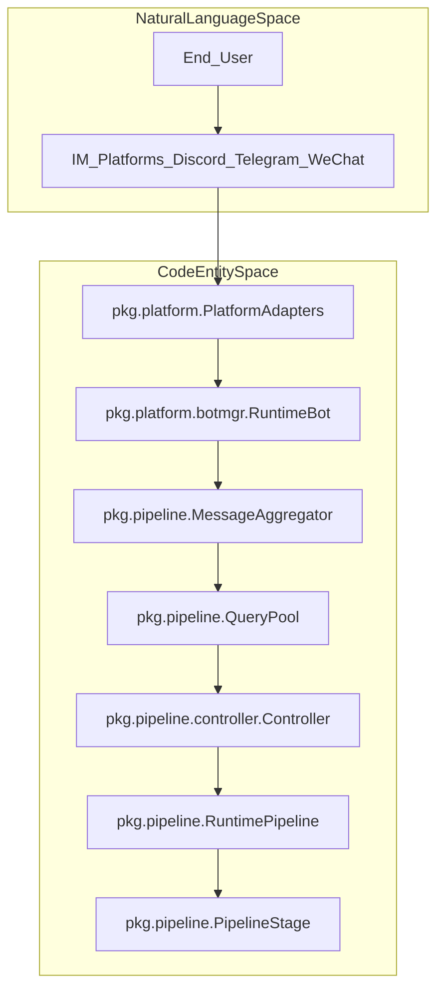
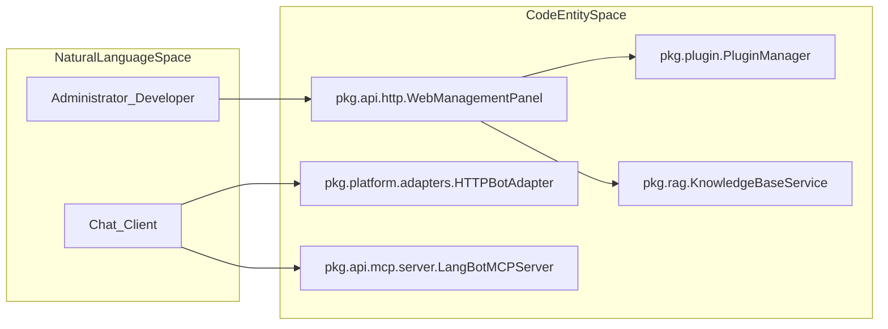
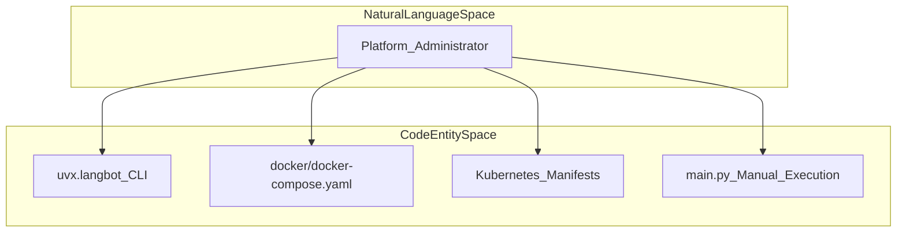

<!-- source: DeepWiki mcp.deepwiki.com · repo langbot-app/LangBot · page 1 LangBot Overview · fetched 2026-10-29 -->

# LangBot Overview

Relevant source files

The following files were used as context for generating this wiki page:

- [.gitignore](.gitignore)
- [README.md](README.md)
- [README_CN.md](README_CN.md)
- [README_ES.md](README_ES.md)
- [README_FR.md](README_FR.md)
- [README_JP.md](README_JP.md)
- [README_KO.md](README_KO.md)
- [README_RU.md](README_RU.md)
- [README_TW.md](README_TW.md)
- [README_VI.md](README_VI.md)
- [docker/docker-compose.yaml](docker/docker-compose.yaml)
- [main.py](main.py)

LangBot is a production-grade, open-source platform designed for building agentic instant messaging (IM) bots that connect Large Language Models (LLMs) to global chat platforms [README.md:35-38](). It enables developers and enterprises to build intelligent conversational agents capable of multi-turn dialogue, tool execution, Retrieval-Augmented Generation (RAG), and complex workflow integrations across various messaging networks [README.md:35-38]().

This page provides a high-level introduction to LangBot’s core purpose, value proposition, and positioning in the AI-powered IM bot ecosystem. Detailed information is available in linked child pages covering system architecture, key features, and deployment options.

---

## 1.1. System Architecture and Components

LangBot employs a modular, decoupled architecture enabling seamless integration between platform-specific adapters, runtime processing engines, plugin extensibility, AI model integrations, and persistent storage [README.md:45-48](). Its backend is implemented in Python and supports Python versions 3.10 through 3.13 [README.md:18]().

The runtime architecture processes incoming chat messages via a well-defined flow starting from platform adapters through a sequence of managers and orchestrators that route, aggregate, and process queries using pipelines and agent runners.

Title: System Runtime Execution Flow

This layered design allows LangBot to cleanly separate concerns: platform-specific message translation belongs in adapters, message orchestration is handled upstream by `RuntimeBot` and `MessageAggregator`, and sophisticated processing such as AI model invocation and tool management happens inside pipeline stages and runners.

For details, see [System Architecture and Components](#1.1).

Sources: [README.md:18](), [README.md:35-48]()

---

## 1.2. Key Features and Capabilities

LangBot offers a suite of comprehensive features engineered for production-grade AI bot deployment across multiple IM platforms [README.md:43-51](). It provides multi-turn dialogues, tool calling, streaming outputs, and native RAG capabilities deeply integrated with leading LLMOps platforms like Dify, Coze, and n8n [README.md:44-45]().

Furthermore, LangBot supports a universal IM adapter layer covering Discord, Telegram, Slack, QQ, WeChat, and more from a single codebase [README.md:46](), [README.md:100-116](). Production features include access control, rate limiting, sensitive word filtering, a rich plugin ecosystem supporting MCP, and an intuitive web management panel [README.md:47-49]().

Title: Feature Integration Architecture

For details, see [Key Features and Capabilities](#1.2).

Sources: [README.md:43-51](), [README.md:100-116]()

---

## 1.3. Deployment Options

LangBot supports flexible deployment methods to suit local development, self-hosted production, and managed cloud environments [README.md:66-92](). Options range from LangBot Cloud zero-configuration hosting to one-line `uvx langbot` execution, Docker Compose setups, and one-click cloud deploys on Zeabur or Railway [README.md:67-95]().

Containerized deployments utilize Docker Compose services spanning the core server, plugin runtime (`langbot_plugin_runtime`), and optional Box sandbox runtime (`langbot_box`) [docker/docker-compose.yaml:6-89](). The main LangBot application (`langbot`) also runs as a Docker service [docker/docker-compose.yaml:90-123]().

Title: Deployment Pathways

For details, see [Deployment Options](#1.3).

Sources: [README.md:66-92](), [README.md:67-95](), [docker/docker-compose.yaml:6-89](), [docker/docker-compose.yaml:90-123]()

---

