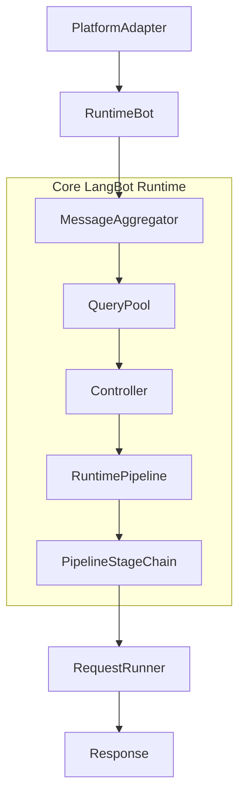
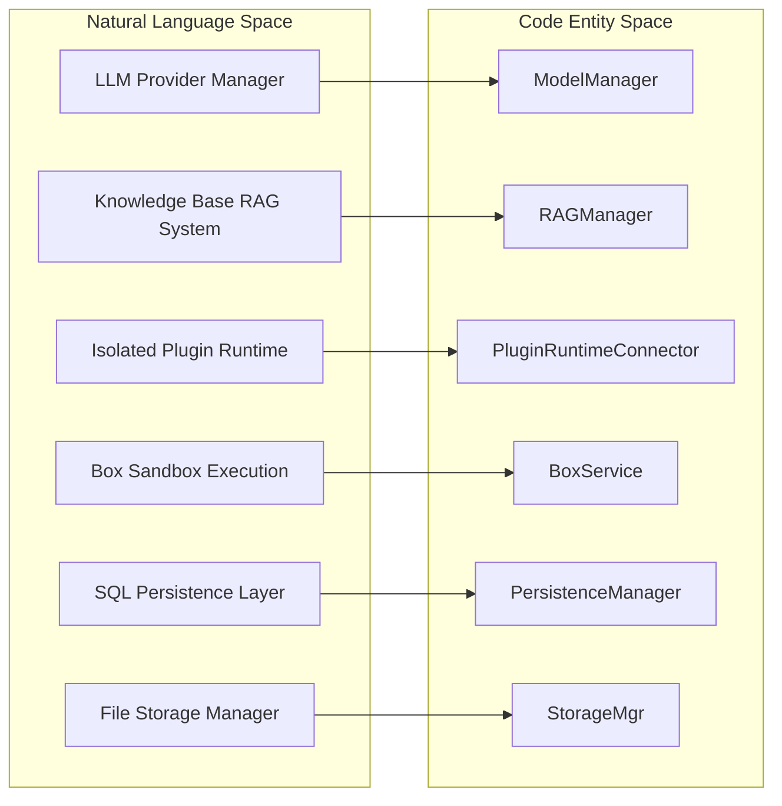
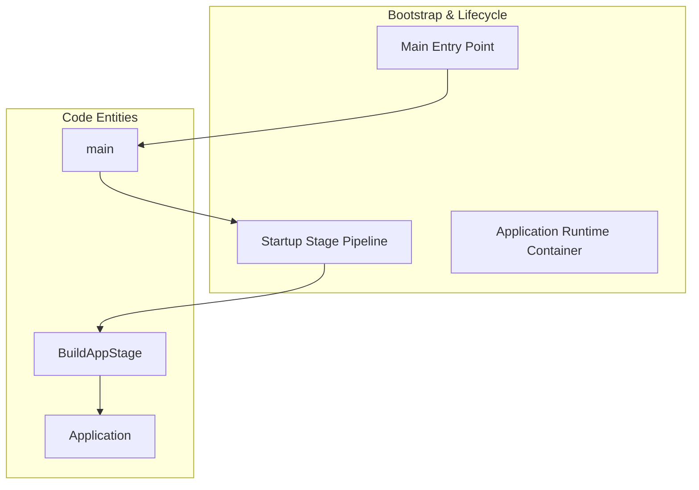

<!-- source: DeepWiki mcp.deepwiki.com · repo langbot-app/LangBot · page 1.1 System Architecture and Components · fetched 2026-10-29 -->

# System Architecture and Components

Relevant source files

The following files were used as context for generating this wiki page:

- [.mcp.json](.mcp.json)
- [AGENTS.md](AGENTS.md)
- [ARCHITECTURE.md](ARCHITECTURE.md)
- [docker/kubernetes.yaml](docker/kubernetes.yaml)
- [docs/MIGRATION_SUMMARY.md](docs/MIGRATION_SUMMARY.md)
- [docs/WEBSOCKET_README.md](docs/WEBSOCKET_README.md)
- [src/langbot/pkg/core/app.py](src/langbot/pkg/core/app.py)
- [src/langbot/pkg/core/stages/build_app.py](src/langbot/pkg/core/stages/build_app.py)
- [src/langbot/pkg/entity/persistence/agent_run.py](src/langbot/pkg/entity/persistence/agent_run.py)
- [src/langbot/pkg/entity/persistence/event_log.py](src/langbot/pkg/entity/persistence/event_log.py)
- [src/langbot/pkg/entity/persistence/monitoring.py](src/langbot/pkg/entity/persistence/monitoring.py)
- [src/langbot/pkg/entity/persistence/transcript.py](src/langbot/pkg/entity/persistence/transcript.py)
- [src/langbot/pkg/operation_trace/service.py](src/langbot/pkg/operation_trace/service.py)
- [src/langbot/pkg/persistence/alembic/versions/0039_execution_lease_indexes.py](src/langbot/pkg/persistence/alembic/versions/0039_execution_lease_indexes.py)
- [src/langbot/pkg/persistence/media.py](src/langbot/pkg/persistence/media.py)
- [src/langbot/pkg/plugin/runner_actions.py](src/langbot/pkg/plugin/runner_actions.py)
- [src/langbot/templates/config.yaml](src/langbot/templates/config.yaml)
- [tests/unit_tests/core/test_app_shutdown.py](tests/unit_tests/core/test_app_shutdown.py)
- [tests/unit_tests/persistence/test_conversation_page_index.py](tests/unit_tests/persistence/test_conversation_page_index.py)
- [tests/unit_tests/persistence/test_execution_lease_indexes.py](tests/unit_tests/persistence/test_execution_lease_indexes.py)
- [tests/unit_tests/persistence/test_partial_history_indexes.py](tests/unit_tests/persistence/test_partial_history_indexes.py)
- [tests/unit_tests/storage/test_inline_media_cleanup.py](tests/unit_tests/storage/test_inline_media_cleanup.py)
- [tests/unit_tests/test_operation_trace_incremental.py](tests/unit_tests/test_operation_trace_incremental.py)
- [tests/unit_tests/test_operation_trace_integrity.py](tests/unit_tests/test_operation_trace_integrity.py)

## Purpose and Scope

This document details the multi-layered architecture of LangBot, mapping high-level architectural concepts to concrete code entities, services, and modules. It covers the interaction between platform adapters, execution pipelines, agents and runners, the isolated plugin runtime, the AI/LLM layer, and the persistence/storage subsystems. It also defines the repository boundary between the core LangBot platform and the `langbot-plugin-sdk` package.

Sources: [ARCHITECTURE.md](), [AGENTS.md:1-14](), [src/langbot/pkg/core/app.py:67-178]()

---

## High-Level System Architecture and Repository Boundary

LangBot is structured around a core application runtime (`Application` class) in [src/langbot/pkg/core/app.py:67-178]() that orchestrates platform ingestion, message aggregation, query scheduling, pipeline and agent execution, extension/plugin connectivity, and persistent storage.

### Repository Boundary: LangBot vs langbot-plugin-sdk

A strict architectural boundary separates:

- **LangBot Repository (`langbot`)**: Contains the core engine, HTTP API based on Quart/Hypercorn [src/langbot/pkg/api/http/controller/main.py](), platform adapters [src/langbot/pkg/platform/](), database persistence and Alembic migrations [src/langbot/pkg/persistence/](), the frontend (`web/`), and plugin/box bridge components [src/langbot/pkg/plugin/connector.py]().
- **langbot-plugin-sdk Repository (`langbot-plugin-sdk`)**: Published independently and pulled in as a dependency, this includes shared data entities, plugin developer APIs, action protocols, isolated Plugin Runtime (`lbp rt`), and Box sandbox runtime (`lbp box`).

Sources: [AGENTS.md:9-13](), [src/langbot/pkg/core/app.py:67-178](), [ARCHITECTURE.md]()

---

## Runtime Execution Graph and Message Flow

LangBot’s runtime processing follows a well-defined graph that transforms incoming platform-specific data into query execution and response emission.

### Runtime Execution Flow Graph

#### Components and Responsibilities:

1.  **Platform Adapter**: Converts platform-specific events into a normalized message format for LangBot. Managed primarily by the `RuntimeBot` entity, defined in [src/langbot/pkg/platform/botmgr.py:55-160]().
2.  **RuntimeBot**: The runtime bot instance encapsulating platform adapter interaction, execution context, and event-to-query conversion. See `RuntimeBot` class [src/langbot/pkg/platform/botmgr.py:55]().
3.  **MessageAggregator**: Buffers and normalizes incoming messages before submitting them to the query pool. Instantiated as `ap.msg_aggregator` [src/langbot/pkg/core/app.py:126]().
4.  **QueryPool**: A concurrency-managed priority queue storing queries awaiting processing. Instantiated as `ap.query_pool` [src/langbot/pkg/core/app.py:124]().
5.  **Controller**: Governs the scheduling and dispatch of queries from the pool to pipeline or agent runners. Instantiated as `ap.ctrl` [src/langbot/pkg/core/app.py:128]().
6.  **RuntimePipeline / Agent runner**: Executes the pipeline stages or agents, controlling the flow of processing. `RuntimePipeline` is defined in [src/langbot/pkg/pipeline/pipelinemgr.py:68-183]().
7.  **Request Runner**: Utilizes the `ToolManager`, `PluginRuntimeConnector`, or `BoxService` to execute tool calls, plugin actions, or sandboxed code.
8.  **Response**: Sends responses back through the original platform adapter to the users.

Sources: [src/langbot/pkg/core/app.py:123-130](), [src/langbot/pkg/platform/botmgr.py:55-160](), [src/langbot/pkg/pipeline/pipelinemgr.py:68-183]()

---

## Natural Language to Code Entity Space Mappings

To link system architecture concepts with concrete codebase entities, the following diagrams map natural language components to their respective code classes, modules, and file paths.

### AI, Storage, and Extension Subsystems Mapping

Sources: [src/langbot/pkg/core/app.py:83-166](), [src/langbot/pkg/plugin/connector.py](), [src/langbot/pkg/storage/mgr.py]()

---

### Application Bootstrap and Boot Stages Mapping

Sources: [src/langbot/pkg/core/stages/build_app.py:58-159](), [src/langbot/pkg/core/app.py:67-178]()

---

## Core Subsystem Integration and Application Lifecycle

LangBot’s initialization and runtime environment are managed as a sequence of boot stages. These stages progressively build the application state and configure all subsystems before accepting requests.

### Boot Stages Overview

1.  **LoadConfigStage**: Loads configuration files and environment variable overrides. The default configuration is in [src/langbot/templates/config.yaml:1-162]().
2.  **GenKeysStage**: Generates or loads cryptographic keys.
3.  **SetupLoggerStage**: Configures logging output and levels.
4.  **BuildAppStage**: Constructs the full `Application` object, initializing all managers and service layers. This stage is defined in [src/langbot/pkg/core/stages/build_app.py:58-159]().
5.  **ShowNotesStage**: Displays startup notes and system information.

### Central Application Object

The `Application` class [src/langbot/pkg/core/app.py:67-178]() centralizes runtime resources and services:

| Subsystem | Corresponding `Application` Attribute | Description |
| :--- | :--- | :--- |
| Platform Manager | `platform_mgr` [src/langbot/pkg/core/app.py:78]() | Manages chat platform adapters, message routing |
| Message Aggregation | `msg_aggregator` [src/langbot/pkg/core/app.py:126]() | Buffers and prepares platform messages |
| Query Pool | `query_pool` [src/langbot/pkg/core/app.py:124]() | Manages concurrency, queues for scheduled query execution |
| Pipeline Controller | `ctrl` [src/langbot/pkg/core/app.py:128]() | Schedules query execution into runtime pipelines |
| Pipeline Manager | `pipeline_mgr` [src/langbot/pkg/core/app.py:130]() | Manages pipeline configurations and lifecycle |
| Plugin Runtime Connector | `plugin_connector` [src/langbot/pkg/core/app.py:121]() | Connects and communicates with isolated plugin runtimes |
| Box Service Sandbox | `box_service` [src/langbot/pkg/core/app.py:93]() | Manages Box sandbox execution environment |
| Persistence Manager | `persistence_mgr` [src/langbot/pkg/core/app.py:138-139]() | Manages database sessions and ORM models |
| Storage Manager | `storage_mgr` [src/langbot/pkg/core/app.py:165]() | Handles file upload and media cache |
| Model Manager | `model_mgr` [src/langbot/pkg/core/app.py:86-87]() | Manages AI LLM/embedding model providers |
| Tool Manager | `tool_mgr` [src/langbot/pkg/core/app.py:92]() | Handles AI tool loading and invocation |
| Workspace Service | `workspace_service` [src/langbot/pkg/core/app.py:142]() | Manages workspace-level operations and multi-tenancy |
| Telemetry | `telemetry_module` [src/langbot/pkg/core/app.py:51]() | Collects and reports operational metrics |
| Operation Trace | `workspace_settings_service` [src/langbot/pkg/core/app.py:39]() | Manages audit logging and traceability of user actions |

Sources: [src/langbot/templates/config.yaml:1-162](), [src/langbot/pkg/core/stages/build_app.py:58-159](), [src/langbot/pkg/core/app.py:67-178](), [src/langbot/pkg/operation_trace/service.py:1-2524]()

---

