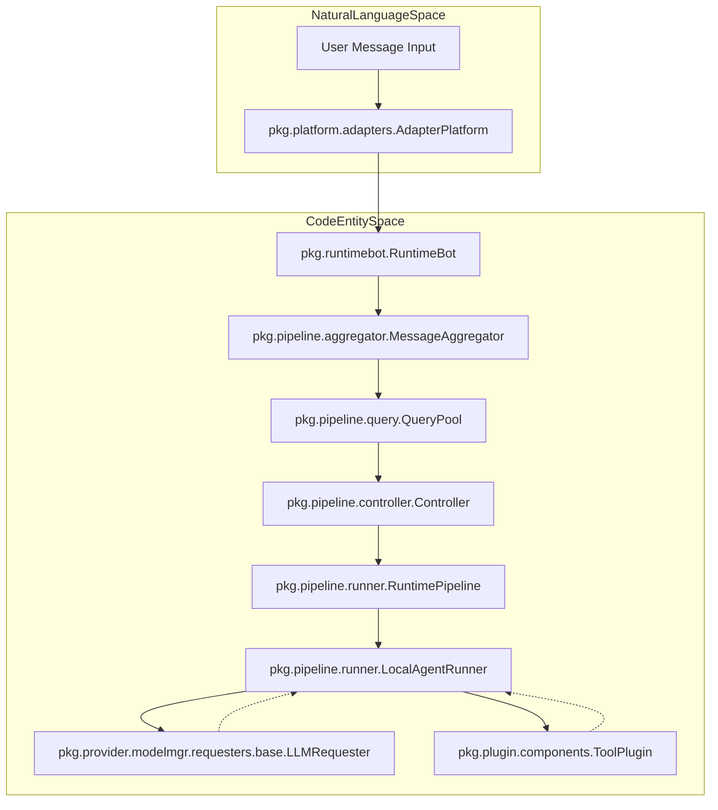
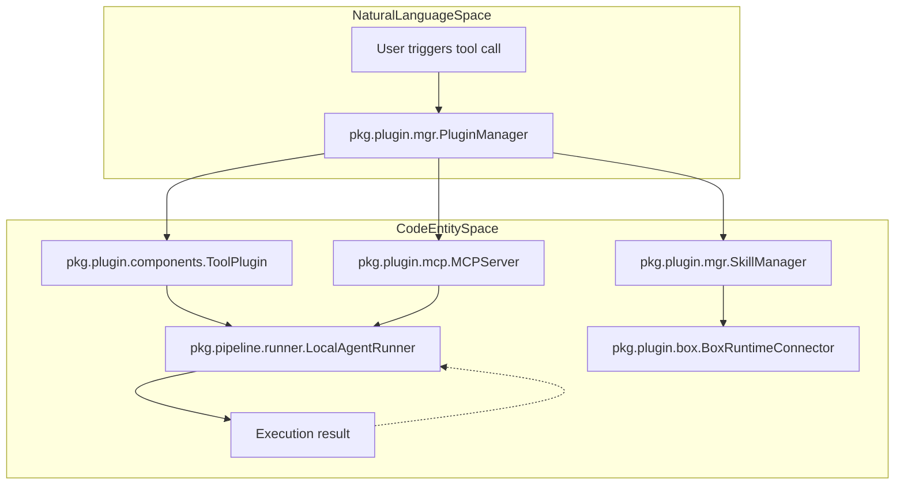
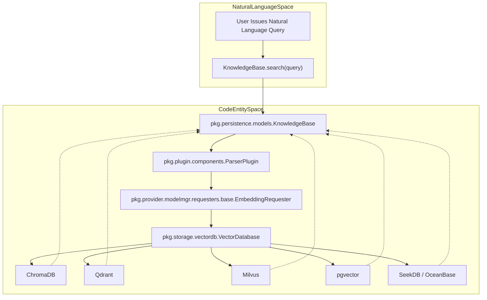
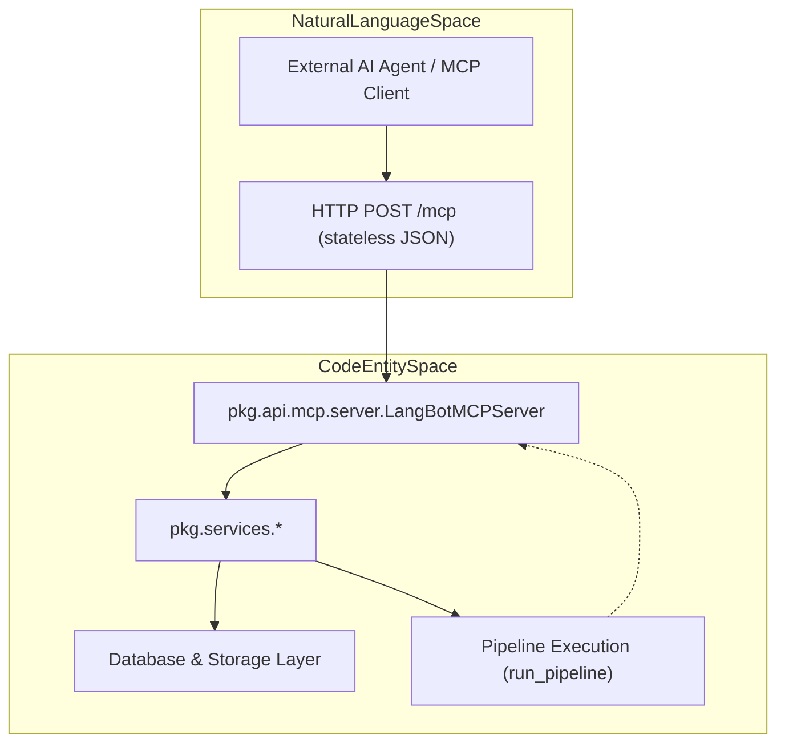

<!-- source: DeepWiki mcp.deepwiki.com · repo langbot-app/LangBot · page 1.2 Key Features and Capabilities · fetched 2026-10-29 -->

# Key Features and Capabilities

Relevant source files

The following files were used as context for generating this wiki page:

- [README.md](README.md)
- [README_CN.md](README_CN.md)
- [README_ES.md](README_ES.md)
- [README_FR.md](README_FR.md)
- [README_JP.md](README_JP.md)
- [README_KO.md](README_KO.md)
- [README_RU.md](README_RU.md)
- [README_TW.md](README_TW.md)
- [README_VI.md](README_VI.md)
- [docker/docker-compose.yaml](docker/docker-compose.yaml)

## Purpose and Scope

This page provides an in-depth explanation of LangBot's key production-grade features and capabilities as a multi-platform AI instant messaging bot platform [README.md:10-50](). It covers technical implementation details of multi-platform universal IM support, agentic runtime with tool calling, integration of RAG and knowledge bases, the extensible plugin ecosystem, advanced production features including access control and monitoring, the web management panel, HTTP Bot adapter usage, and its built-in MCP server exposed at `/mcp`.

These components collectively enable developers to create, deploy, and monitor intelligent conversational agents efficiently across many chat platforms.

Sources: [README.md:10-50]()

---

## Universal IM Platform Support & HTTP Bot Adapter

### Overview

LangBot's core abstraction normalizes inbound chat events from multiple instant messaging platforms into a unified internal message format. This allows seamless multi-platform support with a single runtime codebase [README.md:46]().

The frontend platform adapters handle the platform-specific webhook protocols, WebSocket connections, or long polling, converting raw platform events into LangBot’s internal normalized event objects.

### Supported Platforms

LangBot officially supports over a dozen platforms with first-class platform adapters implementing all required event parsing and outgoing message dispatch [README.md:104-123]():

| Platform | Status | Integration Type / Notes |
|----------|--------|--------------------------|
| Discord  | ✅     | Official Gateway API |
| Telegram | ✅     | Official Bot API |
| Slack    | ✅     | Socket Mode / Events API |
| LINE     | ✅     | Messaging API Webhook |
| QQ       | ✅     | Personal & Official APIs (Channel, DM, Group) |
| WeCom    | ✅     | Enterprise WeChat, External CS, AI Bot |
| WeChat   | ✅     | Personal & Official Account |
| Lark     | ✅     | Official Open Platform |
| DingTalk | ✅     | Official Stream / Webhook |
| KOOK     | ✅     | Official API |
| Satori   | ✅     | Protocol-based adapter |
| Matrix   | ✅     | Bridges Signal, WhatsApp, Messenger, iMessage, and more |
| HTTP Bot | ✅     | Server-to-server webhook |

### HTTP Bot Adapter

The HTTP Bot Adapter supports server-to-server webhook integration without persistent connections:

- **Inbound**: External third-party backends POST JSON payloads to LangBot webhook URLs secured by HMAC-SHA256 signatures.
- **Outbound**: LangBot sends responses back to configured callback URLs with HMAC-SHA256 signed payloads.
- **Session**: Uses a `session_id` to maintain conversation continuity across stateless HTTP requests and responses.

This adapter is implemented as an abstraction within the platform adapter layer, converting webhook events to internal `MessageChain` objects and routing them through the `RuntimeBot` processing stack [README.md:46]().

Sources: [README.md:46]()

---

### Natural Language to Agent Runtime Flow

Diagram: Natural Language to Agent Runtime Flow

This diagram illustrates the flow from receiving a natural language message from any platform adapter into the LangBot runtime pipeline:

1. The platform adapter converts platform events into normalized message objects.
2. `RuntimeBot` orchestrates message processing and event dispatching.
3. `MessageAggregator` collects conversations and aggregates messages.
4. `QueryPool` manages active conversational queries.
5. `Controller` executes control logic and routing.
6. `RuntimePipeline` encapsulates processing stages.
7. The core multi-turn reasoning happens in `LocalAgentRunner`.
8. The runner calls LLM requesters (e.g., OpenAI, Anthropic) and invokes `ToolPlugin` extensions dynamically.

Sources: [README.md:43-48]()

---

## AI Conversation, Agent Runtime, and Tool Calling

### Multi-turn Dialogue Runtime

LangBot’s `LocalAgentRunner` drives the conversational logic for multi-turn dialogues incorporating LLM inference and tool invocation loops. Each user message gets encapsulated in a `Query` object, tracked in `QueryPool` for session management and concurrency control.

The runner handles:

- Invocation of configured language models through `LLMRequester` instances.
- Tool calling including platform-specific or plugin-injected tools.
- Maintaining dialogue context, turn state, and streaming token generation.

This enables rich agentic behaviors: multi-turn conversations with external tool execution [README.md:43-48](). The `AgentService.debug_agent` method provides a way to execute synthetic events against a configured agent for debugging purposes, supporting both message and non-message event envelopes.

### Tool Ecosystem and Discovery

Tools can originate from:

- **Native platform tools**, embedded in LangBot.
- **Plugin components**, loaded via `PluginManager`.
- **External MCP servers** acting as tool providers.
- **Skills executed in sandboxed Box runtimes**.

The system dynamically discovers all installed tool implementations and their JSON schema for argument validation. Tool execution results feed back into the agent runtime to influence further reasoning or user responses.

Sources: [README.md:43-48]()

---

### Tool Discovery & Execution Logic

Diagram: Tool Discovery and Execution Logic

- `PluginManager` manages all plugin and MCP server components.
- Installed tools (native or plugin-based) are exposed to the `LocalAgentRunner`.
- The Box runtime executes skill extensions securely isolated.
- The agent runtime consumes tool results to continue session flows.

Sources: [README.md:45-48]()

---

## RAG and Knowledge Base System

### Overview

LangBot integrates a built-in Retrieval-Augmented Generation system supporting a variety of vector database backends and document parsers for knowledge base construction [README.md:45]().

### KnowledgeBase Entity

The core `KnowledgeBase` model stores:

- Parser plugin selections and ingestion rules.
- Retrieval plugin settings, including vector model selectors.
- Configuration parameters like top-k results, distance thresholds.
- Integration points for LLMOps platforms such as Dify, Coze, and n8n.

RAG engines execute semantic retrieval queries that augment LLM prompts with vector search results.

Sources: [README.md:45]()

---

### RAG Component Interaction

Diagram: RAG Component Interaction

Vector database integration allows LangBot to retrieve semantically relevant documents, enabling enhanced context for LLM generations in tasks like knowledge base Q&A.

Sources: [README.md:45]()

---

## Plugin Ecosystem and Extension Framework

LangBot defines an event-driven plugin runtime architecture that isolates extensions into separate processes with communication via JSON-RPC over stdio or WebSocket [README.md:48](). The `docker-compose.yaml` defines `langbot_plugin_runtime` and `langbot_box` services for this purpose [docker/docker-compose.yaml:7-70]().

Plugins extend LangBot with:

- **Custom tools** exposed to the agent runtime.
- **Event listeners** reacting to lifecycle or platform events.
- **Knowledge engines** for specialized RAG handling.
- **Document parsers** aiding ingestion pipelines.

### Extension Types

- **Plugins** (Python packages) are dynamically loaded with schema-driven configuration.
- **MCP Servers** implement the Model Context Protocol interface for remote tool hosting.
- **Skills** are markdown-scripted agent instructions executed inside sandboxed Box runtimes.

This plugin model supports scalability, security isolation, and seamless extension management.

Sources: [README.md:48](), [docker/docker-compose.yaml:7-70]()

---

## Production-Ready Features, Security, and Monitoring

LangBot is designed to operate safely and reliably in enterprise environments with:

- **Access Control & Multi-tenant Workspaces**: Role-Based Access Control enforced in the tenant `Workspace` context ensures isolated and authorized usage [README.md:47]().
- **Rate Limiting and Content Filtering**: Integration of request occupancy and sensitive word filters prevents abuse and maintains message quality.
- **Comprehensive Monitoring & Telemetry**: Real-time dashboards capture message volumes, LLM call metrics, session states, error rates, and token usage for operational insight.
- **Exception Handling & Retry Policies**: Pipeline stages include robust error handling to maintain stability.

These features are critical for production-scale deployments trusted by enterprises [README.md:47]().

Sources: [README.md:39-47]()

---

## Web Management Panel

LangBot ships with an integrated web management console built with Vite + React Router 7 and shadcn/ui components served via the Quart backend on port 5300 [README.md:49]().

### Capabilities

- Bot, Agent, Pipeline, Knowledge Base CRUD with schema-driven forms.
- Visual event binding and dynamic form editors.
- Real-time pipeline debug and session tracing with WebSocket support.
- Plugin marketplace integration and plugin configuration UIs.
- Monitoring dashboards showing message, session, error, and token stats.

This UI eliminates the need for manual YAML editing and provides operators with powerful bot lifecycle management tools.

Sources: [README.md:39-49](), [docker/docker-compose.yaml:124-125]()

---

## Built-in MCP Server at `/mcp`

LangBot exposes a Model Context Protocol (MCP) server natively under its HTTP service path `/mcp`, providing programmatic management and telemetry for bots, pipelines, LLM models, knowledge bases, MCP servers, and skills.

### Key Features

- Wraps a curated subset of the HTTP service API as MCP tools for AI-agent interoperability without network overhead.
- Supports stateless JSON-over-HTTP transport with API key authentication.
- Implements tools for system info, resource listing, CRUD operations, pipeline execution, and sandbox diagnostics.
- Shares authentication and permission model with the HTTP API, scoped by Workspace/Tenant contexts.

This server enables external MCP clients and agents to control and monitor the LangBot instance programmatically.

Sources: [README.md:48]()

---

### MCP Server Interaction

Diagram: MCP Server Interaction Flow

- AI agents use an MCP client library to communicate with `/mcp` endpoint.
- LangBot’s `LangBotMCPServer` handles tool calls locally via direct service layer access.
- Tool results or mutations trigger updates or pipeline executions on demand.

Sources: [README.md:48]()

---

# Summary Table of Key Features

| Feature                     | Description & Key Code Entities                               |
|-----------------------------|--------------------------------------------------------------|
| Multi-platform IM Support   | `pkg.platform.adapters.*` normalizes all platform events      |
| HTTP Bot Adapter            | Stateless webhook server for backend integration              |
| Agent Runtime & Tool Calling| `pkg.pipeline.runner.LocalAgentRunner`, `pkg.plugin.mgr.*`    |
| RAG Knowledge Bases         | `KnowledgeBase` model, vector DB plugins                       |
| Plugin Ecosystem            | Event-driven, isolated plugin runtime, MCP servers, skills    |
| Production Features         | RBAC, rate limiting, filters, telemetry dashboards            |
| Web Management Panel        | Vite+React UI, dynamic forms, debugging, monitoring           |
| Built-in MCP Server         | `pkg.api.mcp.server.LangBotMCPServer` at `/mcp` path          |

Sources: [README.md](), [docker/docker-compose.yaml]()

---

