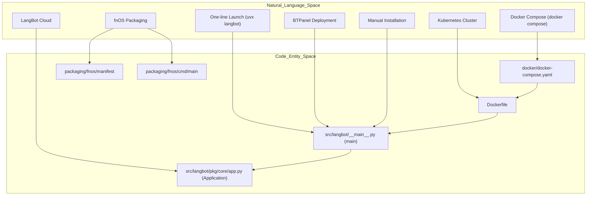
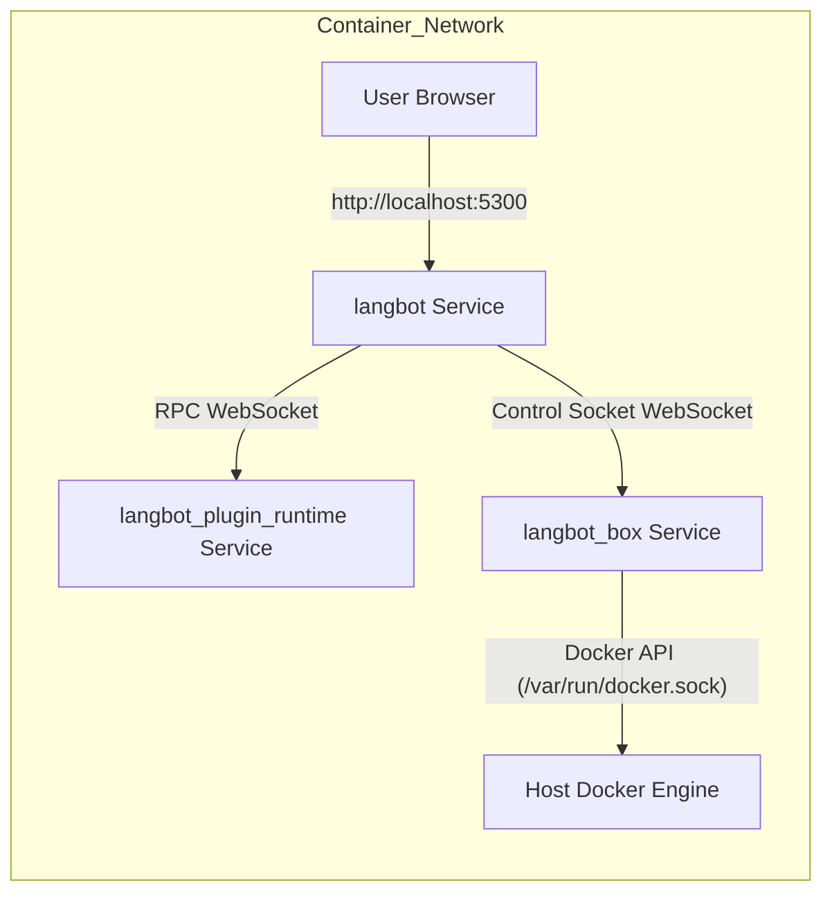
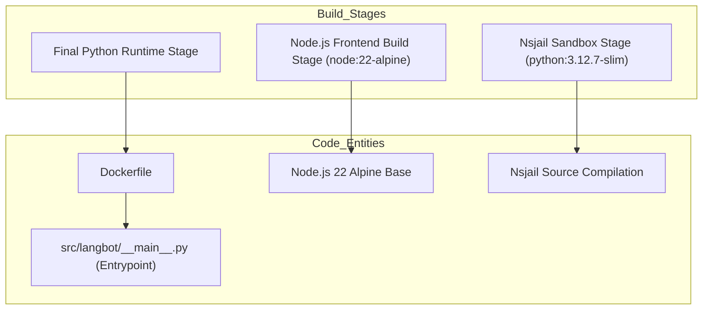

<!-- source: DeepWiki mcp.deepwiki.com · repo langbot-app/LangBot · page 1.3 Deployment Options · fetched 2026-10-29 -->

# Deployment Options

<details>
<summary>Relevant source files</summary>

The following files were used as context for generating this wiki page:

- [README.md](README.md)
- [README_CN.md](README_CN.md)
- [README_ES.md](README_ES.md)
- [README_FR.md](README_FR.md)
- [README_JP.md](README_JP.md)
- [README_KO.md](README_KO.md)
- [README_RU.md](README_RU.md)
- [README_TW.md](README_TW.md)
- [README_VI.md](README_VI.md)
- [docker/docker-compose.yaml](docker/docker-compose.yaml)
- [packaging/fnos/README.md](packaging/fnos/README.md)
- [packaging/fnos/build.sh](packaging/fnos/build.sh)
- [packaging/fnos/cmd/install_callback](packaging/fnos/cmd/install_callback)
- [packaging/fnos/cmd/install_init](packaging/fnos/cmd/install_init)
- [packaging/fnos/cmd/main](packaging/fnos/cmd/main)
- [packaging/fnos/cmd/uninstall_callback](packaging/fnos/cmd/uninstall_callback)
- [packaging/fnos/cmd/upgrade_callback](packaging/fnos/cmd/upgrade_callback)
- [packaging/fnos/cmd/upgrade_init](packaging/fnos/cmd/upgrade_init)
- [packaging/fnos/config/privilege](packaging/fnos/config/privilege)
- [packaging/fnos/manifest](packaging/fnos/manifest)

</details>


This page documents the various deployment pathways available for LangBot, from managed cloud environments to self-hosted container stacks, manual installations, Kubernetes clusters, and specialized NAS/appliance packaging such as fnOS. It covers infrastructure requirements, container build architectures, vector database extension integration, and underlying code execution entry points.

Sources: [README.md:64-92]()

---

## 1. Deployment Method Overview

LangBot supports multiple deployment configurations to accommodate diverse operational needs, scaling demands, and management preferences.

| Method | Setup Time | Infrastructure Required | Code / Runtime Target |
|---|---|---|---|
| **LangBot Cloud** | < 1 minute | Managed cloud | Hosted multi-tenant backend at `space.langbot.app` |
| **One-line Launch (`uvx`)**| < 2 minutes | Python 3.10 - 3.13 + `uv` | Installs PyPI package `langbot` and launches via `uvx` CLI |
| **Docker Compose** | < 5 minutes | Docker and Docker Compose | Multi-container stack: `langbot`, `langbot_plugin_runtime`, `langbot_box` |
| **One-Click Cloud Deploy** | < 5 minutes | PaaS account | Deploys prebuilt `rockchin/langbot:latest` container image |
| **Kubernetes** | 30+ minutes | Kubernetes cluster | K8s manifests with PVCs and Deployments |
| **BTPanel (宝塔面板)** | 10+ minutes | Linux server with BTPanel | Python environment managed via PM2 or supervisor |
| **fnOS Appliance** | 5+ minutes | fnOS NAS environment | Packaged with fnOS FPK format, integrated with NAS lifecycle callbacks |
| **Manual Installation** | 20+ minutes | Server + Python 3.10 - 3.13 | Source checkout with manual Python launch (`main.py`) |

Sources: [README.md:64-92](), [docker/docker-compose.yaml:1-125]()

---

## 2. Deployment Architecture and Code Mapping

This section bridges natural language deployment paths to concrete code entities, container images, manifests, and runtime entry points within the LangBot codebase.

### Deployment Pathways to Code Entity Mapping



- `src/langbot/__main__.py`: Main CLI entrypoint with async `main()` and application bootstrap stages [src/langbot/pkg/core/boot.py:56-91]().
- `docker/docker-compose.yaml`: Defines multi-service setup with core LangBot, plugin runtime, and optional Box sandbox containers [docker/docker-compose.yaml:1-125]().
- `Dockerfile`: Multi-stage build file producing runtime container images, including frontend build and sandbox compilation [Dockerfile:1-73]().
- `packaging/fnos/manifest`: Manifest file and packaging scripts for fnOS NAS appliance integration [packaging/fnos/manifest:1-16]().
- `packaging/fnos/cmd/main`: Shell script managing LangBot lifecycle for fnOS, including environment setup and port patching [packaging/fnos/cmd/main:1-170]().
- `Application`: Core Python application class handling lifecycle and async event loop [src/langbot/pkg/core/boot.py:56-91]().

Sources: [README.md:64-92](), [docker/docker-compose.yaml:1-125](), [src/langbot/pkg/core/boot.py:56-91](), [Dockerfile:1-73](), [packaging/fnos/manifest:1-16](), [packaging/fnos/cmd/main:1-170]()

---

## 3. Managed Cloud and One-Click Deployments

### LangBot Cloud

LangBot Cloud offers a fully managed, zero-configuration hosting environment at:

- **URL**: `https://cloud.langbot.app` / `https://space.langbot.app/cloud` [README.md:25](), [README_CN.md:27](), [README_JP.md:69](), [README_TW.md:71](), [README_RU.md:69](), [README_VI.md:69](), [README_KO.md:69](), [README_FR.md:69](), [README_ES.md:69]()
- **Features**:
  - No local deployment required; instant onboarding.
  - Multi-tenant cloud backend operated by LangBot maintainers.
  - Integrated plugin marketplace and telemetry.
- **Implementation Notes**:
  - Runs on verified, hardened multi-tenant architecture.
  - Cloud bootstrap and launch services manage tenant isolation and resource assignment.

This option is recommended for users without infrastructure or DevOps expertise who desire immediate testing or production usage.

### One-Click Cloud Deployments (Zeabur & Railway)

These cloud providers offer one-click deploy buttons that pull the official LangBot container image:

- **Container Image**: `rockchin/langbot:latest` [docker/docker-compose.yaml:8]()
- **Environment Configuration**: Customizable via environment variables for database endpoints, authentication tokens, and runtime parameters.
- **Persistence**: Supports mounting persistent volumes for SQLite or connecting to external managed PostgreSQL.
- **Examples**:
  - [Zeabur Deployment Template](https://zeabur.com/en-US/templates/ZKTBDH) [README.md:93]()
  - [Railway Deployment Template](https://railway.app/template/yRrAyL?referralCode=vogKPF) [README.md:94]()

Sources: [README.md:66-96](), [README_JP.md:91-94](), [README_TW.md:92-95](), [README_CN.md:91-94](), [README_RU.md:90-93](), [README_VI.md:90-93](), [README_KO.md:90-93](), [README_FR.md:90-93](), [README_ES.md:90-93](), [docker/docker-compose.yaml:8]()

---

## 4. Local and Containerized Self-Hosting

### One-Line Launch (`uvx`)

The fastest way to locally launch LangBot is using Astral's `uvx` tool, which performs:

- Installation directly from PyPI without virtualenv setup.
- Launches the CLI `main` entrypoint (binding to default `http://localhost:5300`).
- For extended vector search functionality, install with extras:  
  ```bash
  uvx --from 'langbot[seekdb]@latest' langbot
  ```
- This approach relies on:
  - Python 3.10 to 3.13 [README.md:18]().
  - `uv` async runtime installed independently [README.md:74-80]().

### Docker Compose

Docker Compose enables structured container-based deployment suitable for production or development:

- **Key Services**:
  1. `langbot`: The core Quart backend server hosting the web UI & webhook endpoints [docker/docker-compose.yaml:90-125]().
  2. `langbot_plugin_runtime`: Isolates plugin execution in a separate container to protect stability [docker/docker-compose.yaml:7-36]().
  3. `langbot_box` (optional): Sandbox runtime providing a secure environment for skill execution with system call confinement [docker/docker-compose.yaml:43-88]().

- **Networking**: All containers connect via the `langbot_network` bridge for inter-service RPC and WebSocket communication [docker/docker-compose.yaml:34]().

- **Port Bindings**:
  - Port 5300 exposed for UI and webhook callbacks [docker/docker-compose.yaml:124]().
  - Ports 2280-2285 for multi-platform reverse connections [docker/docker-compose.yaml:125]().

#### Docker Compose Service Topology



Sources: [README.md:70-84](), [docker/docker-compose.yaml:1-125]()

---

## 5. Docker Image Build Pipeline

The official LangBot container is built via a multi-stage `Dockerfile` combining frontend assets, sandbox infrastructure, and Python runtime.

### Multi-Stage Docker Build Overview



**Stage Details**:

1. **Node Frontend Stage**:
   - Builds the Vite + React frontend located in `web/` [Dockerfile:5-7]().
   - Produces static assets for inclusion in the final image.
   - References: [Dockerfile:1-8]()

2. **Nsjail Sandbox Stage**:
   - Compiles Google's `nsjail` (v3.6) from C source for process-level sandboxing [Dockerfile:14-26]().
   - Avoids dependency on host Docker for sandboxing, though the Docker container can also interface with host Docker.
   - References: [Dockerfile:14-26]()

3. **Final Runtime Stage**:
   - Combines Python dependencies, frontend static files, and sandbox executables [Dockerfile:28-42]().
   - Installs prebuilt CLI support tools such as `docker-ce-cli` and `nodejs` for MCP stdio plugin servers [Dockerfile:43-66]().
   - References: [Dockerfile:28-73]()

Sources: [Dockerfile:1-73]()

---

## 6. Advanced Infrastructure & Appliance Deployments

### Kubernetes Deployment

LangBot provides Kubernetes manifests suitable for production-grade cluster deployments:

- **Features**:
  - Creates dedicated `langbot` namespace.
  - PersistentVolumeClaims (PVCs) for data, plugin storage, and plugin runtime state.
  - Deployments for core `langbot`, `langbot-plugin-runtime`, and optional `langbot-box` sandbox runtime.
  - Services to expose network ports internally and externally.
  - Liveness and readiness probes (`/healthz`, `/readyz`) to ensure container health.
  - Environment configuration via ConfigMaps.
  - Support for external persistent database backends such as PostgreSQL.

- **Usage Notes**:
  - Secrets for plugin runtime and box control tokens should be generated with secure random values (`openssl rand -hex 32`).
  - The Box sandbox requires access to Docker socket `/var/run/docker.sock` on the node.
  - Detailed deployment guide available in documentation.

Sources: [docker/docker-compose.yaml:1-125]()

### BTPanel (宝塔面板) Deployment

For Linux servers managed with BTPanel:

- Clone or upload LangBot repository into a designated BTPanel site directory.
- Use Python 3.10-3.13 to create a virtual environment.
- Install required dependencies manually or via `pip`.
- Manage runtime processes with PM2 or another supervisor referencing `main.py` [src/langbot/__main__.py]().
- Suitable for administrators preferring GUI management for service lifecycle and logs.

### fnOS Appliance Packaging

LangBot supports packaging as a native NAS application using fnOS:

- The `packaging/fnos/` directory contains:
  - `manifest` describing package metadata [packaging/fnos/manifest:1-16]().
  - Build shell scripts [packaging/fnos/build.sh]().
  - Lifecycle command callbacks (`install_init`, `uninstall_callback`, `upgrade_init`, `upgrade_callback`) [packaging/fnos/cmd/install_init](), [packaging/fnos/cmd/uninstall_callback](), [packaging/fnos/cmd/upgrade_init](), [packaging/fnos/cmd/upgrade_callback]().
  - Config files describing settings permissions and hooks [packaging/fnos/config/privilege]().
- The `packaging/fnos/cmd/main` script handles the application's lifecycle, including setting up the Node.js environment for Box sandbox and MCP capabilities, managing persistent data directories, and patching the `config.yaml` to ensure the LangBot's listen port matches the fnOS UI settings [packaging/fnos/cmd/main:1-170]().
- Enables easy network-attached storage appliance deployment without container or Kubernetes knowledge.

Sources: [README.md:92](), [packaging/fnos/manifest:1-16](), [packaging/fnos/build.sh](), [packaging/fnos/cmd/install_init](), [packaging/fnos/cmd/uninstall_callback](), [packaging/fnos/cmd/upgrade_init](), [packaging/fnos/cmd/upgrade_callback](), [packaging/fnos/config/privilege](), [packaging/fnos/cmd/main:1-170]()

---

# Summary

LangBot offers a spectrum of deployment options:

- **Managed Cloud (LangBot Cloud)**: Instant use with no deployment overhead.
- **Local Quick Start (uvx)**: One-liner to get started for development and trial.
- **Docker Compose**: Containerized multi-service deployment for isolated plugin and sandbox execution.
- **One-Click Cloud Deploy**: Easy PaaS deployment with ready container images.
- **Kubernetes**: Production-grade cluster orchestration with PVC support and auto-healing probes.
- **BTPanel**: GUI-managed Linux server environment.
- **fnOS Packaging**: NAS appliance integration supporting lifecycle management scripts.
- **Manual**: Direct Git clone and Python source launch for fine-grained control.

This flexible deployment architecture is supported by the LangBot codebase’s modular and multi-stage build system, allowing both open-source and enterprise users to select deployments matching their operational requirements.

---

Sources:  
[README.md:64-92](), [README_JP.md:91-94](), [README_TW.md:92-95](), [README_CN.md:91-94](), [README_RU.md:90-93](), [README_VI.md:90-93](), [README_KO.md:90-93](), [README_FR.md:90-93](), [README_ES.md:90-93](), [docker/docker-compose.yaml:1-125](), [src/langbot/pkg/core/boot.py:56-91](), [Dockerfile:1-73](), [packaging/fnos/manifest:1-16](), [packaging/fnos/build.sh](), [packaging/fnos/cmd/install_init](), [packaging/fnos/cmd/uninstall_callback](), [packaging/fnos/cmd/upgrade_init](), [packaging/fnos/cmd/upgrade_callback](), [packaging/fnos/config/privilege](), [packaging/fnos/cmd/main:1-170]()

---

