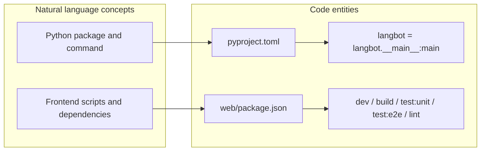
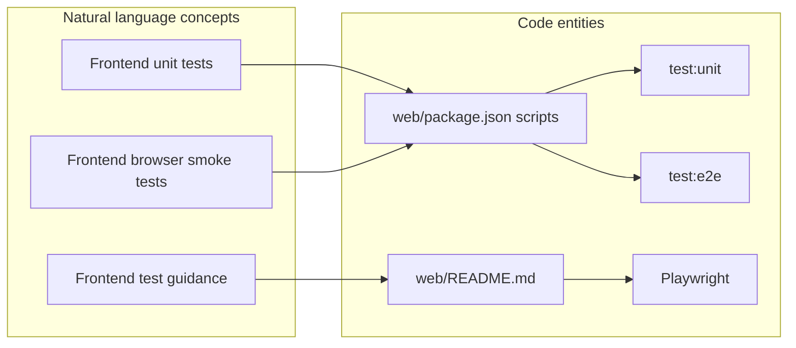

<!-- source: DeepWiki mcp.deepwiki.com · repo langbot-app/LangBot · page 10 Development and Contribution · fetched 2026-10-29 -->

# Development and Contribution

Relevant source files

The following files were used as context for generating this wiki page:

- [pyproject.toml](pyproject.toml)
- [src/langbot/__init__.py](src/langbot/__init__.py)
- [uv.lock](uv.lock)
- [web/.env.example](web/.env.example)
- [web/.gitignore](web/.gitignore)
- [web/README.md](web/README.md)
- [web/package-lock.json](web/package-lock.json)
- [web/package.json](web/package.json)
- [web/pnpm-lock.yaml](web/pnpm-lock.yaml)

## Purpose and scope

This page gives a high-level orientation to LangBot’s development ecosystem: its Python and web project metadata, available frontend tooling, and the areas covered by the contribution-focused child pages. The Python project identifies itself as a production-grade platform for agentic IM bots and exposes a `langbot` command-line entry point [pyproject.toml:1-5]()[pyproject.toml:124-125](). The web project defines its own development, build, lint, and test commands [web/package.json:1-12]().

Use this page to find the right starting point; detailed instructions and implementation specifics belong in the child pages listed below.

Sources: [pyproject.toml:1-5](), [pyproject.toml:124-125](), [web/package.json:1-12]()

## Development topics

| Topic | What it covers |
|---|---|
| [Project Structure and Dependencies](#10.1) | Repository layout, Python and frontend dependencies, and development tooling |
| [Docker and Containerization](#10.2) | Container builds, Compose services, and deployment packaging |
| [CI/CD Pipeline and GitHub Actions](#10.3) | Automated checks, builds, and release workflows |
| [Testing Infrastructure](#10.4) | Backend and frontend test suites, fixtures, and test practices |
| [Contributing Guidelines](#10.5) | Contribution workflow, review expectations, and project standards |
| [Agent Skills Repository and QA Automation](#10.6) | Skills authoring, CLI tooling, and QA automation |

Sources: [pyproject.toml:1-5](), [web/package.json:1-12]()

## Project Structure and Dependencies

The available project metadata shows distinct Python and web project definitions. Python package metadata, dependency declarations, development dependencies, and the `langbot` console entry point are declared in `pyproject.toml` [pyproject.toml:1-8]()[pyproject.toml:124-142](). The web project declares its own package scripts and dependencies in `web/package.json` [web/package.json:1-12]()[web/package.json:42-135]().

For details, see [Project Structure and Dependencies](#10.1).

### Project metadata: concepts mapped to repository entities

Sources: [pyproject.toml:1-8](), [pyproject.toml:124-125](), [web/package.json:1-12]()

## Docker and Containerization

Container builds and deployment packaging are covered by the dedicated child page. It provides the place to look for details on Docker, Compose, and related deployment targets.

For details, see [Docker and Containerization](#10.2).

Sources: [pyproject.toml:1-5]()

## CI/CD Pipeline and GitHub Actions

The CI/CD child page covers the project’s automated build, verification, and release workflows. The frontend package metadata identifies commands for building and linting the web project, which are useful reference points when considering frontend automation [web/package.json:5-12]().

For details, see [CI/CD Pipeline and GitHub Actions](#10.3).

Sources: [web/package.json:5-12]()

## Testing Infrastructure

Testing is split across backend and frontend tooling. Python development dependencies include `pytest`, `pytest-asyncio`, and `pytest-cov` [pyproject.toml:134-142](). The web project exposes `test:unit` and `test:e2e` scripts [web/package.json:5-12](); its README describes the Playwright suite as a frontend smoke test that mocks backend and Space APIs [web/README.md:5-13]().

For details, see [Testing Infrastructure](#10.4).

### Frontend test commands: concepts mapped to repository entities

Sources: [web/package.json:5-12](), [web/README.md:5-13]()

## Contributing Guidelines

The contribution child page is the reference for the project’s contribution workflow, standards, and review process. See it before preparing a change so that contribution-specific expectations are covered in one place.

For details, see [Contributing Guidelines](#10.5).

Sources: [pyproject.toml:1-5]()

## Agent Skills Repository and QA Automation

The skills and QA child page covers the skills repository, its authoring and CLI tooling, and associated automation. Consult that page for those workflows rather than treating them as general Python or frontend package scripts.

For details, see [Agent Skills Repository and QA Automation](#10.6).

Sources: [pyproject.toml:1-5]()

---

