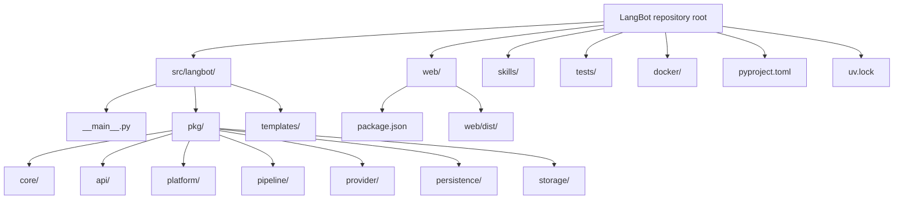
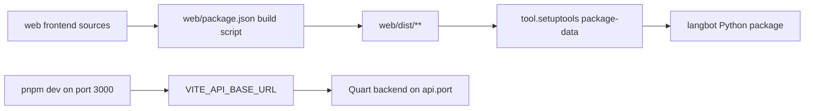
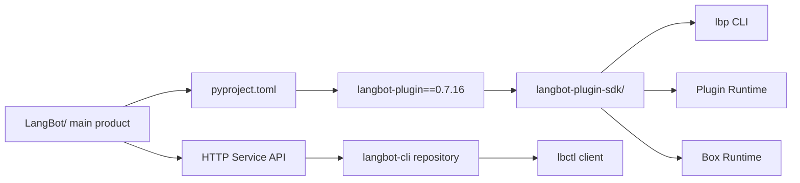
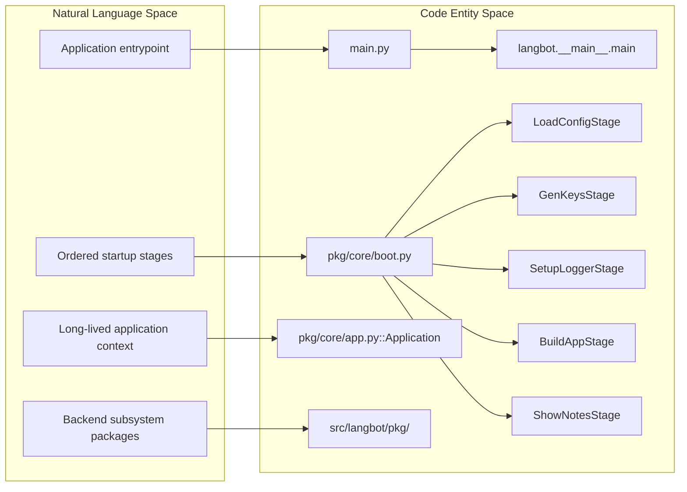
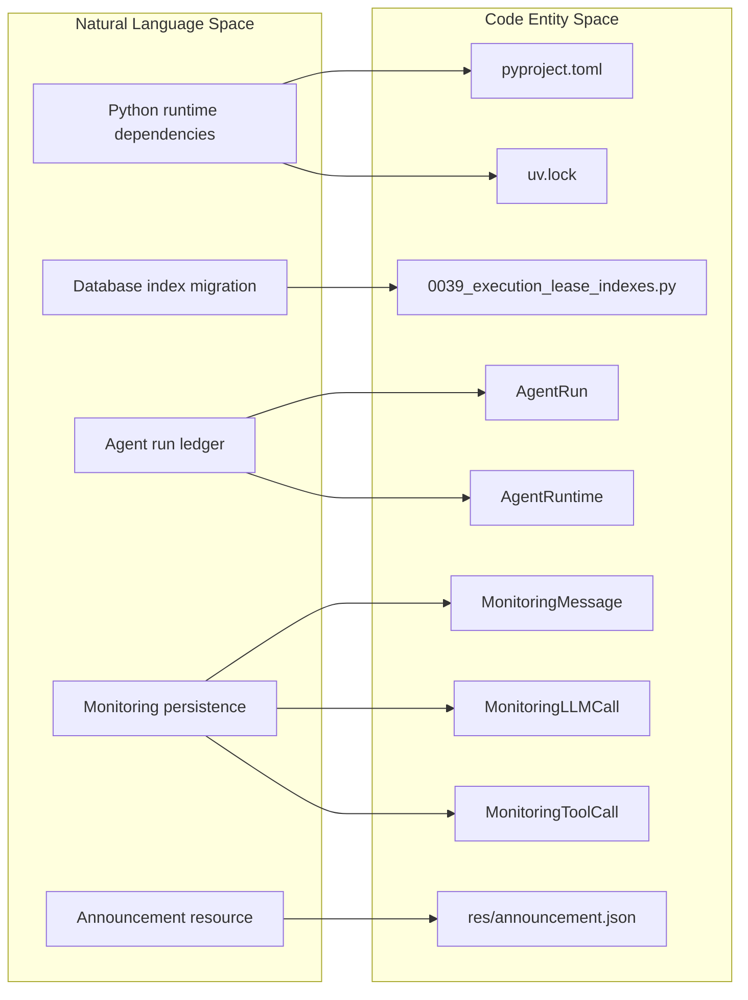

<!-- source: DeepWiki mcp.deepwiki.com · repo langbot-app/LangBot · page 10.1 Project Structure and Dependencies · fetched 2026-10-29 -->

# Project Structure and Dependencies

Relevant source files

The following files were used as context for generating this wiki page:

- [.mcp.json](.mcp.json)
- [AGENTS.md](AGENTS.md)
- [ARCHITECTURE.md](ARCHITECTURE.md)
- [docs/MIGRATION_SUMMARY.md](docs/MIGRATION_SUMMARY.md)
- [docs/WEBSOCKET_README.md](docs/WEBSOCKET_README.md)
- [pyproject.toml](pyproject.toml)
- [res/announcement.json](res/announcement.json)
- [res/scripts/publish_announcement.py](res/scripts/publish_announcement.py)
- [src/langbot/__init__.py](src/langbot/__init__.py)
- [src/langbot/pkg/entity/persistence/agent_run.py](src/langbot/pkg/entity/persistence/agent_run.py)
- [src/langbot/pkg/entity/persistence/event_log.py](src/langbot/pkg/entity/persistence/event_log.py)
- [src/langbot/pkg/entity/persistence/monitoring.py](src/langbot/pkg/entity/persistence/monitoring.py)
- [src/langbot/pkg/entity/persistence/transcript.py](src/langbot/pkg/entity/persistence/transcript.py)
- [src/langbot/pkg/persistence/alembic/versions/0039_execution_lease_indexes.py](src/langbot/pkg/persistence/alembic/versions/0039_execution_lease_indexes.py)
- [src/langbot/pkg/persistence/media.py](src/langbot/pkg/persistence/media.py)
- [src/langbot/pkg/plugin/runner_actions.py](src/langbot/pkg/plugin/runner_actions.py)
- [tests/unit_tests/persistence/test_conversation_page_index.py](tests/unit_tests/persistence/test_conversation_page_index.py)
- [tests/unit_tests/persistence/test_execution_lease_indexes.py](tests/unit_tests/persistence/test_execution_lease_indexes.py)
- [tests/unit_tests/persistence/test_partial_history_indexes.py](tests/unit_tests/persistence/test_partial_history_indexes.py)
- [tests/unit_tests/storage/test_inline_media_cleanup.py](tests/unit_tests/storage/test_inline_media_cleanup.py)
- [uv.lock](uv.lock)
- [web/.env.example](web/.env.example)
- [web/.gitignore](web/.gitignore)
- [web/README.md](web/README.md)
- [web/package-lock.json](web/package-lock.json)
- [web/package.json](web/package.json)
- [web/pnpm-lock.yaml](web/pnpm-lock.yaml)

## Purpose and scope

This page describes the repository’s documented layout, Python and frontend dependency manifests, package boundaries, developer guidance, and the available evidence about bundled assets and build-version reporting. The repository’s architectural map identifies the main application areas and distinguishes the LangBot repository from the sibling plugin SDK and CLI projects. [ARCHITECTURE.md:20-29]()

Sources: [ARCHITECTURE.md:20-29]()

---

## 1. Repository Organization and Frontend/Backend Separation

The main repository contains a Python backend under `src/langbot/` and a separately managed frontend under `web/`. The backend targets Python `>=3.11,<4.0`; the frontend is documented as Vite + React Router 7 + shadcn/ui + Tailwind and is managed with `pnpm`. The backend framework is Quart, served by Hypercorn on the configured API port; the documented default is `5300`. [AGENTS.md:7-13]()

### Repository layout and module architecture

The architecture guide describes the top-level layout and the responsibilities of the principal backend packages. The package configuration also lists which backend resources are included as package data, including frontend distribution assets and persistence migrations. [ARCHITECTURE.md:43-71](), [pyproject.toml:127-132]()

**Diagram: Repository areas and package boundary**

Sources: [ARCHITECTURE.md:43-71](), [pyproject.toml:127-132]()

### Key directory reference

| Path | Role |
|---|---|
| `main.py` | The architecture guide identifies this as the entrypoint shim that delegates to `langbot.__main__.main()`. [ARCHITECTURE.md:45-51]() |
| `src/langbot/` | Python package root. The architecture map locates the CLI entrypoint and backend packages here. [ARCHITECTURE.md:49-66]() |
| `src/langbot/pkg/core/` | Application, startup stages, and task-management area in the architecture map. [ARCHITECTURE.md:51-54]() |
| `src/langbot/pkg/api/` | HTTP API and MCP server area. [ARCHITECTURE.md:51-55]() |
| `src/langbot/pkg/platform/` | Platform adapters and runtime bot management area. [ARCHITECTURE.md:53-56]() |
| `src/langbot/pkg/pipeline/` | Message routing and pipeline-stage area. [ARCHITECTURE.md:54-57]() |
| `src/langbot/pkg/provider/` | Model providers and host-owned tools area. [ARCHITECTURE.md:55-58]() |
| `src/langbot/pkg/persistence/` | SQLAlchemy/SQLModel and Alembic migration area. [ARCHITECTURE.md:61-64]() |
| `web/` | Vite frontend project with its own package manifest and scripts. [AGENTS.md:9-13](), [web/package.json:1-13]() |
| `skills/` | In-repository agent skills; the architecture guide calls this the single source of truth. [ARCHITECTURE.md:67-70]() |
| `docker/` | Deployment manifests area in the architecture map. [ARCHITECTURE.md:65-70]() |

Sources: [ARCHITECTURE.md:43-71](), [AGENTS.md:7-13](), [web/package.json:1-13]()

### Frontend/backend separation

The frontend and backend use distinct manifests and package managers: backend dependency management uses `uv`, while `web/` uses `pnpm`. For local development, the guidance starts the backend with `uv run main.py` and the frontend with `pnpm dev`; the frontend development server is documented on port `3000`, with `VITE_API_BASE_URL` pointing to the backend. The Python package-data configuration includes `web/dist/**`, providing a packaging hook for built frontend assets. [AGENTS.md:7-25](), [pyproject.toml:127-132]()

**Diagram: Development and packaged frontend relationship**

Sources: [AGENTS.md:7-13](), [AGENTS.md:18-25](), [web/package.json:5-13](), [pyproject.toml:127-132]()

---

## 2. Backend Dependencies and Python Tooling

`pyproject.toml` declares the project as `langbot`, version `4.11.2`, with Python compatibility `>=3.11,<4.0`. Runtime dependencies are declared in `[project].dependencies`; the optional `seekdb` group is under `[project.optional-dependencies]`; development dependencies are in the `dev` dependency group. [pyproject.toml:1-7](), [pyproject.toml:8-8](), [pyproject.toml:113-117](), [pyproject.toml:134-142]()

### Dependency groups and purpose

The declared dependencies span the web/API stack, persistence, AI providers, messaging adapters, runtime integration, and document/vector processing. The table summarizes dependency families from the manifest rather than describing runtime call relationships. [pyproject.toml:8-87]()

| Area | Representative declared packages |
|---|---|
| Web and async networking | `quart`, `quart-cors`, `aiohttp`, `websockets`, `httpx[socks]`. [pyproject.toml:11-12](), [pyproject.toml:39-50](), [pyproject.toml:87-87]() |
| Persistence | `sqlalchemy[asyncio]`, `sqlmodel`, `aiosqlite`, `asyncpg`, `alembic`. [pyproject.toml:13-13](), [pyproject.toml:44-46](), [pyproject.toml:75-75]() |
| Model and AI integrations | `openai`, `anthropic`, `litellm`, `ollama`, `dashscope`, `langchain`, and `mcp`. [pyproject.toml:14-14](), [pyproject.toml:20-20](), [pyproject.toml:26-29](), [pyproject.toml:66-68](), [pyproject.toml:83-83]() |
| Platform clients | `discord-py`, `python-telegram-bot`, `slack-sdk`, `lark-oapi`, `qq-botpy-rc`, `line-bot-sdk`, `matrix-nio`, and `dingtalk-stream`. [pyproject.toml:21-25](), [pyproject.toml:35-37](), [pyproject.toml:43-43](), [pyproject.toml:76-77]() |
| Knowledge and document processing | `chromadb`, `qdrant-client`, `pymilvus`, `pgvector`, `pypdf`, `python-docx`, and `ebooklib`. [pyproject.toml:57-58](), [pyproject.toml:64-65](), [pyproject.toml:72-73](), [pyproject.toml:80-81]() |
| Runtime SDK dependency | `langbot-plugin==0.7.16`. The architecture guide identifies the published `langbot-plugin` package as the sibling SDK dependency. [pyproject.toml:74-74](), [ARCHITECTURE.md:24-29]() |
| Development group | `pytest`, `pytest-asyncio`, `pytest-cov`, `ruff`, `pre-commit`, and `moto`. [pyproject.toml:134-142]() |

Sources: [pyproject.toml:8-87](), [pyproject.toml:113-117](), [pyproject.toml:134-142](), [ARCHITECTURE.md:24-29]()

### `uv.lock` and reproducible dependency resolution

`uv.lock` records lockfile format metadata, the Python version constraint, resolution markers, and resolved package entries. The visible package records include package names, pinned versions, registry sources, dependency edges, and distribution hashes. The lockfile header’s `requires-python` constraint matches the project’s declared Python range in `pyproject.toml`. [uv.lock:1-20](), [uv.lock:22-48](), [pyproject.toml:7-7]()

The project instructions use `uv sync --dev` to synchronize the backend environment and `uv run` to execute the application and tests. [AGENTS.md:15-25]()

Sources: [uv.lock:1-48](), [pyproject.toml:7-7](), [AGENTS.md:15-25]()

### Python lint configuration

The `ruff` configuration sets a 120-character line length, four-space indentation, and Python 3.12 as its target version. The lint configuration selects a defined subset of rules and lists explicit ignores; formatting is configured for single-quoted strings and space indentation. [pyproject.toml:144-179](), [pyproject.toml:181-216](), [pyproject.toml:225-236]()

Sources: [pyproject.toml:144-179](), [pyproject.toml:181-236]()

---

## 3. Frontend Dependencies and Package Configuration

The frontend manifest is `web/package.json`. It identifies the package as private, defines Vite development/build/preview scripts, and provides unit-test, end-to-end-test, lint, and formatting scripts. It declares `pnpm@8.9.2` as the package manager. [web/package.json:1-13](), [web/package.json:135-135]()

The manifest declares React and React DOM `19.2.1`, React Router DOM `^7.18.4`, Vite `^8.3.4`, TypeScript `^5.8.3`, Tailwind CSS, Radix UI packages, and i18n packages including `i18next` and `react-i18next`. The repository guidance describes the frontend as Vite + React Router 7 + shadcn/ui + Tailwind. [web/package.json:48-73](), [web/package.json:79-107](), [web/package.json:109-135](), [AGENTS.md:9-13]()

| Manifest or lockfile | Responsibility |
|---|---|
| `web/package.json` | Declares frontend scripts, dependencies, development dependencies, package-manager version, and dependency overrides. [web/package.json:1-13](), [web/package.json:20-40](), [web/package.json:42-135]() |
| `web/pnpm-lock.yaml` | Records pnpm lockfile metadata, overrides, dependency specifiers, and resolved versions. [web/pnpm-lock.yaml:1-22](), [web/pnpm-lock.yaml:24-39]() |
| `web/package-lock.json` | Also exists and identifies a lockfile format version and package records. The supplied content establishes its presence but does not establish which workflow uses it. [web/package-lock.json:1-10]() |

Sources: [web/package.json:1-135](), [web/pnpm-lock.yaml:1-39](), [web/package-lock.json:1-10](), [AGENTS.md:9-13]()

---

## 4. Package Entry Points and Build Artifacts

The Python project declares a console script mapping `langbot` to `langbot.__main__:main`. Its build backend is `setuptools.build_meta`, with `setuptools` and `wheel` as build requirements. The package-data configuration includes templates, locale JSON files, provider requesters, platform sources and adapters, frontend assets under `web/dist/**`, and Alembic migration files. [pyproject.toml:124-132]()

The package initializer obtains the installed distribution version through `importlib.metadata.version('langbot')` and exposes it as `__version__`. The supplied files therefore support describing installed-package version reporting; they do not show a separate build revision-stamping mechanism. [src/langbot/__init__.py:1-5]()

| Packaging element | Configuration |
|---|---|
| Console command | `langbot` → `langbot.__main__:main`. [pyproject.toml:124-126]() |
| Build backend | `setuptools.build_meta`, with `setuptools>=61.0` and `wheel`. [pyproject.toml:127-129]() |
| Frontend assets | `web/dist/**` is included in the `langbot` package-data pattern. [pyproject.toml:131-132]() |
| Migrations | `pkg/persistence/alembic/**` is included in package data. [pyproject.toml:131-132]() |
| Runtime version value | `langbot.__version__` reads the installed distribution version. [src/langbot/__init__.py:3-5]() |

Sources: [pyproject.toml:124-132](), [src/langbot/__init__.py:1-5]()

---

## 5. The Two-Repo Architecture

The architecture documentation describes three repository boundaries:

1. `LangBot/` contains the main product, including backend, web UI, platform adapters, pipeline engine, HTTP API, MCP server, RAG, persistence, skills integration, and runtime bridge code. [ARCHITECTURE.md:20-25]()
2. `langbot-plugin-sdk/` provides plugin developer APIs, shared entities, `lbp`, the Plugin Runtime, and the Box Runtime. The SDK is published as `langbot-plugin` and pinned in the main repository’s `pyproject.toml`. [ARCHITECTURE.md:24-29](), [pyproject.toml:74-74]()
3. `langbot-cli` is documented as a separately released `lbctl` client for managing a running Workspace through the HTTP Service API; it is distinct from both the LangBot server and the SDK’s `lbp` CLI. [ARCHITECTURE.md:24-29]()

For cross-repository SDK work, the working guidance instructs developers to install the local SDK into LangBot’s environment and run LangBot with `--no-sync` so the environment does not restore the pinned package during that workflow. [AGENTS.md:56-78]()

**Diagram: Repository boundaries and named artifacts**

Sources: [ARCHITECTURE.md:20-29](), [pyproject.toml:74-74](), [AGENTS.md:56-78]()

---

## 6. Guides, Documentation, Examples, and Auxiliary Tooling

### `AGENTS.md`, `CLAUDE.md`, and `ARCHITECTURE.md`

`AGENTS.md` is the working checklist for code agents; its opening states that `CLAUDE.md` is a symlink to it. The guidance says to read `ARCHITECTURE.md` before non-trivial backend, frontend, runtime, plugin, Box, MCP, persistence, or cross-repository SDK changes. It characterizes `ARCHITECTURE.md` as the system map. [AGENTS.md:1-5]()

The architecture guide is intended as a stable map of the system and directs readers from subsystem descriptions into implementation file references. Its top-level layout and runtime graph help locate backend packages and understand the main message-processing path. [ARCHITECTURE.md:1-5](), [ARCHITECTURE.md:43-71](), [ARCHITECTURE.md:73-115]()

| Document | Use |
|---|---|
| `AGENTS.md` | Working checklist, environment facts, commands, test guidance, and change rules. [AGENTS.md:1-5](), [AGENTS.md:7-43](), [AGENTS.md:86-97]() |
| `CLAUDE.md` | Symlink to `AGENTS.md`, as stated by `AGENTS.md`. [AGENTS.md:1-5]() |
| `ARCHITECTURE.md` | System map, repository boundary, startup path, directory layout, and runtime/message-flow diagrams. [ARCHITECTURE.md:1-5](), [ARCHITECTURE.md:31-71](), [ARCHITECTURE.md:73-115]() |

Sources: [AGENTS.md:1-5](), [AGENTS.md:7-43](), [AGENTS.md:86-97](), [ARCHITECTURE.md:1-5](), [ARCHITECTURE.md:31-115]()

### Examples, resources, scripts, and tools

The supplied file content confirms `res/announcement.json` exists and currently contains an empty JSON array. The additional-file list names `res/scripts/publish_announcement.py`, but its contents are not included here; the available files do not establish the behavior of `examples/`, top-level `scripts/`, or `tools/`. [res/announcement.json:1]()

The architecture map does identify `skills/` as the in-repository skills source of truth, and `AGENTS.md` points developers to `skills/` for agent skills. [ARCHITECTURE.md:67-70](), [AGENTS.md:45-55]()

| Path | What is established by the supplied content |
|---|---|
| `res/announcement.json` | Exists and contains `[]`. [res/announcement.json:1]() |
| `res/scripts/publish_announcement.py` | Listed among additional files; its implementation is not shown. |
| `examples/`, `scripts/`, `tools/` | Mentioned as repository areas in the page scope, but their contents and behavior are not shown in the supplied files. |
| `skills/` | Identified as the single source of truth for in-repository agent skills. [ARCHITECTURE.md:67-70](), [AGENTS.md:45-55]() |

Sources: [res/announcement.json:1](), [ARCHITECTURE.md:67-70](), [AGENTS.md:45-55]()

### Build revision and version reporting

The available version-reporting implementation is `src/langbot/__init__.py`: it calls `importlib.metadata.version('langbot')` and assigns the result to `__version__`. The supplied content does not show a build-revision generator, stamping script, or revision field; such behavior cannot be documented from these files. [src/langbot/__init__.py:1-5]()

Sources: [src/langbot/__init__.py:1-5]()

---

## 7. Natural Language to Code Entity Space (Core Systems)

This mapping connects repository concepts to named files and entities used in the architecture and package configuration. The architecture guide names the entrypoint, boot stages, `Application`, and the major package areas; the package manifest declares the console-script target. [ARCHITECTURE.md:31-41](), [ARCHITECTURE.md:47-70](), [pyproject.toml:124-126]()

**Diagram: Core repository concepts mapped to code entities**

Sources: [ARCHITECTURE.md:31-41](), [ARCHITECTURE.md:47-70](), [pyproject.toml:124-126]()

| System concept | Code entity |
|---|---|
| Installed command | `[project.scripts]` maps `langbot` to `langbot.__main__:main`. [pyproject.toml:124-126]() |
| Startup orchestration | `pkg/core/boot.py` executes `LoadConfigStage`, `GenKeysStage`, `SetupLoggerStage`, `BuildAppStage`, and `ShowNotesStage`. [ARCHITECTURE.md:33-39]() |
| Application context | `pkg/core/app.py::Application` is described as the central runtime object and service locator. [ARCHITECTURE.md:39-41]() |
| Backend package map | `src/langbot/pkg/` contains the listed core, API, platform, pipeline, provider, agent, plugin, Box, skill, RAG/vector, persistence, and storage areas. [ARCHITECTURE.md:49-66]() |

Sources: [pyproject.toml:124-126](), [ARCHITECTURE.md:31-41](), [ARCHITECTURE.md:47-70]()

---

## 8. Natural Language to Code Entity Space (Persistence & Infrastructure)

This mapping associates infrastructure concepts with the named files and entities supported by the supplied architecture, model, and migration sources. In particular, `AgentRun` is a persistence entity in `agent_run.py`, while `MonitoringMessage`, `MonitoringLLMCall`, and `MonitoringToolCall` are declared in `monitoring.py`. [ARCHITECTURE.md:61-64](), [src/langbot/pkg/entity/persistence/agent_run.py:13-16](), [src/langbot/pkg/entity/persistence/monitoring.py:7-10](), [src/langbot/pkg/entity/persistence/monitoring.py:83-86](), [src/langbot/pkg/entity/persistence/monitoring.py:118-121]()

**Diagram: Infrastructure concepts mapped to concrete entities**

Sources: [pyproject.toml:1-8](), [uv.lock:1-20](), [src/langbot/pkg/persistence/alembic/versions/0039_execution_lease_indexes.py:1-10](), [src/langbot/pkg/entity/persistence/agent_run.py:13-16](), [src/langbot/pkg/entity/persistence/agent_run.py:126-134](), [src/langbot/pkg/entity/persistence/monitoring.py:7-10](), [src/langbot/pkg/entity/persistence/monitoring.py:83-86](), [src/langbot/pkg/entity/persistence/monitoring.py:118-121](), [res/announcement.json:1]()

| Infrastructure concept | Code entity | Role shown in the supplied files |
|---|---|---|
| Dependency declaration and resolution | `pyproject.toml`, `uv.lock` | Project constraints and declared dependencies versus locked resolution metadata and package records. [pyproject.toml:1-8](), [uv.lock:1-20]() |
| Index migration | `0039_execution_lease_indexes.py` | Declares index metadata and migration upgrade/downgrade operations. [src/langbot/pkg/persistence/alembic/versions/0039_execution_lease_indexes.py:6-10](), [src/langbot/pkg/persistence/alembic/versions/0039_execution_lease_indexes.py:31-49]() |
| Run ledger | `AgentRun` | Stores Host-owned execution lifecycle facts and run identifiers. [src/langbot/pkg/entity/persistence/agent_run.py:13-25]() |
| Runtime registry | `AgentRuntime` | Stores Host-owned runtime heartbeat registry facts. [src/langbot/pkg/entity/persistence/agent_run.py:126-159]() |
| Monitoring records | `MonitoringMessage`, `MonitoringLLMCall`, `MonitoringToolCall` | ORM entities for monitoring messages, LLM calls, and tool calls. [src/langbot/pkg/entity/persistence/monitoring.py:7-10](), [src/langbot/pkg/entity/persistence/monitoring.py:83-86](), [src/langbot/pkg/entity/persistence/monitoring.py:118-133]() |

Sources: [pyproject.toml:1-8](), [uv.lock:1-20](), [src/langbot/pkg/persistence/alembic/versions/0039_execution_lease_indexes.py:1-49](), [src/langbot/pkg/entity/persistence/agent_run.py:13-16](), [src/langbot/pkg/entity/persistence/agent_run.py:126-159](), [src/langbot/pkg/entity/persistence/monitoring.py:7-10](), [src/langbot/pkg/entity/persistence/monitoring.py:83-86](), [src/langbot/pkg/entity/persistence/monitoring.py:118-133]()

---

## 9. Development Tooling and Quality Gates

The repository guidance provides separate backend and frontend command sets. Backend commands use `uv`, including `uv sync --dev` and focused `pytest` invocations; frontend commands use `pnpm`, including development, build, lint, and end-to-end tests. The frontend manifest additionally defines unit testing, preview, and formatting scripts. [AGENTS.md:15-39](), [web/package.json:5-13]()

| Task | Documented command or script |
|---|---|
| Synchronize backend environment | `uv sync --dev`. [AGENTS.md:15-20]() |
| Run backend application | `uv run main.py`. [AGENTS.md:17-20]() |
| Backend unit tests | `uv run pytest tests/unit_tests -q`. [AGENTS.md:28-33]() |
| Backend integration tests | `uv run pytest tests/integration -q`. [AGENTS.md:30-34]() |
| Frontend development server | `pnpm dev`, mapped to `vite`. [AGENTS.md:22-25](), [web/package.json:5-8]() |
| Frontend production build | `pnpm build`, mapped to `tsc && vite build`. [AGENTS.md:22-25](), [web/package.json:5-8]() |
| Frontend unit tests | `pnpm test:unit`, mapped to Node’s test runner over `tests/unit/*.test.mjs`. [web/package.json:9-10]() |
| Frontend end-to-end tests | `pnpm test:e2e`, mapped to `playwright test`. [AGENTS.md:36-39](), [web/package.json:9-11]() |
| Frontend lint and formatting | `pnpm lint` runs ESLint; `pnpm format` runs Prettier. [web/package.json:11-13]() |
| Python lint configuration | `ruff` is configured in `pyproject.toml`; the `dev` group includes `ruff`. [pyproject.toml:134-142](), [pyproject.toml:144-179]() |

The development guide recommends running the narrowest useful test first, then expanding checks as needed. It also recommends Linux for tests to match CI and describes using WSL3 Linux containers on Windows to avoid platform-specific failures. [AGENTS.md:41-43]()

Sources: [AGENTS.md:15-43](), [web/package.json:5-13](), [pyproject.toml:134-179]()

---

# Summary

The repository separates the Python backend in `src/langbot/` from the frontend in `web/`, with distinct dependency tooling: `uv` for Python and `pnpm` for the frontend. `pyproject.toml` declares Python constraints, runtime and development dependencies, the console entrypoint, package data, and Ruff settings; `uv.lock` records Python dependency resolution metadata. The architecture documents the main repository boundary and the sibling plugin SDK and CLI projects. `AGENTS.md` supplies working commands and change guidance, while `ARCHITECTURE.md` maps the system to its code areas. The supplied files establish installed-package version reporting through `langbot.__version__`, but do not show a separate build revision-stamping implementation. [pyproject.toml:1-8](), [pyproject.toml:124-142](), [pyproject.toml:144-179](), [uv.lock:1-20](), [AGENTS.md:1-25](), [ARCHITECTURE.md:20-29](), [src/langbot/__init__.py:1-5]()

Sources: [pyproject.toml:1-8](), [pyproject.toml:124-179](), [uv.lock:1-20](), [AGENTS.md:1-25](), [ARCHITECTURE.md:20-29](), [src/langbot/__init__.py:1-5]()

---

