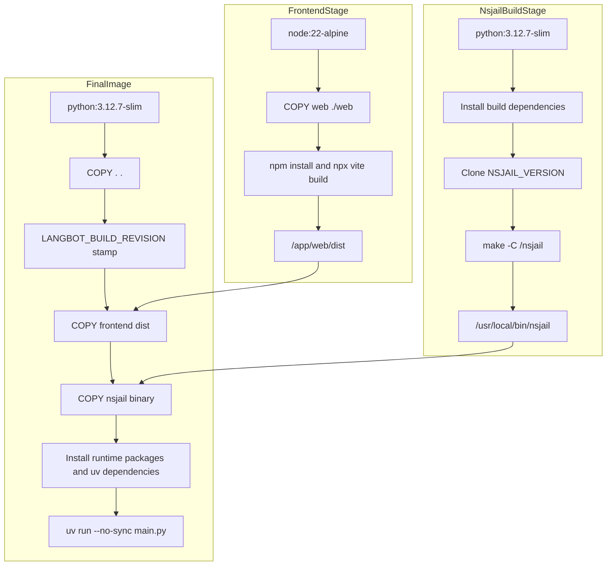
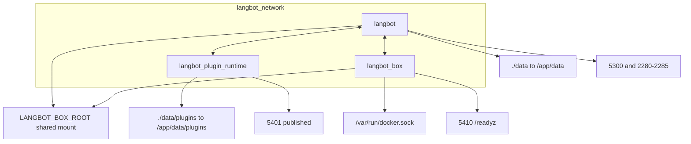
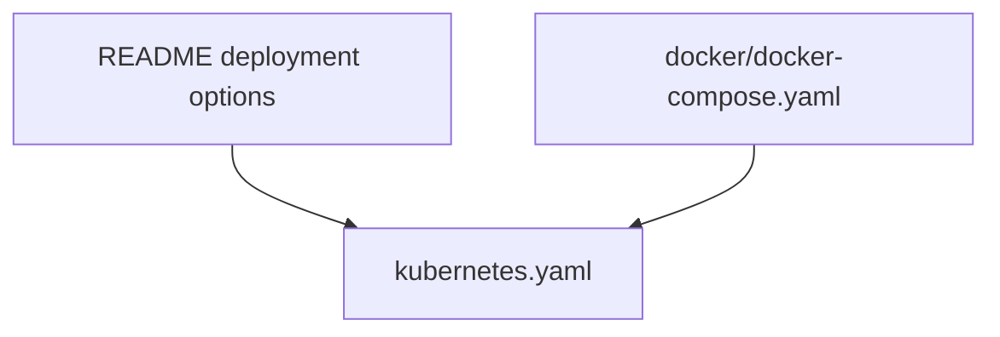
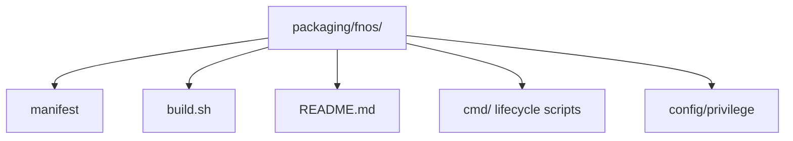
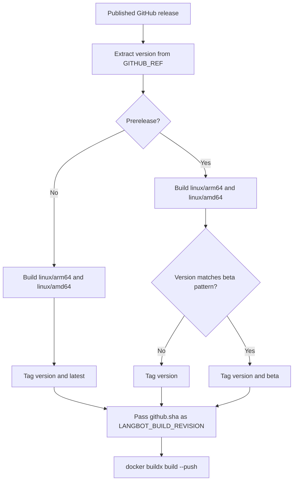
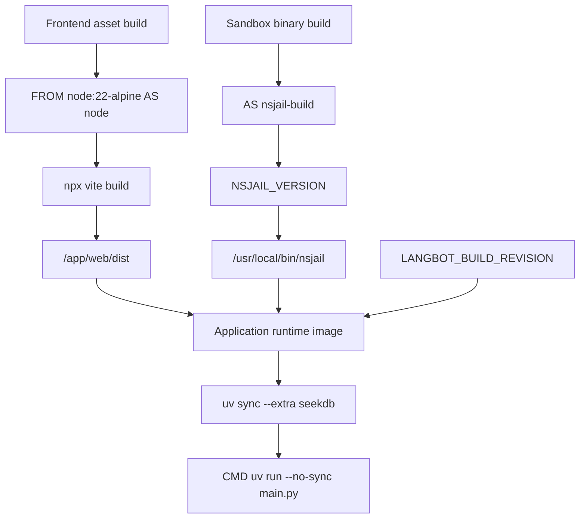
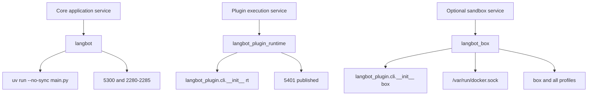

<!-- source: DeepWiki mcp.deepwiki.com · repo langbot-app/LangBot · page 10.2 Docker and Containerization · fetched 2026-10-29 -->

# Docker and Containerization

Relevant source files

The following files were used as context for generating this wiki page:

- [.dockerignore](.dockerignore)
- [.github/workflows/build-dev-image.yaml](.github/workflows/build-dev-image.yaml)
- [.github/workflows/build-docker-image.yml](.github/workflows/build-docker-image.yml)
- [.github/workflows/build-release-artifacts.yaml](.github/workflows/build-release-artifacts.yaml)
- [.github/workflows/publish-to-pypi.yml](.github/workflows/publish-to-pypi.yml)
- [Dockerfile](Dockerfile)
- [README.md](README.md)
- [README_CN.md](README_CN.md)
- [README_ES.md](README_ES.md)
- [README_FR.md](README_FR.md)
- [README_JP.md](README_JP.md)
- [README_KO.md](README_KO.md)
- [README_RU.md](README_RU.md)
- [README_TW.md](README_TW.md)
- [README_VI.md](README_VI.md)
- [docker/docker-compose.yaml](docker/docker-compose.yaml)
- [packaging/fnos/README.md](packaging/fnos/README.md)
- [packaging/fnos/build.sh](packaging/fnos/build.sh)
- [packaging/fnos/cmd/install_callback](packaging/fnos/cmd/install_callback)
- [packaging/fnos/cmd/install_init](packaging/fnos/cmd/install_init)
- [packaging/fnos/cmd/main](packaging/fnos/cmd/main)
- [packaging/fnos/cmd/uninstall_callback](packaging/fnos/cmd/uninstall_callback)
- [packaging/fnos/cmd/upgrade_callback](packaging/fnos/cmd/upgrade_callback)
- [packaging/fnos/cmd/upgrade_init](packaging/fnos/cmd/upgrade_init)
- [packaging/fnos/config/privilege](packaging/fnos/config/privilege)
- [packaging/fnos/manifest](packaging/fnos/manifest)
- [scripts/stamp_build_revision.py](scripts/stamp_build_revision.py)
- [src/langbot/_build_info.py](src/langbot/_build_info.py)

This page describes LangBot’s container build, Docker Compose services, image tags, Kubernetes deployment references, and fnOS packaging. It focuses on the deployment artifacts and behaviors evidenced in the repository; for release automation beyond Docker image publishing, see **10.3 CI/CD Pipeline and GitHub Actions**.

## Purpose and Scope

LangBot’s Docker image packages the backend, built frontend assets, and sandbox-related runtime dependencies. Docker Compose runs the main LangBot service alongside the plugin runtime, with an optional Box runtime. The repository also points to Kubernetes deployment materials and includes a dedicated fnOS packaging area. [Dockerfile:1-73]() [docker/docker-compose.yaml:1-125]() [README.md:82-96]()

Sources: [Dockerfile:1-73](), [docker/docker-compose.yaml:1-125](), [README.md:82-96]()

---

## Multi-Stage Dockerfile Architecture

The `Dockerfile` uses separate build stages for the web frontend and `nsjail`, then assembles the Python application image. This keeps the frontend build environment and `nsjail` compilation toolchain out of the final stage. The final stage contains the application, built web assets, the `nsjail` binary, runtime libraries, Docker CLI, Node.js, and Python dependencies. [Dockerfile:1-73]()

### Build Stages Breakdown

1. **Frontend build (`node`)**  
   The stage starts from `node:22-alpine`, copies `web/` into `/app/web`, and runs `npm install` followed by `npx vite build`. Its output, `/app/web/dist`, is copied into the final image. [Dockerfile:1-8]() [Dockerfile:37-37]()

2. **Sandbox compilation (`nsjail-build`)**  
   The stage starts from `python:3.12.7-slim` and defines `NSJAIL_VERSION` with a default of `3.6`. It installs compilation dependencies, clones that tagged `nsjail` source, builds it, and installs the resulting binary at `/usr/local/bin/nsjail`. The final stage copies the binary, rather than the build toolchain. [Dockerfile:14-26]() [Dockerfile:39-41]()

3. **Application runtime**  
   The final stage starts from `python:3.12.7-slim`, copies the repository into `/app`, optionally stamps `LANGBOT_BUILD_REVISION` through `scripts/stamp_build_revision.py`, and imports the frontend output and `nsjail` binary from the build stages. [Dockerfile:28-41]()

   Runtime setup installs shared libraries for `nsjail`, the Docker CLI client, Node.js 22, and `uv`; it then installs project dependencies with `uv sync --extra seekdb`. The Docker CLI supports the optional Box service’s use of a mounted host Docker socket, while Node.js supports sandboxed `npx`-launched stdio MCP servers. The default container command is `uv run --no-sync main.py`. [Dockerfile:43-73]()

### Dockerfile Build Flow and Artifact Transfer

The diagram maps the Dockerfile’s build stages and artifact transfers to the final image. [Dockerfile:1-73]()

Sources: [Dockerfile:1-73]()

---

## Docker Compose and Multi-Container Services

The Compose file defines `langbot`, `langbot_plugin_runtime`, and the optional `langbot_box` service. The README’s quick-start command uses the `all` profile to start the complete Compose configuration. [docker/docker-compose.yaml:1-125]() [README.md:82-88]()

### Defined Services

| Service | Role and configuration |
|---|---|
| `langbot` | Main service using `rockchin/langbot:latest`. It mounts `./data` at `/app/data`, publishes port `5300` and the `2280-2285` range, and passes configuration overrides for Box paths, skills, and blocking-executor limits. [docker/docker-compose.yaml:90-125]() |
| `langbot_plugin_runtime` | Runs the plugin runtime CLI subcommand `rt`, mounts `./data/plugins` at `/app/data/plugins`, publishes port `5401`, and defines control-token and blocking-executor environment variables. Its health check probes port `5400` at `/healthz`. [docker/docker-compose.yaml:7-36]() |
| `langbot_box` | Optional service enabled by the `box` or `all` Compose profiles. It runs the `box` CLI subcommand, mounts the configured Box root and the host Docker socket, and checks readiness at port `5410` on `/readyz`. The Compose comments note that Box receives functional configuration from LangBot via an `INIT` RPC action rather than reading `box.local.*` itself. [docker/docker-compose.yaml:37-88]() |

The services share the `langbot_network` network in the shown configuration. `langbot` and `langbot_box` mount the same Box root path so that the core service and optional execution runtime can access the same workspace-scoped package revisions. [docker/docker-compose.yaml:34-35]() [docker/docker-compose.yaml:48-55]() [docker/docker-compose.yaml:93-99]()

### Network and Volume Relationships

This diagram summarizes the visible Compose service, mount, and port relationships. The host Docker socket is mounted into `langbot_box`; it is not shown as mounted into the other services. [docker/docker-compose.yaml:7-125]()

Sources: [docker/docker-compose.yaml:7-125]()

---

## Container Deployment & Environment Configuration

Compose passes environment variables to configure inter-service control tokens, blocking-executor limits, and Box paths. The Compose comments describe the `SECTION__SUBSECTION__KEY` convention for mapping environment overrides to `config.yaml` fields; the Box-related settings are forwarded from LangBot to the Box runtime through `INIT` RPC. [docker/docker-compose.yaml:17-24]() [docker/docker-compose.yaml:59-75]() [docker/docker-compose.yaml:100-122]()

### Key Environment Parameters

- **Plugin runtime control token:** `LANGBOT_PLUGIN_RUNTIME_CONTROL_TOKEN` is supplied to both `langbot` and `langbot_plugin_runtime`. The Compose comments recommend setting the same value on both ends when using token protection. [docker/docker-compose.yaml:17-19]() [docker/docker-compose.yaml:101-103]()

- **Box control token:** `LANGBOT_BOX_CONTROL_TOKEN` is supplied to `langbot` and `langbot_box`. The Compose comments state that the values must match when configured, and describe the token as being sent in WebSocket handshake headers rather than URLs or payloads. [docker/docker-compose.yaml:59-63]() [docker/docker-compose.yaml:104-107]()

- **Blocking executor limits:** Compose exposes worker, pending-task, and per-scope in-flight limits. The plugin runtime and Box service use `LANGBOT_BLOCKING_EXECUTOR_*` values; `langbot` maps corresponding values to `SYSTEM__BLOCKING_EXECUTOR__*` overrides. [docker/docker-compose.yaml:20-23]() [docker/docker-compose.yaml:64-67]() [docker/docker-compose.yaml:108-112]()

- **Box and skills paths:** `BOX__LOCAL__HOST_ROOT`, `BOX__LOCAL__ALLOWED_MOUNT_ROOTS`, `BOX__LOCAL__DEFAULT_WORKSPACE`, `BOX__DOCKER__CPU_LIMIT_ENABLED`, and `SKILLS__ROOT` are set on `langbot`. The `LANGBOT_BOX_ROOT` and `LANGBOT_SKILLS_ROOT` variables provide path inputs for these settings. [docker/docker-compose.yaml:113-122]()

The Compose configuration also documents the optional Box behavior: with Box disabled, skill management, activation, and read-only resources remain available, while execution tools and stdio MCP are disabled. [docker/docker-compose.yaml:37-42]()

Sources: [docker/docker-compose.yaml:17-24](), [docker/docker-compose.yaml:37-75](), [docker/docker-compose.yaml:100-125]()

---

## Kubernetes Deployment Architecture

The Compose file points readers to `kubernetes.yaml` and a deployment guide for Kubernetes deployment. The README also lists Kubernetes among the deployment options. The supplied file excerpts do not include the contents of `kubernetes.yaml`, so this page does not infer its resource types, service topology, storage configuration, or probe settings. [docker/docker-compose.yaml:1-3]() [README.md:91-96]()

### Kubernetes Reference

| Repository reference | What the supplied content establishes |
|---|---|
| `kubernetes.yaml` | The Compose file identifies it as the Kubernetes deployment manifest. Its contents are not included in the supplied excerpts. [docker/docker-compose.yaml:1-3]() |
| Kubernetes deployment option | The README lists Kubernetes as a deployment option. [README.md:96-96]() |

### Kubernetes Reference Diagram

The diagram distinguishes the repository’s Kubernetes reference from the Compose configuration, without asserting manifest details that are not visible in the supplied file content. [docker/docker-compose.yaml:1-3]() [README.md:91-96]()

Sources: [docker/docker-compose.yaml:1-3](), [README.md:91-96]()

---

## fnOS Packaging & NAS Integration

The repository includes a `packaging/fnos/` area with a manifest, build script, command scripts, configuration, and README. These paths establish that fnOS packaging is part of the project, but the contents of those files were not included in the supplied excerpts; detailed claims about manifest fields, lifecycle behavior, or build steps therefore cannot be verified here. [packaging/fnos/manifest]() [packaging/fnos/build.sh]() [packaging/fnos/README.md]()

### Packaging Structure

| Path | Evidence available in the supplied content |
|---|---|
| `packaging/fnos/manifest` | The fnOS package manifest exists. Its contents were not provided. [packaging/fnos/manifest]() |
| `packaging/fnos/build.sh` | A packaging build script exists. Its contents were not provided. [packaging/fnos/build.sh]() |
| `packaging/fnos/cmd/` | The supplied file list includes install, upgrade, and uninstall command scripts. Their implementation details were not provided. [packaging/fnos/cmd/install_init]() [packaging/fnos/cmd/install_callback]() [packaging/fnos/cmd/upgrade_init]() [packaging/fnos/cmd/upgrade_callback]() [packaging/fnos/cmd/uninstall_callback]() |
| `packaging/fnos/config/privilege` | A privilege configuration file exists. Its contents were not provided. [packaging/fnos/config/privilege]() |
| `packaging/fnos/README.md` | Packaging documentation exists. Its contents were not provided. [packaging/fnos/README.md]() |

### fnOS Packaging File Map

This diagram maps the named fnOS packaging paths to their apparent artifact categories; it does not describe their internal behavior. [packaging/fnos/manifest]() [packaging/fnos/build.sh]() [packaging/fnos/README.md]() [packaging/fnos/cmd/install_init]() [packaging/fnos/cmd/install_callback]() [packaging/fnos/cmd/upgrade_init]() [packaging/fnos/cmd/upgrade_callback]() [packaging/fnos/cmd/uninstall_callback]() [packaging/fnos/config/privilege]()

Sources: [packaging/fnos/manifest](), [packaging/fnos/build.sh](), [packaging/fnos/README.md](), [packaging/fnos/cmd/install_init](), [packaging/fnos/cmd/install_callback](), [packaging/fnos/cmd/upgrade_init](), [packaging/fnos/cmd/upgrade_callback](), [packaging/fnos/cmd/uninstall_callback](), [packaging/fnos/config/privilege]()

---

## Image Tags and Build Revision

The Docker image publishing workflow runs for published releases. It derives a version from the Git ref, builds for `linux/arm64` and `linux/amd64`, and supplies the commit SHA as `LANGBOT_BUILD_REVISION`. For a non-prerelease release, it pushes both `rockchin/langbot:<version>` and `rockchin/langbot:latest`. [`.github/workflows/build-docker-image.yml:1-44`]() [Dockerfile:34-35]()

For prereleases, the workflow pushes the version tag without updating `latest`. When the version matches the `vMAJOR.MINOR.PATCH-beta.NUMBER` pattern, it also adds the `beta` tag. [`.github/workflows/build-docker-image.yml:45-54`]()

| Release case | Image tags |
|---|---|
| Published non-prerelease release | `rockchin/langbot:<version>` and `rockchin/langbot:latest`. [`.github/workflows/build-docker-image.yml:42-44`]() |
| Published prerelease | `rockchin/langbot:<version>`; the workflow does not add `latest`. [`.github/workflows/build-docker-image.yml:45-54`]() |
| Prerelease matching the beta pattern | Version tag plus `rockchin/langbot:beta`. [`.github/workflows/build-docker-image.yml:49-54`]() |

### Image Build and Tag Flow

Sources: [`.github/workflows/build-docker-image.yml:1-54`](), [Dockerfile:34-35]()

---

# Natural Language Space to Code Entity Association Diagrams

## Container Build Concepts Mapped to Dockerfile Entities

This diagram connects deployment concepts to the concrete Dockerfile stages, build arguments, copied artifacts, and runtime command. [Dockerfile:1-73]()

Sources: [Dockerfile:1-73]()

## Compose Service Names Mapped to Runtime Commands and Ports

This diagram associates the natural-language roles of the Compose containers with service identifiers, CLI subcommands, mounts, and ports as declared in `docker/docker-compose.yaml`. [docker/docker-compose.yaml:7-125]()

Sources: [docker/docker-compose.yaml:7-125]()

---

## Summary

The Dockerfile assembles the frontend build, Python application, and sandbox runtime into a shared image. Compose uses that image for the `langbot`, `langbot_plugin_runtime`, and optional `langbot_box` services, with persistent data mounts and environment-based configuration. The release workflow publishes multi-architecture images under version tags and, depending on release type, `latest` or `beta`. The repository also references a Kubernetes manifest and contains fnOS packaging artifacts, but their detailed contents are not included in the supplied excerpts. [Dockerfile:1-73]() [docker/docker-compose.yaml:1-125]() [`.github/workflows/build-docker-image.yml:1-54`]() [packaging/fnos/manifest]() [docker/docker-compose.yaml:1-3]()

Sources: [Dockerfile:1-73](), [docker/docker-compose.yaml:1-125](), [`.github/workflows/build-docker-image.yml:1-54`](), [packaging/fnos/manifest](), [README.md:91-96]()

---

