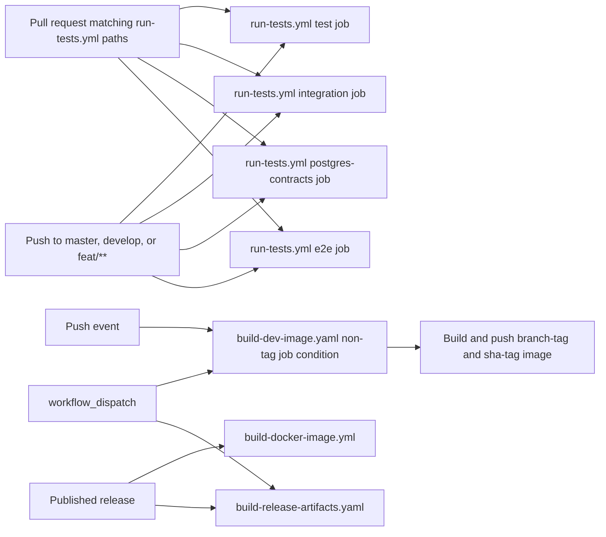
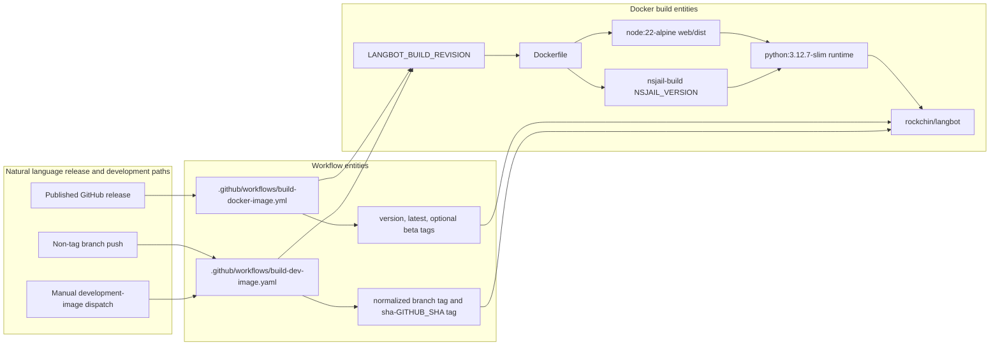

<!-- source: DeepWiki mcp.deepwiki.com · repo langbot-app/LangBot · page 10.3 CI/CD Pipeline and GitHub Actions · fetched 2026-10-29 -->

# CI/CD Pipeline and GitHub Actions

Relevant source files

The following files were used as context for generating this wiki page:

- [.dockerignore](.dockerignore)
- [.github/workflows/build-dev-image.yaml](.github/workflows/build-dev-image.yaml)
- [.github/workflows/build-docker-image.yml](.github/workflows/build-docker-image.yml)
- [.github/workflows/build-release-artifacts.yaml](.github/workflows/build-release-artifacts.yaml)
- [.github/workflows/optional-contracts.yml](.github/workflows/optional-contracts.yml)
- [.github/workflows/publish-to-pypi.yml](.github/workflows/publish-to-pypi.yml)
- [.github/workflows/run-tests.yml](.github/workflows/run-tests.yml)
- [Dockerfile](Dockerfile)
- [docs/DEPENDENCY_CONTRACT_TESTS.md](docs/DEPENDENCY_CONTRACT_TESTS.md)
- [pytest.ini](pytest.ini)
- [scripts/stamp_build_revision.py](scripts/stamp_build_revision.py)
- [src/langbot/_build_info.py](src/langbot/_build_info.py)
- [tests/conftest.py](tests/conftest.py)
- [tests/e2e/test_local_runner_fake_provider.py](tests/e2e/test_local_runner_fake_provider.py)
- [tests/fixtures/legacy_plugin_identity_sources.json](tests/fixtures/legacy_plugin_identity_sources.json)
- [tests/integration/persistence/test_pipeline_admission_postgres.py](tests/integration/persistence/test_pipeline_admission_postgres.py)
- [tests/integration/persistence/test_rag_document_identity.py](tests/integration/persistence/test_rag_document_identity.py)
- [tests/integration/persistence/test_rag_interrupted_ingestion.py](tests/integration/persistence/test_rag_interrupted_ingestion.py)
- [tests/integration/persistence/test_runner_timestamps_postgres.py](tests/integration/persistence/test_runner_timestamps_postgres.py)
- [tests/unit_tests/agent/test_legacy_identity_boundary.py](tests/unit_tests/agent/test_legacy_identity_boundary.py)
- [tests/unit_tests/quality/test_required_contract_report.py](tests/unit_tests/quality/test_required_contract_report.py)
- [tests/utils/legacy_plugin_contract.py](tests/utils/legacy_plugin_contract.py)
- [tests/utils/required_suites.py](tests/utils/required_suites.py)

## Purpose and scope

This page describes the CI/CD behavior visible in the supplied workflow and test files: Python test jobs, PostgreSQL-backed contracts, development and release Docker images, and release artifacts. It also identifies requested areas—frontend tests, migration tests, lint, i18n checks, PyPI publishing, Discord announcements, and Codecov—for which workflow contents were not provided here; their exact triggers and implementation therefore cannot be verified from these sources.

Sources: `.github/workflows/run-tests.yml:1-216`, `.github/workflows/build-docker-image.yml:1-54`, `.github/workflows/build-dev-image.yaml:1-51`, `.github/workflows/build-release-artifacts.yaml:1-66`, `Dockerfile:1-73`

---

## 1. Workflow overview

The supplied workflows cover pull-request and push testing, release-triggered Docker publishing, branch and manual development-image publishing, and release artifact creation. `run-tests.yml` defines separate unit, fast-integration, PostgreSQL-contract, and E2E-startup jobs. Release Docker builds are configured in `build-docker-image.yml`; `build-dev-image.yaml` builds branch- and commit-tagged images. `build-release-artifacts.yaml` can run manually or on release publication.

| Workflow | Trigger shown in supplied contents | Main behavior | Output |
|---|---|---|---|
| `.github/workflows/run-tests.yml` | Selected pull-request changes; pushes to `master`, `develop`, and `feat/**` | Unit and smoke tests, required security suite, fast integration tests, PostgreSQL contracts, and E2E startup tests | Job summaries and JUnit XML artifacts for security, PostgreSQL, and session-summary results |
| `.github/workflows/build-docker-image.yml` | Published release | Builds and pushes production Docker images for `linux/arm64` and `linux/amd64` | Version-tagged image; stable releases also update `latest`; matching beta prereleases can update `beta` |
| `.github/workflows/build-dev-image.yaml` | Any push or manual dispatch; job skips tag refs | Builds and pushes an image tagged with a normalized branch name and commit SHA | Development image tags and OCI revision/source labels |
| `.github/workflows/build-release-artifacts.yaml` | Published release or manual dispatch | Stamps build revision, builds the web frontend, archives the repository tree, and uploads a release ZIP | Workflow artifact and, when associated with a release tag, a GitHub release asset |

The supplied `run-tests.yml` excerpt ends at line 216 during the E2E job. This page describes only the visible E2E setup and does not infer subsequent steps. Workflow contents for frontend tests, migration tests, lint, i18n checks, PyPI publishing, Discord announcements, and Codecov uploads were not included, so those behaviors cannot be specified from the available evidence.

Sources: `.github/workflows/run-tests.yml:1-216`, `.github/workflows/build-docker-image.yml:1-54`, `.github/workflows/build-dev-image.yaml:1-51`, `.github/workflows/build-release-artifacts.yaml:1-66`

### Workflow trigger-to-output map

**Diagram: GitHub Actions workflow paths**

Sources: `.github/workflows/run-tests.yml:3-27`, `.github/workflows/run-tests.yml:176-216`, `.github/workflows/build-dev-image.yaml:3-10`, `.github/workflows/build-dev-image.yaml:38-51`, `.github/workflows/build-docker-image.yml:2-8`, `.github/workflows/build-release-artifacts.yaml:3-12`

---

## 2. Automated testing

### Unit-test matrix and required suites

The `test` job runs on `ubuntu-latest` with a Python matrix of `3.11`, `3.12`, and `3.13`. Each matrix leg checks out the repository, installs the selected Python version and `uv`, synchronizes development dependencies with `uv sync --dev`, and runs `tests/unit_tests/` and `tests/smoke/`. The matrix sets `fail-fast: false`, so a failure in one Python version does not cancel the other legs. [`.github/workflows/run-tests.yml:27-52`]().

After the unit and smoke tests, each matrix leg runs `pytest --required-suite security` and writes `cwe94-results.xml`. An `if: always()` artifact-upload step retains the report when present, including after a failed test step. A further `if: always()` step appends the Python version and job status to the GitHub Actions step summary. [`.github/workflows/run-tests.yml:54-73`]().

The repository’s `pytest.ini` declares required-suite-related markers including `security`, `postgres`, `session_summary`, `local_agent`, `compiled_cli`, `plugin_identity`, and `seekdb`. It also configures strict marker handling, automatic asyncio mode, and warnings for resource leaks and unraisable exceptions as errors. [ `pytest.ini:13-44` ]().

### Fast integration tests

The `integration` job uses Python 3.12, installs dependencies with `uv sync --dev`, and runs `tests/integration/` with `-m "not slow"`. This is a separate job rather than a matrix job, and its summary step runs regardless of job result. [`.github/workflows/run-tests.yml:75-102`]().

### PostgreSQL contract tests

The `postgres-contracts` job starts a `pgvector/pgvector:pg16` service, publishes its port only on loopback, and configures health checks with `pg_isready`. It exports `TEST_POSTGRES_URL` and `LANGBOT_ADMISSION_TEST_URL`, installs the locked development environment with `uv sync --dev --frozen`, and creates a separate `langbot_admission_test` database. [`.github/workflows/run-tests.yml:104-148`]().

The job invokes the required `postgres` suite and uploads `postgres-contract-results.xml` with `if: always()`. It then invokes the required `session_summary` suite using `uv run --no-sync pytest` and uploads `session-summary-results.xml`, also with `if: always()`. [`.github/workflows/run-tests.yml:150-174`]().

Test fixtures demonstrate the isolation strategy used by database contracts. For example, the RAG document identity integration fixture creates a unique PostgreSQL schema for a case and drops it afterward; its SQLite variant enables foreign-key enforcement. [ `tests/integration/persistence/test_rag_document_identity.py:57-83` ](). The runner timestamp PostgreSQL contract similarly creates a unique schema and unprivileged role, then removes both during teardown. [ `tests/integration/persistence/test_runner_timestamps_postgres.py:50-96` ]().

### E2E startup job: visible setup

The visible portion of `e2e` checks out the LangBot repository, reads the official plugin source revision from `tests/fixtures/legacy_plugin_identity_sources.json`, validates the repository name and 40-character lowercase hexadecimal revision, and publishes that revision as a step output. It then checks out `langbot-app/langbot-plugins` at the pinned revision with persisted credentials disabled, before setting up Python 3.12 and `uv`. The supplied workflow excerpt ends during this job’s dependency-installation step, so later execution and reporting behavior is not described here. [`.github/workflows/run-tests.yml:176-216`]().

The fixture pins both the upstream plugin repository revision and file digests, including the LocalAgent plugin’s manifest and runner files. [ `tests/fixtures/legacy_plugin_identity_sources.json:1-40` ](). An E2E test uses `verified_plugin_root` and packages the pinned LocalAgent source for its local-install flow. [ `tests/e2e/test_local_runner_fake_provider.py:26-76` ]().

### Natural-language-to-code map: test execution

**Diagram: Test suite names and their workflow entities**

```mermaid
flowchart TB
    subgraph "Natural language test purposes"
        UnitSmoke["Unit and smoke regression checks"]
        Security["Required security regressions"]
        FastIntegration["Fast integration checks"]
        PostgreSQL["PostgreSQL persistence contracts"]
        SessionSummary["Session summary contracts"]
        Startup["E2E startup setup"]
    end

    subgraph "Code and workflow entities"
        RunTests[".github/workflows/run-tests.yml"]
        PytestUnit["pytest tests/unit_tests/ tests/smoke/"]
        RequiredSecurity["pytest --required-suite security"]
        IntegrationPath["pytest tests/integration/ -m not slow"]
        PostgresService["pgvector/pgvector:pg16"]
        RequiredPostgres["pytest --required-suite postgres"]
        RequiredSession["pytest --required-suite session_summary"]
        PluginPin["tests/fixtures/legacy_plugin_identity_sources.json"]
        PluginCheckout["langbot-app/langbot-plugins at pinned revision"]
    end

    RunTests --> PytestUnit
    RunTests --> RequiredSecurity
    RunTests --> IntegrationPath
    RunTests --> PostgresService
    RunTests --> RequiredPostgres
    RunTests --> RequiredSession
    RunTests --> PluginPin
    PluginPin --> PluginCheckout

    UnitSmoke --> PytestUnit
    Security --> RequiredSecurity
    FastIntegration --> IntegrationPath
    PostgreSQL --> RequiredPostgres
    SessionSummary --> RequiredSession
    Startup --> PluginCheckout
```

Sources: `.github/workflows/run-tests.yml:27-57`, `.github/workflows/run-tests.yml:75-95`, `.github/workflows/run-tests.yml:104-174`, `.github/workflows/run-tests.yml:176-216`, `tests/fixtures/legacy_plugin_identity_sources.json:1-40`

### Test policy and report interpretation

`pytest.ini` sets test discovery to `test_*.py`, `Test*`, and `test_*`, with `tests` as the test path and `.` plus `tests` on the Python path. It defines `contract(name)` and suite markers, including `security`, `postgres`, and `session_summary`. [ `pytest.ini:1-44` ]().

A unit test exercises the required-suite pytest plugin through real collection and execution. It verifies that required cases must pass, missing contracts fail, an empty suite fails, and partial selection filters are rejected. This test documents expected required-suite policy; it is not itself evidence of which plugin implementation is loaded by each workflow step. [ `tests/unit_tests/quality/test_required_contract_report.py:31-104` ]().

Sources: `pytest.ini:1-58`, `tests/unit_tests/quality/test_required_contract_report.py:31-104`, `.github/workflows/run-tests.yml:54-73`, `.github/workflows/run-tests.yml:150-174`

---

## 3. Docker image pipelines

### Release images

`build-docker-image.yml` runs when a GitHub release is published. It checks out the repository, derives a version from `GITHUB_REF`, logs in to the Docker registry using `DOCKER_USERNAME` and `DOCKER_PASSWORD`, and creates a Buildx builder. [`.github/workflows/build-docker-image.yml:1-41`]().

For a stable release, it builds and pushes both `linux/arm64` and `linux/amd64` images, passes `github.sha` as `LANGBOT_BUILD_REVISION`, and applies the version tag and `latest`. For a prerelease, it builds and pushes the version tag without updating `latest`; a version matching `vX.Y.Z-beta.N` also receives the `beta` tag. [`.github/workflows/build-docker-image.yml:42-54`]().

The workflow’s version extraction handles refs beginning with `refs/tags/` by taking the tag component; otherwise it uses the full ref value. [`.github/workflows/build-docker-image.yml:23-37`]().

### Development images

`build-dev-image.yaml` is triggered by pushes and manual dispatches, but its job condition excludes refs beginning with `refs/tags/`. It normalizes the branch name by replacing `/` with `-`, and generates a second tag from the full commit SHA. [`.github/workflows/build-dev-image.yaml:3-30`]().

After Docker Hub login, the workflow builds and pushes the image with `LANGBOT_BUILD_REVISION` set to the commit SHA. It also attaches `org.opencontainers.image.revision` and `org.opencontainers.image.source` labels. [`.github/workflows/build-dev-image.yaml:32-51`]().

### Dockerfile build stages

The `Dockerfile` contains three build stages:

1. **`node`** uses `node:22-alpine`, copies `web`, and runs `npm install` followed by `npx vite build`. [ `Dockerfile:1-8` ]().
2. **`nsjail-build`** uses `python:3.12.7-slim`, pins the `nsjail` source version through `NSJAIL_VERSION` (default `3.6`), installs compilation dependencies, builds `nsjail`, and installs its binary under `/usr/local/bin`. [ `Dockerfile:9-26` ]().
3. **Final runtime** uses `python:3.12.7-slim`, copies the repository, optionally stamps `LANGBOT_BUILD_REVISION`, and copies in the frontend bundle and `nsjail` binary. It installs runtime libraries, Docker CLI, Node.js, and `uv`, then runs `uv sync --extra seekdb`. [ `Dockerfile:28-73` ]().

The final image’s command is `uv run --no-sync main.py`. The Docker build workflow supplies the revision argument; the Dockerfile invokes `scripts/stamp_build_revision.py` only when that argument is non-empty. [ `Dockerfile:34-35` ](), [ `Dockerfile:73-73` ]().

### Natural-language-to-code map: image creation

**Diagram: Release and development image data flow**

Sources: `.github/workflows/build-docker-image.yml:1-54`, `.github/workflows/build-dev-image.yaml:3-51`, `Dockerfile:1-73`

---

## 4. Release artifact workflow

`build-release-artifacts.yaml` runs on manual dispatch or release publication. It checks out the repository, derives a version value from `GITHUB_REF`, and runs `scripts/stamp_build_revision.py`. [`.github/workflows/build-release-artifacts.yaml:1-35`]().

The workflow copies the repository to `/tmp/langbot_build_web`, sets up Node.js 22, and builds the web frontend there using `npm install` and `npx vite build`. It copies the resulting `web/dist` directory back into the checked-out tree. [`.github/workflows/build-release-artifacts.yaml:37-52`]().

It uploads the repository tree as a workflow artifact named `langbot-${version}-all`. It then creates `langbot-${version}-all.zip` and invokes `gh release upload` for the release tag, using `RELEASE_UPLOAD_GITHUB_TOKEN` as `GH_TOKEN`. [`.github/workflows/build-release-artifacts.yaml:53-66`]().

The supplied contents do not show artifact exclusion rules or a separate packaging manifest. Accordingly, the ZIP should be understood as the workflow’s recursive archive of the checked-out working directory at that step, rather than as a narrowly enumerated package. [`.github/workflows/build-release-artifacts.yaml:59-66`]().

Sources: `.github/workflows/build-release-artifacts.yaml:1-66`

---

## 5. Requested workflow areas not verifiable from supplied contents

The page scope calls out frontend tests, migration tests, lint, i18n checks, PyPI publishing, Discord release announcements, and Codecov. The supplied material names some corresponding files—such as `.github/workflows/publish-to-pypi.yml` and `.github/workflows/optional-contracts.yml`—but does not include their contents. It does not provide the frontend-test, migration-test, lint, i18n, or Discord workflow definitions either. Exact triggers, job steps, secrets, report uploads, and failure policies for these areas cannot be documented reliably from the supplied file contents.

In particular, the available `run-tests.yml` excerpt ends at line 216, before the E2E job is complete. It does not show a Codecov action or a coverage upload step in the visible portion. That absence in the excerpt is not evidence that no such step exists later in the workflow or in another workflow. [`.github/workflows/run-tests.yml:176-216`]().

Sources: `.github/workflows/run-tests.yml:176-216`

---

## 6. Operational details and credentials visible in supplied workflows

| Credential or value | Use shown in supplied files |
|---|---|
| `DOCKER_USERNAME`, `DOCKER_PASSWORD` | Docker Hub authentication for release and development image publishing |
| `RELEASE_UPLOAD_GITHUB_TOKEN` | Exposed to `gh release upload` as `GH_TOKEN` in the release artifact workflow |
| `LANGBOT_BUILD_REVISION` | Docker build argument used by the image workflows and consumed by the Dockerfile to stamp build metadata |
| `TEST_POSTGRES_URL` | Connection URL supplied to PostgreSQL contract tests |
| `LANGBOT_ADMISSION_TEST_URL` | Separate admission-test database URL supplied to the PostgreSQL contract job |

These are the values explicitly visible in the supplied workflow and Dockerfile excerpts. No Codecov, PyPI, or Discord secret usage is documented here because the corresponding workflow contents were not provided.

Sources: `.github/workflows/build-docker-image.yml:38-44`, `.github/workflows/build-dev-image.yaml:32-50`, `.github/workflows/build-release-artifacts.yaml:59-66`, `.github/workflows/run-tests.yml:111-113`, `Dockerfile:34-35`

---

