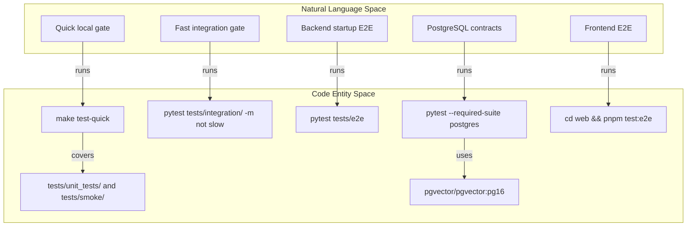
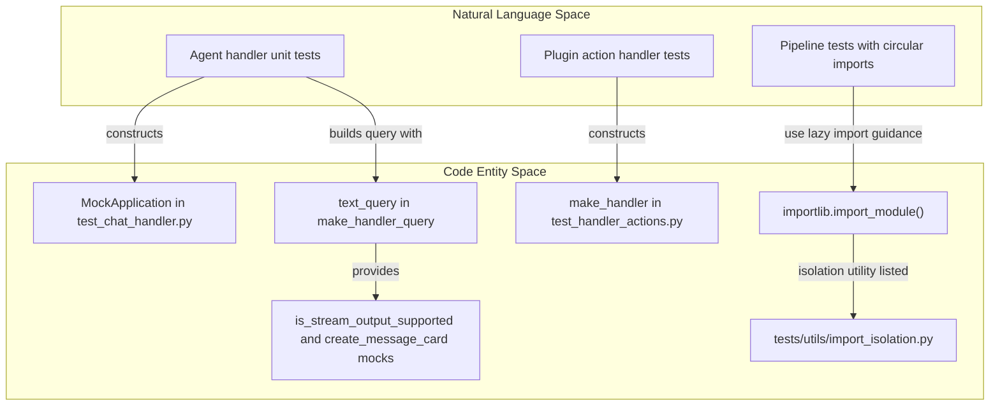
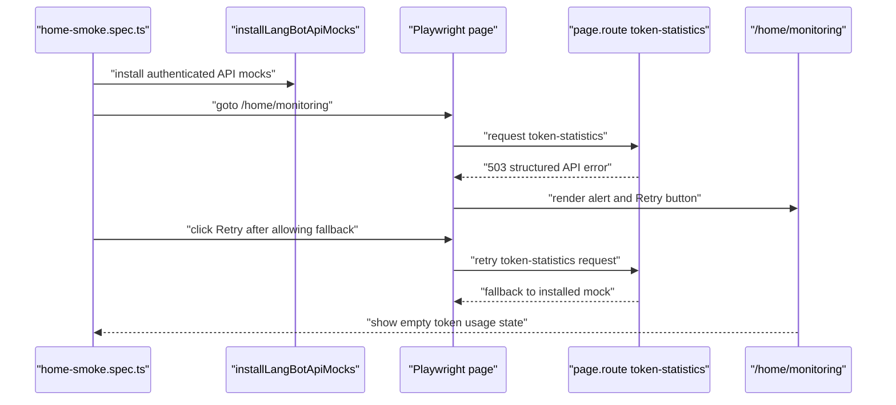
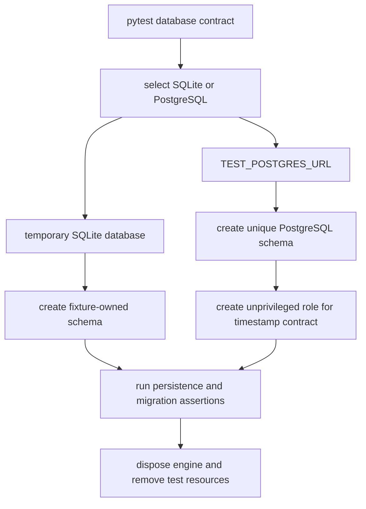

<!-- source: DeepWiki mcp.deepwiki.com · repo langbot-app/LangBot · page 10.4 Testing Infrastructure · fetched 2026-10-29 -->

# Testing Infrastructure

Relevant source files

The following files were used as context for generating this wiki page:

- [.github/workflows/optional-contracts.yml](.github/workflows/optional-contracts.yml)
- [.github/workflows/run-tests.yml](.github/workflows/run-tests.yml)
- [docs/DEPENDENCY_CONTRACT_TESTS.md](docs/DEPENDENCY_CONTRACT_TESTS.md)
- [docs/assets/pr-2363/oauth-required-state.png](docs/assets/pr-2363/oauth-required-state.png)
- [pytest.ini](pytest.ini)
- [scripts/test-complexity.py](scripts/test-complexity.py)
- [tests/README.md](tests/README.md)
- [tests/conftest.py](tests/conftest.py)
- [tests/e2e/test_local_runner_fake_provider.py](tests/e2e/test_local_runner_fake_provider.py)
- [tests/e2e/test_startup.py](tests/e2e/test_startup.py)
- [tests/fixtures/legacy_plugin_identity_sources.json](tests/fixtures/legacy_plugin_identity_sources.json)
- [tests/integration/persistence/test_pipeline_admission_postgres.py](tests/integration/persistence/test_pipeline_admission_postgres.py)
- [tests/integration/persistence/test_rag_document_identity.py](tests/integration/persistence/test_rag_document_identity.py)
- [tests/integration/persistence/test_rag_interrupted_ingestion.py](tests/integration/persistence/test_rag_interrupted_ingestion.py)
- [tests/integration/persistence/test_runner_timestamps_postgres.py](tests/integration/persistence/test_runner_timestamps_postgres.py)
- [tests/integration/pipeline/test_full_flow.py](tests/integration/pipeline/test_full_flow.py)
- [tests/integration_tests/box/test_box_integration.py](tests/integration_tests/box/test_box_integration.py)
- [tests/unit_tests/agent/test_chat_handler.py](tests/unit_tests/agent/test_chat_handler.py)
- [tests/unit_tests/agent/test_event_log_transcript.py](tests/unit_tests/agent/test_event_log_transcript.py)
- [tests/unit_tests/agent/test_handler_auth.py](tests/unit_tests/agent/test_handler_auth.py)
- [tests/unit_tests/agent/test_history_event_api_auth.py](tests/unit_tests/agent/test_history_event_api_auth.py)
- [tests/unit_tests/agent/test_legacy_identity_boundary.py](tests/unit_tests/agent/test_legacy_identity_boundary.py)
- [tests/unit_tests/platform/test_officialaccount_eba_adapter.py](tests/unit_tests/platform/test_officialaccount_eba_adapter.py)
- [tests/unit_tests/platform/test_openclaw_weixin_client.py](tests/unit_tests/platform/test_openclaw_weixin_client.py)
- [tests/unit_tests/platform/test_websocket_adapter_attachments.py](tests/unit_tests/platform/test_websocket_adapter_attachments.py)
- [tests/unit_tests/plugin/test_extract_deps.py](tests/unit_tests/plugin/test_extract_deps.py)
- [tests/unit_tests/plugin/test_handler_actions.py](tests/unit_tests/plugin/test_handler_actions.py)
- [tests/unit_tests/plugin/test_handler_helpers.py](tests/unit_tests/plugin/test_handler_helpers.py)
- [tests/unit_tests/quality/test_required_contract_report.py](tests/unit_tests/quality/test_required_contract_report.py)
- [tests/unit_tests/test_complexity_report.py](tests/unit_tests/test_complexity_report.py)
- [tests/utils/legacy_plugin_contract.py](tests/utils/legacy_plugin_contract.py)
- [tests/utils/required_suites.py](tests/utils/required_suites.py)
- [web/playwright.config.ts](web/playwright.config.ts)
- [web/tests/e2e/entity-loading.spec.ts](web/tests/e2e/entity-loading.spec.ts)
- [web/tests/e2e/home-smoke.spec.ts](web/tests/e2e/home-smoke.spec.ts)
- [web/tests/e2e/pipeline-migration.spec.ts](web/tests/e2e/pipeline-migration.spec.ts)
- [web/tests/e2e/workspace-assistant.spec.ts](web/tests/e2e/workspace-assistant.spec.ts)
- [web/tests/unit/processor-detail-workbench.test.mjs](web/tests/unit/processor-detail-workbench.test.mjs)
- [web/tests/unit/token-monitoring-error.test.mjs](web/tests/unit/token-monitoring-error.test.mjs)

## Purpose and scope

LangBot’s testing infrastructure covers backend unit, integration, startup E2E, and container-backed integration tests, alongside frontend Playwright E2E tests. This page describes the documented test layers, selected CI gates, reusable test doubles, lazy-import guidance, browser API mocking, and database and migration contracts. [tests/README.md:1-22]()

Sources: [tests/README.md:1-22]()

## Test Suite Hierarchy and Quality Gates

The project documents a layered test workflow, from quick local checks to broader integration and coverage gates. The backend test tree separates unit, smoke, integration, startup E2E, and container-backed tests. Frontend Playwright tests are under `web/tests/e2e`. [tests/README.md:6-22]()

| Layer | Command | What it covers |
|---|---|---|
| **Quick** | `make test-quick` or `bash scripts/test-quick.sh` | Ruff lint, unit tests, and smoke tests. [tests/README.md:10-12]() |
| **Fast Integration** | `make test-integration-fast` or `bash scripts/test-integration-fast.sh` | SQLite, API, and pipeline integration tests without external services. [tests/README.md:10-14]() |
| **Backend E2E** | `uv run --python 3.12 pytest tests/e2e -q --tb=short` | Starts a real LangBot process with minimal configuration. [tests/README.md:10-15]() |
| **Box Integration** | `uv run --python 3.12 pytest tests/integration_tests -q --tb=short` | Exercises real Box sandbox/runtime integration. [tests/README.md:10-15]() |
| **Frontend E2E** | `cd web && pnpm test:e2e` | Playwright smoke tests with mocked backend and Space APIs. [tests/README.md:10-22]() |
| **Coverage Gate** | `make test-coverage` or `bash scripts/test-coverage.sh` | Runs tests with an 18% coverage threshold. [tests/README.md:10-18]() |
| **Full Local** | `make test-all-local` | Combines quick, integration, and coverage gates. [tests/README.md:10-18]() |

CI runs unit and smoke tests on Python 3.11, 3.12, and 3.13, followed by required security regressions. A separate integration job runs `tests/integration/` excluding tests marked `slow`. [`.github/workflows/run-tests.yml:27-102`]() CI also provisions PostgreSQL for required PostgreSQL and session-summary contracts. [`.github/workflows/run-tests.yml:104-174`]()

The README describes an 18% line-coverage threshold and reports a 30% actual baseline. It also notes that complexity reports are generated without a pass/fail threshold. [tests/README.md:42-72]()

### Diagram: Quality Gates Mapped to Test Commands

Sources: [tests/README.md:6-22](), [`.github/workflows/run-tests.yml:27-57`](), [`.github/workflows/run-tests.yml:75-95`](), [`.github/workflows/run-tests.yml:104-153`]()

### CI execution details

The unit job installs development dependencies with `uv sync --dev`, runs `tests/unit_tests/` and `tests/smoke/`, then invokes the required `security` suite. It uploads a JUnit XML report for the security regressions even when the job fails. [`.github/workflows/run-tests.yml:27-73`]()

The fast integration job runs `pytest tests/integration/ -m "not slow"`. [`.github/workflows/run-tests.yml:75-102`]() The PostgreSQL job uses a `pgvector/pgvector:pg16` service bound to loopback, sets `TEST_POSTGRES_URL`, creates a separate admission-test database, and runs required `postgres` and `session_summary` suites. [`.github/workflows/run-tests.yml:104-174`]()

The README says PostgreSQL migration tests and slow tests are not in the default local gates; they run in separate CI workflows. [tests/README.md:20-22]() The displayed workflow also shows the PostgreSQL contract and session-summary suite invocations. [`.github/workflows/run-tests.yml:150-174`]()

Sources: [tests/README.md:20-22](), [`.github/workflows/run-tests.yml:27-73`](), [`.github/workflows/run-tests.yml:75-102`](), [`.github/workflows/run-tests.yml:104-174`]()

## Test Layout and Reusable Test Doubles

The `tests/` tree separates shared factories from test suites. `tests/factories/` is documented as containing application, message, provider, and platform factories; suite directories include `unit_tests/`, `integration/`, `e2e/`, `integration_tests/`, and `smoke/`. [tests/README.md:78-129]()

The documented shared factory API includes `FakeApp`, `FakeProvider`, `FakePlatform`, and query helpers such as `text_query`, `group_text_query`, and `command_query`. `FakeProvider().returns(...)` supplies a controlled provider response, while `FakePlatform.get_outbound_messages()` allows assertions against captured outbound messages. [tests/README.md:132-161]()

### MockApplication and application doubles

The name `MockApplication` also appears as a test-local class in `tests/unit_tests/agent/test_chat_handler.py`; it is not the same name as the shared `FakeApp` factory documented in `tests/README.md`. This test-local `MockApplication` accepts an optional orchestrator and provides mocked logger, plugin connector, telemetry, survey, model manager, and session manager dependencies. [tests/unit_tests/agent/test_chat_handler.py:143-173]()

`make_handler_query()` constructs a query with `text_query`, then supplies SDK message, prompt, conversation, and session entities. It replaces adapter streaming detection and message-card creation with async mocks. This keeps the query’s SDK-level entity shape while substituting the adapter and orchestration dependencies. [tests/unit_tests/agent/test_chat_handler.py:175-196]()

Other test files build purpose-specific doubles rather than relying on a universal application object. For example, `make_handler()` in the plugin action tests constructs a `RuntimeConnectionHandler` with mocked external connection objects, a workspace execution binding, and a scoped installation binding. [tests/unit_tests/plugin/test_handler_actions.py:36-75]()

### Lazy imports and circular-import isolation

The test README warns that circular dependencies in the pipeline module structure can make direct imports fail during test collection. It recommends lazy imports via `importlib.import_module()` and lists `tests/utils/import_isolation.py` as a test utility for `sys.modules` isolation. [tests/README.md:74-78](), [tests/README.md:126-129]()

The PostgreSQL timestamp contract demonstrates a targeted lazy import: `_published_schema()` imports migration modules by revision name and calls each revision’s `upgrade()` function inside the migration operations context. [tests/integration/persistence/test_runner_timestamps_postgres.py:40-48]()

### Diagram: Test Doubles and Import Isolation

Sources: [tests/README.md:74-78](), [tests/README.md:126-161](), [tests/unit_tests/agent/test_chat_handler.py:143-196](), [tests/unit_tests/plugin/test_handler_actions.py:36-75]()

## Integration, E2E, and API Mock Fixtures

The backend integration suite includes API smoke, pipeline full-flow, and persistence tests. The E2E suite is for tests that start a real LangBot process; container-backed integration tests are organized separately under `tests/integration_tests/`. [tests/README.md:89-107]()

A backend runner E2E test illustrates the boundary between real and fake components: its docstring states that it starts the real LangBot application and SDK Plugin Runtime, loads a pinned official Local Agent plugin, and exercises Host run-scoped APIs without calling an external provider. [tests/e2e/test_local_runner_fake_provider.py:1-5]() The test defines a deterministic fake provider/model identity and a fake tool manager for its probes. [tests/e2e/test_local_runner_fake_provider.py:32-37](), [tests/e2e/test_local_runner_fake_provider.py:178-200]()

Frontend E2E specs use `installLangBotApiMocks` from `web/tests/e2e/fixtures/langbot-api`. For example, the home smoke tests install authenticated mocks before navigating to routes such as `/home/bots`, `/home/agents`, `/home/extensions`, `/home/mcp`, and `/home/knowledge`; the tests verify route content and that backend-unavailable UI is absent. [web/tests/e2e/home-smoke.spec.ts:1-51]()

The monitoring smoke test checks the default Executions tab and switches to Token Monitoring. Another test intercepts the token-statistics API, returns a structured `503` failure, then retries after changing the route handler state; it verifies both the error message and successful recovery. [web/tests/e2e/home-smoke.spec.ts:54-82](), [web/tests/e2e/home-smoke.spec.ts:142-174]()

The workspace-assistant Playwright spec enables authenticated mocks with `withAssistant: true`, then supplies explicit provider and recommended-model API responses. Its UI assertions exercise resizing, persistence across reload, keyboard controls, and behavior at a small viewport. [web/tests/e2e/workspace-assistant.spec.ts:1-32](), [web/tests/e2e/workspace-assistant.spec.ts:33-99]()

### Diagram: Browser API Mock Data Flow

Sources: [web/tests/e2e/home-smoke.spec.ts:54-82](), [web/tests/e2e/home-smoke.spec.ts:142-174](), [web/tests/e2e/workspace-assistant.spec.ts:15-32]()

Frontend component-level validation also exists outside Playwright. `processor-detail-workbench.test.mjs` uses Node’s test runner to read `DebugDialog.tsx` as source text and assert that callbacks and connection-error handling retain WebSocket ownership guards. [web/tests/unit/processor-detail-workbench.test.mjs:1-33]()

Sources: [tests/README.md:89-107](), [tests/e2e/test_local_runner_fake_provider.py:1-5](), [tests/e2e/test_local_runner_fake_provider.py:32-37](), [tests/e2e/test_local_runner_fake_provider.py:178-200](), [web/tests/e2e/home-smoke.spec.ts:1-51](), [web/tests/e2e/home-smoke.spec.ts:54-82](), [web/tests/e2e/home-smoke.spec.ts:142-174](), [web/tests/e2e/workspace-assistant.spec.ts:1-99](), [web/tests/unit/processor-detail-workbench.test.mjs:1-33]()

## Migration and Database Persistence Tests

Persistence tests use both mocked database sessions and real temporary databases. The event-log and transcript tests exercise store operations, while the RAG document identity integration test parameterizes SQLite and PostgreSQL database setups. [tests/unit_tests/agent/test_event_log_transcript.py:70-105](), [tests/unit_tests/agent/test_event_log_transcript.py:140-188](), [tests/integration/persistence/test_rag_document_identity.py:57-84]()

### SQLite and PostgreSQL integration fixtures

The RAG document identity test’s `database` fixture parameterizes SQLite and PostgreSQL. PostgreSQL is marked with `pytest.mark.postgres`, requires `TEST_POSTGRES_URL`, and creates a uniquely named schema for the test; SQLite uses a temporary database file and enables foreign-key enforcement. Both database resources are disposed during fixture cleanup, and the PostgreSQL schema is dropped. [tests/integration/persistence/test_rag_document_identity.py:57-84]()

Its `create_schema()` helper creates only the fixture-owned dependency closure rather than all imported application tables. When `legacy=True`, it creates the historical `knowledge_base_files` table shape explicitly; otherwise, it creates the current `File` table from metadata. [tests/integration/persistence/test_rag_document_identity.py:86-114]()

The PostgreSQL runner timestamp contract uses a disposable schema and unprivileged role. It parameterizes schema creation between SQLAlchemy metadata and published migration DDL, verifies timestamp column types, and drops the schema and role during cleanup. [tests/integration/persistence/test_runner_timestamps_postgres.py:50-97]()

### Migration contracts and historical schemas

The RAG document identity test resolves the current Alembic head dynamically with `ScriptDirectory.from_config(...).get_current_head()`. It also names `0025_rag_document_identity` explicitly for tests that must exercise that migration branch without traversing an unrelated branch to the current head. [tests/integration/persistence/test_rag_document_identity.py:34-53]()

The runner timestamp contract tests migration-produced schema as well as metadata-produced schema. Its `_published_schema()` applies the listed migration revisions through Alembic `Operations`, and the fixture checks that the resulting timestamp columns have type `timestamp without time zone`. [tests/integration/persistence/test_runner_timestamps_postgres.py:40-48](), [tests/integration/persistence/test_runner_timestamps_postgres.py:73-86]()

### Diagram: Database Contract Test Setup and Cleanup

Sources: [tests/integration/persistence/test_rag_document_identity.py:57-114](), [tests/integration/persistence/test_runner_timestamps_postgres.py:50-97]()

### Store-level persistence tests

`TestEventLogStore` checks appending event data through a mocked session factory, including serialization of metadata JSON. [tests/unit_tests/agent/test_event_log_transcript.py:70-138]() `TestTranscriptStore` uses a real in-memory SQLite engine, creates ORM tables, appends a transcript item, pages the conversation transcript, and disposes the engine afterward. [tests/unit_tests/agent/test_event_log_transcript.py:140-168]()

Sources: [tests/unit_tests/agent/test_event_log_transcript.py:70-138](), [tests/unit_tests/agent/test_event_log_transcript.py:140-168](), [tests/integration/persistence/test_rag_document_identity.py:34-114](), [tests/integration/persistence/test_runner_timestamps_postgres.py:40-97]()

---

