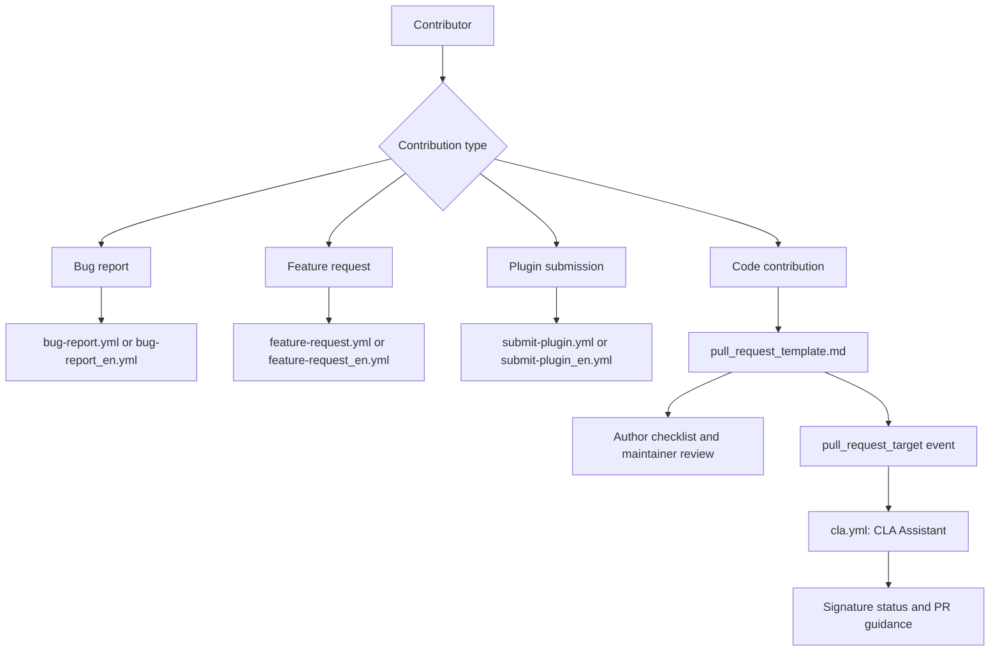
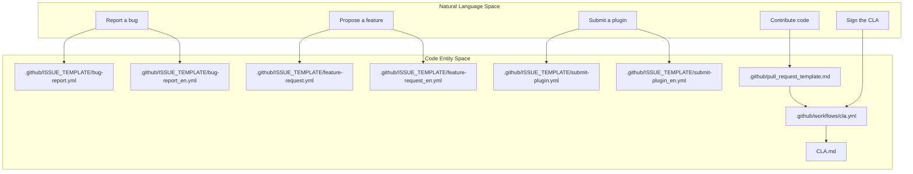
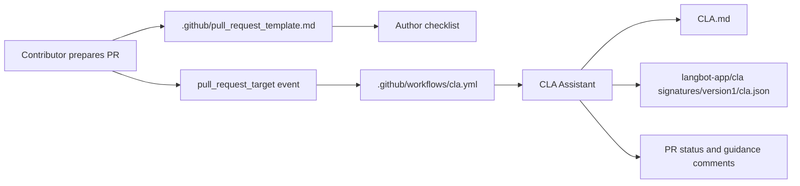

<!-- source: DeepWiki mcp.deepwiki.com · repo langbot-app/LangBot · page 10.5 Contributing Guidelines · fetched 2026-10-29 -->

# Contributing Guidelines

Relevant source files

The following files were used as context for generating this wiki page:

- [.github/ISSUE_TEMPLATE/bug-report.yml](.github/ISSUE_TEMPLATE/bug-report.yml)
- [.github/ISSUE_TEMPLATE/bug-report_en.yml](.github/ISSUE_TEMPLATE/bug-report_en.yml)
- [.github/ISSUE_TEMPLATE/feature-request.yml](.github/ISSUE_TEMPLATE/feature-request.yml)
- [.github/ISSUE_TEMPLATE/feature-request_en.yml](.github/ISSUE_TEMPLATE/feature-request_en.yml)
- [.github/ISSUE_TEMPLATE/submit-plugin.yml](.github/ISSUE_TEMPLATE/submit-plugin.yml)
- [.github/ISSUE_TEMPLATE/submit-plugin_en.yml](.github/ISSUE_TEMPLATE/submit-plugin_en.yml)
- [.github/pull_request_template.md](.github/pull_request_template.md)
- [.github/workflows/cla.yml](.github/workflows/cla.yml)
- [CLA.md](CLA.md)
- [CONTRIBUTING.md](CONTRIBUTING.md)

## Purpose and Scope

This page describes the contribution entry points and processes documented in the repository: GitHub issue forms, the pull request template, CLA signing, and the language and dependency guidance in `CONTRIBUTING.md` and the PR checklist. The available files do not define a commit-message format or a general code-style standard, so neither is prescribed here. [CONTRIBUTING.md:1-43](), [.github/pull_request_template.md:17-33](), [.github/workflows/cla.yml:1-41]()

Sources: [CONTRIBUTING.md:1-43](), [.github/pull_request_template.md:17-33](), [.github/workflows/cla.yml:1-41]()

---

## Overview and Contribution Entry Points

The contribution guide describes code contributions through pull requests, including fixing reported bugs, implementing requested or proposed features, and contributing to derivative projects or plugins. It also lists non-code contributions such as writing articles or making videos. For a proposed feature, the guide asks contributors to create an issue and communicate with a maintainer first. [CONTRIBUTING.md:5-10](), [CONTRIBUTING.md:27-32]()

The repository provides issue forms for bug reports, feature requests, and plugin submissions, alongside a pull request template for proposed code changes. The flow below summarizes those documented entry points and the separate CLA check configured for pull requests. [`.github/ISSUE_TEMPLATE/bug-report.yml:1-39`](), [`.github/ISSUE_TEMPLATE/bug-report_en.yml:1-39`](), [`.github/ISSUE_TEMPLATE/feature-request.yml:1-21`](), [`.github/ISSUE_TEMPLATE/feature-request_en.yml:1-21`](), [`.github/ISSUE_TEMPLATE/submit-plugin.yml:1-24`](), [`.github/ISSUE_TEMPLATE/submit-plugin_en.yml:1-24`](), [`.github/pull_request_template.md:1-33`](), [`.github/workflows/cla.yml:1-41`]()

### Contribution Workflow and Entry Points

Sources: [`.github/ISSUE_TEMPLATE/bug-report.yml:1-39`](), [`.github/ISSUE_TEMPLATE/bug-report_en.yml:1-39`](), [`.github/ISSUE_TEMPLATE/feature-request.yml:1-21`](), [`.github/ISSUE_TEMPLATE/feature-request_en.yml:1-21`](), [`.github/ISSUE_TEMPLATE/submit-plugin.yml:1-24`](), [`.github/ISSUE_TEMPLATE/submit-plugin_en.yml:1-24`](), [`.github/pull_request_template.md:1-33`](), [`.github/workflows/cla.yml:1-41`]()

---

## Issue Templates and Submission Standards

GitHub issue forms are defined as YAML files under `.github/ISSUE_TEMPLATE/`. The repository includes Chinese and English versions of its bug report, feature request, and plugin submission forms. The Chinese bug form describes itself as intended for Chinese users and says that exception or vulnerability issues created without that template will be closed; the English bug form requests bug reports or vulnerabilities and calls out container network issues. [`.github/ISSUE_TEMPLATE/bug-report.yml:1-5`](), [`.github/ISSUE_TEMPLATE/bug-report_en.yml:1-5`]()

### Template Summary

| Template | Purpose and form fields | Labels |
|---|---|---|
| `bug-report.yml` | Chinese bug report; environment, deployment version, exception, reproduction steps, enabled plugins | `bug?` |
| `bug-report_en.yml` | English bug report; environment, deployment version, exception, reproduction steps, enabled plugins | `bug?` |
| `feature-request.yml` | Chinese feature request; request type and detailed description | None configured |
| `feature-request_en.yml` | English feature request; request type and detailed description | None configured |
| `submit-plugin.yml` | Chinese plugin submission; name, GitHub repository address, description | `独立插件` |
| `submit-plugin_en.yml` | English plugin submission; name, GitHub repository address, description | `Independent Plugin` |

Sources: [`.github/ISSUE_TEMPLATE/bug-report.yml:1-39`](), [`.github/ISSUE_TEMPLATE/bug-report_en.yml:1-39`](), [`.github/ISSUE_TEMPLATE/feature-request.yml:1-21`](), [`.github/ISSUE_TEMPLATE/feature-request_en.yml:1-21`](), [`.github/ISSUE_TEMPLATE/submit-plugin.yml:1-24`](), [`.github/ISSUE_TEMPLATE/submit-plugin_en.yml:1-24`]()

### Bug Report Template Structure

Both bug report forms require the runtime environment, deployment version, and exception description. The environment field asks for the LangBot version, operating system, system architecture, Python version, and host location. Deployment version is a required dropdown with Community Edition and Cloud Service options. The exception field is required and asks for a detailed description and logs. Reproduction steps and enabled-plugin information are optional fields. [`.github/ISSUE_TEMPLATE/bug-report.yml:6-39`](), [`.github/ISSUE_TEMPLATE/bug-report_en.yml:6-39`]()

The Chinese form additionally recommends configuration screenshots and, for issues involving platforms such as Dify, n8n, or Langflow, exported application files such as a Dify DSL. Both forms direct users with container network connection issues to the relevant network documentation. [`.github/ISSUE_TEMPLATE/bug-report.yml:2-2`](), [`.github/ISSUE_TEMPLATE/bug-report.yml:28-32`](), [`.github/ISSUE_TEMPLATE/bug-report_en.yml:2-2`]()

### Feature Requests and Plugin Submissions

The feature-request forms ask the submitter to select whether the proposal is a new feature or an improvement to an existing feature, then provide a detailed description. Both fields are required, and the templates configure no labels. [`.github/ISSUE_TEMPLATE/feature-request.yml:1-20`](), [`.github/ISSUE_TEMPLATE/feature-request_en.yml:1-20`]()

The plugin-submission forms require a plugin name, a GitHub repository address, and a plugin description. Each template applies a plugin-related label; the Chinese and English forms use localized label text. [`.github/ISSUE_TEMPLATE/submit-plugin.yml:1-23`](), [`.github/ISSUE_TEMPLATE/submit-plugin_en.yml:1-23`]()

Sources: [`.github/ISSUE_TEMPLATE/bug-report.yml:1-39`](), [`.github/ISSUE_TEMPLATE/bug-report_en.yml:1-39`](), [`.github/ISSUE_TEMPLATE/feature-request.yml:1-20`](), [`.github/ISSUE_TEMPLATE/feature-request_en.yml:1-20`](), [`.github/ISSUE_TEMPLATE/submit-plugin.yml:1-23`](), [`.github/ISSUE_TEMPLATE/submit-plugin_en.yml:1-23`]()

---

## Pull Request Workflow and Checklists

The pull request template is bilingual and provides sections for a summary, before-and-after screenshots, an author checklist, and a maintainer checklist. The template asks authors to describe what they implemented, solved, or optimized and provides places for screenshots or other comparisons. [`.github/pull_request_template.md:1-17`]()

### Author Checklist

The author checklist asks contributors to confirm that they have read the contribution guide, have signed or will sign the CLA when prompted, have communicated with the project maintainer, and have tested their changes. [`.github/pull_request_template.md:18-27`]()

### Maintainer Checklist

The maintainer checklist asks whether the PR links related issues, whether configuration changes and migrations have been written and take effect, whether dependencies have been added to `pyproject.toml` and `core/bootutils/deps.py`, and whether documentation has been written. These are checklist items in the PR template; they do not, by themselves, specify an automated validation process. [`.github/pull_request_template.md:28-33`]()

Sources: [`.github/pull_request_template.md:1-33`]()

---

## Contributor License Agreement (CLA)

LangBot requires code contributors to sign the Individual Contributor License Agreement described in `CLA.md`. The agreement states that contributors retain their rights in their contributions while granting specified copyright and patent licenses; it also describes representations concerning authority to contribute and third-party works. [CONTRIBUTING.md:17-21](), [CONTRIBUTING.md:39-43](), [`CLA.md:1-5`](), [`CLA.md:13-27`]()

### Signing and Automation

The CLA defines electronic signature as posting the designated exact phrase on a pull request. The workflow checks pull request events (`opened`, `closed`, `synchronize`, and `reopened`) and newly created issue comments. It runs the CLA Assistant action for pull requests and for comments containing either the signing phrase or `recheck`. [`.github/workflows/cla.yml:2-7`](), [`.github/workflows/cla.yml:18-21`](), [`CLA.md:41-43`]()

The workflow points the assistant to `CLA.md` and stores signature records in the remote `langbot-app/cla` repository at `signatures/version1/cla.json`. It uses `GITHUB_TOKEN` and the `CLA_PAT` secret, provides unsigned and all-signed PR comments, and is configured to lock a pull request after merge. [`.github/workflows/cla.yml:22-38`]()

The workflow uses `pull_request_target`, which runs with access to base-repository secrets and write permissions. Its configuration explicitly warns not to add a checkout step that checks out pull-request code. [`.github/workflows/cla.yml:8-13`](), [`.github/workflows/cla.yml:39-42`]()

Sources: [`CONTRIBUTING.md:17-21`](), [`CONTRIBUTING.md:39-43`](), [`CLA.md:1-5`](), [`CLA.md:13-27`](), [`CLA.md:41-43`](), [`.github/workflows/cla.yml:2-42`]()

---

## Technical Standards and Code Mapping

### Language, Commit, and Dependency Guidance

The contribution guide asks contributors to use English in pull requests and commit messages. It permits Chinese-language issues for Chinese users. The provided guidance specifies the commit-message language but does not define a required commit format, such as a prefix convention or structured subject pattern. [`CONTRIBUTING.md:12-15`](), [`CONTRIBUTING.md:34-37`]()

The PR maintainer checklist asks whether dependencies have been added to `pyproject.toml` and `core/bootutils/deps.py`. The provided files do not specify a broader code-style standard, formatter, or linting requirement. [`.github/pull_request_template.md:28-33`]()

Sources: [`CONTRIBUTING.md:12-15`](), [`CONTRIBUTING.md:34-37`](), [`.github/pull_request_template.md:28-33`]()

### Contribution Intent to Code Entity Mapping

This diagram maps contributor-facing actions to the repository files that define the corresponding forms and checks. The arrows represent the documented submission or workflow relationship; issue templates and the CLA workflow are separate entry points. [`.github/ISSUE_TEMPLATE/bug-report.yml:1-39`](), [`.github/ISSUE_TEMPLATE/feature-request.yml:1-20`](), [`.github/ISSUE_TEMPLATE/submit-plugin.yml:1-23`](), [`.github/pull_request_template.md:1-33`](), [`.github/workflows/cla.yml:2-38`]()

Sources: [`.github/ISSUE_TEMPLATE/bug-report.yml:1-39`](), [`.github/ISSUE_TEMPLATE/bug-report_en.yml:1-39`](), [`.github/ISSUE_TEMPLATE/feature-request.yml:1-20`](), [`.github/ISSUE_TEMPLATE/feature-request_en.yml:1-20`](), [`.github/ISSUE_TEMPLATE/submit-plugin.yml:1-23`](), [`.github/ISSUE_TEMPLATE/submit-plugin_en.yml:1-23`](), [`.github/pull_request_template.md:1-33`](), [`.github/workflows/cla.yml:2-38`](), [`CLA.md:41-43`]()

### Pull Request and CLA Workflow Mapping

The PR template contains the author and maintainer checklists. Separately, the CLA workflow responds to pull request events and qualifying comments; it invokes the CLA Assistant with the agreement document and signature-record location configured in the workflow. The provided files do not establish that this workflow runs tests or validates dependencies. [`.github/pull_request_template.md:18-33`](), [`.github/workflows/cla.yml:2-38`]()

Sources: [`.github/pull_request_template.md:1-33`](), [`.github/workflows/cla.yml:2-38`](), [`CLA.md:41-43`]()

---

