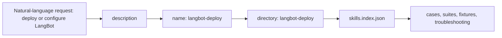
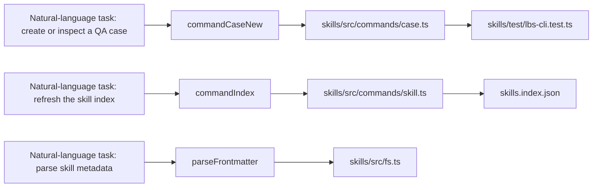
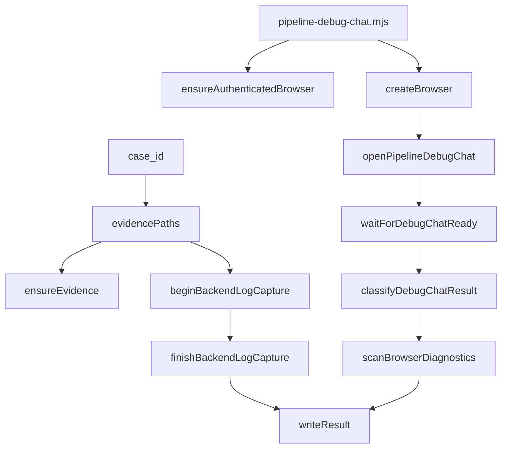

<!-- source: DeepWiki mcp.deepwiki.com · repo langbot-app/LangBot · page 10.6 Agent Skills Repository and QA Automation · fetched 2026-10-29 -->

# Agent Skills Repository and QA Automation

Relevant source files

The following files were used as context for generating this wiki page:

- [skills/scripts/e2e/agent-run-ledger-audit.mjs](skills/scripts/e2e/agent-run-ledger-audit.mjs)
- [skills/scripts/e2e/agent-run-ledger-audit.py](skills/scripts/e2e/agent-run-ledger-audit.py)
- [skills/scripts/e2e/agent_run_ledger_policy.py](skills/scripts/e2e/agent_run_ledger_policy.py)
- [skills/scripts/e2e/bot-event-routing-product-flow.mjs](skills/scripts/e2e/bot-event-routing-product-flow.mjs)
- [skills/scripts/e2e/lib/debug-chat.mjs](skills/scripts/e2e/lib/debug-chat.mjs)
- [skills/scripts/e2e/lib/langbot-e2e.mjs](skills/scripts/e2e/lib/langbot-e2e.mjs)
- [skills/scripts/e2e/local-agent-steering-debug-chat.mjs](skills/scripts/e2e/local-agent-steering-debug-chat.mjs)
- [skills/scripts/e2e/pipeline-debug-chat.mjs](skills/scripts/e2e/pipeline-debug-chat.mjs)
- [skills/skills.index.json](skills/skills.index.json)
- [skills/skills/langbot-testing/cases/agent-run-ledger-audit.yaml](skills/skills/langbot-testing/cases/agent-run-ledger-audit.yaml)
- [skills/skills/langbot-testing/cases/bot-event-routing-product-flow.yaml](skills/skills/langbot-testing/cases/bot-event-routing-product-flow.yaml)
- [skills/test/lbs-cli.test.ts](skills/test/lbs-cli.test.ts)
- [skills/test/test_agent_run_ledger_policy.py](skills/test/test_agent_run_ledger_policy.py)

## Purpose and Scope

The `skills/` tree contains authored agent skills and QA assets, with `skills.index.json` identifying skills and their associated references, cases, suites, fixtures, and troubleshooting entries. This page covers the visible index structure, the `lbs` CLI command surface represented in its tests, selected end-to-end probes and helpers, and the case metadata used by a product-flow probe. [skills/skills.index.json:1-15]()

The supplied file contents do not include the implementation of the schemas or fake-provider harness, so this page does not infer their behavior. Sources: [skills/skills.index.json:1-15]()

## Skills Directory Structure and `skills.index.json`

The index declares `generated_by` as `lbs` and stores skill records in the `skills` array. Each visible record includes a `directory`, `name`, and `description`, plus arrays for `references`, `cases`, `case_summaries`, `suites`, `suite_summaries`, `fixtures`, `troubleshooting`, and `troubleshooting_summaries`. [skills/skills.index.json:1-15]()

For example, `langbot-deploy` is described as covering deployment and configuration topics. Its visible index record has empty arrays for references, cases, suites, fixtures, and troubleshooting data. [skills/skills.index.json:4-15]()

### Index-to-skill mapping

The index bridges agent-facing descriptions and repository entities: natural-language summaries and trigger phrases are attached to stable skill names and directories. [skills/skills.index.json:4-7]()

**Diagram: Skill descriptions mapped to index entities**

Sources: [skills/skills.index.json:1-15]()

## `lbs` CLI Tool

The `skills/test/lbs-cli.test.ts` file imports CLI command functions from `skills/src/commands/` and tests helpers from `skills/src/fs.ts` and `skills/src/cli.ts`. The imported command surface includes case, environment, fixture, log, suite, test, troubleshooting, validation, and indexing operations. [skills/test/lbs-cli.test.ts:17-52]()

The imports identify the commands exercised by the test suite; they do not, by themselves, establish the full command-line syntax or implementation behavior. The test file also imports `parseFrontmatter` and `loadEnv`, and checks that `parseFrontmatter` preserves metadata and body content with both LF and CRLF newlines. [skills/test/lbs-cli.test.ts:52-71]()

| Area | Imported command functions |
|---|---|
| Case management | `commandCaseList`, `commandCaseNew`, `commandCaseShow` [skills/test/lbs-cli.test.ts:17-21]() |
| Environment | `commandEnvDoctor`, `commandEnvShow` [skills/test/lbs-cli.test.ts:22-22]() |
| Fixtures | `commandFixtureCheck`, `commandFixtureList` [skills/test/lbs-cli.test.ts:23-27]() |
| Logs | `commandLogGuard`, `commandLogScan`, `commandLogWatch` [skills/test/lbs-cli.test.ts:28-31]() |
| Suites | `commandSuiteList`, `commandSuiteNew`, `commandSuitePlan`, `commandSuiteReport`, `commandSuiteRun`, `commandSuiteShow`, `commandSuiteStart` [skills/test/lbs-cli.test.ts:33-40]() |
| Tests | `commandTestPlan`, `commandTestRecommend`, `commandTestReport`, `commandTestResult`, `commandTestRun`, `commandTestStart` [skills/test/lbs-cli.test.ts:42-48]() |
| Troubleshooting and index | `commandTroubleSearch`, `commandValidate`, `commandIndex` [skills/test/lbs-cli.test.ts:49-52]() |

The tests also verify repository discovery from a skills-tree path before a generated `bin` directory exists. The fixture tree includes `skills/langbot-testing`, `skills.index.json`, and `schemas/case.schema.json`; `repoRoot` is expected to resolve to the fixture root. [skills/test/lbs-cli.test.ts:163-174]()

**Diagram: `lbs` command names mapped to source entities**

Sources: [skills/test/lbs-cli.test.ts:17-21](), [skills/test/lbs-cli.test.ts:49-52](), [skills/test/lbs-cli.test.ts:52-71]()

## Authored Skills

The visible portion of `skills.index.json` names the following skills and summarizes their intended use:

| Skill | Indexed purpose |
|---|---|
| `langbot-deploy` | Deploying and configuring LangBot, including Docker, Compose, Kubernetes, and `config.yaml`. [skills/skills.index.json:4-15]() |
| `langbot-dev` | Developing, building, and debugging the backend, frontend, APIs, migrations, and MCP server. [skills/skills.index.json:17-29]() |
| `langbot-eba-adapter-dev` | Developing and testing Event-Based Agent platform adapters. [skills/skills.index.json:30-42]() |
| `langbot-env-setup` | Preparing a local development and testing environment, including browser access and service startup references. [skills/skills.index.json:43-63]() |
| `langbot-mcp-ops` | Operating a LangBot instance through its built-in MCP server. [skills/skills.index.json:64-76]() |
| `langbot-plugin-dev` | Developing and testing LangBot plugins. [skills/skills.index.json:77-91]() |
| `langbot-skills-maintenance` | Maintaining and auditing skills, references, cases, troubleshooting, and indexes. [skills/skills.index.json:92-106]() |
| `langbot-space-ops` | Discovering marketplace extensions through the Space MCP server. [skills/skills.index.json:107-119]() |
| `langbot-testing` | Testing WebUI and product flows with browser automation and backend diagnostics. [skills/skills.index.json:120-131]() |

The index shows `langbot-env-setup`, `langbot-plugin-dev`, and `langbot-testing` with reference paths; the records shown for the other listed skills have empty `references` arrays. [skills/skills.index.json:4-131]()

Sources: [skills/skills.index.json:4-131]()

## E2E Probe Scripts and QA Workflow

The E2E scripts use shared helpers from `skills/scripts/e2e/lib/langbot-e2e.mjs`. Those helpers define evidence paths, prepare evidence directories, optionally capture a window of backend logs, redact secrets from appended log lines, and write result JSON files. [skills/scripts/e2e/lib/langbot-e2e.mjs:6-15](), [skills/scripts/e2e/lib/langbot-e2e.mjs:49-67](), [skills/scripts/e2e/lib/langbot-e2e.mjs:69-99](), [skills/scripts/e2e/lib/langbot-e2e.mjs:110-120]()

The `pipeline-debug-chat.mjs` probe creates evidence paths, starts backend log capture, reads its prompt and timeout configuration from environment variables, and initializes a structured result containing case, run, prompt, expected text, and evidence metadata. [skills/scripts/e2e/pipeline-debug-chat.mjs:27-99]() It imports browser, authentication, evidence, logging, and result helpers from `langbot-e2e.mjs`, and Debug Chat interaction helpers from `debug-chat.mjs`. [skills/scripts/e2e/pipeline-debug-chat.mjs:7-25]()

`debug-chat.mjs` provides result-classification helpers. `waitForDebugChatReady` checks that the Debug Chat input becomes visible and enabled; `classifyDebugChatResult` compares expected output and failure signals, and can use before/after assistant-message evidence when supplied. [skills/scripts/e2e/lib/debug-chat.mjs:71-96](), [skills/scripts/e2e/lib/debug-chat.mjs:98-178]()

### Shared evidence and diagnostics

`evidencePaths` derives a run identifier from `LBS_RUN_ID` or a timestamp and case ID, then identifies the evidence directory and core files: `console.log`, `network.log`, `screenshot.png`, `automation-result.json`, and `result.json`. [skills/scripts/e2e/lib/langbot-e2e.mjs:49-61]() `beginBackendLogCapture` records the source log size at capture start; `finishBackendLogCapture` writes the later log window to `backend.log`, if available. [skills/scripts/e2e/lib/langbot-e2e.mjs:69-99]()

The helper library’s `redact` function masks patterns associated with credentials and API keys before `appendLine` writes timestamped log entries. [skills/scripts/e2e/lib/langbot-e2e.mjs:6-15](), [skills/scripts/e2e/lib/langbot-e2e.mjs:110-112]() `writeResult` writes JSON to the automation result path and, when distinct, the general result path. [skills/scripts/e2e/lib/langbot-e2e.mjs:114-120]()

**Diagram: E2E probe flow mapped to helper and probe symbols**

Sources: [skills/scripts/e2e/pipeline-debug-chat.mjs:7-30](), [skills/scripts/e2e/lib/debug-chat.mjs:71-112](), [skills/scripts/e2e/lib/langbot-e2e.mjs:49-67](), [skills/scripts/e2e/lib/langbot-e2e.mjs:69-99](), [skills/scripts/e2e/lib/langbot-e2e.mjs:114-120]()

### Product-flow probe: bot event routing

The `bot-event-routing-product-flow` case declares an `agent-browser` feature test in the `bot` area, with `p0` priority and `medium` risk. It names the automation script, required environment variables, preconditions, steps, checks, evidence types, and troubleshooting entries. [skills/skills/langbot-testing/cases/bot-event-routing-product-flow.yaml:1-60]()

The probe script requires `LANGBOT_FRONTEND_URL` and `LANGBOT_BACKEND_URL`, creates browser evidence, authenticates a browser, and reads a reusable token from local storage. [skills/scripts/e2e/bot-event-routing-product-flow.mjs:18-21](), [skills/scripts/e2e/bot-event-routing-product-flow.mjs:64-84]() It creates a temporary HTTP Bot through `apiJson`, with `message.received` event bindings targeting the discard processor, then navigates to the Bot configuration page and checks for event-routing UI signals. [skills/scripts/e2e/bot-event-routing-product-flow.mjs:127-178](), [skills/scripts/e2e/bot-event-routing-product-flow.mjs:180-212]()

The case requires visible UI evidence for route behavior and diagnostics, and explicitly states that a passing webhook call alone is insufficient without the visible adapter-event and discarded-route states. [skills/skills/langbot-testing/cases/bot-event-routing-product-flow.yaml:38-57]()

Sources: [skills/skills/langbot-testing/cases/bot-event-routing-product-flow.yaml:1-60](), [skills/scripts/e2e/bot-event-routing-product-flow.mjs:18-84](), [skills/scripts/e2e/bot-event-routing-product-flow.mjs:127-212]()

## Case and Suite Schemas

The supplied CLI test confirms that repository discovery can use a tree containing `schemas/case.schema.json`, a skill directory, and `skills.index.json`. [skills/test/lbs-cli.test.ts:163-174]() The available case YAML provides concrete case metadata: `id`, `title`, `mode`, `area`, `type`, `priority`, `risk`, `ci_eligible`, `tags`, `skills`, environment requirements, automation, preconditions, steps, checks, evidence requirements, diagnostics, and troubleshooting entries. [skills/skills/langbot-testing/cases/bot-event-routing-product-flow.yaml:1-60]()

A second case, `agent-run-ledger-audit`, uses `mode: probe`, is marked as a high-risk regression case, names an automation script, and specifies audit steps, checks, evidence, diagnostics, success/failure patterns, and troubleshooting. [skills/skills/langbot-testing/cases/agent-run-ledger-audit.yaml:1-44]() The `lbs` tests import suite commands including `commandSuiteNew`, `commandSuitePlan`, `commandSuiteRun`, and `commandSuiteReport`; the supplied contents do not include the suite schema or a suite definition, so schema fields and suite execution semantics are not detailed here. [skills/test/lbs-cli.test.ts:33-40]()

Sources: [skills/test/lbs-cli.test.ts:33-40](), [skills/test/lbs-cli.test.ts:163-174](), [skills/skills/langbot-testing/cases/bot-event-routing-product-flow.yaml:1-60](), [skills/skills/langbot-testing/cases/agent-run-ledger-audit.yaml:1-44]()

## Runner Ledger Audit and Policy Checks

The `agent-run-ledger-audit` case describes a probe that selects a persisted Runner run, inspects ordered events, checks terminal state and tool-call pairing, compares calls with the authorization snapshot, and validates persisted data. [skills/skills/langbot-testing/cases/agent-run-ledger-audit.yaml:16-27]() Its automation’s Python audit implementation reads database configuration from `data/config.yaml`, supports SQLite and PostgreSQL connection URLs, and queries `agent_run` and `agent_run_event`. [skills/scripts/e2e/agent-run-ledger-audit.py:27-44](), [skills/scripts/e2e/agent-run-ledger-audit.py:80-164]()

`agent_run_ledger_policy.py` provides classification helpers: `load_ledger_json` records malformed persisted JSON as an `invalid_json` failure, `invalid_tool_argument_error_signal` identifies selected invalid-argument signals, and `classify_invalid_tool_argument_errors` distinguishes recovered warnings from failures. [skills/scripts/e2e/agent_run_ledger_policy.py:15-29](), [skills/scripts/e2e/agent_run_ledger_policy.py:32-55]() `classify_tool_authorization` treats calls absent from the Host authorization snapshot as failures in strict mode and warnings in `runner-native` mode. [skills/scripts/e2e/agent_run_ledger_policy.py:58-77]()

Unit tests cover recovered and unrecovered invalid-argument errors, malformed JSON, and the strict versus `runner-native` authorization policy. [skills/test/test_agent_run_ledger_policy.py:18-95]()

Sources: [skills/skills/langbot-testing/cases/agent-run-ledger-audit.yaml:16-44](), [skills/scripts/e2e/agent-run-ledger-audit.py:27-44](), [skills/scripts/e2e/agent-run-ledger-audit.py:80-177](), [skills/scripts/e2e/agent_run_ledger_policy.py:15-77](), [skills/test/test_agent_run_ledger_policy.py:18-95]()

## Fake Provider Harness

The supplied file contents do not include the fake-provider harness files or their implementations. Accordingly, this page does not document its endpoints, configuration, orchestration, or supported test scenarios. Sources: [skills/test/lbs-cli.test.ts:1-53]()

---

