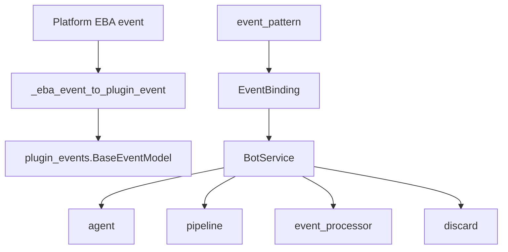
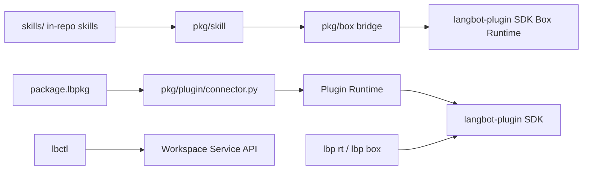

<!-- source: DeepWiki mcp.deepwiki.com · repo langbot-app/LangBot · page 11 Glossary · fetched 2026-10-29 -->

# Glossary

Relevant source files

The following files were used as context for generating this wiki page:

- [.mcp.json](.mcp.json)
- [AGENTS.md](AGENTS.md)
- [ARCHITECTURE.md](ARCHITECTURE.md)
- [docs/MIGRATION_SUMMARY.md](docs/MIGRATION_SUMMARY.md)
- [docs/WEBSOCKET_README.md](docs/WEBSOCKET_README.md)
- [src/langbot/pkg/agent/runner/orchestrator.py](src/langbot/pkg/agent/runner/orchestrator.py)
- [src/langbot/pkg/agent/runner/resource_builder.py](src/langbot/pkg/agent/runner/resource_builder.py)
- [src/langbot/pkg/api/http/controller/groups/platform/bots.py](src/langbot/pkg/api/http/controller/groups/platform/bots.py)
- [src/langbot/pkg/api/http/service/bot.py](src/langbot/pkg/api/http/service/bot.py)
- [src/langbot/pkg/entity/persistence/agent_run.py](src/langbot/pkg/entity/persistence/agent_run.py)
- [src/langbot/pkg/entity/persistence/event_log.py](src/langbot/pkg/entity/persistence/event_log.py)
- [src/langbot/pkg/entity/persistence/monitoring.py](src/langbot/pkg/entity/persistence/monitoring.py)
- [src/langbot/pkg/entity/persistence/transcript.py](src/langbot/pkg/entity/persistence/transcript.py)
- [src/langbot/pkg/persistence/alembic/versions/0039_execution_lease_indexes.py](src/langbot/pkg/persistence/alembic/versions/0039_execution_lease_indexes.py)
- [src/langbot/pkg/persistence/media.py](src/langbot/pkg/persistence/media.py)
- [src/langbot/pkg/pipeline/pipelinemgr.py](src/langbot/pkg/pipeline/pipelinemgr.py)
- [src/langbot/pkg/platform/botmgr.py](src/langbot/pkg/platform/botmgr.py)
- [src/langbot/pkg/plugin/connector.py](src/langbot/pkg/plugin/connector.py)
- [src/langbot/pkg/plugin/runner_actions.py](src/langbot/pkg/plugin/runner_actions.py)
- [src/langbot/pkg/provider/tools/toolmgr.py](src/langbot/pkg/provider/tools/toolmgr.py)
- [src/langbot/pkg/workspace/repository.py](src/langbot/pkg/workspace/repository.py)
- [src/langbot/pkg/workspace/service.py](src/langbot/pkg/workspace/service.py)
- [tests/integration/api/test_bots.py](tests/integration/api/test_bots.py)
- [tests/unit_tests/agent/test_resource_builder.py](tests/unit_tests/agent/test_resource_builder.py)
- [tests/unit_tests/api/service/test_bot_service.py](tests/unit_tests/api/service/test_bot_service.py)
- [tests/unit_tests/persistence/test_conversation_page_index.py](tests/unit_tests/persistence/test_conversation_page_index.py)
- [tests/unit_tests/persistence/test_execution_lease_indexes.py](tests/unit_tests/persistence/test_execution_lease_indexes.py)
- [tests/unit_tests/persistence/test_partial_history_indexes.py](tests/unit_tests/persistence/test_partial_history_indexes.py)
- [tests/unit_tests/pipeline/test_pipelinemgr.py](tests/unit_tests/pipeline/test_pipelinemgr.py)
- [tests/unit_tests/plugin/test_connector_methods.py](tests/unit_tests/plugin/test_connector_methods.py)
- [tests/unit_tests/plugin/test_connector_reconcile.py](tests/unit_tests/plugin/test_connector_reconcile.py)
- [tests/unit_tests/storage/test_inline_media_cleanup.py](tests/unit_tests/storage/test_inline_media_cleanup.py)
- [tests/unit_tests/workspace/test_workspace_service.py](tests/unit_tests/workspace/test_workspace_service.py)
- [web/src/app/home/bots/components/bot-form/EventBindingsEditor.tsx](web/src/app/home/bots/components/bot-form/EventBindingsEditor.tsx)
- [web/tests/e2e/crud-smoke.spec.ts](web/tests/e2e/crud-smoke.spec.ts)
- [web/tests/e2e/fixtures/langbot-api.ts](web/tests/e2e/fixtures/langbot-api.ts)

## Purpose and Scope

This page maps LangBot terminology to the code entities and runtime boundaries visible in the supplied architecture and source references. The main repository contains the application and runtime bridges; shared plugin APIs and runtime contracts are provided by the separately pinned `langbot-plugin` SDK. [ARCHITECTURE.md:20-29]()

Sources: [ARCHITECTURE.md:20-29]()

---

## Core System Concepts

### Pipeline

A pipeline is a message-processing path assembled from runtime stages. `RuntimePipeline` holds a persisted pipeline entity, stage instances, an `ExecutionContext`, and extension preferences; it resolves runner settings and checks that execution still matches the active Workspace placement. [src/langbot/pkg/pipeline/pipelinemgr.py:58-80]() [src/langbot/pkg/pipeline/pipelinemgr.py:99-160]() [src/langbot/pkg/pipeline/pipelinemgr.py:162-182]()

The architecture describes the runtime path as `RuntimePipeline` → pipeline stage chain → runner orchestration and tools → response through the platform adapter. [ARCHITECTURE.md:73-87]() A `PipelineStage` is the stage interface used by `StageInstContainer`. [src/langbot/pkg/pipeline/pipelinemgr.py:58-68]()

Sources: [src/langbot/pkg/pipeline/pipelinemgr.py:58-80](), [src/langbot/pkg/pipeline/pipelinemgr.py:99-182](), [ARCHITECTURE.md:73-87]()

### Agent

An agent is a processor category in LangBot’s event-routing vocabulary. Bot-service code recognizes `agent`, `pipeline`, and `event_processor` as processor target types. [src/langbot/pkg/api/http/service/bot.py:155-163]() The architecture describes a Runner Host orchestrator that receives the current query from the pipeline chat stage; the Host retains responsibility for authorization, tools, telemetry, and conversation history. [ARCHITECTURE.md:103-115]()

Sources: [src/langbot/pkg/api/http/service/bot.py:155-163](), [ARCHITECTURE.md:103-115]()

### Event Processor

An event processor is a processor target type distinct from an `agent` or `pipeline`. Bot routing code accepts it as a recognized target kind, while `RuntimeBot` maps supported EBA platform events into plugin event models. [src/langbot/pkg/api/http/service/bot.py:155-163]() [src/langbot/pkg/platform/botmgr.py:133-156]()

Sources: [src/langbot/pkg/api/http/service/bot.py:155-163](), [src/langbot/pkg/platform/botmgr.py:133-156]()

### AgentKind

`AgentKind` is a processor-kind term used in the product vocabulary; the supplied code excerpts do not show its definition. The visible routing code uses the string values `agent`, `pipeline`, and `event_processor` when identifying processor target kinds. [src/langbot/pkg/api/http/service/bot.py:155-163]()

Sources: [src/langbot/pkg/api/http/service/bot.py:155-163]()

### Runner and `runner_config`

A Runner is the execution component selected for a processor. The architecture calls out a Runner Host orchestrator and explains that a selected plugin Runner can return streaming or final results while the Host owns authorization, tools, telemetry, and conversation history. [ARCHITECTURE.md:103-115]()

`RunnerConfigResolver.resolve_runner_id()` and `RunnerConfigResolver.resolve_runner_config()` are used by `RuntimePipeline` to resolve a runner ID and its configuration from pipeline configuration. The resolved configuration can supply MCP resource attachments and a resource-read setting. [src/langbot/pkg/pipeline/pipelinemgr.py:127-148]()

Sources: [ARCHITECTURE.md:103-115](), [src/langbot/pkg/pipeline/pipelinemgr.py:127-148]()

### Bot and `RuntimeBot`

A Bot is a persisted platform-facing resource. `BotService.BOT_FIELDS` lists fields handled by the service, including adapter identity and configuration, enablement, event bindings, and plugin processors. [src/langbot/pkg/api/http/service/bot.py:25-44]()

`RuntimeBot` is the in-memory runtime object connecting a Bot entity to a platform adapter. Its constructor requires an `ExecutionContext` with instance and Workspace identity, a positive placement generation, and a Workspace matching the persisted Bot. [src/langbot/pkg/platform/botmgr.py:62-118]()

Sources: [src/langbot/pkg/api/http/service/bot.py:25-44](), [src/langbot/pkg/platform/botmgr.py:62-118]()

### Adapter

An adapter is the platform boundary that translates between platform-specific events and LangBot’s shared platform entities. The architecture locates platform adapters under `pkg/platform/sources/` and describes them as converting events into SDK message/event entities. [ARCHITECTURE.md:103-115]()

`BotService` discovers adapter components by the `MessagePlatformAdapter` kind and canonical adapter name. Adapter component configuration can declare a webhook URL field or the system field `__system.onebot_ws_url`. [src/langbot/pkg/api/http/service/bot.py:50-67]()

Sources: [ARCHITECTURE.md:103-115](), [src/langbot/pkg/api/http/service/bot.py:50-67]()

### EBA (Event-Based Adapter)

EBA refers to the event-based platform event model used by the runtime. `RuntimeBot._eba_event_to_plugin_event()` maps platform EBA event classes—such as message received/edited/deleted, reactions, feedback, and member events—to plugin event models. [src/langbot/pkg/platform/botmgr.py:133-156]()

Sources: [src/langbot/pkg/platform/botmgr.py:133-156]()

### HTTP Bot Adapter

The HTTP Bot Adapter is an adapter name handled through the bot service and platform source signing module. The supplied excerpts show `BotService` importing `http_bot_signing`, but do not include the signing implementation or enough code to specify its protocol behavior. [src/langbot/pkg/api/http/service/bot.py:17-20]()

Sources: [src/langbot/pkg/api/http/service/bot.py:17-20]()

### Event Bindings and Routing

An event binding associates an event pattern with a processor target. The frontend editor represents filters such as `chat_type`, `chat_id`, `message_text`, `message_element_types`, and `is_at_bot`; it also models priority and enabled state. [web/src/app/home/bots/components/bot-form/EventBindingsEditor.tsx:135-175]() [web/src/app/home/bots/components/bot-form/EventBindingsEditor.tsx:236-260]()

The bot service recognizes event route diagnostic statuses and target types, including `discard`, `agent`, `pipeline`, and `event_processor`. The special discard route marker is `__discard__`. [src/langbot/pkg/api/http/service/bot.py:29-34]() [src/langbot/pkg/api/http/service/bot.py:155-163]() [web/src/app/home/bots/components/bot-form/EventBindingsEditor.tsx:135-135]()

Sources: [web/src/app/home/bots/components/bot-form/EventBindingsEditor.tsx:135-175](), [web/src/app/home/bots/components/bot-form/EventBindingsEditor.tsx:236-260](), [src/langbot/pkg/api/http/service/bot.py:29-34](), [src/langbot/pkg/api/http/service/bot.py:155-163]()

### MessageChain

`MessageChain` is a conversation-message representation in LangBot’s wider message vocabulary. The supplied excerpts do not show its definition; the architecture does establish that the platform layer normalizes messages and that the Runner Host owns conversation history. [ARCHITECTURE.md:103-115]()

Sources: [ARCHITECTURE.md:103-115]()

### Requester and LocalAgent

`Requester` and `LocalAgent` are names used in the broader AI/runtime vocabulary, but their definitions are not included in the supplied source excerpts. The architecture identifies the pipeline chat stage, Runner Host orchestrator, and provider/tool execution boundary; consult those components when tracing a concrete model request. [ARCHITECTURE.md:103-115]()

Sources: [ARCHITECTURE.md:103-115]()

### QueryPool and Controller

`QueryPool` is the queueing stage between `MessageAggregator` and `Controller` in the documented runtime graph. `Controller` selects queries under global pipeline and per-session concurrency limits, then hands execution to `RuntimePipeline`. [ARCHITECTURE.md:73-87]() [ARCHITECTURE.md:103-115]()

Sources: [ARCHITECTURE.md:73-87](), [ARCHITECTURE.md:103-115]()

### Pipeline runtime data flow

The diagram connects user-visible platform messages to the implementation names documented in the runtime graph. Adapter callbacks and conversion happen before `RuntimeBot`; the architecture places aggregation, query scheduling, controller selection, pipeline stages, runner/tool execution, and adapter response in that order. [ARCHITECTURE.md:73-87]() [ARCHITECTURE.md:103-115]()

**Diagram: Platform message to runtime entities**

```mermaid
flowchart LR
    User["Platform user message"] --> Adapter["pkg/platform/sources"]
    Adapter --> RuntimeBot["RuntimeBot"]
    RuntimeBot --> Aggregator["MessageAggregator"]
    Aggregator --> QueryPool["QueryPool"]
    QueryPool --> Controller["Controller"]
    Controller --> RuntimePipeline["RuntimePipeline"]
    RuntimePipeline --> Stage["PipelineStage chain"]
    Stage --> Runner["Runner Host orchestrator"]
    Runner --> AdapterReply["Platform adapter response"]
```

Sources: [ARCHITECTURE.md:73-87](), [ARCHITECTURE.md:103-115](), [src/langbot/pkg/platform/botmgr.py:62-118](), [src/langbot/pkg/pipeline/pipelinemgr.py:58-80]()

### `AgentKind` and processor routing map

The diagram maps the processor vocabulary to the concrete routing references visible in the supplied files. The service recognizes three processor target strings, while the editor models event patterns and bindings and `RuntimeBot` maps platform EBA events to plugin events. [src/langbot/pkg/api/http/service/bot.py:155-163]() [web/src/app/home/bots/components/bot-form/EventBindingsEditor.tsx:135-175]() [src/langbot/pkg/platform/botmgr.py:133-156]()

**Diagram: Event and processor terminology to code entities**

Sources: [src/langbot/pkg/platform/botmgr.py:133-156](), [src/langbot/pkg/api/http/service/bot.py:155-163](), [web/src/app/home/bots/components/bot-form/EventBindingsEditor.tsx:135-175]()

---

## AI & Knowledge Concepts

### MCP (Model Context Protocol)

MCP is a protocol boundary used for connecting agent workflows to tools and resources. LangBot’s architecture lists an MCP server at `/mcp`; `RuntimePipeline` also resolves MCP server bindings and resource-related runner settings from pipeline configuration and extension preferences. [ARCHITECTURE.md:11-18]() [src/langbot/pkg/pipeline/pipelinemgr.py:127-160]()

Sources: [ARCHITECTURE.md:11-18](), [src/langbot/pkg/pipeline/pipelinemgr.py:127-160]()

### RAG (Retrieval-Augmented Generation) and `KnowledgeEngine`

RAG describes retrieval-assisted generation using knowledge sources. The architecture identifies RAG and vector-database integration as application subsystems, but the supplied excerpts do not include the `KnowledgeEngine` implementation or retrieval call path. [ARCHITECTURE.md:20-27]() [ARCHITECTURE.md:43-64]()

Sources: [ARCHITECTURE.md:20-27](), [ARCHITECTURE.md:43-64]()

### LLMOps

LLMOps is a domain term for integrations with external LLM operations platforms. The supplied source excerpts do not include the integration implementations, so platform names and behavior are not expanded here. [ARCHITECTURE.md:20-27]()

Sources: [ARCHITECTURE.md:20-27]()

### Run Ledger and execution records

“Run Ledger” is a useful shorthand for execution history and observability data; the exact ledger implementation is not shown in the supplied excerpts. The visible `MonitoringMessage` persistence model stores Workspace, Bot, pipeline, session, runner, event, run, and parent-message identifiers alongside status and content. [src/langbot/pkg/entity/persistence/monitoring.py:7-39]()

Monitoring also has separate persistence models for LLM calls and tool calls. Tool-call records include tool source, duration, status, Bot, pipeline, session, and message identifiers. [src/langbot/pkg/entity/persistence/monitoring.py:83-140]()

Sources: [src/langbot/pkg/entity/persistence/monitoring.py:7-39](), [src/langbot/pkg/entity/persistence/monitoring.py:83-140]()

---

## Plugin & Extension System

### Box

Box is the separately provided runtime boundary referenced by LangBot’s architecture and development instructions. The SDK supplies the Box Runtime (`lbp box`), while the LangBot repository contains the bridge code that talks to runtimes. [ARCHITECTURE.md:20-29]() The supplied excerpts do not show Box service or connector implementation details. [AGENTS.md:68-83]()

Sources: [ARCHITECTURE.md:20-29](), [AGENTS.md:68-83]()

### Skill

A Skill is an extension concept integrated by the LangBot repository; `skills/` is identified as the single source of truth for in-repo agent skills. [ARCHITECTURE.md:43-70]() The supplied excerpts do not define the Skill execution protocol. [AGENTS.md:51-54]()

Sources: [ARCHITECTURE.md:43-70](), [AGENTS.md:51-54]()

### `lbpkg`

`lbpkg` is the plugin artifact package format referenced by the connector’s artifact-storage constants. The artifact key is `package.lbpkg`; the connector imports archive inspection and certification/admission functions. [src/langbot/pkg/plugin/connector.py:31-38]() [src/langbot/pkg/plugin/connector.py:81-87]()

Sources: [src/langbot/pkg/plugin/connector.py:31-38](), [src/langbot/pkg/plugin/connector.py:81-87]()

### Plugin Runtime

The Plugin Runtime is a separate runtime boundary supplied by the SDK; LangBot’s repository owns connector/bridge code. [ARCHITECTURE.md:20-29]() `PluginRuntimeConnector` is identified in the connector module’s imports and module purpose, which also imports stdio and WebSocket runtime controllers and runtime security/context types. [src/langbot/pkg/plugin/connector.py:1-2]() [src/langbot/pkg/plugin/connector.py:46-77]()

Sources: [ARCHITECTURE.md:20-29](), [src/langbot/pkg/plugin/connector.py:1-2](), [src/langbot/pkg/plugin/connector.py:46-77]()

### Admission Disposition

`AdmissionDisposition` is an admission-policy type imported by the plugin connector alongside `decide_plugin_admission` and `verify_plugin_archive_certificate`. The supplied excerpt establishes these names and their role in the connector boundary, but does not show enum values or policy branches. [src/langbot/pkg/plugin/connector.py:31-39]()

Sources: [src/langbot/pkg/plugin/connector.py:31-39]()

### `lbp`, `lbctl`, and `lbs`

These CLI names should not be conflated. The SDK’s `lbp` provides runtime commands such as `lbp rt` and `lbp box`; `lbctl` is a separately released client for managing Workspaces through the Service API. [ARCHITECTURE.md:20-29]() `AGENTS.md` also refers to an `lbs` CLI in its skills-related page outline only indirectly via the project’s broader tooling context; the supplied lines specifically identify `lbp` and `lbctl`, not an `lbs` command. [AGENTS.md:45-54]() [AGENTS.md:68-78]()

Sources: [ARCHITECTURE.md:20-29](), [AGENTS.md:45-54](), [AGENTS.md:68-78]()

### Plugin and Skill runtime boundary

This diagram maps the product terms to repository boundaries shown in the architecture and development guidance. The main repository contains bridge code; the SDK supplies the plugin and Box runtimes and the `lbp` commands. [ARCHITECTURE.md:20-29]() [AGENTS.md:68-83]()

**Diagram: Extension terms to repository/runtime boundaries**

Sources: [ARCHITECTURE.md:20-29](), [ARCHITECTURE.md:43-70](), [AGENTS.md:45-54](), [AGENTS.md:68-83](), [src/langbot/pkg/plugin/connector.py:81-87]()

---

## Multi-Tenancy, Workspace & Cloud

### Workspace

A Workspace is a tenant boundary for resources and execution. `RuntimeBot` validates that its Bot entity and `ExecutionContext` refer to the same Workspace and that the placement generation is positive. [src/langbot/pkg/platform/botmgr.py:85-110]() `RuntimePipeline` performs corresponding Workspace, pipeline, and placement checks. [src/langbot/pkg/pipeline/pipelinemgr.py:99-125]()

Sources: [src/langbot/pkg/platform/botmgr.py:85-110](), [src/langbot/pkg/pipeline/pipelinemgr.py:99-125]()

### `TenantContext` and `ExecutionContext`

`TenantContext` is imported by the plugin connector and bot service from the tenant service module; the supplied excerpts do not show its definition. [src/langbot/pkg/plugin/connector.py:76-78]() [src/langbot/pkg/api/http/service/bot.py:14-16]()

`ExecutionContext` is the runtime scope object used by `RuntimeBot` and `RuntimePipeline`. Both validate Workspace and resource identity; both retain a placement generation to reject stale runtime placements. [src/langbot/pkg/platform/botmgr.py:79-110]() [src/langbot/pkg/pipeline/pipelinemgr.py:93-125]()

Sources: [src/langbot/pkg/plugin/connector.py:76-78](), [src/langbot/pkg/api/http/service/bot.py:14-16](), [src/langbot/pkg/platform/botmgr.py:79-110](), [src/langbot/pkg/pipeline/pipelinemgr.py:93-125]()

### Space

`Space` is referenced in connector code as a remote service involved in marketplace plugin-version lookup; the connector handles a response indicating a missing plugin release. [src/langbot/pkg/plugin/connector.py:141-166]() The supplied excerpts do not establish a broader cloud-service definition.

Sources: [src/langbot/pkg/plugin/connector.py:141-166]()

### Passkey/WebAuthn and TOTP

Passkey/WebAuthn and TOTP are authentication terms in the wider LangBot product vocabulary. Their implementation files and behavior are not included in the supplied excerpts, so no code-level behavior is asserted here.

Sources: [ARCHITECTURE.md:1-5]()

---

## Frontend & UI Concepts

### `DynamicFormComponent`

`DynamicFormComponent` is a frontend term for schema-driven configuration rendering in the wider product vocabulary. Its implementation is not present in the supplied excerpts. The visible bot service does show adapter configuration metadata being discovered from adapter component specifications, including webhook URL field declarations. [src/langbot/pkg/api/http/service/bot.py:50-67]()

Sources: [src/langbot/pkg/api/http/service/bot.py:50-67]()

### Operation Trace and Capture Level

“Operation Trace” and “Capture Level” refer to an audit/tracing subsystem in the wider product vocabulary, but the supplied excerpts do not include that subsystem’s implementation or supported capture-level values. They are not defined further here.

Sources: [ARCHITECTURE.md:1-5]()

### Monitoring terms

The monitoring persistence model distinguishes message records, LLM-call records, and tool-call records. Message records include execution status and run identifiers; tool-call records identify the source category, including `native`, `plugin`, `mcp`, and `skill`. [src/langbot/pkg/entity/persistence/monitoring.py:7-39]() [src/langbot/pkg/entity/persistence/monitoring.py:118-140]()

Sources: [src/langbot/pkg/entity/persistence/monitoring.py:7-39](), [src/langbot/pkg/entity/persistence/monitoring.py:118-140]()

---

## Domain Vocabulary

| Term | Definition | Code reference |
|---|---|---|
| `Pipeline` | Runtime stage chain represented by `RuntimePipeline`. | [src/langbot/pkg/pipeline/pipelinemgr.py:58-80]() |
| `Agent` | Processor target category recognized by bot routing. | [src/langbot/pkg/api/http/service/bot.py:155-163]() |
| `Event Processor` | Processor target category distinct from agent and pipeline. | [src/langbot/pkg/api/http/service/bot.py:155-163]() |
| `AgentKind` | Processor-kind vocabulary; visible target strings are `agent`, `pipeline`, and `event_processor`. | [src/langbot/pkg/api/http/service/bot.py:155-163]() |
| `Bot` | Persisted platform resource with adapter, configuration, enablement, and routing-related fields. | [src/langbot/pkg/api/http/service/bot.py:25-44]() |
| `Adapter` | Platform integration boundary; discovered as a `MessagePlatformAdapter` component. | [src/langbot/pkg/api/http/service/bot.py:50-67]() |
| `EBA` | Event model mapped by `RuntimeBot` to plugin event entities. | [src/langbot/pkg/platform/botmgr.py:133-156]() |
| `Runner` | Processor execution component; selected runner returns results while the Host owns shared concerns. | [ARCHITECTURE.md:103-115]() |
| `runner_config` | Runner-specific configuration resolved by `RunnerConfigResolver`. | [src/langbot/pkg/pipeline/pipelinemgr.py:127-148]() |
| `MCP` | Protocol boundary exposed by the `/mcp` server and used in pipeline extension/resource settings. | [ARCHITECTURE.md:11-18]() [src/langbot/pkg/pipeline/pipelinemgr.py:127-160]() |
| `RAG` | Retrieval-assisted generation subsystem named in the architecture. | [ARCHITECTURE.md:20-27]() |
| `Box` | Runtime boundary supplied by the SDK and bridged by LangBot. | [ARCHITECTURE.md:20-29]() |
| `Skill` | In-repo extension concept; `skills/` is the source of truth. | [ARCHITECTURE.md:43-70]() |
| `lbpkg` | Plugin artifact package key is `package.lbpkg`. | [src/langbot/pkg/plugin/connector.py:81-87]() |
| `Plugin Runtime` | Separate SDK runtime connected through LangBot bridge code. | [ARCHITECTURE.md:20-29]() |
| `Admission Disposition` | Plugin admission-policy type used with archive verification and admission functions. | [src/langbot/pkg/plugin/connector.py:31-39]() |
| `HTTP Bot Adapter` | Adapter integration associated with the `http_bot_signing` module. | [src/langbot/pkg/api/http/service/bot.py:17-20]() |
| `LocalAgent` | Name used in the broader AI vocabulary; implementation is not shown in supplied excerpts. | [ARCHITECTURE.md:103-115]() |
| `Requester` | Name used in the broader provider vocabulary; implementation is not shown in supplied excerpts. | [ARCHITECTURE.md:103-115]() |
| `KnowledgeEngine` | Knowledge/retrieval implementation term; implementation is not shown in supplied excerpts. | [ARCHITECTURE.md:20-27]() |
| `DynamicFormComponent` | Frontend configuration-form term; implementation is not shown in supplied excerpts. | [src/langbot/pkg/api/http/service/bot.py:50-67]() |
| `Space` | Remote service referenced for marketplace release lookup. | [src/langbot/pkg/plugin/connector.py:141-166]() |
| `LLMOps` | External LLM operations integration term; implementation is not shown in supplied excerpts. | [ARCHITECTURE.md:20-27]() |
| `MessageChain` | Conversation-message term; the architecture places conversation history under Runner Host ownership. | [ARCHITECTURE.md:103-115]() |
| `lbs CLI` | Not established by the supplied excerpts; distinguish the documented SDK `lbp` and separate `lbctl`. | [ARCHITECTURE.md:20-29]() [AGENTS.md:68-78]() |
| `RuntimeBot` | In-memory Bot runtime with adapter and Workspace-scoped execution context. | [src/langbot/pkg/platform/botmgr.py:62-118]() |
| `QueryPool` | Queueing stage between `MessageAggregator` and `Controller`. | [ARCHITECTURE.md:73-87]() |
| `Controller` | Query scheduler that selects work subject to concurrency controls. | [ARCHITECTURE.md:103-115]() |
| `Workspace` | Tenant boundary validated by runtime objects. | [src/langbot/pkg/platform/botmgr.py:85-110]() |
| `TenantContext` | Tenant-service context type imported by bot and plugin service code. | [src/langbot/pkg/api/http/service/bot.py:14-16]() |
| `Passkey/WebAuthn` | Authentication term; implementation not shown in supplied excerpts. | [ARCHITECTURE.md:1-5]() |
| `TOTP` | Authentication term; implementation not shown in supplied excerpts. | [ARCHITECTURE.md:1-5]() |
| `Run Ledger` | Shorthand for execution/monitoring records; message persistence includes `run_id`. | [src/langbot/pkg/entity/persistence/monitoring.py:7-39]() |
| `Operation Trace/Capture Level` | Audit vocabulary; implementation and values are not shown in supplied excerpts. | [ARCHITECTURE.md:1-5]() |

Sources: [src/langbot/pkg/pipeline/pipelinemgr.py:58-80](), [src/langbot/pkg/api/http/service/bot.py:25-67](), [src/langbot/pkg/api/http/service/bot.py:155-163](), [src/langbot/pkg/platform/botmgr.py:62-156](), [src/langbot/pkg/plugin/connector.py:31-39](), [src/langbot/pkg/plugin/connector.py:81-87](), [src/langbot/pkg/entity/persistence/monitoring.py:7-39](), [ARCHITECTURE.md:11-29](), [ARCHITECTURE.md:73-115](), [AGENTS.md:68-78]()