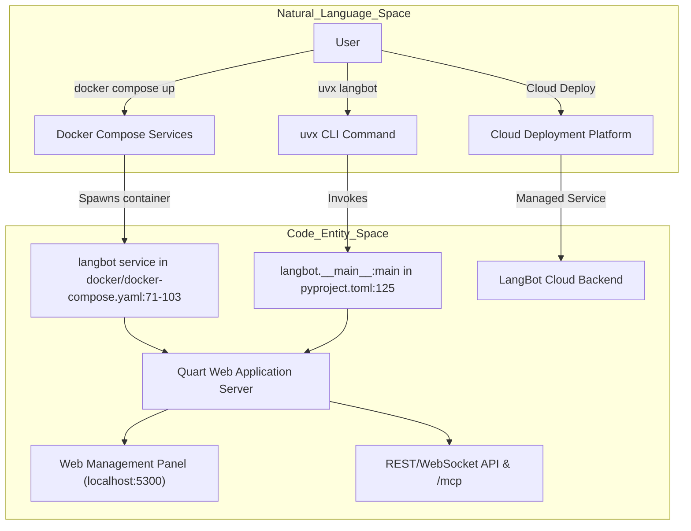
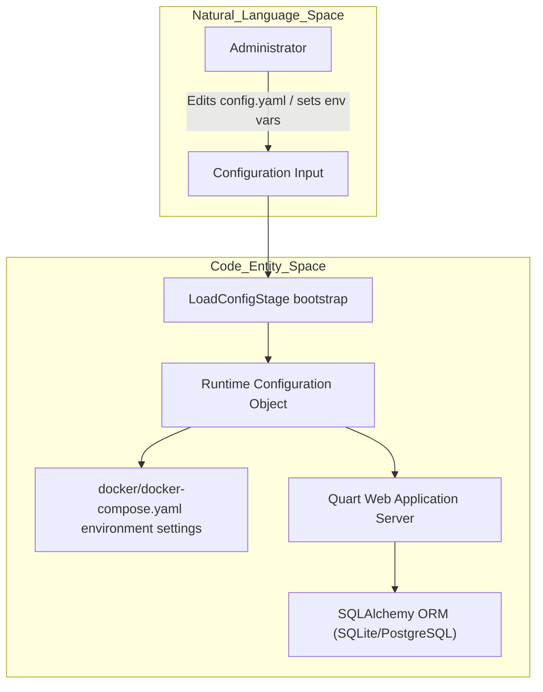

<!-- source: DeepWiki mcp.deepwiki.com · repo langbot-app/LangBot · page 2 Getting Started · fetched 2026-10-29 -->

# Getting Started

Relevant source files

The following files were used as context for generating this wiki page:

- [README.md](README.md)
- [README_CN.md](README_CN.md)
- [README_ES.md](README_ES.md)
- [README_FR.md](README_FR.md)
- [README_JP.md](README_JP.md)
- [README_KO.md](README_KO.md)
- [README_RU.md](README_RU.md)
- [README_TW.md](README_TW.md)
- [README_VI.md](README_VI.md)
- [docker/docker-compose.yaml](docker/docker-compose.yaml)

## Purpose and Scope

This page serves as a high-level quick-start guide for new users to deploy, configure, and access LangBot [README.md:64-80](). As a parent guide, it provides an architectural overview of how installation pathways, configuration options, and the web management interface connect, linking to detailed child pages for deep technical instructions.

For detailed installation steps and system requirements, see [Installation and Setup](#2.1). For comprehensive configuration schemas and environment overrides, see [Initial Configuration](#2.2). For web interface navigation, authentication, and the setup wizard, see [Web Management Panel Access](#2.3).

---

## Installation and Setup

LangBot supports multiple deployment pathways ranging from one-line CLI execution via `uvx langbot` [README.md:74-80]() to containerized orchestration using `docker/docker-compose.yaml` [docker/docker-compose.yaml:71-103]() and pre-built cloud templates [README.md:66-92](). The runtime system bootstraps via standard Python entry points defined in `pyproject.toml` to serve both backend REST/WebSocket APIs and pre-built frontend web assets [pyproject.toml:124-125](), [pyproject.toml:132]().

### Deployment to Code Entity Mapping

*Figure: Mapping natural language user deployment actions to backend entry points and service entities.*

For detailed installation guides, prerequisites, and system requirements, see [Installation and Setup](#2.1).

Sources: [README.md:66-92](), [pyproject.toml:124-132](), [docker/docker-compose.yaml:71-103]()

---

## Initial Configuration

LangBot behavior is controlled via YAML configuration files (`config.yaml`) and system environment variables using the canonical `SECTION__SUBSECTION__KEY` override convention [docker/docker-compose.yaml:77-103](). During bootstrap, configuration stages parse these inputs to initialize service ports, database backends (SQLite/PostgreSQL), storage providers, and execution workers.

### Configuration to Persistence Mapping

*Figure: Mapping administrator configuration inputs to system bootstrap stages and persistence layers.*

For complete configuration schemas, environment variable precedence rules, and essential settings, see [Initial Configuration](#2.2).

Sources: [README.md:66-92](), [docker/docker-compose.yaml:71-103]()

---

## Web Management Panel Access

The web management panel provides an intuitive browser-based interface hosted locally at `http://localhost:5300` [README.md:80](), [docker/docker-compose.yaml:104-105](). Built using Vite and React Router, it offers access to system monitoring dashboards, an onboarding setup wizard, bot and pipeline configuration workbenches, and plugin marketplace integrations [README.md:39-49](), [web/package.json:93]().

For details on authentication mechanisms, initial setup workflows, and UI navigation, see [Web Management Panel Access](#2.3).

Sources: [README.md:39-80](), [docker/docker-compose.yaml:104-105](), [web/package.json:93]()

---

## Next Steps

- **[Installation and Setup](#2.1)** — Step-by-step deployment instructions and package requirements.
- **[Initial Configuration](#2.2)** — Configuration file hierarchy and environment variable mapping.
- **[Web Management Panel Access](#2.3)** — Accessing and navigating the web interface.

Sources:
[README.md:39-92](), [pyproject.toml:124-132](), [docker/docker-compose.yaml:71-105](), [web/package.json:93]()

---

