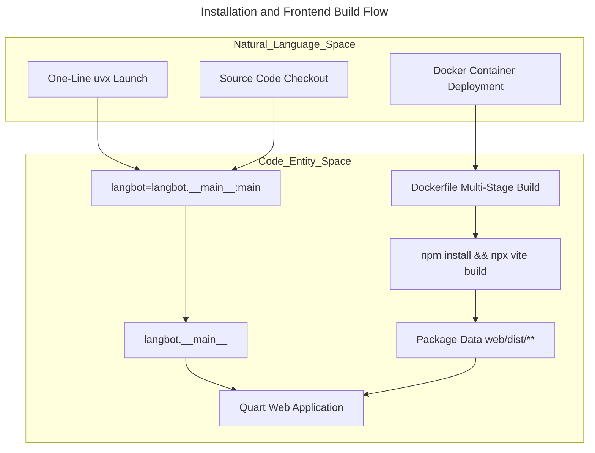
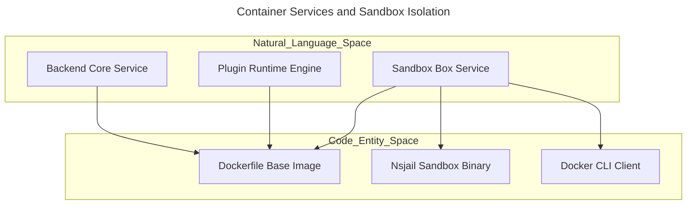
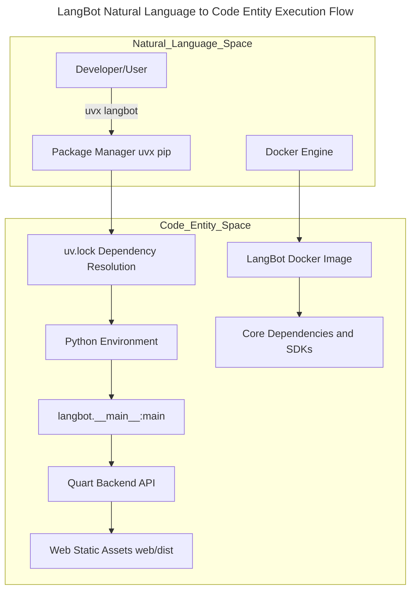

<!-- source: DeepWiki mcp.deepwiki.com · repo langbot-app/LangBot · page 2.1 Installation and Setup · fetched 2026-10-29 -->

# Installation and Setup

<details>
<summary>Relevant source files</summary>

The following files were used as context for generating this wiki page:

- [.dockerignore](.dockerignore)
- [.github/workflows/build-dev-image.yaml](.github/workflows/build-dev-image.yaml)
- [.github/workflows/build-docker-image.yml](.github/workflows/build-docker-image.yml)
- [.github/workflows/build-release-artifacts.yaml](.github/workflows/build-release-artifacts.yaml)
- [.github/workflows/publish-to-pypi.yml](.github/workflows/publish-to-pypi.yml)
- [Dockerfile](Dockerfile)
- [pyproject.toml](pyproject.toml)
- [scripts/stamp_build_revision.py](scripts/stamp_build_revision.py)
- [src/langbot/__init__.py](src/langbot/__init__.py)
- [src/langbot/_build_info.py](src/langbot/_build_info.py)
- [uv.lock](uv.lock)
- [web/.env.example](web/.env.example)
- [web/.gitignore](web/.gitignore)
- [web/README.md](web/README.md)
- [web/package-lock.json](web/package-lock.json)
- [web/package.json](web/package.json)
- [web/pnpm-lock.yaml](web/pnpm-lock.yaml)

</details>


This page provides full technical documentation for installing and setting up LangBot across various deployment targets (`uvx`, `pip`/PyPI, Docker, and cloud), covering system requirements, frontend static asset bundling, optional vector database extensions (SeekDB), and core dependencies.

---

## 1. System Requirements and Pre-built Frontend Packaging

LangBot is a production-grade platform for building agentic IM bots, implemented primarily in Python and distributed as a package named `langbot` [src/langbot/__init__.py:1-5]().

### System Requirements
- **Python Version:** Requires Python `>=3.11,<4.0`, as specified in `pyproject.toml` [pyproject.toml:7]().
- **Operating System:** Core runtime is platform-agnostic. However, sandboxing features (for the Box runtime) require Linux or compatible container runtimes because of `nsjail` usage in container-less sandboxing [Dockerfile:14-26]().
- **Hardware:** At least 512 MB of RAM is recommended for core runtime processes, with 2 GB+ recommended when running additional plugin runtimes and isolated Box sandboxes.

### Pre-Built Frontend Package

LangBot includes a web management interface implemented with Vite and React Router. The frontend is built into static assets under `web/dist/**` which are packaged as Python package data to be served by the Quart backend server [pyproject.toml:131-133](), [Dockerfile:37](). This enables immediate UI availability after installation without extra build steps.

- The entry-point CLI script is defined as:
  ```toml
  langbot = "langbot.__main__:main"
  ```  
  [pyproject.toml:124-125]()

- The frontend build occurs via `npm install && npx vite build` executed in the `web` directory prior to packaging [Dockerfile:1-8](), enabling the backend to serve the UI directly from embedded static files.

**Diagram: Installation and Frontend Build Flow**



Sources: [pyproject.toml:7](), [pyproject.toml:124-133](), [Dockerfile:1-8](), [Dockerfile:37](), [src/langbot/__init__.py:1-5]()

---

## 2. Deployment Methods

### Method 1: One-Line Launch with `uvx`

`uvx` is a Python environment manager and runner that automatically provisions a consistent environment based on a lock file (`uv.lock`). LangBot can be launched directly via its script entry point registered in `pyproject.toml` [pyproject.toml:124-125]():

```bash
uvx langbot
```

This command:
- Resolves dependencies as locked in `uv.lock`, ensuring reproducible builds with exact versions [uv.lock:1-3]().
- Invokes the registered script entry-point `langbot=langbot.__main__:main` [pyproject.toml:124-125]().
- Makes the web UI available at `http://localhost:5300`.
- Supports extras such as OceanBase SeekDB for enhanced vector database functionality:
  ```bash
  uvx --from 'langbot[seekdb]@latest' langbot
  ```

Sources: [pyproject.toml:113-117](), [pyproject.toml:124-125](), [uv.lock:1-3]()

### Method 2: Docker Container Deployment (Production)

A multi-stage `Dockerfile` builds LangBot with the following key points:
- Frontend React app is built in a Node 22 alpine stage via Vite [Dockerfile:1-8]().
- `nsjail` sandbox executable is built from source in a dedicated stage for secure container-less sandboxing by the Box runtime [Dockerfile:14-26]().
- The final image installs Python 3.12 slim, Node.js LTS, Docker CLI client, and necessary runtime libraries [Dockerfile:28-70]().
- The container exposes the Quart backend, hosting the LangBot app with plugin runtime and Box sandbox.

The Docker images are built and pushed to Docker Hub via GitHub Actions workflows. Release images are tagged with the version and `latest` [Dockerfile:34](), [Dockerfile:44](), [Dockerfile:46]() and pre-release images are tagged with the version and `beta` [Dockerfile:50-53](). Development images are tagged with the branch name and commit SHA [Dockerfile:47-48]().

Run the official container build or deployment steps using `uv sync --extra seekdb` inside the container [Dockerfile:68]().

**Diagram: Container Services and Sandbox Isolation**



Sources: [Dockerfile:1-73](), [.github/workflows/build-docker-image.yml:44](), [.github/workflows/build-docker-image.yml:46](), [.github/workflows/build-docker-image.yml:50-53](), [.github/workflows/build-dev-image.yaml:47-48]()

### Method 3: Manual Installation from Source

For development or custom setups:
1. Clone the repository and synchronize dependencies with `uv`:
   ```bash
   git clone https://github.com/langbot-app/LangBot
   cd LangBot
   uv sync
   ```
   To include SeekDB support:
   ```bash
   uv sync --extra seekdb
   ```
2. Build the frontend assets manually if doing UI development:
   ```bash
   cd web
   npm install
   npx vite build
   ```
3. Run the application via `uv run`:
   ```bash
   uv run main.py
   ```

Sources: [Dockerfile:1-8](), [Dockerfile:73](), [pyproject.toml:113-117]()

### Method 4: Cloud and One-Click Deployments
- **LangBot Cloud:** Provides a fully managed instance offering instant access without local installation.
- **One-Click Templates:** Deployment buttons for hosting platforms such as Zeabur and Railway facilitate rapid cloud deployment [pyproject.toml:119-122]().

Sources: [pyproject.toml:119-122]()

---

## 3. Optional Vector Database and Embedding Setup (SeekDB)

LangBot optionally integrates OceanBase SeekDB as a vector database backend and embedding model requester to enhance RAG and similarity search capabilities.

### Optional Dependency Declaration
- SeekDB Python client dependencies are declared as an optional extra in `pyproject.toml` [pyproject.toml:113-117]():
  ```toml
  [project.optional-dependencies]
  seekdb = [
      "pyseekdb==1.4.0.post1",
      "pylibseekdb==1.4.0; sys_platform == 'linux' or (sys_platform == 'darwin' and platform_machine == 'arm64')",
  ]
  ```

Sources: [pyproject.toml:113-117]()

---

## 4. Core Dependencies Reference

LangBot depends on a curated set of libraries for networking, persistence, IM platform adapters, AI integrations, and vector databases as declared in `pyproject.toml` [pyproject.toml:8-87]():

| Category          | Key Libraries / Modules                                         | Role in Codebase                                  |
|-------------------|---------------------------------------------------------------|--------------------------------------------------|
| **Web & API**     | `quart`, `quart-cors`, `websockets`, `aiohttp` | Async HTTP server and WebSocket routing [pyproject.toml:11](), [pyproject.toml:39-40](), [pyproject.toml:50](), [pyproject.toml:60]() |
| **Persistence**   | `sqlalchemy[asyncio]`, `sqlmodel`, `aiosqlite`, `asyncpg` | ORM and async DB support with SQLite & PostgreSQL [pyproject.toml:13](), [pyproject.toml:44-46](), [pyproject.toml:75]() |
| **AI & LLM**       | `openai`, `anthropic`, `mcp`, `ollama`, `litellm` | Client integration for LLM providers and MCP [pyproject.toml:14](), [pyproject.toml:26](), [pyproject.toml:28-29](), [pyproject.toml:83]() |
| **IM Platform SDKs** | `discord-py`, `python-telegram-bot`, `slack-sdk`, `lark-oapi`, `line-bot-sdk` | Platform adapters for instant messaging protocols [pyproject.toml:22](), [pyproject.toml:25](), [pyproject.toml:35](), [pyproject.toml:43](), [pyproject.toml:76]() |
| **Vector Indexing / RAG** | `chromadb`, `qdrant-client`, `pymilvus`, `pyseekdb` | Vector database backends and embedding retrieval [pyproject.toml:72-73](), [pyproject.toml:80](), [pyproject.toml:114-116]() |
| **Utilities**     | `pydantic`, `pyjwt`, `colorlog`, `async-lru`, `tiktoken` | Data validation, logging, LRU caching, token counting [pyproject.toml:16](), [pyproject.toml:18](), [pyproject.toml:33-34](), [pyproject.toml:48]() |

Sources: [pyproject.toml:8-87]()

---

## Summary Diagram: LangBot System Installation and Execution



Sources: [pyproject.toml:1-133](), [Dockerfile:1-73](), [src/langbot/__init__.py:1-5]()

---

