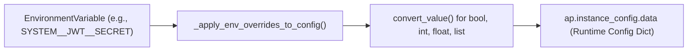
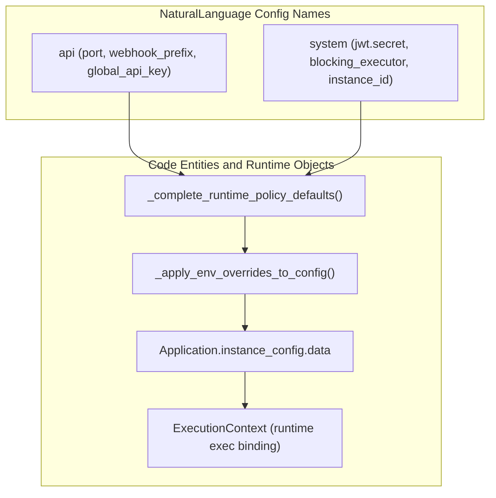

<!-- source: DeepWiki mcp.deepwiki.com · repo langbot-app/LangBot · page 2.2 Initial Configuration · fetched 2026-10-29 -->

# Initial Configuration

<details>
<summary>Relevant source files</summary>

The following files were used as context for generating this wiki page:

- [docker/kubernetes.yaml](docker/kubernetes.yaml)
- [src/langbot/pkg/core/app.py](src/langbot/pkg/core/app.py)
- [src/langbot/pkg/core/stages/build_app.py](src/langbot/pkg/core/stages/build_app.py)
- [src/langbot/pkg/core/stages/load_config.py](src/langbot/pkg/core/stages/load_config.py)
- [src/langbot/pkg/core/taskmgr.py](src/langbot/pkg/core/taskmgr.py)
- [src/langbot/pkg/operation_trace/service.py](src/langbot/pkg/operation_trace/service.py)
- [src/langbot/pkg/utils/constants.py](src/langbot/pkg/utils/constants.py)
- [src/langbot/templates/config.yaml](src/langbot/templates/config.yaml)
- [tests/unit_tests/core/test_app_shutdown.py](tests/unit_tests/core/test_app_shutdown.py)
- [tests/unit_tests/core/test_bootutils_deps.py](tests/unit_tests/core/test_bootutils_deps.py)
- [tests/unit_tests/core/test_load_config.py](tests/unit_tests/core/test_load_config.py)
- [tests/unit_tests/core/test_taskmgr.py](tests/unit_tests/core/test_taskmgr.py)
- [tests/unit_tests/plugin/test_connector_static.py](tests/unit_tests/plugin/test_connector_static.py)
- [tests/unit_tests/test_operation_trace_incremental.py](tests/unit_tests/test_operation_trace_incremental.py)
- [tests/unit_tests/test_operation_trace_integrity.py](tests/unit_tests/test_operation_trace_integrity.py)

</details>


This page details the technical implementation of LangBot's initial configuration system. It covers the structure of the primary configuration file `config.yaml`, environment variable overrides and their advanced semantics, essential initial settings required for startup, resource limits for concurrency and safety, and the code entities responsible for processing and applying these configurations during boot.

For installation procedures, see [2.1 Installation and Setup](). For the guided initial setup in the web UI, see [2.3 Web Management Panel Access]().

---

## Configuration File Overview

LangBot centrally manages its instance-wide runtime configuration using a single YAML file at `data/config.yaml`. This file is instantiated automatically at first application startup by copying from the built-in reference template located at:

- `src/langbot/templates/config.yaml`

This template contains default settings and operational ceilings for all core subsystems [src/langbot/templates/config.yaml:1-154]().

The loading and processing of `config.yaml` are handled by the `LoadConfigStage` boot stage, which is one of the earliest lifecycle stages during app initialization [src/langbot/pkg/core/stages/load_config.py:13-14](). This stage:

- Loads the raw YAML file.
- Backfills mandatory typed runtime policy defaults (e.g. cloud directory limits, database pooling).
- Applies environment variable overrides with type-safe conversions.
- Sets instance identity and global constants.

The sequence is summarized below:

```mermaid
graph TB
    Start["ApplicationStartup"]
    LoadStage["LoadConfigStage.run"]
    Template["TemplateFile (src/langbot/templates/config.yaml)"]
    DataFile["UserConfigFile (data/config.yaml)"]
    Defaults["_complete_runtime_policy_defaults()"]
    EnvOverride["_apply_env_overrides_to_config()"]
    InstanceID["InstanceIDResolution"]
    AppConfig["ap.instance_config.data"]

    Start --> LoadStage
    LoadStage --> Template
    Template --> DataFile
    DataFile --> Defaults
    Defaults --> EnvOverride
    EnvOverride --> InstanceID
    InstanceID --> AppConfig

    EnvOverride -.->|"Environment variables override" EnvOverride
```

This boot stage ensures the configuration is complete, valid, and reflective of any runtime environment overrides before the application begins full service.

Sources: [src/langbot/pkg/core/stages/load_config.py:10-112](), [src/langbot/pkg/core/stages/load_config.py:115-193](), [src/langbot/templates/config.yaml:1-154]()

---

## Configuration File Structure

The `config.yaml` file divides configuration into logically grouped top-level sections. The most critical are:

| Section | Purpose | Key Configuration Fields and Notes |
| :------ | :------ | :--------------------------------- |
| **api** | HTTP API server settings, webhook and UI origins | `host`, `port` (default 5300), `webhook_prefix`, `extra_webhook_prefix`, `webui_url`, `global_api_key` (API master key for bypassing session login) [src/langbot/templates/config.yaml:1-17]() |
| **workspace** | Workspace tenancy and invitation service | Invitation public URL, email provider (`resend`, `smtp`), delivery credentials, timeouts [src/langbot/templates/config.yaml:18-41]() |
| **command** | Bot command prefix configuration | `enable` (bool), `prefix` list of command starter tokens (e.g., `"!"`, `"！"`) [src/langbot/templates/config.yaml:42-47]() |
| **concurrency** | Limits for pipeline throughput and task queues | `pipeline` concurrency, `session` concurrency, `pending_queries` total and per workspace [src/langbot/templates/config.yaml:48-53]() |
| **webhooks** | Outbound webhook invocation limits | `max_per_workspace`, `max_inflight_requests` for outbound message fan-out [src/langbot/templates/config.yaml:54-63]() |
| **cloud** | SaaS environment usage caps and directory limits | Directory max active workspaces, snapshot sizes, max JSON response bytes for Cloud [src/langbot/templates/config.yaml:64-79]() |
| **proxy** | Optional HTTP/HTTPS proxy URLs for outbound calls | `http`, `https` proxy URLs to route requests through [src/langbot/templates/config.yaml:113-115]() |
| **system** | Core runtime metadata, edition, retention policies | `instance_id` (string), `edition` (`community`), `recovery_key`, JWT config, blocking executor limits, retention caps for tasks, sessions, websocket connections, and outbound IPs [src/langbot/templates/config.yaml:116-154]() |

This design provides operational safety, extensible plugin runtime controls, multi-tenant readiness, and secure defaults.

Sources: [src/langbot/templates/config.yaml:1-154]()

---

## Essential Initial Settings

### 1. API Port and Webhook Prefix

```yaml
api:
    port: 5300
    webhook_prefix: 'http://127.0.0.1:5300'
    global_api_key: ''
```

- `api.port` configures the HTTP server port for LangBot's Quart API.
- `api.webhook_prefix` is the canonical URL prefix used by platform adapters to register webhooks or callbacks.
- `global_api_key` enables a master API key accepted anywhere without session authentication; should only be set in trusted internal environments.

These settings ensure connectivity for platform adapters, UI, webhook routing, and external API clients [src/langbot/templates/config.yaml:3-5](), [src/langbot/templates/config.yaml:12-17]().

### 2. Database Backend Configuration

```yaml
database:
    use: sqlite
    sqlite:
        path: 'data/langbot.db'
    postgresql:
        url: ''
        host: '127.0.0.1'
        port: 5432
```

- Supports SQLite for light deployments and PostgreSQL for production workloads.
- PostgreSQL connection can be a full SQLAlchemy URL string or components with connection pool sizes and timeouts.
- Provides efficient connection pooling and statement timeouts for multi-tenant stability.

This flexibility allows choosing an appropriate storage backend.

### 3. JWT Secret and Authentication Expiration

```yaml
system:
    jwt:
        expire: 604800
        secret: ''  # MUST be set for production
```

- `system.jwt.secret` sets the signing secret for JWT tokens used in authentication and web sessions.
- `expire` controls token lifetime in seconds (default 7 days).
- Absence of a strong secret disables secure session management and risks unauthorized access.

It is critical to configure this secret before production deployment.

Sources: [src/langbot/templates/config.yaml:3-17]()

---

## Environment Variable Overrides

LangBot supports overriding any configuration setting at runtime through environment variables, parsed and applied during boot in `_apply_env_overrides_to_config()` [src/langbot/pkg/core/stages/load_config.py:118-191]().

### Override Naming Conventions

- Environment variables must be uppercase.
- Nested YAML keys use double underscores `__` as separators.
- Example mappings:
  - `CONCURRENCY__PIPELINE` → `concurrency.pipeline`
  - `DATABASE__POSTGRESQL__POOL_SIZE` → `database.postgresql.pool_size`
- Variables without `__` or non-uppercase keys are ignored [src/langbot/pkg/core/stages/load_config.py:165-168]().
- Variables with empty segments (e.g. `__CF_USER_TEXT_ENCODING`) are skipped to avoid unwanted keys [src/langbot/pkg/core/stages/load_config.py:174-177]().

### Type-aware Conversion

The override applies type normalization based on the existing YAML default's value type [src/langbot/pkg/core/stages/load_config.py:135-161]():

- **Boolean:** Converts `"true"`, `"1"`, `"yes"`, `"on"` (case-insensitive) to `True`, else `False` [src/langbot/pkg/core/stages/load_config.py:145-146]().
- **Integer:** Attempts integer parsing; if fails, retains string [src/langbot/pkg/core/stages/load_config.py:147-152]().
- **Float:** Attempts float parsing; fallback to string [src/langbot/pkg/core/stages/load_config.py:153-158]().
- **List:** Comma-separated strings parsed into list, elements converted to the original list's element type.
- **Dict:** Overrides for maps are not applied (ignored) to avoid partial or inconsistent merges.

### Secret Handling and Logging

Override logging records only the environment key name to ensure secrets are never exposed in logs, for example:

```
apply env override to config: env_key: SYSTEM__JWT__SECRET
```

No secret values are printed or logged [src/langbot/pkg/core/stages/load_config.py:182](), [tests/unit_tests/core/test_load_config.py:38-53]().

### Environment Variable Override Diagram



This flexible override mechanism enables dynamic adjustment of runtime behavior without modifying `config.yaml` directly.

Sources: [src/langbot/pkg/core/stages/load_config.py:115-193](), [src/langbot/templates/config.yaml:87-103](), [tests/unit_tests/core/test_load_config.py:38-53]()

---

## Resource Limits and Concurrency Controls

LangBot embeds resource governance parameters to prevent overload and maintain multi-tenant safety:

### Blocking Executor Thread Pool

- Configured via `system.blocking_executor` section [src/langbot/templates/config.yaml:122-130]().
- Controls a bounded thread pool used for blocking async tasks (`asyncio.to_thread`).
- Key parameters:
  - `max_workers` (default: 8): Max total concurrent worker threads [src/langbot/templates/config.yaml:126]().
  - `max_pending` (default: 128): Max queued work [src/langbot/templates/config.yaml:127]().
  - `max_inflight_per_scope` (max concurrent per tenant scope; must not exceed half `max_workers`) [src/langbot/templates/config.yaml:129-130]().
- This avoids unbounded CPU consumption or memory pressure from tenant-triggered bursts [src/langbot/pkg/core/stages/load_config.py:37-43]().

### Pipeline and Query Admission Limits

- `concurrency.pipeline`: max concurrent pipeline runs (default: 20) [src/langbot/templates/config.yaml:49]().
- `concurrency.session`: max concurrently active sessions (default: 1) [src/langbot/templates/config.yaml:50]().
- `concurrency.pending_queries`: hard limit on total queued + running pipeline queries (1000) [src/langbot/templates/config.yaml:52]().
- `concurrency.pending_queries_per_workspace`: similar limit enforced per workspace (100) [src/langbot/templates/config.yaml:53]().
- Prevents query storms and protects service stability [src/langbot/templates/config.yaml:48-53]().

### Task and Session Retention Policies

- `system.task_retention` caps:
  - Completed async task record count (default: 200) [src/langbot/templates/config.yaml:145]().
  - Max log chars per task (default: 200k) [src/langbot/templates/config.yaml:147]().
  - Max active user tasks globally and per workspace [src/langbot/templates/config.yaml:149-150]().
- `system.session_retention` caps:
  - Total cached conversation session entries [src/langbot/templates/config.yaml:153]().
  - Per-workspace session load [src/langbot/templates/config.yaml:154]().
- Controls memory usage and ensures aging of inactive or completed workload [src/langbot/templates/config.yaml:143-154]().

Sources: [src/langbot/templates/config.yaml:48-63](), [src/langbot/templates/config.yaml:122-130](), [src/langbot/templates/config.yaml:143-154](), [src/langbot/pkg/core/stages/load_config.py:37-43]()

---

## Configuration to Code Entity Mapping

The boot-time configuration system stores the final merged config dictionary in `ap.instance_config.data` [src/langbot/pkg/core/app.py:109]() and is instantiated by these components:

- `_complete_runtime_policy_defaults()` — backfills security and policy defaults for runtime components [src/langbot/pkg/core/stages/load_config.py:17-112]().

- `_apply_env_overrides_to_config()` — applies environment overrides with safe type conversions [src/langbot/pkg/core/stages/load_config.py:118-191]().

- `ExecutionContext` objects resolve instance and workspace IDs from config during runtime query and event handling [src/langbot/pkg/api/http/context.py:63-63]().

### High-Level Mapping Diagram: Config to Runtime Application Objects



### Mapping Config Policies to Runtime Enforcers

```mermaid
graph TD
    subgraph NaturalLanguageSpace["System Config Sections"]
        C_BLOCK["system.blocking_executor"]
        C_CLOUD["cloud.directory (max_active_workspaces)"]
        C_WEBHOOKS["webhooks (max_per_workspace, max_inflight_requests)"]
        C_TASK_RETENTION["system.task_retention"]
        C_CONCURRENCY["concurrency (pipeline, session, pending_queries)"]
    end

    subgraph CodeEntitySpace["Enforcement and Runtime Classes"]
        BOUNDED_EXEC["bounded_executor.BoundedExecutor"]
        DIR_PROJ_SERVICE["cloud.directory_projection.DirectoryProjectionService"]
        WEBHOOK_PUSHER["platform.webhook_pusher.WebhookPusher"]
        ASYNC_TASK_MANAGER["core.taskmgr.AsyncTaskManager"]
        QUERY_POOL["pipeline.pool.QueryPool"]
        LOAD_CFG["_complete_runtime_policy_defaults() initialization"]
    end

    C_BLOCK --> BOUNDED_EXEC
    C_CLOUD --> DIR_PROJ_SERVICE
    C_WEBHOOKS --> WEBHOOK_PUSHER
    C_TASK_RETENTION --> ASYNC_TASK_MANAGER
    C_CONCURRENCY --> QUERY_POOL

    LOAD_CFG --> BOUNDED_EXEC
    LOAD_CFG --> DIR_PROJ_SERVICE
    LOAD_CFG --> WEBHOOK_PUSHER
    LOAD_CFG --> ASYNC_TASK_MANAGER
    LOAD_CFG --> QUERY_POOL
```



This layered architecture ensures that configuration settings are translated faithfully into runtime components enforcing resource limits, security policies, and platform behavior.

Sources: [src/langbot/pkg/core/stages/load_config.py:16-155](), [src/langbot/templates/config.yaml:1-154](), [src/langbot/pkg/core/app.py:109](), [src/langbot/pkg/core/app.py:81](), [src/langbot/pkg/core/app.py:127](), [src/langbot/pkg/core/app.py:45](), [src/langbot/pkg/core/app.py:155]()

---

This completes the detailed exposition of LangBot's initial configuration subsystem, from the YAML schema through boot-stage loading, environment overrides, essential defaults, resource governance, and the runtime code entities.

For practical examples, advanced tuning, and the integration of config with other system layers, see:

- [2.1 Installation and Setup]()
- [2.3 Web Management Panel Access]()
- [3.2 Configuration System]()

---

