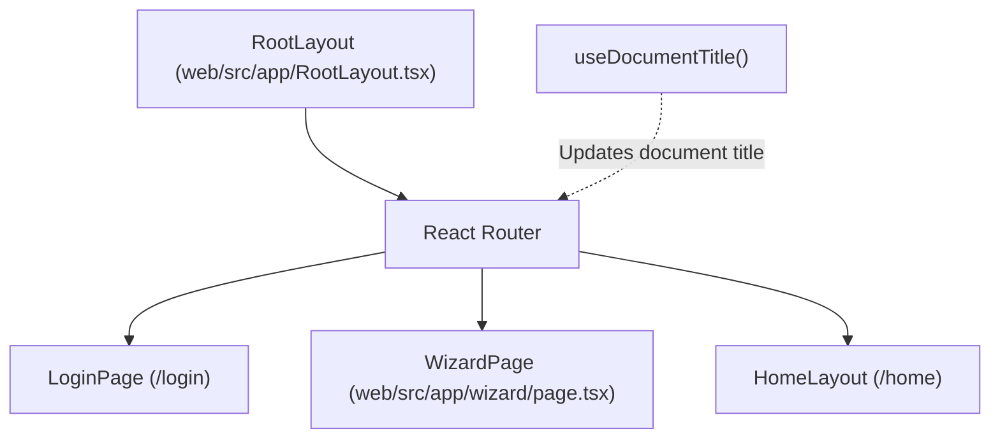
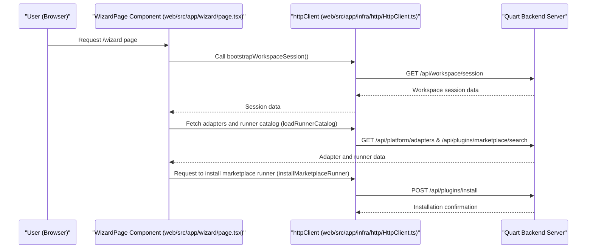
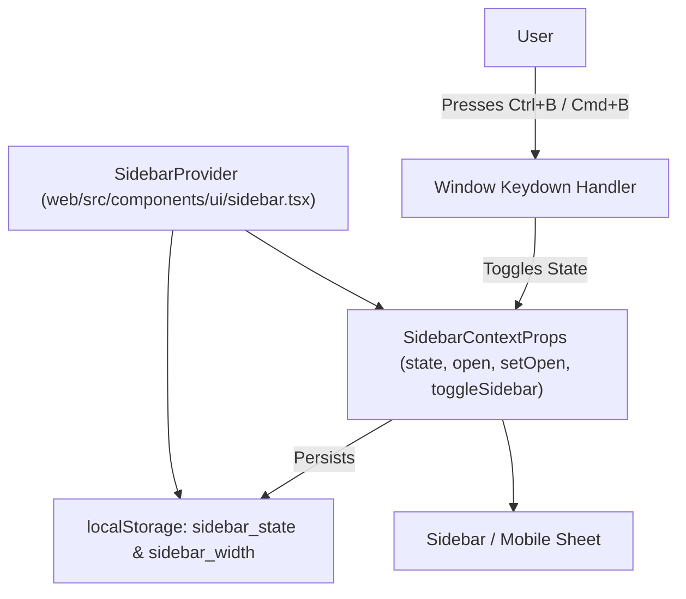
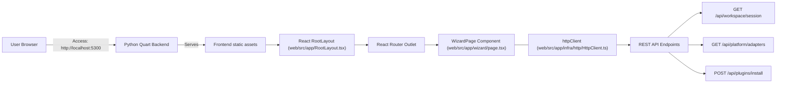
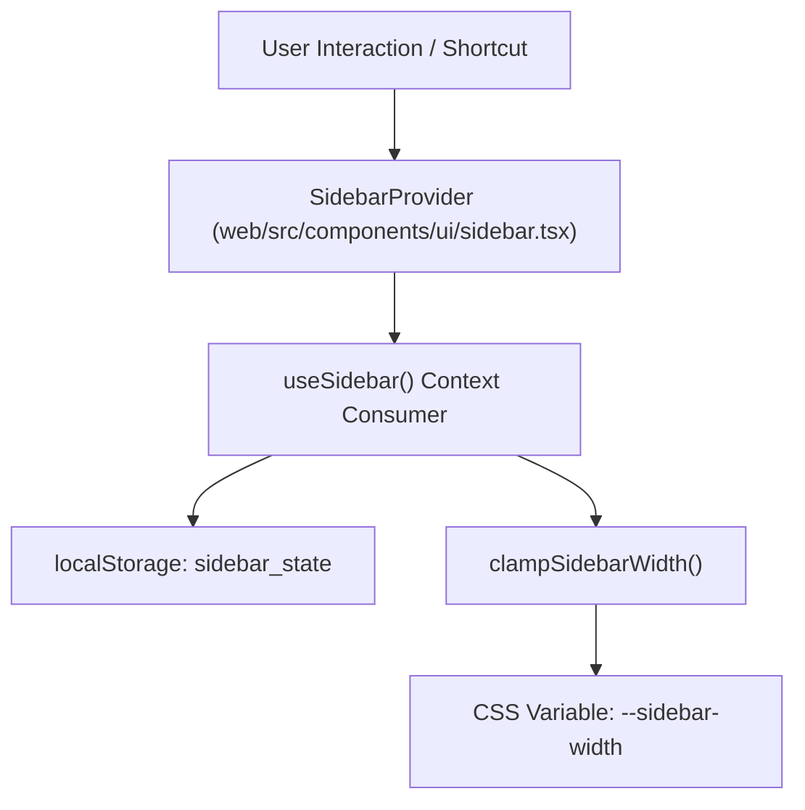

<!-- source: DeepWiki mcp.deepwiki.com · repo langbot-app/LangBot · page 2.3 Web Management Panel Access · fetched 2026-10-29 -->

# Web Management Panel Access

<details>
<summary>Relevant source files</summary>

The following files were used as context for generating this wiki page:

- [web/src/app/home/components/home-sidebar/HomeSidebar.tsx](web/src/app/home/components/home-sidebar/HomeSidebar.tsx)
- [web/src/app/home/components/home-sidebar/SidebarDataContext.tsx](web/src/app/home/components/home-sidebar/SidebarDataContext.tsx)
- [web/src/app/home/plugins/components/plugin-install-task/PluginInstallProgressDialog.tsx](web/src/app/home/plugins/components/plugin-install-task/PluginInstallProgressDialog.tsx)
- [web/src/app/home/plugins/components/plugin-install-task/PluginInstallTaskContext.tsx](web/src/app/home/plugins/components/plugin-install-task/PluginInstallTaskContext.tsx)
- [web/src/app/home/plugins/components/plugin-install-task/PluginInstallTaskQueue.tsx](web/src/app/home/plugins/components/plugin-install-task/PluginInstallTaskQueue.tsx)
- [web/src/app/home/plugins/components/plugin-install-task/install-progress.ts](web/src/app/home/plugins/components/plugin-install-task/install-progress.ts)
- [web/src/app/home/plugins/components/plugin-market/marketplace-installed.ts](web/src/app/home/plugins/components/plugin-market/marketplace-installed.ts)
- [web/src/app/home/plugins/components/plugin-market/useMarketplaceInstalledIndex.ts](web/src/app/home/plugins/components/plugin-market/useMarketplaceInstalledIndex.ts)
- [web/src/app/home/plugins/page.tsx](web/src/app/home/plugins/page.tsx)
- [web/src/app/infra/entities/api/index.ts](web/src/app/infra/entities/api/index.ts)
- [web/src/app/infra/http/BackendClient.ts](web/src/app/infra/http/BackendClient.ts)
- [web/src/app/wizard/page.tsx](web/src/app/wizard/page.tsx)
- [web/src/components/ui/dialog.tsx](web/src/components/ui/dialog.tsx)
- [web/src/i18n/locales/en-US.ts](web/src/i18n/locales/en-US.ts)
- [web/src/i18n/locales/es-ES.ts](web/src/i18n/locales/es-ES.ts)
- [web/src/i18n/locales/ja-JP.ts](web/src/i18n/locales/ja-JP.ts)
- [web/src/i18n/locales/ru-RU.ts](web/src/i18n/locales/ru-RU.ts)
- [web/src/i18n/locales/th-TH.ts](web/src/i18n/locales/th-TH.ts)
- [web/src/i18n/locales/vi-VN.ts](web/src/i18n/locales/vi-VN.ts)
- [web/src/i18n/locales/zh-Hans.ts](web/src/i18n/locales/zh-Hans.ts)
- [web/src/i18n/locales/zh-Hant.ts](web/src/i18n/locales/zh-Hant.ts)
- [web/tests/e2e/knowledge-engine-marketplace.spec.ts](web/tests/e2e/knowledge-engine-marketplace.spec.ts)
- [web/tests/e2e/marketplace-likes.spec.ts](web/tests/e2e/marketplace-likes.spec.ts)
- [web/tests/e2e/plugin-upgrade-recovery.spec.ts](web/tests/e2e/plugin-upgrade-recovery.spec.ts)
- [web/tests/e2e/wizard-platform-regressions.spec.ts](web/tests/e2e/wizard-platform-regressions.spec.ts)
- [web/tests/unit/install-progress.test.mjs](web/tests/unit/install-progress.test.mjs)
- [web/tests/unit/knowledge-engine-marketplace.test.mjs](web/tests/unit/knowledge-engine-marketplace.test.mjs)
- [web/tests/unit/marketplace-installed-state.test.mjs](web/tests/unit/marketplace-installed-state.test.mjs)
- [web/tests/unit/marketplace-likes.test.mjs](web/tests/unit/marketplace-likes.test.mjs)
- [web/tests/unit/wizard-page-bot.test.mjs](web/tests/unit/wizard-page-bot.test.mjs)

</details>


## Purpose and Scope

This page documents the detailed technical implementation and access flow for the LangBot Web Management Panel available at default port `5300` on `localhost`. It covers the web UI infrastructure, authentication mechanisms, client-side routing, initial setup via the Setup Wizard (`WizardPage`), as well as onboarding aids such as the Guided Tour and Sidebar Guide (`SidebarGuide`). The documentation delves into key code entities, data flows, and user interaction layers that enable secure access, initialization, and intuitive navigation through the web panel.

Sources: [web/src/app/RootLayout.tsx:1-9](), [web/src/components/ui/sidebar.tsx:1-228](), [web/src/app/wizard/page.tsx:1-191]()

---

## Default Access Endpoint and Port Configuration

LangBot's web management interface is served on the default local address:

- **URL:** `http://localhost:5300`
- **Port:** 5300 (default HTTP port configured in the backend)

The backend is based on a Python Quart server which serves static frontend assets bundled as a Vite-built React SPA. Any route not matched by the backend static assets is redirected to the frontend's `index.html`, enabling client-side routing through React Router.

### Data Flow Diagram: HTTP Request to Web Panel

```mermaid
flowchart TB
    Browser["User Browser"] -->|"HTTP GET http://localhost:5300"| QuartServer["Quart Backend Server"]
    QuartServer -->|"Serve Static Files"| RootLayout["RootLayout (web/src/app/RootLayout.tsx)"]
    RootLayout -->|"Render React Outlet"| Router["React Router (client-side routing)"]

    %% Annotations for clarity
    note right of Browser
        User accesses the web interface\nvia browser at port 5300
    end
    note right of QuartServer
        Python Quart handles requests,\nserves static assets for SPA
    end
    note right of RootLayout
        Root-level React component rendering\nbased on routing config
    end

    classDef backend fill:#f9f,stroke:#333,stroke-width:1px;
    class QuartServer backend;
```

This setup ensures seamless SPA operation behind a consolidated backend service without exposing separate frontend servers.

Sources: [web/src/app/RootLayout.tsx:1-9]()

---

## Routing and Layout Architecture

Routing is organized via `react-router-dom` with a root `router` instance managing the routes under a `RootLayout` component hierarchy [web/src/app/RootLayout.tsx:1-9]().

- **RootLayout Component:** This is the top-level React component that encapsulates the main layout and provides an `<Outlet />` for nested routes [web/src/app/RootLayout.tsx:1-9]().
- **Client-Side Router:** Routes are declared centrally and delegate views based on path patterns, such as `/login`, `/wizard`, `/home/*`.
- **Document Title Management:** The `useDocumentTitle` hook is used to dynamically update `document.title` for user clarity [web/src/app/RootLayout.tsx:7]().

### Routing Flow Diagram



- Top-level routes outside `/home` provide unauthenticated entry points such as login and wizard.
- The `/home` subtree hosts authenticated pages post-login and initialization.

Sources: [web/src/app/RootLayout.tsx:1-9](), [web/src/app/wizard/page.tsx:1-191]()

---

## Setup Wizard and Initial Configuration Flow

For initial setup or when the workspace is uninitialized, the user is redirected to the Setup Wizard UI located at `/wizard`. This UI assists in configuring core system components:

- Primary bot configuration including platform adapters.
- AI model runner selection and setup.
- Installation of marketplace runners or plugins.

Key React component: `WizardPage` in `web/src/app/wizard/page.tsx` handles these steps. It performs workspace session bootstrap and conditionally loads necessary adapters and runner catalogs via the HTTP client interface [web/src/app/wizard/page.tsx:135-191]().

### Setup Wizard Interaction Sequence



- The wizard manages multi-step initialization state locally and persists progress within the React component state [web/src/app/wizard/page.tsx:140-161]().
- Essential APIs support session validation, adapter discovery, and plugin installs.

Sources: [web/src/app/wizard/page.tsx:1-191](), [web/src/app/wizard/page.tsx:31-40]()

---

## Authentication and Session Bootstrapping

The web panel enforces authentication with workspace (tenant) scoping. Key aspects:

- `bootstrapWorkspaceSession()` initiates retrieval of current workspace session context including user authorization and active tenant information [web/src/app/wizard/page.tsx:35]().
- If users belong to multiple workspaces or no workspace context is active, the client handles navigation accordingly.
- The frontend HTTP client (`httpClient`) attaches JWT or OAuth tokens to every request ensuring secure authenticated interactions [web/src/app/wizard/page.tsx:31]().

This mechanism ensures users access protected routes within their designated workspace boundaries.

Sources: [web/src/app/wizard/page.tsx:31-40]()

---

## Sidebar and Navigation Framework (`SidebarProvider`)

To help new users navigate the extensive features of the LangBot panel, the layout relies on a comprehensive sidebar state machine implemented via `SidebarProvider` in `web/src/components/ui/sidebar.tsx`.

Features and Implementation:

- **Sidebar State Persistence:** The sidebar state (`expanded` or `collapsed`) and custom width are stored persistently in browser `localStorage` using keys like `sidebar_state` and `sidebar_width` [web/src/components/ui/sidebar.tsx:26-27]().
- **Context API:** The `SidebarContext` provides sidebar state, expansion toggles, width adjustment handlers, and mobile drawer integration to all child components [web/src/components/ui/sidebar.tsx:36-48]().
- **Keyboard Shortcuts:** Global keyboard shortcut listeners toggle the sidebar dynamically via `Ctrl+B` (or `Cmd+B`) [web/src/components/ui/sidebar.tsx:33]().

### Sidebar Architecture Flow Diagram



- The sidebar manages responsive layouts automatically between desktop resizable sidebars and mobile sheets (`useIsMobile`).
- Width clamping ensures the layout remains usable across different screen bounds [web/src/components/ui/sidebar.tsx:61-68]().

Sources: [web/src/components/ui/sidebar.tsx:1-228]()

---

## Guided Tour and Sidebar Guide (`SidebarGuide`)

To streamline onboarding for first-time users, the panel integrates contextual guidance mechanisms:

- **`SidebarGuide` Component:** Integrated directly within `HomeSidebar` (`web/src/app/home/components/home-sidebar/HomeSidebar.tsx`), the guide walks users through essential configuration stages [web/src/app/home/components/home-sidebar/HomeSidebar.tsx:130]().
- **Localized Steps:** Multi-step tooltips and instructional guides map directly to sidebar features such as monitoring (`monitoring`), bot configuration (`bots`), pipeline setup, and plugins, with string definitions stored across language packs like `zh-Hans.ts`, `en-US.ts`, `ja-JP.ts`, `zh-Hant.ts`, `vi-VN.ts`, `es-ES.ts`, `th-TH.ts`, and `ru-RU.ts` [web/src/i18n/locales/zh-Hans.ts:217-231](), [web/src/i18n/locales/en-US.ts:217-231](), [web/src/i18n/locales/ja-JP.ts:217-231](), [web/src/i18n/locales/zh-Hant.ts:217-231](), [web/src/i18n/locales/vi-VN.ts:217-231](), [web/src/i18n/locales/es-ES.ts:217-231](), [web/src/i18n/locales/th-TH.ts:217-231](), [web/src/i18n/locales/ru-RU.ts:217-231]().

Sources: [web/src/app/home/components/home-sidebar/HomeSidebar.tsx:130](), [web/src/i18n/locales/zh-Hans.ts:217-231](), [web/src/i18n/locales/en-US.ts:217-231](), [web/src/i18n/locales/ja-JP.ts:217-231](), [web/src/i18n/locales/zh-Hant.ts:217-231](), [web/src/i18n/locales/vi-VN.ts:217-231](), [web/src/i18n/locales/es-ES.ts:217-231](), [web/src/i18n/locales/th-TH.ts:217-231](), [web/src/i18n/locales/ru-RU.ts:217-231]()

---

## Code Entity Mapping: Natural Language Concepts to Codebase Components

To bridge the user's conceptual understanding of the web panel features with the actual code entities, the following mappings are outlined.

### Diagram 1: Web Panel Access Flow to Core Code Components



- The browser sends HTTP requests to the Quart backend, which serves the SPA.
- The SPA root layout component (`RootLayout`) manages views and navigation.
- `WizardPage` initiates backend communication through `httpClient` to retrieve workspace session info and manage setup.

Sources: [web/src/app/RootLayout.tsx:1-9](), [web/src/app/wizard/page.tsx:1-45]()

---

### Diagram 2: Sidebar State and Context Management



- The `SidebarProvider` component supplies state to all sidebar children using React context.
- Persistent storage updates whenever the user collapses, expands, or resizes the sidebar panel.

Sources: [web/src/components/ui/sidebar.tsx:26-147]()

---

## Summary

This page elucidates the end-to-end process of accessing and initializing the LangBot Web Management Panel, spanning:

- Default network endpoint and architecture coupling backend with frontend SPA.
- Client-side routing via `RootLayout`.
- Session authentication and workspace setup redirect logic.
- Stepwise onboarding using the Setup Wizard (`WizardPage`).
- Sidebar navigation framework powered by `SidebarProvider` and interactive onboarding via `SidebarGuide`.

Sources:
[web/src/app/RootLayout.tsx:1-9](), [web/src/components/ui/sidebar.tsx:1-228](), [web/src/app/wizard/page.tsx:1-191](), [web/src/app/home/components/home-sidebar/HomeSidebar.tsx:130](), [web/src/i18n/locales/zh-Hans.ts:217-231](), [web/src/i18n/locales/en-US.ts:217-231](), [web/src/i18n/locales/ja-JP.ts:217-231](), [web/src/i18n/locales/zh-Hant.ts:217-231](), [web/src/i18n/locales/vi-VN.ts:217-231](), [web/src/i18n/locales/es-ES.ts:217-231](), [web/src/i18n/locales/th-TH.ts:217-231](), [web/src/i18n/locales/ru-RU.ts:217-231]()

---

