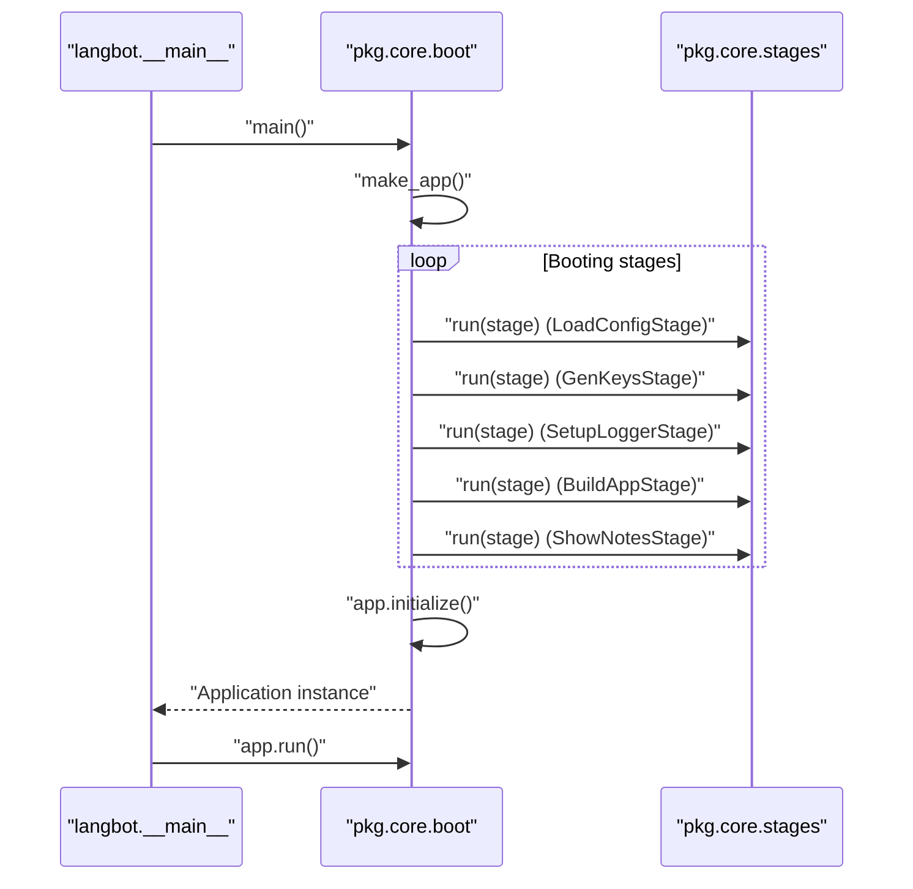

<!-- source: DeepWiki mcp.deepwiki.com · repo langbot-app/LangBot · page 3 Core Backend System · fetched 2026-10-29 -->

# Core Backend System

<details>
<summary>Relevant source files</summary>

The following files were used as context for generating this wiki page:

- [docker/kubernetes.yaml](docker/kubernetes.yaml)
- [src/langbot/pkg/core/app.py](src/langbot/pkg/core/app.py)
- [src/langbot/pkg/core/stages/build_app.py](src/langbot/pkg/core/stages/build_app.py)
- [src/langbot/pkg/operation_trace/service.py](src/langbot/pkg/operation_trace/service.py)
- [src/langbot/templates/config.yaml](src/langbot/templates/config.yaml)
- [tests/unit_tests/core/test_app_shutdown.py](tests/unit_tests/core/test_app_shutdown.py)
- [tests/unit_tests/test_operation_trace_incremental.py](tests/unit_tests/test_operation_trace_incremental.py)
- [tests/unit_tests/test_operation_trace_integrity.py](tests/unit_tests/test_operation_trace_integrity.py)

</details>


The Core Backend System is the Python-based server application that powers LangBot. This document provides a high-level overview of the backend architecture, including the application bootstrap process, configuration management, database persistence, HTTP API layer, storage, query processing, and multi-user workspace boundaries.

## Overview

The LangBot backend is a Python 3.11+ asynchronous application built on the **Quart** web framework. It acts as the central orchestrator for AI agents, IM platform integrations, and plugin runtimes.

- **HTTP API**: Implemented using Quart, exposing endpoints for UI and external API consumers with JWT, Space OAuth, and API key-based authentication [src/langbot/pkg/core/app.py:161-177]().
- **Database Persistence**: Uses SQLAlchemy ORM supporting SQLite and PostgreSQL, managed by the `PersistenceManager` service. Alembic handles schema migrations [src/langbot/pkg/core/app.py:138-160](), [src/langbot/pkg/core/stages/build_app.py:148-159]().
- **Configuration Management**: Configuration is loaded hierarchically from `config.yaml` with environment variable overrides during the bootstrap stages [src/langbot/pkg/core/app.py:95-110]().
- **Storage System**: The `StorageMgr` abstracts file storage which can be local or S3-compatible, managing plugin artifacts, media uploads, and RAG documents [src/langbot/pkg/core/app.py:165-166]().
- **AI Model Management**: Central service managing LLM, embedding, and rerank models from multiple providers [src/langbot/pkg/core/app.py:86-92]().
- **Plugin and Sandbox Runtimes**: Managed via `PluginRuntimeConnector` and the `BoxService` for sandboxed skills execution [src/langbot/pkg/core/app.py:122-125]().
- **Workspace and Multi-Tenancy**: Tenant isolation through `WorkspaceService`, enforcing RBAC, membership, quotas, and multi-tenant scopes [src/langbot/pkg/core/app.py:140-145]().
- **Cloud Integration and Telemetry**: Cloud-specific bootstrap, model catalog sync, telemetry, heartbeat, and survey services augment the backend when running in the SaaS cloud environment [src/langbot/pkg/core/app.py:146-160]().
- **Operation Traceability**: Audit logging with append-only tamper-evident records scoped by workspace, enabling precise user operation traceability [src/langbot/pkg/operation_trace/service.py:1-21]().

The main `Application` class acts as a global dependency container and runtime context, holding references to all core managers and services [src/langbot/pkg/core/app.py:68-177]().

Sources: [src/langbot/pkg/core/app.py:68-177](), [src/langbot/pkg/core/stages/build_app.py:58-159](), [src/langbot/pkg/operation_trace/service.py:1-21]()

---

## Application Architecture

Below are diagrams correlating natural language system components to concrete code entities, helping navigate the codebase efficiently.

### System Entity Map

```mermaid
graph TB
    subgraph "Entry & Bootstrap"
        Main["langbot.__main__:main()"]
        Boot["pkg.core.boot:make_app()"]
        LoadStage["LoadConfigStage (boot stage)"]
        BuildStage["BuildAppStage (boot stage)"]
    end
    
    subgraph "Core Application Context"
        direction TB
        App["app.Application instance"]
        TaskMgr["task_mgr: AsyncTaskManager"]
        PersistMgr["persistence_mgr: PersistenceManager"]
        ConfigMgr["instance_config: ConfigManager"]
        HTTPCtrl["http_ctrl: HTTPController"]
        TeleMgr["telemetry: TelemetryManager"]
        MsgAgg["msg_aggregator: MessageAggregator"]
        WorkspaceSvc["workspace_service: WorkspaceService"]
        WorkspaceCollabSvc["workspace_collaboration_service: WorkspaceCollaborationService"]
        InvitationDeliverySvc["invitation_delivery_service: InvitationDeliveryService"]
    end

    subgraph "HTTP Service Layer"
        UserSvc["user_service: UserService"]
        BotSvc["bot_service: BotService"]
        PipeSvc["pipeline_service: PipelineService"]
        ModelSvc["llm_model_service: LLMModelsService"]
        MaintSvc["maintenance_service: MaintenanceService"]
        SkillSvc["skill_service: SkillService"]
        ApiKeySvc["apikey_service: ApiKeyService"]
        WebhookSvc["webhook_service: WebhookService"]
        MonitoringSvc["monitoring_service: MonitoringService"]
        OpTraceSvc["workspace_settings_service: WorkspaceSettingsService"]
    end

    subgraph "Resource Managers & Providers"
        PlatMgr["platform_mgr: PlatformManager"]
        ModelMgr["model_mgr: ModelManager"]
        StorageMgr["storage_mgr: StorageMgr"]
        RagMgr["rag_mgr: RAGManager"]
        SkillMgr["skill_mgr: SkillManager"]
        BoxSvc["box_service: BoxService"]
        PluginConn["plugin_connector: PluginRuntimeConnector"]
        VectorDBMgr["vector_db_mgr: VectorDBManager"]
    end

    Main --> Boot
    Boot --> LoadStage
    LoadStage --> BuildStage
    BuildStage --> App
    App --> TaskMgr
    App --> PersistMgr
    App --> ConfigMgr
    App --> HTTPCtrl
    App --> TeleMgr
    App --> MsgAgg
    App --> WorkspaceSvc
    App --> WorkspaceCollabSvc
    App --> InvitationDeliverySvc
    BuildStage --> UserSvc & BotSvc & PipeSvc & MaintSvc & SkillSvc & ApiKeySvc & WebhookSvc & MonitoringSvc & OpTraceSvc
    BuildStage --> PlatMgr & ModelMgr & StorageMgr & RagMgr & SkillMgr & BoxSvc & PluginConn & VectorDBMgr

    HTTPCtrl --> UserSvc
    PersistMgr --> DB["SQLAlchemy-managed DB"]
```



Sources: [src/langbot/pkg/core/app.py:68-177](), [src/langbot/pkg/core/stages/build_app.py:58-159]()

### Application Bootstrap Sequence



Sources: [src/langbot/pkg/core/boot.py:18-72](), [src/langbot/pkg/core/app.py:173-201](), [src/langbot/pkg/core/stages/build_app.py:58-72]()

---

## Core Backend Subsystems

### 3.1 Application Bootstrap and Entry Point
The backend application begins at `langbot.__main__.main()`. The bootstrap mechanism instantiates an `Application` and executes a structured sequence of boot stages (`LoadConfigStage`, `GenKeysStage`, `SetupLoggerStage`, `BuildAppStage`, and `ShowNotesStage`). 

The process supports command-line flags like `--standalone-runtime` and `--standalone-box` to run minimal runtime modes. Shutdown sequences handle graceful cancellation of async tasks and resource cleanup [tests/unit_tests/core/test_app_shutdown.py:12-44]().

For details, see [Application Bootstrap and Entry Point](#3.1).

Sources: [src/langbot/pkg/core/boot.py:18-72](), [src/langbot/pkg/core/stages/build_app.py:58-159](), [tests/unit_tests/core/test_app_shutdown.py:12-44]()

### 3.2 Configuration System
LangBot applies a hierarchical configuration system where the YAML file `config.yaml` defines default and user settings [src/langbot/templates/config.yaml:1-162](). Environment variables override sections selectively using double-underscore delimiters for nesting (e.g., `SYSTEM__EDITION`). 

Configurations are exposed in the application context via the `instance_config` manager [src/langbot/pkg/core/app.py:109]().

For details, see [Configuration System](#3.2).

Sources: [src/langbot/templates/config.yaml:1-162](), [src/langbot/pkg/core/app.py:95-110]()

### 3.3 Database and Persistence Layer
LangBot uses SQLAlchemy ORM to interact with its primary databases, supporting SQLite and PostgreSQL. The `PersistenceManager` module initializes engines and sessions and manages migrations using Alembic [src/langbot/pkg/core/app.py:138-160](), [src/langbot/pkg/core/stages/build_app.py:148-159]().

Operations apply row-level security (RLS) keyed per workspace tenant for multi-tenant SaaS compatibility.

For details, see [Database and Persistence Layer](#3.3).

Sources: [src/langbot/pkg/core/app.py:138-160](), [src/langbot/pkg/core/stages/build_app.py:148-159]()

### 3.4 HTTP API Architecture
The HTTP API layer is implemented on Quart and governed by `HTTPController` [src/langbot/pkg/core/app.py:161](). Authentication supports JWT bearer tokens, Space OAuth, API keys, and support admin tokens [src/langbot/pkg/api/http/controller/group.py:55-63]().

The built-in MCP server is exposed at the `/mcp` route for managing Model Context Protocol connections [src/langbot/pkg/core/app.py:35]().

For details, see [HTTP API Architecture](#3.4).

Sources: [src/langbot/pkg/core/app.py:35](), [src/langbot/pkg/core/app.py:161-177](), [src/langbot/pkg/api/http/controller/group.py:54-173]()

### 3.5 Query Processing and Agent Runtime
Core to LangBot's AI functionality is the query processing pipeline. Key components include `LocalAgentRunner`, `MessageAggregator` [src/langbot/pkg/core/app.py:128](), `QueryPool` [src/langbot/pkg/core/app.py:126](), and `Controller` [src/langbot/pkg/core/app.py:130](), which coordinate execution flows, content filters, and tool-calling loops.

For details, see [Query Processing and Agent Runtime](#3.5).

Sources: [src/langbot/pkg/core/app.py:126-130]()

### 3.6 Storage System
Managed by `StorageMgr` [src/langbot/pkg/core/app.py:167](), LangBot supports abstracted storage providers for media assets, RAG document storage, plugin artifacts, and file uploads across local filesystem and S3-compatible cloud backends.

For details, see [Storage System](#3.6).

Sources: [src/langbot/pkg/core/app.py:167](), [src/langbot/pkg/core/stages/build_app.py:156-158]()

### 3.7 Workspace and Multi-User System
Workspaces serve as the tenant boundary. Core services managing this include `WorkspaceService` [src/langbot/pkg/core/app.py:142](), `WorkspaceCollaborationService` [src/langbot/pkg/core/app.py:144](), and `InvitationDeliveryService` [src/langbot/pkg/core/app.py:146](), handling RBAC, membership, tenant isolation, and quotas.

For details, see [Workspace and Multi-User System](#3.7).

Sources: [src/langbot/pkg/core/app.py:140-147](), [src/langbot/pkg/core/stages/build_app.py:64-90]()

### 3.8 Cloud Integration and Telemetry
Cloud integration modules provide SaaS-specific bootstrap routines, directory projection, cloud space launch replay, model catalog synchronization, and support admin sessions [src/langbot/pkg/core/app.py:148-160](). Telemetry captures usage metrics, heartbeat signaling, and surveys.

For details, see [Cloud Integration and Telemetry](#3.8).

Sources: [src/langbot/pkg/core/app.py:148-160](), [src/langbot/pkg/core/stages/build_app.py:64-89]()

### 3.9 Operation Traceability and Audit Logging
LangBot maintains an append-only administrative operation log scoped by workspace. This subsystem supports multiple capture levels, detailed change diffs, and tamper-evident chained hashes [src/langbot/pkg/operation_trace/service.py:1-21](), with operations flushed asynchronously [src/langbot/pkg/operation_trace/service.py:158-167](). The `WorkspaceSettingsService` manages these settings and provides read/prune APIs [src/langbot/pkg/operation_trace/service.py:42-49]().

For details, see [Operation Traceability and Audit Logging](#3.9).

Sources: [src/langbot/pkg/operation_trace/service.py:1-21](), [src/langbot/pkg/operation_trace/service.py:42-49](), [src/langbot/pkg/operation_trace/service.py:158-167]()

---

## Appendix: Bridging Natural Language to Code Entity Space

### Backend System Component to Code Entity Mapping

```mermaid
graph TD
    "Natural_Language_Space" --> "Backend_Subsystems"

    subgraph "Backend_Subsystems"
        A("Application Bootstrap and Entry Point"):::system
        B("Configuration System"):::system
        C("Database and Persistence Layer"):::system
        D("HTTP API Architecture"):::system
        E("Query Processing and Agent Runtime"):::system
        F("Storage System"):::system
        G("Workspace and Multi-User System"):::system
        H("Cloud Integration and Telemetry"):::system
        I("Operation Traceability and Audit Logging"):::system
    end

    subgraph "Code_Entity_Space"
        AppMain["langbot.__main__.main()"]
        BootMakeApp["pkg.core.boot.make_app()"]
        LoadConfigStage["pkg.core.stages.LoadConfigStage"]
        BuildAppStage["pkg.core.stages.BuildAppStage"]

        ConfigMgr["config.manager.ConfigManager"]
        PersistenceMgr["persistence.mgr.PersistenceManager"]
        SQLAlchemy["sqlalchemy ORM"]

        HTTPController["api.http.controller.HTTPController"]
        RouterGroups["api.http.controller.group.RouterGroup"]
        AuthModules["api.http.authz"]

        LocalAgentRunner["agent.runner.LocalAgentRunner"]
        MessageAggregator["pipeline.aggregator.MessageAggregator"]
        QueryPool["pipeline.pool.QueryPool"]
        Controller["pipeline.controller.Controller"]

        StorageMgr["storage.mgr.StorageMgr"]

        WorkspaceService["workspace.service.WorkspaceService"]
        WorkspaceCollab["workspace.collaboration.WorkspaceCollaborationService"]
        InvitationDelivery["workspace.invitation_delivery.InvitationDeliveryService"]

        CloudBootstrap["cloud.bootstrap"]
        TelemetrySvc["telemetry.telemetry"]

        OpTraceService["operation_trace.service.WorkspaceSettingsService"]
        OperationLogEnt["entity.persistence.operation_log.WorkspaceOperationLog"]
    end

    A -->|calls| AppMain & BootMakeApp & LoadConfigStage & BuildAppStage
    B -->|uses| ConfigMgr
    C -->|managed by| PersistenceMgr & SQLAlchemy
    D -->|runs on| HTTPController & RouterGroups & AuthModules
    E -->|implemented by| LocalAgentRunner & MessageAggregator & QueryPool & Controller
    F -->|via| StorageMgr
    G -->|via services| WorkspaceService & WorkspaceCollab & InvitationDelivery
    H -->|modules| CloudBootstrap & TelemetrySvc
    I -->|via| OpTraceService & OperationLogEnt
```

Sources: [src/langbot/pkg/core/app.py:68-177](), [src/langbot/pkg/core/stages/build_app.py:58-159](), [src/langbot/pkg/operation_trace/service.py]()

---

