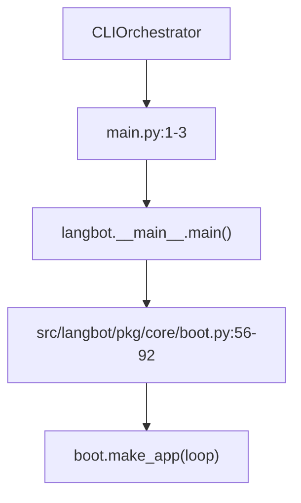
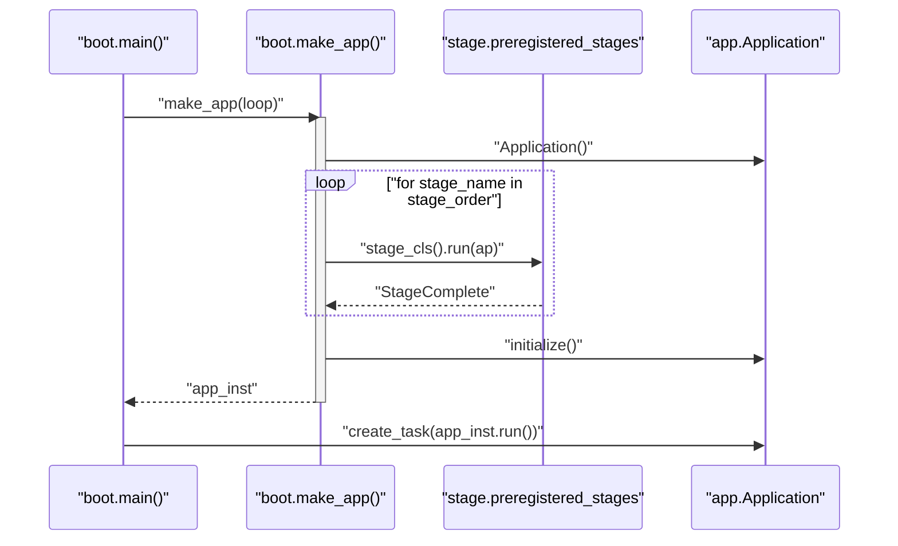
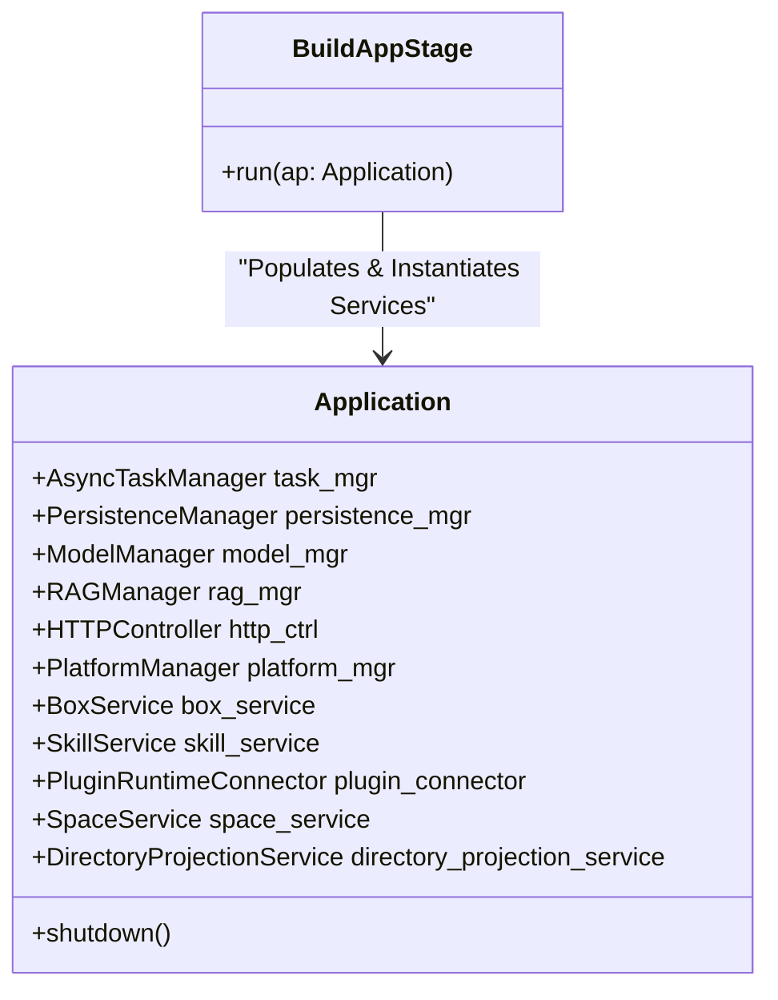

<!-- source: DeepWiki mcp.deepwiki.com · repo langbot-app/LangBot · page 3.1 Application Bootstrap and Entry Point · fetched 2026-10-29 -->

# Application Bootstrap and Entry Point

<details>
<summary>Relevant source files</summary>

The following files were used as context for generating this wiki page:

- [.gitignore](.gitignore)
- [docker/kubernetes.yaml](docker/kubernetes.yaml)
- [main.py](main.py)
- [src/langbot/pkg/core/app.py](src/langbot/pkg/core/app.py)
- [src/langbot/pkg/core/boot.py](src/langbot/pkg/core/boot.py)
- [src/langbot/pkg/core/bootutils/log.py](src/langbot/pkg/core/bootutils/log.py)
- [src/langbot/pkg/core/stages/build_app.py](src/langbot/pkg/core/stages/build_app.py)
- [src/langbot/pkg/operation_trace/service.py](src/langbot/pkg/operation_trace/service.py)
- [src/langbot/pkg/pipeline/controller.py](src/langbot/pkg/pipeline/controller.py)
- [src/langbot/templates/config.yaml](src/langbot/templates/config.yaml)
- [tests/unit_tests/core/test_app_shutdown.py](tests/unit_tests/core/test_app_shutdown.py)
- [tests/unit_tests/core/test_boot.py](tests/unit_tests/core/test_boot.py)
- [tests/unit_tests/core/test_console_logging.py](tests/unit_tests/core/test_console_logging.py)
- [tests/unit_tests/pipeline/test_controller_tenancy.py](tests/unit_tests/pipeline/test_controller_tenancy.py)
- [tests/unit_tests/test_operation_trace_incremental.py](tests/unit_tests/test_operation_trace_incremental.py)
- [tests/unit_tests/test_operation_trace_integrity.py](tests/unit_tests/test_operation_trace_integrity.py)

</details>


## Purpose and Scope
This page documents the detailed application bootstrap and entry point flow in LangBot. It covers the invocation chain from the thin top-level entrypoint script through the staged initialization sequence. The architecture revolves around predefined boot stages (`LoadConfigStage`, `GenKeysStage`, `SetupLoggerStage`, `BuildAppStage`, `ShowNotesStage`) that progressively configure runtime subsystems on the central `Application` object. It also covers command-line flags supporting isolated runtime modes (`--standalone-runtime` and `--standalone-box`) and the graceful shutdown handling for cleanup at process exit.

This page targets a technical audience looking to understand the exact startup logic and runtime wiring of essential LangBot services.

Sources: [main.py:1-3](), [src/langbot/pkg/core/boot.py:18-91](), [src/langbot/pkg/core/app.py:67-178](), [src/langbot/pkg/core/stages/build_app.py:57-161](), [tests/unit_tests/core/test_boot.py:11-102](), [tests/unit_tests/core/test_app_shutdown.py:9-43]()

---

## Entry Point and Execution Modes

LangBot's primary execution entry point is the repository root script `main.py`, which is minimal and delegates execution to `langbot.__main__.main()` [main.py:1-3](). 

This entry supports multiple execution paths:
- Direct script invocation: `python main.py`
- Package module execution: `python -m langbot`
- Container and orchestrator entrypoints
- Specialized CLI flags such as `--standalone-runtime` and `--standalone-box` to boot isolated plugin or sandbox worker processes.

The following diagram maps external execution triggers to concrete code entities in the codebase:

Title: "Entry Point Invocation Flow"


Sources: [main.py:1-3](), [src/langbot/pkg/core/boot.py:27-81]()

---

## Application Bootstrap Stages

The primary initialization routine resides in `src/langbot/pkg/core/boot.py` via the `make_app()` coroutine [src/langbot/pkg/core/boot.py:27-53](). It instantiates the `Application` object and sequentially runs the boot stages defined in `stage_order` [src/langbot/pkg/core/boot.py:18-24]().

The stages execute in the following order:
1. `LoadConfigStage`: Loads `config.yaml` and parses environment variable overrides [src/langbot/pkg/core/boot.py:19]()
2. `GenKeysStage`: Provisions required cryptographic secrets (e.g., JWT signing keys) [src/langbot/pkg/core/boot.py:20]()
3. `SetupLoggerStage`: Initializes file and console logging handlers [src/langbot/pkg/core/boot.py:21]()
4. `BuildAppStage`: Assembles the core `Application` runtime environment and binds infrastructure services [src/langbot/pkg/core/boot.py:22]()
5. `ShowNotesStage`: Emits startup banners, version metadata, and runtime configuration details to logs [src/langbot/pkg/core/boot.py:23]()

If any startup stage raises an exception, `make_app()` invokes `Application.shutdown()` to perform partial cleanup before re-raising [src/langbot/pkg/core/boot.py:45-51]().

Title: "Application Bootstrap Sequence"


Sources: [src/langbot/pkg/core/boot.py:18-91](), [tests/unit_tests/core/test_boot.py:11-33]()

---

## The Application Object and Core Services

The `Application` class (`src/langbot/pkg/core/app.py`) serves as the central runtime context and service registry [src/langbot/pkg/core/app.py:69-70](). It holds references to all core managers, configurations, workers, and HTTP services.

Key fields and components maintained by `Application`:
- **Event & Tasks**: `event_loop`, `task_mgr` (`AsyncTaskManager`) [src/langbot/pkg/core/app.py:72-75]()
- **Platform & Plugins**: `platform_mgr`, `plugin_connector`, `box_service` [src/langbot/pkg/core/app.py:79-94]()
- **Configurations**: `instance_config`, and various structured metadata managers [src/langbot/pkg/core/app.py:109-121]()
- **Persistence & Storage**: `persistence_mgr`, `storage_mgr` [src/langbot/pkg/core/app.py:140-167]()
- **AI & RAG Subsystem**: `model_mgr`, `tool_mgr`, `rag_mgr`, `query_pool`, `ctrl` [src/langbot/pkg/core/app.py:85-131]()
- **HTTP Routing & Services**: `http_ctrl` and various API service instances [src/langbot/pkg/core/app.py:163-176]()

Title: "Application Object Architecture"


Sources: [src/langbot/pkg/core/app.py:67-178](), [src/langbot/pkg/core/stages/build_app.py:57-161]()

---

## Detailed BuildAppStage Initialization Flow

`BuildAppStage` (`src/langbot/pkg/core/stages/build_app.py`) executes during the fourth bootstrap stage [src/langbot/pkg/core/stages/build_app.py:59-63](). It initializes and binds the core subsystems:
- **Deployment & Admission Guard**: Calls `cloud_bootstrap.resolve_deployment()` and instantiates `DeploymentAdmissionGuard` [src/langbot/pkg/core/stages/build_app.py:67-76]().
- **Task & Component Discovery**: Instantiates `AsyncTaskManager` and `ComponentDiscoveryEngine` with `templates/components.yaml` [src/langbot/pkg/core/stages/build_app.py:96-100]().
- **Service Layer Binding**: Registers API service singletons including `SpaceService`, `LLMModelsService`, `PipelineService`, `AgentService`, `BotService`, `KnowledgeService`, and `MCPService` [src/langbot/pkg/core/stages/build_app.py:102-131]().
- **Infrastructure Initializers**: Initializes `ProxyManager`, `VersionManager`, `StorageMgr`, and `PersistenceManager` [src/langbot/pkg/core/stages/build_app.py:145-159]().

Sources: [src/langbot/pkg/core/stages/build_app.py:57-161]()

---

## Standalone Runtime and Box Flags

LangBot supports launching isolated processes using specific command-line switches or entry points:
- `--standalone-runtime`: Executes the plugin worker runtime via `langbot_plugin.cli.__init__ rt` [docker/kubernetes.yaml:129]()
- `--standalone-box`: Starts the secure sandbox execution environment controlling Docker sockets for tool isolation [docker/kubernetes.yaml:214-220]()

Title: "Standalone Runtime Separation"
```mermaid
graph TD
    subgraph MainProcess ["Application ap"]
        AppPC ["ap.plugin_connector"]
        AppBS ["ap.box_service"]
    end

    subgraph PluginRuntime ["StandalonePluginRuntime"]
        PluginCLI["langbot_plugin.cli.__init__ rt"]
    end

    subgraph BoxRuntime ["StandaloneBoxRuntime"]
        BoxCLI["langbot_box.cli.__init__ rt"]
        DockerSock["Docker Socket /var/run/docker.sock"]
    end

    AppPC -->|"WebSocket Control Channel"| PluginCLI
    AppBS -->|"WebSocket Control Channel"| BoxCLI
    BoxCLI -->|"Controls"| DockerSock
```

Sources: [docker/kubernetes.yaml:129-220](), [src/langbot/pkg/core/app.py:90-121]()

---

## Signal Handling and Graceful Shutdown

The main runtime loop handles process lifecycles and OS signals inside `boot.main()` [src/langbot/pkg/core/boot.py:56-91]().
- Signal handlers for `SIGINT` and `SIGTERM` capture termination requests and trigger an asyncio event (`shutdown_requested.set()`) thread-safely [src/langbot/pkg/core/boot.py:63-71]().
- When triggered, `Application.shutdown()` safely stops background tasks, closes MCP session managers, shuts down platform managers, disposes of database engines, and cleans up storage managers [tests/unit_tests/core/test_app_shutdown.py:13-43]().

Sources: [src/langbot/pkg/core/boot.py:56-91](), [tests/unit_tests/core/test_app_shutdown.py:9-43]()

---

