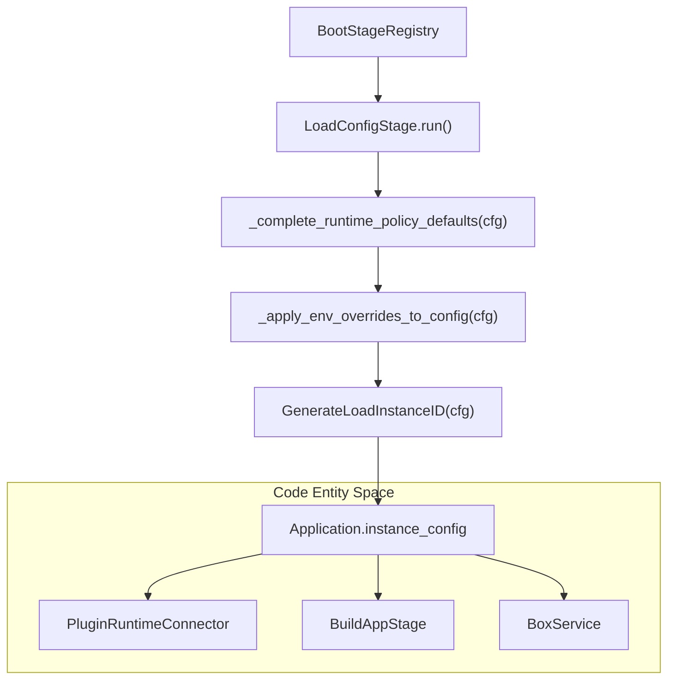
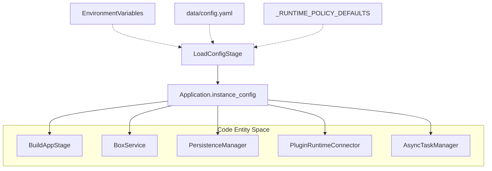

<!-- source: DeepWiki mcp.deepwiki.com · repo langbot-app/LangBot · page 3.2 Configuration System · fetched 2026-10-29 -->

# Configuration System

Relevant source files

The following files were used as context for generating this wiki page:

- [src/langbot/pkg/core/stages/load_config.py](src/langbot/pkg/core/stages/load_config.py)
- [src/langbot/pkg/core/taskmgr.py](src/langbot/pkg/core/taskmgr.py)
- [src/langbot/pkg/utils/constants.py](src/langbot/pkg/utils/constants.py)
- [tests/unit_tests/core/test_bootutils_deps.py](tests/unit_tests/core/test_bootutils_deps.py)
- [tests/unit_tests/core/test_load_config.py](tests/unit_tests/core/test_load_config.py)
- [tests/unit_tests/core/test_taskmgr.py](tests/unit_tests/core/test_taskmgr.py)
- [tests/unit_tests/plugin/test_connector_static.py](tests/unit_tests/plugin/test_connector_static.py)

The configuration system in LangBot provides centralized management of all platform settings through the `config.yaml` file and environment variable overrides. This system controls database backends, vector storage, external service integrations, API settings, security parameters, and plugin runtime behavior.

Sources: [src/langbot/templates/config.yaml:1-154](), [src/langbot/pkg/core/stages/load_config.py:12-110]()

---

## Configuration Loading Lifecycle

The configuration is loaded during the application bootstrap sequence by `LoadConfigStage` defined in [src/langbot/pkg/core/stages/load_config.py:12-110](). It serves as the single source of truth, made available throughout the codebase via the `Application.instance_config` object [src/langbot/pkg/core/app.py:109-112]().

`LoadConfigStage` performs the following execution steps:
- Loads the raw YAML data from the persistent user config file (`data/config.yaml`).
- Backfills typed security-policy leaves via `_complete_runtime_policy_defaults(cfg)` to ensure all nested keys and typed values exist [src/langbot/pkg/core/stages/load_config.py:94-115]().
- Applies environment variable overrides via `_apply_env_overrides_to_config(cfg)` [src/langbot/pkg/core/stages/load_config.py:118-201]().
- Ensures the instance ID and creation timestamp are properly initialized and stored in `constants` [src/langbot/pkg/utils/constants.py:1-17]().
- Persists the final merged configuration back to disk.

### Diagram: Configuration Initialization Flow

*Figure 3.2.1: Configuration initialization flow linking bootstrap stages to runtime code entities.*

Sources: [src/langbot/pkg/core/stages/load_config.py:16-115](), [src/langbot/pkg/core/app.py:109-112](), [src/langbot/pkg/utils/constants.py:1-17]()

---

## Environment Variable Overrides

LangBot supports runtime overrides through environment variables to satisfy 12-factor application patterns.

### Override Rules and Behavior

- **Format**: Environment variable keys must be uppercase with nested keys joined by double underscores `__` matching the YAML hierarchy (e.g., `CONCURRENCY__PIPELINE` overrides `concurrency.pipeline`) [src/langbot/pkg/core/stages/load_config.py:163-172]().
- **Type Conversion**: `convert_value` casts environment string values to match the original config item type [src/langbot/pkg/core/stages/load_config.py:135-161]():
  - Boolean strings (`'true', '1', 'yes', 'on'`) → `bool` [src/langbot/pkg/core/stages/load_config.py:145-146]()
  - Integer strings → `int` [src/langbot/pkg/core/stages/load_config.py:147-151]()
  - Float strings → `float` [src/langbot/pkg/core/stages/load_config.py:153-157]()
  - Comma-separated strings → `list` (if the original value is a list, otherwise it remains a string) [tests/unit_tests/core/test_load_config.py:143-166]()
- **Security Consideration**: Override application logs the override keys without printing sensitive values to prevent credential leaks [src/langbot/pkg/core/stages/load_config.py:179-183](), [tests/unit_tests/core/test_load_config.py:38-53]().

### Examples of Environment Variable Overrides

| YAML Path                         | Environment Variable                    | Example Value                 |
|----------------------------------|--------------------------------------|------------------------------|
| `concurrency.pipeline`            | `CONCURRENCY__PIPELINE`               | `20`                         |
| `api.global_api_key`              | `API__GLOBAL_API_KEY`                 | `secret_token`                |
| `system.outbound_ips`             | `SYSTEM__OUTBOUND_IPS`                | `1.1.1.1,2.2.2.2`             |
| `workspace.invitations.public_web_url` | `WORKSPACE__INVITATIONS__PUBLIC_WEB_URL` | `https://bot.example.com`     |
| `box.runtime.endpoint`            | `BOX__RUNTIME__ENDPOINT`              | `ws://langbot-box:5410`       |

Sources: [src/langbot/pkg/core/stages/load_config.py:118-201](), [src/langbot/templates/config.yaml:1-154](), [tests/unit_tests/core/test_load_config.py:26-176]()

---

## Configuration Structure

The template file in [src/langbot/templates/config.yaml:1-154]() defines the default hierarchical schema.

| Section        | Purpose                                | Key Fields & Notes                                                                   |
|----------------|--------------------------------------|-------------------------------------------------------------------------------------|
| `api`          | Web server and global API keys       | `host`, `port`, `webhook_prefix`, `global_api_key`, `webui_url` [src/langbot/templates/config.yaml:1-17]() |
| `workspace`    | Invitation and email                  | Invitation links, email provider, SMTP settings [src/langbot/templates/config.yaml:18-41]() |
| `command`      | Command prefix and privilege control | Command enable flag, prefix list [src/langbot/templates/config.yaml:42-47]() |
| `concurrency`  | Resource admission control            | Limits for pipeline concurrency, sessions, queued queries [src/langbot/templates/config.yaml:48-53]() |
| `webhooks`     | Outbound webhook limits               | Per-workspace max, max inflight requests [src/langbot/templates/config.yaml:54-63]() |
| `cloud`        | Cloud platform limits                 | Directory quota limits like max active workspaces [src/langbot/templates/config.yaml:64-112]() |
| `proxy`        | Optional HTTP/HTTPS proxies           | `http`, `https` [src/langbot/templates/config.yaml:113-115]() |
| `system`       | Core settings and limits              | `instance_id`, `edition`, blocking executor worker pools, IP whitelist [src/langbot/templates/config.yaml:116-154]() |

Sources: [src/langbot/templates/config.yaml:1-154]()

---

## Configuration Precedence

LangBot resolves configuration values with the following precedence order (highest to lowest):

1.  **Environment Variables**: Applied dynamically at runtime via `_apply_env_overrides_to_config` [src/langbot/pkg/core/stages/load_config.py:118-201]().
2.  **`data/config.yaml` File**: Persistent user configuration file.
3.  **Hardcoded Runtime Defaults**: Critical fallback policies defined in `_RUNTIME_POLICY_DEFAULTS` [src/langbot/pkg/core/stages/load_config.py:17-91](). These defaults are merged into the configuration before environment variables are applied, ensuring that typed fields exist for correct type conversion [src/langbot/pkg/core/stages/load_config.py:94-115](), [tests/unit_tests/core/test_load_config.py:67-79]().
4.  **Template Defaults**: Base hierarchical YAML defaults defined in [src/langbot/templates/config.yaml:1-154]().

Sources: [src/langbot/pkg/core/stages/load_config.py:17-201](), [src/langbot/templates/config.yaml:1-154](), [tests/unit_tests/core/test_load_config.py:67-79]()

---

## Usage in Runtime Services

Configuration values are accessed across various backend subsystems via `Application.instance_config.data` [src/langbot/pkg/core/app.py:109-112]() and `constants` [src/langbot/pkg/utils/constants.py:1-17]().

### Diagram: Config-to-Service Mapping

*Figure 3.2.2: Mapping configuration sources to core runtime components.*

Sources: [src/langbot/pkg/core/stages/load_config.py:118-201](), [src/langbot/pkg/core/stages/build_app.py:68-76](), [src/langbot/pkg/core/app.py:109-112](), [src/langbot/pkg/plugin/connector.py:66-74](), [src/langbot/pkg/core/taskmgr.py:113-120]()

---

# Summary

The LangBot configuration system orchestrates loading, backfilling, environment overriding, and persistence of all application settings. By combining YAML templates with typed default policies and environment variable expansion, it ensures stable and configurable deployments across local and containerized environments.

Sources: [src/langbot/pkg/core/stages/load_config.py:12-201](), [src/langbot/templates/config.yaml:1-154]()

---

