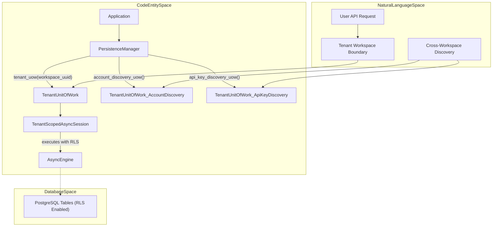
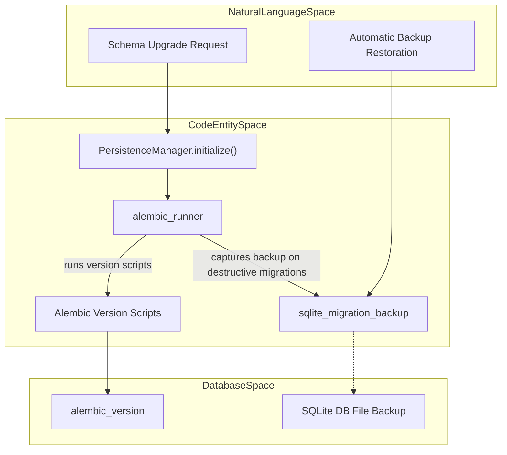

<!-- source: DeepWiki mcp.deepwiki.com · repo langbot-app/LangBot · page 3.3 Database and Persistence Layer · fetched 2026-10-29 -->

# Database and Persistence Layer

Relevant source files

The following files were used as context for generating this wiki page:

- [src/langbot/pkg/api/http/context.py](src/langbot/pkg/api/http/context.py)
- [src/langbot/pkg/cloud/launch.py](src/langbot/pkg/cloud/launch.py)
- [src/langbot/pkg/cloud/support_admin.py](src/langbot/pkg/cloud/support_admin.py)
- [src/langbot/pkg/entity/persistence/agent_interaction.py](src/langbot/pkg/entity/persistence/agent_interaction.py)
- [src/langbot/pkg/entity/persistence/assistant.py](src/langbot/pkg/entity/persistence/assistant.py)
- [src/langbot/pkg/entity/persistence/cloud_directory.py](src/langbot/pkg/entity/persistence/cloud_directory.py)
- [src/langbot/pkg/entity/persistence/pipeline.py](src/langbot/pkg/entity/persistence/pipeline.py)
- [src/langbot/pkg/entity/persistence/resource_url.py](src/langbot/pkg/entity/persistence/resource_url.py)
- [src/langbot/pkg/persistence/alembic/versions/0016_space_launch_replay.py](src/langbot/pkg/persistence/alembic/versions/0016_space_launch_replay.py)
- [src/langbot/pkg/persistence/alembic/versions/0018_merge_launch_replay.py](src/langbot/pkg/persistence/alembic/versions/0018_merge_launch_replay.py)
- [src/langbot/pkg/persistence/alembic/versions/0040_session_summaries.py](src/langbot/pkg/persistence/alembic/versions/0040_session_summaries.py)
- [src/langbot/pkg/persistence/alembic/versions/0041_resource_urls.py](src/langbot/pkg/persistence/alembic/versions/0041_resource_urls.py)
- [src/langbot/pkg/persistence/alembic/versions/0042_sqlite_incremental_vacuum.py](src/langbot/pkg/persistence/alembic/versions/0042_sqlite_incremental_vacuum.py)
- [src/langbot/pkg/persistence/alembic_runner.py](src/langbot/pkg/persistence/alembic_runner.py)
- [src/langbot/pkg/persistence/databases/sqlite.py](src/langbot/pkg/persistence/databases/sqlite.py)
- [src/langbot/pkg/persistence/mgr.py](src/langbot/pkg/persistence/mgr.py)
- [src/langbot/pkg/persistence/resource_urls.py](src/langbot/pkg/persistence/resource_urls.py)
- [src/langbot/pkg/persistence/sqlite_reclamation.py](src/langbot/pkg/persistence/sqlite_reclamation.py)
- [src/langbot/pkg/persistence/tenant_uow.py](src/langbot/pkg/persistence/tenant_uow.py)
- [tests/integration/persistence/test_migration_branch_convergence.py](tests/integration/persistence/test_migration_branch_convergence.py)
- [tests/integration/persistence/test_migrations.py](tests/integration/persistence/test_migrations.py)
- [tests/integration/persistence/test_migrations_postgres.py](tests/integration/persistence/test_migrations_postgres.py)
- [tests/integration/persistence/test_sqlite_migration_backup.py](tests/integration/persistence/test_sqlite_migration_backup.py)
- [tests/integration/persistence/test_sqlite_reclamation.py](tests/integration/persistence/test_sqlite_reclamation.py)
- [tests/unit_tests/api/service/test_monitoring_sessions.py](tests/unit_tests/api/service/test_monitoring_sessions.py)
- [tests/unit_tests/api/service/test_monitoring_tenancy.py](tests/unit_tests/api/service/test_monitoring_tenancy.py)
- [tests/unit_tests/cloud/test_space_launch.py](tests/unit_tests/cloud/test_space_launch.py)
- [tests/unit_tests/persistence/test_resource_urls.py](tests/unit_tests/persistence/test_resource_urls.py)
- [tests/unit_tests/persistence/test_tenant_uow.py](tests/unit_tests/persistence/test_tenant_uow.py)
- [web/src/app/auth/space/callback/page.tsx](web/src/app/auth/space/callback/page.tsx)

This page documents the database and ORM stack, the persistence manager, the migration systems (Alembic), sqlite backup, core tables, and core database architecture used to manage schema evolution and persistence in LangBot [src/langbot/pkg/persistence/mgr.py:117]().

---

## Purpose and Scope

The persistence and database layer provides an asynchronous, reliable storage backend for LangBot. It abstracts database drivers via SQLAlchemy ORM [src/langbot/pkg/entity/persistence/base.py:5](), supports both SQLite (for local/standalone deployments) and PostgreSQL (for production and multi-tenant cloud runtimes) [src/langbot/pkg/persistence/mgr.py:141-164](), manages transactional boundaries with tenant isolation through `TenantUnitOfWork` [src/langbot/pkg/persistence/mgr.py:23-45](), and coordinates schema evolution via Alembic migrations [tests/integration/persistence/test_migrations.py:22-28]().

Sources: [src/langbot/pkg/entity/persistence/base.py:5](), [src/langbot/pkg/persistence/mgr.py:23-45](), [src/langbot/pkg/persistence/mgr.py:117](), [src/langbot/pkg/persistence/mgr.py:141-164](), [tests/integration/persistence/test_migrations.py:22-28]()

---

## Technology Stack

LangBot utilizes **SQLAlchemy** as its primary Object-Relational Mapping (ORM) framework, paired with `asyncio` drivers for fully asynchronous database operations [src/langbot/pkg/persistence/mgr.py:13-16]().

| Component | Package / Module | Role |
|---|---|---|
| ORM Base & Models | `sqlalchemy` | Object definitions, metadata tracking, and schema declaration [src/langbot/pkg/entity/persistence/base.py:5]() |
| Async Engine | `sqlalchemy.ext.asyncio` | Asynchronous session management and connection pooling [src/langbot/pkg/persistence/mgr.py:13-16]() |
| SQLite Driver | `aiosqlite` | Async adapter for SQLite storage [tests/integration/persistence/test_migrations.py:17]() |
| PostgreSQL Driver | `asyncpg` | High-performance async adapter for PostgreSQL [src/langbot/pkg/persistence/mgr.py:148-150]() |
| Migration Runner | `alembic` | Modern database schema migration framework [tests/integration/persistence/test_migrations.py:22-28]() |

Sources: [src/langbot/pkg/entity/persistence/base.py:5](), [src/langbot/pkg/persistence/mgr.py:13-16](), [src/langbot/pkg/persistence/mgr.py:148-150](), [tests/integration/persistence/test_migrations.py:17](), [tests/integration/persistence/test_migrations.py:22-28]()

---

## Supported Databases

LangBot supports two distinct database backends, selected via the `database.use` key in configuration [src/langbot/pkg/persistence/mgr.py:164-169]():

1. **SQLite (`aiosqlite`)**: The default engine for standalone, single-user, and local development environments [tests/integration/persistence/test_migrations.py:55-56](). SQLite initialization automatically configures WAL journal mode and incremental auto-vacuum [src/langbot/pkg/persistence/databases/sqlite.py:13-23]().
2. **PostgreSQL (`asyncpg`)**: Required for production environments, multi-tenant cloud operations, and features relying on Row-Level Security (RLS) [src/langbot/pkg/persistence/mgr.py:179-182]().

Extensive integration tests validate schema migrations across both backends, ensuring upgrade paths remain consistent and reliable [tests/integration/persistence/test_migrations.py:1-8]().

Sources: [src/langbot/pkg/persistence/mgr.py:164-169](), [src/langbot/pkg/persistence/mgr.py:179-182](), [src/langbot/pkg/persistence/databases/sqlite.py:13-23](), [tests/integration/persistence/test_migrations.py:1-8](), [tests/integration/persistence/test_migrations.py:55-56]()

---

## Persistence Manager and Multi-Tenancy

The persistence layer is anchored by the `PersistenceManager` class in `src/langbot/pkg/persistence/mgr.py` [src/langbot/pkg/persistence/mgr.py:124-195](). This manager abstracts the database backend choice, configuration, initialization, and concurrency boundaries.

### Persistence Modes
`PersistenceManager` operates in one of three trusted modes defined by the `PersistenceMode` enum [src/langbot/pkg/persistence/mgr.py:116-123]():

- `OSS_COMPAT`: Default open-source mode using SQLite or PostgreSQL.
- `CLOUD_RUNTIME`: Multi-tenant production mode requiring PostgreSQL, enabling strict Row-Level Security (RLS).
- `RELEASE_MIGRATION`: Special mode for running schema migrations with elevated permissions and separate database URL override.

### Tenant Isolation and Unit of Work
Tenancy isolation is provided by `TenantUnitOfWork` (defined in `tenant_uow.py`), which manages PostgreSQL session context including workspace scoping and tenant policies to enforce strict data isolation by workspace UUID [src/langbot/pkg/persistence/mgr.py:23-45]().

The `PersistenceManager` tracks active persistence scopes and scoped transactions using `contextvars.ContextVar` to ensure context propagation across async tasks safely [src/langbot/pkg/persistence/mgr.py:154-160]().

Title: "Persistence Manager and Scoped Tenant Unit of Work Architecture"

Sources: [src/langbot/pkg/persistence/mgr.py:23-45](), [src/langbot/pkg/persistence/mgr.py:116-123](), [src/langbot/pkg/persistence/mgr.py:124-195]()

---

## Core Tables and Entities

LangBot uses SQLAlchemy declarative base classes (`Base`) to define ORM mapped entities [src/langbot/pkg/entity/persistence/base.py:5](). These models represent core business concepts stored in the database, including tenancy, user accounts, API keys, bots, plugins, knowledge bases, and monitoring logs.

The set of tenant-scoped core tables is enumerated in `_ALEMBIC_TENANT_TABLES` in `mgr.py` [src/langbot/pkg/persistence/mgr.py:51-92]().

### Workspace and Membership

| Table Name | Entity Name | Description |
|---|---|---|
| `workspaces` | `Workspace` | Tenant workspace container, tenancy boundary [src/langbot/pkg/entity/persistence/workspace.py:72]() |
| `workspace_memberships` | `WorkspaceMembership` | Associates users with workspaces, defines roles [src/langbot/pkg/entity/persistence/workspace.py:133]() |
| `workspace_invitations` | `WorkspaceInvitation` | Pending workspace invitations [src/langbot/pkg/entity/persistence/workspace.py:198]() |
| `workspace_execution_states` | `WorkspaceExecutionState` | Tracks execution generation, fencing [src/langbot/pkg/entity/persistence/workspace.py:222]() |

Sources: [src/langbot/pkg/entity/persistence/base.py:5](), [src/langbot/pkg/entity/persistence/workspace.py:72-222](), [src/langbot/pkg/persistence/mgr.py:51-92]()

---

## Migration Systems (Alembic) and SQLite Backups

LangBot employs Alembic, a powerful database migration framework integrated with SQLAlchemy ORM, to manage database schema evolution. Migration scripts reside in `src/langbot/pkg/persistence/alembic/versions/` [tests/integration/persistence/test_migrations.py:22-28]().

### Migration Workflow & SQLite Backup Highlights
- **Baseline Migration (`0001_baseline`)** establishes the initial schema and is stamped on newly created databases [tests/integration/persistence/test_migrations.py:98-106]().
- **Multi-Tenancy (`0009_workspace_tenancy`)** introduces workspace tenancy and RLS policies [src/langbot/pkg/persistence/mgr.py:105]().
- **SQLite Migration Backups**: For SQLite databases, migration workflows automatically create verified boundary backups (`sqlite_migration_backup`) prior to running destructive or major structural updates, restoring from backup automatically if an upgrade fails [tests/integration/persistence/test_sqlite_migration_backup.py:72-136]().
- **Resource URLs (`0041_resource_urls`)**: Normalizes retained resource URLs behind stable shared references across metadata tables [src/langbot/pkg/persistence/alembic/versions/0041_resource_urls.py:1-25]().

Title: "Migration Pipeline and Execution Flow"

Sources: [src/langbot/pkg/persistence/alembic/versions/0041_resource_urls.py:1-25](), [src/langbot/pkg/persistence/mgr.py:105-195](), [tests/integration/persistence/test_migrations.py:22-28](), [tests/integration/persistence/test_migrations.py:98-106](), [tests/integration/persistence/test_sqlite_migration_backup.py:72-136]()

---

## Vector Database Integration

LangBot's vector storage, critical for semantic search and embeddings, is separated from the relational persistence layer. Different vector DB backends are supported, including Chroma, Qdrant, Milvus, pgvector, SeekDB, and Valkey Search.

Within the `CLOUD_RUNTIME` persistence mode, the `pgvector` extension on PostgreSQL is mandatory. The core table `langbot_vectors` stores vectors with strict dimensionality checks enforcing allowed embedding dimensions (384, 512, 768, 1024, 1536, 3072), ensuring compatibility with various embedding models [src/langbot/pkg/persistence/mgr.py:89-109]().

Sources: [src/langbot/pkg/persistence/mgr.py:89-109]()

---

## Datetime Utilities and Data Flow

Throughout `src/langbot/pkg/persistence/mgr.py` and entity definitions, UTC-aware `datetime` objects are consistently used for all timestamp columns, with defaults populated by `sqlalchemy.func.now()` ensuring database-side time consistency.

Transactional workflows utilize async context managers for `TenantUnitOfWork` and `ActiveScopedTransaction` to provide atomic and tenant-isolated unit-of-work boundaries around runtime operations [src/langbot/pkg/persistence/mgr.py:23-45]().

Sources: [src/langbot/pkg/persistence/mgr.py:23-45](), [src/langbot/pkg/persistence/mgr.py:1-195]()

---

# Summary

LangBot’s database and persistence layer leverages Python’s asynchronous SQLAlchemy ORM with SQLite and PostgreSQL engines, managed via a `PersistenceManager` singleton. It supports robust multi-tenancy with tenant-scoped units of work enforcing PostgreSQL Row-Level Security for cloud deployments. The system is governed by a rich migration framework using Alembic with durable SQLite backup/restore safety wrappers.

Sources: [src/langbot/pkg/persistence/mgr.py:1-195](), [src/langbot/pkg/entity/persistence/base.py:5](), [tests/integration/persistence/test_migrations.py:22-188]()

---

