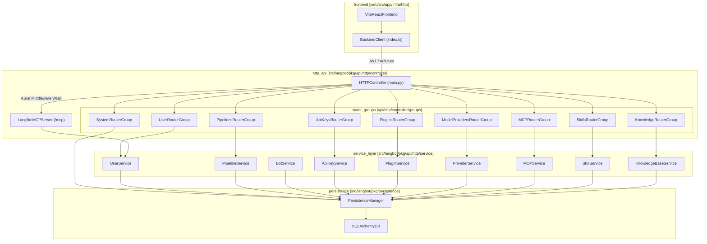
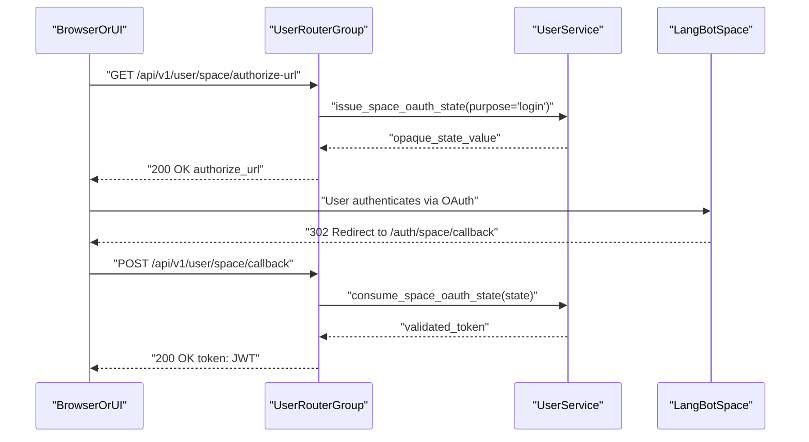
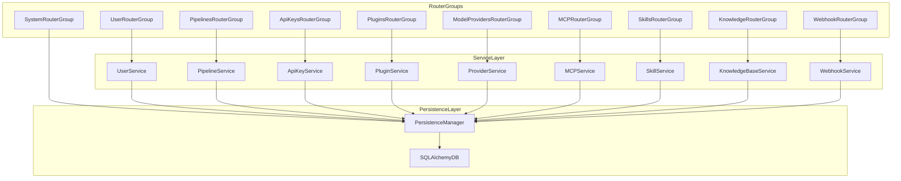

<!-- source: DeepWiki mcp.deepwiki.com · repo langbot-app/LangBot · page 3.4 HTTP API Architecture · fetched 2026-10-29 -->

# HTTP API Architecture

Relevant source files

The following files were used as context for generating this wiki page:

- [src/langbot/pkg/api/http/controller/groups/knowledge/base.py](src/langbot/pkg/api/http/controller/groups/knowledge/base.py)
- [src/langbot/pkg/api/http/controller/groups/pipelines/pipelines.py](src/langbot/pkg/api/http/controller/groups/pipelines/pipelines.py)
- [src/langbot/pkg/api/http/controller/groups/provider/models.py](src/langbot/pkg/api/http/controller/groups/provider/models.py)
- [src/langbot/pkg/api/http/controller/groups/provider/providers.py](src/langbot/pkg/api/http/controller/groups/provider/providers.py)
- [src/langbot/pkg/api/http/controller/groups/provider/query.py](src/langbot/pkg/api/http/controller/groups/provider/query.py)
- [src/langbot/pkg/api/http/controller/groups/resources/mcp.py](src/langbot/pkg/api/http/controller/groups/resources/mcp.py)
- [src/langbot/pkg/api/http/controller/groups/skills.py](src/langbot/pkg/api/http/controller/groups/skills.py)
- [src/langbot/pkg/api/http/controller/groups/system.py](src/langbot/pkg/api/http/controller/groups/system.py)
- [src/langbot/pkg/api/http/controller/main.py](src/langbot/pkg/api/http/controller/main.py)
- [src/langbot/pkg/api/http/controller/social_preview.py](src/langbot/pkg/api/http/controller/social_preview.py)
- [src/langbot/pkg/api/http/service/model.py](src/langbot/pkg/api/http/service/model.py)
- [src/langbot/pkg/api/http/service/pipeline.py](src/langbot/pkg/api/http/service/pipeline.py)
- [src/langbot/pkg/api/http/service/skill.py](src/langbot/pkg/api/http/service/skill.py)
- [src/langbot/pkg/persistence/alembic/versions/0033_operation_traceability.py](src/langbot/pkg/persistence/alembic/versions/0033_operation_traceability.py)
- [tests/integration/api/test_knowledge.py](tests/integration/api/test_knowledge.py)
- [tests/integration/api/test_pipelines.py](tests/integration/api/test_pipelines.py)
- [tests/integration/api/test_providers.py](tests/integration/api/test_providers.py)
- [tests/integration/api/test_support_admin_launch.py](tests/integration/api/test_support_admin_launch.py)
- [tests/integration/api/test_workspaces.py](tests/integration/api/test_workspaces.py)
- [tests/unit_tests/api/service/test_mcp_service.py](tests/unit_tests/api/service/test_mcp_service.py)
- [tests/unit_tests/api/service/test_model_default_pipeline_binding.py](tests/unit_tests/api/service/test_model_default_pipeline_binding.py)
- [tests/unit_tests/api/service/test_pipeline_create_description.py](tests/unit_tests/api/service/test_pipeline_create_description.py)
- [tests/unit_tests/api/service/test_user_service.py](tests/unit_tests/api/service/test_user_service.py)
- [tests/unit_tests/api/service/test_webhook_service.py](tests/unit_tests/api/service/test_webhook_service.py)
- [tests/unit_tests/persistence/test_dedicated_space_provider.py](tests/unit_tests/persistence/test_dedicated_space_provider.py)
- [tests/unit_tests/test_skill_service.py](tests/unit_tests/test_skill_service.py)
- [tests/unit_tests/test_social_preview.py](tests/unit_tests/test_social_preview.py)
- [tests/unit_tests/utils/test_logcache.py](tests/unit_tests/utils/test_logcache.py)
- [tests/unit_tests/vector/test_vdb_base.py](tests/unit_tests/vector/test_vdb_base.py)
- [web/public/social/cloud-v3.png](web/public/social/cloud-v3.png)
- [web/src/app/home/components/workspace-settings/WorkspaceSettingsPanel.tsx](web/src/app/home/components/workspace-settings/WorkspaceSettingsPanel.tsx)
- [web/src/app/infra/http/index.ts](web/src/app/infra/http/index.ts)

This page documents the server-side HTTP API layer of LangBot: the Quart-based web framework configuration, router group organization, authentication model (JWT, Space OAuth, API key, and Support Admin), the service layer pattern, API versioning, asynchronous task manager, webhook endpoints, and the built-in Model Context Protocol (MCP) server at `/mcp`. This API serves the web management panel as well as external programmatic integrations.

For documentation on the frontend client that consumes this API, see [8.3. HTTP and WebSocket Client System](). For the WebSocket-based pipeline debug interface, see [4.4. Pipeline Debug and WebSocket Interface]().

---

## Framework and Server Configuration

LangBot's HTTP API is built upon the asynchronous Python web framework [Quart](https://quart.palletsprojects.com/). The HTTP server is managed by the `HTTPController` class, which is responsible for configuring the Quart app, applying middleware, registering routes, and running the server asynchronously [src/langbot/pkg/api/http/controller/main.py:70-105]().

Key configurations in `config.yaml` that affect the HTTP API layer include:

| Key | Default | Description |
|---|---|---|
| `api.port` | `5300` | TCP port on which the Quart server listens |
| `system.jwt.expire` | `3600` | JWT token lifetime in seconds (1 hour) [tests/integration/api/test_workspaces.py:55-56]() |
| `api.global_api_key` | `''` | Global API key used for external or agent integrations |

The `HTTPController` configures the maximum content length for file uploads (10MB) and installs a custom request class `BoundedJSONRequest` that offloads JSON body parsing to a thread pool (`asyncio.to_thread`), preventing the main event loop from blocking during large JSON decoding [src/langbot/pkg/api/http/controller/main.py:39-67]().

Cross-Origin Resource Sharing (CORS) policy is set via `quart_cors.cors` to allow all origins by default [src/langbot/pkg/api/http/controller/main.py:79](). The server also includes a SPA fallback strategy where requests not matching API paths serve the frontend's `index.html`, enabling client-side routing [src/langbot/pkg/api/http/controller/main.py:173-186]().

Sources:
- [src/langbot/pkg/api/http/controller/main.py:39-186]()
- [tests/integration/api/test_workspaces.py:55-56]()

---

## Overall Architecture

The HTTP API layer is organized with a central `HTTPController` that initializes the Quart app and mounts a collection of router groups, each representing a segment of the API grouped by resource type or domain responsibility. The API groups serve RESTful endpoints for users, pipelines, systems, bots, plugins, and more.

A built-in MCP server is mounted at the endpoint `/mcp` and is integrated at the ASGI layer via `MCPMount.wrap`, allowing direct, authenticated agent access to LangBot services without traversing the full HTTP API router [src/langbot/pkg/api/http/controller/main.py:88-151]().

### Component Diagram: HTTP API Architecture and Interactions

This structure enables clear separation between HTTP routing (including authentication), business logic in service classes, and persistence via SQLAlchemy.

Sources:
- [src/langbot/pkg/api/http/controller/main.py:31-186]()
- [src/langbot/pkg/api/http/controller/groups/system.py:115-116]()
- [src/langbot/pkg/api/http/controller/groups/pipelines/pipelines.py:17-18]()
- [tests/integration/api/test_workspaces.py:75-79]()
- [web/src/app/infra/http/index.ts:66-68]()
- [src/langbot/pkg/api/http/controller/groups/skills.py]()
- [src/langbot/pkg/api/http/controller/groups/knowledge/base.py]()

---

## Authentication Methods

LangBot supports multiple authentication mechanisms to secure the HTTP API requests. The implemented authentication types are enumerated in the `group.AuthType` enum and enforced on router group endpoints by the route decorators [src/langbot/pkg/api/http/controller/group.py:53-170]().

### 1. JWT (User Token, Bearer Token)
- Used primarily for authenticating human users on the web management UI.
- Workflow:
  - Login via `POST /api/v1/user/auth` issues JWT tokens [src/langbot/pkg/api/http/controller/groups/user.py:61-74]().
  - `UserService` validates credentials, issues and verifies tokens [tests/unit_tests/api/service/test_user_service.py:165-184]().
  - Frontend stores tokens in `localStorage` and attaches them to API requests under `Authorization: Bearer` header [web/src/app/infra/http/index.ts:211-223]().

### 2. Space OAuth (Redirect Flow)
- Enables integration with LangBot Space for single sign-on and account linking.
- Client fetches the OAuth authorize URL via `GET /api/v1/user/space/authorize-url`.
- `UserService` issues single-use opaque states with monotonic expiry heaps for CSRF and replay protection [tests/unit_tests/api/service/test_user_service.py:58-114]().
- Redirect flow ends with the web UI posting the authorization code and state to `POST /api/v1/user/space/callback` which exchanges for a JWT session token [web/src/app/infra/http/index.ts:209-223]().

### 3. API Key (X-API-Key or Bearer Token)
- Intended for programmatic access, integrations, and automated agents.
- API keys are generated via the web UI with prefix `lbk_...` and stored securely as hashed secrets [src/langbot/pkg/api/http/service/apikey.py:26-70]().
- A global static key can be optionally configured in `api.global_api_key` for single-tenant OSS instances [src/langbot/pkg/api/http/service/apikey.py:67-69]().
- Router groups specify routes that accept API keys via `AuthType.API_KEY` or combined JWT/API key semantics via `AuthType.USER_TOKEN_OR_API_KEY`.
- Authentication inspects either `X-API-Key` header or `Authorization: Bearer` token for API keys [src/langbot/pkg/api/http/controller/group.py:152-170]().

### 4. Support Admin Sessions
- Special, restricted sessions for support admins authenticated via Ed25519-signed JWTs issued by the LangBot control plane.
- Used for troubleshooting specific workspaces in SaaS deployments.
- Support admin tokens are blocked from accessing account-level and membership management endpoints to enforce security policies [src/langbot/pkg/cloud/support_admin.py:48-96](), [src/langbot/pkg/api/http/controller/group.py:63-71, 117-120]().

Sources:
- [src/langbot/pkg/api/http/controller/group.py:53-170]()
- [src/langbot/pkg/api/http/controller/groups/user.py:61-74]()
- [tests/unit_tests/api/service/test_user_service.py:58-184]()
- [web/src/app/infra/http/index.ts:211-223]()
- [src/langbot/pkg/api/http/service/apikey.py:26-70]()
- [src/langbot/pkg/cloud/support_admin.py:48-96]()

---

## Service Layer Pattern

The HTTP controller layer delegates complex business logic and data access to service classes beneath it, implementing a Service Layer pattern for better separation and testability.

### UserService
- Handles account lifecycle, authentication flows, and Space OAuth state management.
- Key functions: `issue_space_oauth_state()`, `consume_space_oauth_state_details()`.
- Implements atomic consumption of OAuth states to prevent replay [tests/unit_tests/api/service/test_user_service.py:58-114]().

### PipelineService
- Manages CRUD for pipelines, including configurations and extensions preferences.
- Supports returning metadata schemas for dynamic UI generation.
- Supports secret redaction for safe API exposure via `redact_secrets()` [src/langbot/pkg/api/http/service/pipeline.py:35-171]().

### BotService
- Provides management of bot entities with secure masking of adapter config secrets.
- Resolves runtime bot information including platform webhook URLs.
- Serves inbound webhook events for bots, dispatching directly into pipeline runtime [src/langbot/pkg/api/http/service/bot.py:76-95]().

### ApiKeyService
- CRUD for API keys with scopes, expiry, and workspace binding.
- Handles secret hashing and permissions evaluation.
- Integrated with the HTTP API controller for authentication and authorization [tests/integration/api/test_workspaces.py:72-73]().

### MCPService
- Manages MCP server entities, including creation, update, deletion, and connection testing.
- Provides runtime information about MCP server sessions and resource templates [tests/unit_tests/api/service/test_mcp_service.py:117-203]().

### SkillService
- Manages skills, including listing, getting, creating, updating, and deleting skills.
- Handles skill file operations like reading and writing [src/langbot/pkg/api/http/service/skill.py:30-100]().

### PersistenceManager
- Centralized management of SQLAlchemy engine, tenant-scoped transactions, and database execution helpers [src/langbot/pkg/persistence/mgr.py:117-199]().

Sources:
- [tests/unit_tests/api/service/test_user_service.py:58-114]()
- [src/langbot/pkg/api/http/service/pipeline.py:35-171]()
- [src/langbot/pkg/api/http/service/bot.py:76-95]()
- [tests/integration/api/test_workspaces.py:72-73]()
- [tests/unit_tests/api/service/test_mcp_service.py:117-203]()
- [src/langbot/pkg/api/http/service/skill.py:30-100]()
- [src/langbot/pkg/persistence/mgr.py:117-199]()

---

## API Versioning, Router Groups, and Endpoints

Routes are organized as subclasses of `RouterGroup` decorated with `@group.group_class(name, path)` and are mounted under the URI prefix `/api/v1/`. Each router group corresponds to a coherent domain and contains endpoint route handlers using an async Quart framework.

### Space OAuth Redirect and Session Bootstrap Flow

### Key Router Groups and Services

| Router Group | Prefix | Purpose | Service Layer |
|---|---|---|---|
| User | `/api/v1/user` | User auth, password, Space OAuth | `UserRouterGroup`, `UserService` |
| System | `/api/v1/system` | System info, capabilities, wizard status | `SystemRouterGroup` |
| Pipelines | `/api/v1/pipelines` | Pipeline lifecycle and extensions | `PipelinesRouterGroup`, `PipelineService` |
| ApiKeys | `/api/v1/apikeys` | API key management | `ApiKeysRouterGroup`, `ApiKeyService` |
| Plugins | `/api/v1/plugins` | Plugin lifecycle and configuration | `PluginsRouterGroup`, `PluginService` |
| Providers | `/api/v1/provider` | Model providers and model config | `ModelProvidersRouterGroup`, `ProviderService` |
| MCP | `/api/v1/mcp` | MCP server management | `MCPRouterGroup`, `MCPService` |
| Skills | `/api/v1/skills` | Skill management | `SkillsRouterGroup`, `SkillService` |
| Knowledge | `/api/v1/knowledge` | Knowledge base management | `KnowledgeRouterGroup`, `KnowledgeBaseService` |
| Webhook | `/api/v1/webhook` | Webhook registrations and delivery | `WebhookRouterGroup`, `WebhookService` |

Sources:
- [src/langbot/pkg/api/http/controller/groups/user.py:15-162]()
- [src/langbot/pkg/api/http/controller/groups/system.py:15-130]()
- [src/langbot/pkg/api/http/controller/groups/pipelines/pipelines.py:11-156]()
- [tests/integration/api/test_workspaces.py:75-79]()
- [src/langbot/pkg/api/http/controller/groups/skills.py]()
- [src/langbot/pkg/api/http/controller/groups/knowledge/base.py]()
- [tests/unit_tests/api/service/test_webhook_service.py:26-27]()

---

## Task Manager and Background Tasks

LangBot employs an asynchronous task manager to coordinate long-running operations such as plugin installation, ingestion jobs, and resource synchronization.

- The core task manager classes `AsyncTaskManager`, `TaskContext`, and `TaskWrapper` reside in `src/langbot/pkg/core/taskmgr.py`.
- `TaskContext` tracks operational state, log lines with automatic truncation, and progress metadata.
- `TaskWrapper` wraps detached asyncio tasks, preserving tenancy context and lifecycle control, and exposing error stack traces for debugging [src/langbot/pkg/core/taskmgr.py:15-217]().

The task manager integrates tightly with API calls that initiate asynchronous workflows, providing progress tracking via the API. For example, plugin installation routes use `taskmgr.create_task` to run the installation in the background [src/langbot/pkg/api/http/controller/groups/plugins.py:290-295]().

Sources:
- [src/langbot/pkg/core/taskmgr.py:15-217]()
- [src/langbot/pkg/api/http/controller/groups/plugins.py:290-295]()

---

## API Key Management and Webhook Endpoints

### API Key Management
API keys are managed by the `ApiKeysRouterGroup` and `ApiKeyService`. These keys support:
- Per-workspace binding and scoped permissions.
- Secret key material revealed only once, stored as secure hashes.
- Multiple authentication headers supported (`X-API-Key`, `Authorization: Bearer`) [tests/integration/api/test_workspaces.py:72-73]().

### Webhook Endpoints and Pusher
- LangBot supports webhook adapters for diverse platforms (WeCom, DingTalk, HTTP Bot, etc).
- Inbound webhook routes are bound to specific bots, allowing direct integration with runtime pipelines upon receiving platform events [src/langbot/pkg/api/http/service/bot.py:76-95]().
- Outbound notification delivery utilizes the `WebhookPusher`, which manages rate-limit slots, push concurrency, and error handling [src/langbot/pkg/platform/webhook_pusher.py:22-178]().
- The `WebhookService` provides CRUD operations for webhook entities [tests/unit_tests/api/service/test_webhook_service.py:71-126]().

Sources:
- [tests/integration/api/test_workspaces.py:72-73]()
- [src/langbot/pkg/api/http/service/bot.py:76-95]()
- [src/langbot/pkg/platform/webhook_pusher.py:22-178]()
- [tests/unit_tests/api/service/test_webhook_service.py:71-126]()

---

## Built-in MCP Server (`/mcp` Endpoint)

LangBot includes a built-in Model Context Protocol (MCP) server exposed at `/mcp`. The MCP server provides a lightweight, curated subset of the HTTP service API surfaced to AI agents for programmatic control [src/langbot/pkg/api/mcp/server.py:58-157](), [skills/skills/langbot-mcp-ops/SKILL.md:7-131]().

- **Transport:** Stateless streamable HTTP, served via the same host and port as the main API.
- **Authentication:** Uses the same API key scheme as HTTP API (`X-API-Key` or `Authorization: Bearer`).
- **Tool Surface:** Exposes tools for system info retrieval, bot and pipeline management, knowledge base access, skill listing, and runtime operations.
- **Implementation:** MCP tools directly invoke service layer functions, bypassing HTTP to ensure tight integration and consistent authorization.
- **Security:** Each MCP tool enforces RBAC permissions consistent with HTTP API rules.
- **Lifecycle:** The `MCPMount` is built lazily when the `HTTPController` initializes and runs its session manager asynchronously during server startup [src/langbot/pkg/api/http/controller/main.py:88-105]().

Sources:
- [src/langbot/pkg/api/mcp/server.py:58-157]()
- [skills/skills/langbot-mcp-ops/SKILL.md:7-131]()
- [src/langbot/pkg/api/http/controller/main.py:88-105]()

---

## Natural Language API Concepts to Code Entities

```mermaid
graph TD
    subgraph "APIConcepts"
        A1["UserAuthentication"]
        A2["PipelineManagement"]
        A3["BotAndWebhookHandling"]
        A4["TaskManagement"]
        A5["MCPServerIntegration"]
        A6["PluginManagement"]
        A7["ModelProviderManagement"]
        A8["SystemInformation"]
        A9["SkillManagement"]
        A10["KnowledgeBaseManagement"]
    end

    subgraph "CodeEntities"
        C1["UserRouterGroup"]
        C2["UserService"]
        C3["PipelinesRouterGroup"]
        C4["PipelineService"]
        C5["BotService"]
        C6["WebhookPusher"]
        C7["AsyncTaskManager"]
        C8["LangBotMCPServer"]
        C9["MCPMount"]
        C10["PluginsRouterGroup"]
        C11["PluginService"]
        C12["LLMModelsRouterGroup"]
        C13["ProviderService"]
        C14["SystemRouterGroup"]
        C15["SkillsRouterGroup"]
        C16["SkillService"]
        C17["KnowledgeRouterGroup"]
        C18["KnowledgeBaseService"]
    end

    A1 --> C1
    A1 --> C2
    A2 --> C3
    A2 --> C4
    A3 --> C5
    A3 --> C6
    A4 --> C7
    A5 --> C8
    A5 --> C9
    A6 --> C10
    A6 --> C11
    A7 --> C12
    A7 --> C13
    A8 --> C14
    A9 --> C15
    A9 --> C16
    A10 --> C17
    A10 --> C18
```

Sources:
- [src/langbot/pkg/api/http/controller/groups/user.py]()
- [src/langbot/pkg/api/http/service/user.py]()
- [src/langbot/pkg/api/http/controller/groups/pipelines/pipelines.py]()
- [src/langbot/pkg/api/http/service/pipeline.py]()
- [src/langbot/pkg/api/http/service/bot.py]()
- [src/langbot/pkg/platform/webhook_pusher.py]()
- [src/langbot/pkg/core/taskmgr.py]()
- [src/langbot/pkg/api/mcp/server.py]()
- [src/langbot/pkg/api/http/controller/main.py]()
- [src/langbot/pkg/api/http/controller/groups/plugins.py]()
- [src/langbot/pkg/api/http/controller/groups/system.py]()
- [src/langbot/pkg/api/http/controller/groups/provider/models.py:14-15]()
- [src/langbot/pkg/api/http/controller/groups/provider/providers.py]()
- [src/langbot/pkg/api/http/service/skill.py]()
- [src/langbot/pkg/api/http/controller/groups/skills.py]()
- [src/langbot/pkg/api/http/controller/groups/knowledge/base.py]()

---

## HTTP Router Groups and Service Layer Interaction with Persistence

Sources:
- [src/langbot/pkg/api/http/controller/groups/user.py]()
- [src/langbot/pkg/api/http/controller/groups/pipelines/pipelines.py]()
- [src/langbot/pkg/api/http/controller/groups/system.py]()
- [src/langbot/pkg/api/http/controller/groups/apikeys.py]()
- [src/langbot/pkg/api/http/controller/groups/plugins.py]()
- [src/langbot/pkg/api/http/controller/groups/provider/providers.py]()
- [src/langbot/pkg/api/http/controller/groups/resources/mcp.py]()
- [src/langbot/pkg/api/http/controller/groups/skills.py]()
- [src/langbot/pkg/api/http/controller/groups/knowledge/base.py]()
- [src/langbot/pkg/api/http/controller/groups/webhook.py]()
- [src/langbot/pkg/api/http/service/user.py]()
- [src/langbot/pkg/api/http/service/pipeline.py]()
- [src/langbot/pkg/api/http/service/skill.py]()
- [src/langbot/pkg/api/http/service/webhook.py]()
- [src/langbot/pkg/persistence/mgr.py]()

---

