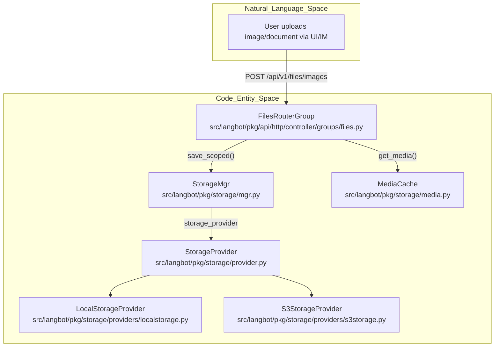
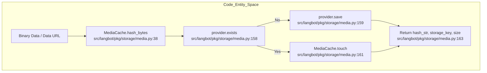
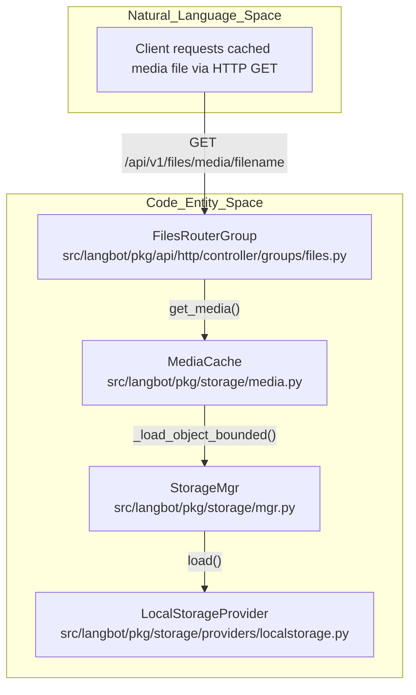
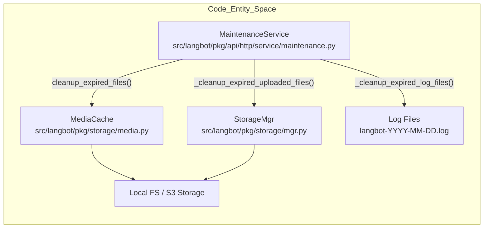

<!-- source: DeepWiki mcp.deepwiki.com · repo langbot-app/LangBot · page 3.6 Storage System · fetched 2026-10-29 -->

# Storage System

Relevant source files

The following files were used as context for generating this wiki page:

- [src/langbot/pkg/api/http/controller/groups/files.py](src/langbot/pkg/api/http/controller/groups/files.py)
- [src/langbot/pkg/api/http/service/maintenance.py](src/langbot/pkg/api/http/service/maintenance.py)
- [src/langbot/pkg/pipeline/monitoring_helper.py](src/langbot/pkg/pipeline/monitoring_helper.py)
- [src/langbot/pkg/storage/media.py](src/langbot/pkg/storage/media.py)
- [src/langbot/pkg/storage/mgr.py](src/langbot/pkg/storage/mgr.py)
- [tests/unit_tests/agent/test_run_journal.py](tests/unit_tests/agent/test_run_journal.py)
- [tests/unit_tests/api/service/test_maintenance_service.py](tests/unit_tests/api/service/test_maintenance_service.py)
- [tests/unit_tests/api/test_file_upload_scoping.py](tests/unit_tests/api/test_file_upload_scoping.py)
- [tests/unit_tests/pipeline/test_monitoring_failure.py](tests/unit_tests/pipeline/test_monitoring_failure.py)
- [tests/unit_tests/pipeline/test_terminal_monitoring.py](tests/unit_tests/pipeline/test_terminal_monitoring.py)
- [tests/unit_tests/storage/test_media_cache.py](tests/unit_tests/storage/test_media_cache.py)

## Purpose and Scope

The Storage System provides a unified abstraction layer for managing binary data, uploaded files, media payloads, and workspace-scoped artifacts in LangBot. It coordinates file-based storage for documents, knowledge base attachments, image payloads, and plugin distribution packages (`.lbpkg`) through pluggable storage providers. The system supports both local filesystem storage and cloud-scale S3-compatible object storage, incorporating content-addressable caching, deduplication, bounded read limits, and automated retention cleanup.

Sources: [src/langbot/pkg/storage/mgr.py:28-36](), [src/langbot/pkg/storage/media.py:24-30]()

## Storage System Architecture and `StorageMgr`

The storage system follows a provider pattern coordinated by `StorageMgr` [src/langbot/pkg/storage/mgr.py:28-36](). `StorageMgr` is instantiated during bootstrap and exposes methods for scoped object storage (`scoped_object_key`, `canonical_binary_storage_key`) [src/langbot/pkg/storage/mgr.py:113-158](), bounded loading (`_load_object_bounded`) [src/langbot/pkg/storage/mgr.py:54-68](), and media management via `MediaCache` [src/langbot/pkg/storage/media.py:24-35]().

### Storage Architecture Overview

Sources: [src/langbot/pkg/storage/mgr.py:28-36](), [src/langbot/pkg/storage/media.py:24-35](), [src/langbot/pkg/api/http/controller/groups/files.py:65-123]()

## Local vs S3 Storage Providers

LangBot abstracts physical backends behind the `StorageProvider` interface, allowing seamless switching between local filesystem and S3 object storage.

*   **LocalStorageProvider**: Stores binary objects directly on the local filesystem under the designated data directory. It enforces path traversal checks and asynchronous file reading/writing.
*   **S3StorageProvider**: Interfaces with S3-compatible object storage APIs (AWS S3, MinIO, etc.) using `boto3`. It maps logical storage keys to object keys in the configured bucket.
*   **Bounded Reads**: `StorageMgr._load_object_bounded` enforces a strict memory guard (defaulting to 10 MiB, bounded by `config.storage.max_object_read_bytes`) to prevent memory exhaustion when loading large binary objects. It tries to use the provider's `load_bounded` method if available, else manually checks object size before loading [src/langbot/pkg/storage/mgr.py:41-68]().

Sources: [src/langbot/pkg/storage/mgr.py:41-68](), [src/langbot/pkg/storage/mgr.py:28-36]()

## Media Cache and Content-Addressable Storage (`MediaCache`)

The `MediaCache` class manages content-addressable storage for images and media attachments [src/langbot/pkg/storage/media.py:24-30]().

*   **Deduplication**: Media payloads are hashed using xxHash3-128 (`hash_bytes`) to compute a content-addressable fingerprint [src/langbot/pkg/storage/media.py:38-41](). If an identical object already exists in storage, duplicate saves are bypassed [src/langbot/pkg/storage/media.py:158-160]().
*   **Data URL Parsing**: `parse_data_url` extracts binary buffers and MIME types from data URIs or base64 strings [src/langbot/pkg/storage/media.py:44-59]().
*   **Guessing Extensions**: MIME types are heuristically mapped to file extensions with fallbacks [src/langbot/pkg/storage/media.py:129-146]().
*   **Media Access**: `get_media` enforces filename safety using regex (`SAFE_MEDIA_FILENAME`), retrieves media bytes from the content addressable store, guesses MIME type, and updates file timestamps for LRU [src/langbot/pkg/storage/media.py:165-179]().
*   **LRU and Retention Cleanup**: `MediaCache.cleanup()` scans stored media cache files, pruning aged files older than retention days, and additionally enforces a max total size by LRU deleting oldest files when size exceeds max size in MB [src/langbot/pkg/storage/media.py:24-35]().
*   **Inline Image Redaction**: `redact_inline_images` and `_clear_inline_image` methods are used to remove base64 encoded image data from message payloads before persistence, replacing them with metadata or `None` to avoid duplicating binary payloads in the database [src/langbot/pkg/storage/media.py:114-127](), [src/langbot/pkg/storage/media.py:101-112](). This is crucial for monitoring and run journals to keep useful input without duplicating binary payloads [tests/unit_tests/agent/test_run_journal.py:18-55]().

### Media Caching and Deduplication Flow

Sources: [src/langbot/pkg/storage/media.py:24-180](), [tests/unit_tests/storage/test_media_cache.py:38-75](), [src/langbot/pkg/storage/media.py:114-127](), [src/langbot/pkg/storage/media.py:101-112](), [tests/unit_tests/agent/test_run_journal.py:18-55]()

## File Upload Handling and API Routes (`FilesRouterGroup`)

The HTTP API provides dedicated endpoints for uploading and resolving images and documents under `/api/v1/files` [src/langbot/pkg/api/http/controller/groups/files.py:23-179]().

*   **Image Uploads (`POST /api/v1/files/images`)**:
    - Checks content-length and actual loaded size against the 10 MiB max [src/langbot/pkg/api/http/controller/groups/files.py:75-77](), [src/langbot/pkg/api/http/controller/groups/files.py:89-91]().
    - Validates allowed extensions (`jpg`, `jpeg`, `png`, `gif`, `webp`) [src/langbot/pkg/api/http/controller/groups/files.py:94-102]().
    - Sanitizes filenames (rejects '/' or '\\' characters) [src/langbot/pkg/api/http/controller/groups/files.py:104-106]().
    - Generates a UUID-based logical key with proper extension [src/langbot/pkg/api/http/controller/groups/files.py:108]().
    - Saves the file scoped under `owner_type='upload_image'` using `storage_mgr.save_scoped` [src/langbot/pkg/api/http/controller/groups/files.py:111-117]().
*   **Document Uploads (`POST /api/v1/files/documents`)**:
    - Similar file size checks [src/langbot/pkg/api/http/controller/groups/files.py:134-136](), [src/langbot/pkg/api/http/controller/groups/files.py:148-150]().
    - Allows any file extension, careful filename checks [src/langbot/pkg/api/http/controller/groups/files.py:153-157]().
    - Uses `owner_type='upload_document'` [src/langbot/pkg/api/http/controller/groups/files.py:168-174](). This dedicated owner type ensures proper scoping and management for documents [tests/unit_tests/api/test_file_upload_scoping.py:18-67]().
*   **Image and Media Retrieval**:
    - `GET /api/v1/files/image/<image_key>` resolves images with possible fallback to `bot_log` owner type [src/langbot/pkg/api/http/controller/groups/files.py:32-41]().
    - `GET /api/v1/files/media/<filename>` retrieves media cache objects from `MediaCache`, with HTTP caching headers for 30 days (immutable) [src/langbot/pkg/api/http/controller/groups/files.py:55-63]().
*   **Storage Ownership**:
    - Uploads attribute ownership by either user account UUID, API key UUID, or the principal's type string to track uploaded files per entity [src/langbot/pkg/api/http/controller/groups/files.py:15-21]().

### Media Retrieval and Resolution Flow

Sources: [src/langbot/pkg/api/http/controller/groups/files.py:23-179](), [src/langbot/pkg/storage/media.py:165-179](), [tests/unit_tests/api/test_file_upload_scoping.py:18-67]()

## Storage Maintenance, Retention, and Analysis (`MaintenanceService`)

The `MaintenanceService` encapsulates asynchronous cleanup and diagnostics related to storage files, logs, and media cache [src/langbot/pkg/api/http/service/maintenance.py:49-171]().

*   **Workspace-Scoped Execution**: Methods requiring workspace authorization are decorated with `_workspace_scope` to ensure tenant scoping, especially in cloud runtime mode [src/langbot/pkg/api/http/service/maintenance.py:30-46]().
*   **Cleanup of Expired Files (`cleanup_expired_files`)**:
    - Removes uploaded files older than configured retention days [src/langbot/pkg/api/http/service/maintenance.py:107]().
    - Removes rotated log files matching `langbot-YYYY-MM-DD.log` older than configured retention [src/langbot/pkg/api/http/service/maintenance.py:108-111]().
    - Cleans media cache using `MediaCache.cleanup()` [src/langbot/pkg/api/http/service/maintenance.py:98-101]().
    - Limits the number of files processed per run, with configurable max capping [src/langbot/pkg/api/http/service/maintenance.py:57-66]().
    - Handles different storage providers (e.g., `S3StorageProvider`) for cleanup operations [tests/unit_tests/api/service/test_maintenance_service.py:141-174]().
*   **Storage Analysis (`get_storage_analysis`)**:
    - Collects various storage usage metrics across database files, logs, storage objects, vector store files, and temporary data [src/langbot/pkg/api/http/service/maintenance.py:139-158]().
    - Obtains binary storage counts and monitoring counts [src/langbot/pkg/api/http/service/maintenance.py:166-167]().
*   **Configuration Driven**: Retention days and max items are read from the `instance_config.yaml` under `storage.cleanup` and `storage.media_cache` sections [src/langbot/pkg/api/http/service/maintenance.py:73-94](). Invalid or zero retention days default to sensible values [tests/unit_tests/api/service/test_maintenance_service.py:70-103](), [tests/unit_tests/api/service/test_maintenance_service.py:175-189]().
*   **Supports Singleton OSS Mode**: Performs comprehensive local storage analysis when running in OSS singleton mode; otherwise scoped cleanup/storage paths are used [src/langbot/pkg/api/http/service/maintenance.py:96](), [src/langbot/pkg/api/http/service/maintenance.py:142-153]().

### Maintenance Service and Storage Cleanup Flow

Sources: [src/langbot/pkg/api/http/service/maintenance.py:49-171](), [src/langbot/pkg/storage/media.py:24-35](), [tests/unit_tests/api/service/test_maintenance_service.py:70-103](), [tests/unit_tests/api/service/test_maintenance_service.py:141-174](), [tests/unit_tests/api/service/test_maintenance_service.py:175-189]()

---

