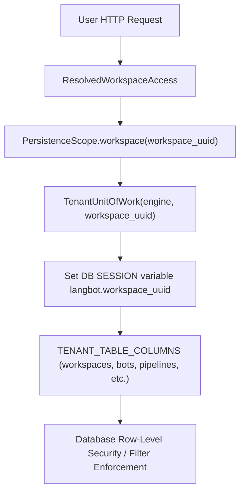
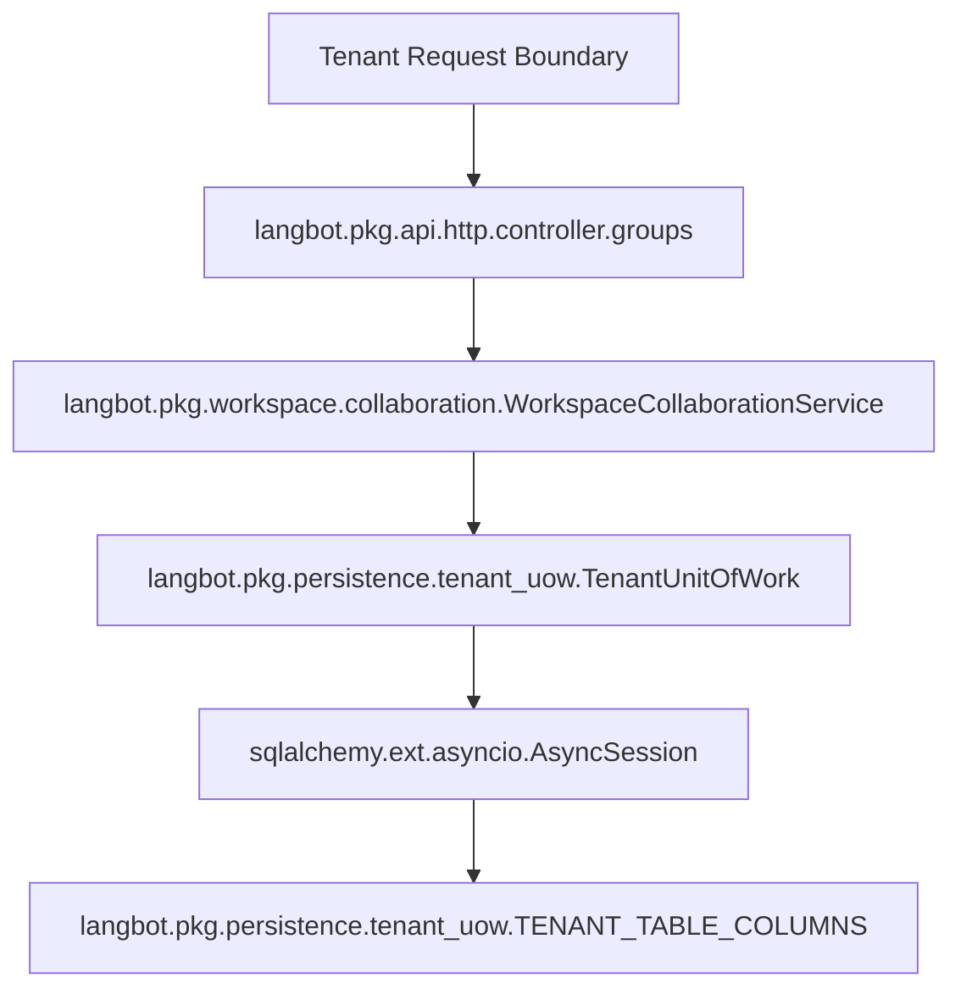
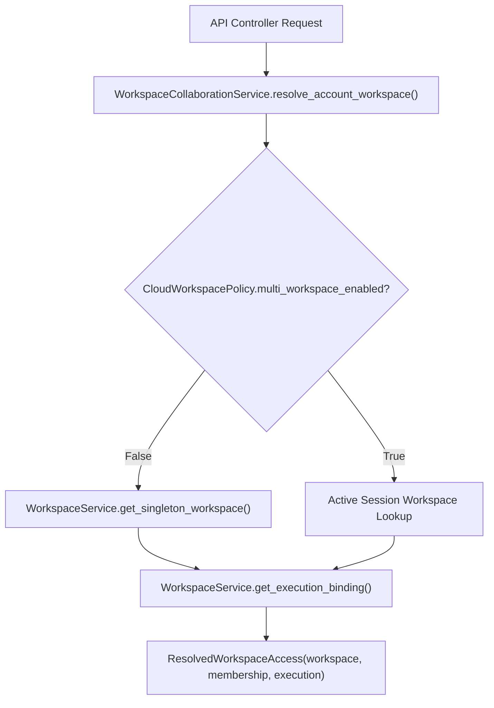
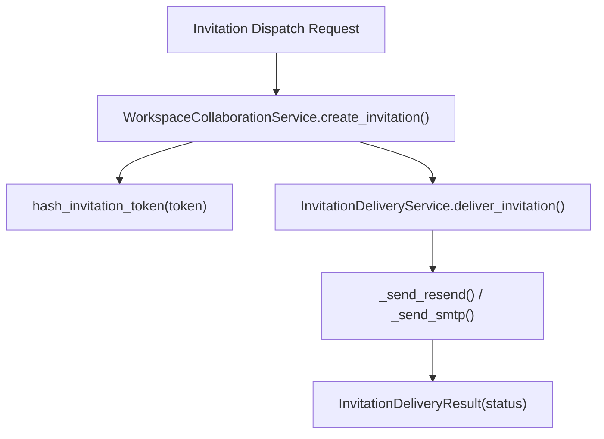
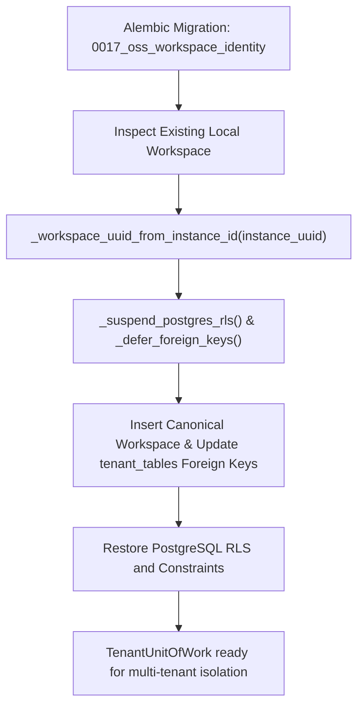

<!-- source: DeepWiki mcp.deepwiki.com · repo langbot-app/LangBot · page 3.7 Workspace and Multi-User System · fetched 2026-10-29 -->

# Workspace and Multi-User System

Relevant source files

The following files were used as context for generating this wiki page:

- [skills/skills/langbot-testing/references/langrag-knowledge-base.md](skills/skills/langbot-testing/references/langrag-knowledge-base.md)
- [src/langbot/pkg/agent/runner/orchestrator.py](src/langbot/pkg/agent/runner/orchestrator.py)
- [src/langbot/pkg/agent/runner/resource_builder.py](src/langbot/pkg/agent/runner/resource_builder.py)
- [src/langbot/pkg/api/http/controller/group.py](src/langbot/pkg/api/http/controller/group.py)
- [src/langbot/pkg/api/http/controller/groups/workspaces.py](src/langbot/pkg/api/http/controller/groups/workspaces.py)
- [src/langbot/pkg/api/http/service/knowledge.py](src/langbot/pkg/api/http/service/knowledge.py)
- [src/langbot/pkg/api/http/service/workspace_limits.py](src/langbot/pkg/api/http/service/workspace_limits.py)
- [src/langbot/pkg/entity/persistence/operation_log.py](src/langbot/pkg/entity/persistence/operation_log.py)
- [src/langbot/pkg/entity/persistence/rag.py](src/langbot/pkg/entity/persistence/rag.py)
- [src/langbot/pkg/persistence/alembic/versions/0025_rag_document_identity.py](src/langbot/pkg/persistence/alembic/versions/0025_rag_document_identity.py)
- [src/langbot/pkg/pipeline/pipelinemgr.py](src/langbot/pkg/pipeline/pipelinemgr.py)
- [src/langbot/pkg/plugin/connector.py](src/langbot/pkg/plugin/connector.py)
- [src/langbot/pkg/provider/tools/toolmgr.py](src/langbot/pkg/provider/tools/toolmgr.py)
- [src/langbot/pkg/rag/knowledge/kbmgr.py](src/langbot/pkg/rag/knowledge/kbmgr.py)
- [src/langbot/pkg/workspace/invitation_delivery.py](src/langbot/pkg/workspace/invitation_delivery.py)
- [src/langbot/pkg/workspace/repository.py](src/langbot/pkg/workspace/repository.py)
- [src/langbot/pkg/workspace/service.py](src/langbot/pkg/workspace/service.py)
- [tests/integration/persistence/test_codex_auth.py](tests/integration/persistence/test_codex_auth.py)
- [tests/integration/persistence/test_workspace_migration.py](tests/integration/persistence/test_workspace_migration.py)
- [tests/integration/plugin/test_rag_cancellation_protocol.py](tests/integration/plugin/test_rag_cancellation_protocol.py)
- [tests/unit_tests/agent/test_resource_builder.py](tests/unit_tests/agent/test_resource_builder.py)
- [tests/unit_tests/api/service/test_apikey_service.py](tests/unit_tests/api/service/test_apikey_service.py)
- [tests/unit_tests/command/test_cmdmgr.py](tests/unit_tests/command/test_cmdmgr.py)
- [tests/unit_tests/core/test_bootutils_log.py](tests/unit_tests/core/test_bootutils_log.py)
- [tests/unit_tests/core/test_stage.py](tests/unit_tests/core/test_stage.py)
- [tests/unit_tests/persistence/test_bot_plugin_processor_migration.py](tests/unit_tests/persistence/test_bot_plugin_processor_migration.py)
- [tests/unit_tests/persistence/test_database_decorator.py](tests/unit_tests/persistence/test_database_decorator.py)
- [tests/unit_tests/persistence/test_mgr_methods.py](tests/unit_tests/persistence/test_mgr_methods.py)
- [tests/unit_tests/persistence/test_runner_state_migration.py](tests/unit_tests/persistence/test_runner_state_migration.py)
- [tests/unit_tests/persistence/test_serialize_model.py](tests/unit_tests/persistence/test_serialize_model.py)
- [tests/unit_tests/pipeline/test_pipelinemgr.py](tests/unit_tests/pipeline/test_pipelinemgr.py)
- [tests/unit_tests/plugin/test_connector_methods.py](tests/unit_tests/plugin/test_connector_methods.py)
- [tests/unit_tests/plugin/test_connector_reconcile.py](tests/unit_tests/plugin/test_connector_reconcile.py)
- [tests/unit_tests/rag/test_file_storage.py](tests/unit_tests/rag/test_file_storage.py)
- [tests/unit_tests/rag/test_kbmgr.py](tests/unit_tests/rag/test_kbmgr.py)
- [tests/unit_tests/storage/test_storage_manager.py](tests/unit_tests/storage/test_storage_manager.py)
- [tests/unit_tests/survey/test_survey_manager.py](tests/unit_tests/survey/test_survey_manager.py)
- [tests/unit_tests/telemetry/test_telemetry.py](tests/unit_tests/telemetry/test_telemetry.py)
- [tests/unit_tests/test_workspace_subscription_limits.py](tests/unit_tests/test_workspace_subscription_limits.py)
- [tests/unit_tests/workspace/test_invitation_delivery.py](tests/unit_tests/workspace/test_invitation_delivery.py)
- [tests/unit_tests/workspace/test_workspace_service.py](tests/unit_tests/workspace/test_workspace_service.py)
- [web/src/app/home/components/workspace-quota/useWorkspaceQuotaStatus.ts](web/src/app/home/components/workspace-quota/useWorkspaceQuotaStatus.ts)
- [web/src/app/infra/entities/workspace.ts](web/src/app/infra/entities/workspace.ts)

This page documents the Workspace entity in LangBot, which serves as the fundamental tenant boundary for data, members, permissions, and execution. It covers the core services (`WorkspaceService`, `WorkspaceCollaborationService`), the Role-Based Access Control (RBAC) system with fixed roles, the invitation mechanism and delivery system (`InvitationDeliveryService`), tenant isolation via `TenantUnitOfWork`, quotas, OSS vs SaaS modes, workspace identity derivation, and the multi-tenant database migration sequence (`0009`–`0020`).

---

## Workspace as a Tenant Boundary & Persistence Scopes

The `Workspace` is the primary isolation unit within LangBot. All data, configurations, bots, pipelines, and user activities are scoped to a specific workspace, providing multi-tenancy in SaaS deployments while maintaining a structured single-instance design in OSS deployments.

The `Workspace` entity is defined in `[src/langbot/pkg/entity/persistence/workspace.py:72-130]()`. It includes fields such as `uuid`, `name`, `status`, `instance_uuid`, and `source` (`local` or `cloud_projection`).

In multi-tenant environments, the `workspace_uuid` is propagated through the execution context. Database isolation is enforced via SQLAlchemy's unit of work pattern and Row-Level Security (RLS) policies, managed by `TenantUnitOfWork` `[src/langbot/pkg/persistence/tenant_uow.py:30-174]()` and governed by the `TENANT_TABLE_COLUMNS` mapping `[src/langbot/pkg/persistence/tenant_uow.py:41-81]()`.

Persistence scopes are classified via `PersistenceScopeKind` and instantiated through `PersistenceScope` `[src/langbot/pkg/persistence/tenant_uow.py:97-159]()`, ensuring that database visibility is strictly bounded to the active transaction context (`TENANT_SETTING = 'langbot.workspace_uuid'`) `[src/langbot/pkg/persistence/tenant_uow.py:23]()`.

### Diagram: Tenant Isolation & Persistence Scope Mapping

Sources:
- `[src/langbot/pkg/persistence/tenant_uow.py:23-81]()`
- `[src/langbot/pkg/persistence/tenant_uow.py:97-159]()`
- `[src/langbot/pkg/entity/persistence/workspace.py:72-130]()`

### Diagram: Natural Language Space to Code Entity Space (Tenancy Mapping)

Sources:
- `[src/langbot/pkg/persistence/tenant_uow.py:23-81]()`
- `[src/langbot/pkg/persistence/tenant_uow.py:97-159]()`

---

## Workspace Services (`WorkspaceService` and `WorkspaceCollaborationService`)

Two primary services manage workspaces, execution bindings, and membership collaboration.

### WorkspaceService

The `WorkspaceService` handles core workspace lifecycle management, creation, retrieval, and identity resolution `[src/langbot/pkg/workspace/service.py:45-176]()`. It coordinates `WorkspaceExecutionBinding` entities to determine execution properties.

Key methods include:

- `get_workspace(workspace_uuid, session=None)`: Loads a workspace by UUID, validating instance UUID and status. This method uses a tenant unit of work when a session is not provided `[src/langbot/pkg/workspace/service.py:73-92]()`.

- `get_singleton_workspace(session=None)`: Retrieves the single workspace in OSS mode, enforcing exactly one local workspace per instance `[src/langbot/pkg/workspace/service.py:94-105]()`.

- `get_execution_state(workspace_uuid, session=None)`: Loads a workspace execution state and validates its instance binding. Uses tenant unit of work if no session is passed `[src/langbot/pkg/workspace/service.py:107-130]()`.

- `list_active_execution_bindings()`: Discovers active workspaces for the current instance by querying execution states with status active and not fenced. Returns a list of `WorkspaceExecutionBinding` structures `[src/langbot/pkg/workspace/service.py:132-145]()`.

- `prime_startup_execution_bindings()`: Freezes and caches a validated snapshot of active execution bindings during app startup to avoid redundant resolution during runtime `[src/langbot/pkg/workspace/service.py:147-163]()`.

- `release_startup_execution_bindings()`: Clears the cached startup snapshot `[src/langbot/pkg/workspace/service.py:165-168]()`.

Internally, this service enforces deployment admission and requires directory projections before listing bindings, ensuring that the instance is authorized and synchronized to manage multiple workspaces.

### WorkspaceCollaborationService

The `WorkspaceCollaborationService` manages memberships, access resolution, roles, and invitations, enforcing workspace security policies `[src/langbot/pkg/workspace/collaboration.py:128-380]()`.

Key concepts and methods include:

- **Access Resolution**: `resolve_account_workspace(account_uuid, requested_workspace_uuid, session=None)` resolves which workspace and membership an account can access, enforcing the workspace selection policy. It raises errors if the workspace is not found or the membership is inactive `[src/langbot/pkg/workspace/collaboration.py:150-201]()`.

- **Membership Listing**: `list_account_workspaces(account_uuid, session=None)` lists all active workspace memberships for a user `[src/langbot/pkg/workspace/collaboration.py:203-213]()`.

- **Invitation Management**:
  - `create_invitation(email, role, sender_uuid, session=None)` creates a time-limited invitation with a bearer token hashed via `hash_invitation_token()` for secure storage `[src/langbot/pkg/workspace/collaboration.py:231-279]()`.
  - `accept_invitation(token, current_account, session=None)` verifies invitation validity (checks expiration, revocation, usage, email match) and provisions the user as a workspace member `[src/langbot/pkg/workspace/collaboration.py:309-379]()`.

- **Email normalization & token hashing**:
  - `normalize_email(email: str)` enforces canonical lowercase email format for invitation matching `[src/langbot/pkg/workspace/collaboration.py:111-119]()`.
  - `hash_invitation_token(token: str)` implements SHA-256 hashing of tokens for secure lookup `[src/langbot/pkg/workspace/collaboration.py:122-126]()`.

The service maintains concurrency-safe internal locking for invitation token issuance to avoid race conditions during invitation creation.

### Diagram: Collaboration & Execution Resolution Flow

Sources:
- `[src/langbot/pkg/workspace/service.py:45-176]()`
- `[src/langbot/pkg/workspace/collaboration.py:128-380]()`
- `[src/langbot/pkg/workspace/entities.py:16]()`

---

## Role-Based Access Control (RBAC)

LangBot defines fixed workspace roles via the `MembershipRole` enumeration `[src/langbot/pkg/entity/persistence/workspace.py:29-35]()`:

| Role | Description |
|---|---|
| OWNER | Full administrative control. Must have at least one owner per workspace. Last owner cannot be removed or demoted to maintain ownership invariant. |
| ADMIN | Manage members and resources; elevated management permissions. |
| DEVELOPER| Bot, pipeline, and runtime configuration access. |
| OPERATOR | Operational monitoring and maintenance access. |
| VIEWER | Read-only access to workspace resources. |

The `WorkspaceMembership` entity stores user memberships linked to a workspace and enforces unique active owner constraints `[src/langbot/pkg/entity/persistence/workspace.py:133-196]()`.

These RBAC roles define the permission levels in collaboration operations, invitations, and resource access within a workspace. The `RouterGroup` `[src/langbot/pkg/api/http/controller/group.py:77-89]()` and its `route` decorator `[src/langbot/pkg/api/http/controller/group.py:94-116]()` are used to define API endpoints and enforce permissions. The `require_permission` function `[src/langbot/pkg/api/http/authz.py:29]()` is called within the route handler to check if the `RequestContext` has the necessary permissions.

Sources:
- `[src/langbot/pkg/entity/persistence/workspace.py:29-35]()`
- `[src/langbot/pkg/entity/persistence/workspace.py:133-196]()`
- `[src/langbot/pkg/workspace/collaboration.py:150-201]()`
- `[src/langbot/pkg/api/http/controller/group.py:77-89]()`
- `[src/langbot/pkg/api/http/controller/group.py:94-116]()`
- `[src/langbot/pkg/api/http/authz.py:29]()`

---

## Invitations and Delivery Mechanism

Users join workspaces via time-limited invitation tokens managed by the invitation subsystem.

### Invitation Creation

Authorized users create workspace invitations specifying the target email and role. The service generates a secure bearer token prefixed with `"lbi_"`, and stores the token hash using `hash_invitation_token()` for secure database lookup `[src/langbot/pkg/workspace/collaboration.py:231-279]()`.

### Invitation Delivery

The `InvitationDeliveryService` handles sending email invitations and supports two providers:

- **Resend API**: Sends invitations via the Resend email service API.
- **SMTP**: Sends via SMTP server with configurable TLS and SSL options.

When no provider is configured, the service falls back to returning the invitation link directly for manual sharing. Delivery failures do not revoke or invalidate pending invitations; failures are reported non-secretly to the caller `[src/langbot/pkg/workspace/invitation_delivery.py:47-156]()`.

Invitation emails include brand-neutral but informative messaging with workspace names, expiration notices (7 days), and accept links. The system respects environment variable overrides for SMTP and Resend credentials and endpoints.

### Invitation Acceptance

The acceptance flow verifies the invitation token by:

- Checking token validity, expiration, revocation, and prior usage.
- Matching the invitation email to the authenticated user (to prevent misuse).
- Enforcing invitation role validity.

Accepted invitations create active workspace memberships and invalidate the invitation to prevent re-use.

Frontend acceptance UI holds the bearer token secret in `sessionStorage` throughout the multi-step acceptance workflow, preventing leakage in headers, query strings, or logs `[web/src/app/invitations/accept/page.tsx:28-29]()`. Terminal invitation errors (e.g., `invitation_revoked`, `invitation_used`, `invitation_email_mismatch`) are handled by the frontend, allowing for refreshing on new fragments and account switching `[web/tests/e2e/invitations.spec.ts:5-57]()`. If an email mismatch occurs, the user is redirected to the login page with an error parameter `[web/tests/e2e/invitations.spec.ts:97-105]()`. For OAuth-only OSS instances, the invitation acceptance flow can register the invited email with a local password `[web/tests/e2e/invitations.spec.ts:114-201]()`.

### Diagram: Natural Language Space to Code Entity Space (Invitation Flow)

Sources:
- `[src/langbot/pkg/workspace/collaboration.py:122-279]()`
- `[src/langbot/pkg/workspace/invitation_delivery.py:47-156]()`
- `[web/src/app/invitations/accept/page.tsx:28-29]()`
- `[web/tests/e2e/invitations.spec.ts:5-57]()`
- `[web/tests/e2e/invitations.spec.ts:97-105]()`
- `[web/tests/e2e/invitations.spec.ts:114-201]()`

---

## Tenant Unit-of-Work Implementation

Tenant isolation is enforced at the SQLAlchemy unit-of-work level through `TenantUnitOfWork` and related classes in `[src/langbot/pkg/persistence/tenant_uow.py:30-174]()`.

- `TenantUnitOfWork` manages asynchronous transactions and enforces that all database requests are scoped by a trusted `PersistenceScope`.
- `TenantUnitOfWork` is a single-use context manager; attempting to reuse it or access its session outside an active scope will raise an error `[tests/unit_tests/persistence/test_tenant_uow.py:137-149]()`.
- `PersistenceScopeKind` enumerates different scope types; the `WORKSPACE` kind binds `langbot.workspace_uuid` as the tenant setting, used as a session-level parameter in transactions.
- The tenant unit-of-work sets a session variable in PostgreSQL (e.g., `SET SESSION langbot.workspace_uuid = '...'`) so that RLS policies filter data consistently and securely inside each transaction.
- The `TENANT_TABLE_COLUMNS` dictionary explicitly lists all tables containing a tenant foreign key column such as `workspace_uuid`. This list ensures that RLS policies and migrations stay in sync.
- Attempts to cross or change tenant scope inside an active transaction are rejected with errors (e.g. `CrossScopeTransactionError`) `[tests/unit_tests/persistence/test_tenant_uow.py:185]()`.
- This design guarantees strict tenant data isolation at the database level for all business operations.

Sources:
- `[src/langbot/pkg/persistence/tenant_uow.py:23-174]()`
- `[tests/unit_tests/persistence/test_tenant_uow.py:137-149]()`
- `[tests/unit_tests/persistence/test_tenant_uow.py:185]()`

---

## OSS Single-Workspace vs. SaaS Multi-Workspace Modes & Identity

LangBot supports both open source (OSS) and cloud SaaS deployment modes with different workspace tenancy designs:

- **OSS Single-Workspace Mode** enforces exactly one workspace tied to the instance. The workspace UUID is deterministically derived from the instance UUID using the helper `workspace_uuid_from_instance_id()` in `[src/langbot/pkg/workspace/identity.py:10-20]()`, creating a stable identity aligned to the installation.

- **SaaS Multi-Workspace Mode** with `CloudWorkspacePolicy` supports multiple workspaces per instance, synchronized via directory projection states and execution bindings. The `PluginRuntimeConnector` `[src/langbot/pkg/plugin/connector.py:18]()` and `AgentRunOrchestrator` `[src/langbot/pkg/agent/runner/orchestrator.py:52]()` are examples of components that leverage the `ExecutionContext` `[src/langbot/pkg/api/http/context.py:76]()` to ensure operations are performed within the correct workspace context. The `PluginRuntimeConnector`'s `_prepare_connected_runtime` method `[src/langbot/pkg/plugin/connector.py:1049]()` and `_load_workspace_settings` `[src/langbot/pkg/plugin/connector.py:1060]()` are crucial for reconciling plugin installations across multiple workspaces in a shared runtime `[tests/unit_tests/plugin/test_connector_reconcile.py:153-176]()`. Similarly, the `AgentRunOrchestrator` validates the `ExecutionContext` against the event's workspace ID to prevent cross-workspace data access `[src/langbot/pkg/agent/runner/orchestrator.py:103-108]()`. The `KnowledgeService` also uses `require_workspace_uuid` `[src/langbot/pkg/api/http/service/knowledge.py:35]()` and `_assert_execution_context` `[src/langbot/pkg/rag/knowledge/kbmgr.py:84-96]()` to ensure knowledge base operations are workspace-scoped.

Telemetry and runtime tracking consolidate tenant identity using `workspace_identity()` from `[src/langbot/pkg/telemetry/identity.py:14-22]()`, bundling instance and workspace identifiers for analytics payloads.

Sources:
- `[src/langbot/pkg/workspace/identity.py:10-20]()`
- `[src/langbot/pkg/telemetry/identity.py:14-22]()`
- `[src/langbot/pkg/plugin/connector.py:18]()`
- `[src/langbot/pkg/agent/runner/orchestrator.py:52]()`
- `[src/langbot/pkg/api/http/context.py:76]()`
- `[src/langbot/pkg/plugin/connector.py:1049]()`
- `[src/langbot/pkg/plugin/connector.py:1060]()`
- `[tests/unit_tests/plugin/test_connector_reconcile.py:153-176]()`
- `[src/langbot/pkg/agent/runner/orchestrator.py:103-108]()`
- `[src/langbot/pkg/api/http/service/knowledge.py:35]()`
- `[src/langbot/pkg/rag/knowledge/kbmgr.py:84-96]()`

---

## Multi-Tenant Database Migration Sequence (0009–0020)

The multi-tenant architecture is established via a series of Alembic migrations modifying schema and data for workspace tenancy:

- **0009_workspace_tenancy_kernel**: Introduces the `workspaces` table and adds `workspace_uuid` foreign keys to tenant tables as defined in `TENANT_TABLE_COLUMNS` `[src/langbot/pkg/persistence/tenant_uow.py:41-81]()`.

- **0017_oss_workspace_identity**: Implements stable workspace identity in OSS mode by deriving the canonical Workspace UUID from the instance UUID. This migration suspends PostgreSQL RLS and defers foreign key constraints during atomic rekeying of tenant tables and restores constraints afterward, ensuring no downtime and data integrity during isolation upgrade `[src/langbot/pkg/persistence/alembic/versions/0017_oss_workspace_identity.py:25-90]()`.

- **0017_local_owner_repair**: Repairs ownerless local workspaces post-tenancy migration, ensuring there is one active owner membership and setting the `created_by_account_uuid` if missing. This enforces the invariant that a workspace must have an owner `[src/langbot/pkg/persistence/alembic/versions/0017_repair_local_workspace_owner.py:27-145]()`. This migration is idempotent and preserves identifiers if run multiple times `[tests/integration/persistence/test_workspace_migration.py:135-152]()`. It also handles cases where an ownerless workspace needs repair `[tests/integration/persistence/test_workspace_migration.py:154-160]()`.

- **0018_merge_workspace_heads**: Merges parallel Alembic migration branches for Runner and OSS tenancy changes `[src/langbot/pkg/persistence/alembic/versions/0018_merge_workspace_heads.py:8-15]()`.

- **0020_workspace_membership_source**: Adds a `source` column to `workspace_memberships` to differentiate whether membership is local or comes from cloud-projected directories `[src/langbot/pkg/persistence/alembic/versions/0020_workspace_membership_source.py]()`.

- **0025_rag_document_identity**: This migration adds `workspace_uuid` to the `rag_files` table, ensuring that RAG documents are correctly scoped to a workspace `[src/langbot/pkg/persistence/alembic/versions/0025_rag_document_identity.py:10-20]()`. This is critical for multi-tenant RAG systems, as it prevents documents from one workspace from being accessible or visible to another.

### Diagram: Migration Re-Keying & Identity Mapping

Sources:
- `[src/langbot/pkg/persistence/alembic/versions/0017_oss_workspace_identity.py:25-90]()`
- `[src/langbot/pkg/workspace/identity.py:10-20]()`
- `[src/langbot/pkg/persistence/tenant_uow.py:41-81]()`
- `[src/langbot/pkg/persistence/alembic/versions/0017_repair_local_workspace_owner.py:27-145]()`
- `[tests/integration/persistence/test_workspace_migration.py:135-152]()`
- `[tests/integration/persistence/test_workspace_migration.py:154-160]()`
- `[src/langbot/pkg/persistence/alembic/versions/0018_merge_workspace_heads.py:8-15]()`
- `[src/langbot/pkg/persistence/alembic/versions/0020_workspace_membership_source.py]()`
- `[src/langbot/pkg/persistence/alembic/versions/0025_rag_document_identity.py:10-20]()`

---

## Quotas and Multi-Tenant Operation

Workspace tenancy enables resource quota enforcement at the workspace level by associating usage and execution counts with the active `workspace_uuid` in tenant-scoped queries. This abstraction permits SaaS operators and OSS administrators to impose resource limits on individual tenants cleanly (e.g., maximum knowledge bases, storage bounds).

The `workspace_limits` service `[src/langbot/pkg/api/http/service/workspace_limits.py:10-20]()` provides a mechanism to retrieve and enforce these limits. For example, when creating a knowledge base, the `KnowledgeService` checks `max_knowledge_bases` against the current count for the workspace `[src/langbot/pkg/api/http/service/knowledge.py:61-74]()`.

Multi-tenant isolation also facilitates logging, telemetry, and auditing scoped by workspace, ensuring precise traceability for usage monitoring.

Sources:
- `[src/langbot/pkg/api/http/service/knowledge.py:61-74]()`
- `[src/langbot/pkg/persistence/tenant_uow.py:23-174]()`
- `[src/langbot/pkg/api/http/service/workspace_limits.py:10-20]()`

---

# Summary

LangBot’s Workspace and Multi-User System implements a robust multi-tenant architecture centered around the `Workspace` entity as the tenant boundary. Tenant isolation is achieved through:

- Tenant-scoped unit-of-work (`TenantUnitOfWork`) enforcing SQL-level tenant filtering.
- Dedicated lifecycle and membership services (`WorkspaceService` and `WorkspaceCollaborationService`) managing workspace data, members, and invitations.
- Role-based access control with fixed workspace roles guarding resource access and collaboration primitives.
- Secure invitation generation and delivery with provider-configurable email sending and token hashing.
- Dual OSS single-workspace and SaaS multi-workspace deployment modes with stable workspace identity derivation.
- Progressive database migration sequence establishing tenancy and repairing tenancy invariants post-factum.

This design ensures LangBot can operate securely as a multi-user SaaS platform or as a single-workspace local OSS instance with clear tenancy and collaboration semantics.

Sources:
- `[src/langbot/pkg/persistence/tenant_uow.py:23-174]()`
- `[src/langbot/pkg/entity/persistence/workspace.py:29-35, 72-130, 133-196]()`
- `[src/langbot/pkg/workspace/service.py:45-176]()`
- `[src/langbot/pkg/workspace/collaboration.py:111-203, 231-379]()`
- `[src/langbot/pkg/workspace/invitation_delivery.py:47-156]()`
- `[src/langbot/pkg/persistence/alembic/versions/0017_repair_local_workspace_owner.py:27-145]()`
- `[src/langbot/pkg/persistence/alembic/versions/0017_oss_workspace_identity.py:25-90]()`
- `[src/langbot/pkg/persistence/alembic/versions/0018_merge_workspace_heads.py:8-15]()`
- `[src/langbot/pkg/persistence/alembic/versions/0020_workspace_membership_source.py]()`
- `[src/langbot/pkg/persistence/alembic/versions/0025_rag_document_identity.py:10-20]()`
- `[src/langbot/pkg/workspace/identity.py:10-20]()`
- `[src/langbot/pkg/telemetry/identity.py:14-22]()`
- `[web/src/app/invitations/accept/page.tsx:28-29]()`
- `[web/tests/e2e/invitations.spec.ts:5-57]()`
- `[web/tests/e2e/invitations.spec.ts:97-105]()`
- `[web/tests/e2e/invitations.spec.ts:114-201]()`
- `[tests/unit_tests/persistence/test_tenant_uow.py:137-149]()`
- `[tests/unit_tests/persistence/test_tenant_uow.py:185]()`
- `[tests/integration/persistence/test_workspace_migration.py:135-152]()`
- `[tests/integration/persistence/test_workspace_migration.py:154-160]()`

---

