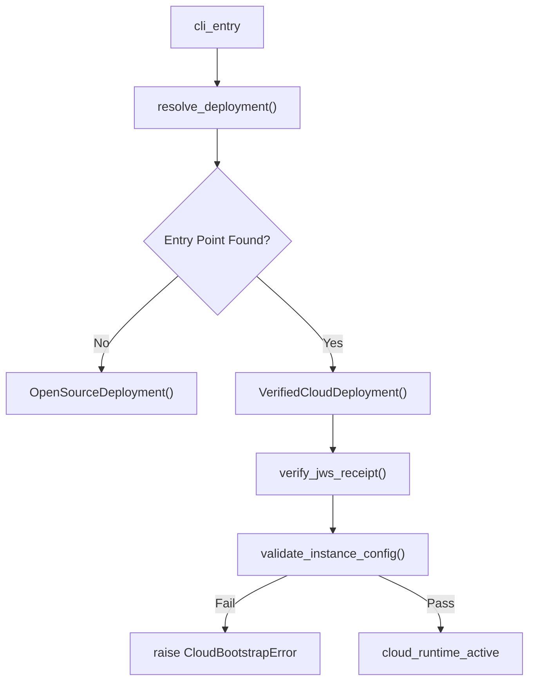
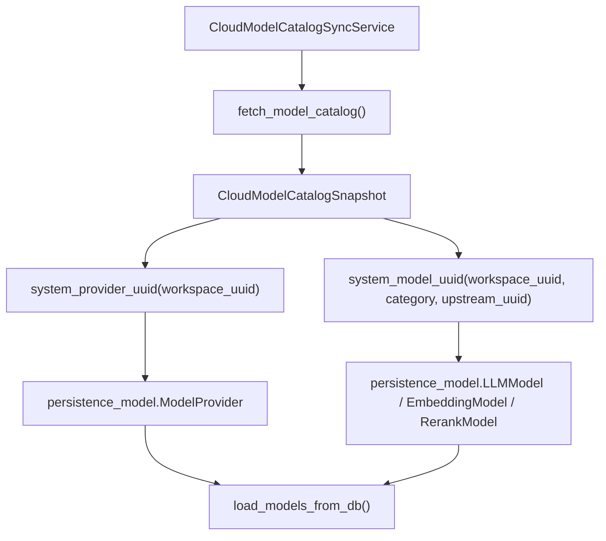
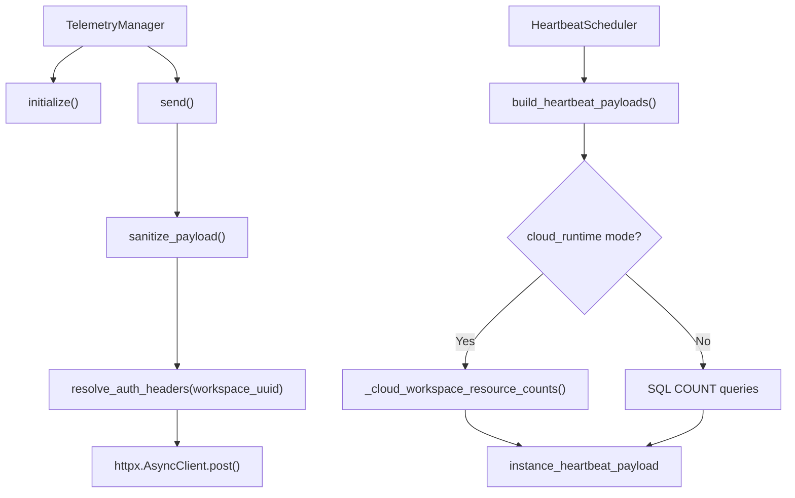
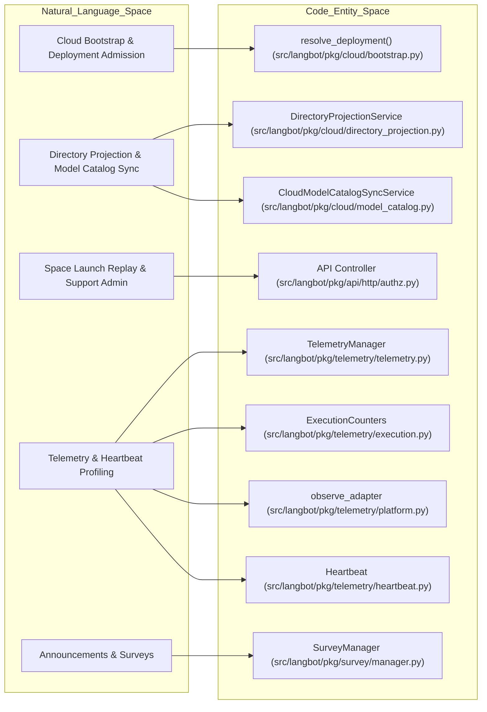
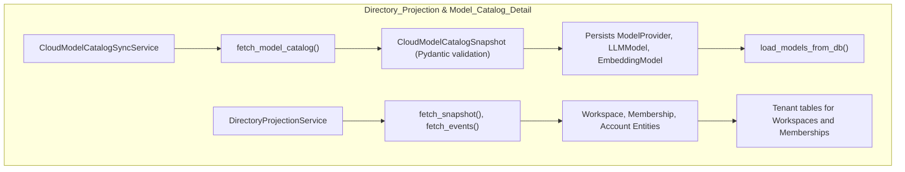

<!-- source: DeepWiki mcp.deepwiki.com · repo langbot-app/LangBot · page 3.8 Cloud Integration and Telemetry · fetched 2026-10-29 -->

# Cloud Integration and Telemetry

Relevant source files

The following files were used as context for generating this wiki page:

- [res/announcement.json](res/announcement.json)
- [res/scripts/publish_announcement.py](res/scripts/publish_announcement.py)
- [src/langbot/pkg/api/http/authz.py](src/langbot/pkg/api/http/authz.py)
- [src/langbot/pkg/cloud/directory_projection.py](src/langbot/pkg/cloud/directory_projection.py)
- [src/langbot/pkg/cloud/model_catalog.py](src/langbot/pkg/cloud/model_catalog.py)
- [src/langbot/pkg/persistence/alembic/versions/0009_workspace_tenancy_kernel.py](src/langbot/pkg/persistence/alembic/versions/0009_workspace_tenancy_kernel.py)
- [src/langbot/pkg/persistence/alembic/versions/0017_oss_workspace_identity.py](src/langbot/pkg/persistence/alembic/versions/0017_oss_workspace_identity.py)
- [src/langbot/pkg/persistence/alembic/versions/0019_single_workspace_owner.py](src/langbot/pkg/persistence/alembic/versions/0019_single_workspace_owner.py)
- [src/langbot/pkg/pipeline/process/handlers/chat.py](src/langbot/pkg/pipeline/process/handlers/chat.py)
- [src/langbot/pkg/telemetry/execution.py](src/langbot/pkg/telemetry/execution.py)
- [src/langbot/pkg/telemetry/heartbeat.py](src/langbot/pkg/telemetry/heartbeat.py)
- [src/langbot/pkg/telemetry/identity.py](src/langbot/pkg/telemetry/identity.py)
- [src/langbot/pkg/telemetry/platform.py](src/langbot/pkg/telemetry/platform.py)
- [src/langbot/pkg/telemetry/resources.py](src/langbot/pkg/telemetry/resources.py)
- [src/langbot/pkg/telemetry/telemetry.py](src/langbot/pkg/telemetry/telemetry.py)
- [src/langbot/pkg/telemetry/trace.py](src/langbot/pkg/telemetry/trace.py)
- [src/langbot/pkg/workspace/identity.py](src/langbot/pkg/workspace/identity.py)
- [tests/unit_tests/cloud/test_directory_projection.py](tests/unit_tests/cloud/test_directory_projection.py)
- [tests/unit_tests/cloud/test_model_catalog.py](tests/unit_tests/cloud/test_model_catalog.py)
- [tests/unit_tests/telemetry/test_batch_ack.py](tests/unit_tests/telemetry/test_batch_ack.py)
- [tests/unit_tests/telemetry/test_cloud_sampling.py](tests/unit_tests/telemetry/test_cloud_sampling.py)
- [tests/unit_tests/telemetry/test_heartbeat.py](tests/unit_tests/telemetry/test_heartbeat.py)
- [tests/unit_tests/telemetry/test_platform_model.py](tests/unit_tests/telemetry/test_platform_model.py)
- [tests/unit_tests/telemetry/test_trace.py](tests/unit_tests/telemetry/test_trace.py)
- [tests/unit_tests/telemetry/test_workspace_identity.py](tests/unit_tests/telemetry/test_workspace_identity.py)

## Purpose and Scope
This page documents LangBot's architectural integration with LangBot Cloud (Space), covering the core cloud bootstrap process, directory projection, model catalog synchronization, support admin protocols, telemetry emission including point-wise execution tracing, heartbeat profiling, and survey/feedback collection mechanisms.

---

## 1. Cloud Bootstrap and Deployment Admission

LangBot operates in two core modes controlled by cloud bootstrap verification: 

- **Open-source mode (`oss`)**: Default fallback operation with single-tenant workspace policy and OSS entitlement provider.
- **Cloud runtime mode (`cloud_runtime`)**: Activated when a verified closed bootstrap provider is installed, ensuring strong runtime invariants and configuration validation.

The bootstrap entry point discovery occurs via entry points under `langbot.cloud_bootstrap` inspected by `resolve_deployment()`. If no verified closed bootstrap provider is present, an `OpenSourceDeployment` instance is returned, setting default workspace policies and entitlement providers. If a closed deployment manifest is found, it returns a `VerifiedCloudDeployment` object which:

- Verifies the deployment manifest's JSON Web Signature (JWS) receipt.
- Enforces runtime invariants:
  - Instance UUID must match the expected one `[src/langbot/pkg/cloud/bootstrap.py:98-99]()`.
  - Manifest expiration timestamp must be in the future `[src/langbot/pkg/cloud/bootstrap.py:104]()`.
  - Tenant isolation version must meet or exceed the required minimum `[src/langbot/pkg/cloud/bootstrap.py:106]()`.
  - Required capabilities such as `multi_workspace_v2` must be granted `[src/langbot/pkg/cloud/bootstrap.py:108]()`.
  - The entitlement, directory, manifest, and model catalog providers must be properly instantiated `[src/langbot/pkg/cloud/bootstrap.py:110-117]()`.
- Validates instance configuration to enforce cloud runtime constraints `[src/langbot/pkg/cloud/bootstrap.py:119-143]()`:
  - PostgreSQL is required (`database.use=postgresql`) `[src/langbot/pkg/cloud/bootstrap.py:125]()`.
  - Use of `pgvector` vector database backend, with required sub-settings `[src/langbot/pkg/cloud/bootstrap.py:127-139]()`.
  - The MCP stdio transport is disabled (`mcp.stdio.enabled=false`) `[src/langbot/pkg/cloud/bootstrap.py:140-141]()`.
  - Plugin worker requires hard resource limits `[src/langbot/pkg/cloud/bootstrap.py:142-143]()`.
  - Directory projection limits must be valid `[src/langbot/pkg/cloud/bootstrap.py:120-124]()`.

Violation of any constraint raises a fail-closed `CloudBootstrapError`, preventing unsafe or incompatible runtimes.

Diagram: Cloud Bootstrap Verification Flow

Sources: `src/langbot/pkg/cloud/bootstrap.py:1-420`, `tests/unit_tests/cloud/test_bootstrap.py:1-398`

---

## 2. Directory Projection and Model Catalog Synchronization

Cloud mode syncs workspace, user, and entitlement directory data into runtime tenant database tables via `DirectoryProjectionService` and synchronizes model catalogs via `CloudModelCatalogSyncService`.

### Directory Projection (`DirectoryProjectionService`)

- Implements incremental projection of directory data from a signed publisher (Space) into locked tenant tables `[src/langbot/pkg/cloud/directory_projection.py:78]()`.
- Runs continuous synchronization with rate-limiting and retry/backoff on failure `[src/langbot/pkg/cloud/directory_projection.py:160-171]()`.
- Consumes snapshots and event batches from a verified external directory provider `[src/langbot/pkg/cloud/directory_projection.py:144-156]()`.
- Tracks consumer cursor position to achieve eventual consistency without race conditions `[src/langbot/pkg/cloud/directory_projection.py:125-127]()`.
- Validates and maps directory states (workspaces, memberships, accounts) including role/status conversions and internal metadata `[src/langbot/pkg/cloud/directory_projection.py:46-68]()`.
- Designed for multi-instance deployment ensuring each runtime independently consumes event streams safely `[src/langbot/pkg/cloud/directory_projection.py:123-127]()`.
- Provides `initialize()`, `run()`, and `sync_once()` coroutine APIs to control sync lifecycle `[src/langbot/pkg/cloud/directory_projection.py:130-175]()`.

Sources: `src/langbot/pkg/cloud/directory_projection.py:77-175`, `tests/unit_tests/cloud/test_directory_projection.py:1-202`

### Model Catalog (`CloudModelCatalogSyncService`)

- Reconciles complete workspace-scoped model catalogs owned by Space `[src/langbot/pkg/cloud/model_catalog.py:131]()`.
- Uses `CloudModelCatalogSnapshot` Pydantic models for strict validation `[src/langbot/pkg/cloud/model_catalog.py:69-106]()`:
  - Limits max 500 models to synchronize `[src/langbot/pkg/cloud/model_catalog.py:89]()`.
  - Limits max 10,000 workspaces `[src/langbot/pkg/cloud/model_catalog.py:101]()`.
  - Requires secure HTTPS base URLs `[src/langbot/pkg/cloud/model_catalog.py:81-83]()`.
- Derives deterministic UUIDs for system providers and models scoped to workspace namespaces (UUIDv5) `[src/langbot/pkg/cloud/model_catalog.py:116-127]()`.
- Tracks workspace credits (owner billing tokens) in-memory for quick retrieval `[src/langbot/pkg/cloud/model_catalog.py:157-158]()`.
- Supports explicit sync trigger (`request_sync()`) and scheduled periodic sync `[src/langbot/pkg/cloud/model_catalog.py:163-175]()`.
- Updates persistence-layer tables with model and provider information, initializing custom and system-default entries `[src/langbot/pkg/cloud/model_catalog.py:190-290]()`.
- Notifies runtime model management about catalog reloads for in-memory updates `[src/langbot/pkg/cloud/model_catalog.py:180]()`.

Diagram: Model Catalog Synchronization Pipeline

Sources: `src/langbot/pkg/cloud/model_catalog.py:1-338`, `tests/unit_tests/cloud/test_model_catalog.py:1-467`

---

## 3. Space Launch Replay and Support Admin

Space administrators and support agents interact with LangBot instances via authenticated support admin tokens issued by Space. These tokens authorize a scoped set of operations but explicitly deny sensitive actions related to membership and permission management.

- The HTTP API controllers inspect support admin tokens.
- Sensitive permissions explicitly forbidden in support admin context `[src/langbot/pkg/api/http/authz.py:100-103]()`:
  - `Permission.MEMBER_VIEW`
  - `Permission.MEMBER_INVITE`
  - `Permission.MEMBER_UPDATE_ROLE`
  - `Permission.MEMBER_REMOVE`
- This ensures support admins cannot escalate privileges or modify critical membership assignments during troubleshooting.
- Support admin token authentication is seamlessly integrated with standard user authentication but with scoped denial of privilege escalation.

Sources: `src/langbot/pkg/api/http/authz.py:100-103`, `tests/integration/api/test_support_admin_launch.py:1-80`

---

## 4. Telemetry, Execution Tracing, and Heartbeat System

LangBot provides asynchronous telemetry reporting, point-wise execution tracing, platform adapter observation, and periodic heartbeat snapshots to monitor platform adoption and runtime state in privacy-preserving ways.

### TelemetryManager

- Manages outbound telemetry via asynchronous tasks with concurrency bounds `[src/langbot/pkg/telemetry/telemetry.py:23-28]()`.
- Sanitizes telemetry fields such as query IDs, timestamps, and duration fields to standardize and truncate values `[src/langbot/pkg/telemetry/telemetry.py:81-121]()`.
- Attaches authentication headers dynamically based on workspace UUID and configured user/instance tokens `[src/langbot/pkg/telemetry/telemetry.py:126-150]()`.
- Uses `httpx.AsyncClient` to POST telemetry data to configured Space telemetry endpoints `[src/langbot/pkg/telemetry/telemetry.py:151-154]()`.

### Execution Tracing (`pkg.telemetry.execution` & `trace`)

- One execution is reported as a chain of independent records carrying the same `event_id`: one `execution_node` per workflow node emitted upon completion, plus exactly one `execution_chain` emitted when the execution closes `[src/langbot/pkg/telemetry/execution.py:1-9]()`.
- Sampling is determined stably at ingress based on execution identity hashes `[src/langbot/pkg/telemetry/execution.py:15-19]()`. Broken chains are always emitted even if sampled out.
- `ExecutionCounters` manages record buffering, retry policies, batching, and health metrics (`sent`, `dropped`) `[src/langbot/pkg/telemetry/execution.py:135-151]()`.
- Bounded error formatting preserves error classes and short machine-readable prefixes while scrubbing arbitrary payload strings `[src/langbot/pkg/telemetry/execution.py:103-124]()`.

### Platform Adapter Observation (`pkg.telemetry.platform`)

- Wraps concrete bot adapter API methods instance-locally to monitor execution outcome, duration, and error codes without recording raw arguments or sensitive content `[src/langbot/pkg/telemetry/platform.py:63-123]()`.
- Evaluates API outcomes (`success`, `failed`, `cancelled`, `timeout`, `unknown`) and extracts error details safely `[src/langbot/pkg/telemetry/platform.py:14-60]()`.

### Heartbeat Profiling (`pkg.telemetry.heartbeat`)

- Sends periodic snapshots once daily, starting at runtime launch `[src/langbot/pkg/telemetry/heartbeat.py:28]()`.
- Snapshots gather anonymized instance configuration counts: number of enabled bots, pipelines, plugins, knowledge bases, MCP servers, skills, adapters, and extensions `[src/langbot/pkg/telemetry/heartbeat.py:31-46]()`.
- Counts originate from:
  - Direct database counting in OSS mode (SQLite/Postgres) `[src/langbot/pkg/telemetry/heartbeat.py:118-120]()`.
  - In cloud runtime, counts are collected from already-loaded registries without issuing per-tenant SQL queries for efficiency `[src/langbot/pkg/telemetry/heartbeat.py:125-161]()`.
- Does not include any PII, message content, or credentials — only aggregate configuration metadata and adapter type names `[src/langbot/pkg/telemetry/heartbeat.py:7-10]()`.

Diagram: Telemetry and Heartbeat Flow

Sources: `src/langbot/pkg/telemetry/telemetry.py:1-202`, `src/langbot/pkg/telemetry/execution.py:1-172`, `src/langbot/pkg/telemetry/heartbeat.py:1-171`, `src/langbot/pkg/telemetry/platform.py:1-124`, `tests/unit_tests/telemetry/test_heartbeat.py:1-174`, `tests/unit_tests/telemetry/test_trace.py:1-219`

---

## 5. Announcements and Survey/Feedback Collection

LangBot integrates announcements and user feedback surveys leveraging Space backend synchronization.

- Announcements are maintained in `res/announcement.json` `[res/announcement.json:1]()`.
- Surveys are managed by `SurveyManager` and triggered by usage milestones `[src/langbot/pkg/survey/manager.py:1-293]()`.
- Milestone example: after 100 successful bot responses, a milestone event triggers a survey prompt.
- Surveys are fetched from and submitted to configured Space endpoints via HTTP during triggered events.
- Frontend UI integrates a feedback popover offering ratings and comments, sending results back to Space `web/src/app/home/components/home-sidebar/FeedbackPopover.tsx`.

Sources: `src/langbot/pkg/survey/manager.py:1-294`, `src/langbot/pkg/pipeline/process/handlers/chat.py:136-153`, `res/announcement.json:1-2`

---

# Summary Diagrams Bridging Natural Language Space to Code Entities

Diagram: Natural Language Space to Code Entity Mapping for Cloud & Telemetry

Diagram: Directory Projection and Model Catalog Detail Architecture

Sources: `src/langbot/pkg/cloud/bootstrap.py`, `src/langbot/pkg/cloud/directory_projection.py`, `src/langbot/pkg/cloud/model_catalog.py`, `src/langbot/pkg/telemetry/telemetry.py`, `src/langbot/pkg/telemetry/execution.py`, `src/langbot/pkg/telemetry/platform.py`, `src/langbot/pkg/telemetry/heartbeat.py`

---

# References and Sources

- `src/langbot/pkg/cloud/bootstrap.py:1-420`
- `src/langbot/pkg/cloud/directory_projection.py:1-175`
- `src/langbot/pkg/cloud/model_catalog.py:1-338`
- `src/langbot/pkg/api/http/authz.py:100-103`
- `src/langbot/pkg/telemetry/telemetry.py:1-202`
- `src/langbot/pkg/telemetry/execution.py:1-172`
- `src/langbot/pkg/telemetry/platform.py:1-124`
- `src/langbot/pkg/telemetry/heartbeat.py:1-171`
- `src/langbot/pkg/survey/manager.py:1-294`
- `src/langbot/pkg/pipeline/process/handlers/chat.py:136-153`
- `res/announcement.json:1-2`
- `web/src/app/home/components/home-sidebar/FeedbackPopover.tsx`
- `tests/unit_tests/cloud/test_bootstrap.py:1-398`
- `tests/unit_tests/cloud/test_directory_projection.py:1-202`
- `tests/unit_tests/cloud/test_model_catalog.py:1-182`
- `tests/unit_tests/telemetry/test_heartbeat.py:1-174`
- `tests/unit_tests/telemetry/test_trace.py:1-219`
- `tests/integration/api/test_support_admin_launch.py:1-80`

---

