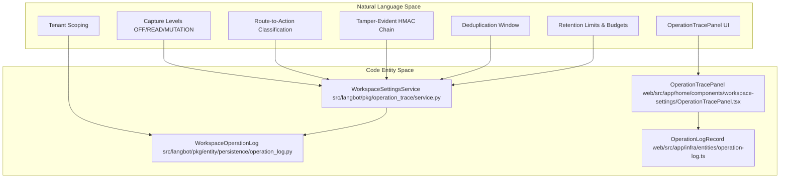
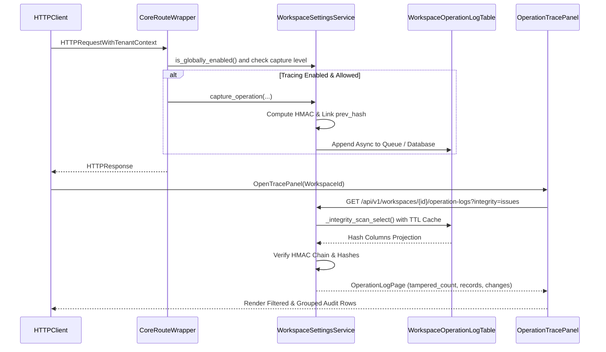

<!-- source: DeepWiki mcp.deepwiki.com · repo langbot-app/LangBot · page 3.9 Operation Traceability and Audit Logging · fetched 2026-10-29 -->

# Operation Traceability and Audit Logging

Relevant source files

The following files were used as context for generating this wiki page:

- [docker/kubernetes.yaml](docker/kubernetes.yaml)
- [src/langbot/pkg/core/app.py](src/langbot/pkg/core/app.py)
- [src/langbot/pkg/core/stages/build_app.py](src/langbot/pkg/core/stages/build_app.py)
- [src/langbot/pkg/operation_trace/service.py](src/langbot/pkg/operation_trace/service.py)
- [src/langbot/templates/config.yaml](src/langbot/templates/config.yaml)
- [tests/unit_tests/core/test_app_shutdown.py](tests/unit_tests/core/test_app_shutdown.py)
- [tests/unit_tests/test_operation_trace_incremental.py](tests/unit_tests/test_operation_trace_incremental.py)
- [tests/unit_tests/test_operation_trace_integrity.py](tests/unit_tests/test_operation_trace_integrity.py)
- [web/src/app/home/components/workspace-settings/OperationTracePanel.tsx](web/src/app/home/components/workspace-settings/OperationTracePanel.tsx)
- [web/src/app/infra/entities/operation-log.ts](web/src/app/infra/entities/operation-log.ts)

## Purpose and Scope

The `operation_trace` subsystem provides audit logging, operation traceability, and workspace governance for LangBot [src/langbot/pkg/operation_trace/service.py:1-21](). It captures administrative actions and data accesses, maintains tamper-evident append-only logs via cryptographic HMAC chains, enforces deduplication windows and retention limits, and exposes controls through the `OperationTracePanel` frontend UI [web/src/app/home/components/workspace-settings/OperationTracePanel.tsx:1-46]().

Sources:
- [src/langbot/pkg/operation_trace/service.py:1-21]()
- [web/src/app/home/components/workspace-settings/OperationTracePanel.tsx:1-46]()

---

## Capture Levels and Governance

The subsystem supports three explicit capture levels, ordered by scope and configured per workspace [web/src/app/infra/entities/operation-log.ts:10-36]():

- `0` (`OPERATION_LEVEL_NONE` / `OFF`): Tracing is disabled; no operation logs are recorded [src/langbot/pkg/operation_trace/service.py:45-49, src/langbot/pkg/operation_trace/service.py:89-92]().
- `1` (`OPERATION_LEVEL_READ`): Records read-type operations and data observations [src/langbot/pkg/operation_trace/service.py:45-49]().
- `2` (`OPERATION_LEVEL_MUTATION`): Records both read and mutation (write, update, delete) operations [src/langbot/pkg/operation_trace/service.py:45-49]().

Tracing is strictly opt-in per workspace to prevent audit overhead on default deployments [src/langbot/pkg/operation_trace/service.py:89-92](). A process-wide boolean flag `_global_enabled` governed by `is_globally_enabled()` and `enable_globally()` ensures that if no workspace has tracing enabled, route wrappers bypass the subsystem entirely with zero hot-path overhead [src/langbot/pkg/operation_trace/service.py:55-78]().

Configurable governance parameters include:
- Retention period (`retention_days`), bounded between `MIN_RETENTION_DAYS` (1) and `MAX_RETENTION_DAYS` (3650) [src/langbot/pkg/operation_trace/service.py:101-103]().
- Maximum row count (`max_rows`), bounded between `MIN_MAX_ROWS` (100) and `MAX_MAX_ROWS` (500,000) [src/langbot/pkg/operation_trace/service.py:104-105]().
- Deduplication window (`dedupe_window_seconds`), bounded between `MIN_DEDUPE_WINDOW_SECONDS` (0) and `MAX_DEDUPE_WINDOW_SECONDS` (3600) [src/langbot/pkg/operation_trace/service.py:106-107]().

Sources:
- [src/langbot/pkg/operation_trace/service.py:55-107]()
- [web/src/app/infra/entities/operation-log.ts:10-36]()

---

## Route-to-Action Classification and Asynchronous Writer

Incoming HTTP API requests dispatched across Core controllers are mapped to normalized action keys and resource types [src/langbot/pkg/operation_trace/service.py:7-10]().

To ensure auditing never blocks business traffic, trace writes are best-effort and delegated to a bounded asynchronous queue (`_QUEUE_MAX_SIZE = 2048`) [src/langbot/pkg/operation_trace/service.py:158-162](). If the writer falls behind, oldest pending traces are dropped rather than stalling client requests [src/langbot/pkg/operation_trace/service.py:158-162](). Batch writing uses a drain timeout (`_WRITER_DRAIN_TIMEOUT = 0.2`) to aggregate inserts and defer row-budget checks (`_ROW_BUDGET_CHECK_STRIDE = 64`) [src/langbot/pkg/operation_trace/service.py:153-166]().

Sources:
- [src/langbot/pkg/operation_trace/service.py:7-10]()
- [src/langbot/pkg/operation_trace/service.py:153-166]()

---

## Tamper-Evident HMAC Chain and Integrity Verifier

Operation logs are structured as an append-only cryptographic chain [src/langbot/pkg/operation_trace/service.py:9-11](). Each record contains a `record_hash` computed via HMAC over its core fields, along with `prev_hash` pointing to the cryptographic hash of the preceding record [tests/unit_tests/test_operation_trace_incremental.py:44-71, tests/unit_tests/test_operation_trace_integrity.py:52-55]().

### Integrity Scanning and Caching
- **Optimized Scan Projection**: The integrity checker (`_integrity_scan_select`) selects exclusively the hash-relevant columns rather than loading full row payloads, avoiding memory bloat during scans up to `MAX_INTEGRITY_SCAN_ROWS` (20,000) [src/langbot/pkg/operation_trace/service.py:115-118, tests/unit_tests/test_operation_trace_integrity.py:61-81]().
- **Verification Cache**: Integrity results are cached per workspace for `INTEGRITY_CACHE_TTL_SECONDS` (30.0s) to shield the database from rapid page turns and UI refreshes [src/langbot/pkg/operation_trace/service.py:130-130](). On a cache miss, the service re-verifies the window to catch any silent in-place edits to historical rows [src/langbot/pkg/operation_trace/service.py:126-130]().
- **Failure Filtering**: Queries support verification filters (`all`, `issues`, `hash_mismatch`, `chain_broken`) to isolate content tampering from broken chain links [src/langbot/pkg/operation_trace/service.py:135-146, web/src/app/infra/entities/operation-log.ts:75-76]().

Sources:
- [src/langbot/pkg/operation_trace/service.py:115-146]()
- [tests/unit_tests/test_operation_trace_incremental.py:44-71]()
- [tests/unit_tests/test_operation_trace_integrity.py:52-81]()

---

## Natural Language to Code Entity Mapping (Subsystem Architecture)

Sources:
- [src/langbot/pkg/operation_trace/service.py:1-175]()
- [web/src/app/infra/entities/operation-log.ts:1-119]()
- [web/src/app/home/components/workspace-settings/OperationTracePanel.tsx:1-46]()

---

## Data Flow and Verification Sequence

Sources:
- [src/langbot/pkg/operation_trace/service.py:55-146]()
- [web/src/app/home/components/workspace-settings/OperationTracePanel.tsx:1-210]()
- [web/src/app/infra/entities/operation-log.ts:78-119]()

---

## Frontend UI: `OperationTracePanel`

The `OperationTracePanel` component (`web/src/app/home/components/workspace-settings/OperationTracePanel.tsx`) renders the audit history interface [web/src/app/home/components/workspace-settings/OperationTracePanel.tsx:44-46](). Key interface behaviors include:

- **Row Grouping**: Consecutive identical observations are collapsed via `groupRecords()` to eliminate polling and WebUI heartbeat noise [web/src/app/home/components/workspace-settings/OperationTracePanel.tsx:186-210]().
- **Field Diffs**: Changes between before/after payloads are parsed and displayed using `ChangeList` and `ChangeRow` with truncation rules (`COLLAPSED_VALUE_CHARS = 64`, `COLLAPSED_CHANGE_LIMIT = 3`) [web/src/app/home/components/workspace-settings/OperationTracePanel.tsx:64-184]().
- **Integrity Badges**: Rows flagged with hash mismatches or broken chains display verification warnings (`tampered: boolean`, `integrity_ok`, `chain_ok`) [web/src/app/infra/entities/operation-log.ts:44-52]().
- **Export and Filtering**: Operators can filter logs by action, resource type, actor, level, and verification status, as well as export bounded record sets (`MAX_EXPORT_ROWS = 10000`) [src/langbot/pkg/operation_trace/service.py:148-149, web/src/app/infra/entities/operation-log.ts:102-120]().

Sources:
- [src/langbot/pkg/operation_trace/service.py:148-149]()
- [web/src/app/home/components/workspace-settings/OperationTracePanel.tsx:44-210]()
- [web/src/app/infra/entities/operation-log.ts:44-119]()

---

