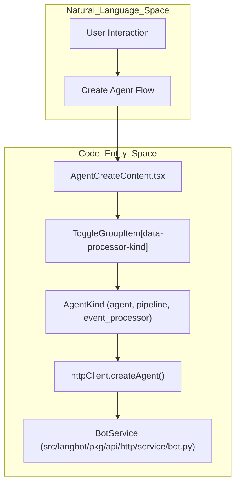
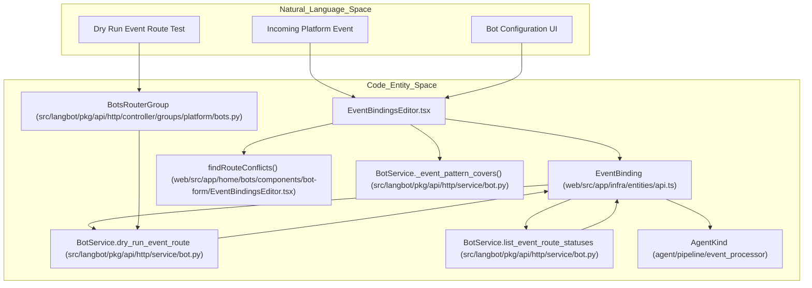

<!-- source: DeepWiki mcp.deepwiki.com · repo langbot-app/LangBot · page 4 Bot and Pipeline Management · fetched 2026-10-29 -->

# Bot and Pipeline Management

<details>
<summary>Relevant source files</summary>

The following files were used as context for generating this wiki page:

- [src/langbot/pkg/api/http/controller/groups/platform/bots.py](src/langbot/pkg/api/http/controller/groups/platform/bots.py)
- [src/langbot/pkg/api/http/service/bot.py](src/langbot/pkg/api/http/service/bot.py)
- [src/langbot/pkg/platform/botmgr.py](src/langbot/pkg/platform/botmgr.py)
- [tests/integration/api/test_bots.py](tests/integration/api/test_bots.py)
- [tests/unit_tests/api/service/test_bot_service.py](tests/unit_tests/api/service/test_bot_service.py)
- [web/src/app/home/bots/components/bot-form/EventBindingsEditor.tsx](web/src/app/home/bots/components/bot-form/EventBindingsEditor.tsx)
- [web/tests/e2e/crud-smoke.spec.ts](web/tests/e2e/crud-smoke.spec.ts)
- [web/tests/e2e/fixtures/langbot-api.ts](web/tests/e2e/fixtures/langbot-api.ts)

</details>


This page provides a high-level overview of LangBot's bot configuration system, processor abstractions (`agent`, `pipeline`, and `event_processor`), and pipeline execution architecture. LangBot decouples chat platform identities (`Bot`) from execution logic (`Pipeline`, `Agent`, or `Event Processor`), enabling flexible event routing and multi-processor deployments [src/langbot/pkg/api/http/service/bot.py:33-43]().

For deep technical details, refer to the child pages linked below:
- [Agents, Pipelines, and Event Processors](#4.1) — The processor abstraction: AgentKind, AgentService, runner registry and descriptors, runner_config, supported_event_patterns, and debugging panels.
- [Bot Configuration and Platform Adapters](#4.2) — Bot entity structure, adapter selection, adapter_config dynamic forms, webhook URLs, and `RuntimeBot`.
- [Pipeline Configuration and Stages](#4.3) — Pipeline tabs, stage settings, extensions, dynamic form metadata, and legacy config migration.
- [Pipeline Debug and WebSocket Interface](#4.4) — DebugDialog, WebSocket debugging, streaming, image upload, and embeddable widget.js.
- [Event Routing and Multi-Processor Deployment](#4.5) — Event bindings, priority evaluation, filter conditions, dry-run route diagnostics, and multi-pipeline routing scenarios.

---

## 4.1. Agents, Pipelines, and Event Processors

LangBot defines a unified processor abstraction represented by the `AgentKind` enumeration with values `agent`, `pipeline`, and `event_processor` [web/tests/e2e/fixtures/langbot-api.ts:19-20](). These processor kinds represent different types of message/event handlers within a LangBot workspace. The `BotService` manages these processors, which are executed via registered runners identified by runner descriptors and configured using `runner_config` data [src/langbot/pkg/api/http/service/bot.py:33-42](). Each processor declares `supported_event_patterns` to indicate which event types it handles in incoming telemetry.

The user interface components such as `ProcessorDetailWorkbench` and `AgentDebugPanel` allow real-time inspection and debugging of running processors. The runtime pluginization protocol enables custom runner implementations (agent-runners) for extensibility. For details, see [Agents, Pipelines, and Event Processors](#4.1).

**Diagram: Processor Kind Dispatch**

Sources: [web/src/app/home/agents/components/AgentCreateContent.tsx:1-90](), [src/langbot/pkg/api/http/service/bot.py:33-42](), [web/tests/e2e/crud-smoke.spec.ts:106-114]()

---

## 4.2. Bot Configuration and Platform Adapters

A `Bot` entity represents an instance of a message platform bot equipped to handle events via one or more processors [src/langbot/pkg/api/http/service/bot.py:33-43](). Bots specify the platform adapter (e.g., Discord, Telegram) they use and provide adapter-specific credential configurations through dynamic forms (`adapter_config`) [src/langbot/pkg/api/http/service/bot.py:33-43](). The `BotService` implements lifecycle operations for bots, including creation, updating, deletion, and retrieval [src/langbot/pkg/api/http/service/bot.py:23-44](). It also supports automatic webhook URL provisioning if the platform adapter declares such a configuration [src/langbot/pkg/api/http/service/bot.py:55-64]().

On the runtime side, `RuntimeBot` encapsulates a bot's execution environment, integrates with platform adapters, manages event routing, lifecycle, and logging [src/langbot/pkg/platform/botmgr.py:61-118](). The platform adapter layer normalizes IM platform specifics into a consistent event model to pass up to processor runners [src/langbot/pkg/platform/botmgr.py:133-155](). For details, see [Bot Configuration and Platform Adapters](#4.2).

**Diagram: Bot and Platform Runtime Architecture**
```mermaid
graph TD
    subgraph "Natural_Language_Space"
        IM_PLATFORM[""IM Platform (e.g., Telegram, Discord)""]
        BOT_CONFIG_UI[""Bot Configuration UI""]
    end
    subgraph "Code_Entity_Space"
        ADAPTER_COMPONENT["Component[kind=MessagePlatformAdapter]"]
        BOT_SERVICE["BotService (src/langbot/pkg/api/http/service/bot.py)"]
        BOT_ENTITY["Bot (src/langbot/pkg/entity/persistence/bot.py)"]
        RUNTIME_BOT["RuntimeBot (src/langbot/pkg/platform/botmgr.py)"]
        ADAPTER_CONFIG_FORM["adapter_config (Dynamic Form)"]
        WEBHOOK_URL_TYPE["config_item[type=webhook-url]"]
    end

    IM_PLATFORM --> ADAPTER_COMPONENT
    BOT_CONFIG_UI --> BOT_SERVICE
    BOT_SERVICE --> BOT_ENTITY
    BOT_ENTITY --> RUNTIME_BOT
    ADAPTER_COMPONENT --> ADAPTER_CONFIG_FORM
    ADAPTER_CONFIG_FORM --> WEBHOOK_URL_TYPE
    WEBHOOK_URL_TYPE --> BOT_SERVICE
    RUNTIME_BOT --> ADAPTER_COMPONENT
```
Sources: [src/langbot/pkg/api/http/service/bot.py:47-64](), [src/langbot/pkg/platform/botmgr.py:61-118]()

---

## 4.3. Pipeline Configuration and Stages

Pipelines define multi-stage processing workflows that operate on events routed from bots. Configuration covers basic settings, AI parameters defining model and tool usage, trigger conditions, safety rules, and output formatting.

These stages can be extended via plugin extensions and support dynamic form metadata for rich configuration UIs. Utilities exist for migration from legacy pipeline schemas to the current runtime container format. For details, see [Pipeline Configuration and Stages](#4.3).

Sources: [web/tests/e2e/fixtures/langbot-api.ts:18-23]()

---

## 4.4. Pipeline Debug and WebSocket Interface

LangBot supports interactive debugging of pipelines through a specialized `DebugDialog` UI and a WebSocket debug interface. Developers can review message histories, observe streaming output tokens, and upload images. The WebSocket adapter supports live communication, and embeddable `widget.js` enables integration of bot widgets in web pages.

This subsystem facilitates iterative development and troubleshooting of pipelines and processor behavior in real time. For details, see [Pipeline Debug and WebSocket Interface](#4.4).

Sources: [web/src/app/home/agents/components/AgentDebugPanel.tsx:1-200]() (example of a debug panel)

---

## 4.5. Event Routing and Multi-Processor Deployment

Event routing in LangBot is based on declarative event bindings configured per bot. Bindings specify event patterns, priority orders, filter conditions, and target processors (`agent`, `pipeline`, or `event_processor`) [src/langbot/pkg/api/http/service/bot.py:33-43](). This supports complex scenarios including multi-pipeline deployment per bot and plugin processor bindings [src/langbot/pkg/api/http/service/bot.py:153-160]().

The user interface includes dry-run diagnostics to evaluate routing decisions before deployment, plus real-time monitoring of event route statuses [src/langbot/pkg/api/http/service/bot.py:65-150](). Event pattern pickers streamline route configurability with semantic grouping of event types. For details, see [Event Routing and Multi-Processor Deployment](#4.5).

**Diagram: Event Routing and Processor Dispatch**

Sources: [src/langbot/pkg/api/http/service/bot.py:65-150](), [web/src/app/home/bots/components/bot-form/EventBindingsEditor.tsx:118-122](), [web/src/app/infra/entities/api.ts:1-100]() (for `EventBinding` definition), [src/langbot/pkg/api/http/controller/groups/platform/bots.py:118-146]()

---

This page serves as an introductory map to the comprehensive Bot and Pipeline Management system in LangBot. Detailed explanations, API references, and UI guides are available in the child pages:

- [Agents, Pipelines, and Event Processors](#4.1)
- [Bot Configuration and Platform Adapters](#4.2)
- [Pipeline Configuration and Stages](#4.3)
- [Pipeline Debug and WebSocket Interface](#4.4)
- [Event Routing and Multi-Processor Deployment](#4.5)

---

