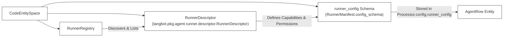
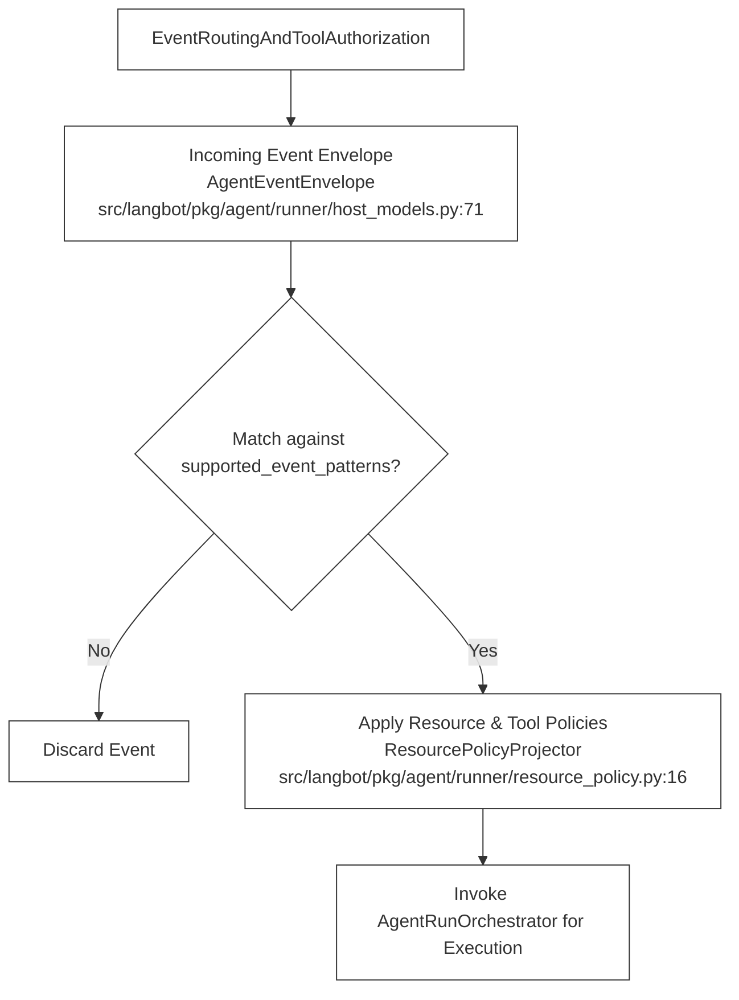
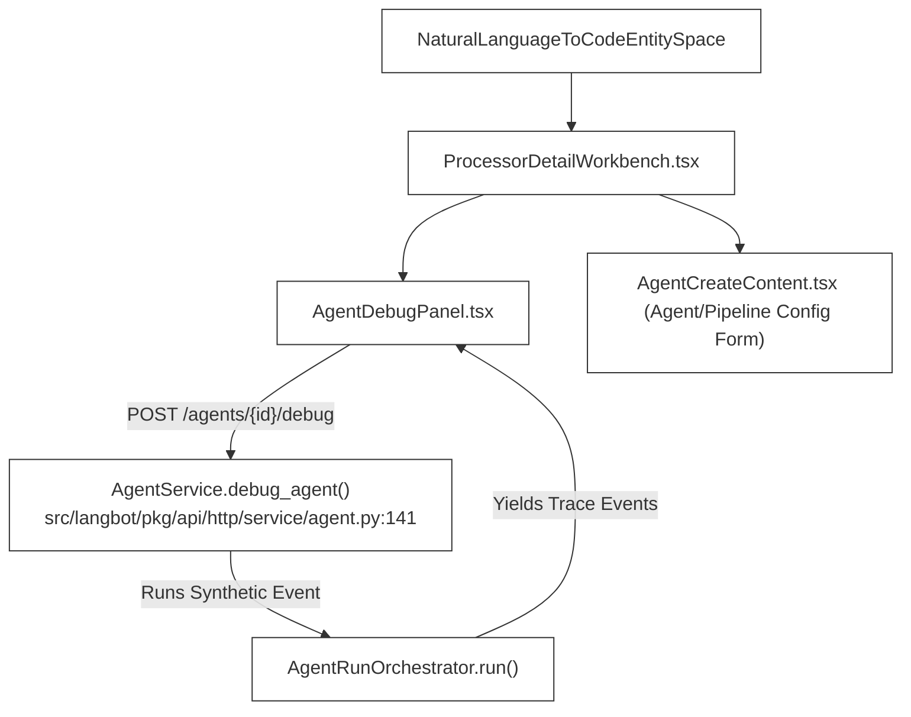
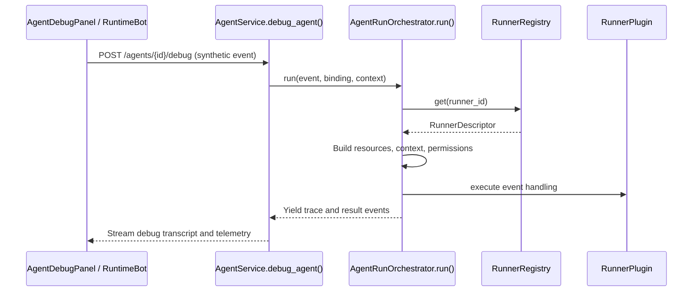

<!-- source: DeepWiki mcp.deepwiki.com · repo langbot-app/LangBot · page 4.1 Agents, Pipelines, and Event Processors · fetched 2026-10-29 -->

# Agents, Pipelines, and Event Processors

<details>
<summary>Relevant source files</summary>

The following files were used as context for generating this wiki page:

- [docs/agent-runner-pluginization/AGENT_CONTEXT_PROTOCOL.md](docs/agent-runner-pluginization/AGENT_CONTEXT_PROTOCOL.md)
- [docs/agent-runner-pluginization/HOST_SDK_INFRASTRUCTURE.md](docs/agent-runner-pluginization/HOST_SDK_INFRASTRUCTURE.md)
- [docs/agent-runner-pluginization/PROTOCOL_V1.md](docs/agent-runner-pluginization/PROTOCOL_V1.md)
- [docs/agent-runner-pluginization/SECURITY_HARDENING.md](docs/agent-runner-pluginization/SECURITY_HARDENING.md)
- [docs/agent-runner-pluginization/STATUS.md](docs/agent-runner-pluginization/STATUS.md)
- [skills/skills/langbot-testing/cases/acp-agent-runner-debug-chat.yaml](skills/skills/langbot-testing/cases/acp-agent-runner-debug-chat.yaml)
- [src/langbot/pkg/api/http/service/agent.py](src/langbot/pkg/api/http/service/agent.py)
- [tests/unit_tests/agent/test_debug_prompt.py](tests/unit_tests/agent/test_debug_prompt.py)
- [tests/unit_tests/api/service/test_agent_service.py](tests/unit_tests/api/service/test_agent_service.py)
- [tests/unit_tests/api/service/test_knowledge_service.py](tests/unit_tests/api/service/test_knowledge_service.py)
- [tests/unit_tests/api/service/test_provider_service.py](tests/unit_tests/api/service/test_provider_service.py)
- [tests/unit_tests/api/test_provider_controller_secrets.py](tests/unit_tests/api/test_provider_controller_secrets.py)
- [tests/unit_tests/provider/test_model_manager.py](tests/unit_tests/provider/test_model_manager.py)
- [web/src/app/home/agents/components/AgentCreateContent.tsx](web/src/app/home/agents/components/AgentCreateContent.tsx)
- [web/src/app/home/agents/components/ProcessorTypeDiagram.tsx](web/src/app/home/agents/components/ProcessorTypeDiagram.tsx)

</details>


This page details LangBot's processor abstraction encompassing three main types of processors—agents, pipelines, and event processors. It explains the `AgentKind` taxonomy, the central `AgentService` facade, the runner registry and descriptors, runner configuration schemas, supported event patterns, debugging UIs (`ProcessorDetailWorkbench` and `AgentDebugPanel`), and the agent-runner pluginization protocol.

---

## 1. Processor Abstraction and AgentKind

LangBot unifies various processing paradigms—autonomous agents, multi-stage pipelines, and event-driven handlers—under a single abstraction managed by the `AgentService` class [src/langbot/pkg/api/http/service/agent.py:56-57](). Each processor entity in a workspace maps to one of three `AgentKind` values [src/langbot/pkg/api/http/service/agent.py:49-51]():

- **`agent`**: Autonomous plugin-based agents driven by runners (e.g., LocalAgent or ACP runners) that handle arbitrary event envelopes with model-driven tool calling loops. Supports broad event patterns (`'*'`) and non-message events [src/langbot/pkg/api/http/service/agent.py:95-98]().

- **`pipeline`**: Sequential pipelines configured with stages (basic, ai, trigger, safety, output). These primarily process message-related events limited to `message.*` patterns [src/langbot/pkg/api/http/service/agent.py:52, 99-102]().

- **`event_processor`**: Lightweight, standalone plugin runners for handling background IM platform lifecycle events such as group joins or reactions without requiring chat message context. They support all event patterns (`'*'`) [src/langbot/pkg/api/http/service/agent.py:103-106]().

The `AgentService.get_agent_metadata()` method exposes this capability metadata along with runner config schemas and platform tool catalogs to the UI [src/langbot/pkg/api/http/service/agent.py:64-108]().

```mermaid
graph TD
  sub5["AgentServiceMetadataFacade"] -->|"AGENT_KIND_AGENT"| K1["agent (\"Kind\")\nSupported Events: '*' (all)\nsrc/langbot/pkg/api/http/service/agent.py:95"]
  sub5 -->|"AGENT_KIND_PIPELINE"| K2["pipeline (\"Kind\")\nSupported Events: 'message.*'\nsrc/langbot/pkg/api/http/service/agent.py:99"]
  sub5 -->|"AGENT_KIND_EVENT_PROCESSOR"| K3["event_processor (\"Kind\")\nSupported Events: '*'\nsrc/langbot/pkg/api/http/service/agent.py:103"]
  
  K1 --> R1["Plugin Runner Discovery via RunnerRegistry"]
  K2 --> R2["PipelineService: multi-stage config & execution"]
  K3 --> R3["Plugin Event Bindings for IM lifecycle events"]

  classDef default fill:#fff,stroke:#333,stroke-width:1px;
```
*Diagram 1: Natural language space mapping to `AgentService` and `AgentKind` code entities.*

Sources: [src/langbot/pkg/api/http/service/agent.py:47-108]()

---

## 2. Runner Registry, Descriptors, and Pluginization Protocol

Runners are self-contained plugin extensions implementing the Agent-Runner Protocol [docs/agent-runner-pluginization/PROTOCOL_V1.md](). The LangBot host manages runners via the `RunnerRegistry` abstraction [src/langbot/pkg/api/http/service/agent.py:80]().

### Runner Descriptor

Each runner is described by a descriptor specifying its:

- **Usages:** whether it supports `agent`, `event`, or both [src/langbot/pkg/api/http/service/agent.py:84]()
- **Capabilities:** e.g., streaming output, tool calls, knowledge base usage, skill authoring [docs/agent-runner-pluginization/PROTOCOL_V1.md:96-119]()
- **Required Resource Permissions:** categories such as `models`, `tools`, `knowledge_bases`, `history`, `events`, `storage` [docs/agent-runner-pluginization/PROTOCOL_V1.md:125-134]()
- **Config Schema:** JSON schema describing configuration UI components for the runner [docs/agent-runner-pluginization/PROTOCOL_V1.md:85]()

### runner_config Schema

The runner's `config_schema` defines UI form fields used to configure the runner's behavior (e.g., model selectors and prompt settings). These configurations are stored in the processor entity’s `config.runner_config` map [tests/unit_tests/api/service/test_agent_service.py:48](). The `AgentService.get_agent_metadata()` method provides `runner_config` metadata to the frontend [src/langbot/pkg/api/http/service/agent.py:92]().


*Diagram 2: Code entity space mapping for runner registry and descriptor storage.*

Sources: [src/langbot/pkg/api/http/service/agent.py:64-92](), [tests/unit_tests/api/service/test_agent_service.py:48](), [docs/agent-runner-pluginization/PROTOCOL_V1.md:85, 96-119, 125-134]()

---

## 3. Event Patterns and Tool Authorization

Each processor declares `supported_event_patterns`, a list of glob-style filters that specify which event types it receives and processes [src/langbot/pkg/api/http/service/agent.py:162-166]().

- **Pattern Matching:** Wildcards like `*`, `message.*`, `group.*` are matched against runtime event envelope types using matching utilities, allowing flexible event subscription [src/langbot/pkg/api/http/service/agent.py:162-166]().

- **Tools Authorization:**
  - `allowed_platform_tools`: Whitelist of built-in platform tools (e.g., `event_reply`, `event_get_actor`) that can be invoked by the processor [tests/unit_tests/api/service/test_agent_service.py:173]().
  - `allowed_tools`: Whitelist of external or host-executed tools (e.g., `exec`, `weather`, MCP tools) allowed for use [tests/unit_tests/api/service/test_agent_service.py:178]().



Sources: [src/langbot/pkg/agent/runner/host_models.py:71](), [src/langbot/pkg/agent/runner/resource_policy.py:16](), [src/langbot/pkg/api/http/service/agent.py:162-166](), [tests/unit_tests/api/service/test_agent_service.py:173, 178]()

---

## 4. Debugging Workbenches (`ProcessorDetailWorkbench` & `AgentDebugPanel`)

The React frontend offers detailed debugging and configuration UIs for processors:

- **`ProcessorDetailWorkbench`**: Provides a split or tabbed interface that integrates configuration panels (Runner settings, Events/Tools binding editors) with real-time debugging and monitoring views for agents and pipelines. The frontend test `processor-detail-workbench.test.mjs` specifically checks the layout for Agent's sections [docs/agent-runner-pluginization/STATUS.md:18]().
- **`AgentDebugPanel`**: Enables developers to simulate synthetic events using preset or custom event types (e.g., `message.received`, `group.member_joined`), modify structured event payloads on the fly, submit them to the debug API, and view detailed execution traces streamed back in real time [web/src/app/home/agents/components/AgentDebugPanel.tsx:94-222](). The `AgentService.debug_agent()` method handles the backend logic for these debug runs [src/langbot/pkg/api/http/service/agent.py:141-174]().



Sources: [web/src/app/home/agents/components/AgentDebugPanel.tsx:94-222](), [src/langbot/pkg/api/http/service/agent.py:141-174](), [docs/agent-runner-pluginization/STATUS.md:18]()

---

## 5. AgentService: Central Facade for Agents and Pipelines

The `AgentService` class acts as a unified facade to manage agents, pipelines, and event processors uniformly [src/langbot/pkg/api/http/service/agent.py:56-57](), supporting:

- Metadata retrieval for available runners, kinds, platform tools, and host tools for UI consumption (`get_agent_metadata`) [src/langbot/pkg/api/http/service/agent.py:64-108]()
- CRUD operations and data hydration for agents and pipelines (`get_agents`, `get_agent`, etc.) [src/langbot/pkg/api/http/service/agent.py:110-139]()
- Debugging runs with synthetic event input, coordinating with lower layers to execute a debug run and stream telemetry (`debug_agent`) [src/langbot/pkg/api/http/service/agent.py:141-174]()

`AgentService` also defines the canonical event patterns per kind:

| AgentKind | Default Supported Event Patterns | Message Only |
| :---------------- | :------------------------------- | :----------- |
| `agent` | `['*']` | No |
| `pipeline` | `['message.received']` | Yes |
| `event_processor` | `['*']` | No |

Sources: [src/langbot/pkg/api/http/service/agent.py:49-108](), [src/langbot/pkg/api/http/service/agent.py:52]()

---

## 6. AgentRunOrchestrator and Execution Flow

The execution of agents and pipelines is coordinated by the orchestrator subsystem. When an event triggers execution (including debug events), the orchestrator:

- Validates execution context including workspace tenancy [src/langbot/pkg/api/http/service/agent.py:141-157]()
- Resolves the runner descriptor from the `RunnerRegistry` [docs/agent-runner-pluginization/HOST_SDK_INFRASTRUCTURE.md:167]()
- Checks runner capabilities and event support [src/langbot/pkg/api/http/service/agent.py:162-166]()
- Engages the runner plugin connector to execute runtime steps [docs/agent-runner-pluginization/HOST_SDK_INFRASTRUCTURE.md:171]()
- Streams normalized runtime events and output back to the host/console/UI [src/langbot/pkg/api/http/service/agent.py:147-148]()



Sources: [src/langbot/pkg/api/http/service/agent.py:141-174](), [docs/agent-runner-pluginization/HOST_SDK_INFRASTRUCTURE.md:167, 171]()

---

