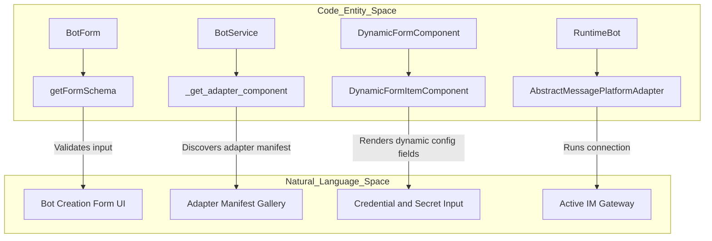
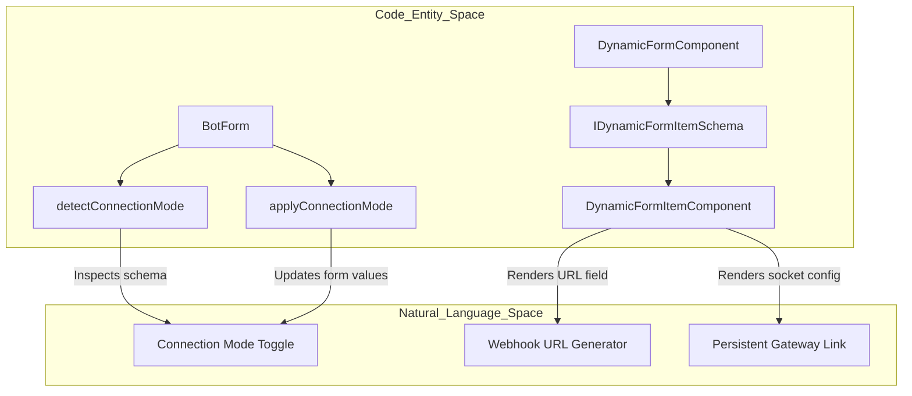
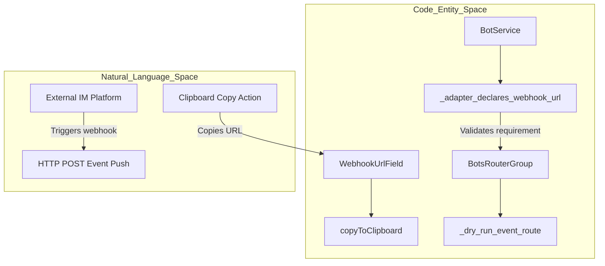

<!-- source: DeepWiki mcp.deepwiki.com · repo langbot-app/LangBot · page 4.2 Bot Configuration and Platform Adapters · fetched 2026-10-29 -->

# Bot Configuration and Platform Adapters

Relevant source files

The following files were used as context for generating this wiki page:

- [src/langbot/pkg/api/http/controller/groups/platform/adapters.py](src/langbot/pkg/api/http/controller/groups/platform/adapters.py)
- [src/langbot/pkg/api/http/controller/groups/platform/bots.py](src/langbot/pkg/api/http/controller/groups/platform/bots.py)
- [src/langbot/pkg/api/http/service/bot.py](src/langbot/pkg/api/http/service/bot.py)
- [src/langbot/pkg/platform/botmgr.py](src/langbot/pkg/platform/botmgr.py)
- [tests/integration/api/test_bots.py](tests/integration/api/test_bots.py)
- [tests/unit_tests/api/service/test_bot_service.py](tests/unit_tests/api/service/test_bot_service.py)
- [tests/unit_tests/api/test_credential_session_ttl.py](tests/unit_tests/api/test_credential_session_ttl.py)
- [web/src/app/home/bots/components/bot-form/EventBindingsEditor.tsx](web/src/app/home/bots/components/bot-form/EventBindingsEditor.tsx)
- [web/src/app/home/components/qrcode-login/QrCodeLoginDialog.tsx](web/src/app/home/components/qrcode-login/QrCodeLoginDialog.tsx)
- [web/tests/e2e/crud-smoke.spec.ts](web/tests/e2e/crud-smoke.spec.ts)
- [web/tests/e2e/fixtures/langbot-api.ts](web/tests/e2e/fixtures/langbot-api.ts)

This page documents the **Bot entity** structure, platform adapter selection, dynamic form configuration (`adapter_config`), webhook URL provisioning, event bindings, bot admins, bot logs, and runtime bot management (`botmgr/RuntimeBot`) within LangBot.

For abstract adapter interfaces and supported IM platforms, see [5.1 Platform Adapter Architecture]() and [5.2 Supported IM Platforms](). For processor workbench details, see [4.1 Agents, Pipelines, and Event Processors]().

---

## Bot Entity Data Model and Service Layer

A **Bot** is a central entity that connects LangBot's external messaging platform adapters with its internal processing units (agents, pipelines, event processors). Each bot is persisted in a tenant-aware workspace-scoped database and managed via the Python `BotService` class.

### Structure and Fields

The `BotService` manages essential fields for each bot entity:

| Field | Description |
|---|---|
| `uuid` | Unique bot identifier |
| `name` | Bot's human-readable display name |
| `description` | Optional textual description |
| `adapter` | Canonical name (ID) of the platform adapter bound to the bot |
| `adapter_config` | Dictionary of platform-specific configuration and credentials |
| `enable` | Boolean flag to enable or disable the bot's runtime |
| `event_bindings` | List of routing rules mapping event patterns to processors |
| `plugin_processors` | Plugin processor hooks attached to the bot |

These fields are defined and exposed by `BotService` at the API and persistence layers with tenant and workspace scoping [src/langbot/pkg/api/http/service/bot.py:35-44](), [tests/unit_tests/api/service/test_bot_service.py:18-48]().

### BotService Key Responsibilities

- Discovery of platform adapter components via `_get_adapter_component()` to validate and fetch adapter manifests [src/langbot/pkg/api/http/service/bot.py:50-56]().
- Identifying whether an adapter declares a webhook URL field via `_adapter_declares_webhook_url()` [src/langbot/pkg/api/http/service/bot.py:58-67]().
- Utilities for event pattern validation, coverage checking, and diagnostic formatting for event route matching logic [src/langbot/pkg/api/http/service/bot.py:70-118]().

Sources: [src/langbot/pkg/api/http/service/bot.py:35-118](), [tests/unit_tests/api/service/test_bot_service.py:18-88]()

---

## Adapter Selection and Dynamic Configuration

Platform adapters define YAML manifests declaring configuration items required for bot setup, such as credentials, connection modes, and webhook URLs.

### Dynamic Form Rendering and Validation

- The frontend `BotForm` component manages the bot configuration form, rendering adapter selection and parsing dynamic form schemas through `getFormSchema()` [web/src/app/home/bots/components/bot-form/BotForm.tsx:167-197]().
- Field inputs are validated against strict Zod schemas for basic metadata while leaving `adapter_config` as an arbitrary key-value record [web/src/app/home/bots/components/bot-form/BotForm.tsx:167-197]().
- Dynamic form fields for adapter configurations are rendered by `DynamicFormComponent` and `DynamicFormItemComponent`, which interpret the adapter manifest schema to provide appropriate widgets, model selectors, and secret fields [web/src/app/home/components/dynamic-form/DynamicFormComponent.tsx:1-58](), [web/src/app/home/components/dynamic-form/DynamicFormItemComponent.tsx:1-125]().

### Connection Modes: Webhook vs Persistent

Adapters may support distinct connection topologies evaluated by `supportsConnectionMode()` and `detectConnectionMode()` [web/src/app/home/bots/components/bot-form/BotForm.tsx:90-165]():
- **Webhook mode**: LangBot exposes a unique public webhook URL (`webhook_url`) to which the external platform pushes events.
- **Persistent mode**: Long-lived persistent connections (e.g., WebSocket or long-polling) initiated from LangBot to the platform.

Credential binding also supports QR code authentication flows via `QrCodeLoginDialog` [web/src/app/home/components/qrcode-login/QrCodeLoginDialog.tsx:1-40]().

Sources: [web/src/app/home/bots/components/bot-form/BotForm.tsx:90-165](), [web/src/app/home/components/dynamic-form/DynamicFormComponent.tsx:1-58](), [web/src/app/home/components/dynamic-form/DynamicFormItemComponent.tsx:1-125]()

---

## Webhook URLs and Runtime Bot Information

For webhook-driven adapters, the system auto-generates webhook receiver URLs managed by `BotService` and platform controllers [src/langbot/pkg/api/http/service/bot.py:58-68]().

- Each webhook URL integrates the system ingress endpoint with the bot's UUID, allowing external platforms to route events directly to the correct bot instance within its workspace context [src/langbot/pkg/api/http/service/bot.py:58-68]().
- Webhook URLs are rendered via `WebhookUrlField` as read-only form items with copy-to-clipboard functionality [web/src/app/home/components/dynamic-form/DynamicFormComponent.tsx:202-225]().
- Dry-run validation endpoints (`dry_run_event_route`) allow operators to verify configuration validity and test event dispatching [src/langbot/pkg/api/http/service/bot.py:166-170]().

Sources: [src/langbot/pkg/api/http/service/bot.py:58-68](), [src/langbot/pkg/api/http/controller/groups/platform/bots.py:118-146](), [web/src/app/home/components/dynamic-form/DynamicFormComponent.tsx:202-225]()

---

## Event Routing, Event Bindings, and Diagnostics

LangBot uses an event-driven routing architecture to dispatch incoming platform events to designated target processors (agents, pipelines, event processors).

### Data Model for Event Bindings

Each bot configuration includes an ordered list of `event_bindings`:
- `event_pattern`: Glob-style string pattern matching event namespaces (e.g., `message.received`, `group.*`) [web/src/app/home/bots/components/bot-form/EventBindingsEditor.tsx:138-195]().
- `target_type`: Target processor category (`agent`, `pipeline`, `event_processor`, or `discard`) [web/src/app/home/bots/components/bot-form/EventBindingsEditor.tsx:177-187]().
- `target_uuid`: UUID identifying the target processor instance [web/src/app/home/bots/components/bot-form/EventBindingsEditor.tsx:188]().
- `filters`: Array of conditional field rules (e.g., checking `chat_type`, `message_text`, or `is_at_bot`) [web/src/app/home/bots/components/bot-form/EventBindingsEditor.tsx:147-175]().
- `priority`: Integer weight determining evaluation precedence [web/src/app/home/bots/components/bot-form/EventBindingsEditor.tsx:191]().

### Route Diagnostics and Tracing

- `BotService` formats step-by-step diagnostic traces via `_format_diagnostic_step()` and `_event_route_status_from_log()` to analyze route matching outcomes and failures like `route_not_found` or `processor_not_found` [src/langbot/pkg/api/http/service/bot.py:90-153]().
- The `EventBindingsEditor` frontend component provides drag-and-drop sorting via `@dnd-kit`, conflict detection, and behavior presets [web/src/app/home/bots/components/bot-form/EventBindingsEditor.tsx:96-114]().

Sources: [src/langbot/pkg/api/http/service/bot.py:90-153](), [web/src/app/home/bots/components/bot-form/EventBindingsEditor.tsx:96-224]()

---

## RuntimeBot Management and Execution Context

The `RuntimeBot` class represents the active execution instance of a bot within the backend runtime (`botmgr`), bridging incoming platform events with pipeline and processor invocation [src/langbot/pkg/platform/botmgr.py:62-84]().

### Key RuntimeBot Responsibilities

- **Execution Verification**: Validates active workspace constraints, instance UUIDs, and placement generations through `assert_execution_active()` [src/langbot/pkg/platform/botmgr.py:120-128]().
- **Event Translation**: Maps platform EBA events (`platform_events.EBAEvent`) to plugin event models (`plugin_events.BaseEventModel`) via `_eba_event_to_plugin_event()` [src/langbot/pkg/platform/botmgr.py:134-156]().
- **Pattern Matching**: Evaluates wildcard and namespace patterns using `_match_event_pattern()` [src/langbot/pkg/platform/botmgr.py:158-166]().

Sources: [src/langbot/pkg/platform/botmgr.py:62-166]()

---

## Bot Logging and Event Management

LangBot records bot telemetry, session interactions, and event routing traces.

- `BotService` queries stored logs and execution traces associated with tenant bot instances [src/langbot/pkg/api/http/service/bot.py:120-153]().
- Frontend views display route activity, historical logs, and error states to assist administrators with troubleshooting [web/tests/e2e/crud-smoke.spec.ts:150-161]().

Sources: [src/langbot/pkg/api/http/service/bot.py:120-153](), [web/tests/e2e/crud-smoke.spec.ts:150-161]()

---

