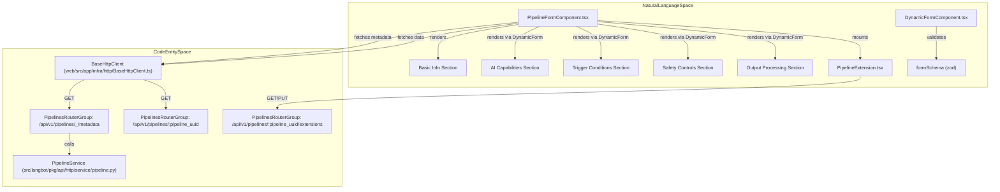
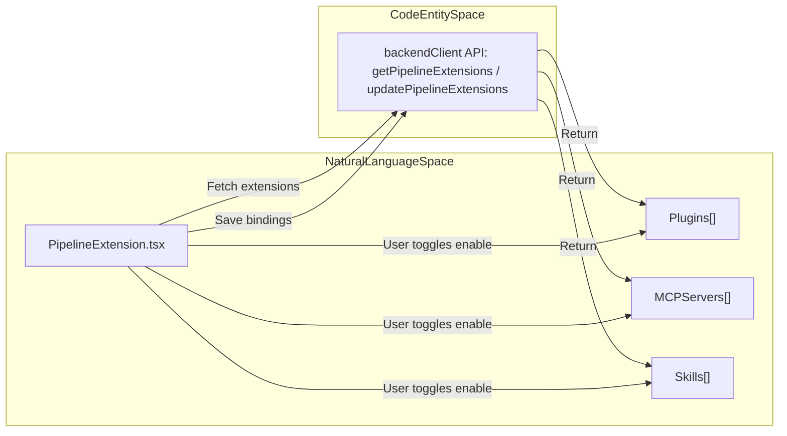
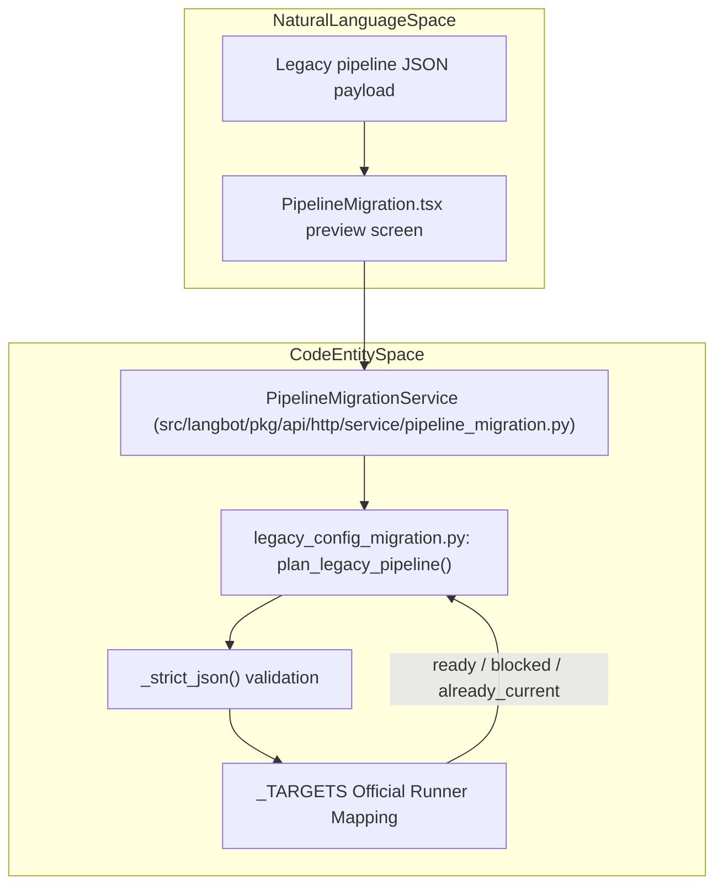

<!-- source: DeepWiki mcp.deepwiki.com · repo langbot-app/LangBot · page 4.3 Pipeline Configuration and Stages · fetched 2026-10-29 -->

# Pipeline Configuration and Stages

Relevant source files

The following files were used as context for generating this wiki page:

- [docs/pipeline-migration-config-map.zh-CN.md](docs/pipeline-migration-config-map.zh-CN.md)
- [src/langbot/pkg/api/http/service/pipeline_migration.py](src/langbot/pkg/api/http/service/pipeline_migration.py)
- [src/langbot/pkg/pipeline/legacy_config_migration.py](src/langbot/pkg/pipeline/legacy_config_migration.py)
- [src/langbot/templates/default-pipeline-config.json](src/langbot/templates/default-pipeline-config.json)
- [src/langbot/templates/metadata/pipeline/ai.yaml](src/langbot/templates/metadata/pipeline/ai.yaml)
- [src/langbot/templates/metadata/pipeline/output.yaml](src/langbot/templates/metadata/pipeline/output.yaml)
- [tests/unit_tests/api/service/test_pipeline_migration.py](tests/unit_tests/api/service/test_pipeline_migration.py)
- [tests/unit_tests/pipeline/conftest.py](tests/unit_tests/pipeline/conftest.py)
- [tests/unit_tests/pipeline/test_legacy_config_migration.py](tests/unit_tests/pipeline/test_legacy_config_migration.py)
- [tests/unit_tests/pipeline/test_migration_current_shape.py](tests/unit_tests/pipeline/test_migration_current_shape.py)
- [web/src/app/home/pipelines/PipelineMigration.tsx](web/src/app/home/pipelines/PipelineMigration.tsx)
- [web/src/app/home/pipelines/pipeline-migration-issues.ts](web/src/app/home/pipelines/pipeline-migration-issues.ts)
- [web/src/app/infra/entities/api/pipeline-migration.ts](web/src/app/infra/entities/api/pipeline-migration.ts)
- [web/src/app/infra/http/BaseHttpClient.ts](web/src/app/infra/http/BaseHttpClient.ts)
- [web/src/i18n/locales/pipeline-migration/en-US.ts](web/src/i18n/locales/pipeline-migration/en-US.ts)
- [web/src/i18n/locales/pipeline-migration/es-ES.ts](web/src/i18n/locales/pipeline-migration/es-ES.ts)
- [web/src/i18n/locales/pipeline-migration/ja-JP.ts](web/src/i18n/locales/pipeline-migration/ja-JP.ts)
- [web/src/i18n/locales/pipeline-migration/ru-RU.ts](web/src/i18n/locales/pipeline-migration/ru-RU.ts)
- [web/src/i18n/locales/pipeline-migration/th-TH.ts](web/src/i18n/locales/pipeline-migration/th-TH.ts)
- [web/src/i18n/locales/pipeline-migration/vi-VN.ts](web/src/i18n/locales/pipeline-migration/vi-VN.ts)
- [web/src/i18n/locales/pipeline-migration/zh-Hans.ts](web/src/i18n/locales/pipeline-migration/zh-Hans.ts)
- [web/src/i18n/locales/pipeline-migration/zh-Hant.ts](web/src/i18n/locales/pipeline-migration/zh-Hant.ts)
- [web/tests/e2e/fixtures/runner-migration-contract.json](web/tests/e2e/fixtures/runner-migration-contract.json)
- [web/tests/unit/migration-network-diagnostics.test.mjs](web/tests/unit/migration-network-diagnostics.test.mjs)

## Purpose and Scope

This document details the pipeline configuration architecture, stage-specific settings, pipeline extensions, dynamic form metadata systems, and the legacy configuration migration framework in LangBot. A pipeline defines message processing behaviors, AI runner selection, triggers, safety controls, and output formatting.

Sources: [src/langbot/pkg/entity/persistence/pipeline.py:1-42](), [src/langbot/pkg/api/http/service/pipeline.py:1-151](), [src/langbot/pkg/pipeline/legacy_config_migration.py:1-12]()

---

## Pipeline Entity Structure and Persistence

Pipelines are persisted using the `LegacyPipeline` ORM model defined in `src/langbot/pkg/entity/persistence/pipeline.py` [tests/unit_tests/api/service/test_pipeline_migration.py:18-18](). Each pipeline entity stores hierarchical settings and extension preferences.

| Field | Type | Description |
|---|---|---|
| `uuid` | string | Unique primary key identifying the pipeline |
| `name` | string | User-facing display name |
| `description` | string | Text describing the pipeline's purpose |
| `emoji` | string | Emoji representing the pipeline in UI (default: "⚙️") |
| `config` | JSON object | Hierarchical configuration covering `ai`, `trigger`, `safety`, and `output` |
| `is_default` | boolean | Indicates if this is the default fallback pipeline |
| `stages` | list[string]| Ordered array of stage class names defining execution sequence |
| `extensions_preferences` | JSON object | Preferences mapping bound plugins, MCP servers, and skills |

Default pipeline configurations are provisioned using the template `src/langbot/templates/default-pipeline-config.json` when pipelines are created via `PipelineService.create_pipeline` [src/langbot/pkg/api/http/service/pipeline.py:103-125](), [src/langbot/templates/default-pipeline-config.json:1-65](). The `config` field in the `LegacyPipeline` model stores the structured settings for different pipeline aspects [tests/unit_tests/api/service/test_pipeline_migration.py:119-121]().

Sources: [src/langbot/pkg/entity/persistence/pipeline.py:6-42](), [src/langbot/pkg/api/http/service/pipeline.py:103-125](), [src/langbot/templates/default-pipeline-config.json:1-65](), [tests/unit_tests/api/service/test_pipeline_migration.py:18-18](), [tests/unit_tests/api/service/test_pipeline_migration.py:119-121]()

---

## Configuration Tabs and Metadata-Driven Architecture

The frontend pipeline management UI uses `PipelineFormComponent` and `PipelineDetailContent` to organize settings across five main tabs (basic, AI, trigger, safety, output) and an extensions tab [web/src/app/home/pipelines/PipelineDetailContent.tsx:108-186](), [src/langbot/pkg/api/http/controller/groups/pipelines/pipelines.py:46-58]().

### Pipeline Configuration and Metadata Data Flow

Diagram Title: Pipeline Metadata and Configuration Data Flow

**Description:**
- The frontend `PipelineFormComponent` requests metadata and pipeline instance data via `BaseHttpClient` [web/src/app/infra/http/BaseHttpClient.ts:39-106]().
- The backend routes `/pipelines/_/metadata` and `/pipelines/:uuid` are handled by `PipelineService` [src/langbot/pkg/api/http/controller/groups/pipelines/pipelines.py:46-58]().
- The dynamic form renders tab contents based on backend metadata schemas, such as `src/langbot/templates/metadata/pipeline/ai.yaml` [src/langbot/templates/metadata/pipeline/ai.yaml:1-43]().
- User input is validated against `zod` schemas.

Sources: [web/src/app/home/pipelines/PipelineDetailContent.tsx:108-186](), [src/langbot/pkg/api/http/controller/groups/pipelines/pipelines.py:46-58](), [web/src/app/infra/http/BaseHttpClient.ts:39-106](), [src/langbot/templates/metadata/pipeline/ai.yaml:1-43]()

---

## Stage-Specific Settings and Pipeline Runtime Stages

Pipeline execution follows an ordered sequence of runtime stages configured via the pipeline's `stages` list [src/langbot/pkg/api/http/service/pipeline.py:14-27]():

- `GroupRespondRuleCheckStage`: Evaluates prefixes, mentions, and regex patterns to decide message processing eligibility.
- `PreProcessor`: Normalizes incoming message events, handles conversation expiration timeout (`expire-time`) as defined in `src/langbot/templates/metadata/pipeline/ai.yaml`, and injects context before AI invocation [src/langbot/templates/metadata/pipeline/ai.yaml:21-40]().
- `MessageProcessor`: Dispatches AI processing via runner implementations such as `LocalAgentRunner` or API-based runners (`N8nServiceAPIRunner`, `DifyAgent`, etc.).
- `SendResponseBackStage`: Transforms and routes the AI response back to the target IM platform adapter.

### AI Runner Configuration Highlights
- **LocalAgentRunner**: Supports primary and fallback models, system prompt editors, knowledge bases, and reranking parameters.
- **Sandbox Scope Template**: The `box-session-id-template` field controls sandbox reuse scope using variables like `{launcher_type}_{launcher_id}`.
- **API-based Runners**: Supported runners include `n8n-service-api`, `dify-service-api`, `dashscope-app-api`, `coze-api`, `tbox-app-api`, and `weknora-api`.
- **N8n Authentication**: Uses specialized components for rendering dynamic subforms based on authentication type.

The `ai.yaml` metadata defines the `runner` stage, allowing dynamic population of options from the `RunnerRegistry` and adding runner-specific configuration stages [src/langbot/templates/metadata/pipeline/ai.yaml:5-43](). The `expire-time` setting for conversations is crucial for managing session state [src/langbot/templates/metadata/pipeline/ai.yaml:21-40]().

Sources: [src/langbot/pkg/api/http/service/pipeline.py:14-27](), [src/langbot/templates/metadata/pipeline/ai.yaml:5-43](), [src/langbot/templates/default-pipeline-config.json:39-44]()

---

## Pipeline Extensions and Bindings

Pipelines can bind to multiple extension types managed through the `PipelineExtension` component [web/src/app/home/pipelines/components/pipeline-extensions/PipelineExtension.tsx:76-156]().

### Extension Types Managed
- **Plugins**: Contribute commands, event listeners, or tools selectively bound per pipeline. Icons are resolved and cached via the `useInstalledPluginIcon` hook [web/src/app/infra/hooks/useInstalledPluginIcon.ts:1-118]().
- **MCP Servers**: Remote contexts providing injectable tools and resources.
- **Skills**: Markdown instruction packages for specialized agent workflows.

### Extension Management Flow

Diagram Title: Pipeline Extension Management Data Flow

Sources: [web/src/app/home/pipelines/components/pipeline-extensions/PipelineExtension.tsx:76-186](), [src/langbot/pkg/api/http/controller/groups/pipelines/pipelines.py:120-151](), [web/src/app/infra/hooks/useInstalledPluginIcon.ts:1-118]()

---

## Legacy Configuration Migration Architecture

LangBot incorporates a fail-safe legacy pipeline migration planner (`legacy_config_migration.py`) and migration service (`pipeline_migration.py`) to convert old builtin AI runner configurations into official plugin-based models without runtime side effects [src/langbot/pkg/pipeline/legacy_config_migration.py:1-12](), [src/langbot/pkg/api/http/service/pipeline_migration.py:1-165](). The migration process is designed to be robust, handling various scenarios including network diagnostics and installation errors [web/src/i18n/locales/pipeline-migration/en-US.ts:2-9](), [web/src/i18n/locales/pipeline-migration/en-US.ts:18-31]().

### Migration Planner Data Flow and Code Mapping

Diagram Title: Legacy Migration Planning and Execution Flow

The `plan_legacy_pipeline` function is mocked in tests to simulate migration planning [tests/unit_tests/api/service/test_pipeline_migration.py:81-81](). The `PipelineMigrationService` orchestrates the migration, including previewing and executing the migration task [tests/unit_tests/api/service/test_pipeline_migration.py:172-184]().

### Supported Official Legacy Runner Targets

| Legacy ID | Plugin Name | Min Version |
|---|---|---|
| `local-agent` | `LocalAgent` | 0.2.1 |
| `dify-service-api` | `DifyAgent` | 0.2.3 |
| `coze-api` | `CozeAgent` | 0.2.0 |
| `dashscope-app-api`| `DashScopeAgent` | 0.2.2 |
| `n8n-service-api` | `N8nAgent` | 0.2.0 |
| `langflow-api` | `LangflowAgent` | 0.2.2 |
| `deerflow-api` | `DeerFlowAgent` | 0.2.1 |
| `tbox-app-api` | `TboxAgent` | 0.2.1 |
| `weknora-api` | `WeKnoraAgent` | 0.2.1 |

### Planner Safety Rules (Planner v5)
- **Strict Validation**: Rejects cycles, custom objects, non-finite numbers, and non-string keys via `_strict_json` [src/langbot/pkg/pipeline/legacy_config_migration.py:200-201]().
- **Automatic Repair**: Coerces stringified numbers/booleans, fills missing fields with defaults from schemas, and archives unknown fields.
- **Authorization Scoping**: Preserves tool, knowledge base, and MCP resource authorizations constrained by tenant preferences.
- **Migration Notices**: The frontend displays various notices during migration, such as `fieldDropped`, `valueRepaired`, `pluginRequired`, and `legacyArchive`, to inform users about changes and potential issues [web/src/i18n/locales/pipeline-migration/en-US.ts:48-105]().

Sources: [src/langbot/pkg/pipeline/legacy_config_migration.py:1-210](), [tests/unit_tests/pipeline/test_legacy_config_migration.py:1-161](), [docs/pipeline-migration-config-map.zh-CN.md:1-40](), [src/langbot/pkg/api/http/service/pipeline_migration.py:1-165](), [web/src/i18n/locales/pipeline-migration/en-US.ts:2-9](), [web/src/i18n/locales/pipeline-migration/en-US.ts:18-31](), [tests/unit_tests/api/service/test_pipeline_migration.py:81-81](), [tests/unit_tests/api/service/test_pipeline_migration.py:172-184](), [web/src/i18n/locales/pipeline-migration/en-US.ts:48-105]()

---

# Summary

This section covered the full lifecycle of pipeline configuration in LangBot, including ORM persistence, UI configuration tabs, runtime execution stages, pipeline extensions, metadata-driven dynamic form rendering, and the migration framework.

Sources: [src/langbot/pkg/entity/persistence/pipeline.py:1-42](), [src/langbot/pkg/api/http/service/pipeline.py:1-151](), [src/langbot/pkg/pipeline/legacy_config_migration.py:1-12]()

---

