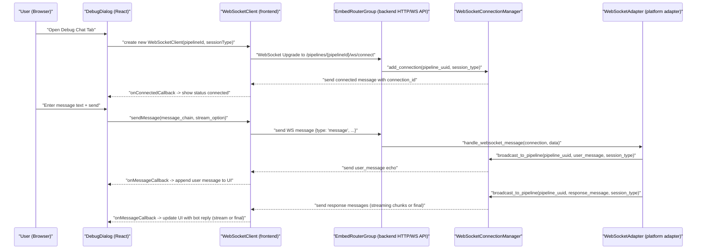
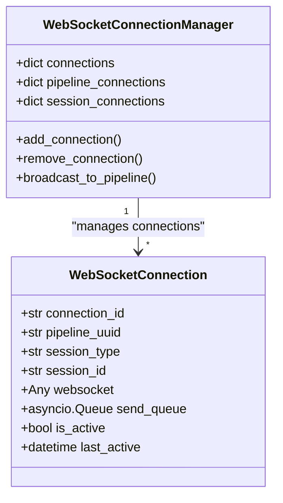
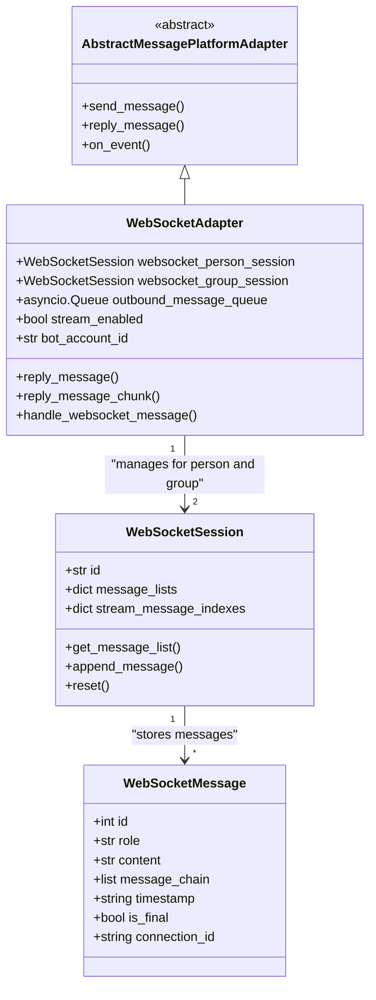
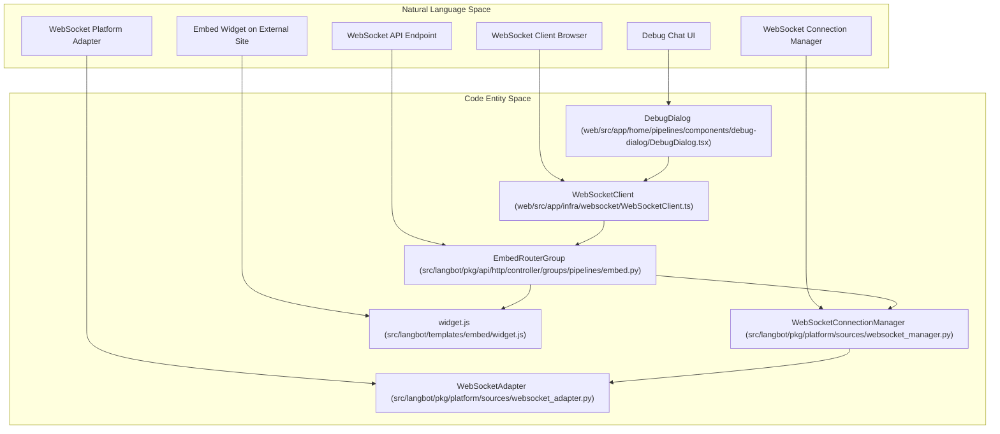

<!-- source: DeepWiki mcp.deepwiki.com · repo langbot-app/LangBot · page 4.4 Pipeline Debug and WebSocket Interface · fetched 2026-10-29 -->

# Pipeline Debug and WebSocket Interface

<details>
<summary>Relevant source files</summary>

The following files were used as context for generating this wiki page:

- [src/langbot/pkg/api/http/controller/groups/pipelines/embed.py](src/langbot/pkg/api/http/controller/groups/pipelines/embed.py)
- [src/langbot/pkg/platform/sources/websocket_adapter.py](src/langbot/pkg/platform/sources/websocket_adapter.py)
- [src/langbot/templates/embed/widget.js](src/langbot/templates/embed/widget.js)
- [tests/integration/api/test_embed.py](tests/integration/api/test_embed.py)
- [tests/integration/api/test_monitoring.py](tests/integration/api/test_monitoring.py)
- [tests/unit_tests/platform/test_websocket_session_isolation.py](tests/unit_tests/platform/test_websocket_session_isolation.py)
- [web/src/app/home/agents/AgentDetailContent.tsx](web/src/app/home/agents/AgentDetailContent.tsx)
- [web/src/app/home/agents/components/AgentDebugPanel.tsx](web/src/app/home/agents/components/AgentDebugPanel.tsx)
- [web/src/app/home/agents/components/AgentFormComponent.tsx](web/src/app/home/agents/components/AgentFormComponent.tsx)
- [web/src/app/home/bots/BotDetailContent.tsx](web/src/app/home/bots/BotDetailContent.tsx)
- [web/src/app/home/components/processor-detail/ProcessorDetailWorkbench.tsx](web/src/app/home/components/processor-detail/ProcessorDetailWorkbench.tsx)
- [web/src/app/home/knowledge/KBDetailContent.tsx](web/src/app/home/knowledge/KBDetailContent.tsx)
- [web/src/app/home/pipelines/PipelineDetailContent.tsx](web/src/app/home/pipelines/PipelineDetailContent.tsx)
- [web/src/app/home/pipelines/components/debug-dialog/DebugDialog.tsx](web/src/app/home/pipelines/components/debug-dialog/DebugDialog.tsx)
- [web/src/app/infra/http/HttpClient.ts](web/src/app/infra/http/HttpClient.ts)
- [web/src/app/infra/websocket/WebSocketClient.ts](web/src/app/infra/websocket/WebSocketClient.ts)
- [web/src/app/infra/websocket/url.ts](web/src/app/infra/websocket/url.ts)
- [web/tests/e2e/processor-detail-workbench.spec.ts](web/tests/e2e/processor-detail-workbench.spec.ts)
- [web/tests/unit/embed-widget-assistant-dedupe.test.mjs](web/tests/unit/embed-widget-assistant-dedupe.test.mjs)
- [web/tests/unit/websocket-client.test.mjs](web/tests/unit/websocket-client.test.mjs)

</details>


This page covers the real-time pipeline debugging system, including the in-browser chat interface (`DebugDialog`), the frontend `WebSocketClient`, the backend `WebSocketAdapter`, `WebPageBotAdapter`, and the `WebSocketConnectionManager`. The debug interface uses a dedicated WebSocket adapter that acts as a synthetic IM platform, routing messages through the full pipeline processing stack. This system completely replaced the legacy SSE (Server-Sent Events) and WebChat implementation to provide true bi-directional communication.

For information on pipeline configuration stages (AI, Trigger, Safety, Output), see [4.3. Pipeline Configuration and Stages](). For the broader pipeline and bot architecture, see [1.1. System Architecture and Components](). For the HTTP API layer, see [3.4. HTTP API Architecture]().

---

## Overview

When a user navigates to the "Debug Chat" tab inside the pipeline editor, the frontend opens a persistent WebSocket connection to the backend endpoint `/api/v1/pipelines/{pipelineId}/ws/connect` implemented in the `WebSocketClient` [web/src/app/home/pipelines/components/debug-dialog/DebugDialog.tsx:208-210](), [web/src/app/infra/websocket/WebSocketClient.ts:93-101]().

Messages sent through this UI flow through the same pipeline processing code as messages from a real IM platform. The platform adapter in this context is `WebSocketAdapter` which implements the interface `AbstractMessagePlatformAdapter`. This adapter maintains per-session message histories and implements streaming and chunked message reply semantics on the backend [src/langbot/pkg/platform/sources/websocket_adapter.py:137-182]().

Two `WebSocketSession` instances are used internally within `WebSocketAdapter`—one for private one-to-one chat (`person`) and one for group mode (`group`). They maintain message history dictionaries keyed by `pipeline_uuid` [src/langbot/pkg/platform/sources/websocket_adapter.py:51-135]().

The backend also uses a module-level singleton `ws_connection_manager` (type `WebSocketConnectionManager`) to keep track of all active WebSocket connections. It manages routing of incoming and outgoing messages by pipeline, session type, and session ID [src/langbot/pkg/platform/sources/websocket_adapter.py:20-20](), [src/langbot/pkg/platform/sources/websocket_manager.py:51-188]().

### Key Components Summary

| Component | File | Description |
| - | - | - |
| `DebugDialog` | web/src/app/home/pipelines/components/debug-dialog/DebugDialog.tsx | React component UI for pipeline debugging: shows message history, sends/receives messages on WS. |
| `WebSocketClient` | web/src/app/infra/websocket/WebSocketClient.ts | Frontend WebSocket client managing connection lifecycle, heartbeat, message parsing, and callbacks. |
| `WebSocketAdapter` | src/langbot/pkg/platform/sources/websocket_adapter.py | Backend platform adapter implementing bidirectional WebSocket messaging, message history, streaming. |
| `WebSocketSession` | src/langbot/pkg/platform/sources/websocket_adapter.py | Manages per-session, per-pipeline message lists and stream indexing in-memory. |
| `WebSocketConnectionManager` | src/langbot/pkg/platform/sources/websocket_manager.py | Tracks all active WebSocketConnection instances and routes messages. |
| `EmbedRouterGroup` | src/langbot/pkg/api/http/controller/groups/pipelines/embed.py | HTTP API routes for serving embeddable widget.js, authentication, token verification. |
| `widget.js` | src/langbot/templates/embed/widget.js | Embeddable standalone JavaScript chat widget for external websites with i18n and connection management. |
| `debug_stream_response` | src/langbot/pkg/api/http/controller/groups/agent_debug_stream.py | Bounded, cancellable NDJSON transport for Agent debug execution. |

Sources: [web/src/app/home/pipelines/components/debug-dialog/DebugDialog.tsx:208-210](), [web/src/app/infra/websocket/WebSocketClient.ts:8-198](), [src/langbot/pkg/platform/sources/websocket_adapter.py:38-182](), [src/langbot/pkg/platform/sources/websocket_manager.py:51-188](), [src/langbot/pkg/api/http/controller/groups/pipelines/embed.py:64-163](), [src/langbot/templates/embed/widget.js:1-179]()

---

## End-to-End Data Flow

The debug system avoids using standard webhook platforms by instantiating a special `RuntimeBot` via the platform manager acting as the "WebSocket Bot". This synthetic bot uses the `WebSocketAdapter` to handle message receipt and delivery over WebSockets. The runtime pipeline processing is reused completely, providing a seamless debugging experience.

### Diagram: Debug Message Lifecycle and Components



This flow preserves message IDs and incremental streaming flags to support UI updates and history accumulation.

Sources: [web/src/app/home/pipelines/components/debug-dialog/DebugDialog.tsx:208-210](), [web/src/app/infra/websocket/WebSocketClient.ts:93-151](), [src/langbot/pkg/platform/sources/websocket_adapter.py:224-291]()

---

## WebSocket Protocol Reference

Communication between frontend and backend is JSON-over-WebSocket, with an explicit `type` field and usage of rich message chains.

### Client → Server Messages

| Type | Payload Fields | Description |
|-------|----------------|-------------|
| `authenticate` | `token`: string, `workspace_uuid`: string | Sent immediately after opening WS for session authentication [web/src/app/infra/websocket/WebSocketClient.ts:121-126]() |
| `message` | `message: MessageChainComponent[]`, `stream: boolean` | User sends composed message chain for pipeline processing [web/src/app/infra/websocket/WebSocketClient.ts:231-237]() |
| `ping` | None | Heartbeat message for connection liveness [web/src/app/infra/websocket/WebSocketClient.ts:243-247]() |

### Server → Client Messages

| Type | Payload Fields | Description |
|-------|----------------|-------------|
| `connected` | `connection_id`: string, `pipeline_uuid`: string, `session_type`: string, `timestamp`: string | Acknowledges successful connection and authentication [web/src/app/infra/websocket/WebSocketClient.ts:143-151]() |
| `user_message` | `session_type`: string, `data`: WebSocketMessage | Echo back of user message with server-assigned ID, for UI rendering consistency [web/src/app/infra/websocket/WebSocketClient.ts:213-218]() |
| `response` | `session_type`: string, `data`: WebSocketMessage | Bot response messages; supports streaming tokens via multiple chunks [web/src/app/infra/websocket/WebSocketClient.ts:208-211]() |
| `pong` | None | Reply to client's `ping` heartbeat [web/src/app/infra/websocket/WebSocketClient.ts:220-222]() |
| `broadcast` | `message`: string | Server-initiated broadcast info messages, usually displayed as notifications [web/src/app/infra/websocket/WebSocketClient.ts:224-228]() |
| `error` | `message`: string | Error notification message from the server [web/src/app/infra/websocket/WebSocketClient.ts:230-233]() |

### `WebSocketMessage` Structure

```typescript
interface WebSocketMessage {
  id: number;                   // unique incremental message ID within session
  role: 'user' | 'assistant';   // sender role
  content: string;              // plain text fallback content
  message_chain: MessageChainComponent[]; // rich structured message parts
  timestamp: string;            // ISO8601 timestamp
  is_final?: boolean;           // true if this is the final chunk
  connection_id?: string;       // backend connection identifier
}
```

Message chains support multiple component types such as `Plain`, `At`, `Image`, `Voice`, `File`, supporting rich conversations [web/src/app/infra/entities/message/index.ts:2-20]().

Sources: [web/src/app/infra/websocket/WebSocketClient.ts:8-195](), [src/langbot/pkg/platform/sources/websocket_adapter.py:38-47](), [web/src/app/infra/entities/message/index.ts:2-20]()

---

## WebSocketConnectionManager (Backend)

`WebSocketConnectionManager` tracks all active WebSocket connections per pipeline, session type, workspace, and session ID.

### Diagram: WebSocketConnectionManager and Related Entities



Each connection object holds a send queue to process outbound messages asynchronously, enabling concurrent message delivery and backpressure handling.

Broadcast to pipeline messages filter connections by pipeline UUID, session type, and also session ID for embed widgets to isolate separate browser conversations [tests/unit_tests/platform/test_websocket_session_isolation.py:38-71]().

Sources: [src/langbot/pkg/platform/sources/websocket_manager.py:51-188](), [src/langbot/pkg/platform/sources/websocket_adapter.py:20-20]()

---

## WebSocketAdapter and WebPageBotAdapter — The Synthetic IM Platforms

The `WebSocketAdapter` class implements the abstract platform adapter interface (`AbstractMessagePlatformAdapter`), allowing the debug system to operate like a proper IM platform with full message sending, receiving, and streaming support [src/langbot/pkg/platform/sources/websocket_adapter.py:137-182]().

The adapter maintains separate `WebSocketSession` instances for person and group message contexts, enabling independent message histories and output flows.

### Diagram: WebSocketAdapter and Related Classes



### Message Reply: Streaming vs. Non-Streaming

The adapter implements two main methods for replies:

- `reply_message`: For non-streaming final responses; creates an immutable new message with `is_final=True` and broadcasts once.
- `reply_message_chunk`: For streaming output; updates existing messages or appends new ones with intermediate chunks (`is_final=False`), broadcasting each update for live UI refresh. Only the final chunk writes permanently to history.

This design supports low-latency token streaming in the debug UI [src/langbot/pkg/platform/sources/websocket_adapter.py:224-291]().

Sources: [src/langbot/pkg/platform/sources/websocket_adapter.py:137-291]()

---

## Embed Interface (External Widget)

LangBot provides an embeddable chat widget `widget.js` for usage on external websites. This widget offers chat capabilities backed by a `web_page_bot` RuntimeBot which delegates to `WebSocketAdapter` [src/langbot/templates/embed/widget.js:1-179](), [src/langbot/pkg/api/http/controller/groups/pipelines/embed.py:63-163]().

Key points for the embed widget:

- **URLs use** `bot_uuid` **to prevent exposure of internal pipeline IDs.** The backend resolves the `bot_uuid` to a runtime bot entity and its bound pipeline ID internally.
- **Session isolation:** Embeds use a stable `session_id` (UUID) generated client-side to maintain independent conversations and message histories per visitor session. The backend isolates message histories and connection routing by this session ID [src/langbot/pkg/platform/sources/websocket_manager.py:42-48](), [tests/unit_tests/platform/test_websocket_session_isolation.py:30-67]().
- **Turnstile CAPTCHA verification support:** The embed controller supports seamless verification with Turnstile tokens to prevent bot abuse [src/langbot/pkg/api/http/controller/groups/pipelines/embed.py:145-177]().
- **Dynamic JS template:** The backend reads and caches the embed widget JavaScript from `templates/embed/widget.js`. On every request, it replaces placeholders such as `__LANGBOT_BOT_UUID__`, `__LANGBOT_BASE_URL__`, and localization settings dynamically before serving [src/langbot/pkg/api/http/controller/groups/pipelines/embed.py:31-51]().
- **Feature-rich UI:** The widget implements connection management, message sending, image uploads, conversation reset, and localized UI strings to support multiple user languages.

Sources: [src/langbot/pkg/api/http/controller/groups/pipelines/embed.py:63-163](), [src/langbot/templates/embed/widget.js:1-179](), [src/langbot/pkg/platform/sources/websocket_manager.py:40-48](), [tests/unit_tests/platform/test_websocket_session_isolation.py:20-65]()

---

## Debug Interface Features

### Real-time Streaming Output

The `DebugDialog` React component subscribes to the messages from `WebSocketClient` which receives streaming bot response chunks via WebSocket messages of type `"response"` with `is_final` flags. The component updates UI messages in-place as partial data arrives, creating a smooth streaming experience [web/src/app/home/pipelines/components/debug-dialog/DebugDialog.tsx:151-152]().

### Rich Content and Markdown Rendering

Assistant messages are rendered using `react-markdown` with several rehype plugins for:

- GitHub Flavored Markdown (`remark-gfm`)
- Code syntax highlight (`rehype-highlight`)
- Safe HTML rendering (`rehype-raw`, `rehype-sanitize`)
- Linked headings and slugs (`rehype-autolink-headings`, `rehype-slug`)

This enables messages with formatted text, code blocks, and embedded images to appear as expected [web/src/app/home/pipelines/components/debug-dialog/DebugDialog.tsx:25-32]().

### Image Upload and Component Processing

The `DebugDialog` UI supports image, voice, and file uploads that are managed with React state. Uploaded files are previewed locally and sent as part of the message chain on send [web/src/app/home/pipelines/components/debug-dialog/DebugDialog.tsx:135-142]().

On the backend, the `WebSocketAdapter` processes these uploaded media components by resolving storage keys into base64 data URIs or URLs. Images are retained in history with their storage path, while other media types may be deleted after consumption to avoid storage bloat [tests/unit_tests/platform/test_websocket_adapter_attachments.py:55-139]().

### Conversation History and Reset Support

History messages are stored in-memory per session inside `WebSocketSession.message_lists`. The API exposes endpoints for the frontend to fetch recent history on load or after reset. Resetting a conversation clears the history and forces the UI to refresh cleanly [web/src/app/home/pipelines/components/debug-dialog/DebugDialog.tsx:176-205]().

### Connection Reliability

`WebSocketClient` manages reconnections with an exponential backoff strategy, retrying up to 5 times by default. Heartbeat messages (`ping`/`pong`) are exchanged every 30 seconds to maintain the connection. The client handles errors and notifies the UI on connection state changes [web/src/app/infra/websocket/WebSocketClient.ts:34-180]().

Sources: [web/src/app/home/pipelines/components/debug-dialog/DebugDialog.tsx:118-190](), [web/src/app/infra/websocket/WebSocketClient.ts:34-160](), [tests/unit_tests/platform/test_websocket_adapter_attachments.py:55-139]()

---

## Natural Language Space to Code Entity Mapping

### Diagram: System Concepts to Code Implementation



Sources: [web/src/app/home/pipelines/components/debug-dialog/DebugDialog.tsx:208-210](), [web/src/app/infra/websocket/WebSocketClient.ts:8-198](), [src/langbot/pkg/api/http/controller/groups/pipelines/embed.py:63-163](), [src/langbot/pkg/platform/sources/websocket_manager.py:51-188](), [src/langbot/pkg/platform/sources/websocket_adapter.py:137-182](), [src/langbot/templates/embed/widget.js:1-179]()

---

## Summary

Section 4.4 elaborates on LangBot's production-grade pipeline debugging and WebSocket-based messaging interface. The unified real-time pipeline debugging approach uses the synthetic `WebSocketAdapter` platform to unify dev/debug access with real pipeline execution and supports rich multimedia, streaming, and history persistence. The `WebSocketClient` complements this on the frontend with lifecycle management and protocol compliance.

Additionally, LangBot supports embeddable chat widgets for external sites backed by the same adapter technology, enabling isolated, multi-tenant, verified chat sessions.

This architecture exemplifies how LangBot achieves deep runtime visibility and seamless message routing for both internal debugging and public-facing chat widget use cases.

Sources: [web/src/app/home/pipelines/components/debug-dialog/DebugDialog.tsx:208-210](), [web/src/app/infra/websocket/WebSocketClient.ts:8-198](), [src/langbot/pkg/platform/sources/websocket_adapter.py:38-291](), [src/langbot/pkg/platform/sources/websocket_manager.py:51-188](), [src/langbot/pkg/api/http/controller/groups/pipelines/embed.py:63-163](), [src/langbot/templates/embed/widget.js:1-179](), [web/src/app/infra/entities/message/index.ts:2-20](), [tests/unit_tests/platform/test_websocket_session_isolation.py:20-67](), [tests/unit_tests/platform/test_websocket_adapter_attachments.py:55-139]()

---

