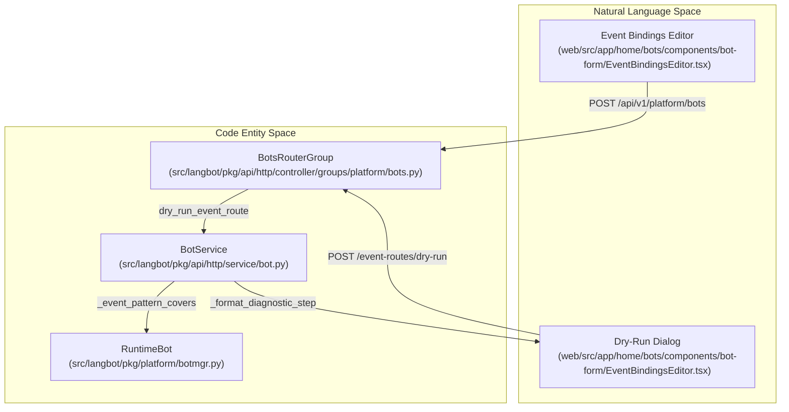
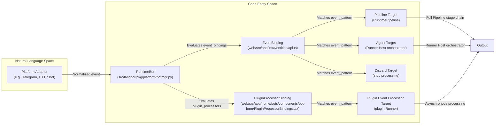

<!-- source: DeepWiki mcp.deepwiki.com · repo langbot-app/LangBot · page 4.5 Event Routing and Multi-Processor Deployment · fetched 2026-10-29 -->

# Event Routing and Multi-Processor Deployment

<details>
<summary>Relevant source files</summary>

The following files were used as context for generating this wiki page:

- [skills/scripts/e2e/bot-event-routing-product-flow.mjs](skills/scripts/e2e/bot-event-routing-product-flow.mjs)
- [skills/skills/langbot-testing/cases/bot-event-routing-product-flow.yaml](skills/skills/langbot-testing/cases/bot-event-routing-product-flow.yaml)
- [src/langbot/pkg/api/http/controller/groups/platform/bots.py](src/langbot/pkg/api/http/controller/groups/platform/bots.py)
- [src/langbot/pkg/api/http/service/bot.py](src/langbot/pkg/api/http/service/bot.py)
- [src/langbot/pkg/platform/botmgr.py](src/langbot/pkg/platform/botmgr.py)
- [tests/integration/api/test_bots.py](tests/integration/api/test_bots.py)
- [tests/unit_tests/api/http/service/test_tenant_resource_isolation.py](tests/unit_tests/api/http/service/test_tenant_resource_isolation.py)
- [tests/unit_tests/api/service/test_bot_service.py](tests/unit_tests/api/service/test_bot_service.py)
- [tests/unit_tests/api/test_bots_controller_errors.py](tests/unit_tests/api/test_bots_controller_errors.py)
- [tests/unit_tests/api/test_pipeline_service_defaults.py](tests/unit_tests/api/test_pipeline_service_defaults.py)
- [tests/unit_tests/core/test_app_resource_maintenance.py](tests/unit_tests/core/test_app_resource_maintenance.py)
- [tests/unit_tests/platform/test_dingtalk_api.py](tests/unit_tests/platform/test_dingtalk_api.py)
- [tests/unit_tests/platform/test_native_stream_completion.py](tests/unit_tests/platform/test_native_stream_completion.py)
- [tests/unit_tests/platform/test_plugin_subscriptions.py](tests/unit_tests/platform/test_plugin_subscriptions.py)
- [tests/unit_tests/platform/test_routing_rules.py](tests/unit_tests/platform/test_routing_rules.py)
- [tests/unit_tests/provider/test_requester_base.py](tests/unit_tests/provider/test_requester_base.py)
- [web/src/app/home/bots/components/bot-form/EventBindingsEditor.tsx](web/src/app/home/bots/components/bot-form/EventBindingsEditor.tsx)
- [web/tests/e2e/crud-smoke.spec.ts](web/tests/e2e/crud-smoke.spec.ts)
- [web/tests/e2e/fixtures/langbot-api.ts](web/tests/e2e/fixtures/langbot-api.ts)

</details>


## Purpose and Scope

This document specifies the event routing subsystem and multi-processor deployment architecture in LangBot. LangBot decouples message ingestion from processing by routing normalized platform events through configurable `event_bindings` [src/langbot/pkg/api/http/service/bot.py:42]() and `plugin_processors` [src/langbot/pkg/api/http/service/bot.py:43]() attached to each `Bot` entity [src/langbot/pkg/entity/persistence/bot.py:39-68]().

Multi-processor deployment enables a single bot instance to delegate different event types (such as messages, group membership changes, or friend requests) to specialized agents, pipelines, or plugin event processors based on matching patterns, priorities, and runtime filter conditions.

**Key Technical Capabilities:**
- **Event Bindings & Pattern Matching**: Namespace-aware event routing using wildcard patterns (`message.*`, `platform.*`, `*`) [src/langbot/pkg/api/http/service/bot.py:76-79]().
- **Priority Evaluation & Conflict Detection**: Deterministic sorting and conflict warnings via `routePrecedes` and `findRouteConflicts` [web/src/app/home/bots/components/bot-form/EventBindingsEditor.tsx:246-260]().
- **Filter Conditions**: Fine-grained filtering by `chat_type`, `chat_id`, `message_text`, and `message_element_types` [web/src/app/home/bots/components/bot-form/EventBindingsEditor.tsx:148-175]().
- **Dry-Run Route Diagnostics**: Simulated event execution trace via `dry_run_event_route` and `_diagnostic_result` [src/langbot/pkg/api/http/controller/groups/platform/bots.py:123-131]().
- **Event Route Statuses**: Structured log inspection (`ROUTE_TRACE_KIND`) to track success, failure codes, and route hits [src/langbot/pkg/api/http/service/bot.py:33]().
- **Plugin Processor Bindings**: Binding event-driven plugin handlers (`event_processor`) with capability and schema validation [web/src/app/home/bots/components/bot-form/PluginProcessorBindings.tsx:105-187]().

Sources: [src/langbot/pkg/api/http/service/bot.py:33-43](), [web/src/app/home/bots/components/bot-form/EventBindingsEditor.tsx:148-260](), [web/src/app/home/bots/components/bot-form/PluginProcessorBindings.tsx:105-187](), [src/langbot/pkg/entity/persistence/bot.py:39-68](), [src/langbot/pkg/api/http/controller/groups/platform/bots.py:123-131]()

---

## Event Bindings and Pattern Matching

Platform adapters emit normalized events routed by `RuntimeBot` through `_dispatch_eba_event_to_processor()` [src/langbot/pkg/platform/botmgr.py:200-201](). Each event has a structured `event_type` string identifier like `message.received`, `group.member_joined`, or `friend.request_received`.

### Event Pattern Matching

Event bindings are configured per bot as a list of `EventBinding` references [web/src/app/infra/entities/api.ts:118-127]() which specify:
- `event_pattern`: Strings supporting exact matches (e.g., `message.received`), namespace wildcards (e.g., `group.*`), or global wildcards `*` [src/langbot/pkg/api/http/service/bot.py:76-79]().
- `target_type`: The processor type to dispatch to (`pipeline`, `agent`, or `discard`) [web/src/app/infra/entities/api.ts:120]().
- `target_uuid`: UUID reference to the destination processor [web/src/app/infra/entities/api.ts:121]().
- `priority`: Integer priority used for sorting match precedence [web/src/app/infra/entities/api.ts:124]().
- `filters`: Structured conditions to further narrow event scope [web/src/app/infra/entities/api.ts:123]().

Pattern matching logic in `BotService` evaluates incoming events against these bindings supporting:
- Exact match: `event_type == pattern`
- Global wildcard: `pattern == '*'` matches all events
- Namespace wildcard: `pattern` ending with `.*` matches any event starting with that namespace prefix

See `_event_pattern_covers` in [src/langbot/pkg/api/http/service/bot.py:70-80]().

### Event Pattern Pickers and UI Helpers

The web UI includes user-friendly components such as `AgentEventPatternPicker` [web/src/app/home/agents/components/AgentEventPatternPicker.tsx]() that allow users to select event patterns. These pickers group events by namespace using utilities in `event-pattern-groups.ts` [web/src/app/home/components/event-patterns/event-pattern-groups.ts]() which implement:

- `groupEventPatterns` to cluster patterns by namespace [web/src/app/home/components/event-patterns/event-pattern-groups.ts:61-85]()
- `eventNamespaces` to extract namespace counts [web/src/app/home/components/event-patterns/event-pattern-groups.ts:48-59]()
- `eventPatternCovers` to check coverage relations between patterns [web/src/app/home/components/event-patterns/event-pattern-groups.ts:8-13]()

These utilities help present patterns in an organized way for user selection and validation, improving management of complex pattern sets.

Sources: [src/langbot/pkg/api/http/service/bot.py:70-80](), [web/src/app/home/components/event-patterns/event-pattern-groups.ts:8-85](), [web/src/app/home/agents/components/AgentEventPatternPicker.tsx](), [web/src/app/infra/entities/api.ts:118-127](), [src/langbot/pkg/platform/botmgr.py:200-201]()

---

## Priority Evaluation and Conflict Detection

When multiple bindings match an incoming event, LangBot resolves which processor should handle the event based on priority and declaration order.

### Priority Sorting Rules

Bindings are sorted by:
1. **Priority Field** (`priority` integer, default `0`): Higher values take precedence.
2. **Declaration Order**: Among equal priority, earlier declared routes take precedence.

This deterministic sort ensures consistent event routing [web/src/app/home/bots/components/bot-form/EventBindingsEditor.tsx:253-254]().

### Conflict Detection (`findRouteConflicts`)

The frontend editor `EventBindingsEditor` runs the `findRouteConflicts` function [web/src/app/home/bots/components/bot-form/EventBindingsEditor.tsx:258-260]() to detect shadowing — where a high-priority route's pattern covers a lower-priority route's pattern, making it unreachable.

If conflicts are detected, user interface warnings inform the bot administrator, ensuring no binding silently obscures another [skills/scripts/e2e/bot-event-routing-product-flow.mjs:197-199]().

Sources: [web/src/app/home/bots/components/bot-form/EventBindingsEditor.tsx:246-260](), [skills/scripts/e2e/bot-event-routing-product-flow.mjs:197-199]()

---

## Filter Conditions and Scoping

Event bindings support fine-grained filtering via `filters` arrays defined per binding [web/src/app/home/bots/components/bot-form/EventBindingsEditor.tsx:148-175]().

### Supported Filter Fields and Operators

| Field                 | Operators                                              | Description                                  |
|-----------------------|--------------------------------------------------------|----------------------------------------------|
| `is_at_bot`           | `eq`, `neq`                                            | Whether the bot was @-mentioned in a group chat |
| `chat_type`           | `eq`, `neq`                                            | Filters event scope by chat type (e.g., private, group) |
| `chat_id`             | `eq`, `neq`, `contains`, `not_contains`, `regex`      | Matches specific target chats or IDs         |
| `message_text`        | `contains`, `not_contains`, `eq`, `neq`, `starts_with`, `regex` | Text matching over message content           |
| `message_element_types`| `contains`, `not_contains`                             | Matches attachment types like `Image`, `Voice`, `File`, `At` |

These filters allow event routes to restrict their scope to relevant conversations or contexts dynamically.

Sources: [web/src/app/home/bots/components/bot-form/EventBindingsEditor.tsx:148-175]()

---

## Dry-Run Route Diagnostics and Status Tracking

### Dry-Run Implementation

To assist administrators in verifying route configurations without executing live bot logic, LangBot provides a dry-run diagnostics endpoint at:

```
POST /api/v1/platform/bots/<bot_uuid>/event-routes/dry-run
```

Implemented in the HTTP API controller [src/langbot/pkg/api/http/controller/groups/platform/bots.py:134-146](), this method triggers `BotService.dry_run_event_route()`, which evaluates the candidate event against all bindings and filter conditions. It returns a detailed step-by-step log of route matching decisions via the `_format_diagnostic_step()` helper in `BotService` [src/langbot/pkg/api/http/service/bot.py:91-114]().

This allows debugging shadowed routes, filter mismatches, and priority ordering [skills/scripts/e2e/bot-event-routing-product-flow.mjs:216-221]().

### Route Status Tracking

Event routing emits structured telemetry logs with the `ROUTE_TRACE_KIND` tag `"event_route_trace"` [src/langbot/pkg/api/http/service/bot.py:33](). These logs record route evaluation outcomes:

- Success states when routes are matched and processed.
- Failure states like `route_not_found`, `processor_not_found`, or `processor_incompatible` [src/langbot/pkg/api/http/service/bot.py:29-31]().

Route statuses can be queried at:

```
GET /api/v1/platform/bots/<bot_uuid>/event-routes/status
```

implemented in [src/langbot/pkg/api/http/controller/groups/platform/bots.py:110-117]().

This produces real-time health and conflict indicators in the web UI.

Sources: [src/langbot/pkg/api/http/controller/groups/platform/bots.py:110-146](), [src/langbot/pkg/api/http/service/bot.py:29-150](), [skills/scripts/e2e/bot-event-routing-product-flow.mjs:216-221]()

---

## Plugin Processor Bindings and Multi-Processor Deployment

Beyond routing to core Pipelines or standalone Agents, LangBot supports event-driven plugin processors via `plugin_processors` attached to each Bot [src/langbot/pkg/api/http/service/bot.py:43]().

### Processor Binding UI and Validation

The React component `PluginProcessorBindings` [web/src/app/home/bots/components/bot-form/PluginProcessorBindings.tsx]() shows:

- A list of currently bound plugin event processors.
- Integration with the plugin registry to fetch available `event_processor` components.
- Compatibility checks using `processorEventCompatibility` to compare selected processor’s supported event patterns with the adapter's supported events [web/src/app/home/bots/components/bot-form/PluginProcessorBindings.tsx:48-103]().

### Adding and Creating Plugin Processors

Users may:

- Bind existing event processors installed in the system.
- Create new event processors by selecting runner components and editing their runner config dynamically in a dialog [web/src/app/home/bots/components/bot-form/PluginProcessorBindings.tsx:169-178]().

Once bound, these processors asynchronously handle matching events dispatched from the platform adapter through `RuntimeBot`'s event routing flow.

Sources: [src/langbot/pkg/api/http/service/bot.py:43](), [web/src/app/home/bots/components/bot-form/PluginProcessorBindings.tsx]()

---

## Architecture and Data Flow

### Diagram: Event Routing and Diagnostic Flow

This diagram shows how the Web UI initiates route edits and diagnostics, sending requests to backend HTTP controllers, which delegate routing evaluation logic to `BotService` and finally `RuntimeBot`'s routing engine.

Sources: [src/langbot/pkg/api/http/controller/groups/platform/bots.py:40-146](), [src/langbot/pkg/api/http/service/bot.py:70-132](), [web/src/app/home/bots/components/bot-form/EventBindingsEditor.tsx:112-116]()

---

### Diagram: Multi-Processor Event Dispatch Sequence



This diagram illustrates dispatching a single inbound platform event: the adapter normalizes it, then `RuntimeBot` routes the event to exactly one configured target among Pipelines or Agents, while also launching asynchronous plugin processor invocations. All routing respects event pattern matching, priority, filters, and compatibility.

Sources: [src/langbot/pkg/platform/botmgr.py:127-160](), [web/src/app/home/bots/components/bot-form/PluginProcessorBindings.tsx:105-187](), [web/src/app/infra/entities/api.ts:118-127]()

---

## Summary

LangBot’s flexible event routing and multi-processor deployment architecture separate ingestion from processing using a configurable event binding map and plugin processor subscriptions. This system supports:

- Namespace and wildcard pattern-based event routing,
- Priority and shadowing detection,
- Rich filter capabilities by chat context and message content,
- Dry-run diagnostics for safe testing,
- Fine-grained route health tracking via telemetry logs, and
- Plugin processor lifecycle and compatibility management.

This enables deployment of bots that dynamically route different event types to specialized pipeline or agent runners with observability and safety, integrating legacy pipelines with new event processors in a unified event-driven agent platform.

Sources: [src/langbot/pkg/api/http/service/bot.py:29-150](), [src/langbot/pkg/api/http/controller/groups/platform/bots.py:110-146](), [web/src/app/home/bots/components/bot-form/EventBindingsEditor.tsx:148-260](), [web/src/app/home/bots/components/bot-form/PluginProcessorBindings.tsx:105-187](), [web/src/app/home/components/event-patterns/event-pattern-groups.ts:8-85](), [web/src/app/home/agents/components/AgentEventPatternPicker.tsx]()

---

