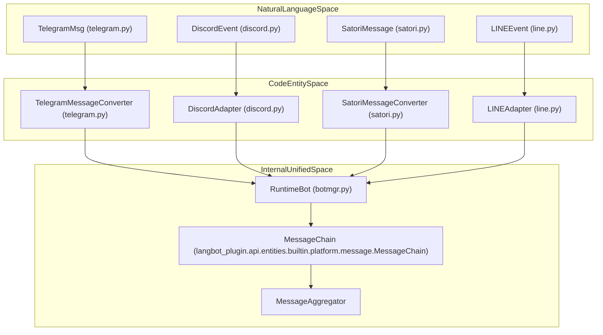
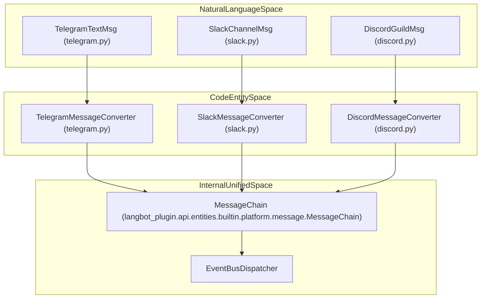

<!-- source: DeepWiki mcp.deepwiki.com · repo langbot-app/LangBot · page 5 Platform Adapter System · fetched 2026-10-29 -->

# Platform Adapter System

Relevant source files

The following files were used as context for generating this wiki page:

- [src/langbot/pkg/discover/engine.py](src/langbot/pkg/discover/engine.py)
- [src/langbot/pkg/platform/sources/line.yaml](src/langbot/pkg/platform/sources/line.yaml)
- [src/langbot/pkg/platform/sources/satori.png](src/langbot/pkg/platform/sources/satori.png)
- [src/langbot/pkg/platform/sources/satori.py](src/langbot/pkg/platform/sources/satori.py)
- [src/langbot/pkg/platform/sources/satori.yaml](src/langbot/pkg/platform/sources/satori.yaml)
- [src/langbot/pkg/utils/importutil.py](src/langbot/pkg/utils/importutil.py)
- [src/langbot/templates/components.yaml](src/langbot/templates/components.yaml)

## Purpose and Scope

The Platform Adapter System provides a unified abstraction layer that normalizes messages and events from over 10 instant messaging platforms into a common internal format. This enables LangBot to operate with a single codebase across diverse platforms such as Discord, Telegram, Slack, LINE, QQ, WeChat, WeCom, Lark, DingTalk, KOOK, Satori, Matrix, and Mattermost.

This page offers a high-level overview of the platform abstraction layer, message normalization, the unified bot interface, and the `RuntimeBot` execution model `[src/langbot/pkg/platform/botmgr.py:35-65]()`.

As a parent page, detailed technical aspects of the adapter architecture, WebSocket/WebPage/HTTP Bot adapters, HMAC signing, and callback routing are covered in **[Platform Adapter Architecture](#5.1)**. Specifics of platform implementations and YAML manifest configurations are documented in **[Supported IM Platforms](#5.2)**. The modern Event-Based Adapters (EBA) approach, including migration from legacy adapters, is described in **[Event-Based Adapters (EBA)](#5.3)**.

Sources: `[src/langbot/pkg/platform/botmgr.py:35-65]()`

---

## Architecture Overview

The Platform Adapter System acts as the intermediary layer between external IM platforms and LangBot's core runtime pipeline. Each supported platform has a dedicated adapter implementing a common interface, abstracting platform-specific communication protocols, message events, and authentication mechanisms. `RuntimeBot` instances manage the lifecycle and runtime interaction of these adapters with LangBot's internal components `[src/langbot/pkg/platform/botmgr.py:35-87]()`.

### System Components Spanning Natural Language to Code Entity Space

This diagram illustrates how natural language inputs or platform-native payloads are converted by adapters (e.g., `TelegramMessageConverter`, `DiscordAdapter`, `SatoriMessageConverter`, `LINEAdapter`) into the unified `MessageChain` internal format `[src/langbot/pkg/platform/sources/satori.py:26-112]()` processed by `RuntimeBot`. This unification enables LangBot to run consistent logic and pipelines regardless of originating platform.

Sources:
`[src/langbot/pkg/platform/botmgr.py:35-87]()`,
`[src/langbot/pkg/platform/sources/telegram.yaml:1-79]()`,
`[src/langbot/pkg/platform/sources/discord.yaml:1-59]()`,
`[src/langbot/pkg/platform/sources/satori.yaml:1-111]()`,
`[src/langbot/pkg/platform/sources/line.yaml:1-84]()`,
`[src/langbot/pkg/platform/sources/satori.py:26-112]()`

---

## Supported IM Platforms

LangBot supports a broad range of IM platforms, each with a dedicated adapter implementation and YAML manifest specifying configuration schemas, help links, and metadata. Representative platforms include:

- **Discord & Telegram**: Reliable adapters supporting rich message content, streaming replies, and webhook integrations `[src/langbot/pkg/platform/sources/telegram.py:107-146]()`.
- **Satori**: A protocol adapter `[src/langbot/pkg/platform/sources/satori.yaml:1-111]()` that supports various platforms by converting messages to and from the `MessageChain` format `[src/langbot/pkg/platform/sources/satori.py:26-112]()`.
- **LINE**: An adapter that requires a public URL for receiving message pushes `[src/langbot/pkg/platform/sources/line.yaml:1-84]()`.
- **OneBot v11 (aiocqhttp)**: Protocol-compatible adapter for QQ bots supporting reverse WebSocket connections.
- **Enterprise Platforms**: WeCom, WeCom Customer Service, DingTalk, Lark/Feishu, Official Account (WeChat Official Accounts).
- **Messaging and Collaboration Tools**: Slack, KOOK `[src/langbot/pkg/platform/sources/kook.py:56-96]()`, Matrix, Mattermost.
- **HTTP Bot & Web Page Bot**: Custom webhook-based integration and embeddable browser chat widgets.

These platforms are managed through configuration manifests under `src/langbot/pkg/platform/sources/`, each exposing adapter configuration parameters like tokens, webhook URLs, IP whitelists, and API base URLs. The `ComponentDiscoveryEngine` `[src/langbot/pkg/discover/engine.py:203-209]()` is responsible for loading these manifests `[src/langbot/pkg/discover/engine.py:216-228]()`.

| Platform             | Manifest File                 | Adapter Class      |
|----------------------|-------------------------------|--------------------|
| Telegram             | `telegram.yaml`               | `TelegramAdapter` (`telegram.py`) `[src/langbot/pkg/platform/sources/telegram.py:107-146]()` |
| Discord              | `discord.yaml`                | `DiscordAdapter` (`discord.py`) `[src/langbot/pkg/platform/sources/discord.py:1-40]()` |
| Satori               | `satori.yaml`                 | `SatoriAdapter` (`satori.py`) `[src/langbot/pkg/platform/sources/satori.py:26-112]()` |
| LINE                 | `line.yaml`                   | `LINEAdapter` (`line.py`) `[src/langbot/pkg/platform/sources/line.yaml:83-85]()` |
| OneBot v11 (QQ)      | `aiocqhttp.yaml`              | `AiocqhttpAdapter` (`aiocqhttp.py`)|
| WeCom                | `wecom.yaml`                  | `WecomAdapter` (`wecom.py`)        |
| WeCom CustomerService| `wecomcs.yaml`                | `WecomCSAdapter` (`wecomcs.py`)    |
| Official Account (WeChat) | `officialaccount.yaml`    | `OfficialAccountAdapter` (`officialaccount.py`)|
| Slack                | `slack.yaml`                  | `SlackAdapter` (`slack.py`)         |

For full details on each platform’s capabilities, setup steps, and config parameters, see **[Supported IM Platforms](#5.2)**.

Sources:
`[src/langbot/pkg/platform/sources/telegram.yaml:1-79]()`,
`[src/langbot/pkg/platform/sources/discord.yaml:1-59]()`,
`[src/langbot/pkg/platform/sources/satori.yaml:1-111]()`,
`[src/langbot/pkg/platform/sources/line.yaml:1-84]()`,
`[src/langbot/pkg/platform/sources/satori.py:26-112]()`,
`[src/langbot/pkg/discover/engine.py:203-209]()`,
`[src/langbot/pkg/discover/engine.py:216-228]()`,
`[src/langbot/pkg/platform/sources/line.yaml:83-85]()`

---

## Platform Adapter Architecture and Webhooks

All platform adapters implement an abstraction layer consistent with the `AbstractMessagePlatformAdapter` interface `[src/langbot/pkg/platform/sources/satori.py:16-20]()`. This abstraction enables support for diverse communication patterns:

- **Bidirectional WebSocket connections:** For platforms supporting persistent connections.
- **HTTP callback endpoints:** For platforms pushing messages via webhooks.
- **Long polling and reverse WebSocket:** Such as used in OneBot v11 (aiocqhttp).

Inbound platform events, after adapter-specific conversion, are normalized into the internal `MessageChain` format `[src/langbot/pkg/platform/sources/satori.py:114-117]()`. Outbound messages from LangBot pipelines are translated back into platform-specific formats by the adapters `[src/langbot/pkg/platform/sources/satori.py:29-112]()`.

Additionally, LangBot supports pushing inbound events to external HTTP endpoints via the `WebhookPusher` component `[src/langbot/pkg/platform/webhook_pusher.py:22-123]()`. This includes controls for maximum inflight requests, request capacity limits, and a `skip_pipeline` flag to bypass LangBot’s message processing pipeline if desired `[src/langbot/pkg/platform/webhook_pusher.py:117-123]()`.

### Event-Based Adapter Conversion Flow Spanning Natural Language to Code Entity Space

For comprehensive technical details, system diagrams, the discovery engine, and QR-code login workflows, see **[Platform Adapter Architecture](#5.1)**.

Sources:
`[src/langbot/pkg/platform/botmgr.py:35-65]()`,
`[src/langbot/pkg/platform/webhook_pusher.py:22-123]()`,
`[src/langbot/pkg/platform/sources/satori.py:16-20]()`,
`[src/langbot/pkg/platform/sources/satori.py:29-112]()`,
`[src/langbot/pkg/platform/sources/satori.py:114-117]()`

---

## Event-Based Adapters (EBA) Migration

LangBot’s modern adapter strategy uses Event-Based Adapters (EBA) located under `src/langbot/pkg/platform/adapters/`. This architecture improves modularity and extensibility by separating:

- **`manifest.yaml`**: Defines adapter metadata, configuration fields, and supported event types.
- **`event_converter.py`**: Translates native platform events into LangBot's canonical event bus format.
- **`message_converter.py`**: Handles normalization between platform-specific message formats and the shared `MessageChain`.
- **`adapter.py`**: Manages the adapter’s connection lifecycle, including reverse WebSocket servers or webhook HTTP servers.

The `ComponentDiscoveryEngine` `[src/langbot/pkg/discover/engine.py:203-209]()` loads these manifests from both `pkg/platform/sources/` and `pkg/platform/adapters/` directories `[src/langbot/templates/components.yaml:10-13]()`. EBA packages also maintain detailed acceptance test checklists and migration records from legacy adapters in `sources/`. This greatly simplifies adding new platforms or updating existing ones with minimal impact on the core runtime.

For deep details on EBA internals, platform-specific implementations, and migration guidance, see **[Event-Based Adapters (EBA)](#5.3)**.

Sources:
`[src/langbot/pkg/platform/adapters/aiocqhttp/manifest.yaml:1-60]()`,
`[docs/event-based-agents/adapters/00-index.md:1-30]()`,
`[src/langbot/pkg/discover/engine.py:203-209]()`,
`[src/langbot/templates/components.yaml:10-13]()`

---

