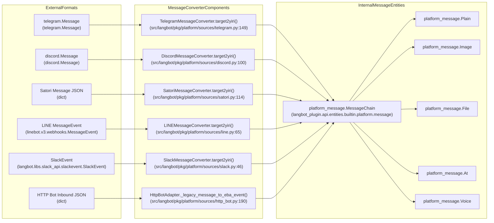

<!-- source: DeepWiki mcp.deepwiki.com · repo langbot-app/LangBot · page 5.1 Platform Adapter Architecture · fetched 2026-10-29 -->

# Platform Adapter Architecture

Relevant source files

The following files were used as context for generating this wiki page:

- [docs/platforms/http-bot.md](docs/platforms/http-bot.md)
- [src/langbot/libs/wechatpad_api/util/http_util.py](src/langbot/libs/wechatpad_api/util/http_util.py)
- [src/langbot/pkg/agent/runner/context_builder.py](src/langbot/pkg/agent/runner/context_builder.py)
- [src/langbot/pkg/agent/runner/session_registry.py](src/langbot/pkg/agent/runner/session_registry.py)
- [src/langbot/pkg/api/http/controller/groups/webhook_mgmt.py](src/langbot/pkg/api/http/controller/groups/webhook_mgmt.py)
- [src/langbot/pkg/box/runner.py](src/langbot/pkg/box/runner.py)
- [src/langbot/pkg/core/bootutils/deps.py](src/langbot/pkg/core/bootutils/deps.py)
- [src/langbot/pkg/discover/engine.py](src/langbot/pkg/discover/engine.py)
- [src/langbot/pkg/pipeline/cntfilter/filters/baiduexamine.py](src/langbot/pkg/pipeline/cntfilter/filters/baiduexamine.py)
- [src/langbot/pkg/platform/sources/discord.py](src/langbot/pkg/platform/sources/discord.py)
- [src/langbot/pkg/platform/sources/http_bot.py](src/langbot/pkg/platform/sources/http_bot.py)
- [src/langbot/pkg/platform/sources/kook.py](src/langbot/pkg/platform/sources/kook.py)
- [src/langbot/pkg/platform/sources/legacy/gewechat.py](src/langbot/pkg/platform/sources/legacy/gewechat.py)
- [src/langbot/pkg/platform/sources/line.py](src/langbot/pkg/platform/sources/line.py)
- [src/langbot/pkg/platform/sources/line.yaml](src/langbot/pkg/platform/sources/line.yaml)
- [src/langbot/pkg/platform/sources/satori.png](src/langbot/pkg/platform/sources/satori.png)
- [src/langbot/pkg/platform/sources/satori.py](src/langbot/pkg/platform/sources/satori.py)
- [src/langbot/pkg/platform/sources/satori.yaml](src/langbot/pkg/platform/sources/satori.yaml)
- [src/langbot/pkg/platform/sources/slack.py](src/langbot/pkg/platform/sources/slack.py)
- [src/langbot/pkg/platform/sources/telegram.py](src/langbot/pkg/platform/sources/telegram.py)
- [src/langbot/pkg/platform/webhook_pusher.py](src/langbot/pkg/platform/webhook_pusher.py)
- [src/langbot/pkg/provider/modelmgr/requester.py](src/langbot/pkg/provider/modelmgr/requester.py)
- [src/langbot/pkg/provider/modelmgr/requesters/litellmchat.py](src/langbot/pkg/provider/modelmgr/requesters/litellmchat.py)
- [src/langbot/pkg/utils/image.py](src/langbot/pkg/utils/image.py)
- [src/langbot/pkg/utils/importutil.py](src/langbot/pkg/utils/importutil.py)
- [src/langbot/templates/components.yaml](src/langbot/templates/components.yaml)
- [tests/unit_tests/agent/conftest.py](tests/unit_tests/agent/conftest.py)
- [tests/unit_tests/box/test_runner_box.py](tests/unit_tests/box/test_runner_box.py)
- [tests/unit_tests/platform/test_http_bot_agent_boundary.py](tests/unit_tests/platform/test_http_bot_agent_boundary.py)
- [tests/unit_tests/platform/test_line_session_identity.py](tests/unit_tests/platform/test_line_session_identity.py)
- [tests/unit_tests/platform/test_telegram_adapter.py](tests/unit_tests/platform/test_telegram_adapter.py)
- [tests/unit_tests/provider/test_image_base64_normalization.py](tests/unit_tests/provider/test_image_base64_normalization.py)
- [tests/unit_tests/provider/test_litellmchat.py](tests/unit_tests/provider/test_litellmchat.py)
- [tests/unit_tests/provider/test_provider_specific_fields.py](tests/unit_tests/provider/test_provider_specific_fields.py)

## Purpose and Scope

The Platform Adapter System in LangBot serves as a comprehensive abstraction layer that standardizes and normalizes messages and events from over ten instant messaging (IM) platforms. These platforms include Discord, Telegram, Slack, LINE, QQ, WeChat, WeCom, Lark, DingTalk, KOOK, Satori, Matrix, Mattermost, HTTP Bot, and Web Page Bot. This unified abstraction enables LangBot to operate a single, common codebase to handle diverse messaging sources seamlessly.

This page details the architecture of the platform adapters, the message normalization process into a unified internal format, the unified bot interface encapsulated in `RuntimeBot`, specialized adapters such as WebSocket, WebPageBot, HTTP Bot adapters, the QR-code login flow, webhook pushing mechanism, and the discovery engine.

Key implementations and components discussed here can be found in the following locations:

- Adapter base and orchestration: `RuntimeBot` in `[src/langbot/pkg/platform/botmgr.py:35-65]()`
- WebSocket Bot adapter: `[src/langbot/pkg/platform/sources/websocket_adapter.py:137-160]()`
- WebPage Bot adapter: `[src/langbot/pkg/platform/sources/web_page_bot_adapter.py:13-25]()`
- Telegram adapter as an example of platform adapter: `[src/langbot/pkg/platform/sources/telegram.py:107-146]()`
- QR-code login dialog frontend: `[web/src/app/home/components/qrcode-login/QrCodeLoginDialog.tsx:1-208]()`
- Webhook pusher implementation: `[src/langbot/pkg/platform/webhook_pusher.py:22-180]()`
- Platform API endpoints & credential exchange: `[src/langbot/pkg/api/http/controller/groups/platform/adapters.py:128-188]()`

---

## Architecture Overview & Platform Abstraction Layer

The platform adapter system is the core bridge between external IM platforms and LangBot's internal processing architecture. Each supported platform exposes one or more adapters implementing the common interface `AbstractMessagePlatformAdapter` defined in the plugin API `[src/langbot/pkg/platform/sources/telegram.py:20-23]()`.

The lifecycle and message dispatch of all platform adapters are managed by `RuntimeBot` instances which map platform-specific events into LangBot's internal pipeline processing.

### Core System Components and Entity Mapping

```mermaid
graph TB
    subgraph "ExternalIMPlatforms"
        Discord["Discord"]
        Telegram["Telegram"]
        Slack["Slack"]
        LINE["LINE"]
        QQ["QQ"]
        WeChat["WeChat"]
        WeCom["WeCom"]
        Lark["Lark"]
        DingTalk["DingTalk"]
        KOOK["KOOK"]
        Satori["Satori"]
        Matrix["Matrix"]
        Mattermost["Mattermost"]
        HTTPBot["HTTPBot"]
        WebPageBot["WebPageBot"]
    end

    subgraph "PlatformAbstractionLayer"
        AbstractAdapter["AbstractMessagePlatformAdapter\n(langbot_plugin.api.definition.abstract.platform.adapter)"]
        TelegramAdapter["TelegramAdapter\n(src/langbot/pkg/platform/sources/telegram.py)"]
        DiscordAdapter["DiscordAdapter\n(src/langbot/pkg/platform/sources/discord.py)"]
        WebSocketAdapter["WebSocketAdapter\n(src/langbot/pkg/platform/sources/websocket_adapter.py)"]
        WebPageBotAdapter["WebPageBotAdapter\n(src/langbot/pkg/platform/sources/web_page_bot_adapter.py)"]
        SatoriAdapter["SatoriAdapter\n(src/langbot/pkg/platform/sources/satori.py)"]
        LINEAdapter["LINEAdapter\n(src/langbot/pkg/platform/sources/line.py)"]
        HTTPBotAdapter["HttpBotAdapter\n(src/langbot/pkg/platform/sources/http_bot.py)"]
        SlackAdapter["SlackAdapter\n(src/langbot/pkg/platform/sources/slack.py)"]
    end

    subgraph "RuntimeExecution"
        RuntimeBot["RuntimeBot\n(src/langbot/pkg/platform/botmgr.py:35)"]
        PipelineRouter["resolve_pipeline_uuid()\n(src/langbot/pkg/platform/botmgr.py:122)"]
    end

    subgraph "PipelineAndWebhook"
        RuntimePipeline["RuntimePipeline"]
        WebhookPusher["WebhookPusher\n(src/langbot/pkg/platform/webhook_pusher.py)"]
    end

    Discord & Telegram & Slack & LINE & QQ & WeChat & WeCom & Lark & DingTalk & KOOK & Satori & Matrix & Mattermost & HTTPBot & WebPageBot --> AbstractAdapter
    AbstractAdapter --> TelegramAdapter & DiscordAdapter & WebSocketAdapter & WebPageBotAdapter & SatoriAdapter & LINEAdapter & HTTPBotAdapter & SlackAdapter
    RuntimeBot --> AbstractAdapter
    RuntimeBot --> PipelineRouter
    RuntimeBot --> WebhookPusher
    PipelineRouter --> RuntimePipeline
```

Sources: `[src/langbot/pkg/platform/botmgr.py:35-65]()`, `[src/langbot/pkg/platform/botmgr.py:122-150]()`, `[src/langbot/pkg/platform/sources/websocket_adapter.py:137-160]()`, `[src/langbot/pkg/platform/sources/web_page_bot_adapter.py:13-25]()`, `[src/langbot/pkg/platform/webhook_pusher.py:22-31]()`, `[src/langbot/pkg/platform/sources/telegram.py:107-146]()`, `[src/langbot/pkg/platform/sources/discord.py:23-27]()`, `[src/langbot/pkg/platform/sources/satori.py:26-28]()`, `[src/langbot/pkg/platform/sources/line.py:45-60]()`, `[src/langbot/pkg/platform/sources/http_bot.py:31-33]()`, `[src/langbot/pkg/platform/sources/slack.py:92-122]()`.

---

## RuntimeBot and Pipeline Routing

### RuntimeBot — Unified Bot Execution Wrapper

`RuntimeBot` wraps platform adapters and handles the lifecycle of the bot at runtime. It manages:
- Registration of event listeners.
- Routing of incoming platform events to internal pipelines.
- Invoking platform API methods to send or reply with messages.
- Managing streamable responses and interaction buttons `[src/langbot/pkg/platform/botmgr.py:35-65]()`.

### Pipeline Routing Logic

When a new event arrives, `RuntimeBot` evaluates configurable routing rules to determine which internal pipeline handles the message via `resolve_pipeline_uuid()`:

| Rule Type | Description | Code Reference |
|---|---|---|
| `launcher_type` | Filters by session type (`person` or `group`) | `[src/langbot/pkg/platform/botmgr.py:162-164]()` |
| `launcher_id` | Filters on specific user or group IDs | `[src/langbot/pkg/platform/botmgr.py:165-167]()` |
| `message_content` | Matches message text with operators like eq, regex, contains | `[src/langbot/pkg/platform/botmgr.py:100-117]()` |

Sources: `[src/langbot/pkg/platform/botmgr.py:35-65]()`, `[src/langbot/pkg/platform/botmgr.py:100-120]()`, `[src/langbot/pkg/platform/botmgr.py:162-176]()`.

---

## Message Normalization and Internal Format

Adapter implementations normalize messages from platform-specific formats into LangBot's unified internal format, `MessageChain`.

### Message Normalization Process and Code Entity Mapping

Sources: `[src/langbot/pkg/platform/sources/telegram.py:149-170]()`, `[src/langbot/pkg/platform/sources/discord.py:100-120]()`, `[src/langbot/pkg/platform/sources/satori.py:114-138]()`, `[src/langbot/pkg/platform/sources/line.py:65-92]()`, `[src/langbot/pkg/platform/sources/slack.py:46-56]()`, `[src/langbot/pkg/platform/sources/http_bot.py:190-200]()`, `[langbot_plugin.api.entities.builtin.platform.message]()`.

---

## Specialized Adapters and Features

- **WebSocket Adapter and WebPageBotAdapter**: The `WebSocketAdapter` implements real-time bidirectional communication for internal debug panels and chat widgets `[src/langbot/pkg/platform/sources/websocket_adapter.py:137-160]()`. Sessions manage message history and streaming indices `[src/langbot/pkg/platform/sources/websocket_adapter.py:51-66]()`. `WebSocketConnectionManager` controls scope isolation `[tests/unit_tests/platform/test_websocket_session_isolation.py:21-57]()`. The `WebPageBotAdapter` is designed for embedding LangBot into web pages, allowing direct interaction via a JavaScript widget `[src/langbot/pkg/platform/sources/web_page_bot_adapter.py:13-25]()`.
- **HTTP Bot Adapter**: The `HttpBotAdapter` provides a generic HTTP endpoint for receiving and sending messages, often used for custom integrations or testing. It supports message signing for security `[src/langbot/pkg/platform/sources/http_bot_signing.py:1-10]()` and handles file attachments, including their transfer to the Box sandbox for processing `[tests/unit_tests/platform/test_http_bot_agent_boundary.py:53-121]()`.
- **QR-Code Login Flow**: LangBot supports interactive QR-code login/credential binding flows for platforms like `qqofficial`, `lark`, `weixin`, `dingtalk`, and `wecombot` `[web/src/app/home/components/qrcode-login/QrCodeLoginDialog.tsx:1-208]()`, `[src/langbot/pkg/api/http/controller/groups/platform/adapters.py:81-156]()`.

Sources: `[src/langbot/pkg/platform/sources/websocket_adapter.py:51-160]()`, `[src/langbot/pkg/platform/sources/web_page_bot_adapter.py:13-58]()`, `[web/src/app/home/components/qrcode-login/QrCodeLoginDialog.tsx:1-210]()`, `[src/langbot/pkg/api/http/controller/groups/platform/adapters.py:81-156]()`, `[src/langbot/pkg/platform/sources/http_bot_signing.py:1-10]()`, `[tests/unit_tests/platform/test_http_bot_agent_boundary.py:53-121]()`.

---

## Webhook Pusher

The `WebhookPusher` handles dispatching of bot events to configured external HTTP webhook URLs `[src/langbot/pkg/platform/webhook_pusher.py:22-180]()`. It supports person and group message event types, concurrency throttling via inflight limits, and respects `skip_pipeline=true` responses from downstream endpoints to bypass AI pipeline processing.

Sources: `[src/langbot/pkg/platform/webhook_pusher.py:22-180]()`.

---

## Discovery Engine

The discovery engine, implemented by `Component` in `[src/langbot/pkg/discover/engine.py:1-10]()`, is responsible for locating and loading platform adapters. Adapters are defined by YAML manifests (e.g., `[src/langbot/pkg/platform/sources/satori.yaml:1-111]()`) which specify metadata, configuration fields, and the Python class to be loaded. This allows for dynamic extension and management of supported platforms.

Sources: `[src/langbot/pkg/discover/engine.py:1-10]()`, `[src/langbot/pkg/platform/sources/satori.yaml:1-111]()`.

---

## References

- `RuntimeBot`: `[src/langbot/pkg/platform/botmgr.py:35-65]()`
- Telegram Adapter: `[src/langbot/pkg/platform/sources/telegram.py:107-146]()`
- WebSocket Adapter: `[src/langbot/pkg/platform/sources/websocket_adapter.py:1-182]()`
- WebPage Bot Adapter: `[src/langbot/pkg/platform/sources/web_page_bot_adapter.py:1-58]()`
- Webhook Pusher: `[src/langbot/pkg/platform/webhook_pusher.py:22-180]()`
- QRCode Login Dialog: `[web/src/app/home/components/qrcode-login/QrCodeLoginDialog.tsx:1-208]()`
- Platform API controller: `[src/langbot/pkg/api/http/controller/groups/platform/adapters.py:128-188]()`
- Satori Adapter: `[src/langbot/pkg/platform/sources/satori.py:26-28]()`
- LINE Adapter: `[src/langbot/pkg/platform/sources/line.py:45-60]()`
- HTTP Bot Adapter: `[src/langbot/pkg/platform/sources/http_bot.py:31-33]()`
- Slack Adapter: `[src/langbot/pkg/platform/sources/slack.py:92-122]()`
- Discovery Engine Component: `[src/langbot/pkg/discover/engine.py:1-10]()`

---

