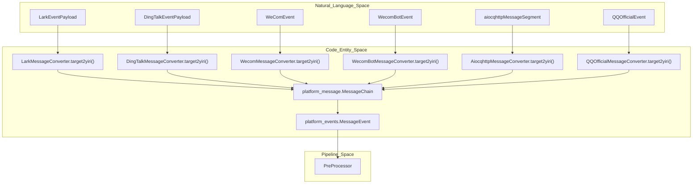
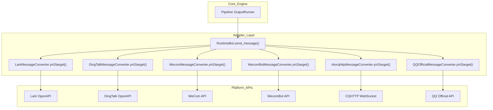

<!-- source: DeepWiki mcp.deepwiki.com · repo langbot-app/LangBot · page 5.2 Supported IM Platforms · fetched 2026-10-29 -->

# Supported IM Platforms

Relevant source files

The following files were used as context for generating this wiki page:

- [docs/event-based-agents/adapters/lark.md](docs/event-based-agents/adapters/lark.md)
- [docs/event-based-agents/adapters/slack.md](docs/event-based-agents/adapters/slack.md)
- [src/langbot/libs/dingtalk_api/api.py](src/langbot/libs/dingtalk_api/api.py)
- [src/langbot/libs/dingtalk_api/dingtalkevent.py](src/langbot/libs/dingtalk_api/dingtalkevent.py)
- [src/langbot/libs/dingtalk_api/thinking.py](src/langbot/libs/dingtalk_api/thinking.py)
- [src/langbot/libs/qq_official_api/api.py](src/langbot/libs/qq_official_api/api.py)
- [src/langbot/libs/slack_api/api.py](src/langbot/libs/slack_api/api.py)
- [src/langbot/libs/slack_api/media.py](src/langbot/libs/slack_api/media.py)
- [src/langbot/libs/slack_api/slackevent.py](src/langbot/libs/slack_api/slackevent.py)
- [src/langbot/libs/wecom_ai_bot_api/api.py](src/langbot/libs/wecom_ai_bot_api/api.py)
- [src/langbot/libs/wecom_ai_bot_api/wecombotevent.py](src/langbot/libs/wecom_ai_bot_api/wecombotevent.py)
- [src/langbot/libs/wecom_api/api.py](src/langbot/libs/wecom_api/api.py)
- [src/langbot/libs/wecom_customer_service_api/api.py](src/langbot/libs/wecom_customer_service_api/api.py)
- [src/langbot/pkg/api/http/service/slack_setup.py](src/langbot/pkg/api/http/service/slack_setup.py)
- [src/langbot/pkg/pipeline/preproc/preproc.py](src/langbot/pkg/pipeline/preproc/preproc.py)
- [src/langbot/pkg/platform/adapters/dingtalk/adapter.py](src/langbot/pkg/platform/adapters/dingtalk/adapter.py)
- [src/langbot/pkg/platform/adapters/dingtalk/event_converter.py](src/langbot/pkg/platform/adapters/dingtalk/event_converter.py)
- [src/langbot/pkg/platform/adapters/dingtalk/manifest.yaml](src/langbot/pkg/platform/adapters/dingtalk/manifest.yaml)
- [src/langbot/pkg/platform/adapters/dingtalk/message_converter.py](src/langbot/pkg/platform/adapters/dingtalk/message_converter.py)
- [src/langbot/pkg/platform/adapters/dingtalk/types.py](src/langbot/pkg/platform/adapters/dingtalk/types.py)
- [src/langbot/pkg/platform/adapters/lark/__init__.py](src/langbot/pkg/platform/adapters/lark/__init__.py)
- [src/langbot/pkg/platform/adapters/lark/adapter.py](src/langbot/pkg/platform/adapters/lark/adapter.py)
- [src/langbot/pkg/platform/adapters/lark/api_impl.py](src/langbot/pkg/platform/adapters/lark/api_impl.py)
- [src/langbot/pkg/platform/adapters/lark/event_converter.py](src/langbot/pkg/platform/adapters/lark/event_converter.py)
- [src/langbot/pkg/platform/adapters/lark/lark.svg](src/langbot/pkg/platform/adapters/lark/lark.svg)
- [src/langbot/pkg/platform/adapters/lark/manifest.yaml](src/langbot/pkg/platform/adapters/lark/manifest.yaml)
- [src/langbot/pkg/platform/adapters/lark/message_converter.py](src/langbot/pkg/platform/adapters/lark/message_converter.py)
- [src/langbot/pkg/platform/adapters/lark/platform_api.py](src/langbot/pkg/platform/adapters/lark/platform_api.py)
- [src/langbot/pkg/platform/adapters/lark/stream_card.py](src/langbot/pkg/platform/adapters/lark/stream_card.py)
- [src/langbot/pkg/platform/adapters/slack/__init__.py](src/langbot/pkg/platform/adapters/slack/__init__.py)
- [src/langbot/pkg/platform/adapters/slack/adapter.py](src/langbot/pkg/platform/adapters/slack/adapter.py)
- [src/langbot/pkg/platform/adapters/slack/api_impl.py](src/langbot/pkg/platform/adapters/slack/api_impl.py)
- [src/langbot/pkg/platform/adapters/slack/errors.py](src/langbot/pkg/platform/adapters/slack/errors.py)
- [src/langbot/pkg/platform/adapters/slack/event_converter.py](src/langbot/pkg/platform/adapters/slack/event_converter.py)
- [src/langbot/pkg/platform/adapters/slack/manifest.yaml](src/langbot/pkg/platform/adapters/slack/manifest.yaml)
- [src/langbot/pkg/platform/adapters/slack/message_converter.py](src/langbot/pkg/platform/adapters/slack/message_converter.py)
- [src/langbot/pkg/platform/adapters/slack/platform_api.py](src/langbot/pkg/platform/adapters/slack/platform_api.py)
- [src/langbot/pkg/platform/adapters/wecomcs/adapter.py](src/langbot/pkg/platform/adapters/wecomcs/adapter.py)
- [src/langbot/pkg/platform/adapters/wecomcs/event_converter.py](src/langbot/pkg/platform/adapters/wecomcs/event_converter.py)
- [src/langbot/pkg/platform/adapters/wecomcs/manifest.yaml](src/langbot/pkg/platform/adapters/wecomcs/manifest.yaml)
- [src/langbot/pkg/platform/sources/aiocqhttp.yaml](src/langbot/pkg/platform/sources/aiocqhttp.yaml)
- [src/langbot/pkg/platform/sources/dingtalk.py](src/langbot/pkg/platform/sources/dingtalk.py)
- [src/langbot/pkg/platform/sources/dingtalk.yaml](src/langbot/pkg/platform/sources/dingtalk.yaml)
- [src/langbot/pkg/platform/sources/discord.yaml](src/langbot/pkg/platform/sources/discord.yaml)
- [src/langbot/pkg/platform/sources/lark.py](src/langbot/pkg/platform/sources/lark.py)
- [src/langbot/pkg/platform/sources/lark.yaml](src/langbot/pkg/platform/sources/lark.yaml)
- [src/langbot/pkg/platform/sources/officialaccount.py](src/langbot/pkg/platform/sources/officialaccount.py)
- [src/langbot/pkg/platform/sources/officialaccount.yaml](src/langbot/pkg/platform/sources/officialaccount.yaml)
- [src/langbot/pkg/platform/sources/qqofficial.py](src/langbot/pkg/platform/sources/qqofficial.py)
- [src/langbot/pkg/platform/sources/qqofficial.yaml](src/langbot/pkg/platform/sources/qqofficial.yaml)
- [src/langbot/pkg/platform/sources/slack.yaml](src/langbot/pkg/platform/sources/slack.yaml)
- [src/langbot/pkg/platform/sources/telegram.yaml](src/langbot/pkg/platform/sources/telegram.yaml)
- [src/langbot/pkg/platform/sources/wecom.py](src/langbot/pkg/platform/sources/wecom.py)
- [src/langbot/pkg/platform/sources/wecom.yaml](src/langbot/pkg/platform/sources/wecom.yaml)
- [src/langbot/pkg/platform/sources/wecombot.py](src/langbot/pkg/platform/sources/wecombot.py)
- [src/langbot/pkg/platform/sources/wecombot.yaml](src/langbot/pkg/platform/sources/wecombot.yaml)
- [src/langbot/pkg/platform/sources/wecomcs.py](src/langbot/pkg/platform/sources/wecomcs.py)
- [src/langbot/pkg/platform/sources/wecomcs.yaml](src/langbot/pkg/platform/sources/wecomcs.yaml)
- [src/langbot/pkg/utils/outbound_url.py](src/langbot/pkg/utils/outbound_url.py)
- [src/langbot/templates/dingtalk_stream_card.json](src/langbot/templates/dingtalk_stream_card.json)
- [tests/unit_tests/platform/test_dingtalk_eba_adapter.py](tests/unit_tests/platform/test_dingtalk_eba_adapter.py)
- [tests/unit_tests/platform/test_lark_eba_adapter.py](tests/unit_tests/platform/test_lark_eba_adapter.py)
- [tests/unit_tests/platform/test_lark_inbound_code_blocks.py](tests/unit_tests/platform/test_lark_inbound_code_blocks.py)
- [tests/unit_tests/platform/test_lark_webhook_auth.py](tests/unit_tests/platform/test_lark_webhook_auth.py)
- [tests/unit_tests/platform/test_qqofficial_api.py](tests/unit_tests/platform/test_qqofficial_api.py)
- [tests/unit_tests/platform/test_slack_eba_adapter.py](tests/unit_tests/platform/test_slack_eba_adapter.py)
- [tests/unit_tests/platform/test_slack_events.py](tests/unit_tests/platform/test_slack_events.py)
- [tests/unit_tests/platform/test_slack_media.py](tests/unit_tests/platform/test_slack_media.py)
- [tests/unit_tests/platform/test_wecom_send_message.py](tests/unit_tests/platform/test_wecom_send_message.py)
- [tests/unit_tests/platform/test_wecomcs_adapter.py](tests/unit_tests/platform/test_wecomcs_adapter.py)
- [tests/unit_tests/platform/test_wecomcs_api.py](tests/unit_tests/platform/test_wecomcs_api.py)
- [tests/unit_tests/utils/test_outbound_url_guard.py](tests/unit_tests/utils/test_outbound_url_guard.py)
- [web/src/app/home/components/qrcode-login/SlackSetupDialog.tsx](web/src/app/home/components/qrcode-login/SlackSetupDialog.tsx)
- [web/src/app/home/monitoring/hooks/useFeedbackData.ts](web/src/app/home/monitoring/hooks/useFeedbackData.ts)
- [web/src/i18n/locales/slack-setup/en-US.ts](web/src/i18n/locales/slack-setup/en-US.ts)
- [web/src/i18n/locales/slack-setup/ja-JP.ts](web/src/i18n/locales/slack-setup/ja-JP.ts)
- [web/src/i18n/locales/slack-setup/zh-Hans.ts](web/src/i18n/locales/slack-setup/zh-Hans.ts)
- [web/src/i18n/locales/slack-setup/zh-Hant.ts](web/src/i18n/locales/slack-setup/zh-Hant.ts)

This page provides an in-depth technical reference of all instant messaging (IM) platforms supported by LangBot, detailing each platform's adapter, YAML manifest configuration, message conversion processes, implementation details, and data flow within the platform adapter system. LangBot's architecture relies on platform adapters to normalize heterogeneous platform protocols into a consistent internal representation.

---

## 1. Platform Architecture & Overview

Each IM platform is integrated via a dedicated adapter class implementing the `AbstractMessagePlatformAdapter` interface, responsible for:

- Receiving raw inbound events from the platform.
- Converting them into LangBot's internal `MessageChain` and `MessageEvent` entities using platform-specific `MessageConverter` and `EventConverter`.
- Handling outgoing messages by serializing LangBot's `MessageChain` back to the platform's message format.
- Managing connection protocols such as WebSocket, REST webhook, or other custom modes.
- Offering plugin configuration schemas via YAML manifests.

All adapters interact with the `RuntimeBot` instance, which manages lifecycle, workspace tenancy, and orchestration [src/langbot/pkg/platform/botmgr.py:35-128]().

Sources: [src/langbot/pkg/platform/botmgr.py:35-128]()

---

## 2. Comprehensive Platform Matrix

| Platform | Adapter Name | Adapter Class | YAML Manifest | Message/Event Converters | Deployment Notes |
|---|---|---|---|---|---|
| Discord | `discord` | `DiscordAdapter` | `discord.yaml` | `DiscordMessageConverter` | Standard gateway via `discord.py`. |
| Telegram | `telegram` | `TelegramAdapter` | `telegram.yaml` | `TelegramMessageConverter` | Uses python-telegram-bot SDK with 10MB media limit. |
| Slack | `slack` | `SlackAdapter` | `slack.yaml` | `SlackMessageConverter` | Uses Slack Event Subscription/webhooks [src/langbot/pkg/platform/adapters/slack/adapter.py:116-120](). |
| LINE | `line` | `LINEAdapter` | `line.yaml` | `LINEMessageConverter` | HMAC signature verification, webhook-based. |
| KOOK | `kook` | `KookAdapter` | `kook.yaml` | `KookMessageConverter` | Gaming platform popular in China. |
| Satori | `satori` | `SatoriAdapter` | `satori.yaml` | `SatoriMessageConverter` | XML-like markup messages; supports image uploads [src/langbot/pkg/platform/sources/satori.py:26-138](). |
| Matrix | `matrix` | `MatrixAdapter` | `matrix.yaml` | `MatrixMessageConverter` | Decentralized communication protocol. |
| Mattermost | `mattermost` | `MattermostAdapter` | `mattermost.yaml` | `MattermostMessageConverter` | Webhook and REST API integration. |
| HTTP Bot | `http_bot` | `HttpBotAdapter` | `http_bot.yaml` | `HttpBotMessageConverter` | Secure webhook with signed callbacks. |
| Web Page Bot | `web_page_bot` | `WebPageBotAdapter` | `web_page_bot.yaml` | N/A (WebSocket native) | Embeddable in web pages for conversational UI. |
| Lark (Feishu) | `lark` | `LarkAdapter` | `lark.yaml` | `LarkMessageConverter` | Supports WebSocket & Webhook; advanced Dify forms [src/langbot/pkg/platform/sources/lark.py:1-185](). |
| WeChat Official | `officialaccount` | `OfficialAccountAdapter` | `officialaccount.yaml` | `OfficialAccountMessageConverter` | XML-based, requires message decryption. |
| QQ Official | `qqofficial` | `QQOfficialAdapter` | `qqofficial.yaml` | `QQOfficialMessageConverter` | Supports media and interaction buttons [src/langbot/pkg/platform/sources/qqofficial.py:40-96](). |
| aiocqhttp (QQ Bot) | `aiocqhttp` | `AiocqhttpAdapter` | `aiocqhttp.yaml` | `AiocqhttpMessageConverter` | Old-style CQHTTP bot, supports rich messaging [src/langbot/pkg/platform/sources/aiocqhttp.py:52-113](). |
| WeCom Internal | `wecom` | `WecomAdapter` | `wecom.yaml` | `WecomMessageConverter` | Enterprise WeCom integration with media chunking [src/langbot/pkg/platform/sources/wecom.py:18-67](). |
| WeCom Bot (WecomBot)| `wecombot` | `WecomBotAdapter` | `wecombot.yaml` | `WecomBotMessageConverter` | Bot mode with both Webhook and WebSocket options [src/langbot/pkg/platform/sources/wecombot.yaml:1-154](). |
| DingTalk | `dingtalk` | `DingTalkAdapter` | `dingtalk.yaml` | `DingTalkMessageConverter` | Supports streaming replies and card actions [src/langbot/libs/dingtalk_api/api.py:77-176](). |

Sources: [src/langbot/pkg/platform/sources/wecombot.yaml:1-154](), [src/langbot/pkg/platform/sources/lark.yaml:1-202](), [src/langbot/pkg/platform/sources/wecombot.py:26-153](), [src/langbot/pkg/platform/sources/lark.py:1-185](), [src/langbot/libs/dingtalk_api/api.py:77-176](), [src/langbot/pkg/platform/sources/aiocqhttp.py:52-113](), [src/langbot/pkg/platform/sources/satori.py:26-138](), [src/langbot/pkg/platform/adapters/slack/adapter.py:116-120](), [src/langbot/pkg/platform/sources/wecom.py:18-67](), [src/langbot/pkg/platform/sources/qqofficial.py:40-96]()

---

## 3. Message and Event Conversion: Inbound Data Flow

Each platform receives platform-specific raw data (payload or WebSocket messages) which pass through the `MessageConverter` and `EventConverter` classes to normalize upstream data into the uniform `MessageChain` and `MessageEvent` objects.

These converters implement two main functions:
- `target2yiri`: Converts platform native format to LangBot internal representation.
- `yiri2target`: Converts LangBot message chains back into platform format for sending.

For example:
- `LarkMessageConverter.target2yiri()` captures Lark event payloads with rich content blocks including images, audio, and cards to LangBot objects [src/langbot/pkg/platform/sources/lark.py:1-185]().
- `DingTalkMessageConverter.target2yiri()` captures DingTalk event payloads with rich content blocks [src/langbot/libs/dingtalk_api/api.py:77-176]().
- `WecomMessageConverter.target2yiri()` creates friend messages from WeCom events, handling text chunking per byte limits [src/langbot/pkg/platform/sources/wecom.py:18-67]().
- `WecomBotMessageConverter.target2yiri()` converts WeComBot events into LangBot message chains [src/langbot/pkg/platform/sources/wecombot.py:26-153]().
- `AiocqhttpMessageConverter.target2yiri()` converts CQHttp message segments into internal chains [src/langbot/pkg/platform/sources/aiocqhttp.py:52-113]().
- `QQOfficialMessageConverter.target2yiri()` converts QQ Official messages into LangBot message chains [src/langbot/pkg/platform/sources/qqofficial.py:40-96]().

### Diagram: Inbound Message Normalization Flow (Natural Language Space to Code Entity Space)

Sources: [src/langbot/pkg/platform/sources/lark.py:1-185](), [src/langbot/libs/dingtalk_api/api.py:77-176](), [src/langbot/pkg/platform/sources/wecom.py:18-67](), [src/langbot/pkg/platform/sources/wecombot.py:26-153](), [src/langbot/pkg/platform/sources/aiocqhttp.py:52-113](), [src/langbot/pkg/platform/sources/qqofficial.py:40-96]()

---

## 4. Platform-Specific Adapter Highlights and Implementation Details

### 4.1 Lark (Feishu)

- Adapter: `LarkAdapter` [src/langbot/pkg/platform/adapters/lark/adapter.py:116]()
- Major files: `src/langbot/pkg/platform/sources/lark.py`
- YAML: `lark.yaml` [src/langbot/pkg/platform/sources/lark.yaml:1-202]()
- Connectivity: Supports both webhook and WebSocket long connection modes.
- Message conversion:
  - Handles Dify interactive forms by parsing input fields and reacts to runtime human input loops [src/langbot/pkg/platform/sources/lark.py:1-185]().
  - Media size limited to 10MB [src/langbot/pkg/platform/sources/lark.py:39]().
- Uses `lark_oapi` Python SDK for API and WebSocket operations [src/langbot/pkg/platform/sources/lark.py:5-30]().
- Supports streaming replies with incremental text updates.

Sources: [src/langbot/pkg/platform/sources/lark.py:1-185](), [src/langbot/pkg/platform/sources/lark.yaml:1-202](), [src/langbot/pkg/platform/adapters/lark/adapter.py:116]()

---

### 4.2 WeCom (Internal and Bot variants)

- **Wecom (`wecom`):**
  - Adapter: `WecomAdapter`
  - Uses `WecomClient` from `libs/wecom_api/api.py` [src/langbot/pkg/platform/sources/wecom.py:8]().
  - Implements message chunk splitting due to 2048-byte content limit with `split_string_by_bytes()` function [src/langbot/pkg/platform/sources/wecom.py:18-67]().
  - YAML manifest: `wecom.yaml` [src/langbot/pkg/platform/sources/wecom.yaml]().

- **WecomBot (`wecombot`):**
  - Adapter: `WecomBotAdapter` [src/langbot/pkg/platform/sources/wecombot.py:26]()
  - YAML manifest: `wecombot.yaml` [src/langbot/pkg/platform/sources/wecombot.yaml:1-154]().
  - Uses `WecomBotClient` from `libs/wecom_ai_bot_api/api.py` [src/langbot/libs/wecom_ai_bot_api/api.py:16-23]().
  - Supports Webhook mode and WebSocket persistent connection [src/langbot/pkg/platform/sources/wecombot.yaml:51-62]().
  - Manages stream sessions with queue buffers to support stream replies [src/langbot/libs/wecom_ai_bot_api/api.py:30-74]().

Sources: [src/langbot/pkg/platform/sources/wecom.py:18-67](), [src/langbot/pkg/platform/sources/wecombot.py:26-153](), [src/langbot/pkg/platform/sources/wecombot.yaml:1-154](), [src/langbot/libs/wecom_ai_bot_api/api.py:16-74](), [src/langbot/pkg/platform/sources/wecom.yaml]()

---

### 4.3 DingTalk

- Adapter: `DingTalkAdapter` [src/langbot/pkg/platform/adapters/dingtalk/adapter.py:100]()
- Client: `DingTalkClient` from `libs/dingtalk_api/api.py` [src/langbot/libs/dingtalk_api/api.py:77-176]().
- Features:
  - Uses DingTalk streaming connection mode via `dingtalk_stream` SDK.
  - Maintains task queue size and OAuth2 access token auto-refresh.
- YAML manifest: `dingtalk.yaml` [src/langbot/pkg/platform/sources/dingtalk.yaml]().

Sources: [src/langbot/libs/dingtalk_api/api.py:77-176](), [src/langbot/pkg/platform/adapters/dingtalk/adapter.py:100](), [src/langbot/pkg/platform/sources/dingtalk.yaml]()

---

### 4.4 QQ Platforms

- **QQ Official (`qqofficial`):**
  - Adapter converts LangBot message chains with base64 or URL media handling [src/langbot/pkg/platform/sources/qqofficial.py:40-96]().
  - Event conversion to `FriendMessage` or `GroupMessage` depending on event type [src/langbot/pkg/platform/sources/qqofficial.py:112-169]().
  - YAML: `qqofficial.yaml` [src/langbot/pkg/platform/sources/qqofficial.yaml]().

- **aiocqhttp:**
  - Converter supports rich message segments including face emojis, rps/dice games, at/atAll segments [src/langbot/pkg/platform/sources/aiocqhttp.py:52-113]().
  - YAML manifest: `aiocqhttp.yaml`.

Sources: [src/langbot/pkg/platform/sources/qqofficial.py:40-169](), [src/langbot/pkg/platform/sources/aiocqhttp.py:52-113](), [src/langbot/pkg/platform/sources/qqofficial.yaml]()

---

### 4.5 Other Platforms (Slack, Satori, etc.)

- **Slack:** Uses `SlackAdapter` [src/langbot/pkg/platform/adapters/slack/adapter.py:116]() and `SlackMessageConverter` supporting socket mode or signing secrets [src/langbot/pkg/platform/adapters/slack/adapter.py:116-120]().
- **Satori:** Uses `SatoriMessageConverter` parsing XML-like markup tags [src/langbot/pkg/platform/sources/satori.py:26-138]().

Sources: [src/langbot/pkg/platform/adapters/slack/adapter.py:116-120](), [src/langbot/pkg/platform/sources/satori.py:26-138]()

---

## 5. Outbound Data Flow & Platform Serialization

LangBot internal `MessageChain` instances are converted back to platform-specific message formats before sending using their respective `yiri2target()` methods.

### Diagram: Outbound Message Conversion Flow (Natural Language Space to Code Entity Space)

Sources: [src/langbot/pkg/platform/sources/lark.py:1-185](), [src/langbot/libs/dingtalk_api/api.py:77-176](), [src/langbot/pkg/platform/sources/wecom.py:18-67](), [src/langbot/pkg/platform/sources/wecombot.py:26-153](), [src/langbot/pkg/platform/sources/aiocqhttp.py:52-113](), [src/langbot/pkg/platform/sources/qqofficial.py:40-96]()

---

## 6. Key Classes and File References

| Class / Object Name | File Path | Description / Role |
|---|---|---|
| `RuntimeBot` | [src/langbot/pkg/platform/botmgr.py:35-128]() | Core orchestrator that manages adapter lifecycles and execution contexts. |
| `LarkAdapter` | [src/langbot/pkg/platform/adapters/lark/adapter.py:116]() | Adapter implementation for Lark platform with rich forms and streaming. |
| `WecomBotAdapter` | [src/langbot/pkg/platform/sources/wecombot.py:26]() | Adapter for WeCom Bot platform managing sessions and interactive cards. |
| `WecomMessageConverter` | [src/langbot/pkg/platform/sources/wecom.py:18-67]() | Converts LangBot messages to/from WeCom message format with chunking. |
| `DingTalkClient` | [src/langbot/libs/dingtalk_api/api.py:77-176]() | Handles DingTalk Stream client, card action callbacks, and token refresh. |
| `AiocqhttpMessageConverter` | [src/langbot/pkg/platform/sources/aiocqhttp.py:52-113]() | Converts CQHTTP message segments and emojis to LangBot objects. |
| `QQOfficialMessageConverter` | [src/langbot/pkg/platform/sources/qqofficial.py:40-96]() | Handles QQ Official platform message serialization and events. |
| `SlackAdapter` | [src/langbot/pkg/platform/adapters/slack/adapter.py:116]() | Adapter implementation for Slack. |
| `SatoriMessageConverter` | [src/langbot/pkg/platform/sources/satori.py:26-138]() | Converts Satori messages. |

Sources: Individual platform source files as cited.

---

