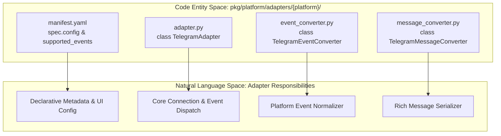
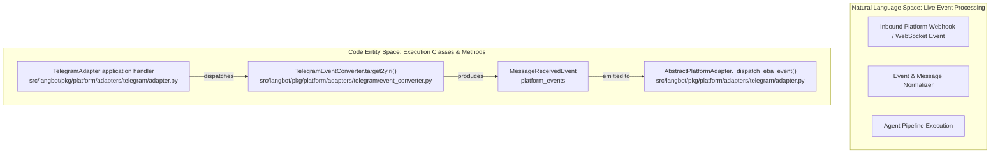

<!-- source: DeepWiki mcp.deepwiki.com · repo langbot-app/LangBot · page 5.3 Event-Based Adapters (EBA) · fetched 2026-10-29 -->

# Event-Based Adapters (EBA)

Relevant source files

The following files were used as context for generating this wiki page:

- [docs/assets/pr-2336/after.png](docs/assets/pr-2336/after.png)
- [docs/assets/pr-2336/before.png](docs/assets/pr-2336/before.png)
- [docs/event-based-agents/adapters/00-index.md](docs/event-based-agents/adapters/00-index.md)
- [docs/event-based-agents/adapters/acceptance-checklist.md](docs/event-based-agents/adapters/acceptance-checklist.md)
- [docs/event-based-agents/adapters/acceptance-report.md](docs/event-based-agents/adapters/acceptance-report.md)
- [docs/event-based-agents/adapters/aiocqhttp.md](docs/event-based-agents/adapters/aiocqhttp.md)
- [docs/event-based-agents/adapters/dingtalk.md](docs/event-based-agents/adapters/dingtalk.md)
- [docs/event-based-agents/adapters/discord.md](docs/event-based-agents/adapters/discord.md)
- [docs/event-based-agents/adapters/telegram.md](docs/event-based-agents/adapters/telegram.md)
- [docs/review/telegram-4.11-acceptance.md](docs/review/telegram-4.11-acceptance.md)
- [skills/scripts/e2e/onebot-runtime-probe.py](skills/scripts/e2e/onebot-runtime-probe.py)
- [skills/scripts/e2e/wizard-onebot-agent-runtime.mjs](skills/scripts/e2e/wizard-onebot-agent-runtime.mjs)
- [skills/skills/langbot-testing/cases/wizard-onebot-agent-runtime.yaml](skills/skills/langbot-testing/cases/wizard-onebot-agent-runtime.yaml)
- [src/langbot/pkg/agent/runner/query_entry_adapter.py](src/langbot/pkg/agent/runner/query_entry_adapter.py)
- [src/langbot/pkg/api/http/controller/groups/webhooks.py](src/langbot/pkg/api/http/controller/groups/webhooks.py)
- [src/langbot/pkg/platform/adapter_names.py](src/langbot/pkg/platform/adapter_names.py)
- [src/langbot/pkg/platform/adapters/aiocqhttp/adapter.py](src/langbot/pkg/platform/adapters/aiocqhttp/adapter.py)
- [src/langbot/pkg/platform/adapters/aiocqhttp/event_converter.py](src/langbot/pkg/platform/adapters/aiocqhttp/event_converter.py)
- [src/langbot/pkg/platform/adapters/aiocqhttp/image_urls.py](src/langbot/pkg/platform/adapters/aiocqhttp/image_urls.py)
- [src/langbot/pkg/platform/adapters/aiocqhttp/manifest.yaml](src/langbot/pkg/platform/adapters/aiocqhttp/manifest.yaml)
- [src/langbot/pkg/platform/adapters/aiocqhttp/message_converter.py](src/langbot/pkg/platform/adapters/aiocqhttp/message_converter.py)
- [src/langbot/pkg/platform/adapters/aiocqhttp/onebot.png](src/langbot/pkg/platform/adapters/aiocqhttp/onebot.png)
- [src/langbot/pkg/platform/adapters/aiocqhttp/transport.py](src/langbot/pkg/platform/adapters/aiocqhttp/transport.py)
- [src/langbot/pkg/platform/adapters/dingtalk/__init__.py](src/langbot/pkg/platform/adapters/dingtalk/__init__.py)
- [src/langbot/pkg/platform/adapters/dingtalk/api_impl.py](src/langbot/pkg/platform/adapters/dingtalk/api_impl.py)
- [src/langbot/pkg/platform/adapters/telegram/adapter.py](src/langbot/pkg/platform/adapters/telegram/adapter.py)
- [src/langbot/pkg/platform/adapters/telegram/api_impl.py](src/langbot/pkg/platform/adapters/telegram/api_impl.py)
- [src/langbot/pkg/platform/adapters/telegram/event_converter.py](src/langbot/pkg/platform/adapters/telegram/event_converter.py)
- [src/langbot/pkg/platform/adapters/telegram/manifest.yaml](src/langbot/pkg/platform/adapters/telegram/manifest.yaml)
- [src/langbot/pkg/platform/adapters/telegram/message_converter.py](src/langbot/pkg/platform/adapters/telegram/message_converter.py)
- [src/langbot/pkg/platform/image_urls.py](src/langbot/pkg/platform/image_urls.py)
- [src/langbot/pkg/platform/sources/aiocqhttp.py](src/langbot/pkg/platform/sources/aiocqhttp.py)
- [src/langbot/pkg/plugin/agent_pull_actions.py](src/langbot/pkg/plugin/agent_pull_actions.py)
- [tests/e2e/live_aiocqhttp_eba_probe.py](tests/e2e/live_aiocqhttp_eba_probe.py)
- [tests/e2e/live_telegram_eba_probe.py](tests/e2e/live_telegram_eba_probe.py)
- [tests/unit_tests/platform/test_aiocqhttp_eba_adapter.py](tests/unit_tests/platform/test_aiocqhttp_eba_adapter.py)
- [tests/unit_tests/platform/test_aiocqhttp_message_converter.py](tests/unit_tests/platform/test_aiocqhttp_message_converter.py)
- [tests/unit_tests/platform/test_onebot_image_urls.py](tests/unit_tests/platform/test_onebot_image_urls.py)
- [tests/unit_tests/platform/test_telegram_eba_adapter.py](tests/unit_tests/platform/test_telegram_eba_adapter.py)
- [tests/unit_tests/provider/test_request_policy.py](tests/unit_tests/provider/test_request_policy.py)
- [web/src/app/home/bots/components/bot-form/AdapterEventDebugDialog.tsx](web/src/app/home/bots/components/bot-form/AdapterEventDebugDialog.tsx)

### Purpose and Scope
The Event-Based Adapters (EBA) subsystem under `pkg/platform/adapters/` transitions LangBot from a single-scene message-processing platform into a fully event-driven agent platform [docs/event-based-agents/adapters/00-index.md:1-15](). EBA replaces monolithic legacy source files in `src/langbot/pkg/platform/sources/` with well-structured adapter packages [docs/event-based-agents/adapters/00-index.md:1-15](). These packages enable multi-event ingestion (such as `message.received`, `group.member_joined`, `bot.invited_to_group`), provide unified platform APIs, and facilitate fine-grained event routing across different instant messaging platforms [docs/event-based-agents/adapters/00-index.md:1-15]().

Sources: [docs/event-based-agents/adapters/00-index.md:1-15]()

---

## Adapter Package Structure and `manifest.yaml`

Each EBA adapter resides in its own directory under `src/langbot/pkg/platform/adapters/{platform_name}/` [src/langbot/pkg/platform/adapters/telegram/manifest.yaml:1-106]() with a consistent modular layout:

- **`manifest.yaml`**: Declarative metadata describing adapter capabilities, user configuration schema (`spec.config`), declared supported events (`spec.supported_events`), common APIs, and platform-specific APIs [src/langbot/pkg/platform/adapters/telegram/manifest.yaml:1-106]().
- **`adapter.py`**: The core adapter runtime class subclassing `AbstractPlatformAdapter` [src/langbot/pkg/platform/adapters/telegram/adapter.py:44-48](), responsible for initialization, connection management, and event dispatch.
- **`event_converter.py`**: Implements event normalization inheriting from `AbstractEventConverter` [src/langbot/pkg/platform/adapters/telegram/event_converter.py:54-56]().
- **`message_converter.py`**: Implements bidirectional serialization inheriting from `AbstractMessageConverter` [src/langbot/pkg/platform/adapters/telegram/message_converter.py:1-1()]().
- **`api_impl.py` and `platform_api.py`**: Implementations of common platform APIs and platform-specific extensions exposed via `call_platform_api(action, params)` [src/langbot/pkg/platform/adapters/telegram/adapter.py:188-193]().

Diagram 1: Adapter Module Architecture bridging Natural Language concepts to Code Entity Space.

Sources: [src/langbot/pkg/platform/adapters/telegram/manifest.yaml:1-106](), [src/langbot/pkg/platform/adapters/telegram/adapter.py:44-52](), [src/langbot/pkg/platform/adapters/telegram/event_converter.py:54-56](), [src/langbot/pkg/platform/adapters/telegram/message_converter.py:1-1]()

---

## Event Conversion Engine (`event_converter.py`)

The event converter normalizes platform-specific payloads into unified EBA event models. Adapters implement `AbstractEventConverter` subclasses such as `TelegramEventConverter` [src/langbot/pkg/platform/adapters/telegram/event_converter.py:54-56](), mapping native updates (e.g., `Update` objects in python-telegram-bot [src/langbot/pkg/platform/adapters/telegram/event_converter.py:65-70]()) into standard plugin SDK events like `MessageReceivedEvent`, `MessageEditedEvent`, or `PlatformSpecificEvent` [src/langbot/pkg/platform/adapters/telegram/event_converter.py:146-177]().

For example, the `AiocqhttpEventConverter` handles events from the OneBot v11 protocol, converting them into LangBot's internal event types. It includes logic for caching group names and member information to reduce API calls [src/langbot/pkg/platform/adapters/aiocqhttp/event_converter.py:20-25](). The `_prune_caches` method ensures these caches remain bounded [tests/unit_tests/platform/test_aiocqhttp_message_converter.py:82-88]().

Sources: [src/langbot/pkg/platform/adapters/telegram/event_converter.py:54-177](), [tests/unit_tests/platform/test_telegram_eba_adapter.py:14-15](), [src/langbot/pkg/platform/adapters/aiocqhttp/event_converter.py:20-25](), [tests/unit_tests/platform/test_aiocqhttp_message_converter.py:82-88]()

---

## Message Chain Conversion (`message_converter.py`)

LangBot utilizes `MessageChain` to represent rich messages systematically. Converters handle bidirectional serialization between platform payloads and LangBot components (`Plain`, `At`, `Image`, `Voice`, `File`, `Quote`) [docs/event-based-agents/adapters/discord.md:146](). For instance, `AiocqhttpMessageConverter` [src/langbot/pkg/platform/sources/aiocqhttp.py:52-53]() converts `MessageChain` objects to `aiocqhttp.Message` segments and vice-versa, handling various message types including text, images (with base64 normalization [src/langbot/pkg/platform/sources/aiocqhttp.py:69-78]()), voice, and files [src/langbot/pkg/platform/sources/aiocqhttp.py:83-101](). It also includes logic for handling specific face types and forward messages [src/langbot/pkg/platform/sources/aiocqhttp.py:103-108]().

Sources: [docs/event-based-agents/adapters/discord.md:146](), [src/langbot/pkg/platform/adapters/telegram/message_converter.py:1-1()](), [src/langbot/pkg/platform/sources/aiocqhttp.py:52-108](), [tests/unit_tests/platform/test_aiocqhttp_message_converter.py:113-154]()

---

## Per-Platform EBA Documentation and Acceptance Status

LangBot tracks migration status and acceptance testing under `docs/event-based-agents/adapters/` [docs/event-based-agents/adapters/00-index.md:1-15](). The acceptance framework evaluates configuration, event coverage, API completeness, and live test evidence across adapters such as Telegram, Discord, OneBot v11, DingTalk, Lark, WeCom, Slack, and others [docs/event-based-agents/adapters/acceptance-report.md:1-43](). Each adapter has a dedicated document (e.g., `telegram.md` [docs/event-based-agents/adapters/telegram.md:1-131](), `discord.md` [docs/event-based-agents/adapters/discord.md:1-138](), `aiocqhttp.md` [docs/event-based-agents/adapters/aiocqhttp.md:1-108]()) detailing its configuration, supported events, common APIs, platform-specific APIs, and live test records [docs/event-based-agents/adapters/00-index.md:31-41](). The `acceptance-report.md` provides a summary of the acceptance status for each adapter, including evidence levels like `plugin-e2e-ui` and `unit` [docs/event-based-agents/adapters/acceptance-report.md:19-25]().

Diagram 2: Runtime Event Flow bridging Natural Language execution concepts to Code Entity Space.

Sources: [src/langbot/pkg/platform/adapters/telegram/adapter.py:70-118](), [src/langbot/pkg/platform/adapters/telegram/event_converter.py:65-75](), [docs/event-based-agents/adapters/00-index.md:1-41](), [docs/event-based-agents/adapters/acceptance-report.md:1-43](), [docs/event-based-agents/adapters/telegram.md:1-131](), [docs/event-based-agents/adapters/discord.md:1-138](), [docs/event-based-agents/adapters/aiocqhttp.md:1-108]()

---

## Migration from Legacy Single-File Sources to EBA Packages

Legacy platform adapters implemented as single source files under `src/langbot/pkg/platform/sources/{platform}.py` [docs/event-based-agents/adapters/acceptance-report.md:37-42]() are refactored into modular EBA packages in `pkg/platform/adapters/` [docs/event-based-agents/adapters/00-index.md:1-15](). This transition decouples event handling, expands API coverage via `call_platform_api` [src/langbot/pkg/platform/adapters/telegram/adapter.py:188-193](), and establishes declarative schemas in `manifest.yaml` [src/langbot/pkg/platform/adapters/telegram/manifest.yaml:1-106](). For example, the `aiocqhttp` adapter was migrated from `src/langbot/pkg/platform/sources/aiocqhttp.py` to `src/langbot/pkg/platform/adapters/aiocqhttp/` [docs/event-based-agents/adapters/aiocqhttp.md:1-108](). The `OneBotConnection` class in `transport.py` handles the duplex communication for OneBot v11, managing pending actions and event queues [src/langbot/pkg/platform/adapters/aiocqhttp/transport.py:15-26]().

Sources: [docs/event-based-agents/adapters/00-index.md:1-15](), [src/langbot/pkg/platform/adapters/telegram/adapter.py:188-193](), [src/langbot/pkg/platform/adapters/telegram/manifest.yaml:1-106](), [docs/event-based-agents/adapters/aiocqhttp.md:1-108](), [src/langbot/pkg/platform/adapters/aiocqhttp/transport.py:15-26]()

---

# Summary

The Event-Based Adapter (EBA) architecture modernizes LangBot's platform abstraction by modularizing platform support, enabling multi-event processing, unifying API models, and consolidating adapter lifecycle management [docs/event-based-agents/adapters/00-index.md:1-15](). This structure enhances maintainability and cross-platform interoperability for production deployments [docs/event-based-agents/adapters/00-index.md:1-15]().

Sources:
- [docs/event-based-agents/adapters/00-index.md:1-15]()
- [docs/event-based-agents/adapters/acceptance-report.md:30-43]()
- [src/langbot/pkg/platform/adapters/telegram/manifest.yaml:1-106]()
- [docs/event-based-agents/adapters/discord.md:15-24]()
- [docs/event-based-agents/adapters/aiocqhttp.md:1-108]()
- [src/langbot/pkg/platform/adapters/telegram/adapter.py:44-118]()

---

