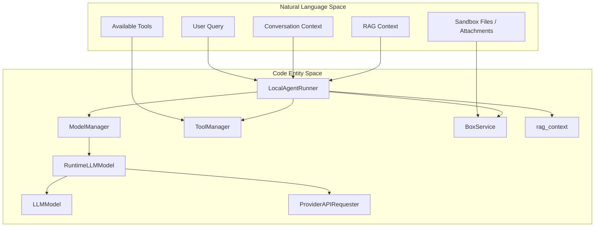
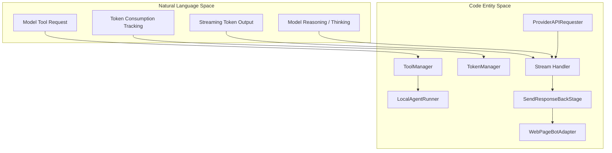

<!-- source: DeepWiki mcp.deepwiki.com · repo langbot-app/LangBot · page 6 AI and LLM Integration · fetched 2026-10-29 -->

# AI and LLM Integration

Relevant source files

The following files were used as context for generating this wiki page:

- [src/langbot/pkg/api/http/service/provider.py](src/langbot/pkg/api/http/service/provider.py)
- [src/langbot/pkg/pipeline/plugin_diagnostics.py](src/langbot/pkg/pipeline/plugin_diagnostics.py)
- [src/langbot/pkg/pipeline/process/handlers/command.py](src/langbot/pkg/pipeline/process/handlers/command.py)
- [src/langbot/pkg/pipeline/respback/respback.py](src/langbot/pkg/pipeline/respback/respback.py)
- [src/langbot/pkg/platform/sources/web_page_bot_adapter.py](src/langbot/pkg/platform/sources/web_page_bot_adapter.py)
- [src/langbot/pkg/provider/modelmgr/modelmgr.py](src/langbot/pkg/provider/modelmgr/modelmgr.py)
- [src/langbot/pkg/provider/modelmgr/token.py](src/langbot/pkg/provider/modelmgr/token.py)
- [tests/unit_tests/provider/__init__.py](tests/unit_tests/provider/__init__.py)
- [tests/unit_tests/provider/test_model_service.py](tests/unit_tests/provider/test_model_service.py)

This section provides a high-level overview of the AI layer in LangBot, which serves as the core intelligence engine for processing natural language queries. The system abstracts various LLM providers, embedding models, tool execution protocols, and streaming responses into a unified interface utilized by the pipeline execution engine.

As a PARENT page, this document outlines the high-level architecture and relationships of the AI layer. For deep technical details, see the child pages:
- [LLM and Embedding Model Configuration](#6.1) — LLMModel/EmbeddingModel entities, selectors, abilities, model testing, token accounting, requesters (LiteLLM, Ollama, embeddings), provider controllers and secrets.
- [Tool Calling and Function Execution](#6.2) — ToolManager and loaders (native, plugin, skill, skill_authoring, mcp), platform tools and host tools, invocation during LLM calls, agentic loops, resource builder.
- [MCP (Model Context Protocol) Integration](#6.3) — LangBot as MCP client (stdio via Box, SSE, Streamable HTTP, OAuth, resources) and as MCP server (/mcp endpoint).
- [Streaming and Advanced LLM Features](#6.4) — Streaming output, token-by-token delivery, WebSocket updates, context management, system prompts, LLMOps integrations (Dify, Coze, n8n, Langflow, DashScope).

---

## AI Layer Architecture

The AI layer is coordinated by the `ModelManager`, which manages the lifecycle of model providers and specific model instances [src/langbot/pkg/provider/modelmgr/modelmgr.py:34-54](). It bridges raw API requesters and high-level execution runners such as `LocalAgentRunner` during query processing. The `Application` instance (`ap`) acts as the central hub holding references to the `ModelManager`, `ToolManager`, and services like sandbox (`BoxService`) used for running skills or sandboxed code [src/langbot/pkg/provider/modelmgr/modelmgr.py:47-54]().

### Natural Language to Code Entity Mapping: AI Layer

The following diagram bridges natural language concepts to specific classes and modules within the codebase, illustrating how user interactions and context flow into runtime components.

**AI Layer Entity Mapping**

Sources: [src/langbot/pkg/provider/modelmgr/modelmgr.py:34-54]()

---

## Model Management and Configuration

LangBot supports various LLM, Embedding, and Rerank model providers via the `ModelManager`, which maintains workspace-scoped runtime caches of providers and models [src/langbot/pkg/provider/modelmgr/modelmgr.py:34-42](). This manager ensures workspace isolation, generation awareness [src/langbot/pkg/provider/modelmgr/modelmgr.py:97-122](), and cloud runtime protections where specific providers are immutable [src/langbot/pkg/api/http/service/provider.py:29-42]().

Model providers, credentials, and metadata are managed by `ModelProviderService`, which enforces validation, secret masking, and runtime caching [src/langbot/pkg/api/http/service/provider.py:19-159](). The `TokenManager` handles API key rotation and tracking [src/langbot/pkg/provider/modelmgr/token.py:6-27]().

For detailed configuration parameters, provider controllers, token accounting, and embedding models, see [LLM and Embedding Model Configuration](#6.1).

Sources: [src/langbot/pkg/provider/modelmgr/modelmgr.py:34-46](), [src/langbot/pkg/api/http/service/provider.py:19-42](), [src/langbot/pkg/provider/modelmgr/token.py:6-27]()

---

## Tool Calling and Function Execution

LangBot’s AI layer supports robust tool calling, enabling LLMs to execute native functions, plugin features, skills, and platform actions within sandboxed environments. The `ToolManager` loads tools from multiple sources while agentic loops handle multi-turn execution and feedback loops.

For comprehensive details on tool loaders, host tools, and resource builders, see [Tool Calling and Function Execution](#6.2).

Sources: [src/langbot/pkg/api/http/service/provider.py:19-35]()

---

## MCP (Model Context Protocol) Integration

LangBot implements the Model Context Protocol (MCP) to standardize communication between intelligent agents and external tool sources. LangBot can operate both as an **MCP Client** (connecting to external servers via stdio, SSE, streamable HTTP, or OAuth) and as an **MCP Server** (exposing endpoints at `/mcp` for external agent management).

For implementation details and configuration modes, see [MCP (Model Context Protocol) Integration](#6.3).

Sources: [src/langbot/pkg/provider/modelmgr/modelmgr.py:34-46]()

---

## Streaming and Advanced LLM Features

LangBot supports low-latency token-by-token streaming responses across platforms. The `WebPageBotAdapter` delegates streaming output to underlying WebSocket adapters [src/langbot/pkg/platform/sources/web_page_bot_adapter.py:60-71](), while `SendResponseBackStage` manages chunk delivery in the pipeline execution flow [src/langbot/pkg/pipeline/respback/respback.py:48-58]().

For deep dives into streaming, context management, prompt engineering, and LLMOps integrations (such as Dify, Coze, and n8n), see [Streaming and Advanced LLM Features](#6.4).

Sources: [src/langbot/pkg/provider/modelmgr/modelmgr.py:34-54](), [src/langbot/pkg/platform/sources/web_page_bot_adapter.py:60-71](), [src/langbot/pkg/pipeline/respback/respback.py:48-58]()

---

## Natural Language to Code Entity Mapping: Execution & Streaming

This diagram maps natural language streaming, token tracking, and tool invocation concepts to their respective code entities during the runtime of the AI pipeline.

**Execution Flow Entity Mapping**

Sources: [src/langbot/pkg/provider/modelmgr/modelmgr.py:34-54](), [src/langbot/pkg/pipeline/respback/respback.py:16-95](), [src/langbot/pkg/platform/sources/web_page_bot_adapter.py:60-71]()

---

This completes the top-level overview of LangBot’s AI and LLM integration layer. For comprehensive implementation details, please navigate to the respective child pages.

---

