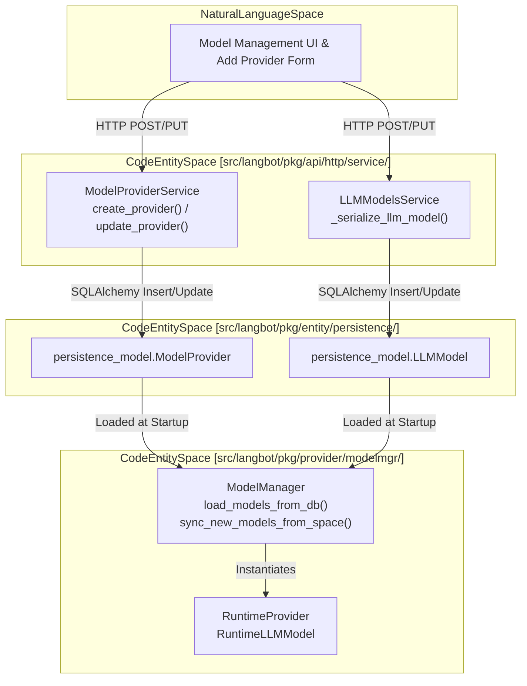
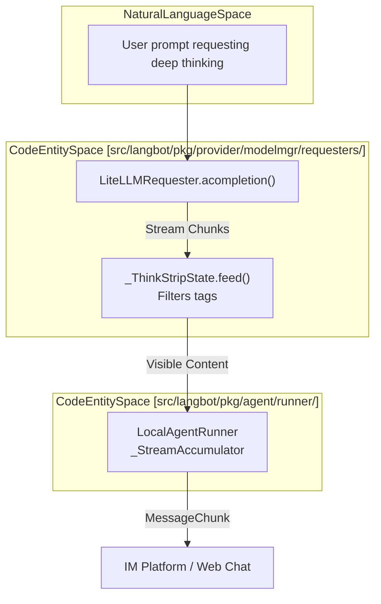
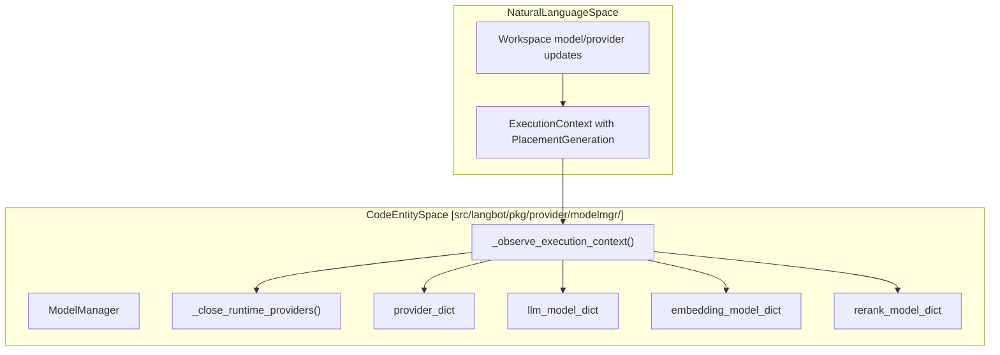

<!-- source: DeepWiki mcp.deepwiki.com · repo langbot-app/LangBot · page 6.1 LLM and Embedding Model Configuration · fetched 2026-10-29 -->

# LLM and Embedding Model Configuration

Relevant source files

The following files were used as context for generating this wiki page:

- [docs/platforms/http-bot.md](docs/platforms/http-bot.md)
- [src/langbot/pkg/agent/runner/context_builder.py](src/langbot/pkg/agent/runner/context_builder.py)
- [src/langbot/pkg/agent/runner/session_registry.py](src/langbot/pkg/agent/runner/session_registry.py)
- [src/langbot/pkg/api/http/service/provider.py](src/langbot/pkg/api/http/service/provider.py)
- [src/langbot/pkg/box/runner.py](src/langbot/pkg/box/runner.py)
- [src/langbot/pkg/pipeline/plugin_diagnostics.py](src/langbot/pkg/pipeline/plugin_diagnostics.py)
- [src/langbot/pkg/pipeline/process/handlers/command.py](src/langbot/pkg/pipeline/process/handlers/command.py)
- [src/langbot/pkg/pipeline/respback/respback.py](src/langbot/pkg/pipeline/respback/respback.py)
- [src/langbot/pkg/platform/sources/http_bot.py](src/langbot/pkg/platform/sources/http_bot.py)
- [src/langbot/pkg/platform/sources/web_page_bot_adapter.py](src/langbot/pkg/platform/sources/web_page_bot_adapter.py)
- [src/langbot/pkg/provider/modelmgr/modelmgr.py](src/langbot/pkg/provider/modelmgr/modelmgr.py)
- [src/langbot/pkg/provider/modelmgr/requester.py](src/langbot/pkg/provider/modelmgr/requester.py)
- [src/langbot/pkg/provider/modelmgr/requesters/litellmchat.py](src/langbot/pkg/provider/modelmgr/requesters/litellmchat.py)
- [src/langbot/pkg/provider/modelmgr/token.py](src/langbot/pkg/provider/modelmgr/token.py)
- [src/langbot/pkg/utils/image.py](src/langbot/pkg/utils/image.py)
- [tests/unit_tests/agent/conftest.py](tests/unit_tests/agent/conftest.py)
- [tests/unit_tests/box/test_runner_box.py](tests/unit_tests/box/test_runner_box.py)
- [tests/unit_tests/platform/test_http_bot_agent_boundary.py](tests/unit_tests/platform/test_http_bot_agent_boundary.py)
- [tests/unit_tests/provider/__init__.py](tests/unit_tests/provider/__init__.py)
- [tests/unit_tests/provider/test_image_base64_normalization.py](tests/unit_tests/provider/test_image_base64_normalization.py)
- [tests/unit_tests/provider/test_litellmchat.py](tests/unit_tests/provider/test_litellmchat.py)
- [tests/unit_tests/provider/test_model_service.py](tests/unit_tests/provider/test_model_service.py)
- [tests/unit_tests/provider/test_provider_specific_fields.py](tests/unit_tests/provider/test_provider_specific_fields.py)

This leaf wiki page details the technical architecture, configuration schemas, entity definitions, and runtime management of Language Models (LLMs), Embedding models, and Rerank models within LangBot. It covers the two-tier entity model, provider requester protocols, token accounting, reasoning/thinking strategies, runtime caching via `ModelManager`, placement generation enforcement, workspace-scoped model validation, and request policies.

---

## 1. Model and Provider Entity Architecture

LangBot decouples raw API connectivity parameters from model-specific metadata by adopting a two-tier persistence model:
1. **`ModelProvider`**: Encapsulates base URLs, authentication keys, and backend requester driver identifiers (`persistence_model.ModelProvider`) [src/langbot/pkg/api/http/service/provider.py:61-85]().
2. **Models (`LLMModel`, `EmbeddingModel`, `RerankModel`)**: Represent distinct model instances, extra arguments, context limits, and operational capability tags bound to a parent provider [src/langbot/pkg/entity/persistence/model.py]().

### Model Management & Code Entity Flow
The following diagram bridges the natural language conceptual view of model provisioning to the underlying Python classes and SQLAlchemy persistence entities.

Title: "Model Management Code Entity Mapping"

**Sources:**
- [src/langbot/pkg/api/http/service/provider.py:61-85]()
- [src/langbot/pkg/api/http/service/model.py:99-103]()
- [src/langbot/pkg/provider/modelmgr/modelmgr.py:34-54]()

---

## 2. ModelProvider and Requesters

The `ModelProvider` entity maps to a specific backend driver interface termed a **requester**. Requesters govern how internal LangBot request payloads are translated into target API wire protocols.

### Supported Requesters and Protocols
LangBot integrates providers via unified adapters (such as `LiteLLMRequester` [src/langbot/pkg/provider/modelmgr/requesters/litellmchat.py:17-178]()) or native driver classes:
- **Global Leaders**: `openai`, `anthropic`, `gemini-chat-completions`
- **Local & Open Source**: `ollama`, `localai`, `vllm`
- **Aggregators**: `openrouter`, `302ai`, `newapi`, `compshare`, `ppio`, `tokenpony`, `shengsuanyun`, `jiekouai`, `qhaigc`
- **Cloud & Enterprise**: `volcark`, `qiniu`, `giteeai`, `zhipuai`, `bailian`, `siliconflow`, `moonshot`
- **Specialized / Rerank**: Cohere, Jina, and VoyageAI rerankers
- **Built-in / Space**: `space-chat-completions` (managed via LangBot Cloud), local embedding via `seekdb-embedding` (`SeekDBEmbedding`) [src/langbot/pkg/provider/modelmgr/requesters/seekdbembed.py:10-15](), and Chroma embedding integrations [src/langbot/pkg/provider/modelmgr/requesters/chromaembed.py]().

### Provider Controllers, Secrets, and Token Management
Authentication tokens are stored within `api_keys`. The `TokenManager` class normalizes token inputs, strips whitespace, and discards empty or duplicate keys to enable round-robin rotation [tests/unit_tests/provider/test_model_service.py:71-76](). Secret masking utilities (`mask_secret_value`, `redact_secrets`) ensure credentials are protected during API serialization [src/langbot/pkg/api/http/service/model.py:17-58](). The `ModelProviderService._normalize_api_keys` static method handles the cleaning of API keys, removing blank entries and duplicates [src/langbot/pkg/api/http/service/provider.py:43-60]().

**Sources:**
- [tests/unit_tests/provider/test_model_service.py:71-76]()
- [src/langbot/pkg/api/http/service/provider.py:43-60]()
- [src/langbot/pkg/api/http/service/model.py:17-58]()
- [src/langbot/pkg/provider/modelmgr/requesters/seekdbembed.py:10-15]()
- [src/langbot/pkg/provider/modelmgr/requesters/litellmchat.py:17-178]()
- [src/langbot/pkg/provider/modelmgr/token.py:16-25]()

---

## 3. LLMModel Configuration & Reasoning Control

Models configured in the `LLMModel` persistence table feature explicit capability flags (`abilities`) and reasoning configurations [src/langbot/pkg/api/http/service/model.py:59-82]().

### Model Abilities and Selectors
Abilities dictate runtime pipeline behavior:
- `vision`: Enables multi-modal image conversion and validation [src/langbot/pkg/utils/image.py:20-42]().
- `func_call`: Activates tool calling and execution loops via tool managers [tests/unit_tests/provider/test_provider_specific_fields.py:66-104]().
- `reasoning`: Signals support for chain-of-thought outputs.

### Reasoning Control (Thinking Strategy)
For reasoning-capable models, LangBot parses and manages reasoning configurations via `reasoning_config` [src/langbot/pkg/api/http/service/model.py:59-65]() alongside stateful stream strippers (`_ThinkStripState`) [src/langbot/pkg/provider/modelmgr/requesters/litellmchat.py:64-175]() to filter raw thinking tokens (`<think>` blocks) from end-user visibility.

Title: "Streaming Reasoning and Code Entity Flow"

Reasoning token budgets for provider families like Qwen and Anthropic are mapped via effort tiers:
- `low`: `1024` tokens
- `medium`: `4096` tokens
- `high`: `8192` tokens

**Sources:**
- [src/langbot/pkg/provider/modelmgr/requesters/litellmchat.py:64-195]()
- [src/langbot/pkg/api/http/service/model.py:59-82]()
- [tests/unit_tests/provider/test_provider_specific_fields.py:66-104]()
- [src/langbot/pkg/utils/image.py:20-42]()

---

## 4. Embedding and Rerank Models

### Embedding Models
`EmbeddingModel` entities link to providers (such as OpenAI, Ollama, Chroma, or SeekDB) to supply vector embedding generation for RAG knowledge bases [src/langbot/pkg/provider/modelmgr/modelmgr.py:41](). Local vector embedding is supported via the `SeekDBEmbedding` requester, which utilizes `pyseekdb`'s built-in embedding function (`all-MiniLM-L6-v2`) when installed with the `seekdb` extra [src/langbot/pkg/provider/modelmgr/requesters/seekdbembed.py:10-32](), and Chroma embedding adapters [src/langbot/pkg/provider/modelmgr/requesters/chromaembed.py](). During runtime updates, `_runtime_model_data` ensures entities preserve stable UUIDs without requiring process restarts [src/langbot/pkg/api/http/service/model.py:33-41]().

### Rerank Models
`RerankModel` entities handle post-retrieval document re-scoring using cross-encoder providers like Cohere or Jina [src/langbot/pkg/provider/modelmgr/modelmgr.py:42]() to optimize context relevance before injection into prompts.

**Sources:**
- [src/langbot/pkg/provider/modelmgr/modelmgr.py:41-42]()
- [src/langbot/pkg/api/http/service/model.py:33-41]()
- [src/langbot/pkg/provider/modelmgr/requesters/seekdbembed.py:10-32]()

---

## 5. Token Accounting and Usage Normalization

LangBot tracks token consumption via `LiteLLMRequester._extract_usage` and `_normalize_usage` [tests/unit_tests/provider/test_litellmchat.py:115-181](). Usage data captures granular provider metrics, including prompt, completion, cache counters (`prompt_tokens_details`), and reasoning tokens (`completion_tokens_details`). The `_store_llm_usage` function stores this information on the `pipeline_query.Query` object for upstream handlers [src/langbot/pkg/provider/modelmgr/requester.py:41-49]().

| Field | Description |
|---|---|
| `prompt_tokens` | Tokens consumed by the input message history, system prompt, and RAG context. |
| `completion_tokens` | Tokens generated by the model response (including thinking tokens if unstripped). |
| `total_tokens` | Derived or reported total (`prompt_tokens` + `completion_tokens`). |
| `prompt_tokens_details` | Provider sub-metrics such as `cached_tokens`. |
| `completion_tokens_details` | Provider sub-metrics such as `reasoning_tokens`. |

**Sources:**
- [tests/unit_tests/provider/test_litellmchat.py:115-181]()
- [src/langbot/pkg/provider/modelmgr/requesters/litellmchat.py:1-25]()
- [src/langbot/pkg/provider/modelmgr/requester.py:41-49]()

---

## 6. Fallback, Runtime Caching, and Placement Generations

Model runtimes are cached in `ModelManager` per workspace and execution instance [src/langbot/pkg/provider/modelmgr/modelmgr.py:34-55]().

### Placement Generations
To handle tenant updates and dynamic model reconfigurations safely without race conditions, `ModelManager` observes `ExecutionContext` placement generations [src/langbot/pkg/provider/modelmgr/modelmgr.py:97-122](). When a workspace generation advances, superseded providers are safely evicted and their connections closed via `_close_runtime_providers` [src/langbot/pkg/provider/modelmgr/modelmgr.py:124-142](). The `_ensure_same_execution_scope` function validates that resources belong to the expected execution context, preventing cross-workspace or stale resource access [src/langbot/pkg/provider/modelmgr/requester.py:27-39]().

Title: "ModelManager Runtime Caching and Generation Flow"

**Sources:**
- [src/langbot/pkg/provider/modelmgr/modelmgr.py:34-142]()
- [src/langbot/pkg/provider/modelmgr/requester.py:27-39]()

---

## 7. Model Testing, Synchronization, and Validation

### Validation Guardrails & Model Testing
The backend guards against invalid attachments using `_validate_provider_supports`, ensuring models are only attached to providers whose manifest specifies the correct support type (`llm`, `text-embedding`, or `rerank`) [src/langbot/pkg/api/http/service/model.py:108-158](). These actions are exposed via Quart-based router groups under `/api/v1/provider/models/llm` and related paths [src/langbot/pkg/api/http/controller/groups/provider/models.py](). Models can be live-tested via management panels to verify connectivity, latency, and auth token validity.

### Space Synchronization
During startup, `ModelManager` can synchronize models from LangBot Space [tests/unit_tests/provider/test_model_service.py:88-118](). This process respects a strict timeout (`models_sync_timeout`) to prevent blocking boot sequences if cloud endpoints are unreachable [tests/unit_tests/provider/test_model_service.py:117]().

**Sources:**
- [src/langbot/pkg/api/http/service/model.py:108-158]()
- [tests/unit_tests/provider/test_model_service.py:88-118]()

---

