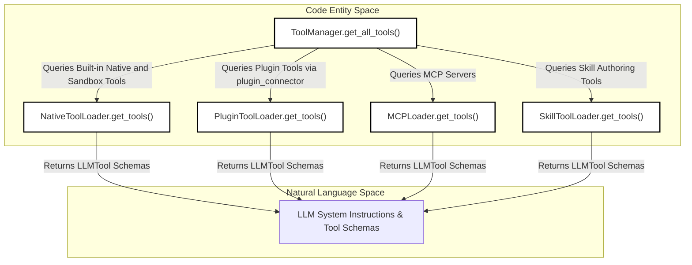
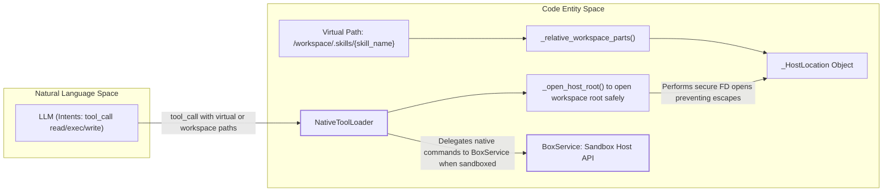

<!-- source: DeepWiki mcp.deepwiki.com · repo langbot-app/LangBot · page 6.2 Tool Calling and Function Execution · fetched 2026-10-29 -->

# Tool Calling and Function Execution

<details>
<summary>Relevant source files</summary>

The following files were used as context for generating this wiki page:

- [docs/review/box-architecture.md](docs/review/box-architecture.md)
- [src/langbot/pkg/agent/runner/context_reset.py](src/langbot/pkg/agent/runner/context_reset.py)
- [src/langbot/pkg/agent/runner/orchestrator.py](src/langbot/pkg/agent/runner/orchestrator.py)
- [src/langbot/pkg/agent/runner/platform_tools.py](src/langbot/pkg/agent/runner/platform_tools.py)
- [src/langbot/pkg/agent/runner/resource_builder.py](src/langbot/pkg/agent/runner/resource_builder.py)
- [src/langbot/pkg/pipeline/pipelinemgr.py](src/langbot/pkg/pipeline/pipelinemgr.py)
- [src/langbot/pkg/platform/adapters/discord/adapter.py](src/langbot/pkg/platform/adapters/discord/adapter.py)
- [src/langbot/pkg/platform/adapters/discord/event_converter.py](src/langbot/pkg/platform/adapters/discord/event_converter.py)
- [src/langbot/pkg/plugin/connector.py](src/langbot/pkg/plugin/connector.py)
- [src/langbot/pkg/provider/tools/loaders/native.py](src/langbot/pkg/provider/tools/loaders/native.py)
- [src/langbot/pkg/provider/tools/loaders/skill.py](src/langbot/pkg/provider/tools/loaders/skill.py)
- [src/langbot/pkg/provider/tools/loaders/skill_authoring.py](src/langbot/pkg/provider/tools/loaders/skill_authoring.py)
- [src/langbot/pkg/provider/tools/toolmgr.py](src/langbot/pkg/provider/tools/toolmgr.py)
- [src/langbot/pkg/skill/repository.py](src/langbot/pkg/skill/repository.py)
- [src/langbot/pkg/workspace/repository.py](src/langbot/pkg/workspace/repository.py)
- [src/langbot/pkg/workspace/service.py](src/langbot/pkg/workspace/service.py)
- [tests/integration_tests/box/test_cloud_box_admission_integration.py](tests/integration_tests/box/test_cloud_box_admission_integration.py)
- [tests/unit_tests/agent/test_platform_tools.py](tests/unit_tests/agent/test_platform_tools.py)
- [tests/unit_tests/agent/test_resource_builder.py](tests/unit_tests/agent/test_resource_builder.py)
- [tests/unit_tests/pipeline/test_pipelinemgr.py](tests/unit_tests/pipeline/test_pipelinemgr.py)
- [tests/unit_tests/platform/test_botmgr_execution_trace.py](tests/unit_tests/platform/test_botmgr_execution_trace.py)
- [tests/unit_tests/platform/test_discord_eba_adapter.py](tests/unit_tests/platform/test_discord_eba_adapter.py)
- [tests/unit_tests/plugin/test_connector_methods.py](tests/unit_tests/plugin/test_connector_methods.py)
- [tests/unit_tests/plugin/test_connector_reconcile.py](tests/unit_tests/plugin/test_connector_reconcile.py)
- [tests/unit_tests/provider/test_skill_tools.py](tests/unit_tests/provider/test_skill_tools.py)
- [tests/unit_tests/provider/test_tool_manager_native.py](tests/unit_tests/provider/test_tool_manager_native.py)
- [tests/unit_tests/test_skill_repository.py](tests/unit_tests/test_skill_repository.py)
- [tests/unit_tests/workspace/test_workspace_service.py](tests/unit_tests/workspace/test_workspace_service.py)

</details>


This page documents LangBot's comprehensive tool calling and function execution subsystem, enabling LLMs to invoke external functions (tools) as part of agentic workflows. When an LLM requires capabilities or data beyond its inherent knowledge, it uses tool calls; LangBot intercepts these, routes execution to appropriate implementations (native, plugin, skill, MCP), and returns the result for continued reasoning.

---

## 1. Tool Loading and Discovery

The core orchestrator for tool management is the `ToolManager`, which aggregates tools from multiple loaders, each corresponding to a tool source type [src/langbot/pkg/provider/tools/toolmgr.py:42-46]().

### Tool Sources and Loaders

LangBot supports these main tool sources, each with a dedicated loader implementing the `ToolLoader` abstract interface [src/langbot/pkg/provider/tools/loader.py:31-69]():

- **Native Tools**: These are built-in host functionality tools implemented in LangBot's native runtime, such as file operations (`read`, `write`, `edit`, `glob`, `grep`) and command execution (`exec`). Managed by `NativeToolLoader` [src/langbot/pkg/provider/tools/loaders/native.py:29-36]().

- **Plugin Tools**: Extensions supplied by installed plugins, accessed through LangBot's plugin runtime connector. Managed by `PluginToolLoader`, which retrieves tool metadata and calls through plugin APIs [src/langbot/pkg/provider/tools/toolmgr.py:43-43]().

- **MCP Tools**: Tools exposed through Model Context Protocol (MCP) servers. MCP servers may run remotely and provide functions accessible via LangBot's MCP client loader `MCPLoader`. These can be accessed through multiple transport layers such as `stdio`, HTTP streaming, or SSE [src/langbot/pkg/provider/tools/toolmgr.py:44-44]().

- **Skill Authoring Tools**: Special tools for skill activation and registration aligned with Claude Code's skill design, including `activate` to enable a skill context and `register_skill` to add skills to user storage. Managed by `SkillToolLoader` [src/langbot/pkg/provider/tools/loaders/skill_authoring.py:16-20]().

### Tool Discovery Workflow

The `ToolManager.get_all_tools()` asynchronously invokes `get_tools()` on each loader, respecting workspace entitlements for exposure of potentially sensitive tools (e.g., sandbox or skill-authoring tools) [src/langbot/pkg/provider/tools/toolmgr.py:111-136](). Sandbox tools are only included if the workspace has the corresponding sanctioned capability (checked via `BoxService.is_workspace_sandbox_available`) [src/langbot/pkg/provider/tools/toolmgr.py:66-79]().

#### Tool Discovery and Natural Language Mapping



*Diagram 1: Mapping tool definitions from system code entities to LLM prompt schemas.*

Sources:  
[src/langbot/pkg/provider/tools/toolmgr.py:42-46](),  
[src/langbot/pkg/provider/tools/toolmgr.py:66-79](),  
[src/langbot/pkg/provider/tools/toolmgr.py:111-136](),  
[src/langbot/pkg/provider/tools/loader.py:31-69](),  
[src/langbot/pkg/provider/tools/loaders/native.py:29-36](),  
[src/langbot/pkg/provider/tools/toolmgr.py:43-43](),  
[src/langbot/pkg/provider/tools/toolmgr.py:44-44](),  
[src/langbot/pkg/provider/tools/loaders/skill_authoring.py:16-20]()

---

## 2. Platform Tools and Host Tools

LangBot differentiates **platform tools**, which interact with the IM platform or event context, from host tools (native/sandbox) and plugin/MCP tools. These platform-level tools are only usable with explicit permissions and provide safe, controlled access to platform-side operations [src/langbot/pkg/agent/runner/platform_tools.py:1-16]().

### Platform Tool Overview

Platform tools encapsulate common event-level actions like replying, deleting messages, fetching actors, and moderation operations. These tools are declared centrally as `PlatformToolDefinition` objects and bundled during agent resource building [src/langbot/pkg/agent/runner/platform_tools.py:21-32]().

Their invocation is restricted by the execution environment and validation checks enforced during resource build and at runtime [src/langbot/pkg/agent/runner/platform_tools.py:1-16]().

Sources:  
[src/langbot/pkg/agent/runner/platform_tools.py:1-16](),  
[src/langbot/pkg/agent/runner/platform_tools.py:21-32]()

---

## 3. Tool Execution and Function Calling Flow

When an LLM response includes function calls, the agent runtime routes these calls to the `ToolManager`, which delegates invocation to the correct loader depending on tool origin [src/langbot/pkg/provider/tools/toolmgr.py:183-200]().

### Execution Sequence Flow

```mermaid
sequenceDiagram
    participant LLM as "LLM Provider"
    participant Runner as "LocalAgentRunner"
    participant ToolMgr as "ToolManager"
    participant Loader as "ToolLoader (Native/Plugin/MCP/Skill)"
    participant Box as "BoxService"

    LLM->>Runner: Response with tool_calls
    loop For each tool call
        Runner->>ToolMgr: execute_func_call(name, params, query)
        ToolMgr->>Loader: invoke_tool(name, params, query)
        alt Native / Skill / Sandbox Tool
            Loader->>Box: require_workspace_sandbox(context)
            Box-->>Loader: Sandbox Ready
        else Plugin Tool
            Loader->>PluginConnector: call_tool(name, params, ...)
        else MCP Tool
            Loader->>MCPServerClient: call_tool(name, params, ...)
        end
        Loader-->>ToolMgr: Tool Execution Result
        ToolMgr-->>Runner: Result Object
        Runner->>Runner: Add Tool Result Message to Transcript
    end
    Runner->>LLM: Continue Processing with Tool Results
```

*Diagram 2: Agent loop invocation flow for function calls and sandbox routing.*

### Tool Invocation Details

- **Native/Sandbox Tools**: Confirm sandbox availability before execution to prevent accidental unsafe host operations [src/langbot/pkg/provider/tools/toolmgr.py:66-79]().
- **Plugin Tools**: Calls proceed via the plugin connector protocol, with error handling and logging [src/langbot/pkg/plugin/connector.py:2000-2009]().
- **Skill Tools**: `activate` and `register_skill` tools implement skill lifecycle in sandboxed environments, returning skill markdown content or registration results [src/langbot/pkg/provider/tools/loaders/skill_authoring.py:96-113]().
- **MCP Tools**: Invoked through the MCP client infrastructure supporting multiple transport protocols.

Each tool call typically returns a JSON-compatible result or a tool message injected into the LLM context for downstream consumption.

Sources:  
[src/langbot/pkg/provider/tools/toolmgr.py:66-79](),  
[src/langbot/pkg/provider/tools/toolmgr.py:183-200](),  
[src/langbot/pkg/plugin/connector.py:2000-2009](),  
[src/langbot/pkg/provider/tools/loaders/skill_authoring.py:96-113]()

---

## 4. MCP Protocol Integration and Tool Exposure

Model Context Protocol (MCP) servers allow LangBot to consume externally hosted tools securely. The `MCPLoader` handles the MCP server integration, discovering tools and resources provided by MCP servers registered with LangBot [src/langbot/pkg/provider/tools/toolmgr.py:44-44]().

### Key MCP Considerations

- **Box Sandbox Execution**: For `stdio` MCP servers, LangBot can coordinate execution inside a Box-managed sandbox. This isolates arbitrary MCP code execution from the host system, enhances security, and supports resource isolation.
- **Resource and Tool Catalog**: MCP tools include those declared explicitly by the server plus resource-proxy tools (e.g., file read access). The loader retrieves MCP tool catalogs and merges them into the global tool registry.
- **Invocation Protocol**: MCP tool calls proxy through the MCP connection, which abstracts several transport protocols (stdio pipes, SSE, HTTP stream, OAuth).

This MCP tooling integration extends LangBot's tool invocation surface while maintaining tenant scoping and secure execution guarantees.

Sources:  
[src/langbot/pkg/provider/tools/toolmgr.py:44-44]()

---

## 5. Native Tool File Path Resolution and Virtual Skill Mounts

Native tools like `read`, `write`, `edit`, `glob`, and `grep` operate with strict filesystem boundary checks to constrain operations within the workspace. With Skill activation, skills are virtually mounted into the workspace at `/workspace/.skills/{skill-name}`, enabling native tools to access skill files in an isolated namespace [src/langbot/pkg/provider/tools/loaders/native.py:72-180](), [src/langbot/pkg/provider/tools/loaders/skill.py:1-200]().

### Path Resolution Details

- Functions `_relative_workspace_parts` [src/langbot/pkg/provider/tools/loaders/native.py:87-97]() and `_open_host_root` [src/langbot/pkg/provider/tools/loaders/native.py:140-179]() resolve and safely open directories within the workspace, preventing symlink escapes or access outside sandbox boundaries.
- The `_HostLocation` dataclass [src/langbot/pkg/provider/tools/loaders/native.py:72-78]() represents resolved host filesystem paths with relative parts and optional workspace anchor to enforce these constraints.
- Native tools open file descriptors for operations with strict `O_NOFOLLOW` and `O_DIRECTORY` flags to avoid accidental symlink or path attacks [src/langbot/pkg/provider/tools/loaders/native.py:58-61]().
  
### Virtual Skill Mounts

Skill packages activated via `activate` are mounted virtually under `/workspace/.skills/{skill-name}`. Native tools receive these virtual paths and translate operations accordingly, enabling secure file navigation and manipulation inside the skill context [src/langbot/pkg/provider/tools/loaders/skill.py:1-200]().

#### Sandbox to Host Path Mapping and Tool Routing



*Diagram 3: Bridging natural language tool calls to secure code entity file path resolution.*

Sources:  
[src/langbot/pkg/provider/tools/loaders/native.py:58-61](),  
[src/langbot/pkg/provider/tools/loaders/native.py:72-180](),  
[src/langbot/pkg/provider/tools/loaders/native.py:72-78](),  
[src/langbot/pkg/provider/tools/loaders/native.py:87-97](),  
[src/langbot/pkg/provider/tools/loaders/native.py:140-179](),  
[src/langbot/pkg/provider/tools/loaders/skill.py:1-200]()

---

## 6. Agent Resource Builder and Run Context

LangBot agents run with resource scoping that includes authorized tools. The `AgentResourceBuilder` compiles tools, platform tools, models, knowledge bases, skills, and storage permissions into resource descriptors from the runner descriptor and binding policies [src/langbot/pkg/agent/runner/resource_builder.py:95-106]().

- It filters tools based on manifest permissions (`detail`, `call`), intersection with binding policies for allowed names and sources [src/langbot/pkg/agent/runner/resource_builder.py:95-106]().
- The builder adds **platform tools** for authorized runs if the runner requires host tool usage [src/langbot/pkg/agent/runner/resource_builder.py:95-106]().
- It merges resolved plugin and MCP tools as well as skill tools visible in the context.
- Models are resolved from the runner config, viewer manifest permissions, and declared authorized model UUIDs [src/langbot/pkg/agent/runner/resource_builder.py:123-181]().

This resource summary governs what tools are exposed at runtime and what operations they may perform. The runtime enforces these constraints during tool calls.

Sources:  
[src/langbot/pkg/agent/runner/resource_builder.py:95-106](),  
[src/langbot/pkg/agent/runner/resource_builder.py:123-181]()

---

# Summary

LangBot's tool calling system is architected as a layered integration of multiple tool loaders—native, skill, plugin, and MCP—all orchestrated by a unified `ToolManager`. Tools are discovered dynamically, scoped by workspace and tenant entitlements, and exposed as schemas to LLMs to enable precise function call generation. Runtime tool execution routes calls through the trusted loader boundaries, integrating sandbox isolation via `BoxService` and platform tools under guarded permissions. The system ensures security, extensibility, and comprehensive capability coverage within LangBot's multi-platform agent framework.

---

